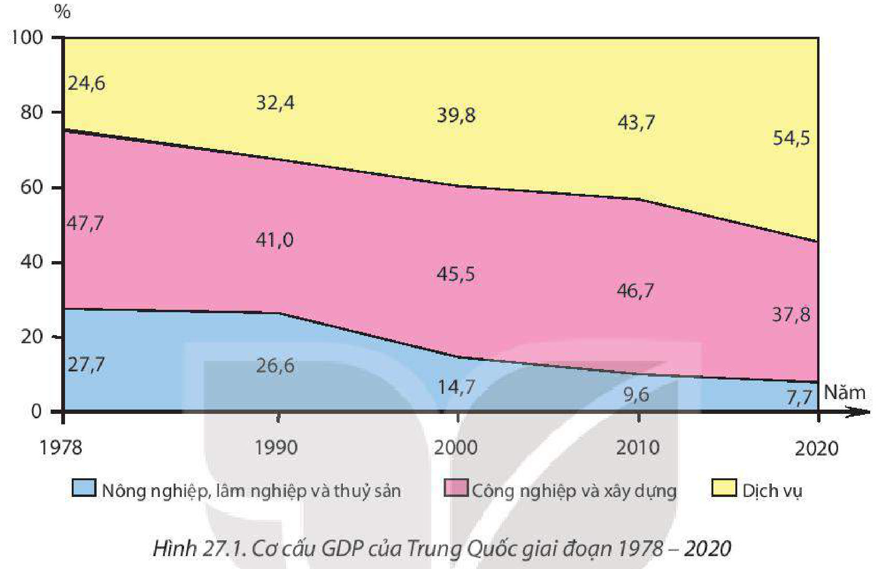
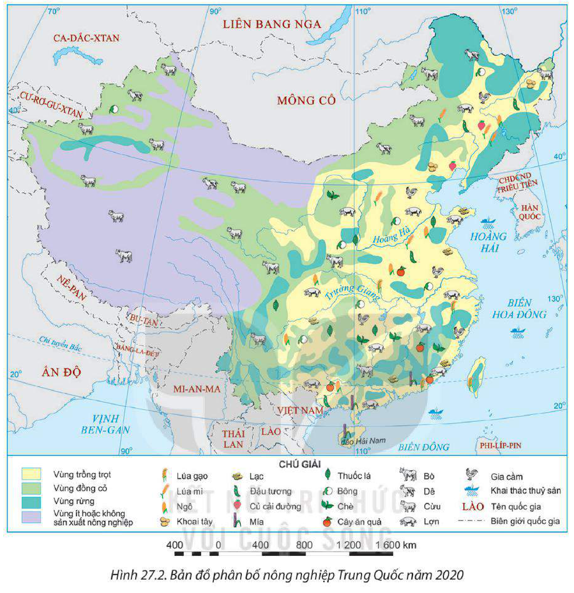
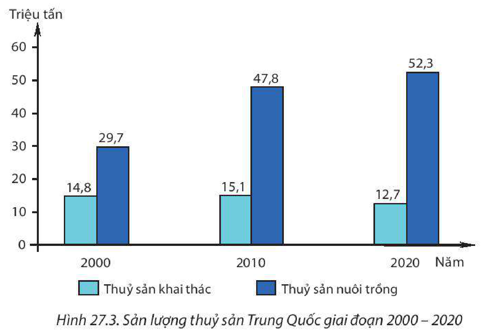
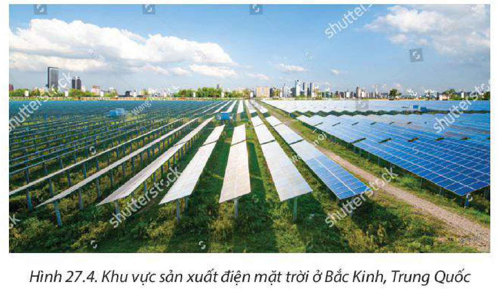
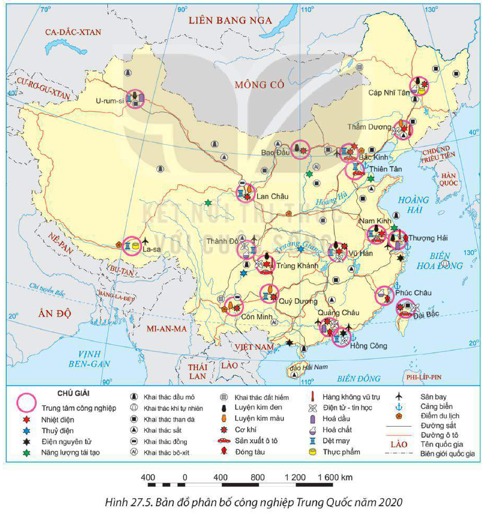
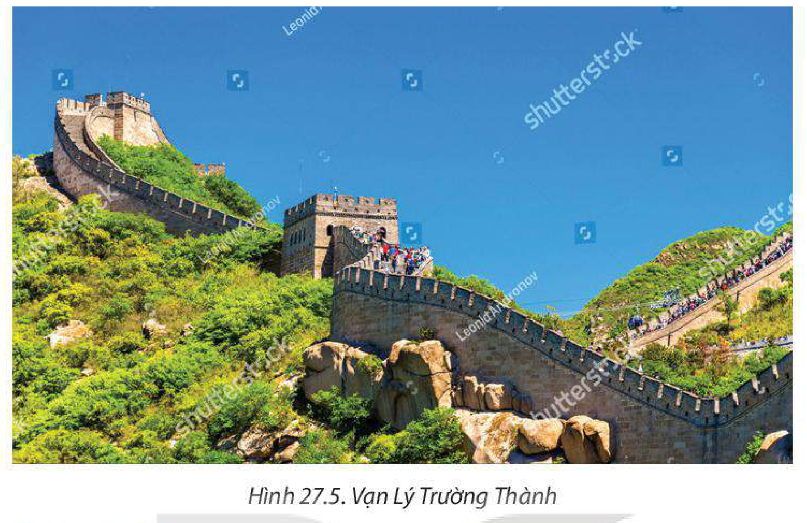

<!-- pdf:141 -->

# BÀI 27: KINH TẾ TRUNG QUỐC

## 🔴 Mở đầu

Sau hơn 40 năm cải cách, mở cửa, nền kinh tế Trung Quốc đã đạt được nhiều thành tựu. Trung Quốc có vai trò ngày càng quan trọng đối với nền kinh tế thế giới. Vị thế của nền kinh tế Trung Quốc trên thế giới hiện nay như thế nào? Các ngành kinh tế phát triển ra sao? Nguyên nhân nào tạo nên những thành tựu của nền kinh tế Trung Quốc?

## I. ĐẶC ĐIỂM CHUNG

### 1. Thành tựu và vị thế của nền kinh tế Trung Quốc

<!-- term: Thành tựu và vị thế kinh tế Trung Quốc -->
Năm 1978, Trung Quốc thực hiện cải cách từ nền kinh tế kế hoạch hoá tập trung sang nền kinh tế theo định hướng thị trường và đã đạt được nhiều thành tựu. Những thành tựu về kinh tế đã đưa Trung Quốc trở thành quốc gia có vị thế quan trọng đối với nền kinh tế thế giới.

Trung Quốc là nền kinh tế có quy mô lớn thứ hai thế giới, đóng góp lớn cho tăng trưởng kinh tế toàn cầu. Theo Ngân hàng Thế giới, mức đóng góp trung bình hằng năm của Trung Quốc vào tăng trưởng kinh tế thế giới là hơn 30%. Xuất nhập khẩu, đầu tư nước ngoài của Trung Quốc có tác động ngày càng lớn và là động lực thúc đẩy sự tăng trưởng kinh tế toàn cầu.

– Quy mô GDP tăng nhanh liên tục, đến năm 2010, Trung Quốc chính thức vượt qua Nhật Bản để trở thành nền kinh tế có quy mô GDP lớn thứ hai thế giới (sau Hoa Kỳ). Năm 2020, GDP của Trung Quốc chiếm 17,3% toàn thế giới.

**BẢNG 27.1. QUY MÔ GDP THEO GIÁ HIỆN HÀNH VÀ TỐC ĐỘ TĂNG GDP CỦA TRUNG QUỐC, HOA KỲ VÀ NHẬT BẢN GIAI ĐOẠN 1978 – 2020**

| Chỉ tiêu | Quốc gia | 1978 | 2000 | 2010 | 2019 | 2020 |
| --- | --- | --- | --- | --- | --- | --- |
| GDP *(tỉ USD)* | Trung Quốc | 149,5 | 1 211,3 | 6 087,2 | 14 280,0 | 14 687,7 |
| GDP *(tỉ USD)* | Hoa Kỳ | 2 351,6 | 10 250,9 | 15 049,0 | 21 372,6 | 20 893,7 |
| GDP *(tỉ USD)* | Nhật Bản | 1 013,6 | 4 968,4 | 5 759,1 | 5 123,3 | 5 040,1 |
| Tốc độ tăng GDP *(%)* | Trung Quốc | 11,3 | 8,5 | 10,6 | 6,0 | 2,2 |
| Tốc độ tăng GDP *(%)* | Hoa Kỳ | 5,5 | 4,1 | 2,7 | 2,3 | –3,4 |
| Tốc độ tăng GDP *(%)* | Nhật Bản | 5,3 | 2,8 | 4,1 | 0,3 | –4,6 |
<!-- ocr-ok: đối chiếu trực tiếp ảnh trang PDF 141 (Bảng 27.1), OCR đọc nhầm dấu phẩy thập phân và khoảng cách hàng nghìn -->

*(Nguồn: Ngân hàng Thế giới, 2022)*

<!-- pdf:142 -->

– Tốc độ tăng GDP tuy có biến động qua các năm song luôn ở mức cao.

<!-- term: Cơ cấu GDP của Trung Quốc -->
– Nền kinh tế có những thay đổi về cơ cấu GDP theo hướng công nghiệp hoá, hiện đại hoá: tỉ trọng của các ngành công nghiệp và xây dựng, dịch vụ tăng; giảm tỉ trọng của ngành nông nghiệp, lâm nghiệp và thuỷ sản.

*Hình 27.1. Cơ cấu GDP của Trung Quốc giai đoạn 1978 – 2020*
*(Nguồn: Ngân hàng Thế giới, 2022)*

– Tổng kim ngạch xuất nhập khẩu tăng nhanh là động lực cho tăng trưởng kinh tế. Trung Quốc luôn là nước xuất siêu. Năm 2020, tổng trị giá xuất nhập khẩu hàng hoá và dịch vụ của Trung Quốc là 5 080,4 tỉ USD, đứng đầu thế giới. Từ năm 2017 đến năm 2021, Trung Quốc duy trì vị trí là quốc gia thương mại hàng đầu thế giới.

– Trung Quốc là một trong những nước nhận được vốn đầu tư trực tiếp nước ngoài (FDI) lớn, năm 2020 là 163 tỉ USD (đứng đầu thế giới).

### 2. Nguyên nhân

<!-- term: Nguyên nhân phát triển kinh tế Trung Quốc -->
Thành tựu kinh tế Trung Quốc đạt được là do:

<!-- term: Nguyên nhân phát triển kinh tế Trung Quốc -->
– Trung Quốc có nguồn lực tự nhiên đa dạng, phong phú là tiền đề để phát triển kinh tế; nguồn lao động dồi dào, trình độ của người lao động ngày càng được nâng cao là nhân tố quyết định đến việc tiếp nhận công nghệ mới từ nước ngoài, nhờ đó năng suất lao động cao hơn và tác động tới tăng trưởng của nền kinh tế. Trung Quốc đã chú trọng phát triển nguồn nhân lực chất lượng cao trong nước, và thực hiện các chính sách thu hút nguồn nhân lực chất lượng cao từ nước ngoài.

<!-- term: Nguyên nhân phát triển kinh tế Trung Quốc -->
– Cơ sở hạ tầng phát triển, thị trường rộng lớn và năng động tạo động lực mạnh mẽ cho tăng trưởng kinh tế.

<!-- pdf:143 -->

– Nhà nước có các chính sách, chiến lược phát triển kinh tế – xã hội năng động, điều chỉnh phương thức phát triển kịp thời qua các giai đoạn khác nhau. Sự thay đổi trong chính sách phát triển kinh tế, nhất là việc mở cửa thu hút đầu tư trực tiếp nước ngoài (FDI) từ sau năm 1978 là chính sách quan trọng nhất; Trung Quốc đã thành lập các đặc khu kinh tế để thu hút FDI.

– Trung Quốc rất chú trọng ứng dụng khoa học – công nghệ, chuyển đổi cơ cấu sản xuất.

> ❓ Dựa vào nội dung mục I, hãy:
> – Trình bày những thành tựu nổi bật của nền kinh tế Trung Quốc.
> – Cho biết vị thế của nền kinh tế Trung Quốc trên thế giới.
> – Phân tích nguyên nhân phát triển của nền kinh tế Trung Quốc.

## II. CÁC NGÀNH KINH TẾ

### 1. Nông nghiệp, lâm nghiệp và thuỷ sản

Trung Quốc chú trọng phát triển nông nghiệp nhằm đáp ứng nhu cầu của hơn 1,4 tỉ dân trong nước và hướng ra xuất khẩu. Sản phẩm nông nghiệp cung cấp nguyên liệu có giá trị cho các ngành công nghiệp chế biến đã góp phần tăng nguồn thu ngoại tệ cho Trung Quốc. Năm 2020, ngành nông nghiệp, lâm nghiệp và thuỷ sản đóng góp 7,7% GDP, giải quyết việc làm cho khoảng 22% lực lượng lao động của đất nước.

**a) Nông nghiệp**

<!-- term: Nông nghiệp Trung Quốc -->
Trồng trọt là ngành chủ yếu trong nông nghiệp Trung Quốc, chiếm hơn 60% giá trị sản xuất nông nghiệp. Trong cơ cấu ngành trồng trọt, cây lương thực giữ vị trí quan trọng. Ngoài ra, Trung Quốc còn trồng nhiều loại cây công nghiệp như: đậu tương, bông, lạc, củ cải đường, mía, chè,... cây thực phẩm và cây ăn quả. Ngành trồng trọt phát triển mạnh ở các đồng bằng (Đông Bắc, Hoa Bắc, Hoa Trung, Hoa Nam).

Ngành chăn nuôi cũng được quan tâm phát triển. Lợn, bò và gia cầm được nuôi nhiều ở các vùng đồng bằng; cừu, dê được chăn thả ở các tỉnh thuộc vùng Đông Bắc, Hoa Bắc và ở các khu tự trị phía Tây.

**BẢNG 27.2. MỘT SỐ SẢN PHẨM NÔNG NGHIỆP CỦA TRUNG QUỐC GIAI ĐOẠN 2000 – 2020**

*(Đơn vị: triệu tấn)*

| Sản phẩm \ Năm | 2000 | 2010 | 2020 |
| --- | --- | --- | --- |
| Lương thực | 407,3 | 498,0 | 617,5 |
| Bông | 4,4 | 6,0 | 4,9 |
| Mía | 71,3 | 111,5 | 108,7 |
| Chè | 0,7 | 1,5 | 3,0 |
| Thịt lợn | 40,7 | 51,7 | 42,1 |
| Thịt bò | 4,6 | 5,7 | 6,0 |

*(Nguồn: Tổ chức Lương thực và Nông nghiệp Liên hợp quốc, 2022)*

<!-- pdf:144 -->

*Hình 27.2. Bản đồ phân bố nông nghiệp Trung Quốc năm 2020*

**b) Lâm nghiệp**

<!-- term: Lâm nghiệp Trung Quốc -->
Sản lượng gỗ tròn khai thác đạt 350,6 triệu m³ năm 2020 (đứng thứ ba thế giới, sau Hoa Kỳ và Ấn Độ). Hiện nay, Trung Quốc đang hướng tới bảo vệ rừng, kiểm soát chặt chẽ việc khai thác rừng tự nhiên và giới hạn sản lượng khai thác hằng năm. Trung Quốc đang nỗ lực trồng rừng để tăng tỉ lệ che phủ rừng.

**c) Thuỷ sản**

<!-- term: Thuỷ sản Trung Quốc -->
Trung Quốc là nước có ngành thuỷ sản lâu đời và rất phát triển. Sản lượng thuỷ sản khai thác và nuôi trồng đứng đầu thế giới. Các ngư trường khai thác quan trọng nằm ở biển Hoa Đông, Hoa Nam,... Nuôi trồng thuỷ sản tăng trưởng nhanh, các sản phẩm chủ yếu là cá, tôm, trai lấy ngọc, rong biển,...

<!-- pdf:145 -->

*Hình 27.3. Sản lượng thuỷ sản Trung Quốc giai đoạn 2000 – 2020*
*(Nguồn: Tổ chức Lương thực và Nông nghiệp Liên hợp quốc, 2022)*

> ❓ Dựa vào nội dung mục 1, hãy:
> – Nêu vùng sản xuất chủ yếu của một số sản phẩm nông nghiệp: lúa mì, lúa gạo, cây ăn quả, cừu, lợn.
> – Trình bày sự phát triển của một trong ba ngành: nông nghiệp, lâm nghiệp, thuỷ sản của Trung Quốc.

### 2. Công nghiệp

<!-- term: Công nghiệp Trung Quốc -->
Nền công nghiệp Trung Quốc có quy mô lớn, cơ cấu đa dạng, nhiều sản phẩm có sản lượng đứng đầu thế giới. Năm 2020, giá trị sản xuất của ngành công nghiệp và xây dựng đóng góp 37,8% vào GDP cả nước. Công nghiệp của Trung Quốc đang chuyển dịch theo hướng hiện đại hoá, gia tăng các ngành có hàm lượng khoa học – công nghệ cao. Các ngành công nghiệp đóng vai trò quan trọng trong nền kinh tế Trung Quốc là công nghiệp chế tạo, năng lượng, luyện kim, điện tử – tin học,...

– Ngành công nghiệp chế tạo có tốc độ phát triển nhanh, đặc biệt là máy móc chính xác. Một số sản phẩm chế tạo tiêu biểu là máy nông nghiệp, ô tô, tàu biển, chi tiết máy của ngành hàng không – vũ trụ,... Công nghiệp chế tạo ô tô tăng nhanh, năm 2020 Trung Quốc sản xuất khoảng 30% lượng ô tô toàn thế giới (đứng đầu thế giới).

– Công nghiệp năng lượng là ngành cơ bản, được đầu tư phát triển nhằm cung cấp năng lượng cho nhu cầu của nền kinh tế. Trung Quốc là nước khai thác than lớn nhất, thường chiếm hơn 50% sản lượng than toàn thế giới. Trung Quốc là nước sản xuất và tiêu thụ điện lớn nhất thế giới, chiếm khoảng 29% sản lượng điện toàn thế giới. Trung Quốc đang từng bước đa dạng hoá nguồn cung cấp điện thông qua việc phát triển năng lượng tái tạo và năng lượng hạt nhân.

<!-- pdf:146 -->

*Hình 27.4. Khu vực sản xuất điện mặt trời ở Bắc Kinh, Trung Quốc*

*Hình 27.5. Bản đồ phân bố công nghiệp Trung Quốc năm 2020*

<!-- pdf:147 -->

– Công nghiệp luyện kim của Trung Quốc được coi trọng và đầu tư phát triển. Trung Quốc là quốc gia sản xuất thép nhiều nhất thế giới, sản xuất 56,5% sản lượng thép trên thế giới (năm 2020).

– Công nghiệp điện tử – tin học đang phát triển nhanh và trở thành ngành mũi nhọn của nền kinh tế Trung Quốc. Nhiều sản phẩm của ngành công nghiệp điện tử – tin học như: máy tính, thiết bị điện tử, điện tử tiêu dùng, thiết bị viễn thông có sản lượng hàng đầu thế giới.

Các trung tâm công nghiệp lớn nhất của Trung Quốc tập trung ở miền Đông, đặc biệt là vùng duyên hải. Các trung tâm công nghiệp lớn là Thượng Hải, Thâm Quyến, Bắc Kinh, Quảng Châu, Thiên Tân,...

**BẢNG 27.3. MỘT SỐ SẢN PHẨM CÔNG NGHIỆP CỦA TRUNG QUỐC GIAI ĐOẠN 2000 – 2020**

| Sản phẩm \ Năm | 2000 | 2010 | 2020 |
| --- | --- | --- | --- |
| Than đá *(triệu tấn)* | 1 384,2 | 3 428,4 | 3 902,0 |
| Điện *(tỉ kWh)* | 1 355,6 | 4 207,2 | 7 779,1 |
| Thép *(triệu tấn)* | 128,5 | 626,7 | 1 053,0 |
| Ô tô *(triệu chiếc)* | 2,1 | 13,9 | 20,0 |
| Điện thoại di động *(triệu chiếc)* | 85,2 | 859,0 | 1 720 |
<!-- ocr-ok: đối chiếu trực tiếp ảnh trang PDF 147 (Bảng 27.3), OCR bỏ sót hàng tiêu đề năm và đọc nhầm dấu phẩy thập phân -->

*(Nguồn: Cục thống kê Quốc gia Trung Quốc, 2022)*

> ❓ Dựa vào nội dung mục 2, hãy:
> – Trình bày khái quát tình hình phát triển của ngành công nghiệp ở Trung Quốc.
> – Nêu sự phân bố của các ngành công nghiệp luyện kim, điện tử – tin học và một số nhà máy thuỷ điện, nhiệt điện ở Trung Quốc.

### 3. Dịch vụ

<!-- term: Dịch vụ Trung Quốc -->
Trong quá trình chuyển sang nền kinh tế thị trường, ngành dịch vụ ngày càng có vai trò quan trọng với sự phát triển kinh tế của Trung Quốc. Năm 2020, ngành dịch vụ đóng góp 54,5% vào GDP của Trung Quốc. Các loại hình dịch vụ: thương mại, giao thông vận tải, du lịch, tài chính ngân hàng phát triển nhanh chóng để đáp ứng nhu cầu phát triển kinh tế, đồng thời phục vụ nhu cầu ngày càng tăng của người dân. Một số trung tâm dịch vụ lớn của Trung Quốc là Bắc Kinh, Thiên Tân, Thượng Hải, Thâm Quyến,...

**a) Thương mại**

<!-- term: Thương mại Trung Quốc -->
– Nội thương: Với quy mô dân số lớn, thị trường nội địa là động lực quan trọng cho nền kinh tế đất nước, tiêu thụ phần lớn các sản phẩm do nền kinh tế Trung Quốc tạo ra. Doanh thu bán lẻ và doanh thu từ cung ứng các dịch vụ tăng nhanh (khoảng 5 400 tỉ USD năm 2020). Các trung tâm thương mại lớn là Bắc Kinh, Thượng Hải, Thiên Tân, Hồng Công, Thâm Quyến,...

<!-- pdf:148 -->

– Ngoại thương: Kim ngạch ngoại thương của Trung Quốc có mức tăng hằng năm cao. Năm 2020, tổng trị giá xuất nhập khẩu hàng hoá và dịch vụ của Trung Quốc lớn nhất thế giới, chiếm 11,5% toàn thế giới (trong đó trị giá xuất khẩu chiếm 12,1%, trị giá nhập khẩu chiếm 10,1%). Trung Quốc có quan hệ buôn bán với hơn 200 nước và vùng lãnh thổ trên thế giới. Những đối tác thương mại quan trọng của Trung Quốc là Nhật Bản, Hoa Kỳ, EU, ASEAN, Hàn Quốc,... Trung Quốc thường là nước xuất siêu.

**BẢNG 27.4. TRỊ GIÁ XUẤT NHẬP KHẨU HÀNG HOÁ VÀ DỊCH VỤ CỦA TRUNG QUỐC GIAI ĐOẠN 1978 – 2020**

*(Đơn vị: tỉ USD)*

| Trị giá \ Năm | 1978 | 1990 | 2000 | 2010 | 2020 |
| --- | --- | --- | --- | --- | --- |
| Xuất khẩu | 6,8 | 44,9 | 253,1 | 1 602,5 | 2 723,3 |
| Nhập khẩu | 7,6 | 35,2 | 224,3 | 1 380,1 | 2 357,1 |
<!-- ocr-ok: đối chiếu trực tiếp ảnh trang PDF 148 (Bảng 27.4), OCR bỏ sót hàng tiêu đề năm và đọc sai số liệu -->

*(Nguồn: Ngân hàng Thế giới, 2022)*

**b) Giao thông vận tải**

<!-- term: Giao thông vận tải Trung Quốc -->
Trung Quốc đã xây dựng được một mạng lưới giao thông hiện đại, các loại hình giao thông đều rất phát triển.

Đến năm 2020, Trung Quốc có hệ thống đường sắt dài hơn 130 nghìn km trong đó hơn 40 nghìn km đường sắt cao tốc có tốc độ tàu chạy trên 200 km/h. Đường ô tô có khoảng 5 triệu km, trong đó 150 nghìn km đường cao tốc (đứng đầu thế giới). Đường biển phát triển mạnh phục vụ việc xuất nhập khẩu với các cảng biển lớn như: Thượng Hải, Ninh Ba – Chu Sơn, Thâm Quyến,... Đường hàng không cũng rất phát triển, các sân bay có lượng hành khách và hàng hoá luân chuyển lớn nhất là Bắc Kinh, Phố Đông (Thượng Hải),... Hiện nay, Trung Quốc đang đầu tư mạnh vào hạ tầng giao thông khu vực miền Tây để mở rộng quy mô và hoàn thiện mạng lưới giao thông.

**c) Du lịch**

<!-- term: Du lịch Trung Quốc -->
Là một quốc gia có nền văn minh lâu đời, nhiều danh lam thắng cảnh, công trình kiến trúc nổi tiếng, cùng với sự phát triển vượt bậc về cơ sở hạ tầng du lịch, Trung Quốc là điểm đến hấp dẫn của nhiều khách du lịch. Năm 2019, Trung Quốc đứng thứ 4 trong 10 quốc gia trên thế giới có nhiều lượt khách du lịch quốc tế đến nhất và đứng thứ 11 về doanh thu du lịch quốc tế. Năm 2019, doanh thu của ngành du lịch đạt khoảng 1 000 tỉ USD. Các điểm du lịch nổi tiếng ở Trung Quốc là Vạn Lý Trường Thành, Tử Cấm Thành, Lăng mộ Tần Thuỷ Hoàng, bến Thượng Hải,...

<!-- pdf:149 -->

*Hình 27.5. Vạn Lý Trường Thành*

**d) Tài chính ngân hàng**

<!-- term: Tài chính ngân hàng Trung Quốc -->
Hoạt động của ngành tài chính ngân hàng ở Trung Quốc ngày càng phát triển. Doanh thu từ hoạt động tài chính liên tục tăng qua các năm, đạt 1 071 tỉ USD năm 2020. Nhiều ngân hàng nước ngoài đã thành lập công ty cổ phần hoặc 100% vốn nước ngoài để gia nhập thị trường vốn của Trung Quốc. Trung Quốc có nhiều trung tâm tài chính lớn như Thượng Hải, Thiên Tân, Thâm Quyến.

> ❓ Dựa vào nội dung mục 3, hãy trình bày sự phát triển của các ngành thương mại, giao thông vận tải, du lịch và tài chính ngân hàng ở Trung Quốc.

## ✏️ Luyện tập

**1.** Dựa vào bảng 27.1, vẽ biểu đồ thể hiện tốc độ tăng GDP của Trung Quốc giai đoạn 1978 – 2020. Nêu nhận xét.

**2.** Dựa vào bảng 27.4, hãy nhận xét sự thay đổi trị giá xuất nhập khẩu hàng hoá và dịch vụ của Trung Quốc giai đoạn 1978 – 2020.

## 🚀 Vận dụng

Tìm kiếm thông tin, viết báo cáo ngắn về một ngành kinh tế của Trung Quốc.

## 📷 Danh sách hình trong bài

| Mã hình | Trang PDF | Vị trí trong bài | Chú thích gốc |
| --- | --- | --- | --- |
| H11-dia-b27-01 | 142 | Mục I.1 | Hình 27.1. Cơ cấu GDP của Trung Quốc giai đoạn 1978 – 2020 |
| H11-dia-b27-02 | 144 | Mục II.1.a | Hình 27.2. Bản đồ phân bố nông nghiệp Trung Quốc năm 2020 |
| H11-dia-b27-03 | 145 | Mục II.1.c | Hình 27.3. Sản lượng thuỷ sản Trung Quốc giai đoạn 2000 – 2020 |
| H11-dia-b27-04 | 146 | Mục II.2 | Hình 27.4. Khu vực sản xuất điện mặt trời ở Bắc Kinh, Trung Quốc |
| H11-dia-b27-05 | 146 | Mục II.2 | Hình 27.5. Bản đồ phân bố công nghiệp Trung Quốc năm 2020 |
| H11-dia-b27-06 | 149 | Mục II.3.c | Hình 27.5. Vạn Lý Trường Thành |
