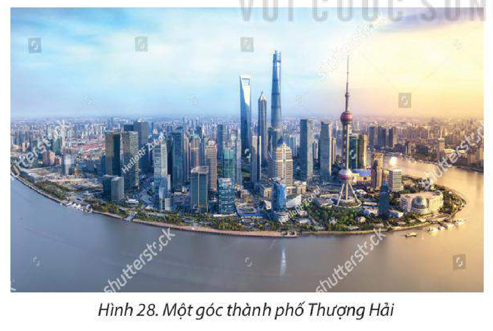

<!-- pdf:150 -->

# BÀI 28: THỰC HÀNH: VIẾT BÁO CÁO VỀ SỰ THAY ĐỔI CỦA KINH TẾ VÙNG DUYÊN HẢI TRUNG QUỐC

## 1. Nội dung

Viết báo cáo về sự phát triển kinh tế tại vùng duyên hải Trung Quốc.

## 2. Nguồn tư liệu

– Thông tin trên internet có nội dung liên quan đến kinh tế vùng duyên hải Trung Quốc.

– Sách, báo, tạp chí,... có nội dung liên quan.

## 3. Gợi ý cấu trúc báo cáo

> SỰ THAY ĐỔI CỦA NỀN KINH TẾ TẠI VÙNG DUYÊN HẢI TRUNG QUỐC
>
> **1. Giới thiệu vùng duyên hải**
>
> **2. Những thay đổi của vùng duyên hải**
>
> – Về GDP
>
> – Về trị giá xuất nhập khẩu
>
> – Về vai trò của vùng duyên hải

## 4. Thông tin tham khảo

<!-- term: Vùng duyên hải Trung Quốc -->
> Vùng duyên hải Trung Quốc bao gồm các tỉnh, thành phố giáp biển ở phía đông Trung Quốc là Liêu Ninh, Thiên Tân, Hà Bắc, Sơn Đông, Giang Tô, Thượng Hải, Chiết Giang, Phúc Kiến, Quảng Đông, Quảng Tây, Hải Nam. Đây là khu vực kinh tế phát triển, chiếm khoảng 55% GDP của Trung Quốc (năm 2021). Sự phát triển kinh tế của vùng duyên hải đóng góp phần quan trọng vào sự tăng trưởng của nền kinh tế Trung Quốc, đồng thời là động lực thúc đẩy sự phát triển kinh tế của vùng nội địa và miền Tây Trung Quốc.

<!-- pdf:151 -->

**BẢNG 28. GDP THEO GIÁ HIỆN HÀNH CỦA CÁC TỈNH, THÀNH PHỐ VÙNG DUYÊN HẢI TRUNG QUỐC NĂM 2011 VÀ NĂM 2021**

*(Đơn vị: tỉ USD)*

| STT | Tỉnh, thành phố | Năm 2011 | Năm 2021 |
| --- | --- | --- | --- |
| 1 | Liêu Ninh | 348 | 434 |
| 2 | Thiên Tân | 179 | 247 |
| 3 | Hà Bắc | 285 | 636 |
| 4 | Sơn Đông | 711 | 1 308 |
| 5 | Giang Tô | 759 | 1 832 |
| 6 | Thượng Hải | 288 | 680 |
| 7 | Chiết Giang | 506 | 1 157 |
| 8 | Phúc Kiến | 277 | 768 |
| 9 | Quảng Đông | 838 | 1 947 |
| 10 | Quảng Tây | 183 | 389 |
| 11 | Hải Nam | 36 | 102 |
| | Tổng số | 4 410 | 9 500 |

*(Nguồn: Cục Thống kê Quốc gia Trung Quốc, 2022)*

*Hình 28. Một góc thành phố Thượng Hải*

> 💡 EM CÓ BIẾT?
>
> Thượng Hải là nơi đặt trụ sở của khoảng 1 700 tổ chức tài chính. Hồng Công là một trong những trung tâm tài chính lớn nhất thế giới khi có tới 100 ngân hàng lớn trên thế giới đặt trụ sở/chi nhánh tại đây.

## 📷 Danh sách hình trong bài

| Mã hình | Trang PDF | Vị trí trong bài | Chú thích gốc |
| --- | --- | --- | --- |
| H11-dia-b28-01 | 151 | Mục 4 | Hình 28. Một góc thành phố Thượng Hải |
