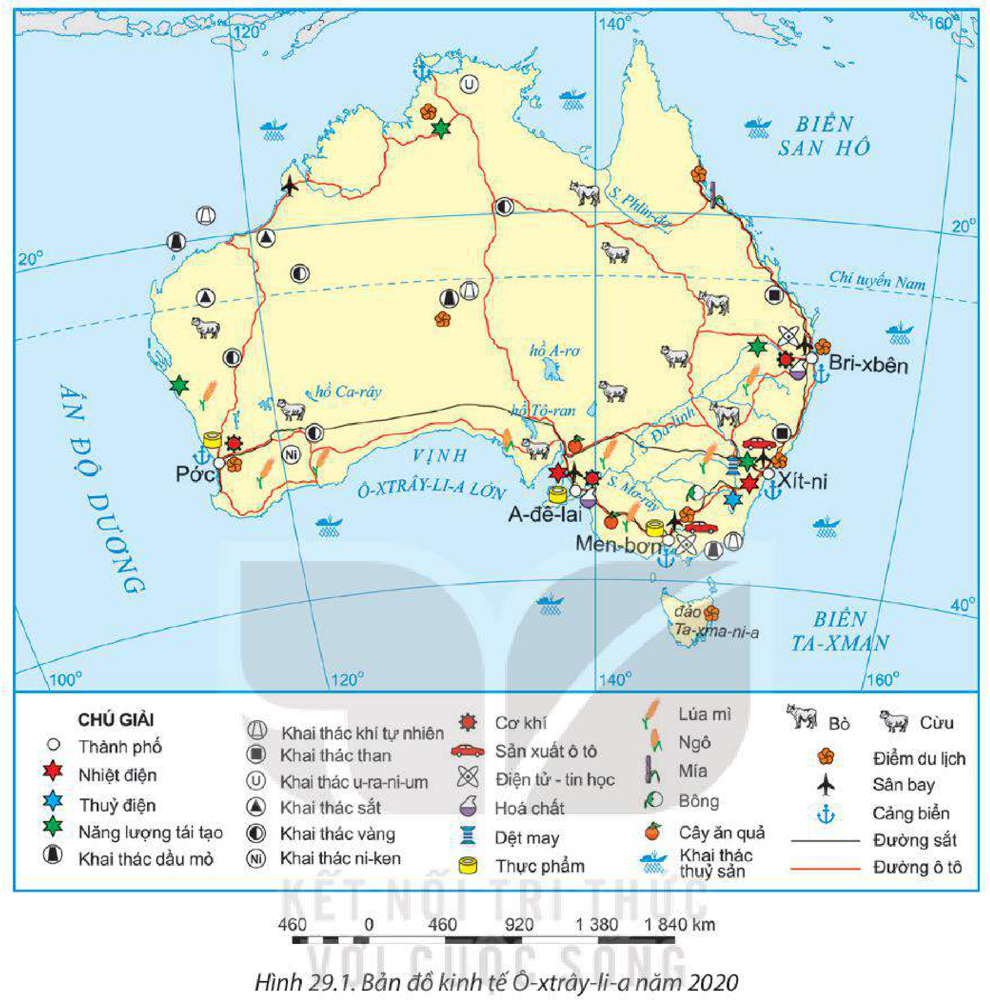
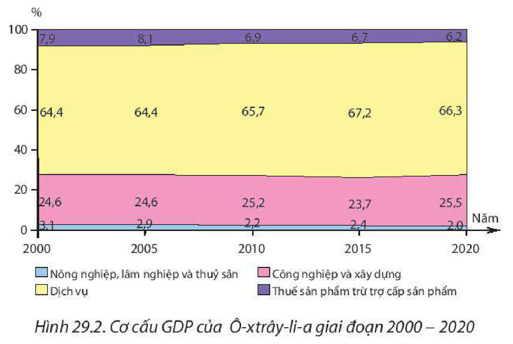

<!-- pdf:152 -->

# BÀI 29: THỰC HÀNH: TÌM HIỂU VỀ KINH TẾ CỦA Ô-XTRÂY-LI-A

> **Ô-XTRÂY-LI-A**
>
> Diện tích: khoảng 7,7 triệu km²
>
> Số dân: 25,8 triệu người (năm 2020)
>
> Thủ đô: Can-bê-ra

## 1. Nội dung

– Xác định sự phân bố kinh tế Ô-xtrây-li-a trên bản đồ.

– Viết báo cáo về tình hình phát triển kinh tế của Ô-xtrây-li-a.

## 2. Nguồn tư liệu

– Thông tin thu thập, chọn lọc từ internet về kinh tế của Ô-xtrây-li-a.

– Sách, báo, tạp chí,... có nội dung liên quan.

## 3. Gợi ý cấu trúc báo cáo

> TÌNH HÌNH PHÁT TRIỂN KINH TẾ Ô-XTRÂY-LI-A
>
> **1. Tình hình phát triển kinh tế chung**
>
> – Quy mô GDP
>
> – Tốc độ tăng GDP
>
> – Chuyển dịch cơ cấu kinh tế
>
> **2. Ngành kinh tế**
>
> Xác định sự phân bố một số ngành kinh tế của Ô-xtrây-li-a

## 4. Thông tin tham khảo

**BẢNG 29. QUY MÔ GDP THEO GIÁ HIỆN HÀNH VÀ TỐC ĐỘ TĂNG GDP CỦA Ô-XTRÂY-LI-A GIAI ĐOẠN 2000 – 2020**

| Chỉ tiêu \ Năm | 2000 | 2005 | 2010 | 2015 | 2020 |
| --- | --- | --- | --- | --- | --- |
| GDP *(tỉ USD)* | 415,6 | 695,1 | 1 147,0 | 1 350,5 | 1 327,8 |
| Tốc độ tăng GDP *(%)* | 3,9 | 3,2 | 2,2 | 2,2 | 0,0 |
<!-- ocr-ok: đối chiếu trực tiếp ảnh trang PDF 152 (Bảng 29), OCR đọc thiếu chữ số đầu của các năm và đọc sai số liệu hàng tốc độ tăng GDP -->

*(Nguồn: Ngân hàng Thế giới, 2022)*

<!-- pdf:153 -->

*Hình 29.1. Bản đồ kinh tế Ô-xtrây-li-a năm 2020*

*Hình 29.2. Cơ cấu GDP của Ô-xtrây-li-a giai đoạn 2000 – 2020*
*(Nguồn: Ngân hàng Thế giới, 2022)*

## 📷 Danh sách hình trong bài

| Mã hình | Trang PDF | Vị trí trong bài | Chú thích gốc |
| --- | --- | --- | --- |
| H11-dia-b29-01 | 153 | Mục 4 | Hình 29.1. Bản đồ kinh tế Ô-xtrây-li-a năm 2020 |
| H11-dia-b29-02 | 153 | Mục 4 | Hình 29.2. Cơ cấu GDP của Ô-xtrây-li-a giai đoạn 2000 – 2020 |
