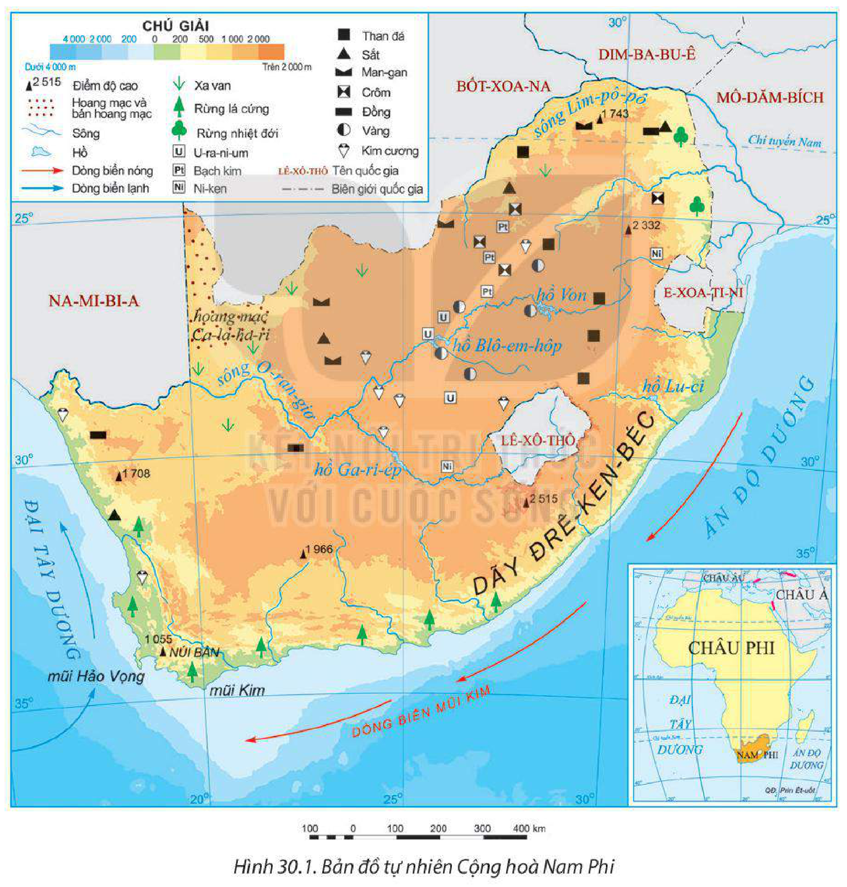
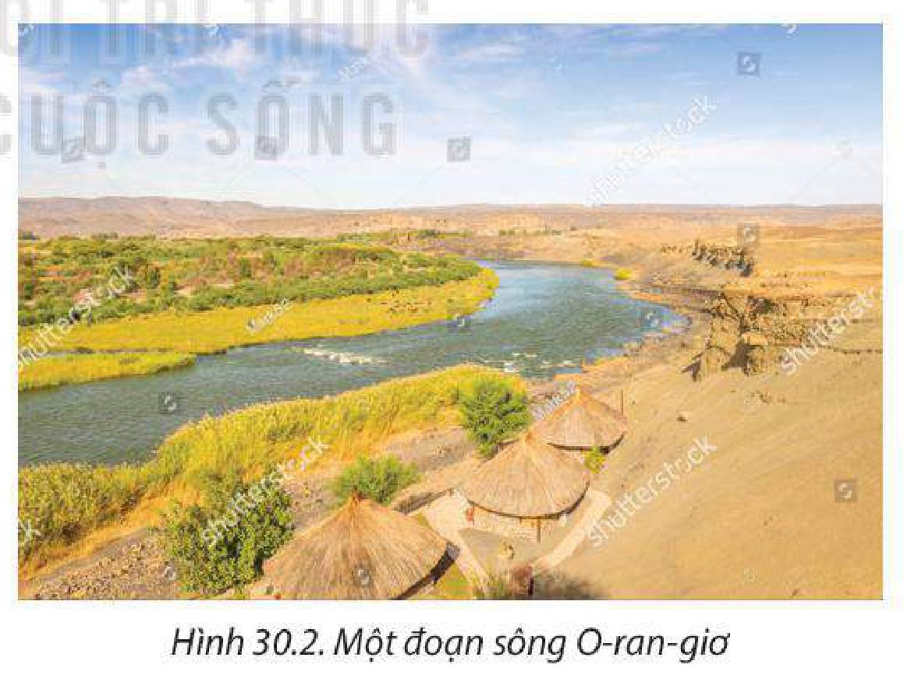
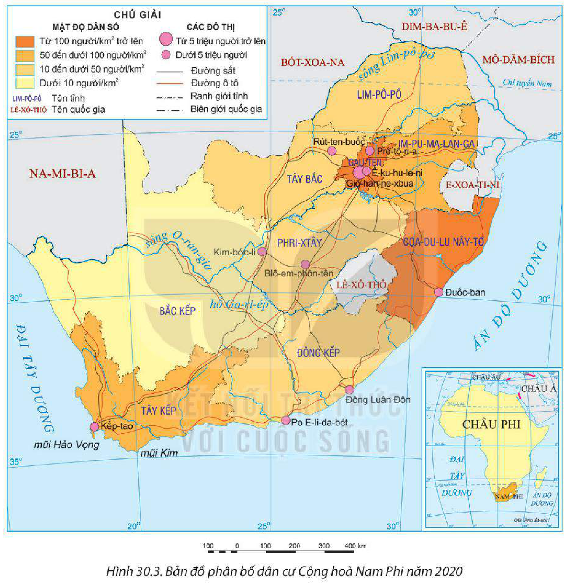

<!-- pdf:154 -->

# BÀI 30: VỊ TRÍ ĐỊA LÍ, ĐIỀU KIỆN TỰ NHIÊN, DÂN CƯ VÀ XÃ HỘI CỘNG HOÀ NAM PHI

> **CỘNG HOÀ NAM PHI**
>
> Diện tích: khoảng 1,2 triệu km²
>
> Số dân: 59,3 triệu người (năm 2020)
>
> Thủ đô: Prê-tô-ri-a, Kếp-tao, Blô-em-phôn-tên

## 🔴 Mở đầu

Cộng hoà Nam Phi có vị trí địa lí, điều kiện tự nhiên, dân cư và xã hội độc đáo. Các đặc điểm vị trí địa lí, điều kiện tự nhiên, dân cư và xã hội đã ảnh hưởng như thế nào đến sự phát triển của đất nước này?

## I. VỊ TRÍ ĐỊA LÍ

<!-- term: Vị trí địa lí Cộng hoà Nam Phi -->
– Cộng hoà Nam Phi nằm hoàn toàn ở bán cầu Nam, là vùng đất cuối cùng ở phía nam châu Phi; có chung biên giới với sáu quốc gia là Na-mi-bi-a, Bốt-xoa-na, Dim-ba-bu-ê, Mô-dăm-bích, E-xoa-ti-ni, Lê-xô-thô và tiếp giáp hai đại dương là Đại Tây Dương và Ấn Độ Dương. Lãnh thổ phần đất liền trải dài theo chiều vĩ tuyến từ khoảng vĩ độ 22°N đến gần vĩ độ 35°N và theo chiều kinh tuyến từ khoảng kinh độ 17°Đ đến kinh độ 33°Đ.

> 💡 EM CÓ BIẾT?
>
> Cộng hoà Nam Phi là quốc gia duy nhất trên thế giới có tới ba thủ đô là Prê-tô-ri-a, Kếp-tao và Blô-em-phôn-tên. Prê-tô-ri-a với vai trò là thủ đô hành chính, Kếp-tao là thủ đô lập pháp và Blô-em-phôn-tên là thủ đô tư pháp.
>
> Lê-xô-thô là nước nằm lọt hoàn toàn trong lãnh thổ Cộng hoà Nam Phi.

Cộng hoà Nam Phi án ngữ con đường biển quan trọng giữa Đại Tây Dương và Ấn Độ Dương.

– Vị trí địa lí của Cộng hoà Nam Phi tạo thuận lợi để phát triển kinh tế biển, giao lưu kinh tế – xã hội với các nước trên thế giới.

> ❓ Dựa vào thông tin mục I và hình 30.1, hãy:
> – Xác định vị trí địa lí của Cộng hoà Nam Phi.
> – Phân tích ảnh hưởng của vị trí địa lí đến phát triển kinh tế của Cộng hoà Nam Phi.

<!-- pdf:155 -->

## II. ĐIỀU KIỆN TỰ NHIÊN VÀ TÀI NGUYÊN THIÊN NHIÊN

### 1. Địa hình và đất

<!-- term: Địa hình và đất Cộng hoà Nam Phi -->
Phần lớn lãnh thổ Cộng hoà Nam Phi có địa hình cao nguyên với độ cao trung bình khoảng 2 000 m. Địa hình có thể chia thành ba khu vực chính:

– Khu vực nội địa có địa hình cao nguyên tương đối bằng phẳng với nhiều bậc địa hình. Đất ở khu vực này chủ yếu là đất xám hoang mạc và bán hoang mạc, đất xa van, khô cằn, ít dinh dưỡng, không thuận lợi cho trồng trọt, một phần nhỏ diện tích có thể phát triển đồng cỏ để chăn nuôi gia súc.

*Hình 30.1. Bản đồ tự nhiên Cộng hoà Nam Phi*

– Khu vực ven biển và thung lũng các sông có địa hình đồng bằng, đất màu mỡ thuận lợi cho sản xuất nông nghiệp và cư trú.

<!-- pdf:156 -->

– Dãy Đrê-ken-béc dài hơn 1 000 km, hình thành ranh giới ngăn cách giữa các cao nguyên rộng lớn trong nội địa với các đồng bằng và vùng thấp ven Ấn Độ Dương. Địa hình núi chia cắt gây khó khăn cho giao thông và kết nối thị trường trong nước.

### 2. Khí hậu

<!-- term: Khí hậu Cộng hoà Nam Phi -->
Cộng hoà Nam Phi nằm trong các đới khí hậu nhiệt đới và cận nhiệt, nhưng có sự phân hoá giữa phía bắc với phía nam, giữa ven biển phía tây và ven biển phía đông, giữa vùng ven biển với vùng nội địa.

– Vùng nội địa và duyên hải phía tây có khí hậu nhiệt đới lục địa khô hạn, lượng mưa ít, cảnh quan chủ yếu là hoang mạc, xa van, cây bụi chỉ phù hợp để phát triển chăn nuôi gia súc.

– Vùng duyên hải đông nam có khí hậu nhiệt đới ẩm, lượng mưa hằng năm khá cao, thuận lợi trồng các loại cây công nghiệp như mía, chè, cọ dầu và cây ăn quả (chuối, dứa,...).

– Vùng ven biển phía nam có khí hậu cận nhiệt địa trung hải, thuận lợi trồng các loại cây ăn quả cận nhiệt như nho, cam, chanh.

Khí hậu tạo điều kiện cho Cộng hoà Nam Phi có cơ cấu cây trồng, vật nuôi đa dạng, đặc biệt là các loại cây trồng nhiệt đới, cận nhiệt có giá trị xuất khẩu. Tuy nhiên, khí hậu Cộng hoà Nam Phi tương đối khô hạn, chỉ khoảng một phần ba diện tích lãnh thổ có đủ lượng mưa cho hoạt động trồng trọt. Vì vậy, Cộng hoà Nam Phi đã phải đầu tư xây dựng nhiều công trình thuỷ lợi nhằm cung cấp nước cho sản xuất và phục vụ sinh hoạt của người dân.

### 3. Sông, hồ

<!-- term: Sông, hồ Cộng hoà Nam Phi -->
Cộng hoà Nam Phi có nhiều sông nhưng sông thường ngắn, dốc. Các sông thường bắt nguồn từ vùng cao nguyên nội địa và dãy Đrê-ken-béc, chảy ra Ấn Độ Dương và Đại Tây Dương.

Sông O-ran-giơ và Lim-pô-pô là hai con sông lớn ở Cộng hoà Nam Phi. Sông ở Cộng hoà Nam Phi có nguồn cung cấp nước chủ yếu là nước mưa nên mùa lũ trùng mùa mưa. Một số sông có giá trị thuỷ điện và cung cấp nước cho công nghiệp khai thác khoáng sản, canh tác nông nghiệp, tuy nhiên ít có giá trị về giao thông.

*Hình 30.2. Một đoạn sông O-ran-giơ*

Nam Phi có ít hồ tự nhiên, chủ yếu là các hồ nhân tạo phục vụ mục đích tưới tiêu, thuỷ điện.

<!-- pdf:157 -->

### 4. Sinh vật

<!-- term: Sinh vật Cộng hoà Nam Phi -->
Xa van là hệ sinh thái điển hình ở Cộng hoà Nam Phi, chiếm 34,3% diện tích đất nước. Cộng hoà Nam Phi có hệ động vật rất phong phú, đa dạng, với nhiều loài đặc hữu như: sư tử, báo, voi, tê giác, hươu cao cổ, ngựa vằn, hà mã,... Đây là nơi cung cấp nguồn gen và các nguyên liệu có giá trị cho sản xuất và đời sống của người dân.

> 💡 EM CÓ BIẾT?
>
> Cộng hoà Nam Phi có rất nhiều quốc gia và khu bảo tồn thiên nhiên. Vườn quốc gia Kru-gơ và Vườn quốc gia Núi Bàn là các khu bảo tồn lớn nhất châu Phi, nơi sinh sống của hàng nghìn loài sinh vật đặc hữu như ngựa vằn, hươu cao cổ, các loài thực vật mọng nước,...

Sự đa dạng và độc đáo về tài nguyên sinh vật là một trong những đặc điểm hấp dẫn, thu hút khách du lịch tới Cộng hoà Nam Phi.

### 5. Khoáng sản

<!-- term: Khoáng sản Cộng hoà Nam Phi -->
Cộng hoà Nam Phi có tài nguyên khoáng sản phong phú, các loại khoáng sản có trữ lượng lớn là kim loại (đặc biệt kim loại quý), khoáng sản năng lượng,... tập trung ở vùng cao nguyên trong nội địa.

**BẢNG 30.1. TRỮ LƯỢNG MỘT SỐ LOẠI KHOÁNG SẢN Ở CỘNG HOÀ NAM PHI NĂM 2020**

| Tên khoáng sản | Trữ lượng | Tỉ trọng so với thế giới *(%)* |
| --- | --- | --- |
| Crôm *(tỉ tấn)* | 200 | 72 |
| Man-gan *(triệu tấn)* | 520 | 80 |
| PGMs (kim loại thuộc nhóm bạch kim) *(triệu tấn)* | 63 | 88 |
| Vàng *(nghìn tấn)* | 2,7 | 13 |
| Than *(tỉ tấn)* | 53,2 | 3,5 |
| U-ra-ni-um *(nghìn tấn)* | 279 | 5,2 |
<!-- ocr-ok: đối chiếu trực tiếp ảnh trang PDF 157 (Bảng 30.1), OCR bỏ sót tiêu đề cột và đọc sai số liệu trong bảng -->

*(Nguồn: Hội đồng Khoáng sản Nam Phi, 2021)*

Tài nguyên khoáng sản có ý nghĩa then chốt thúc đẩy sự phát triển ngành công nghiệp khai khoáng và các ngành công nghiệp liên quan, góp phần phát triển kinh tế – xã hội, tạo việc làm và đem lại nguồn thu ngoại tệ cho đất nước.

### 6. Biển

<!-- term: Tài nguyên biển Cộng hoà Nam Phi -->
Vùng biển Cộng hoà Nam Phi có tài nguyên sinh vật biển phong phú do có nhiều dòng biển chảy qua, đặc biệt là vùng biển phía tây nam là nơi có trữ lượng thuỷ sản lớn nhất, nhiều loài có giá trị cao, tạo điều kiện cho ngành khai thác thuỷ sản phát triển. Vùng biển Cộng hoà Nam Phi còn thuận lợi để phát triển giao thông vận tải biển (một số cảng nước sâu như Kếp-tao, Po Ê-li-da-bét) và du lịch.

<!-- pdf:158 -->

> ❓ Dựa vào thông tin mục II và hình 30.1, hãy:
> – Nêu đặc điểm nổi bật về điều kiện tự nhiên và tài nguyên thiên nhiên của Cộng hoà Nam Phi.
> – Phân tích ảnh hưởng của điều kiện tự nhiên và tài nguyên thiên nhiên đến phát triển kinh tế – xã hội Cộng hoà Nam Phi.

## III. DÂN CƯ VÀ XÃ HỘI

### 1. Dân cư

<!-- term: Dân cư Cộng hoà Nam Phi -->
– Cộng hoà Nam Phi là một trong sáu quốc gia đông dân nhất châu Phi. Tỉ lệ tăng tự nhiên của dân số còn khá cao nhưng đang có xu hướng giảm, từ 1,6% năm 2010 xuống còn 1,2% năm 2020. Dân số đông, gia tăng nhanh tạo nên thị trường tiêu thụ lớn và nguồn lao động dồi dào cho đất nước.

**BẢNG 30.2. SỐ DÂN VÀ CƠ CẤU DÂN SỐ THEO TUỔI CỦA CỘNG HOÀ NAM PHI GIAI ĐOẠN 2000 – 2020**

| Năm | 2000 | 2005 | 2010 | 2015 | 2020 |
| --- | --- | --- | --- | --- | --- |
| Số dân *(triệu người)* | 45,0 | 47,0 | 51,2 | 55,4 | 59,3 |
| Cơ cấu dân số theo tuổi *(%)*: | | | | | |
| – Dưới 15 tuổi | 34,0 | 33,0 | 31,0 | 30,0 | 29,0 |
| – Từ 15 đến 64 tuổi | 62,0 | 63,0 | 64,0 | 64,0 | 65,0 |
| – Từ 65 tuổi trở lên | 4,0 | 4,0 | 5,0 | 6,0 | 6,0 |

*(Nguồn: Liên hợp quốc, 2022)*

– Cộng hoà Nam Phi là một trong những quốc gia có thành phần dân tộc, chủng tộc đa dạng, phức tạp nhất thế giới; chủ yếu là người gốc Phi (chiếm 80,9%), ngoài ra còn có người gốc Âu, người nhập cư gốc Á và người lai giữa các chủng tộc.

– Cộng hoà Nam Phi có số dân nữ nhiều hơn nam. Năm 2020, tỉ lệ nữ chiếm 50,7% tổng số dân. Cơ cấu dân số trẻ, nhóm tuổi từ 15 đến 64 tuổi có xu hướng tăng lên, là nguồn lao động dồi dào cho đất nước, song cũng là thách thức đối với vấn đề giải quyết việc làm.

<!-- term: Phân bố dân cư và đô thị hoá Cộng hoà Nam Phi -->
– Cộng hoà Nam Phi có mật độ dân số thấp (49 người/km² năm 2020). Dân cư phân bố rất không đều, tập trung tại vùng đông bắc, các vùng duyên hải phía đông và phía nam là những nơi có tài nguyên khoáng sản phong phú, điều kiện tự nhiên thuận lợi. Vùng hoang mạc và bán hoang mạc trong nội địa dân cư thưa thớt.

– Tỉ lệ dân thành thị ở Cộng hoà Nam Phi khá cao. Năm 2020, 67,4% dân cư sống ở các đô thị. Tốc độ đô thị hoá của Cộng hoà Nam Phi vào loại nhanh nhất thế giới.

<!-- pdf:159 -->

Nhiều đô thị hình thành từ việc thu hút lao động đến làm việc ở các khu mỏ; trình độ đô thị hoá thấp, dẫn đến nhiều vấn đề về kinh tế, xã hội, môi trường. Cộng hoà Nam Phi có nhiều đô thị đông dân và hiện đại như Kếp-tao (4,6 triệu dân), Đuốc-ban (3,2 triệu dân), Giô-han-ne-xbua (5,8 triệu dân) năm 2020.

*Hình 30.3. Bản đồ phân bố dân cư Cộng hoà Nam Phi năm 2020*

> ❓ Dựa vào thông tin mục 1 và hình 30.3, hãy:
> – Nêu khái quát đặc điểm dân cư Cộng hoà Nam Phi.
> – Phân tích những thuận lợi và khó khăn của đặc điểm dân cư tới phát triển kinh tế – xã hội Cộng hoà Nam Phi.

<!-- pdf:160 -->

### 2. Xã hội

<!-- term: Đặc điểm xã hội Cộng hoà Nam Phi -->
– Cộng hoà Nam Phi là đất nước có nền văn hoá hết sức đặc sắc, vừa đậm nét truyền thống của châu Phi, vừa có sự giao thoa với văn hoá châu Âu, châu Á cùng sự phong phú về ẩm thực, ngôn ngữ, tôn giáo và các lễ hội, tạo thành đặc điểm thu hút khách du lịch từ khắp nơi trên thế giới.

– Người dân Cộng hoà Nam Phi có trình độ kĩ thuật cao và kinh nghiệm sản xuất phong phú, đặc biệt trong lĩnh vực khai thác khoáng sản, góp phần khai thác hiệu quả tài nguyên thiên nhiên.

– Chất lượng cuộc sống của dân cư Cộng hoà Nam Phi ngày càng được nâng cao.

**BẢNG 30.3. TUỔI THỌ TRUNG BÌNH VÀ SỐ NĂM ĐI HỌC TRUNG BÌNH CỦA NGƯỜI TỪ 25 TUỔI TRỞ LÊN CỦA CỘNG HOÀ NAM PHI VÀ THẾ GIỚI NĂM 2000 VÀ NĂM 2020**

| Quốc gia / Thế giới | Tuổi thọ trung bình *(năm)* - Năm 2000 | Tuổi thọ trung bình *(năm)* - Năm 2020 | Số năm đi học trung bình của người từ 25 tuổi trở lên *(năm)* - Năm 2000 | Số năm đi học trung bình của người từ 25 tuổi trở lên *(năm)* - Năm 2020 |
| --- | --- | --- | --- | --- |
| Cộng hoà Nam Phi | 58,5 | 65,3 | 7,3 | 11,4 |
| Thế giới | 68 | 73 | 4,5 | 8,6 |

*(Nguồn: Liên hợp quốc, 2022)*

– Một số vấn đề xã hội đang tồn tại ở Cộng hoà Nam Phi cần giải quyết là dịch bệnh (nhất là HIV/AIDS), tỉ lệ thất nghiệp cao, khoảng cách giàu nghèo lớn, tuổi thọ trung bình thấp, tạo nên sức ép lớn đối với việc thực hiện các mục tiêu về an sinh, xã hội.

> ❓ Dựa vào thông tin mục 2, hãy phân tích tác động của đặc điểm xã hội đến phát triển kinh tế – xã hội Cộng hoà Nam Phi.

## ✏️ Luyện tập

**1.** Chứng minh Cộng hoà Nam Phi có điều kiện thuận lợi để phát triển tổng hợp kinh tế biển.

**2.** Dựa vào bảng 30.2, hãy phân tích sự thay đổi số dân và cơ cấu dân số theo tuổi của Cộng hoà Nam Phi giai đoạn 2000 – 2020.

## 🚀 Vận dụng

Sưu tầm thông tin và trình bày về một vườn quốc gia của Cộng hoà Nam Phi.

## 📷 Danh sách hình trong bài

| Mã hình | Trang PDF | Vị trí trong bài | Chú thích gốc |
| --- | --- | --- | --- |
| H11-dia-b30-01 | 155 | Mục II.1 | Hình 30.1. Bản đồ tự nhiên Cộng hoà Nam Phi |
| H11-dia-b30-02 | 156 | Mục II.3 | Hình 30.2. Một đoạn sông O-ran-giơ |
| H11-dia-b30-03 | 159 | Mục III.1 | Hình 30.3. Bản đồ phân bố dân cư Cộng hoà Nam Phi năm 2020 |
