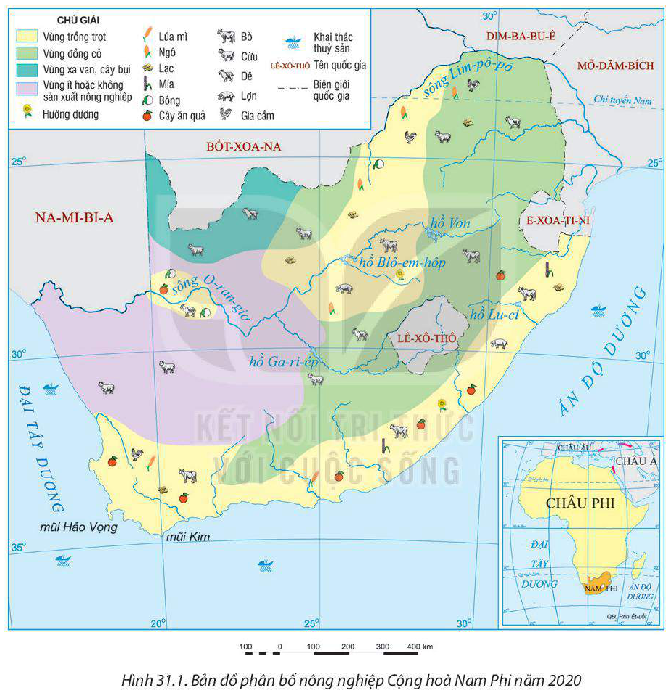
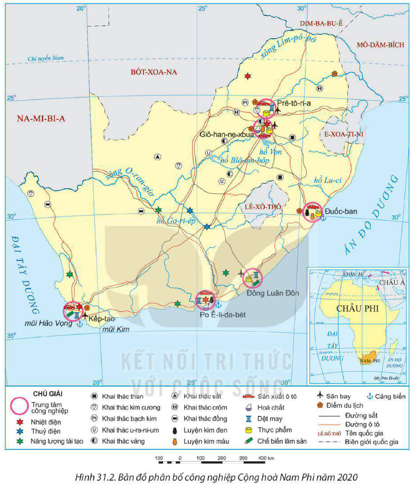

<!-- pdf:161 -->

# BÀI 31: KINH TẾ CỘNG HOÀ NAM PHI

## 🔴 Mở đầu

Cộng hoà Nam Phi là một trong những quốc gia phát triển nhất châu Phi. Nền kinh tế Cộng hoà Nam Phi có đặc điểm gì nổi bật? Các ngành kinh tế hiện nay đang phát triển như thế nào?

## I. TÌNH HÌNH PHÁT TRIỂN KINH TẾ

<!-- term: Tình hình phát triển kinh tế Cộng hoà Nam Phi -->
Cộng hoà Nam Phi là một trong ba nền kinh tế lớn nhất châu Phi (cùng với Ni-giê-ri-a và Ai Cập), là quốc gia duy nhất ở châu Phi thuộc thành viên của G20 (năm 2020).

**BẢNG 31.1. MỘT SỐ CHỈ TIÊU KINH TẾ CỦA CỘNG HOÀ NAM PHI GIAI ĐOẠN 2000 – 2020**

| Chỉ tiêu \ Năm | 2000 | 2010 | 2019 | 2020 |
| --- | --- | --- | --- | --- |
| GDP theo giá hiện hành *(tỉ USD)* | 151,8 | 417,4 | 387,9 | 335,4 |
| Tốc độ tăng GDP *(%)* | 4,2 | 3,0 | 0,1 | –6,4 |
| Cơ cấu GDP *(%)*: Nông nghiệp, lâm nghiệp và thuỷ sản | 2,6 | 2,1 | 2,0 | 2,5 |
| Cơ cấu GDP *(%)*: Công nghiệp và xây dựng | 28,2 | 25,3 | 23,6 | 23,4 |
| Cơ cấu GDP *(%)*: Dịch vụ | 61,2 | 64,3 | 64,4 | 64,6 |
| Cơ cấu GDP *(%)*: Thuế sản phẩm trừ trợ cấp sản phẩm | 8,0 | 8,3 | 10,0 | 9,5 |
<!-- ocr-ok: đối chiếu trực tiếp ảnh trang PDF 161 (Bảng 31.1), OCR bỏ sót hàng tiêu đề năm và đọc nhầm dấu phẩy thập phân -->

*(Nguồn: Ngân hàng Thế giới, 2022)*

Cộng hoà Nam Phi là quốc gia có trình độ khoa học – công nghệ phát triển nhất châu Phi, có cơ sở hạ tầng hiện đại hỗ trợ cho các ngành kinh tế. Cộng hoà Nam Phi thu hút được nhiều vốn đầu tư từ Hoa Kỳ, Anh, Pháp, Đức, Nhật Bản,... Tổng FDI đầu tư vào Cộng hoà Nam Phi đạt 3 tỉ USD năm 2020, lớn thứ ba châu Phi (sau Ai Cập và Cộng hoà Công-gô).

> ❓ Dựa vào thông tin mục I, hãy trình bày khái quát sự phát triển kinh tế của Cộng hoà Nam Phi.

## II. CÁC NGÀNH KINH TẾ

### 1. Nông nghiệp, lâm nghiệp và thuỷ sản

**a) Nông nghiệp**

<!-- term: Nông nghiệp Cộng hoà Nam Phi -->
Ngành nông nghiệp, lâm nghiệp và thuỷ sản chỉ đóng góp 2,5% vào GDP (năm 2020) nhưng có ý nghĩa quan trọng đối với Cộng hoà Nam Phi do giải quyết việc làm cho dân

<!-- pdf:162 -->

cư ở khu vực nông thôn, tạo ra nguồn thu ngoại tệ đáng kể nhờ xuất khẩu các mặt hàng nông sản và đóng vai trò quan trọng trong đảm bảo an ninh lương thực quốc gia.

Diện tích đất trồng trọt của Cộng hoà Nam Phi chỉ chiếm 1/5 diện tích đất nông nghiệp. Các cây trồng quan trọng là ngô, đậu tương, lúa mì, mía, hướng dương, cây ăn quả các loại. Chăn nuôi quảng canh chiếm 4/5 diện tích đất nông nghiệp. Các vật nuôi phổ biến là bò, cừu, dê, lợn,...

*Hình 31.1. Bản đồ phân bố nông nghiệp Cộng hoà Nam Phi năm 2020*

Nông nghiệp của Cộng hoà Nam Phi có sự phân hoá theo vùng: Hoạt động trồng trọt thâm canh và chăn nuôi hỗn hợp tập trung chủ yếu ở những khu vực có tài nguyên đất và nguồn nước thuận lợi như vùng ven biển đông nam và phía nam, hình thành các vùng chuyên canh cây lương thực, cây công nghiệp và cây ăn quả; trong khi chăn nuôi gia súc thường phân bố ở các vùng khô hạn trong nội địa.

<!-- pdf:163 -->

**BẢNG 31.2. MỘT SỐ NÔNG SẢN CỦA CỘNG HOÀ NAM PHI GIAI ĐOẠN 2000 – 2020**
<!-- ocr-ok: đối chiếu trực tiếp ảnh trang PDF 163, OCR đọc sai dấu tiếng Việt trong tiêu đề Bảng 31.2 -->

*(Đơn vị: triệu tấn)*

| Sản phẩm | 2000 | 2010 | 2020 |
| --- | --- | --- | --- |
| Lúa mì | 2,4 | 1,4 | 2,1 |
| Ngô | 11,4 | 12,8 | 15,3 |
| Mía | 23,8 | 16,0 | 18,2 |
| Thịt bò | 13,6 | 13,7 | 12,3 |
| Thịt cừu | 28,6 | 24,5 | 21,4 |

*(Nguồn: Tổ chức Lương thực và Nông nghiệp Liên hợp quốc, 2022)*

**b) Lâm nghiệp**

<!-- term: Lâm nghiệp Cộng hoà Nam Phi -->
Lâm nghiệp là ngành có ý nghĩa quan trọng đối với Cộng hoà Nam Phi. Mặc dù chỉ đóng góp 0,6% vào GDP (năm 2020) nhưng đây là ngành cung cấp nguồn nguyên liệu cho nhiều ngành khác như sản xuất giấy, bột giấy; đặc biệt, lâm nghiệp có ý nghĩa lớn đối với việc bảo tồn đa dạng sinh học, đảm bảo sử dụng bền vững các nguồn tài nguyên thiên nhiên.

Rừng trồng của Nam Phi có thể cung cấp hằng năm từ 15 đến 18 triệu m³ gỗ. Mô hình đồn điền trồng cây lấy gỗ (thông, bạch đàn, muồng,...) đang ngày càng được đầu tư, phát triển cho năng suất cao.

**c) Thuỷ sản**

<!-- term: Thuỷ sản Cộng hoà Nam Phi -->
Ngành thuỷ sản chưa thực sự phát triển, mới chỉ đóng góp khoảng 0,1% vào GDP (năm 2020). Sản lượng thuỷ sản khai thác ngày càng tăng, năm 2020 đạt 602,7 nghìn tấn. Sản lượng thuỷ sản nuôi trồng có xu hướng tăng lên song còn thấp, đạt 9,7 nghìn tấn (năm 2020). Hoạt động nuôi trồng thuỷ sản đang ngày càng được chú trọng theo hướng phát triển bền vững.

> ❓ Dựa vào thông tin mục 1 và hình 31.1, hãy trình bày một số đặc điểm nổi bật của ngành nông nghiệp, lâm nghiệp và thuỷ sản ở Cộng hoà Nam Phi.

### 2. Công nghiệp

<!-- term: Công nghiệp Cộng hoà Nam Phi -->
Cộng hoà Nam Phi là một trong những nước có nền công nghiệp phát triển nhất châu Phi. Mặc dù tỉ trọng trong GDP có xu hướng giảm nhưng công nghiệp vẫn là ngành kinh tế quan trọng, chiếm 23,4% GDP và khoảng 25% lực lượng lao động của đất nước (năm 2020); tạo nên nhiều mặt hàng xuất khẩu quan trọng.

Công nghiệp khai thác khoáng sản là ngành công nghiệp mũi nhọn, tạo ra nguồn việc làm cho 451,4 nghìn người (năm 2020) và đem lại nguồn thu ngoại tệ quan trọng cho nền kinh tế. Cộng hoà Nam Phi là nhà sản xuất lớn nhất thế giới về bạch kim, vàng và crôm. Công nghiệp khai thác khoáng sản tập trung ở khu vực nội địa.

<!-- pdf:164 -->

*Hình 31.2. Bản đồ phân bố công nghiệp Cộng hoà Nam Phi năm 2020*

Một số ngành công nghiệp quan trọng khác của Cộng hoà Nam Phi là sản xuất ô tô, luyện kim, dệt may, hoá chất, chế biến thực phẩm, chế biến lâm sản.

Các trung tâm công nghiệp chính là Kếp-tao, Giô-han-ne-xbua, Po Ê-li-da-bét, Đông Luân Đôn và Đuốc-ban.

<!-- pdf:165 -->

**BẢNG 31.3. SẢN LƯỢNG KHAI THÁC MỘT SỐ KHOÁNG SẢN CỦA CỘNG HOÀ NAM PHI GIAI ĐOẠN 2010 – 2020**

| Sản phẩm \ Năm | 2010 | 2015 | 2020 |
| --- | --- | --- | --- |
| Bạch kim *(tấn)* | 287,0 | 276,0 | 226,0 |
| Vàng *(tấn)* | 189,0 | 145,0 | 96,0 |
| Kim cương *(triệu ca-ra)* | 8,9 | 8,2 | 8,5 |
| Than đá *(triệu tấn)* | 257,2 | 252,2 | 248,1 |
| Sắt *(triệu tấn)* | 58,7 | 72,8 | 55,6 |
| Crôm *(nghìn tấn)* | 10,9 | 15,7 | 14,5 |

*(Nguồn: Hội đồng Khoáng sản Nam Phi, 2021)*

> ❓ Dựa vào thông tin mục 2 và hình 31.2, hãy trình bày đặc điểm nổi bật của ngành công nghiệp Cộng hoà Nam Phi.

### 3. Dịch vụ

<!-- term: Dịch vụ Cộng hoà Nam Phi -->
Dịch vụ là ngành kinh tế quan trọng nhất của Nam Phi, chiếm 64,6% GDP và sử dụng 72,4% lực lượng lao động (năm 2020). Các ngành dịch vụ nổi bật là ngoại thương, giao thông vận tải, tài chính ngân hàng và du lịch.

<!-- term: Ngoại thương Cộng hoà Nam Phi -->
– Ngoại thương: Các sản phẩm xuất khẩu chính là quặng kim loại (bạch kim, quặng sắt, than đá, vàng, kim cương) và nông sản. Các mặt hàng nhập khẩu chủ yếu là máy móc thiết bị, hoá chất, sản phẩm xăng dầu, thực phẩm và dược phẩm. Các đối tác thương mại hàng đầu của Cộng hoà Nam Phi là Trung Quốc, Đức, Hoa Kỳ, Nhật Bản, Ấn Độ, Anh.

**BẢNG 31.4. TRỊ GIÁ XUẤT NHẬP KHẨU HÀNG HOÁ VÀ DỊCH VỤ CỦA CỘNG HOÀ NAM PHI GIAI ĐOẠN 2000 – 2020**

*(Đơn vị: tỉ USD)*

| Năm | 2000 | 2005 | 2010 | 2015 | 2020 |
| --- | --- | --- | --- | --- | --- |
| Xuất khẩu | 37,0 | 68,2 | 107,6 | 96,1 | 93,2 |
| Nhập khẩu | 33,1 | 68,8 | 102,8 | 100,6 | 78,3 |
| Cán cân thương mại | 3,9 | –0,6 | 4,8 | –4,5 | 14,9 |

*(Nguồn: Ngân hàng Thế giới, 2022)*

<!-- term: Giao thông vận tải Cộng hoà Nam Phi -->
– Giao thông vận tải: Cơ sở hạ tầng giao thông vận tải của Cộng hoà Nam Phi khá phát triển với đầy đủ các loại hình giao thông. Tuy nhiên, một số vùng (núi cao, hoang mạc) cơ sở hạ tầng giao thông còn hạn chế. Đường bộ là loại hình vận tải chính để vận chuyển hành khách, hàng hoá ở Cộng hoà Nam Phi. Giao thông đường sắt có chiều dài đứng thứ 10 trên thế giới và kết nối với nhiều mạng lưới đường sắt ở khu vực cận Xa-ha-ra. Giao thông đường biển có vai trò quan trọng đối với phát triển kinh tế đất nước, một số

<!-- pdf:166 -->

cảng biển lớn là Kếp-tao, Po Ê-li-da-bét, Đuốc-ban. Giao thông đường hàng không được đầu tư phát triển nhanh trong những năm gần đây, các sân bay quan trọng là Prê-tô-ri-a, Giô-han-ne-xbua, Kếp-tao.

<!-- term: Tài chính ngân hàng Cộng hoà Nam Phi -->
– Tài chính ngân hàng: Cộng hoà Nam Phi có hệ thống tài chính phát triển với sàn giao dịch chứng khoán nằm trong nhóm 20 quốc gia hàng đầu thế giới về giá trị vốn hoá thị trường. Hệ thống ngân hàng Nam Phi được phát triển tốt và quản lí hiệu quả. Nhiều ngân hàng và tổ chức đầu tư nước ngoài đã thành lập chi nhánh tại Cộng hoà Nam Phi. Kếp-tao là trung tâm tài chính lớn nhất đất nước.

<!-- term: Du lịch Cộng hoà Nam Phi -->
– Du lịch: Du lịch là một trong những ngành mũi nhọn của Cộng hoà Nam Phi, đóng góp lớn cho nền kinh tế đất nước. Năm 2019, Cộng hoà Nam Phi thu hút được 10,2 triệu khách du lịch quốc tế (thứ hai ở châu Phi) với doanh thu du lịch từ khách quốc tế đạt 8,4 tỉ USD. Nam Phi phát triển nhiều loại hình du lịch, như du lịch mạo hiểm, du lịch khám phá thiên nhiên, du lịch văn hoá,... Giô-han-ne-xbua, Kếp-tao và Đuốc-ban là những trung tâm du lịch lớn nhất của Cộng hoà Nam Phi.

*Hình 31.3. Khung cảnh hùng vĩ tại Núi Bàn*

> ❓ Dựa vào thông tin mục 3, hãy trình bày đặc điểm của một ngành dịch vụ ở Cộng hoà Nam Phi.

## ✏️ Luyện tập

**1.** Dựa vào bản đồ phân bố công nghiệp (hình 31.2), hãy xác định cơ cấu ngành công nghiệp của các trung tâm công nghiệp ở Cộng hoà Nam Phi.

**2.** Dựa vào bảng 31.4, hãy vẽ biểu đồ thể hiện trị giá xuất nhập khẩu hàng hoá và dịch vụ của Cộng hoà Nam Phi giai đoạn 2000 – 2020. Nêu nhận xét.

## 🚀 Vận dụng

Sưu tầm thông tin, viết bài giới thiệu về một sản phẩm nông nghiệp hoặc một sản phẩm công nghiệp đặc trưng của Cộng hoà Nam Phi.

## 📷 Danh sách hình trong bài

| Mã hình | Trang PDF | Vị trí trong bài | Chú thích gốc |
| --- | --- | --- | --- |
| H11-dia-b31-01 | 162 | Mục II.1.a | Hình 31.1. Bản đồ phân bố nông nghiệp Cộng hoà Nam Phi năm 2020 |
| H11-dia-b31-02 | 164 | Mục II.2 | Hình 31.2. Bản đồ phân bố công nghiệp Cộng hoà Nam Phi năm 2020 |
| H11-dia-b31-03 | 166 | Mục II.3 | Hình 31.3. Khung cảnh hùng vĩ tại Núi Bàn |
