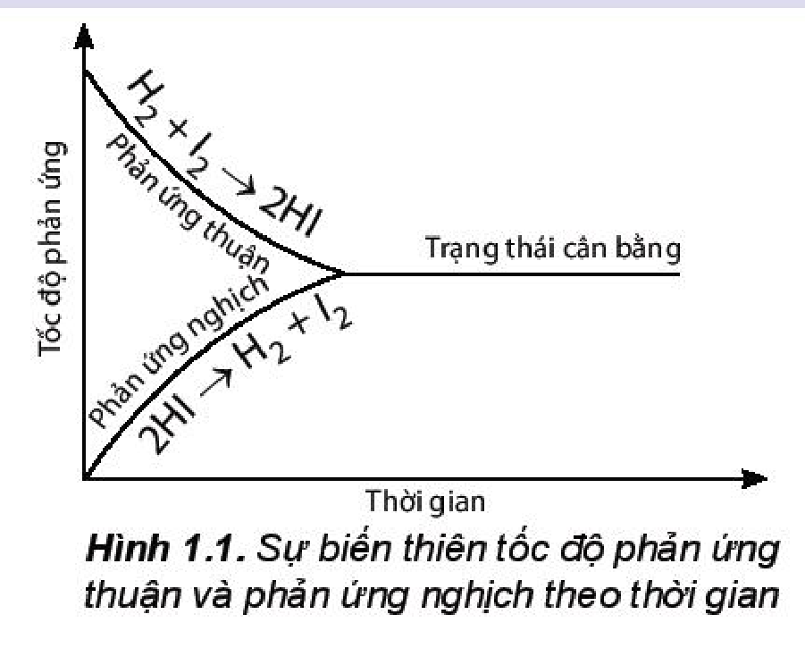
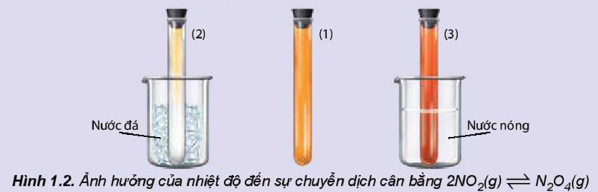
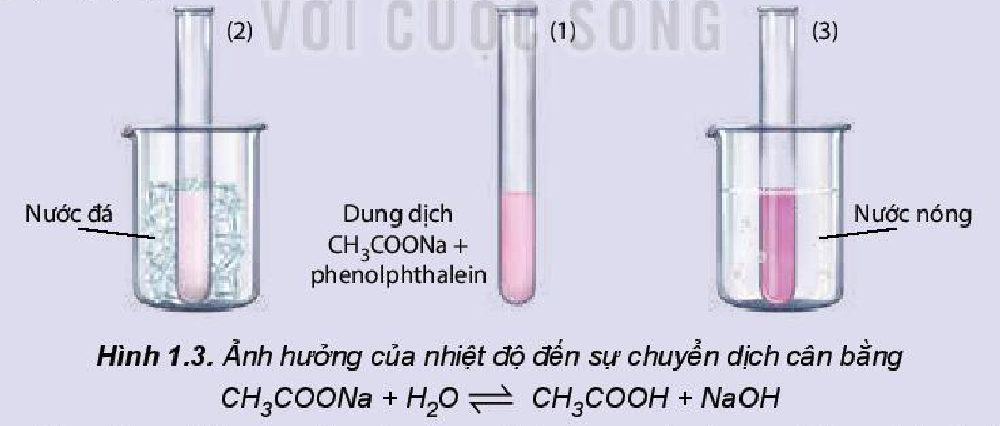
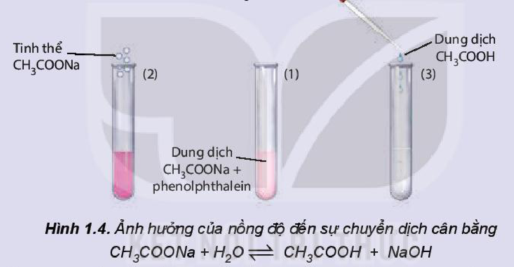
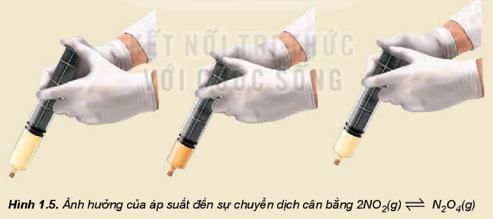

<!-- pdf:7 -->

# BÀI 1: KHÁI NIỆM VỀ CÂN BẰNG HOÁ HỌC

## 🎯 Mục tiêu

- Trình bày được khái niệm phản ứng thuận nghịch và trạng thái cân bằng của phản ứng thuận nghịch.
- Viết được biểu thức hằng số cân bằng ($K_C$) của phản ứng thuận nghịch.
- Thực hiện được thí nghiệm nghiên cứu ảnh hưởng của nhiệt độ tới chuyển dịch cân bằng:
  (1) Phản ứng: $\ce{2NO2 <=> N2O4}$
  (2) Phản ứng thuỷ phân sodium acetate.
- Vận dụng được nguyên lí chuyển dịch cân bằng Le Chatelier để giải thích ảnh hưởng của nhiệt độ, nồng độ, áp suất đến cân bằng hoá học.

## 🔴 Mở đầu

Phản ứng hoá học là quá trình biến đổi các chất đầu thành sản phẩm. Tuy nhiên, có nhiều phản ứng, các chất sản phẩm sinh ra lại có thể phản ứng với nhau tạo thành chất đầu. Đối với những phản ứng này, làm thế nào để thu được nhiều sản phẩm hơn và làm tăng hiệu suất phản ứng?

## I. PHẢN ỨNG MỘT CHIỀU VÀ PHẢN ỨNG THUẬN NGHỊCH

### 1. Phản ứng một chiều

Xét phản ứng đốt cháy khí methane trong khí oxygen:

$\ce{CH4 + 2O2 ->[t^o] CO2 + 2H2O}$
<!-- ocr-ok: OCR đọc lỗi phương trình đốt cháy methane ("CHÍ +20, :17126Oz+2H4O"); đã đối chiếu ảnh -->

Khi đốt cháy khí methane, thu được sản phẩm là khí carbon dioxide và hơi nước. Trong điều kiện này, các chất sản phẩm không phản ứng được với nhau để tạo thành chất đầu. Phản ứng như trên được gọi là ***phản ứng một chiều***.

Phương trình hoá học của phản ứng một chiều được biểu diễn bằng một mũi tên chỉ chiều phản ứng.

*Ví dụ:* $\ce{NaOH + HCl -> NaCl + H2O}$.

### 2. Phản ứng thuận nghịch

> ✋ Hai thí nghiệm sau đều được thực hiện ở cùng một điều kiện (bình kín dung tích $10\text{ L}$, nhiệt độ $445\text{ }^\circ\text{C}$):
>
> *Thí nghiệm 1:* Cho $1\text{ mol }\ce{H2}$ và $1\text{ mol }\ce{I2}$ vào bình kín. Kết quả thí nghiệm cho thấy dù thời gian phản ứng kéo dài bao lâu thì trong bình vẫn chỉ tạo ra $1,6\text{ mol }\ce{HI}$; còn dư $0,2\text{ mol }\ce{H2}$ và $0,2\text{ mol }\ce{I2}$.

<!-- pdf:8 -->

> *Thí nghiệm 2:* Cho $2\text{ mol }\ce{HI}$ vào bình. Kết quả thí nghiệm cũng cho thấy dù thời gian phản ứng kéo dài bao lâu thì trong bình vẫn chỉ tạo ra $0,2\text{ mol }\ce{H2}$ và $0,2\text{ mol }\ce{I2}$; còn dư $1,6\text{ mol }\ce{HI}$.
>
> *Thực hiện yêu cầu sau:*
>
> a) Viết phương trình hoá học của các phản ứng xảy ra trong thí nghiệm 1 và thí nghiệm 2.
>
> b) Trong cả hai thí nghiệm trên, dù thời gian phản ứng kéo dài bao lâu thì các chất đầu đều còn lại sau phản ứng. Giải thích.

Ở nhiệt độ $445\text{ }^\circ\text{C}$, trong bình chứa hỗn hợp $\ce{H2}$ và $\ce{I2}$ xảy ra đồng thời hai phản ứng:

$\ce{H2(g) + I2(g) -> 2HI(g)} \qquad (1)$

$\ce{2HI(g) -> H2(g) + I2(g)} \qquad (2)$

Ở thí nghiệm 1, khí $\ce{H2}$ tác dụng với $\ce{I2}$ tạo thành $\ce{HI}$, đồng thời $\ce{HI}$ lại phân huỷ tạo thành $\ce{I2}$ và $\ce{H2}$ nên dù thời gian kéo dài bao lâu, phản ứng vẫn không thể xảy ra hoàn toàn.

Phản ứng giữa $\ce{H2}$ và $\ce{I2}$ trong điều kiện trên được gọi là phản ứng thuận nghịch và được biểu diễn bằng phương trình hoá học:

$\ce{H2(g) + I2(g) <=> 2HI(g)}$

Tương tự, ở thí nghiệm 2 cũng xảy ra phản ứng thuận nghịch:

$\ce{2HI(g) <=> H2(g) + I2(g)}$

***Phản ứng thuận nghịch*** *là phản ứng xảy ra theo hai chiều ngược nhau trong cùng điều kiện.*

Phương trình hoá học của phản ứng thuận nghịch được biểu diễn bằng hai nửa mũi tên ngược chiều nhau. Chiều từ trái sang phải là chiều **phản ứng thuận**, chiều từ phải sang trái là chiều **phản ứng nghịch**.

Trong thực tế, các phản ứng thuận nghịch xảy ra không hoàn toàn bởi vì trong cùng một điều kiện, các chất phản ứng tác dụng với nhau tạo thành các chất sản phẩm (phản ứng thuận), đồng thời các chất sản phẩm lại tác dụng với nhau tạo thành các chất ban đầu (phản ứng nghịch).

> ❓ 1. Quá trình hình thành hang động, thạch nhũ là một ví dụ điển hình về phản ứng thuận nghịch trong tự nhiên.
>
>    Nước có chứa $\ce{CO2}$ chảy qua đá vôi, bào mòn đá tạo thành $\ce{Ca(HCO3)2}$ (phản ứng thuận) góp phần hình thành các hang động. Hợp chất $\ce{Ca(HCO3)2}$ trong nước lại bị phân huỷ tạo ra $\ce{CO2}$ và $\ce{CaCO3}$ (phản ứng nghịch), hình thành các thạch nhũ, măng đá, cột đá.
>
>    Viết phương trình hoá học của các phản ứng xảy ra trong hai quá trình trên.

<!-- pdf:9 -->

> 2. Phản ứng xảy ra khi cho khí $\ce{Cl2}$ tác dụng với nước là một phản ứng thuận nghịch. Viết phương trình hoá học của phản ứng, xác định phản ứng thuận, phản ứng nghịch.
>
> 3. Nhận xét nào sau đây **không** đúng?
>
>    A. Trong phản ứng một chiều, chất sản phẩm không phản ứng được với nhau tạo thành chất đầu.
>
>    B. Trong phản ứng thuận nghịch, các chất sản phẩm có thể phản ứng với nhau để tạo thành chất đầu.
>
>    C. Phản ứng một chiều là phản ứng luôn xảy ra không hoàn toàn.
>
>    D. Phản ứng thuận nghịch là phản ứng xảy ra theo hai chiều trái ngược nhau trong cùng điều kiện.

## II. CÂN BẰNG HOÁ HỌC

### 1. Trạng thái cân bằng

> ✋ Xét phản ứng thuận nghịch: $\ce{H2(g) + I2(g) <=> 2HI(g)}$.
>
> Số liệu về sự thay đổi số mol các chất trong bình phản ứng ở thí nghiệm 1 được trình bày trong Bảng 1.1 dưới đây:
>
> *Bảng 1.1. Số mol các chất trong bình phản ứng của thí nghiệm 1 thay đổi theo thời gian*
>
> | Thời gian (giây) | $t_0$ | $t_1$ | $t_2$ | $t_3$ | $t_4$ | $t_5$ | ... | $t_\infty$ |
> |---|---|---|---|---|---|---|---|---|
> | Số mol $\ce{H2}$ | 1,0 | 0,6 | 0,4 | 0,3 | 0,2 | 0,2 | 0,2 | 0,2 |
> | Số mol $\ce{I2}$ | 1,0 | 0,6 | 0,4 | 0,3 | 0,2 | 0,2 | 0,2 | 0,2 |
> | Số mol $\ce{HI}$ | 0 | 0,8 | 1,2 | 1,4 | 1,6 | 1,6 | 1,6 | 1,6 |
> <!-- ocr-ok: OCR đọc lỗi hàng tiêu đề thời gian và dấu phẩy thập phân trong Bảng 1.1; đã đối chiếu ảnh -->
>
> *Thực hiện các yêu cầu:*
>
> a) Vẽ đồ thị biểu diễn sự thay đổi số mol các chất theo thời gian.
>
> b) Từ đồ thị, nhận xét về sự thay đổi số mol của các chất theo thời gian.
>
> c) Viết biểu thức định luật tác dụng khối lượng đối với phản ứng thuận và phản ứng nghịch, từ đó dự đoán sự thay đổi tốc độ của mỗi phản ứng theo thời gian (biết các phản ứng này đều là phản ứng đơn giản).
>
> d) Bắt đầu từ thời điểm nào thì số mol các chất trong hệ phản ứng không thay đổi nữa?

Trong thí nghiệm trên, lúc đầu phản ứng thuận có tốc độ lớn hơn phản ứng nghịch và ưu tiên tạo ra hydrogen iodide. Theo thời gian, tốc độ phản ứng thuận giảm dần, tốc độ phản ứng nghịch tăng dần đến khi tốc độ hai phản ứng bằng nhau (Hình 1.1). Tại thời điểm này, số mol của các chất hydrogen, iodine, hydrogen iodide không thay đổi nữa. Đây là thời điểm phản ứng thuận nghịch đạt tới trạng thái cân bằng.
<!-- ocr-ok: Hình 1.1 đặt cạnh đoạn văn nên OCR đọc trộn nhãn đồ thị vào cuối đoạn văn; đã đối chiếu ảnh -->

- Trạng thái cân bằng; Tốc độ phản ứng; Thời gian
- Phản ứng thuận: $\ce{H2 + I2 -> 2HI}$; Phản ứng nghịch: $\ce{2HI -> H2 + I2}$

Hình 1.1. Sự biến thiên tốc độ phản ứng thuận và phản ứng nghịch theo thời gian

<!-- pdf:10 -->

***Trạng thái cân bằng*** *của phản ứng thuận nghịch là trạng thái tại đó tốc độ phản ứng thuận bằng tốc độ phản ứng nghịch.*

**Cân bằng hoá học** là một cân bằng động, các chất tham gia phản ứng liên tục phản ứng với nhau để tạo thành sản phẩm và các chất sản phẩm cũng liên tục phản ứng với nhau để tạo thành các chất đầu nhưng với tốc độ bằng nhau nên ở trạng thái cân bằng, nồng độ các chất không thay đổi.

> ❓ 4. Cho phản ứng: $\ce{2HI(g) <=> H2(g) + I2(g)}$
>
>    a) Vẽ dạng đồ thị biểu diễn tốc độ của phản ứng thuận và phản ứng nghịch theo thời gian.
>
>    b) Xác định trên đồ thị thời điểm phản ứng trên bắt đầu đạt đến trạng thái cân bằng.
>
> 5. Cho các nhận xét sau:
>
>    a) Ở trạng thái cân bằng, tốc độ phản ứng thuận bằng tốc độ phản ứng nghịch.
>
>    b) Ở trạng thái cân bằng, các chất không phản ứng với nhau.
>
>    c) Ở trạng thái cân bằng, nồng độ các chất sản phẩm luôn lớn hơn nồng độ các chất đầu.
>
>    d) Ở trạng thái cân bằng, nồng độ các chất không thay đổi.
>
>    Các nhận xét đúng là
>
>    A. (a) và (b). B. (b) và (c). C. (a) và (c). D. (a) và (d).

### 2. Hằng số cân bằng

**a) Biểu thức của hằng số cân bằng**

> ✋ Xét phản ứng thuận nghịch: $\ce{H2(g) + I2(g) <=> 2HI(g)}$
>
> Thực hiện phản ứng trên trong bình kín, ở nhiệt độ $445\text{ }^\circ\text{C}$ với các nồng độ ban đầu khác nhau. Số liệu về nồng độ các chất ở thời điểm ban đầu và ở trạng thái cân bằng trong các thí nghiệm được trình bày trong Bảng 1.2.
>
> *Bảng 1.2. Nồng độ các chất của phản ứng $\ce{H2(g) + I2(g) <=> 2HI(g)}$ ở thời điểm ban đầu và ở trạng thái cân bằng*
>
> | | Nồng độ các chất ở thời điểm ban đầu ($\text{mol/L}$) $\ce{H2}$ | Nồng độ các chất ở thời điểm ban đầu ($\text{mol/L}$) $\ce{I2}$ | Nồng độ các chất ở thời điểm ban đầu ($\text{mol/L}$) $\ce{HI}$ | Nồng độ các chất ở trạng thái cân bằng ($\text{mol/L}$) $\ce{H2}$ | Nồng độ các chất ở trạng thái cân bằng ($\text{mol/L}$) $\ce{I2}$ | Nồng độ các chất ở trạng thái cân bằng ($\text{mol/L}$) $\ce{HI}$ |
> |---|---|---|---|---|---|---|
> | Thí nghiệm 1 | 0,1 | 0,1 | 0 | 0,02000 | 0,02000 | 0,16000 |
> | Thí nghiệm 2 | 0,1 | 0,2 | 0 | 0,00532 | 0,10532 | 0,18936 |
> | Thí nghiệm 3 | 0,3 | 0,1 | 0 | 0,20290 | 0,00290 | 0,19420 |
>
> *Tính giá trị $K_C = \frac{[\ce{HI}]^2}{[\ce{H2}][\ce{I2}]}^{(1)}$ ở mỗi thí nghiệm, nhận xét kết quả thu được.*
<!-- ocr-ok: OCR tách rời phân thức Kc trong câu hỏi cuối hộp hoạt động; đã đối chiếu ảnh -->

$K_C = \frac{[\ce{HI}]^2}{[\ce{H2}][\ce{I2}]}$ được gọi là biểu thức hằng số cân bằng của phản ứng thuận nghịch:

$\ce{H2(g) + I2(g) <=> 2HI(g)}$
<!-- ocr-ok: OCR đảo thứ tự phân thức Kc và câu dẫn dưới hộp hoạt động; đã đối chiếu ảnh -->

> (1) Dấu $[\text{i}]$ biểu thị nồng độ của chất $\text{i}$ ở trạng thái cân bằng.

<!-- pdf:11 -->

Xét phản ứng thuận nghịch tổng quát: $\ce{aA + bB <=> cC + dD}$

Ở trạng thái cân bằng, **hằng số cân bằng** ($K_C$) của phản ứng được xác định theo biểu thức:

$$K_C = \frac{[\ce{C}]^c[\ce{D}]^d}{[\ce{A}]^a[\ce{B}]^b}$$
<!-- ocr-ok: OCR đọc lỗi công thức Kc đóng khung ("Ke-LGÌ [DJ / [AJIBI"); đã đối chiếu ảnh -->

Trong đó: $[\ce{A}], [\ce{B}], [\ce{C}], [\ce{D}]$ là nồng độ mol của các chất A, B, C, D ở trạng thái cân bằng; $a, b, c, d$ là hệ số tỉ lượng của các chất trong phương trình hoá học của phản ứng.

Thực nghiệm cho thấy: hằng số cân bằng $K_C$ của một phản ứng thuận nghịch chỉ phụ thuộc nhiệt độ và bản chất của phản ứng.

Đối với các phản ứng có chất rắn tham gia, không biểu diễn nồng độ của chất rắn trong biểu thức hằng số cân bằng. *Ví dụ:*

$$\ce{C(s) + CO2(g) <=> 2CO(g)} \qquad K_C = \frac{[\ce{CO}]^2}{[\ce{CO2}]}$$
<!-- ocr-ok: OCR đọc lỗi phân thức Kc của phản ứng C(s) + CO2(g); đã đối chiếu ảnh -->

> ❓ 6. Viết biểu thức hằng số cân bằng cho các phản ứng sau:
>
>    a) Phản ứng tổng hợp ammonia: $\ce{N2(g) + 3H2(g) <=> 2NH3(g)}$
>
>    b) Phản ứng nung vôi: $\ce{CaCO3(s) <=> CaO(s) + CO2(g)}$
>
> 7. Ammonia ($\ce{NH3}$) được điều chế bằng phản ứng: $\ce{N2(g) + 3H2(g) <=> 2NH3(g)}$
>
>    Ở $t\text{ }^\circ\text{C}$, nồng độ các chất ở trạng thái cân bằng là:
>
>    $[\ce{N2}] = 0,45\text{ M}$; $[\ce{H2}] = 0,14\text{ M}$; $[\ce{NH3}] = 0,62\text{ M}$.
>
>    Tính hằng số cân bằng $K_C$ của phản ứng trên tại $t\text{ }^\circ\text{C}$.

**b) Ý nghĩa của hằng số cân bằng**

**Hằng số cân bằng** $K_C$ phụ thuộc vào bản chất của phản ứng và nhiệt độ.

Biểu thức xác định **hằng số cân bằng** $K_C = \frac{[\ce{C}]^c[\ce{D}]^d}{[\ce{A}]^a[\ce{B}]^b}$ cho thấy: $K_C$ càng lớn thì phản ứng thuận càng chiếm ưu thế hơn và ngược lại, $K_C$ càng nhỏ thì phản ứng nghịch càng chiếm ưu thế hơn.

## III. CÁC YẾU TỐ ẢNH HƯỞNG ĐẾN SỰ CHUYỂN DỊCH CÂN BẰNG HOÁ HỌC

### 1. Ảnh hưởng của nhiệt độ

> 🔬 **Thí nghiệm 1. Ảnh hưởng của nhiệt độ đến sự chuyển dịch cân bằng:**
>
> $\underset{\text{(màu nâu đỏ)}}{\ce{2NO2(g)}} \ce{<=>} \underset{\text{(không màu)}}{\ce{N2O4(g)}} \qquad \Delta_r H^o_{298} < 0$
>
> *Chuẩn bị:* 3 ống nghiệm chứa khí $\ce{NO2}$ nút kín có màu giống nhau, cốc nước đá, cốc nước nóng.
>
> *Tiến hành:*
> - Ống nghiệm (1) để so sánh.
> - Ngâm ống nghiệm (2) vào cốc nước đá trong khoảng 1 – 2 phút.
> - Ngâm ống nghiệm (3) vào cốc nước nóng trong khoảng 1 – 2 phút.

<!-- pdf:12 -->

> *Lưu ý:* $\ce{NO2}$ là một khí độc, chú ý nút kín ống nghiệm.
>
> 
>
> - (2) Nước đá; (1); (3) Nước nóng
>
> Hình 1.2. Ảnh hưởng của nhiệt độ đến sự chuyển dịch cân bằng $\ce{2NO2(g) <=> N2O4(g)}$
>
> *Quan sát sự thay đổi màu sắc của khí trong các ống nghiệm và hoàn thành vào vở theo mẫu bảng sau:*
>
> | Tác động | Hiện tượng | Chiều chuyển dịch cân bằng (thuận/nghịch) | Chiều chuyển dịch cân bằng (toả nhiệt/thu nhiệt) |
> |---|---|---|---|
> | Tăng nhiệt độ | ? | ? | ? |
> | Giảm nhiệt độ | ? | ? | ? |
> <!-- ocr-ok: OCR đảo thứ tự dòng "Giảm nhiệt độ" lên trên tiêu đề bảng; đã đối chiếu ảnh -->

> 🔬 **Thí nghiệm 2. Ảnh hưởng của nhiệt độ đến sự chuyển dịch cân bằng:**
>
> $\ce{CH3COONa + H2O <=> CH3COOH + NaOH} \qquad \Delta_r H^o_{298} > 0$
>
> *Chuẩn bị:* dung dịch $\ce{CH3COONa}$ $0,5\text{ M}$, phenolphthalein; cốc nước nóng, cốc nước đá, 3 ống nghiệm.
>
> *Tiến hành:*
> - Cho khoảng $10\text{ mL}$ dung dịch $\ce{CH3COONa}$ $0,5\text{ M}$ vào cốc thuỷ tinh, thêm 1 – 2 giọt phenolphthalein, khuấy đều.
> - Chia dung dịch thu được vào 3 ống nghiệm. Ống nghiệm (1) để so sánh, ống nghiệm (2) ngâm vào cốc nước đá, ống nghiệm (3) ngâm vào cốc nước nóng.
>
> 
>
> - (2) Nước đá; (1) Dung dịch $\ce{CH3COONa}$ + phenolphthalein; (3) Nước nóng
>
> Hình 1.3. Ảnh hưởng của nhiệt độ đến sự chuyển dịch cân bằng $\ce{CH3COONa + H2O <=> CH3COOH + NaOH}$
>
> *Quan sát sự thay đổi màu sắc của dung dịch trong các ống nghiệm và hoàn thành vào vở theo mẫu bảng sau:*
>
> | Tác động | Hiện tượng | Chiều chuyển dịch cân bằng (thuận/nghịch) | Chiều chuyển dịch cân bằng (phản ứng toả nhiệt/thu nhiệt) |
> |---|---|---|---|
> | Tăng nhiệt độ | ? | ? | ? |
> | Giảm nhiệt độ | ? | ? | ? |

<!-- pdf:13 -->

<!-- term: Ảnh hưởng của nhiệt độ đến cân bằng hoá học -->
*Khi tăng nhiệt độ, cân bằng chuyển dịch theo chiều làm giảm nhiệt độ, tức là chiều phản ứng thu nhiệt ($\Delta_r H^o_{298} > 0$), nghĩa là chiều làm giảm tác động của việc tăng nhiệt độ và ngược lại.*

### 2. Ảnh hưởng của nồng độ

> ✋ **Nghiên cứu ảnh hưởng của nồng độ đến sự chuyển dịch cân bằng:**
>
> $\ce{CH3COONa + H2O <=> CH3COOH + NaOH}$
>
> Thí nghiệm nghiên cứu ảnh hưởng của nồng độ đến sự chuyển dịch cân bằng trên được thực hiện như sau:
> - Cho một vài giọt phenolphthalein vào dung dịch $\ce{CH3COONa}$, lắc đều, dung dịch có màu hồng nhạt.
> - Chia dung dịch thu được vào ba ống nghiệm với thể tích gần bằng nhau. Ống nghiệm (1) để so sánh, ống nghiệm (2) thêm vài tinh thể $\ce{CH3COONa}$, ống nghiệm (3) thêm một vài giọt dung dịch $\ce{CH3COOH}$.
>
> 
>
> - (2) Tinh thể $\ce{CH3COONa}$; (1) Dung dịch $\ce{CH3COONa}$ + phenolphthalein; (3) Dung dịch $\ce{CH3COOH}$
>
> Hình 1.4. Ảnh hưởng của nồng độ đến sự chuyển dịch cân bằng $\ce{CH3COONa + H2O <=> CH3COOH + NaOH}$
>
> *Quan sát sự thay đổi màu sắc của dung dịch trong các ống nghiệm (Hình 1.4) và hoàn thành vào vở theo mẫu bảng sau:*
>
> | Tác động | Hiện tượng | Chiều chuyển dịch cân bằng (thuận/nghịch) | Chiều chuyển dịch cân bằng (tăng/giảm nồng độ) |
> |---|---|---|---|
> | Tăng nồng độ $\ce{CH3COONa}$ | ? | ? | ? |
> | Tăng nồng độ $\ce{CH3COOH}$ | ? | ? | ? |

<!-- term: Ảnh hưởng của nồng độ đến cân bằng hoá học -->
*Khi tăng nồng độ một chất trong phản ứng thì cân bằng hoá học bị phá vỡ và chuyển dịch theo chiều làm giảm nồng độ của chất đó và ngược lại.*

<!-- pdf:14 -->

> ❓ 8. Cho các cân bằng sau:
>
>    $\ce{CaCO3(s) <=> CaO(s) + CO2(g)} \qquad \Delta_r H^o_{298} = 176\text{ kJ}$
>
>    $\ce{2SO2(g) + O2(g) <=> 2SO3(g)} \qquad \Delta_r H^o_{298} = -198\text{ kJ}$
>
>    Nếu tăng nhiệt độ, các cân bằng trên chuyển dịch theo chiều nào? Giải thích.
>
> 9. Ester là hợp chất hữu cơ dễ bay hơi, một số ester được sử dụng làm chất tạo mùi thơm cho các loại bánh, thực phẩm. Phản ứng điều chế ester là một phản ứng thuận nghịch:
>
>    $\ce{CH3COOH(l) + C2H5OH(l) <=> CH3COOC2H5(l) + H2O(l)}$
>
>    Hãy cho biết cân bằng trên chuyển dịch theo chiều nào nếu
>
>    a) Tăng nồng độ của $\ce{C2H5OH}$.
>
>    b) Giảm nồng độ của $\ce{CH3COOC2H5}$.

> 💡 EM CÓ BIẾT
>
> **Ảnh hưởng của áp suất tới chuyển dịch cân bằng:**
>
> $\underset{\text{(màu nâu đỏ)}}{\ce{2NO2(g)}} \ce{<=>} \underset{\text{(không màu)}}{\ce{N2O4(g)}}$
>
> Thí nghiệm nghiên cứu ảnh hưởng của áp suất đến sự chuyển dịch cân bằng trên được thực hiện như sau:
>
> Lấy một ống xi-lanh đựng khí $\ce{NO2}$. Đẩy pít-tông xuống để làm giảm thể tích và làm tăng áp suất trong ống. Lúc này, màu của khí trong xi-lanh đậm hơn. Sau một thời gian, khí trong ống lại nhạt màu hơn (Hình 1.5). Như vậy, khi tăng áp suất, cân bằng trên chuyển dịch theo chiều làm giảm số mol khí trong xi-lanh.
>
> 
>
> Hình 1.5. Ảnh hưởng của áp suất đến sự chuyển dịch cân bằng $\ce{2NO2(g) <=> N2O4(g)}$

<!-- term: Ảnh hưởng của áp suất đến cân bằng hoá học -->
*Khi tăng áp suất chung của hệ, thì cân bằng chuyển dịch theo chiều làm giảm áp suất, tức là chiều làm giảm số mol khí và ngược lại.*

<!-- term: Ảnh hưởng của áp suất đến cân bằng hoá học -->
*Đối với phản ứng thuận nghịch có tổng hệ số tỉ lượng của các chất khí ở hai vế của phương trình hoá học bằng nhau thì trạng thái cân bằng của hệ không bị chuyển dịch khi thay đổi áp suất chung của hệ.*

<!-- pdf:15 -->

> ❓ 10. Cho các cân bằng sau:
>
>    a) $\ce{2SO2(g) + O2(g) <=> 2SO3(g)}$
>
>    b) $\ce{CO(g) + H2O(g) <=> H2(g) + CO2(g)}$
>
>    c) $\ce{PCl5(g) <=> Cl2(g) + PCl3(g)}$
>
>    d) $\ce{H2(g) + I2(g) <=> 2HI(g)}$
>
>    Nếu tăng áp suất và giữ nguyên nhiệt độ, các cân bằng trên chuyển dịch theo chiều nào? Giải thích.
<!-- ocr-ok: Hộp câu hỏi 10 và hộp Em có biết đặt song song hai cột nên OCR đọc trộn dòng; đã đối chiếu ảnh -->

> 💡 EM CÓ BIẾT
>
> **Chất xúc tác**
>
> Đối với các phản ứng thuận nghịch xảy ra với tốc độ chậm thì chất xúc tác giúp hệ phản ứng nhanh đạt tới trạng thái cân bằng. Chất xúc tác làm tăng tốc độ phản ứng thuận và phản ứng nghịch với số lần bằng nhau nên không làm chuyển dịch cân bằng.

### 3. Nguyên lí chuyển dịch cân bằng Le Chatelier

Qua việc nghiên cứu các yếu tố ảnh hưởng đến cân bằng, nhà hoá học người Pháp Le Chatelier (Lơ Sa-tơ-li-ê) đã đưa ra một nguyên lí mang tên ông như sau:

Một phản ứng thuận nghịch đang ở trạng thái cân bằng, khi chịu một tác động bên ngoài làm thay đổi nồng độ, nhiệt độ, áp suất thì cân bằng sẽ chuyển dịch theo chiều làm giảm tác động bên ngoài đó.

**Nguyên lí chuyển dịch cân bằng Le Chatelier** có ý nghĩa rất lớn khi được vận dụng vào kĩ thuật công nghiệp hoá học. Người ta có thể thay đổi các điều kiện để chuyển dịch cân bằng theo chiều mong muốn, làm tăng hiệu suất của phản ứng.

*Ví dụ:* Trong công nghiệp, ammonia được tổng hợp theo phản ứng

$\ce{N2(g) + 3H2(g) <=> 2NH3(g)} \qquad \Delta_r H^o_{298} = -91,8\text{ kJ}$

*Yếu tố áp suất:*

Theo phương trình hoá học của phản ứng trên, khi phản ứng xảy ra làm giảm số mol khí của hệ. Do đó, theo nguyên lí Le Chatelier, khi tăng áp suất thì cân bằng trên chuyển dịch theo chiều thuận, tức là theo chiều tạo ra nhiều ammonia hơn. Thực tế, phản ứng tổng hợp ammonia thường được thực hiện ở áp suất khoảng $200\text{ bar}$.

*Yếu tố nhiệt độ:*

Phản ứng trên là phản ứng toả nhiệt. Do đó, để cân bằng chuyển dịch về phía tạo thành ammonia, cần thực hiện phản ứng ở nhiệt độ thấp. Tuy nhiên, ở nhiệt độ thấp, tốc độ của phản ứng này rất chậm. Vì vậy thực tế, ammonia được tổng hợp ở nhiệt độ khoảng $450\text{ }^\circ\text{C}$.

Ngoài ra, để tăng tốc độ phản ứng, người ta sử dụng chất xúc tác là bột $\ce{Fe}$.

> ❓ 11. Trong công nghiệp, khí hydrogen được điều chế như sau:
>
>    Cho hơi nước đi qua than nung nóng, thu được hỗn hợp khí $\ce{CO}$ và $\ce{H2}$ (gọi là khí than ướt):
>
>    $\ce{C(s) + H2O(g) <=> CO(g) + H2(g)} \qquad \Delta_r H^o_{298} = 130\text{ kJ} \qquad (1)$
>
>    Trộn khí than ướt với hơi nước, cho hỗn hợp đi qua chất xúc tác $\ce{Fe2O3}$:
>
>    $\ce{CO(g) + H2O(g) <=> CO2(g) + H2(g)} \qquad \Delta_r H^o_{298} = -42\text{ kJ} \qquad (2)$

<!-- pdf:16 -->

>    a) Vận dụng nguyên lí Le Chatelier, hãy cho biết cần tác động yếu tố nhiệt độ như thế nào để các cân bằng (1), (2) chuyển dịch theo chiều thuận.
>
>    b) Trong thực tế, ở phản ứng (2), lượng hơi nước được lấy dư nhiều (4 – 5 lần) so với khí carbon monoxide. Giải thích.
>
>    c) Nếu tăng áp suất, cân bằng (1), (2) chuyển dịch theo chiều nào? Giải thích.
>
> 12. Trong cơ thể người, hemoglobin ($\text{Hb}$) kết hợp oxygen theo phản ứng thuận nghịch được biểu diễn đơn giản như sau:
>
>    $\ce{Hb + O2 <=> HbO2}$
>
>    Ở phổi, nồng độ oxygen lớn nên cân bằng trên chuyển dịch sang phải, hemoglobin kết hợp với oxygen. Khi đến các mô, nồng độ oxygen thấp, cân bằng trên chuyển dịch sang trái, giải phóng oxygen. Nếu thiếu oxygen ở não, con người có thể bị đau đầu, chóng mặt.
>
>    a) Vận dụng nguyên lí chuyển dịch cân bằng Le Chatelier, em hãy đề xuất biện pháp để oxygen lên não được nhiều hơn?
>
>    b) Khi lên núi cao, một số người cũng gặp hiện tượng bị đau đầu, chóng mặt. Dựa vào cân bằng trên, em hãy giải thích hiện tượng này.

## 📌 Em đã học

- Phản ứng thuận nghịch là phản ứng xảy ra theo hai chiều trái ngược nhau trong cùng điều kiện.
- Cân bằng hoá học là trạng thái của phản ứng thuận nghịch, tại đó tốc độ phản ứng thuận bằng tốc độ phản ứng nghịch.
- Biểu thức hằng số cân bằng $K_C$ của phản ứng thuận nghịch $\ce{aA + bB <=> cC + dD}$ là:

  $$K_C = \frac{[\ce{C}]^c[\ce{D}]^d}{[\ce{A}]^a[\ce{B}]^b}$$
<!-- ocr-ok: OCR đọc lỗi công thức Kc trong mục Em đã học ("_-IeFipf / [AI'IBI"); đã đối chiếu ảnh -->

  $K_C$ chỉ phụ thuộc nhiệt độ và bản chất của phản ứng, không phụ thuộc nồng độ ban đầu của các chất.

  Không biểu diễn nồng độ chất rắn trong biểu thức hằng số cân bằng.
- **Nguyên lí chuyển dịch cân bằng Le Chatelier**: Một phản ứng thuận nghịch đang ở trạng thái cân bằng, khi chịu một tác động bên ngoài như biến đổi nồng độ, nhiệt độ, áp suất thì cân bằng sẽ chuyển dịch theo chiều làm giảm tác động bên ngoài đó.

## ✏️ Em có thể

- Vận dụng được nguyên lí chuyển dịch cân bằng Le Chatelier để giải thích các cân bằng hoá học diễn ra trong tự nhiên và trong cơ thể người. Áp dụng trong việc chăm sóc sức khoẻ và giải thích các hiện tượng trong tự nhiên,...
- Xác định được các yếu tố cần tác động để cân bằng hoá học chuyển dịch theo chiều mong muốn, làm tăng hiệu suất phản ứng.

## 📷 Danh sách hình trong bài

| Mã hình | Trang PDF | Vị trí | Chú thích gốc |
|---|---|---|---|
| H11-hoa-b01-01 | 9 | Mục II.1 | Hình 1.1. Sự biến thiên tốc độ phản ứng thuận và phản ứng nghịch theo thời gian |
| H11-hoa-b01-02 | 12 | Mục III.1, Thí nghiệm 1 | Hình 1.2. Ảnh hưởng của nhiệt độ đến sự chuyển dịch cân bằng $\ce{2NO2(g) <=> N2O4(g)}$ |
| H11-hoa-b01-03 | 12 | Mục III.1, Thí nghiệm 2 | Hình 1.3. Ảnh hưởng của nhiệt độ đến sự chuyển dịch cân bằng $\ce{CH3COONa + H2O <=> CH3COOH + NaOH}$ |
| H11-hoa-b01-04 | 13 | Mục III.2, hộp hoạt động (đầu ống nhỏ giọt vươn lên ngang dòng văn bản bên trái nên cạnh trên đi qua đầu ống nhỏ giọt) | Hình 1.4. Ảnh hưởng của nồng độ đến sự chuyển dịch cân bằng $\ce{CH3COONa + H2O <=> CH3COOH + NaOH}$ |
| H11-hoa-b01-05 | 14 | Mục III.2, hộp Em có biết | Hình 1.5. Ảnh hưởng của áp suất đến sự chuyển dịch cân bằng $\ce{2NO2(g) <=> N2O4(g)}$ |
