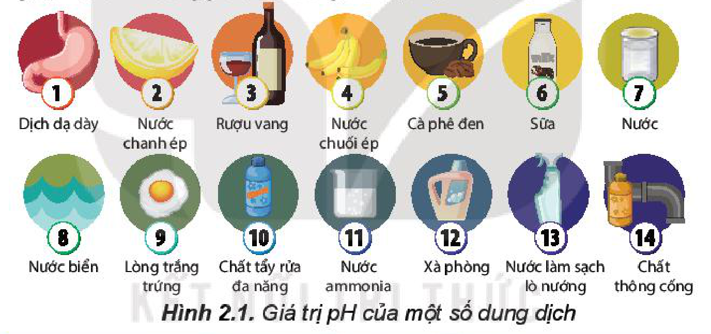
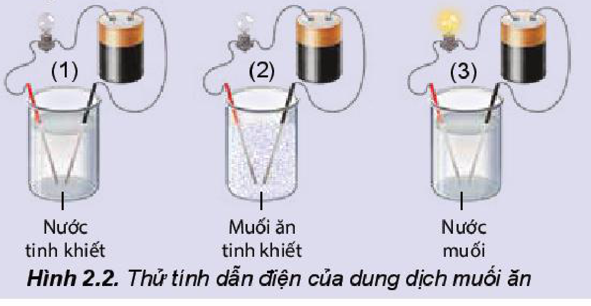
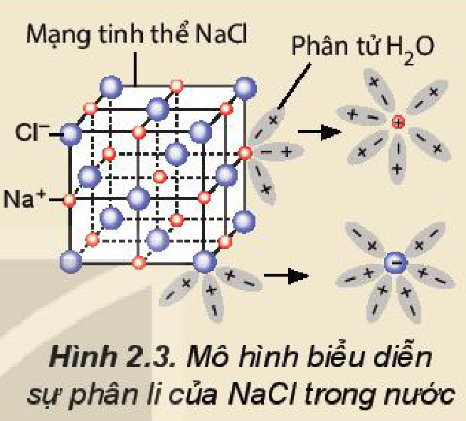
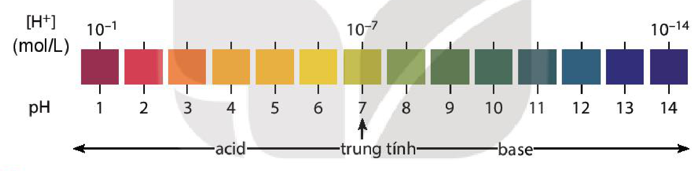
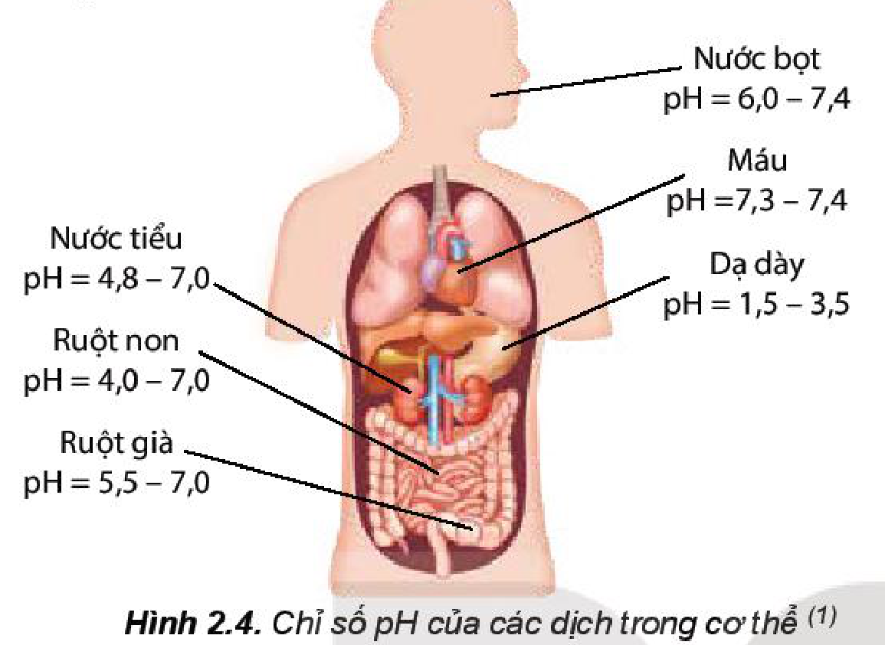
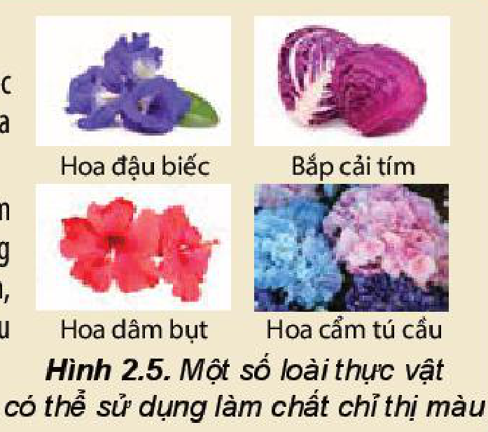
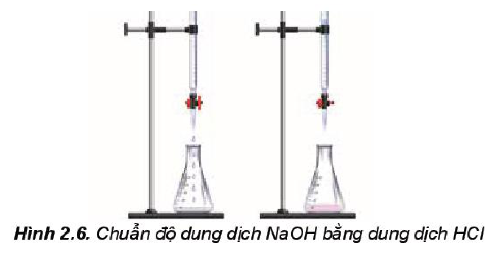
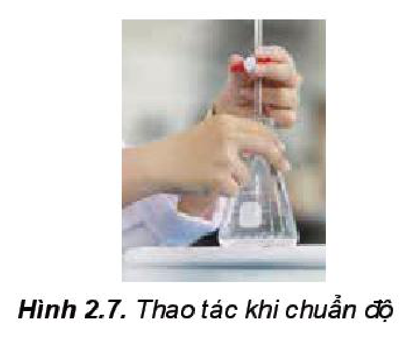

<!-- pdf:17 -->

# BÀI 2: CÂN BẰNG TRONG DUNG DỊCH NƯỚC

## 🎯 Mục tiêu

- Nêu được khái niệm sự điện li, chất điện li, chất không điện li.
- Trình bày được thuyết Brønsted – Lowry về acid – base.
- Nêu được khái niệm và ý nghĩa của pH trong thực tiễn.
- Viết được biểu thức tính pH và biết cách sử dụng các chất chỉ thị để xác định pH bằng các chất chỉ thị phổ biến như giấy chỉ thị màu, quỳ tím, phenolphthalein,...
- Nêu được nguyên tắc xác định nồng độ acid, base mạnh bằng phương pháp chuẩn độ.
- Thực hiện được thí nghiệm chuẩn độ acid – base: Chuẩn độ dung dịch base mạnh (sodium hydroxide) bằng acid mạnh (hydrochloric acid).
- Trình bày được ý nghĩa thực tiễn cân bằng trong dung dịch nước của ion $\ce{Al^3+}$, $\ce{Fe^3+}$ và $\ce{CO3^2-}$.

## 🔴 Mở đầu

Hình 2.1 cho thấy giá trị pH của dung dịch một số chất thông dụng. Vậy pH là gì? pH có ảnh hưởng gì đến đời sống? Xác định pH như thế nào?

- 1: Dịch dạ dày; 2: Nước chanh ép; 3: Rượu vang; 4: Nước chuối ép; 5: Cà phê đen; 6: Sữa; 7: Nước
- 8: Nước biển; 9: Lòng trắng trứng; 10: Chất tẩy rửa đa năng; 11: Nước ammonia; 12: Xà phòng; 13: Nước làm sạch lò nướng; 14: Chất thông cống
<!-- ocr-ok: OCR bỏ sót số thứ tự 1-14 và đọc lỗi nhãn trong Hình 2.1; đã đối chiếu ảnh -->

Hình 2.1. Giá trị pH của một số dung dịch

## I. SỰ ĐIỆN LI

### 1. Hiện tượng điện li

> ✋ **Tìm hiểu về sự điện li**
>
> Thí nghiệm thử tính dẫn điện của nước, muối ăn và dung dịch muối ăn được thực hiện như mô tả trong Hình 2.2.
>
> 
>
> - (1) Nước tinh khiết; (2) Muối ăn tinh khiết; (3) Nước muối
>
> Hình 2.2. Thử tính dẫn điện của dung dịch muối ăn

<!-- pdf:18 -->

> *Thực hiện yêu cầu:*
>
> a) Hãy nhắc lại khái niệm dòng điện.
>
> b) Đèn sáng cho thấy dung dịch $\ce{NaCl}$ dẫn điện, chứng tỏ trong dung dịch có hạt mang điện. Đó có thể là loại hạt nào (electron, phân tử $\ce{NaCl}$, cation hay anion)?
>
> c) Hãy giải thích sự tạo thành hạt mang điện đó.

Quá trình phân li các chất trong nước tạo thành ion được gọi là **sự điện li**. Những chất khi tan trong nước phân li ra các ion được gọi là ***chất điện li***.

> 💡 EM CÓ BIẾT
>
> **Sự phân li của $\ce{NaCl}$ trong nước**
>
> $\ce{NaCl}$ là hợp chất ion, trong tinh thể có các ion $\ce{Na+}$ và $\ce{Cl-}$ liên kết với nhau bằng lực hút tĩnh điện. Nước là một dung môi phân cực. Khi cho tinh thể $\ce{NaCl}$ vào nước, các ion $\ce{Na+}$ và $\ce{Cl-}$ trên bề mặt hút các phân tử nước lại gần. Các phân tử nước hướng các đầu âm vào ion $\ce{Na+}$, các đầu dương vào ion $\ce{Cl-}$ và làm yếu liên kết giữa các cation, anion trong tinh thể và khuếch tán vào nước (Hình 2.3).
>
> Quá trình trên được biểu diễn một cách đơn giản bằng phương trình điện li: $\ce{NaCl(aq) -> Na+(aq) + Cl-(aq)}$.
>
> 
>
> - Mạng tinh thể $\ce{NaCl}$ ($\ce{Cl-}$, $\ce{Na+}$); Phân tử $\ce{H2O}$
>
> Hình 2.3. Mô hình biểu diễn sự phân li của $\ce{NaCl}$ trong nước
<!-- ocr-ok: Hộp Em có biết có Hình 2.3 đặt bên phải nên OCR đọc lồng tiêu đề mục 2 vào giữa các nhãn hình; đã đối chiếu ảnh -->

### 2. Chất điện li

**a) Chất điện li và chất không điện li**

> ✋ **Tìm hiểu về chất điện li và chất không điện li**
>
> Kết quả thử tính dẫn điện với các dung dịch hydrochloric acid ($\ce{HCl}$), sodium hydroxide ($\ce{NaOH}$), saccharose ($\ce{C12H22O11}$), ethanol ($\ce{C2H5OH}$) được trình bày trong bảng dưới đây. *Hãy hoàn thành các thông tin còn thiếu trong bảng vào vở:*
>
> | | Dung dịch $\ce{HCl}$ | Dung dịch $\ce{NaOH}$ | Nước đường | Dung dịch ethanol |
> |---|---|---|---|---|
> | Hiện tượng | Đèn sáng | Đèn sáng | Đèn không sáng | Đèn không sáng |
> | Dung dịch dẫn điện/không dẫn điện | ? | ? | ? | ? |
> | Có/không có các ion trái dấu trong dung dịch | ? | ? | ? | ? |
> | Chất điện li/chất không điện li | ? | ? | ? | ? |

Thí nghiệm trên cho thấy: các chất như hydrochloric acid, sodium hydroxide,... tan trong nước phân li ra các ion nên chúng là *chất điện li*. Saccarose, ethanol,... không phân li ra các ion nên chúng là ***chất không điện li***.

<!-- pdf:19 -->

Sự phân li một chất thành các ion mang điện trái dấu trong dung dịch được biểu diễn bằng **phương trình điện li**.

*Ví dụ:* $\ce{NaOH(aq) -> Na+(aq) + OH-(aq)}$ ; $\ce{HCl(aq) -> H+(aq) + Cl-(aq)}$.

**b) Chất điện li mạnh và chất điện li yếu**

> ✋ **So sánh khả năng phân li trong nước của $\ce{HCl}$ và $\ce{CH3COOH}$**
>
> Kết quả thử tính dẫn điện với dung dịch $\ce{HCl}$ $0,1\text{ M}$ và dung dịch $\ce{CH3COOH}$ $0,1\text{ M}$ cho thấy trường hợp cốc đựng dung dịch $\ce{HCl}$ $0,1\text{ M}$ bóng đèn sáng hơn.
>
> *Thực hiện yêu cầu sau:*
>
> Hãy so sánh số ion mang điện trong hai dung dịch trên, từ đó cho biết acid nào phân li mạnh hơn.

Dựa vào mức độ phân li thành các ion, chất điện li được chia thành hai loại:

- ***Chất điện li mạnh*** là chất khi tan trong nước, hầu hết các phân tử chất tan đều phân li ra ion. Các chất điện li mạnh thường gặp là:
  - Các acid mạnh: $\ce{HCl}$, $\ce{HNO3}$, $\ce{H2SO4}$,...
  - Các base mạnh: $\ce{NaOH}$, $\ce{KOH}$, $\ce{Ca(OH)2}$, $\ce{Ba(OH)2}$,...
  - Hầu hết các muối.

  Quá trình phân li của chất điện li mạnh xảy ra gần như hoàn toàn và được biểu diễn bằng mũi tên một chiều.

  $\ce{HNO3 -> H+ + NO3-}$

  $\ce{NaOH -> Na+ + OH-}$

  $\ce{Na2CO3 -> 2Na+ + CO3^2-}$
- ***Chất điện li yếu*** là chất khi tan trong nước chỉ có một phần số phân tử chất tan phân li ra ion, phần còn lại vẫn tồn tại ở dạng phân tử trong dung dịch.

  *Ví dụ:* trong dung dịch $\ce{CH3COOH}$ $0,1\text{ M}$, cứ $1\,000$ phân tử hoà tan thì chỉ có 3 phân tử phân li thành ion, còn lại tồn tại ở dạng phân tử.

  Những chất điện li yếu gồm các acid yếu như $\ce{CH3COOH}$, $\ce{HClO}$, $\ce{HF}$, $\ce{H2CO3}$,... và base yếu như $\ce{Cu(OH)2}$, $\ce{Fe(OH)2}$,...

  Quá trình phân li của chất điện li yếu là một phản ứng thuận nghịch và được biểu diễn bằng hai nửa mũi tên ngược chiều nhau

  $\ce{CH3COOH <=> H+ + CH3COO-}$.

> ❓ 1. Viết phương trình điện li của các chất sau: $\ce{HF}$, $\ce{HI}$, $\ce{Ba(OH)2}$, $\ce{KNO3}$, $\ce{Na2SO4}$.

<!-- pdf:20 -->

> 💡 EM CÓ BIẾT
>
> **Phương trình ion rút gọn**
>
> Trong dung dịch, chất điện li phân li thành các ion và chính các ion này trực tiếp tham gia vào phản ứng hoá học. Do vậy, phương trình dạng ion rút gọn được sử dụng để biểu diễn các phản ứng xảy ra giữa các chất điện li.
>
> *Ví dụ 1:* Khi cho dung dịch $\ce{HCl}$ (chứa ion $\ce{H+}$ và $\ce{Cl-}$) tác dụng với dung dịch $\ce{NaOH}$ (chứa ion $\ce{Na+}$ và $\ce{OH-}$), thực tế chỉ xảy ra phản ứng giữa ion $\ce{H+}$ và $\ce{OH-}$ theo phương trình ion rút gọn:
>
> $\ce{H+ + OH- -> H2O}$
>
> *Ví dụ 2:* Khi cho dung dịch $\ce{BaCl2}$ tác dụng với dung dịch $\ce{Na2SO4}$, thực tế chỉ xảy ra phản ứng giữa ion $\ce{Ba^2+}$ và $\ce{SO4^2-}$ theo phương trình ion rút gọn:
>
> $\ce{Ba^2+ + SO4^2- -> BaSO4}$
>
> **Phương trình ion rút gọn** cho biết bản chất của phản ứng trong dung dịch các chất điện li.

## II. THUYẾT ACID-BASE CỦA BRØNSTED – LOWRY

### 1. Khái niệm acid và base theo thuyết Brønsted – Lowry

> ✋ Cho các dung dịch: $\ce{HCl}$, $\ce{NaOH}$, $\ce{Na2CO3}$.
>
> a) Viết phương trình điện li của các chất trên.
>
> b) Sử dụng máy đo pH (hoặc giấy pH) xác định pH, môi trường (acid/base) của các dung dịch trên.
>
> c) Theo khái niệm acid-base trong môn *Khoa học tự nhiên* ở lớp 8, trong những chất cho ở trên: Chất nào là acid? Chất nào là base?

Khái niệm acid-base đề cập ở lớp 8 chỉ đúng với dung môi nước và chưa phản ánh đầy đủ bản chất acid/base. Năm 1923, nhà hoá học người Đan Mạch J. Brønsted (Bron-stết) và nhà hoá học người Anh T. Lowry (Lao-ri) đã đưa ra một định nghĩa tổng quát hơn về acid, base.

**Thuyết Brønsted – Lowry** cho rằng **acid** là chất cho proton ($\ce{H+}$) và **base** là chất nhận proton.

*Ví dụ 1:* $\ce{HCl + H2O ->[\ce{H+}] H3O+ + Cl-}$

Trong phản ứng trên: $\ce{HCl}$ cho $\ce{H+}$, $\ce{HCl}$ là acid; $\ce{H2O}$ nhận $\ce{H+}$, $\ce{H2O}$ là base.
<!-- ocr-ok: OCR đọc lỗi công thức HCl và H2O ("HƠI", "HO", "H.O"); đã đối chiếu ảnh -->

*Ví dụ 2:* $\ce{NH3 + H2O <=>[][\ce{H+}] NH4+ + OH-}$

Trong phản ứng thuận, $\ce{NH3}$ nhận $\ce{H+}$ của $\ce{H2O}$, $\ce{NH3}$ là base, $\ce{H2O}$ là acid. Trong phản ứng nghịch, ion $\ce{NH4+}$ là acid, ion $\ce{OH-}$ là base.

*Ví dụ 3:* $\ce{CO3^2- + H2O <=>[][\ce{H+}] HCO3- + OH-}$

Trong phản ứng thuận, $\ce{CO3^2-}$ nhận $\ce{H+}$ của $\ce{H2O}$, $\ce{CO3^2-}$ là base, $\ce{H2O}$ là acid. Trong phản ứng nghịch, ion $\ce{HCO3-}$ là acid, ion $\ce{OH-}$ là base.

<!-- pdf:21 -->

*Ví dụ 4:*

a) $\ce{HCO3- + H2O <=>[\ce{H+}] H3O+ + CO3^2-}$

Trong phản ứng thuận, $\ce{HCO3-}$ nhường $\ce{H+}$, $\ce{HCO3-}$ là acid, $\ce{H2O}$ là base. Trong phản ứng nghịch $\ce{CO3^2-}$ là base, $\ce{H3O+}$ là acid.

b) $\ce{HCO3- + H2O <=>[][\ce{H+}] HO- + H2CO3}$

Trong phản ứng thuận, $\ce{HCO3-}$ nhận $\ce{H+}$ từ nước, $\ce{HCO3-}$ là base, $\ce{H2O}$ là acid. Trong phản ứng nghịch $\ce{H2CO3}$ là acid, $\ce{OH-}$ là base.

Ion $\ce{HCO3-}$ vừa có thể nhận $\ce{H+}$, vừa có thể cho $\ce{H+}$, vậy $\ce{HCO3-}$ có tính chất lưỡng tính. Phân tử $\ce{H2O}$ cũng vừa có thể nhận $\ce{H+}$, vừa có thể cho $\ce{H+}$ nên $\ce{H2O}$ cũng là **chất lưỡng tính**.

> ❓ 2. Dựa vào thuyết acid – base của Brønsted – Lowry, hãy xác định chất nào là acid, chất nào là base trong các phản ứng sau:
>
>    a) $\ce{CH3COOH + H2O <=> CH3COO- + H3O+}$
>
>    b) $\ce{S^2- + H2O <=> HS- + OH-}$

### 2. Ưu điểm của thuyết Brønsted – Lowry

Theo thuyết Arrhenius, trong phân tử acid phải có nguyên tử H, trong nước phân li ra ion $\ce{H+}$, trong phân tử base phải có nhóm $\ce{OH}$, trong nước phân li ra ion $\ce{OH-}$. Thuyết Arrhenius chỉ đúng cho trường hợp dung môi là nước. Thuyết acid – base của Brønsted – Lowry tổng quát hơn thuyết Arrhenius, phân tử không có nhóm $\ce{OH}$ như $\ce{NH3}$ hoặc ion như $\ce{CO3^2-}$ cũng là base.

> 💡 EM CÓ BIẾT
>
> Thuyết acid-base của Brønsted – Lowry còn có thể mở rộng đối với những phản ứng acid – base trong dung môi không phải nước. Ví dụ, perchloric acid ($\ce{HClO4}$) trong dung môi acetic acid ($\ce{CH3COOH}$), xảy ra phản ứng:
>
> $\ce{HClO4 + CH3COOH <=> ClO4- + CH3COOH2+}$
>
> Trong phản ứng trên, $\ce{HClO4}$ là acid vì là chất cho $\ce{H+}$, còn $\ce{CH3COOH}$ là base vì là chất nhận $\ce{H+}$.

## III. KHÁI NIỆM pH VÀ Ý NGHĨA CỦA pH TRONG THỰC TIỄN
<!-- ocr-ok: OCR đọc lỗi "TRONG THỰC TIỄN" thành "TR0NG THỰC TIỀN"; đã đối chiếu ảnh -->

> 💡 EM CÓ BIẾT
>
> **Tích số ion của nước ($K_{\text{w}}$)$^{(1)}$**
>
> Trong dung dịch nước, tích số $K_{\text{w}} = [\ce{H+}][\ce{OH-}]$ là một hằng số, chỉ phụ thuộc vào nhiệt độ và được gọi là **tích số ion của nước**. Ở $25\text{ }^\circ\text{C}$, $K_{\text{w}} = 10^{-14}$, tuy nhiên giá trị này có thể được dùng khi nhiệt độ không khác nhiều với $25\text{ }^\circ\text{C}$.
>
> Đối với nước tinh khiết: $[\ce{H+}] = [\ce{OH-}] = \sqrt{10^{-14}} = 10^{-7}\text{ (mol/L)}$.

> (1) Trong kí hiệu $K_{\text{w}}$, w là viết tắt của từ tiếng Anh: water (nước).

<!-- pdf:22 -->

### 1. Khái niệm pH

Nồng độ ion $\ce{H+}$ hoặc ion $\ce{OH-}$ được dùng để đánh giá tính acid hoặc tính base của các dung dịch. Tuy nhiên, nếu các dung dịch có nồng độ $\ce{H+}$, nồng độ $\ce{OH-}$ thấp, chúng là những số có số mũ âm hoặc có nhiều chữ số thập phân. Vì vậy, để tiện sử dụng, người ta dùng đại lượng **pH** với quy ước như sau:

$$\text{pH} = -\lg[\ce{H+}] \text{ hoặc } [\ce{H+}] = 10^{-\text{pH}}$$
<!-- ocr-ok: OCR đọc lỗi công thức pH đóng khung ("pH =~-lIg[H*]hoặc [H*] = 10H"); đã đối chiếu ảnh -->

Trong đó $[\ce{H+}]$ là nồng độ mol của ion $\ce{H+}$.

Nếu dung dịch có $[\ce{H+}] = 10^{-a}\text{ mol/L}$ thì $\text{pH} = a$.

*Ví dụ:* $[\ce{H+}] = 10^{-2}\text{ mol/L}$ thì $\text{pH} = 2$.

**Môi trường acid** là môi trường có $[\ce{H+}] > [\ce{OH-}]$ nên $[\ce{H+}] > 10^{-7}\text{ mol/L}$ hay $\text{pH} < 7$.

**Môi trường base** là môi trường có $[\ce{H+}] < [\ce{OH-}]$ nên $[\ce{H+}] < 10^{-7}\text{ mol/L}$ hay $\text{pH} > 7$.

**Môi trường trung tính** là môi trường có $[\ce{H+}] = [\ce{OH-}] = 10^{-7}\text{ mol/L}$ hay $\text{pH} = 7$.

Thang pH thường dùng có giá trị từ 1 đến 14.

- $[\ce{H+}]\text{ (mol/L)}$: $10^{-1}$; $10^{-7}$; $10^{-14}$
- $\text{pH}$: 1, 2, 3, 4, 5, 6 (acid); 7 (trung tính); 8, 9, 10, 11, 12, 13, 14 (base)
<!-- ocr-ok: OCR đọc lỗi các số trên sơ đồ thang pH ("VNI 20A8"); đã đối chiếu ảnh -->

> ❓ 3. Một loại dầu gội đầu có nồng độ ion $\ce{OH-}$ là $10^{-5,17}\text{ mol/L}$.
>
>    a) Tính nồng độ ion $\ce{H+}$, pH của loại dầu gội nói trên.
>
>    b) Môi trường của loại dầu gội đầu trên là acid, base hay trung tính?
>
> 4. Một học sinh làm thí nghiệm xác định độ pH của đất như sau: Lấy một lượng đất cho vào nước rồi lọc lấy phần dung dịch. Dùng máy pH đo được giá trị pH là 4,52.
>
>    a) Hãy cho biết môi trường của dung dịch là acid, base hay trung tính.
>
>    b) Loại đất trên được gọi là đất chua. Hãy đề xuất biện pháp để giảm độ chua, tăng độ pH của đất.
>
> 5. pH của dung dịch nào sau đây có giá trị nhỏ nhất?
>
>    A. Dung dịch $\ce{HCl}$ $0,1\text{ M}$. B. Dung dịch $\ce{CH3COOH}$ $0,1\text{ M}$.
>
>    C. Dung dịch $\ce{NaCl}$ $0,1\text{ M}$. D. Dung dịch $\ce{NaOH}$ $0,01\text{ M}$.

<!-- pdf:23 -->

### 2. Ý nghĩa của pH trong thực tiễn

Chỉ số pH có ý nghĩa to lớn trong thực tiễn, pH có liên quan đến sức khoẻ của con người, sự phát triển của động vật, thực vật,...

- Nước bọt: $\text{pH} = 6,0 - 7,4$; Máu: $\text{pH} = 7,3 - 7,4$; Dạ dày: $\text{pH} = 1,5 - 3,5$
- Nước tiểu: $\text{pH} = 4,8 - 7,0$; Ruột non: $\text{pH} = 4,0 - 7,0$; Ruột già: $\text{pH} = 5,5 - 7,0$
<!-- ocr-ok: OCR đọc lỗi các nhãn chỉ số pH trong Hình 2.4; đã đối chiếu ảnh -->

Hình 2.4. Chỉ số pH của các dịch trong cơ thể$^{(1)}$

> 💡 EM CÓ BIẾT
>
> Chỉ số pH trong nước tiểu thường trong khoảng $4,8 - 7,0$. Nếu pH nước tiểu cao trên $8,0$, bệnh nhân có thể đang mắc một số bệnh như sỏi thận, nhiễm trùng đường tiết niệu,...
>
> Nếu pH nước tiểu thấp dưới $5,0$, nước tiểu có tính acid hơn bình thường, bệnh nhân có thể đang mắc bệnh tiểu đường, tiêu chảy, mất nước,...

Trong cơ thể của người, máu và các dịch của dạ dày, mật,... đều có giá trị pH trong một khoảng nhất định. Chỉ số pH trong cơ thể có liên quan đến tình trạng sức khoẻ. Nếu chỉ số pH tăng hoặc giảm đột ngột, không nằm trong giới hạn cho phép thì có thể là dấu hiệu ban đầu của bệnh lí, người bệnh cần được khám để tìm ra nguyên nhân.

Một số động vật sống dưới nước cần môi trường có giá trị pH thích hợp, ví dụ: tôm và cá ưa sống trong môi trường nước có pH khoảng $7,5 - 8,5$.

Một số loại thực vật chỉ phát triển tốt trong đất có giá trị pH thích hợp, ví dụ:

| | Cây chè | Cây lúa | Cây cà chua |
|---|---|---|---|
| pH | 4,5 – 5,5 | 5,5 – 6,5 | 6,0 – 7,0 |
<!-- ocr-ok: OCR đọc tách cột bảng pH của cây trồng và sai số liệu ("45-5,5", "55-8,5"); đã đối chiếu ảnh -->

Trong đời sống hằng ngày, các sản phẩm như dầu gội, xà phòng, kem dưỡng da,... cũng đều cần có giá trị pH trong một khoảng nhất định để an toàn cho người sử dụng.

> ❓ 6. Đo pH của một cốc nước chanh được giá trị pH bằng 2,4. Nhận định nào sau đây **không** đúng?
>
>    A. Nước chanh có môi trường acid.
>
>    B. Nồng độ ion $[\ce{H+}]$ của nước chanh là $10^{-2,4}\text{ mol/L}$.
>
>    C. Nồng độ ion $[\ce{H+}]$ của nước chanh là $0,24\text{ mol/L}$.
>
>    D. Nồng độ của ion $[\ce{OH-}]$ của nước chanh nhỏ hơn $10^{-7}\text{ mol/L}$.
> <!-- ocr-ok: OCR đọc mất chữ cái đầu đáp án A, B, C, D và sinh kí tự rác "”¬ Ueomzx»r"; đã đối chiếu ảnh -->
>
> 7. Nước Javel (chứa $\ce{NaClO}$ và $\ce{NaCl}$) được dùng làm chất tẩy rửa, khử trùng. Trong dung dịch, ion $\ce{ClO-}$ nhận proton của nước để tạo thành $\ce{HClO}$.
>
>    a) Viết phương trình hoá học của phản ứng xảy ra và xác định chất nào là acid, chất nào là base trong phản ứng trên.
>
>    b) Dựa vào phản ứng, hãy cho biết môi trường của nước Javel là acid hay base.

> (1) Nguồn: Expert Opinion on Drug Metabolism & Toxicology.

<!-- pdf:24 -->

### 4. Xác định pH

Giá trị pH của dung dịch được xác định gần đúng bằng cách sử dụng chất chỉ thị acid – base. Khi cần xác định giá trị pH chính xác hơn, người ta sử dụng máy đo pH.

**Chất chỉ thị acid – base** là chất có màu sắc biến đổi phụ thuộc vào giá trị pH của dung dịch. Một số chất chỉ thị như giấy pH, giấy quỳ, phenolphthalein có màu sắc thay đổi trong các khoảng pH khác nhau (Bảng 2.1).

*Bảng 2.1. Màu của giấy pH, giấy quỳ và phenolphthalein trong dung dịch ở các khoảng pH khác nhau*

| Chất chỉ thị | Khoảng pH và màu sắc | | |
|---|---|---|---|
| Giấy quỳ | Đỏ ($\text{pH} \le 6$) | Tím ($\text{pH} = 7$) | Xanh ($\text{pH} \ge 8$) |
| Phenolphthalein | Không màu ($\text{pH} < 8$) | | Màu hồng ($\text{pH} > 8$) |
| Giấy pH | Dải màu biến đổi liên tục theo thang pH từ 1 đến 14 | | |
<!-- ocr-ok: Bảng 2.1 có các ô tô màu nên OCR bỏ sót chữ "Đỏ pH <= 6", "Tím pH = 7", "Xanh pH >= 8", "pH > 8 Màu hồng"; đã đối chiếu ảnh -->

> ✋ **Làm chất chỉ thị màu từ hoa đậu biếc/bắp cải tím**
>
> *Chuẩn bị:*
> - Hoa đậu biếc (khoảng $50\text{ g}$) hoặc bắp cải tím thái nhỏ (khoảng $100\text{ g}$).
> - Cốc thuỷ tinh $250\text{ mL}$, nước sôi, đũa thuỷ tinh, lưới/vải lọc.
> - Các cốc (đã được dán nhãn) đựng giấm ăn, nước C sủi, nước rửa bát, nước soda, nước muối.
> - Giấy pH hoặc máy đo pH.
>
> *Tiến hành:*
> - Ngâm khoảng $50\text{ g}$ hoa đậu biếc/$100\text{ g}$ bắp cải tím đã được chuẩn bị vào $100\text{ mL}$ nước sôi trong khoảng 10 phút. Lọc bằng lưới lọc hoặc vải lọc, thu được dung dịch. Dung dịch này được sử dụng làm chất chỉ thị.
> - Dùng máy đo pH (hoặc giấy pH) xác định pH của các dung dịch.
> - Cho vài giọt chất chỉ thị lần lượt vào các dung dịch: giấm ăn, nước C sủi, nước rửa bát, nước soda, nước muối và khuấy đều. Quan sát sự đổi màu của các dung dịch.
>
> *Hoàn thành thông tin theo mẫu bảng sau vào vở:*
>
> | | Giấm ăn | Nước C sủi | Nước rửa bát | Nước soda | Nước muối |
> |---|---|---|---|---|---|
> | pH | ? | ? | ? | ? | ? |
> | Màu của chất chỉ thị | ? | ? | ? | ? | ? |
> | Môi trường acid/base | ? | ? | ? | ? | ? |

<!-- pdf:25 -->

> 💡 EM CÓ BIẾT
>
> **Chất chỉ thị màu trong tự nhiên**
>
> Hoa đậu biếc, hoa cẩm tú cầu, hoa dâm bụt, bắp cải tím,... có chứa các hợp chất hữu cơ mang màu và màu sắc của chúng thay đổi theo pH của môi trường nên có thể sử dụng chúng làm chất chỉ thị màu.
>
> *Ví dụ:* sắc tố tạo màu đặc trưng cho đậu biếc là các hợp chất thuộc nhóm anthocyanin, một trong những chất chống oxi hoá tự nhiên. Ở môi trường pH nhỏ hơn 7 (môi trường acid), anthocyanin chuyển sang màu đỏ tím, ở môi trường pH lớn hơn 7 (môi trường base) chúng chuyển sang màu xanh sẫm.
>
> 
>
> - Hoa đậu biếc; Bắp cải tím; Hoa dâm bụt; Hoa cẩm tú cầu
>
> Hình 2.5. Một số loài thực vật có thể sử dụng làm chất chỉ thị màu
<!-- ocr-ok: Hình 2.5 đặt bên phải trong hộp Em có biết nên OCR đọc trộn nhãn ảnh với các dòng văn bản; đã đối chiếu ảnh -->

## IV. SỰ THUỶ PHÂN CỦA CÁC ION

### 1. Môi trường của một số dung dịch muối

> ✋ Cho các dung dịch sau: $\ce{Na2CO3}$, $\ce{AlCl3}$, $\ce{FeCl3}$.
>
> 1. Dùng giấy pH xác định giá trị pH gần đúng của các dung dịch trên.
> 2. Nhận xét và giải thích về môi trường của các dung dịch trên.

Khi tan trong nước, muối phân li thành các ion. Phản ứng giữa ion với nước tạo ra các dung dịch có môi trường khác nhau được gọi là **phản ứng thuỷ phân**.

*Ví dụ 1:* Trong dung dịch $\ce{Na2CO3}$, ion $\ce{Na+}$ không bị thuỷ phân, còn $\ce{CO3^2-}$ thuỷ phân trong nước tạo ion $\ce{OH-}$ theo phương trình:

$\ce{CO3^2- + H2O <=> HCO3- + OH-}$

Vì vậy, dung dịch $\ce{Na2CO3}$ có môi trường base. $\ce{Na2CO3}$ được sử dụng trong công nghiệp thực phẩm, dệt, nhuộm, công nghiệp thuỷ tinh, silicate,...

*Ví dụ 2:* Trong dung dịch $\ce{AlCl3}$ và $\ce{FeCl3}$, ion $\ce{Cl-}$ không bị thuỷ phân, các ion $\ce{Al^3+}$ và $\ce{Fe^3+}$ bị thuỷ phân trong nước tạo ion $\ce{H+}$ theo phương trình ở dạng đơn giản như sau:

$\ce{Al^3+ + H2O <=> Al(OH)^2+ + H+}$

$\ce{Fe^3+ + H2O <=> Fe(OH)^2+ + H+}$

Do đó, dung dịch $\ce{AlCl3}$, $\ce{FeCl3}$ có môi trường acid. Trong thực tế, các loại đất có chứa nhiều ion $\ce{Al^3+}$, $\ce{Fe^3+}$ có giá trị pH thấp hay còn gọi là đất chua. Để khử chua, người ta bón vôi cho đất.

Các muối nhôm và sắt, ví dụ: *phèn nhôm* ($\ce{(NH4)2SO4.Al2(SO4)3.24H2O}$) và *phèn sắt* ($\ce{(NH4)2SO4.Fe2(SO4)3.24H2O}$) được sử dụng làm chất keo tụ trong quá trình xử lí nước, dùng làm chất cầm màu trong công nghiệp dệt, nhuộm, hoặc làm chất kết dính, chống nhoè trong công nghiệp giấy,...

<!-- pdf:26 -->

## V. CHUẨN ĐỘ ACID-BASE

### 1. Nguyên tắc

***Chuẩn độ*** là phương pháp xác định nồng độ của một chất bằng một dung dịch chuẩn đã biết nồng độ. Dựa vào thể tích của các dung dịch khi phản ứng vừa đủ với nhau, xác định được nồng độ dung dịch chất cần chuẩn độ.

Trong phòng thí nghiệm, nồng độ của dung dịch base mạnh (ví dụ $\ce{NaOH}$) được xác định bằng một dung dịch acid mạnh (ví dụ $\ce{HCl}$) đã biết trước nồng độ mol dựa trên phản ứng:

$\ce{NaOH + HCl -> NaCl + H2O}$

Khi các chất phản ứng vừa đủ với nhau, số mol $\ce{HCl}$ phản ứng bằng số mol $\ce{NaOH}$.

Ta có: $V_{\ce{HCl}} \cdot C_{\ce{HCl}} = V_{\ce{NaOH}} \cdot C_{\ce{NaOH}}$

Trong đó:

$C_{\ce{HCl}}$ và $C_{\ce{NaOH}}$ lần lượt là nồng độ mol của dung dịch $\ce{HCl}$ và dung dịch $\ce{NaOH}$;

$V_{\ce{HCl}}$ và $V_{\ce{NaOH}}$ lần lượt là thể tích của dung dịch $\ce{HCl}$ và dung dịch $\ce{NaOH}$ (cùng đơn vị đo).

Khi biết $V_{\ce{HCl}}$, $V_{\ce{NaOH}}$ trong quá trình chuẩn độ và biết $C_{\ce{HCl}}$ sẽ tính được $C_{\ce{NaOH}}$.

Thời điểm để kết thúc chuẩn độ được xác định bằng sự đổi màu của chất chỉ thị phenolphthalein.

### 2. Thực hành chuẩn độ acid – base

*Chuẩn bị:*
- Dung dịch $\ce{HCl}$ $0,1\text{ M}$; dung dịch $\ce{NaOH}$ nồng độ khoảng $0,1\text{ M}$; dung dịch phenolphthalein.
- Pipette $10\text{ mL}$; burette $25\text{ mL}$; bình tam giác $100\text{ mL}$; bình tia nước cất; giá đỡ; kẹp burrete.
<!-- ocr-ok: OCR đọc dính chữ ("Dungdịch HƠI 0,1M", "dung dịchphenolphthalein"); đã đối chiếu ảnh -->

*Tiến hành:*
- Dùng pipette lấy $10\text{ mL}$ dung dịch $\ce{HCl}$ $0,1\text{ M}$ cho vào bình tam giác, thêm 1 – 2 giọt phenolphthalein.
- Cho dung dịch $\ce{NaOH}$ vào burette, điều chỉnh dung dịch trong burette về mức 0.
- Mở khoá burette, nhỏ từng giọt dung dịch $\ce{NaOH}$ xuống bình tam giác (lắc đều trong quá trình chuẩn độ) đến khi dung dịch xuất hiện màu hồng nhạt (bền trong khoảng 10 giây) thì dừng chuẩn độ.
- Ghi lại thể tích dung dịch $\ce{NaOH}$ đã dùng.

*Tiến hành chuẩn độ ít nhất ba lần, ghi số liệu thực nghiệm và hoàn thành vào vở theo mẫu bảng sau:*

| | $V_{\ce{HCl}}\text{ (mL)}$ | $V_{\ce{NaOH}}\text{ (mL)}$ | $V_{\text{tb }\ce{NaOH}}\text{ (mL)}$ | $C_{\ce{NaOH}}\text{ (mol/L)}$ |
|---|---|---|---|---|
| Thí nghiệm 1 | ? | ? | ? | ? |
| Thí nghiệm 2 | ? | ? | ? | ? |
| Thí nghiệm 3 | ? | ? | ? | ? |

<!-- pdf:27 -->

Hình 2.6. Chuẩn độ dung dịch $\ce{NaOH}$ bằng dung dịch $\ce{HCl}$

Hình 2.7. Thao tác khi chuẩn độ

*Lưu ý:*
- Tránh để các hoá chất như dung dịch $\ce{HCl}$, dung dịch $\ce{NaOH}$ bắn vào tay, mắt.
- Các dụng cụ thuỷ tinh (bình tam giác, burette, pipette,...) dễ vỡ, cần cẩn thận.

> ❓ 8. Nêu một số điểm cần chú ý trong quá trình chuẩn độ.
>
> 9. Nêu một số nguyên nhân có thể dẫn đến sai số trong quá trình chuẩn độ.

## 📌 Em đã học

- Quá trình phân li các chất trong nước tạo thành các ion được gọi là *sự điện li*. Những chất khi tan trong nước phân li ra các ion được gọi là *chất điện li*. Các chất khi tan trong nước không phân li ra các ion được gọi là **chất không điện li**.
- Chất khi tan trong nước phân li hoàn toàn thành các ion là chất điện li mạnh.
- Thuyết Brønsted – Lowry về acid-base: acid là chất cho proton ($\ce{H+}$) và base là chất nhận proton.
- Biểu thức tính pH: $\text{pH} = -\lg[\ce{H+}]$ hoặc $[\ce{H+}] = 10^{-\text{pH}}$.
- Chất chỉ thị acid – base là chất có màu sắc biến đổi phụ thuộc vào giá trị pH của dung dịch. Các chất chỉ thị thông dụng gồm có: giấy quỳ, phenolphthalein, giấy pH.
- Phản ứng giữa ion với nước được gọi là phản ứng thuỷ phân.
- Chuẩn độ là phương pháp xác định nồng độ của một chất bằng một dung dịch chuẩn đã biết nồng độ.

## ✏️ Em có thể

- Tự làm chất chỉ thị màu bằng các nguyên liệu dễ kiếm như hoa đậu biếc, bắp cải tím,...
- Vận dụng kiến thức về pH trong cơ thể người để bảo vệ, chăm sóc sức khoẻ.
- Xác định pH trong môi trường (đất, nước), từ đó có giải pháp cải tạo môi trường hoặc lựa chọn giống cây trồng, vật nuôi phục vụ cho sản xuất nông nghiệp, nuôi trồng thuỷ sản.
- Biết lựa chọn, sử dụng dược phẩm, mĩ phẩm, chất tẩy rửa có pH thích hợp để bảo vệ sức khoẻ.
- Xác định được nồng độ dung dịch acid – base bằng phương pháp chuẩn độ.

## 📷 Danh sách hình trong bài

| Mã hình | Trang PDF | Vị trí | Chú thích gốc |
|---|---|---|---|
| H11-hoa-b02-01 | 17 | Mục Mở đầu (nút chai số 3 cao sát dòng chữ phía trên nên cạnh trên đi qua khe hẹp giữa chữ và đỉnh nút chai) | Hình 2.1. Giá trị pH của một số dung dịch |
| H11-hoa-b02-02 | 17 | Mục I.1, hộp hoạt động | Hình 2.2. Thử tính dẫn điện của dung dịch muối ăn |
| H11-hoa-b02-03 | 18 | Mục I.1, hộp Em có biết (nằm đè lên vùng logo chìm ở giữa trang) | Hình 2.3. Mô hình biểu diễn sự phân li của $\ce{NaCl}$ trong nước |
| H11-hoa-b02-04 | 22 | Mục III.1 (sơ đồ thang pH) | (sách không đánh số, không có chú thích) |
| H11-hoa-b02-05 | 23 | Mục III.2 (đỉnh đầu hình người cao hơn dòng chữ góc trên trái nên đặt cạnh trên ngay dưới dòng chữ) | Hình 2.4. Chỉ số pH của các dịch trong cơ thể$^{(1)}$ |
| H11-hoa-b02-06 | 25 | Mục III.4, hộp Em có biết (chữ 'c' đầu chú thích hình chồng lấn phương ngang với mép phải cột chữ bên trái) | Hình 2.5. Một số loài thực vật có thể sử dụng làm chất chỉ thị màu |
| H11-hoa-b02-07 | 27 | Mục V.2 | Hình 2.6. Chuẩn độ dung dịch $\ce{NaOH}$ bằng dung dịch $\ce{HCl}$ |
| H11-hoa-b02-08 | 27 | Mục V.2 | Hình 2.7. Thao tác khi chuẩn độ |
