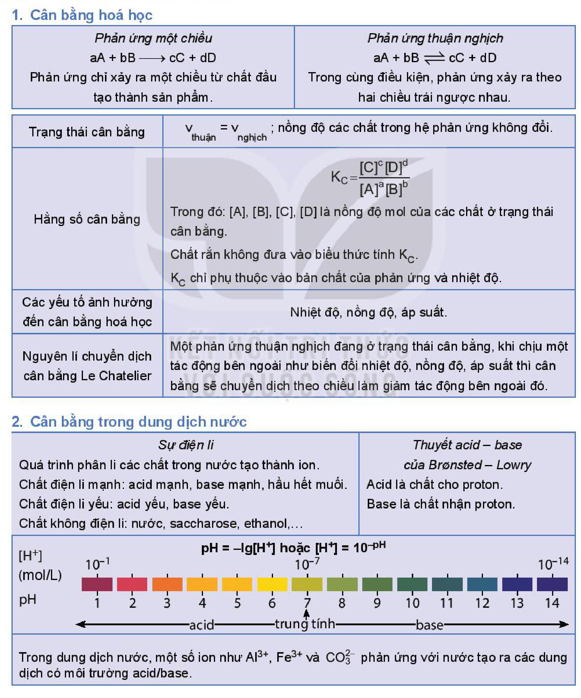

<!-- pdf:28 -->

# BÀI 3: ÔN TẬP CHƯƠNG 1

## I. HỆ THỐNG HOÁ KIẾN THỨC
<!-- ocr-ok: OCR đọc sai "KIẾN THỨC" thành "HIẾN THỨC"; đã đối chiếu ảnh -->

### 1. Cân bằng hoá học

| Nội dung | Phản ứng một chiều | Phản ứng thuận nghịch |
|---|---|---|
| Phương trình và đặc điểm | $\ce{aA + bB -> cC + dD}$ Phản ứng chỉ xảy ra một chiều từ chất đầu tạo thành sản phẩm. | $\ce{aA + bB <=> cC + dD}$ Trong cùng điều kiện, phản ứng xảy ra theo hai chiều trái ngược nhau. |
| Trạng thái cân bằng | \multicolumn{2}{l}{$v_{\text{thuận}} = v_{\text{nghịch}}$ ; nồng độ các chất trong hệ phản ứng không đổi.} |
| Hằng số cân bằng | \multicolumn{2}{l}{$K_C = \frac{[\ce{C}]^c[\ce{D}]^d}{[\ce{A}]^a[\ce{B}]^b}$ Trong đó: $[\ce{A}], [\ce{B}], [\ce{C}], [\ce{D}]$ là nồng độ mol của các chất ở trạng thái cân bằng. Chất rắn không đưa vào biểu thức tính $K_C$. $K_C$ chỉ phụ thuộc vào bản chất của phản ứng và nhiệt độ.} |
| Các yếu tố ảnh hưởng đến cân bằng hoá học | \multicolumn{2}{l}{Nhiệt độ, nồng độ, áp suất.} |
| Nguyên lí chuyển dịch cân bằng Le Chatelier | \multicolumn{2}{l}{Một phản ứng thuận nghịch đang ở trạng thái cân bằng, khi chịu một tác động bên ngoài như biến đổi nhiệt độ, nồng độ, áp suất thì cân bằng sẽ chuyển dịch theo chiều làm giảm tác động bên ngoài đó.} |
<!-- ocr-ok: Bảng hệ thống hoá kiến thức mục 1 có công thức Kc và v_thuận = v_nghịch bị OCR đọc lỗi; đã đối chiếu ảnh -->

### 2. Cân bằng trong dung dịch nước

- **Sự điện li:**
  - Quá trình phân li các chất trong nước tạo thành ion.
  - Chất điện li mạnh: acid mạnh, base mạnh, hầu hết muối.
  - Chất điện li yếu: acid yếu, base yếu.
  - Chất không điện li: nước, saccharose, ethanol,...
- **Thuyết acid – base của Brønsted – Lowry:**
  - Acid là chất cho proton.
  - Base là chất nhận proton.
- **Khái niệm pH và thang pH:**
  - $\text{pH} = -\lg[\ce{H+}]$ hoặc $[\ce{H+}] = 10^{-\text{pH}}$
  - $[\ce{H+}]\text{ (mol/L)}$: $10^{-1} \dots 10^{-7} \dots 10^{-14}$
  - $\text{pH}$: 1, 2, 3, 4, 5, 6 (acid); 7 (trung tính); 8, 9, 10, 11, 12, 13, 14 (base)
- Trong dung dịch nước, một số ion như $\ce{Al^3+}$, $\ce{Fe^3+}$ và $\ce{CO3^2-}$ phản ứng với nước tạo ra các dung dịch có môi trường acid/base.
<!-- ocr-ok: Sơ đồ thang pH trong bảng mục 2 bị OCR đọc lỗi ("OƯ ngang mi... HN NHI HÌN SH"); đã đối chiếu ảnh -->

<!-- pdf:29 -->

## II. LUYỆN TẬP

**Câu 1.** Hằng số $K_C$ của một phản ứng phụ thuộc vào yếu tố nào sau đây?

A. Nồng độ. B. Nhiệt độ. C. Áp suất. D. Chất xúc tác.

**Câu 2.** Thêm nước vào $10\text{ mL}$ dung dịch $\ce{HCl}$ $1,0\text{ mol/L}$ để được $1\,000\text{ mL}$ dung dịch A. Dung dịch mới thu được có pH thay đổi như thế nào so với dung dịch ban đầu?

A. pH giảm đi 2 đơn vị. B. pH giảm đi 0,5 đơn vị.

C. pH tăng gấp đôi. D. pH tăng 2 đơn vị.

**Câu 3.** Tính pH của các dung dịch sau:

a) Dung dịch $\ce{NaOH}$ $0,1\text{ M}$;

b) Dung dịch $\ce{HCl}$ $0,1\text{ M}$;

c) Dung dịch $\ce{Ca(OH)2}$ $0,01\text{ M}$.

**Câu 4.** Viết biểu thức hằng số cân bằng $K_C$ cho các phản ứng sau:

a) $\ce{2SO2(g) + O2(g) <=> 2SO3(g)}$

b) $\ce{2C(s) + O2(g) <=> 2CO(g)}$

c) $\ce{AgCl(s) <=> Ag+(aq) + Cl-(aq)}$

**Câu 5.** Cho cân bằng hoá học sau: $\ce{H2(g) + I2(g) <=> 2HI(g)} \qquad \Delta_r H^o_{298} = -9,6\text{ kJ}$

Nhận xét nào sau đây **không** đúng?

A. Khi tăng nhiệt độ, cân bằng trên chuyển dịch theo chiều nghịch.

B. Ở nhiệt độ không đổi, khi tăng áp suất thì cân bằng không bị chuyển dịch.

C. Ở nhiệt độ không đổi, khi tăng nồng độ $\ce{H2}$ hoặc $\ce{I2}$ thì giá trị hằng số cân bằng tăng.

D. Ở trạng thái cân bằng, tốc độ phản ứng thuận bằng tốc độ phản ứng nghịch.

**Câu 6.** Xét phản ứng xảy ra trong lò luyện gang:

$\ce{Fe2O3(s) + 3CO(g) <=> 2Fe(s) + 3CO2(g)} \qquad \Delta_r H^o < 0$

Nêu các yếu tố (nồng độ, nhiệt độ, áp suất) cần tác động vào cân bằng trên để cân bằng chuyển dịch về bên phải (làm tăng hiệu suất của phản ứng).

**Câu 7.** Cho cân bằng hoá học sau:

$\ce{CO(g) + H2O(g) <=> H2(g) + CO2(g)}$

Ở $700\text{ }^\circ\text{C}$, hằng số cân bằng $K_C = 8,3$. Cho $1\text{ mol}$ khí $\ce{CO}$ và $1\text{ mol}$ hơi nước vào bình kín dung tích 10 lít và giữ ở $700\text{ }^\circ\text{C}$. Tính nồng độ các chất ở trạng thái cân bằng.

## 📷 Danh sách hình trong bài

| Mã hình | Trang PDF | Vị trí | Chú thích gốc |
|---|---|---|---|
| H11-hoa-b03-01 | 28 | Mục I. Hệ thống hoá kiến thức | (sách không đánh số, không có chú thích) |
