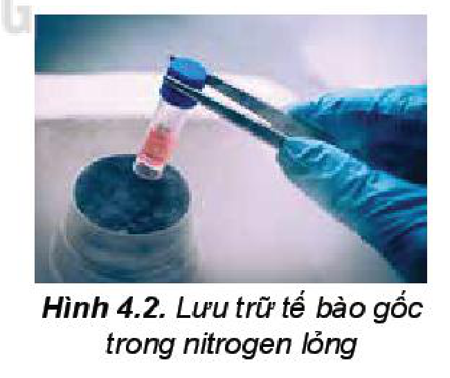

<!-- pdf:30 -->

# BÀI 4: NITROGEN

## 🎯 Mục tiêu

- Phát biểu được trạng thái tự nhiên của nguyên tố nitrogen.
- Giải thích được tính trơ của đơn chất nitrogen ở nhiệt độ thường thông qua liên kết và giá trị năng lượng liên kết.
- Trình bày được sự hoạt động của đơn chất nitrogen ở nhiệt độ cao đối với hydrogen, oxygen. Liên hệ quá trình tạo và cung cấp nitrate cho đất từ nước mưa.
- Giải thích được các ứng dụng của đơn chất nitrogen khí và lỏng trong sản xuất, trong hoạt động nghiên cứu.

## 🔴 Mở đầu

Trong công nghiệp, đơn chất nitrogen kết hợp với hydrogen tạo thành ammonia là một hợp chất quan trọng trong sản xuất phân bón, hoá chất.

Tại sao phản ứng trên cần thực hiện ở nhiệt độ cao? Đơn chất nitrogen đóng vai trò gì trong phản ứng đó?

## I. TRẠNG THÁI TỰ NHIÊN

> ✋ Nêu ứng dụng thực tiễn của khí nitrogen và diêm tiêu Chile mà em biết.

<!-- term: Nitrogen -->
Trong khí quyển Trái Đất, nitrogen là nguyên tố phổ biến nhất, chiếm 75,5% khối lượng (hoặc 78,1% thể tích) và tập trung chủ yếu ở tầng đối lưu.

Trong vỏ Trái Đất, nguyên tố nitrogen tồn tại tập trung ở một số mỏ khoáng dưới dạng sodium nitrate (thường gọi là **diêm tiêu Chile**).

Nguyên tố nitrogen có trong tất cả cơ thể động vật và thực vật, là thành phần cấu tạo nên nucleic acid, protein,... Trong cơ thể người, nitrogen chiếm khoảng 3% khối lượng, đứng thứ tư sau oxygen, carbon và hydrogen.

Nguyên tố nitrogen tồn tại trong tự nhiên với hai đồng vị bền là $\ce{^{14}N}$ (99,63%) và $\ce{^{15}N}$ (0,37%).

> 💡 EM CÓ BIẾT
>
> **Bệnh giảm áp của thợ lặn**
>
> Khi lặn sâu dưới nước, áp suất không khí trong buồng phổi tăng làm lượng nitrogen hoà tan trong máu tăng. Trong quá trình di chuyển lên mặt nước, áp suất giảm dần. Nếu người thợ lặn di chuyển lên mặt nước quá nhanh, nitrogen không kịp chuyển đến và thoát ra ở phổi, sẽ tạo thành các bọt khí trong mạch máu. Các bọt khí này làm tắc mạch máu hoặc chèn ép vào dây thần kinh, gây đau khớp, tê liệt hoặc tử vong.
>
> 
>
> Hình 4.1. Thợ lặn biển

<!-- pdf:31 -->

## II. CẤU TẠO NGUYÊN TỬ, PHÂN TỬ

### 1. Cấu tạo nguyên tử

<!-- term: Nitrogen -->
Nguyên tố nitrogen ở ô số 7, nhóm VA, chu kì 2 trong bảng tuần hoàn. Nguyên tử nitrogen có độ âm điện lớn (3,04). Nitrogen là phi kim điển hình.

Nitrogen tạo ra nhiều hợp chất với các số oxi hoá khác nhau từ $-3$ đến $+5$. Các số oxi hoá thường gặp của nitrogen được biểu diễn ở trục số oxi hoá dưới đây.

| Số oxi hoá | $-3$ | $0$ | $+1$ | $+2$ | $+3$ | $+4$ | $+5$ |
| :--- | :---: | :---: | :---: | :---: | :---: | :---: | :---: |
| Đơn chất/Hợp chất | | $\ce{N2}$ | | | | | |
<!-- ocr-ok: đối chiếu trực tiếp ảnh trang PDF 31, trục số oxi hoá biểu diễn các mức -3, 0 (N2), +1, +2, +3, +4, +5 -->

> ✋ 1. Sắp xếp các hợp chất sau vào vị trí tương ứng trong trục biểu diễn số oxi hoá của nitrogen: $\ce{NO}$, $\ce{N2O}$, $\ce{NO2}$, $\ce{NH3}$, $\ce{HNO2}$, $\ce{HNO3}$, $\ce{NH4Cl}$, $\ce{KNO2}$, $\ce{NaNO3}$.
>
> 2. Dựa vào trục biểu diễn số oxi hoá của nitrogen để giải thích nitrogen có cả tính oxi hoá và tính khử. Viết một quá trình oxi hoá và một quá trình khử để minh hoạ.

### 2. Cấu tạo phân tử

<!-- term: Nitrogen -->
Phân tử nitrogen gồm hai nguyên tử, liên kết với nhau bằng liên kết ba (1 liên kết $\sigma$ và 2 liên kết $\pi$). Phân tử nitrogen có năng lượng liên kết lớn ($945\text{ kJ/mol}$) và không có cực.

> ✋ 1. Viết công thức electron, công thức Lewis và công thức cấu tạo của phân tử nitrogen.
>
> 2. Từ cấu tạo phân tử, hãy cho biết tại sao phân tử $\ce{N2}$ có năng lượng liên kết lớn. Dự đoán về khả năng hoạt động hoá học của nitrogen ở nhiệt độ thường.

## III. TÍNH CHẤT VẬT LÍ

<!-- term: Nitrogen -->
Ở điều kiện thường, nitrogen là chất khí, không màu, không mùi, không vị, khó hoá lỏng (hoá lỏng ở $-196\text{ }^\circ\text{C}$), tan rất ít trong nước (1 lít nước hoà tan được $0,012\text{ lít}$ khí nitrogen). Khí nitrogen không duy trì sự cháy và sự hô hấp.

Hình 4.2. Lưu trữ tế bào gốc trong nitrogen lỏng
<!-- ocr-ok: đối chiếu trực tiếp ảnh trang PDF 31, OCR đọc sai chú thích Hình 4.2 thành "1outrgta bao gạo" -->

> ❓ 1. Dựa vào tương tác van der Waals, hãy giải thích tại sao đơn chất $\ce{N2}$ khó hoá lỏng và ít tan trong nước.

## IV. TÍNH CHẤT HOÁ HỌC

<!-- term: Nitrogen -->
Nitrogen khá trơ ở nhiệt độ thường, ở nhiệt độ cao, nitrogen trở nên hoạt động hơn. Nitrogen thể hiện cả tính oxi hoá và tính khử.

<!-- pdf:32 -->

### 1. Tác dụng với hydrogen

Ở nhiệt độ cao, áp suất cao và có xúc tác, nitrogen hoá hợp trực tiếp với hydrogen, tạo thành ammonia. Đây là quá trình quan trọng nhất để sản xuất ammonia, thường gọi là **quá trình Haber-Bosch** (Ha-bơ Bót), được phát minh bởi nhà hoá học Fritz Haber (Phờ-rít Ha-bơ) và được phát triển bởi kĩ sư Carl Bosch (Can Bót). Quá trình Haber-Bosch được thực hiện ở quy mô công nghiệp từ năm 1913:

$\ce{N2(g) + 3H2(g) <=>[\text{t}^\circ\text{, p, xt}] 2NH3(g)}$

Phản ứng tổng hợp ammonia là quá trình trung gian quan trọng để sản xuất nitric acid, thuốc nổ, đạm nitrate, urea, ammophos,...

> 💡 EM CÓ BIẾT
>
> **Quy trình Haber-Bosch**
>
> Quy trình Haber-Bosch là một chìa khoá quan trọng trong công nghiệp sản xuất phân bón, giúp đảm bảo an ninh lương thực toàn cầu.
>
> Hiện nay, quy trình Haber-Bosch vẫn đang tiếp tục được nghiên cứu, cải tiến theo hướng tìm kiếm những xúc tác hiệu quả hơn nhằm làm giảm nhiệt độ và giảm áp suất của phản ứng tổng hợp ammonia.

### 2. Tác dụng với oxygen

Ở nhiệt độ cao trên $3\text{ }000\text{ }^\circ\text{C}$ hoặc có tia lửa điện, nitrogen kết hợp với oxygen, tạo ra nitrogen monoxide ($\ce{NO}$) với hiệu suất rất thấp.

$\ce{N2(g) + O2(g) <=>[\text{t}^\circ] 2NO(g)} \qquad \Delta_r H^\circ = 180,6\text{ kJ}.$
<!-- ocr-ok: đối chiếu trực tiếp ảnh trang PDF 32, phương trình hoá học kèm biến thiên enthalpy bị OCR đọc biến dạng -->

<!-- term: Quá trình tạo và cung cấp đạm nitrate cho đất từ nước mưa -->
Trong tự nhiên, phản ứng trên xảy ra trong những cơn mưa dông kèm sấm sét, khởi đầu cho quá trình chuyển hoá từ nitrogen thành nitric acid. Nitric acid tan trong nước mưa và phân li ra ion nitrate ($\ce{NO3-}$) là một dạng phân đạm mà cây trồng hấp thụ được để sinh trưởng, phát triển.

<!-- term: Quá trình tạo và cung cấp đạm nitrate cho đất từ nước mưa -->
Quá trình tạo và cung cấp đạm nitrate cho đất từ nước mưa được biểu diễn theo sơ đồ:

$\ce{N2 ->[+\ce{O2}] NO ->[+\ce{O2}] NO2 ->[+\ce{O2} + \ce{H2O}] HNO3 -> H+ + NO3-}$

Trong thực tế, phản ứng hoá hợp giữa nitrogen với oxygen thường xảy ra đồng thời với quá trình đốt cháy nhiên liệu ở nhiệt độ cao bằng không khí. Các hoạt động giao thông vận tải và sản xuất công nghiệp là nguyên nhân chính gây phát thải các oxide của nitrogen vào khí quyển.

> ❓ 2. Trong phương trình hoá học của phản ứng tổng hợp ammonia, hãy xác định các nguyên tử có sự thay đổi số oxi hoá và vai trò của nitrogen.
>
> 3. Trong phương trình hoá học của phản ứng giữa nitrogen với oxygen:
>
> a) Hãy xác định các nguyên tử có sự thay đổi số oxi hoá.
>
> b) Tại sao thực tế không sử dụng phản ứng này để tạo ra $\ce{NO}$, một hợp chất trung gian quan trọng trong công nghiệp sản xuất nitric acid?
>
> 4. Viết các phương trình hoá học minh hoạ quá trình hình thành đạm nitrate trong tự nhiên xuất phát từ nitrogen.

> 💡 EM CÓ BIẾT
>
> Một số vi sinh vật chuyển hoá nitrogen thành phân đạm, tích luỹ tại các nốt sần ở rễ cây họ đậu. Quá trình này góp phần cải tạo và bổ sung dinh dưỡng cho đất trồng.
>
> 
>
> Hình 4.3. Các nốt sần ở rễ cây họ đậu

<!-- pdf:33 -->

## V. ỨNG DỤNG

<!-- term: Nitrogen -->
Ứng dụng của nitrogen:
- Tác nhân làm lạnh
- Tổng hợp ammonia
- Tạo khí quyển trơ
- Bảo quản thực phẩm

> ✋ Sưu tầm một số hình ảnh để báo cáo, thuyết trình về ứng dụng của nitrogen trong thực tiễn. Sử dụng các tính chất vật lí và hoá học để giải thích cơ sở khoa học của các ứng dụng này.

> ❓ 5. a) Tại sao nitrogen lỏng được dùng để bảo quản mẫu vật phẩm trong y học?
>
> b) Tại sao dùng khí nitrogen để làm căng vỏ bao bì thực phẩm mà không dùng không khí?

> 💡 EM CÓ BIẾT
>
> **Ứng dụng của nitrogen lỏng trong y tế và công nghệ thực phẩm**
>
> Nitrogen lỏng làm mô bị đóng băng ngay khi tiếp xúc nên được dùng điều trị mụn cóc và một số bệnh ngoài da.
>
> Nitrogen lỏng được phun vào vỏ bao bì, sau đó gắn kín, nitrogen biến thành thể khí làm căng vỏ bao bì, vừa bảo vệ thực phẩm khi va chạm, vừa bảo quản được thực phẩm.

## 📌 Em đã học

- Nguyên tố nitrogen tồn tại trong tự nhiên ở cả dạng đơn chất (trong khí quyển) và dạng hợp chất (nitrate, protein, nucleic acid,...).
- Hai nguyên tử trong phân tử nitrogen liên kết với nhau bằng một liên kết ba bền vững nên đơn chất nitrogen kém hoạt động hoá học ở nhiệt độ thường, hoạt động hoá học mạnh hơn ở nhiệt độ cao. Đơn chất nitrogen thể hiện cả tính oxi hoá (tác dụng với hydrogen) và tính khử (tác dụng với oxygen).
- Nitrogen có nhiều ứng dụng trong các ngành sản xuất hoá chất, bảo quản thực phẩm, dược phẩm, mẫu vật phẩm y tế,...

## ✏️ Em có thể

- Giải thích quá trình tạo và cung cấp ion nitrate cho đất từ nước mưa.
- Giải thích được các ứng dụng của đơn chất nitrogen ở thể khí và thể lỏng trong bảo quản thực phẩm, dược phẩm, mẫu vật phẩm y tế.

## 📷 Danh sách hình trong bài

| Mã hình | Trang PDF | Vị trí | Chú thích gốc |
|---|---|---|---|
| H11-hoa-b04-01 | 30 | Mục I, hộp Em có biết | Hình 4.1. Thợ lặn biển |
| H11-hoa-b04-02 | 31 | Mục III | Hình 4.2. Lưu trữ tế bào gốc trong nitrogen lỏng |
| H11-hoa-b04-03 | 32 | Mục IV.2, hộp Em có biết | Hình 4.3. Các nốt sần ở rễ cây họ đậu |
