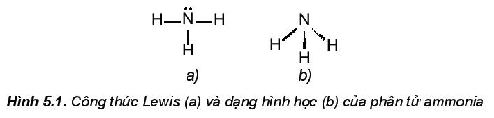
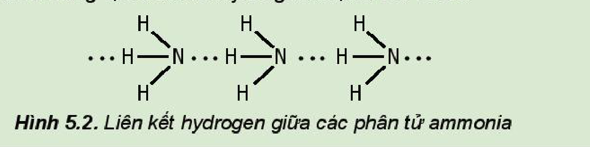
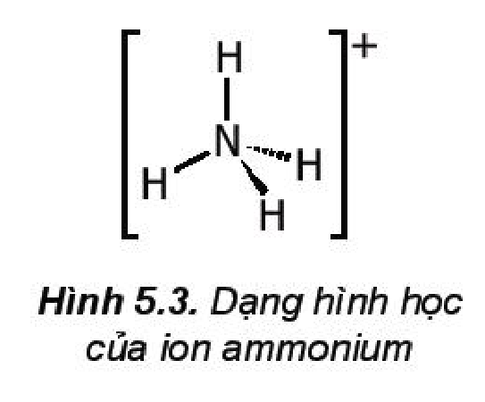

<!-- pdf:34 -->

# BÀI 5: AMMONIA. MUỐI AMMONIUM

## 🎯 Mục tiêu

- Mô tả được công thức Lewis và dạng hình học của phân tử ammonia.
- Từ cấu tạo của phân tử ammonia, giải thích được tính tan, tính base, tính khử. Viết được phương trình hoá học minh hoạ.
- Vận dụng được kiến thức về cân bằng hoá học, tốc độ phản ứng, enthalpy cho phản ứng tổng hợp ammonia từ nitrogen và hydrogen trong quá trình Haber.
- Trình bày được tính chất cơ bản của muối ammonium và nhận biết ion ammonium trong dung dịch.
- Trình bày được ứng dụng của ammonia; ammonium nitrate và một số muối ammonium tan.
- Thực hiện được (hoặc quan sát video) thí nghiệm nhận biết được ion ammonium trong phân đạm chứa ion ammonium.

## 🔴 Mở đầu

Từ ammonia, thông qua phản ứng nào có thể sản xuất phân đạm chứa ion ammonium? Ammonia đóng vai trò gì trong phản ứng đó?

## I. AMMONIA

### 1. Cấu tạo phân tử

> ✋ 1. Viết cấu hình electron của các nguyên tử $\ce{H}$ ($Z = 1$) và $\ce{N}$ ($Z = 7$).
>
> 2. Trình bày các bước lập công thức Lewis của phân tử ammonia.

<!-- term: Ammonia -->
Phân tử ammonia được tạo bởi một nguyên tử nitrogen liên kết với ba nguyên tử hydrogen và có dạng hình học là chóp tam giác:

Hình 5.1. Công thức Lewis (a) và dạng hình học (b) của phân tử ammonia

<!-- term: Ammonia -->
Đặc điểm cấu tạo của phân tử ammonia:

- Nguyên tử nitrogen còn một cặp electron không liên kết, tạo ra vùng có mật độ điện tích âm trên nguyên tử nitrogen.
- Liên kết $\ce{N-H}$ phân cực, cặp electron dùng chung lệch về nguyên tử nitrogen làm cho nguyên tử hydrogen mang một phần điện tích dương.
- Liên kết $\ce{N-H}$ tương đối bền với năng lượng liên kết là $386\text{ kJ/mol}$.

<!-- pdf:35 -->

> ❓ 1. Từ đặc điểm cấu tạo của phân tử ammonia, hãy giải thích tại sao các phân tử ammonia có khả năng tạo liên kết hydrogen mạnh với nhau.
>
> 
>
> Hình 5.2. Liên kết hydrogen giữa các phân tử ammonia

### 2. Tính chất vật lí

Ammonia tồn tại ở cả trong môi trường đất, nước, không khí. Trong cơ thể người, ammonia được tạo ra trong quá trình chuyển hoá thức ăn chứa protein.

<!-- term: Ammonia -->
Ở điều kiện thường, ammonia tồn tại ở thể khí, không màu, nhẹ hơn không khí, mùi khai và xốc. Ammonia tan nhiều trong nước. Ở điều kiện thường, 1 lít nước hoà tan được khoảng 700 lít khí ammonia. Ammonia dễ hoá lỏng (hoá lỏng ở $-33,3\text{ }^\circ\text{C}$) và dễ hoá rắn (hoá rắn ở $-77,7\text{ }^\circ\text{C}$).

> ❓ 2. Hãy giải thích tại sao ammonia tan tốt trong nước.

### 3. Tính chất hoá học

**a) Tính base**

> ✋ Trong công nghiệp, phản ứng giữa ammonia với acid được dùng để sản xuất phân bón:
>
> $\ce{NH3 + HCl -> NH4Cl}$
>
> $\ce{NH3 + HNO3 -> NH4NO3}$
>
> $\ce{2NH3 + H2SO4 -> (NH4)2SO4}$
>
> Xác định chất cho, chất nhận proton trong mỗi phản ứng trên. Dùng mũi tên để biểu diễn sự cho, nhận đó.

<!-- term: Ammonia -->
Trong dung dịch, một phần số phân tử ammonia nhận proton của nước, tạo thành ion ammonium ($\ce{NH4+}$):

$\ce{NH3 + H2O <=> NH4+ + OH-}$

<!-- term: Ammonia -->
Dung dịch ammonia có môi trường base yếu, làm quỳ tím chuyển màu xanh, phenolphthalein chuyển màu hồng.

Ở thể khí, ammonia cũng có khả năng nhận proton, thể hiện tính chất của một base Bronsted–Lowry.

*Ví dụ:* $\ce{NH3(g) + HCl(g) -> NH4Cl(s)}$

> 💡 EM CÓ BIẾT
>
> **Ammophos** là một loại phân bón phức hợp, cung cấp đồng thời hai nguyên tố nitrogen và phosphorus cho cây trồng. Thành phần chính của ammophos là sản phẩm của các phản ứng:
>
> $\ce{NH3 + H3PO4 -> NH4H2PO4}$
>
> $\ce{2NH3 + H3PO4 -> (NH4)2HPO4}$

<!-- pdf:36 -->

**b) Tính khử**

<!-- term: Ammonia -->
Trong phân tử ammonia, nguyên tử nitrogen có số oxi hoá $-3$ (số oxi hoá thấp nhất của nitrogen) nên ammonia thể hiện tính khử.

Khi đốt cháy trong oxygen, ammonia cháy với ngọn lửa màu vàng.

$\ce{4NH3 + 3O2 ->[\text{t}^\circ] 2N2 + 6H2O}$

Trong công nghiệp, phản ứng giữa ammonia và oxygen được thực hiện ở nhiệt độ $800\text{ }^\circ\text{C} - 900\text{ }^\circ\text{C}$ với xúc tác $\ce{Pt}$.

$\ce{4NH3 + 5O2 ->[\text{t}^\circ][\ce{Pt}] 4NO + 6H2O}$

Phản ứng trên là giai đoạn trung gian quan trọng trong quá trình sản xuất nitric acid theo **phương pháp Ostwald** (Ốt-xvan).

> ❓ 3. Trong hai phản ứng oxi hoá ammonia bằng oxygen ở trên, hãy:
>
> a) Xác định các nguyên tử có sự thay đổi số oxi hoá.
>
> b) Viết quá trình oxi hoá, quá trình khử.

> 💡 EM CÓ BIẾT
>
> Ammonia tự bốc cháy ở nhiệt độ $651\text{ }^\circ\text{C}$ khi có sắt xúc tác và ở $850\text{ }^\circ\text{C}$ khi không có xúc tác. Ammonia có thể tạo hỗn hợp nổ với không khí khi nồng độ ammonia trong hỗn hợp từ 16% đến 25% thể tích.
<!-- ocr-ok: đối chiếu trực tiếp ảnh trang PDF 36, hộp Em có biết cột phải bị OCR ghép lẫn vào hộp câu hỏi 3 cột trái -->

### 4. Ứng dụng

<!-- term: Ammonia -->
Một số ứng dụng của ammonia:
- Tác nhân làm lạnh
- Dung môi
- Sản xuất nitric acid
- Sản xuất phân đạm

> ✋ Sưu tầm một số hình ảnh để báo cáo, thuyết trình về ứng dụng của ammonia trong thực tiễn. Sử dụng các tính chất vật lí và hoá học để giải thích cơ sở khoa học của các ứng dụng này.

### 5. Sản xuất

<!-- term: Ammonia -->
Trong công nghiệp, quá trình sản xuất ammonia thường được thực hiện ở nhiệt độ $400\text{ }^\circ\text{C} - 450\text{ }^\circ\text{C}$, áp suất $150 - 200\text{ bar}$, xúc tác $\ce{Fe}$.

$\ce{N2(g) + 3H2(g) <=>[\text{t}^\circ\text{, p, xt}] 2NH3(g)} \qquad \Delta_r H^\circ = -91,8\text{ kJ}$

> ✋ Vận dụng kiến thức về cân bằng hoá học, tốc độ phản ứng, biến thiên enthalpy để giải thích các điều kiện của phản ứng sản xuất ammonia, cụ thể:
>
> 1. Nếu tăng hoặc giảm nhiệt độ sẽ ảnh hưởng đến sự chuyển dịch cân bằng và tốc độ phản ứng như thế nào?
> 2. Nếu giảm áp suất, cân bằng chuyển dịch theo chiều nào? Tại sao không thực hiện ở áp suất cao hơn?
> 3. Vai trò của chất xúc tác trong phản ứng là gì?

<!-- pdf:37 -->

## II. MUỐI AMMONIUM

### 1. Tính tan, sự điện li
<!-- ocr-ok: đối chiếu trực tiếp ảnh trang PDF 37, OCR đọc sai dấu "Tính" thành "Tĩnh" -->

Một số muối ammonium phổ biến: $\ce{NH4Cl}$, $\ce{NH4ClO4}$, $\ce{NH4NO3}$, $\ce{(NH4)2SO4}$, $\ce{NH4H2PO4}$, $\ce{(NH4)2HPO4}$, $\ce{NH4HCO3}$, $\ce{(NH4)2Cr2O7}$.
<!-- ocr-ok: đối chiếu trực tiếp ảnh trang PDF 37, OCR đọc sai "phổ" thành "phỗ" và bỏ công thức hoá học -->

<!-- term: Muối ammonium -->
Hầu hết các muối ammonium đều dễ tan trong nước và phân li hoàn toàn ra ion.

*Ví dụ:* $\ce{NH4Cl -> NH4+ + Cl-}$.

Hình 5.3. Dạng hình học của ion ammonium

### 2. Tác dụng với kiềm – Nhận biết ion ammonium

<!-- term: Muối ammonium -->
Khi đun nóng hỗn hợp muối ammonium với dung dịch kiềm, sinh ra khí ammonia có mùi khai.

*Ví dụ:* $\ce{(NH4)2SO4 + 2NaOH ->[\text{t}^\circ] Na2SO4 + 2NH3 + 2H2O}$

Phương trình ion rút gọn: $\ce{NH4+ + OH- ->[\text{t}^\circ] NH3 + H2O}$

> 🔬 Thí nghiệm: Nhận biết ion ammonium trong phân đạm
>
> *Chuẩn bị:* phân bón potassium nitrate và phân bón ammonium chloride dạng rắn, dung dịch $\ce{NaOH}\text{ }20\%$, giấy pH; bình xịt tia nước cất, 2 ống nghiệm, kẹp gỗ, đèn cồn.
>
> *Tiến hành:*
>
> - Cho khoảng $1\text{ g}$ phân bón potassium nitrate vào ống nghiệm (1) và khoảng $1\text{ g}$ phân bón ammonium chloride vào ống nghiệm (2).
> - Thêm vào mỗi ống nghiệm khoảng $3\text{ mL}$ nước cất, lắc đều cho tan hết.
> - Nhỏ $1\text{ mL}$ dung dịch $\ce{NaOH}\text{ }20\%$ vào mỗi ống nghiệm, đun nóng nhẹ trên đèn cồn.
> - Đưa hai mẩu giấy pH đã tẩm ướt vào miệng mỗi ống nghiệm.
>
> *Quan sát hiện tượng và trả lời câu hỏi:*
>
> Dựa vào dấu hiệu nào để nhận biết ion ammonium? Giải thích bằng phương trình hoá học.

### 3. Tính chất kém bền nhiệt

<!-- term: Muối ammonium -->
Các muối ammonium đều kém bền nhiệt và dễ bị phân huỷ khi nung nóng.

*Ví dụ:*

$\ce{NH4Cl ->[\text{t}^\circ] NH3 + HCl}$

$\ce{NH4HCO3 ->[\text{t}^\circ] NH3 + CO2 + H2O}$

$\ce{NH4NO3 ->[\text{t}^\circ] N2O + 2H2O}$

> 💡 EM CÓ BIẾT
>
> Ammonium nitrate vừa là phân bón nhưng đồng thời cũng là chất nổ do phản ứng:
>
> $\ce{2NH4NO3 ->[\text{t}^\circ] 2N2 + O2 + 4H2O}$
>
> Phản ứng trên là nguyên nhân vụ nổ kinh hoàng tại nhà kho chứa khoảng $2\text{ }700\text{ tấn}$ ammonium nitrate ở cảng Beirut (Lebanon) vào tháng 8 năm 2020. Do vậy, quá trình bảo quản, sử dụng chúng phải tuân theo nguyên tắc phòng và chống cháy, nổ.

<!-- pdf:38 -->

### 4. Ứng dụng

<!-- term: Muối ammonium -->
Một số ứng dụng của muối ammonium:
- Thuốc long đờm
- Phân bón hoá học
- Chất phụ gia thực phẩm
- Chất đánh sạch bề mặt kim loại
- Thuốc bổ sung chất điện giải
<!-- ocr-ok: đối chiếu trực tiếp ảnh trang PDF 38, sơ đồ các ô ứng dụng của muối ammonium bị OCR ghép dòng ngang -->

> ❓ 4. a) So sánh phân tử ammonia và ion ammonium về dạng hình học, số liên kết cộng hoá trị, số oxi hoá của nguyên tử nitrogen.
>
> b) Viết phương trình hoá học minh hoạ tính acid/base của ammonia và ammonium.

## 📌 Em đã học

- Phân tử ammonia có dạng chóp tam giác, phân tử chứa ba liên kết $\ce{N-H}$ phân cực và một cặp electron không liên kết trên nguyên tử nitrogen.
- Các phân tử ammonia tạo được liên kết hydrogen với nhau và với nước. Ammonia dễ hoá lỏng và dễ tan trong nước.
- Tính base và tính khử của ammonia được ứng dụng trong sản xuất phân bón, nitric acid,...
- Muối ammonium dễ tan, kém bền nhiệt, tác dụng với base, được dùng chủ yếu làm phân bón.

## ✏️ Em có thể

- Vận dụng được kiến thức về cân bằng hoá học, tốc độ phản ứng, enthalpy cho phản ứng tổng hợp ammonia trong quá trình Haber-Bosch.
- Nhận biết được ion ammonium trong phân đạm.

## 📷 Danh sách hình trong bài

| Mã hình | Trang PDF | Vị trí | Chú thích gốc |
|---|---|---|---|
| H11-hoa-b05-01 | 34 | Mục I.1 | Hình 5.1. Công thức Lewis (a) và dạng hình học (b) của phân tử ammonia |
| H11-hoa-b05-02 | 35 | Mục I.1, hộp câu hỏi 1 | Hình 5.2. Liên kết hydrogen giữa các phân tử ammonia |
| H11-hoa-b05-03 | 37 | Mục II.1 | Hình 5.3. Dạng hình học của ion ammonium |
