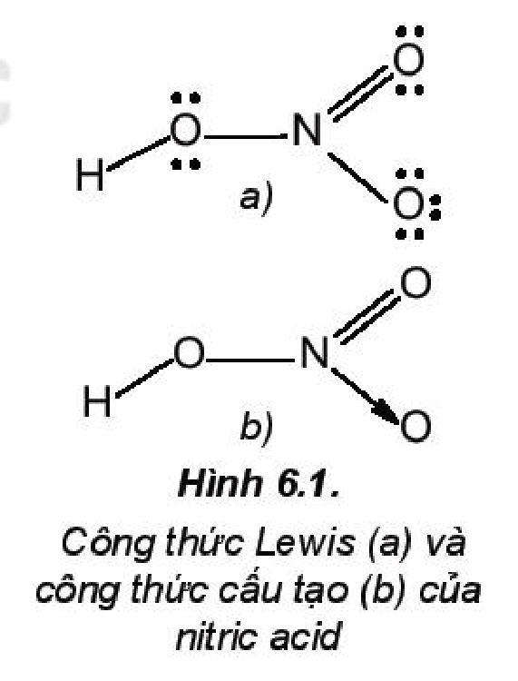
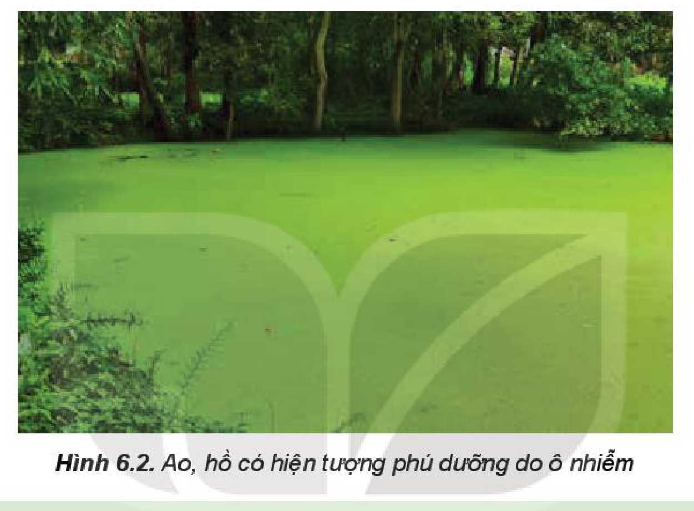

<!-- pdf:39 -->

# BÀI 6: MỘT SỐ HỢP CHẤT CỦA NITROGEN VỚI OXYGEN

## 🎯 Mục tiêu

- Phân tích được nguồn gốc các oxide của nitrogen trong không khí và nguyên nhân gây hiện tượng mưa acid.
- Nêu được cấu tạo của $\ce{HNO3}$, tính acid, tính oxi hoá mạnh trong một số ứng dụng thực tiễn quan trọng của nitric acid.
- Giải thích được nguyên nhân, hệ quả của hiện tượng phú dưỡng.

## 🔴 Mở đầu

Năm 1872, trong cuốn sách *Không khí và Mưa*, Robert Angus Smith (Rô-bớt An-gớt Smít) (nhà hoá học người Scotland) đã trình bày chi tiết về hiện tượng mưa acid. Đến cuối những năm 1960, mưa acid đã thực sự ảnh hưởng đến môi trường các vùng rộng lớn ở Tây Âu và Đông Bắc Mỹ. Ngày nay, mưa acid trở thành một trong các thảm hoạ môi trường toàn cầu.

Vậy mưa acid là gì? Hợp chất của nitrogen với oxygen có vai trò gì trong hiện tượng đó?

## I. CÁC OXIDE CỦA NITROGEN

### 1. Công thức, tên gọi

<!-- term: Các oxide của nitrogen -->
Oxide của nitrogen được kí hiệu chung là $\ce{NO_x}$, một loại hợp chất điển hình gây ô nhiễm không khí. Hợp chất $\ce{NO_x}$ có trong không khí là $\ce{NO2}$, $\ce{NO}$, $\ce{N2O4}$, $\ce{N2O}$.

| Oxide | $\ce{N2O}$ | $\ce{NO}$ | $\ce{NO2}$ | $\ce{N2O4}$ |
| :--- | :---: | :---: | :---: | :---: |
| Tên gọi | Dinitrogen oxide | Nitrogen monoxide | Nitrogen dioxide | Dinitrogen tetroxide |

### 2. Nguồn gốc phát sinh $\ce{NO_x}$ trong không khí

<!-- term: Các oxide của nitrogen -->
Bên cạnh nguồn gốc tự nhiên như núi lửa phun trào, cháy rừng, mưa dông kèm theo sấm sét, sự phân huỷ các hợp chất hữu cơ, thì sự phát sinh $\ce{NO_x}$ chủ yếu là do hoạt động của con người. Các nguồn gây phát thải $\ce{NO_x}$ nhân tạo từ hoạt động giao thông vận tải, sản xuất công nghiệp, nông nghiệp, nhà máy nhiệt điện và trong đời sống.

*Bảng 6.1. Nguyên nhân hình thành $\ce{NO_x}$ trong không khí*

| Loại $\ce{NO_x}$ | **$\ce{NO_x}$ nhiệt** ($\text{thermal}-\ce{NO_x}$) | **$\ce{NO_x}$ nhiên liệu** ($\text{fuel}-\ce{NO_x}$) | **$\ce{NO_x}$ tức thời** ($\text{prompt}-\ce{NO_x}$) |
| :--- | :---: | :---: | :---: |
| Nguyên nhân tạo thành | Nhiệt độ rất cao (trên $3\text{ }000\text{ }^\circ\text{C}$) hoặc tia lửa điện làm nitrogen trong không khí bị oxi hoá: $\ce{N2 + O2 <=> 2NO}$ | Nitrogen trong nhiên liệu hoặc sinh khối$^{(1)}$ kết hợp với oxygen trong không khí. | Nitrogen trong không khí tác dụng với các gốc tự do$^{(2)}$ (gốc hydrocarbon, gốc hydroxyl,...). |

<!-- term: Các oxide của nitrogen -->
$\ce{NO_x}$ là một trong các nguyên nhân gây mưa acid, sương mù quang hoá, hiệu ứng nhà kính, thủng tầng ozone và hiện tượng phú dưỡng, làm ô nhiễm môi trường.

$^{(1)}$ **Sinh khối** là một thuật ngữ dùng để mô tả các vật chất hữu cơ có nguồn gốc từ sinh vật sống.

$^{(2)}$ **Gốc tự do** là nguyên tử/nhóm nguyên tử có electron tự do, chưa tạo thành cặp electron.

<!-- pdf:40 -->

### 3. Mưa acid

> ✋ 1. Giải thích nguyên nhân phát thải $\ce{NO_x}$ từ hoạt động giao thông vận tải, nhà máy nhiệt điện, luyện kim, đốt nhiên liệu. Đề xuất các biện pháp nhằm cắt giảm các nguồn phát thải đó.
>
> 2. Sưu tầm hình ảnh về ảnh hưởng của mưa acid đối với môi trường. Đề xuất một số giải pháp nhằm giảm thiểu nguy cơ gây mưa acid.

Nước mưa thông thường có pH khoảng 5,6 chủ yếu do có carbon dioxide hoà tan tạo môi trường acid yếu. Khi nước mưa có pH nhỏ hơn 5,6 thì gọi là hiện tượng **mưa acid**.

Tác nhân chính gây mưa acid là $\ce{SO2}$ và $\ce{NO_x}$, phát thải chủ yếu do các hoạt động công nghiệp, nhiệt điện, giao thông, khai thác và chế biến dầu mỏ,...

Với sự xúc tác của các ion kim loại trong khói bụi, khí $\ce{SO2}$ và $\ce{NO_x}$ bị oxi hoá bởi oxygen, ozone, hydrogen peroxide, gốc tự do,... rồi hoà tan vào nước, tạo thành sulfuric acid và nitric acid. *Ví dụ:*

$\ce{2SO2 + O2 + 2H2O ->[\text{xúc tác}] 2H2SO4}$

$\ce{4NO2 + O2 + 2H2O ->[\text{xúc tác}] 4HNO3}$

Các giọt acid li ti tạo thành theo mưa rơi xuống bề mặt Trái Đất.

Mưa acid gây tác động xấu đối với môi trường, con người và sinh vật, rõ rệt nhất khi nước mưa có giá trị pH dưới 4,5. Mưa acid, ảnh hưởng đến sinh vật, ăn mòn các công trình xây dựng, kiến trúc bằng đá và kim loại,...

## II. NITRIC ACID

### 1. Cấu tạo

Nitric acid ($\ce{HNO3}$) có công thức Lewis và công thức cấu tạo như Hình 6.1.

<!-- term: Nitric acid -->
Đặc điểm cấu tạo của phân tử nitric acid:

- Nguyên tử $\ce{N}$ có số oxi hoá $+5$, là số oxi hoá cao nhất của nitrogen.
- Liên kết $\ce{O-H}$ phân cực mạnh về phía nguyên tử oxygen.
- Liên kết $\ce{N->O}$ là liên kết cho nhận.
<!-- ocr-ok: đối chiếu trực tiếp ảnh trang PDF 40, các gạch đầu dòng đặc điểm cấu tạo có công thức hoá học nằm cạnh Hình 6.1 -->

Hình 6.1. Công thức Lewis (a) và công thức cấu tạo (b) của nitric acid

> ✋ Từ đặc điểm cấu tạo, dự đoán tính tan và tính chất hoá học của nitric acid.

### 2. Tính chất vật lí

<!-- term: Nitric acid -->
Nitric acid tinh khiết là chất lỏng, không màu, có khối lượng riêng $D = 1,53\text{ g/mL}$. Nitric acid nóng chảy ở $-42\text{ }^\circ\text{C}$ và sôi ở $83\text{ }^\circ\text{C}$. Nitric acid bốc khói mạnh trong không khí ẩm và tan vô hạn trong nước.

<!-- pdf:41 -->

### 3. Tính chất hoá học

> ✋ Viết phương trình phân li và các phương trình hoá học minh hoạ cho tính chất acid mạnh của nitric acid.

**a) Tính acid**

<!-- term: Nitric acid -->
Nitric acid có khả năng cho proton, thể hiện tính chất của một acid Bronsted–Lowry.

<!-- term: Nitric acid -->
Trong công nghiệp, nitric acid được sử dụng để sản xuất phân bón giàu dinh dưỡng như ammonium nitrate, calcium nitrate.

$\ce{NH3 + HNO3 -> NH4NO3}$

$\ce{CaCO3 + 2HNO3 -> Ca(NO3)2 + CO2 + H2O}$

Ammonium nitrate cung cấp nguyên tố nitrogen ở cả dạng ammonium và cả dạng nitrate.

**b) Tính oxi hoá**

<!-- term: Nitric acid -->
Phân tử nitric acid chứa nguyên tử nitrogen có số oxi hoá cao nhất ($+5$) nên nitric acid có khả năng nhận electron, thể hiện tính oxi hoá mạnh.

<!-- term: Nitric acid -->
Do có tính oxi hoá mạnh, nitric acid thường được sử dụng để phá mẫu quặng trong việc nghiên cứu, xác định hàm lượng các kim loại trong quặng.

> 💡 EM CÓ BIẾT
>
> **Ứng dụng nổi bật của nitric acid đặc**
>
> - Ở dạng đậm đặc, nitric acid được dùng để sản xuất thuốc nổ trinitrotoluene (TNT), nitroglycerin và thuốc súng không khói cellulose trinitrate. Trong các hợp chất đó, tính oxi hoá của nitric acid được bảo lưu ở các gốc nitrate và tham gia vào phản ứng cháy, nổ.
> - Nitric acid đặc tạo với hydrochloric acid đặc hỗn hợp có tính oxi hoá mạnh (thường gọi là **nước cường toan** – aqua regia) có khả năng hoà tan vàng, platinum.
>
>   *Ví dụ:* $\ce{Au + HNO3 + 3HCl ->[\text{t}^\circ] AuCl3 + NO + 2H2O}$
>
>   Phản ứng hoà tan vàng, platinum trong nước cường toan được sử dụng phổ biến ở nhiều phòng thí nghiệm nghiên cứu.

## III. HIỆN TƯỢNG PHÚ DƯỠNG

Nguyên nhân của **hiện tượng phú dưỡng** là do sự dư thừa dinh dưỡng đã cung cấp nguồn thức ăn dồi dào cho sinh vật phù du phát triển rất mạnh.

Thông thường, khi hàm lượng nitrogen trong nước (bao gồm ion nitrate, nitrite, ammonium) đạt $300\text{ }\mu\text{g/L}$ và hàm lượng phosphorus (các dạng ion phosphate) đạt $20\text{ }\mu\text{g/L}$ sẽ gây ra hiện tượng phú dưỡng.

<!-- pdf:42 -->

Nguồn dinh dưỡng ở ao, hồ thường có nguồn gốc từ nước thải (nông nghiệp, công nghiệp và sinh hoạt) được đưa đến ao, hồ thông qua các cống dẫn nước cố định hoặc do chảy tràn trên mặt đất khi mưa, lũ. Bên cạnh đó, ở nhiều đầm nuôi trồng thuỷ sản, sự dư thừa thức ăn chăn nuôi cũng tạo ra sự dư thừa dinh dưỡng.

Hiện tượng phú dưỡng gây cản trở sự hấp thụ ánh sáng mặt trời vào nước, làm giảm sự quang hợp của thực vật thuỷ sinh. Rong, tảo phát triển mạnh gây thiếu nguồn oxygen trầm trọng cho các loài khác (đặc biệt là tôm, cá), gây mất cân bằng sinh thái. Ngoài ra, xác rong, tảo phân huỷ gây ô nhiễm môi trường nước, không khí và tạo chất bùn lắng xuống lòng ao, hồ.

Hình 6.2. Ao, hồ có hiện tượng phú dưỡng do ô nhiễm

> ❓ 1. Nêu các biện pháp nhằm hạn chế hiện tượng phú dưỡng xảy ra ở các ao, hồ.
>
> 2. Hãy mô tả đặc điểm của ao, hồ có hiện tượng phú dưỡng và đề xuất cách cải tạo.

## 📌 Em đã học

- Sự phát thải các oxide của nitrogen trong không khí chủ yếu do các hoạt động của con người như giao thông vận tải, nhiệt điện, sản xuất công nghiệp, nông nghiệp và đời sống.
- Nguyên nhân gây hiện tượng mưa acid do có sự phát thải quá nhiều khí $\ce{SO2}$ và $\ce{NO_x}$ từ sản xuất công nghiệp, giao thông,...
- Nitric acid là acid mạnh và có tính oxi hoá mạnh.

## ✏️ Em có thể

- Liên hệ được tính chất hoá học của nitric acid trong một số quy trình sản xuất hoá chất.
- Giữ gìn môi trường nước của các ao, hồ trong khu vực em sinh sống và tham gia cải tạo những ao, hồ có hiện tượng phú dưỡng.

## 📷 Danh sách hình trong bài

| Mã hình | Trang PDF | Vị trí | Chú thích gốc |
|---|---|---|---|
| H11-hoa-b06-01 | 40 | Mục II.1 | Hình 6.1. Công thức Lewis (a) và công thức cấu tạo (b) của nitric acid |
| H11-hoa-b06-02 | 42 | Mục III | Hình 6.2. Ao, hồ có hiện tượng phú dưỡng do ô nhiễm |
