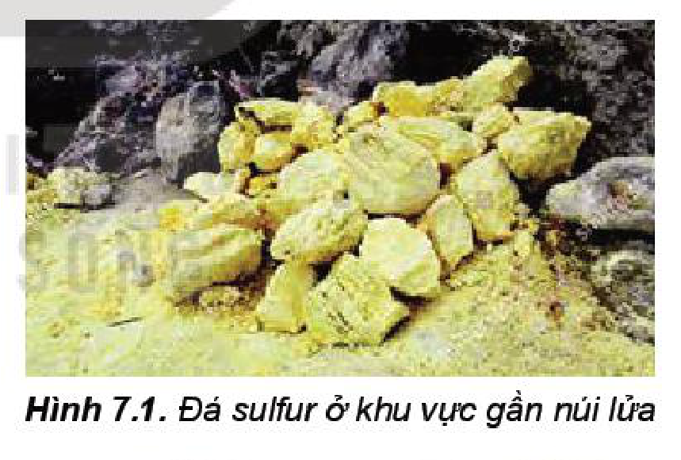
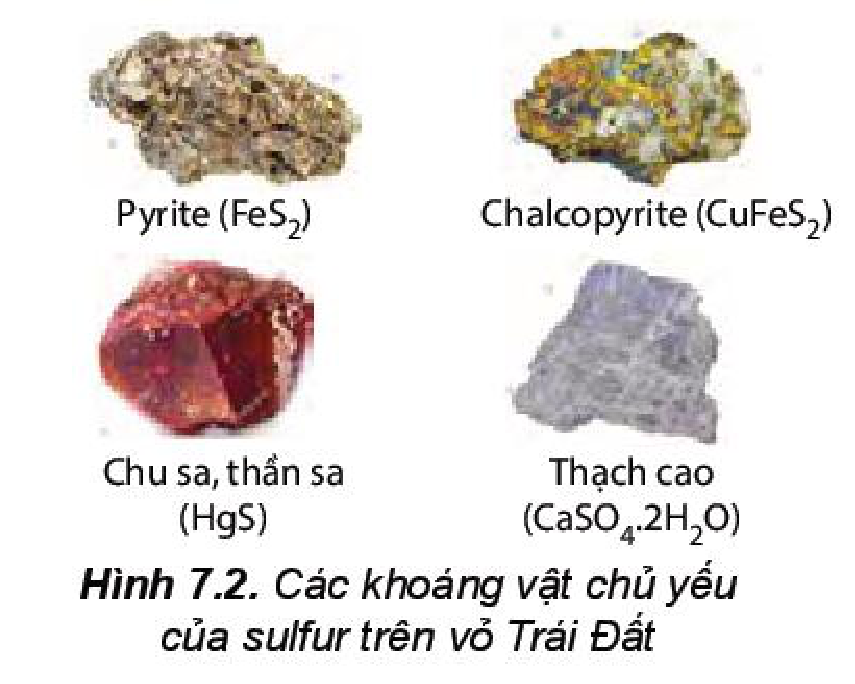
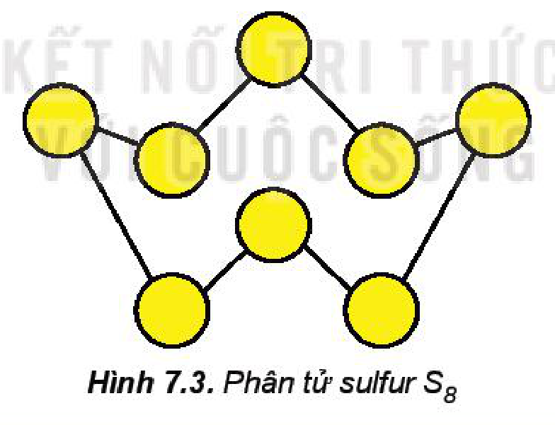
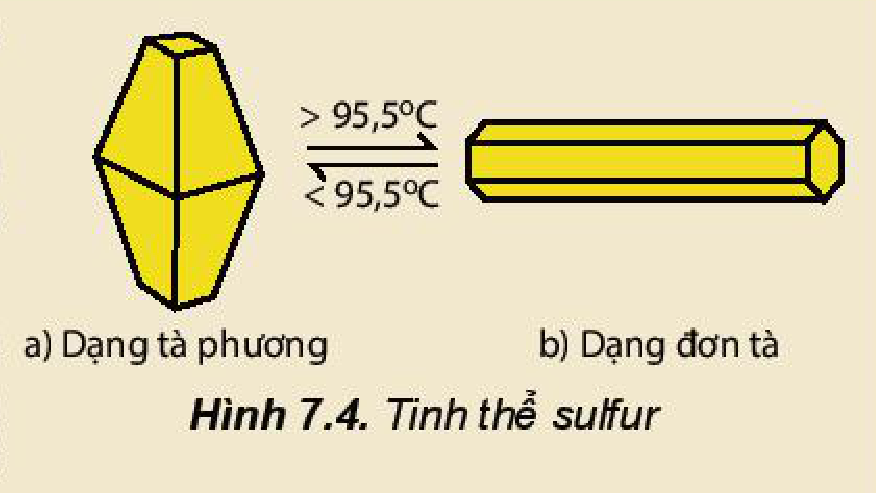

<!-- pdf:43 -->

# BÀI 7: SULFUR VÀ SULFUR DIOXIDE

## 🎯 Mục tiêu

- Nêu được các trạng thái tự nhiên của nguyên tố sulfur.
- Trình bày được cấu tạo, tính chất vật lí, hoá học cơ bản và ứng dụng của sulfur đơn chất.
- Thực hiện được thí nghiệm chứng minh sulfur đơn chất vừa có tính oxi hoá vừa có tính khử.
- Trình bày được tính oxi hoá, tính khử và ứng dụng của sulfur dioxide.
- Trình bày được sự hình thành sulfur dioxide do tác động của con người, tự nhiên, tác hại của sulfur dioxide và một số biện pháp làm giảm thiểu lượng sulfur dioxide thải vào không khí.

## 🔴 Mở đầu

Trong công nghiệp, sulfur là nguyên liệu ban đầu, còn sulfur dioxide là hợp chất trung gian trong quá trình sản xuất sulfuric acid. Bên cạnh đó, sulfur dioxide cũng là một tác nhân gây ô nhiễm không khí.

Vậy, tính chất cơ bản của sulfur, sulfur dioxide là gì và làm thế nào để giảm thiểu tác hại của sulfur dioxide đối với môi trường?

## I. SULFUR

### 1. Trạng thái tự nhiên

<!-- term: Sulfur -->
Sulfur (lưu huỳnh) là nguyên tố phổ biến thứ 17 trên vỏ Trái Đất, chiếm khoảng $0,03 - 0,1\%$ khối lượng, tồn tại ở bốn dạng đồng vị bền: $\ce{^{32}S}$ ($94,98\%$), $\ce{^{33}S}$ ($0,76\%$), $\ce{^{34}S}$ ($4,22\%$) và $\ce{^{36}S}$ ($0,02\%$)$^{(1)}$. Trong tự nhiên, sulfur tồn tại ở cả dạng đơn chất và dạng hợp chất. Đơn chất sulfur được phân bố ở vùng lân cận núi lửa và suối nước nóng,... Hợp chất sulfur gồm các khoáng vật sulfide, sulfate, protein,...

Hình 7.1. Đá sulfur ở khu vực gần núi lửa
<!-- ocr-ok: đối chiếu trực tiếp ảnh trang PDF 43, chú thích Hình 7.1 cột phải bị OCR ghép lẫn vào dòng văn bản cột trái -->

Sulfur được giải phóng ra khỏi lõi Trái Đất chủ yếu ở dạng sulfur dioxide ($\ce{SO2}$) và hydrogen sulfide ($\ce{H2S}$) khi núi lửa hoạt động. Sau đó, hydrogen sulfide chuyển hoá thành muối sulfide ít tan (tạo thành các khoáng vật pyrite, chalcopyrite,...) và sulfur dioxide chuyển hoá thành muối sulfate của calcium, barium (tạo thành các khoáng vật như thạch cao) (Hình 7.2). Trong cơ thể người, sulfur chiếm khoảng $0,2\%$ khối lượng, có trong thành phần nhiều protein và enzyme.

Hình 7.2. Các khoáng vật chủ yếu của sulfur trên vỏ Trái Đất

$^{(1)}$ *Nguồn: J. Räisänen, Encyclopedia of Analytical Science (Second Edition), 2005.*

<!-- pdf:44 -->

> ❓ 1. Kể tên một ứng dụng thực tiễn của quặng pyrite, thạch cao, sulfuric acid mà em biết.

### 2. Cấu tạo nguyên tử, phân tử

**a) Cấu tạo nguyên tử**

> ✋ 1. Viết cấu hình electron của nguyên tử $\ce{S}$ ($Z = 16$) và biểu diễn sự phân bố electron vào các ô orbital.
>
> 2. Dựa vào cấu hình electron và độ âm điện của nguyên tử $\ce{S}$, hãy đưa ra dự đoán về:
>
> a) Số oxi hoá thấp nhất, cao nhất của nguyên tử $\ce{S}$ trong hợp chất.
>
> b) Tính oxi hoá, tính khử của sulfur.

<!-- term: Sulfur -->
Nguyên tố sulfur ở ô số 16, nhóm VIA, chu kì 3 trong bảng tuần hoàn. Nguyên tử sulfur có độ âm điện là 2,58. Sulfur có tính phi kim.

Sulfur tạo ra nhiều hợp chất với các số oxi hoá khác nhau từ $-2$ đến $+6$, ví dụ: $\ce{H2S}$, $\ce{SO2}$, $\ce{SO3}$,...

**b) Cấu tạo phân tử**

<!-- term: Sulfur -->
Phân tử sulfur gồm 8 nguyên tử ($\ce{S8}$) có dạng vòng khép kín. Mỗi nguyên tử sulfur liên kết với hai nguyên tử bên cạnh bằng hai liên kết cộng hoá trị không phân cực. Liên kết $\ce{S-S}$ có năng lượng liên kết bằng $226\text{ kJ/mol}$ và độ dài liên kết là $205\text{ pm}$.

Trong phản ứng hoá học, phân tử sulfur được viết đơn giản là $\ce{S}$.

Hình 7.3. Phân tử sulfur $\ce{S8}$

> ❓ 2. Trong tinh thể sulfur, các phân tử $\ce{S8}$ tương tác với nhau bằng lực van der Waals yếu. Hãy dự đoán về nhiệt độ nóng chảy (cao hay thấp) của đơn chất sulfur.

### 3. Tính chất vật lí

<!-- term: Sulfur -->
Đơn chất sulfur có hai dạng thù hình: dạng *tà phương* (bền ở nhiệt độ thường) và dạng *đơn tà*.

<!-- term: Sulfur -->
Sulfur không tan trong nước, ít tan trong alcohol, tan nhiều trong carbon disulfide.

<!-- term: Sulfur -->
Sulfur nóng chảy ở $113\text{ }^\circ\text{C}$ và sôi ở $445\text{ }^\circ\text{C}$.

<!-- pdf:45 -->

> 💡 EM CÓ BIẾT
>
> - Sulfur tà phương và sulfur đơn tà khác nhau về sự sắp xếp các phân tử $\ce{S8}$ trong tinh thể (Hình 7.4).
> - Tính chất dễ nóng chảy của sulfur được ứng dụng trong công nghệ khai thác sulfur từ mỏ theo **phương pháp Frasch** (Phờ-rát).
>
>   Nguyên tắc của phương pháp này là hoá lỏng sulfur ngầm dưới đất bằng hơi nước siêu nóng (ở khoảng $180\text{ }^\circ\text{C}$) với áp suất cao, sau đó kết hợp với bơm không khí nén để đẩy sulfur lỏng trào lên mặt đất theo đường ống dẫn.
>
> 
>
> Hình 7.4. Tinh thể sulfur

### 4. Tính chất hoá học

<!-- term: Sulfur -->
Khi tham gia phản ứng hoá học, sulfur có thể thể hiện tính oxi hoá hoặc tính khử. Trong thực tế, hầu hết các phản ứng của sulfur chỉ xảy ra khi đun nóng.

**a) Tác dụng với hydrogen và kim loại**

> 🔬 Thí nghiệm: Sulfur tác dụng với sắt (iron)
>
> *Chuẩn bị:* bột sulfur, bột iron, ống nghiệm, kẹp gỗ, đèn cồn, bông.
>
> *Tiến hành:*
>
> - Trộn đều bột sulfur với bột iron theo tỉ lệ khối lượng khoảng $1 : 1,5$.
> - Lấy khoảng $2\text{ g}$ hỗn hợp vào ống nghiệm khô chịu nhiệt, dùng bông nút miệng ống nghiệm.
> - Hơ nóng đều nửa dưới ống nghiệm trên ngọn lửa đèn cồn, sau đó đun tập trung vào phần chứa hỗn hợp.
>
> *Quan sát, mô tả hiện tượng và thực hiện yêu cầu sau:*
>
> Dự đoán sản phẩm tạo thành sau thí nghiệm, viết phương trình hoá học của phản ứng và xác định chất oxi hoá, chất khử.

<!-- term: Sulfur -->
Ở nhiệt độ cao, sulfur tác dụng với hydrogen tạo thành hydrogen sulfide:

$\ce{H2(g) + S(s) ->[\text{t}^\circ] H2S(g)} \qquad \Delta_r H^\circ = -20,6\text{ kJ}$

<!-- term: Sulfur -->
Sulfur tác dụng với thuỷ ngân (mercury) ngay ở nhiệt độ thường, tác dụng với nhiều kim loại khác ở nhiệt độ cao, tạo thành muối sulfide:

$\ce{Hg + S -> HgS}$

$\ce{2Al + 3S ->[\text{t}^\circ] Al2S3}$

Phản ứng của mercury với sulfur được sử dụng để xử lí mercury rơi vãi.

<!-- pdf:46 -->

**b) Tác dụng với phi kim**

> 🔬 Thí nghiệm: Sulfur tác dụng với oxygen
>
> *Chuẩn bị:* bột sulfur, bình khí oxygen; muôi sắt, đèn cồn, nút cao su.
>
> *Tiến hành:*
>
> - Lấy một ít bột sulfur vào muôi sắt (đã cắm xuyên qua nút cao su).
> - Hơ nóng muôi sắt trên ngọn lửa đèn cồn đến khi sulfur nóng chảy và cháy một phần trong không khí.
> - Đưa nhanh muôi sắt vào bình khí oxygen.
>
> *Quan sát và thực hiện các yêu cầu:*
>
> 1. Viết phương trình hoá học và xác định chất oxi hoá, chất khử.
> 2. Nhận xét mức độ phản ứng cháy của sulfur trong không khí và trong khí oxygen.

<!-- term: Sulfur -->
Ở nhiệt độ thích hợp, sulfur tác dụng với một số phi kim như fluorine, oxygen,...

$\ce{S(s) + 3F2(g) -> SF6(g)} \qquad \Delta_r H^\circ = -1\text{ }220,5\text{ kJ}$

$\ce{S(s) + O2(g) ->[\text{t}^\circ] SO2(g)} \qquad \Delta_r H^\circ = -296,8\text{ kJ}$

> ❓ 3. Trong phản ứng của sulfur với hydrogen, nhôm (aluminium), thuỷ ngân (mercury) và fluorine, hãy xác định sự thay đổi số oxi hoá của nguyên tử các nguyên tố. Sulfur là chất oxi hoá hay chất khử?

### 5. Ứng dụng

<!-- term: Sulfur -->
Một số ứng dụng của sulfur:
- Lưu hoá cao su
- Sản xuất diêm, thuốc nổ
- Sản xuất sulfuric acid
- Sản xuất thuốc trừ sâu, thuốc diệt nấm

> ✋ Sưu tầm thông tin và trình bày về ứng dụng của một hợp chất có chứa nguyên tố sulfur trong thực tiễn.

## II. SULFUR DIOXIDE

### 1. Tính chất vật lí

<!-- term: Sulfur dioxide -->
Ở điều kiện thường, sulfur dioxide ($\ce{SO2}$) là chất khí không màu, nặng hơn không khí, mùi hắc, tan nhiều trong nước (ở $20\text{ }^\circ\text{C}$, 1 lít nước hoà tan được 40 lít khí sulfur dioxide).

<!-- term: Sulfur dioxide -->
Sulfur dioxide là khí độc, hít thở không khí chứa sulfur dioxide vượt ngưỡng cho phép sẽ gây viêm đường hô hấp.

<!-- pdf:47 -->

### 2. Tính chất hoá học

> ✋ 1. Sulfur dioxide là oxide acid (acidic oxide). Viết phương trình hoá học minh hoạ.
>
> 2. Dựa vào số oxi hoá của sulfur trong hợp chất sulfur dioxide, hãy dự đoán tính oxi hoá, tính khử của sulfur dioxide.

**a) Tính oxi hoá**

<!-- term: Sulfur dioxide -->
Sulfur dioxide tác dụng với hydrogen sulfide tạo thành sulfur và nước.

$\ce{SO2 + 2H2S -> 3S + 2H2O}$

Trong thực tiễn, phản ứng trên được dùng để chuyển hoá hydrogen sulfide trong khí thiên nhiên thành sulfur.

**b) Tính khử**

<!-- term: Sulfur dioxide -->
Sulfur dioxide tác dụng với nitrogen dioxide ($\ce{NO2}$) khi có xúc tác nitrogen oxide để chuyển hoá thành sulfur trioxide.

$\ce{SO2 + NO2 ->[\text{xúc tác}] SO3 + NO}$

Trong không khí, sulfur dioxide chuyển hoá thành sulfur trioxide, sau đó kết hợp với hơi nước tạo thành sulfuric acid. Đây là phản ứng giải thích quá trình hình thành mưa acid khi không khí bị ô nhiễm bởi sulfur dioxide.

> ❓ 4. Hãy xác định sự thay đổi số oxi hoá của nguyên tử các nguyên tố và vai trò của sulfur dioxide trong phản ứng của sulfur dioxide với hydrogen sulfide và nitrogen dioxide.

### 3. Ứng dụng

<!-- term: Sulfur dioxide -->
Sulfur dioxide là chất trung gian quan trọng trong quá trình sản xuất sulfuric acid.

<!-- term: Sulfur dioxide -->
Do có khả năng tẩy trắng và diệt khuẩn, sulfur dioxide được sử dụng để tẩy trắng bột giấy, khử màu trong sản xuất đường, chống nấm mốc cho sản phẩm mây tre đan,...

Trong nghiên cứu, sulfur dioxide lỏng là một dung môi phân cực, được sử dụng để thực hiện nhiều phản ứng.

> 💡 EM CÓ BIẾT
>
> Ở nhiều làng nghề sản xuất mây tre đan, sulfur được đốt cháy để tạo ra sulfur dioxide, một tác nhân có khả năng chống mốc và tẩy trắng sản phẩm mây tre đan. Quá trình đốt cháy sulfur tại các làng nghề thủ công gây ảnh hưởng đến sức khoẻ con người và ô nhiễm môi trường.

### 4. Sulfur dioxide và ô nhiễm môi trường

**a) Nguồn phát sinh sulfur dioxide**

<!-- term: Sulfur dioxide -->
Sulfur dioxide được sinh ra từ cả nguồn tự nhiên (khí thải núi lửa) và nguồn nhân tạo. Trên toàn thế giới, nguồn sulfur dioxide tự nhiên chiếm ưu thế, nhưng ở các khu vực đô thị và công nghiệp, nguồn nhân tạo chiếm ưu thế.

Nguồn sulfur dioxide nhân tạo chủ yếu sinh ra từ quá trình đốt cháy nhiên liệu có chứa tạp chất sulfur (than đá, dầu mỏ), đốt quặng sulfide (galen, blend) trong luyện kim, đốt sulfur và quặng pyrite trong sản xuất sulfuric acid,...

<!-- pdf:48 -->

**b) Tác hại**

<!-- term: Sulfur dioxide -->
Sulfur dioxide là một trong các tác nhân làm ô nhiễm khí quyển, gây mưa acid và viêm đường hô hấp ở người,...

**c) Biện pháp cắt giảm phát thải sulfur dioxide vào khí quyển**

Dựa trên các nguồn phát sinh sulfur dioxide do hoạt động của con người, các biện pháp để cắt giảm sự phát thải khí này được đề xuất như sau: tăng cường sử dụng các nguồn năng lượng mới, năng lượng sạch, năng lượng tái tạo; sử dụng tiết kiệm, hiệu quả nguồn tài nguyên thiên nhiên; cải tiến công nghệ sản xuất, có biện pháp xử lí khí thải và tái chế các sản phẩm phụ có chứa sulfur.

> 💡 EM CÓ BIẾT
>
> *Bảng 7.1. Hàm lượng cho phép tối đa của $\ce{SO2}$ và $\ce{NO_x}$ trong không khí$^{(1)}$*
>
> | Thông số ($\mu\text{g/m}^3$) | $\ce{SO2}$ | $\ce{NO_x}$ |
> | :--- | :---: | :---: |
> | Trung bình 24 giờ | 125 | 100 |
> | Trung bình năm | 50 | 40 |
>
> Giá trị trung bình 24 giờ và trung bình năm lần lượt là giá trị trung bình của các giá trị đo được trong khoảng thời gian 24 giờ liên tục (một ngày đêm) và trong khoảng thời gian một năm.

> ❓ 5. a) Trình bày ứng dụng của sulfur dioxide. Giải thích.
>
> b) Kể tên một số nguồn phát thải sulfur dioxide vào khí quyển. Em hãy đề xuất một số biện pháp nhằm cắt giảm sự phát thải đó.

## 📌 Em đã học

- Nguyên tố sulfur tồn tại trong tự nhiên ở cả dạng đơn chất (mỏ sulfur) và dạng hợp chất (quặng sulfide, sulfate,...).
- Đơn chất sulfur thể hiện tính oxi hoá (tác dụng với hydrogen, kim loại) và tính khử (tác dụng với oxygen, fluorine).
- Sulfur dioxide vừa có tính oxi hoá, vừa có tính khử. Sulfur dioxide là tác nhân gây ô nhiễm không khí, được sinh ra từ núi lửa và các hoạt động của con người.
- Ứng dụng của sulfur: sản xuất sulfuric acid, lưu hoá cao su, sản xuất diêm, thuốc nổ, thuốc trừ sâu, diệt nấm,...

## ✏️ Em có thể

- Giải thích được quá trình hình thành mưa acid từ sulfur dioxide.
- Đề xuất được một số biện pháp để cắt giảm sự phát thải sulfur dioxide vào khí quyển.

$^{(1)}$ *Nguồn: Trích QCVN 05: 2013/BTNMT về Chất lượng không khí xung quanh.*

## 📷 Danh sách hình trong bài

| Mã hình | Trang PDF | Vị trí | Chú thích gốc |
|---|---|---|---|
| H11-hoa-b07-01 | 43 | Mục I.1 | Hình 7.1. Đá sulfur ở khu vực gần núi lửa |
| H11-hoa-b07-02 | 43 | Mục I.1 | Hình 7.2. Các khoáng vật chủ yếu của sulfur trên vỏ Trái Đất |
| H11-hoa-b07-03 | 44 | Mục I.2b | Hình 7.3. Phân tử sulfur $\ce{S8}$ |
| H11-hoa-b07-04 | 45 | Mục I.3, hộp Em có biết | Hình 7.4. Tinh thể sulfur |
