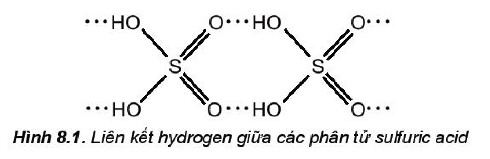
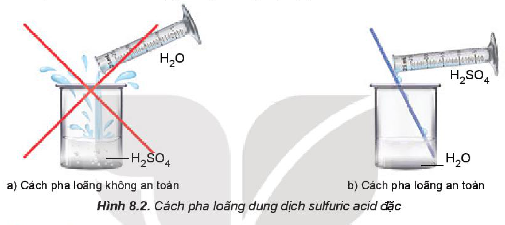
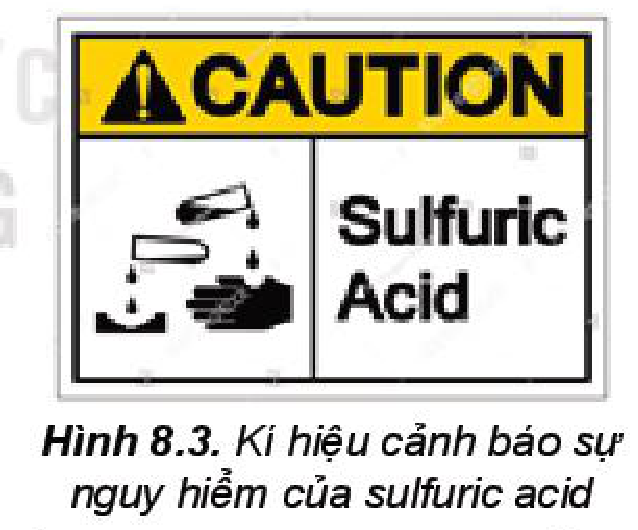
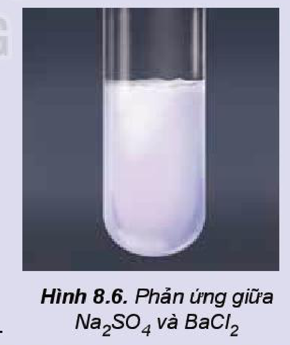

<!-- pdf:49 -->

# BÀI 8: SULFURIC ACID VÀ MUỐI SULFATE

## 🎯 Mục tiêu

- Trình bày được tính chất vật lí, cách bảo quản, sử dụng và nguyên tắc xử lí sơ bộ khi bỏng acid.
- Trình bày được cấu tạo phân tử $\ce{H2SO4}$; tính chất vật lí, tính chất hoá học cơ bản, ứng dụng của dung dịch sulfuric acid loãng, dung dịch sulfuric acid đặc và những lưu ý khi sử dụng sulfuric acid.
- Thực hiện được một số thí nghiệm chứng minh tính oxi hoá mạnh và tính háo nước của dung dịch sulfuric acid đặc.
- Vận dụng được kiến thức về năng lượng phản ứng, chuyển dịch cân bằng, vấn đề bảo vệ môi trường để giải thích các giai đoạn trong quá trình sản xuất sulfuric acid theo phương pháp tiếp xúc.
- Nêu được ứng dụng của một số muối sulfate quan trọng: barium sulfate, ammonium sulfate, calcium sulfate, magnesium sulfate và nhận biết được ion $\ce{SO4^2-}$ trong dung dịch bằng ion $\ce{Ba^2+}$.

## 🔴 Mở đầu

Sulfuric acid là hoá chất quan trọng hàng đầu trong công nghiệp, được sử dụng cả ở dạng dung dịch loãng và dạng dung dịch đặc dựa trên những tính chất khác biệt.

Vậy, dung dịch sulfuric acid loãng và dung dịch sulfuric acid đặc có những tính chất quan trọng nào? Cần lưu ý điều gì khi bảo quản và sử dụng acid này để đảm bảo an toàn?

## I. SULFURIC ACID

### 1. Cấu tạo phân tử

<!-- term: Sulfuric acid -->
Phân tử sulfuric acid ($\ce{H2SO4}$) có công thức cấu tạo: $\ce{HO-SO2-OH}$.

<!-- term: Sulfuric acid -->
Với cấu tạo gồm các nguyên tử hydrogen linh động và các nguyên tử oxygen có độ âm điện lớn, giữa các phân tử sulfuric acid hình thành nhiều liên kết hydrogen.

Hình 8.1. Liên kết hydrogen giữa các phân tử sulfuric acid

> ❓ 1. a) Dựa vào cấu tạo, cho biết phân tử sulfuric acid có khả năng cho bao nhiêu proton khi đóng vai trò là acid.
>
> b) Dựa vào tương tác giữa các phân tử, hãy dự đoán sulfuric acid là chất lỏng dễ bay hơi hay khó bay hơi.

<!-- pdf:50 -->

### 2. Tính chất vật lí

<!-- term: Sulfuric acid -->
Ở điều kiện thường, sulfuric acid là chất lỏng sánh như dầu, không màu, không bay hơi, có tính hút ẩm mạnh.

<!-- term: Sulfuric acid -->
Dung dịch sulfuric acid $98\%$ có khối lượng riêng $1,84\text{ g/cm}^3$, nặng gần gấp hai lần nước.

<!-- term: Sulfuric acid -->
Sulfuric acid tan vô hạn trong nước và toả rất nhiều nhiệt. Do vậy, tuyệt đối không tự ý pha loãng sulfuric acid. Khi pha loãng dung dịch sulfuric acid đặc, để đảm bảo an toàn phải rót từ từ dung dịch sulfuric acid đặc vào nước, vừa rót vừa khuấy (không làm ngược lại).

> 💡 EM CÓ BIẾT
>
> Sulfuric acid được sử dụng làm chất hút ẩm trong các bình hút ẩm để làm khô nhiều chất. Dung dịch sulfuric acid đặc cũng được sử dụng trong các bình rửa khí để tách loại hơi nước có lẫn trong các chất khí như chlorine, carbon dioxide, sulfur dioxide,...

Hình 8.2. Cách pha loãng dung dịch sulfuric acid đặc

### 3. Quy tắc an toàn

**a) Bảo quản**

Sulfuric acid được bảo quản trong chai, lọ có nút đậy chặt, đặt ở vị trí chắc chắn.

Đặt chai, lọ đựng dung dịch sulfuric acid đặc cách xa các lọ chứa chất dễ gây cháy, nổ như chlorate, perchlorate, permanganate, dichromate.

Hình 8.3. Kí hiệu cảnh báo sự nguy hiểm của sulfuric acid

**b) Sử dụng**

Sulfuric acid gây bỏng khi rơi vào da, do vậy khi sử dụng cần tuân thủ các nguyên tắc:

(1) Sử dụng găng tay, đeo kính bảo hộ, mặc áo thí nghiệm.

(2) Cầm dụng cụ chắc chắn, thao tác cẩn thận.

(3) Không tì, đè chai đựng acid lên miệng cốc, ống đong khi rót acid.

(4) Sử dụng lượng acid vừa phải, lượng acid còn thừa phải thu hồi vào lọ đựng.

(5) Không được đổ nước vào dung dịch acid đặc.

<!-- pdf:51 -->

**c) Sơ cứu khi bỏng acid**

Khi bị bỏng sulfuric acid cần thực hiện sơ cứu theo các bước sau:

(1) Nhanh chóng rửa ngay với nước lạnh nhiều lần để làm giảm lượng acid bám trên da. Nếu bị bỏng ở vùng mặt nhưng acid chưa bắn vào mắt thì nhắm chặt mắt khi ngâm rửa. Nếu acid đã bắn vào mắt thì úp mặt vào chậu nước sạch, mở mắt và chớp nhiều lần để rửa acid.

(2) Sau khi ngâm rửa bằng nước, cần tiến hành trung hoà acid bằng dung dịch $\ce{NaHCO3}$ loãng (khoảng $2\%$).

(3) Băng bó tạm thời vết bỏng bằng băng sạch, cho người bị bỏng uống bù nước điện giải rồi đưa đến cơ sở y tế gần nhất.

> ❓ 2. a) Nêu các lưu ý bắt buộc để đảm bảo an toàn khi sử dụng dung dịch sulfuric acid đặc.
>
> b) Hãy cho biết ý nghĩa của kí hiệu cảnh báo ở Hình 8.3.

### 4. Tính chất hoá học

**a) Dung dịch sulfuric acid loãng**

<!-- term: Sulfuric acid -->
Dung dịch sulfuric acid loãng có đầy đủ tính chất của một acid mạnh.

> ✋ 1. Em hãy cho biết các tính chất hoá học cơ bản của một acid.
>
> 2. Viết phương trình hoá học minh hoạ tính acid của dung dịch $\ce{H2SO4}$ loãng với: kim loại $\ce{Fe}$, bột $\ce{MgO}$, dung dịch $\ce{Na2CO3}$, dung dịch $\ce{BaCl2}$.

> 💡 EM CÓ BIẾT
>
> Dung dịch sulfuric acid loãng được sử dụng phổ biến để tạo môi trường acid cho nhiều phản ứng trong công nghiệp và nghiên cứu.
>
> - Sản xuất copper(II) sulfate: $\ce{2Cu + O2 + 2H2SO4 -> 2CuSO4 + 2H2O}$
> - Chuẩn độ permanganate: $\ce{5H2C2O4 + 2KMnO4 + 3H2SO4 -> 10CO2 + K2SO4 + 2MnSO4 + 8H2O}$
> - Sản xuất acquy chì: $\ce{Pb + PbO2 + 2H2SO4 -> 2PbSO4 + 2H2O}$

**b) Dung dịch sulfuric acid đặc**

- *Tính acid*

<!-- term: Sulfuric acid -->
Dung dịch sulfuric acid đặc có tính acid mạnh và khó bay hơi, được sử dụng để điều chế một số acid dễ bay hơi.

*Ví dụ:* Dung dịch sulfuric acid đặc được dùng trong công nghiệp để điều chế $\ce{HF}$ bằng cách tác dụng với quặng fluorite.

$\ce{CaF2 + H2SO4 ->[250\text{ }^\circ\text{C}] CaSO4 + 2HF}$

<!-- pdf:52 -->

- *Tính oxi hoá*

> 🔬 Thí nghiệm: Đồng (copper) tác dụng với dung dịch sulfuric acid đặc, nóng
>
> *Chuẩn bị:* đồng lá hoặc phoi bào, dung dịch sulfuric acid $70\%$; ống nghiệm, kẹp gỗ, đèn cồn, bông tẩm dung dịch $\ce{NaOH}$ loãng.
>
> *Tiến hành:*
>
> - Cho vài lá đồng đã cắt nhỏ vào ống nghiệm, thêm tiếp khoảng $3\text{ mL}$ dung dịch $\ce{H2SO4}\text{ }70\%$, dùng bông đã tẩm dung dịch $\ce{NaOH}$ loãng nút miệng ống nghiệm.
> - Hơ nóng đều phần ống nghiệm chứa dung dịch trên ngọn lửa đèn cồn, sau đó đun tập trung vào đáy ống nghiệm.
>
> *Lưu ý:* Dung dịch sulfuric acid đặc rơi vào da sẽ gây bỏng nặng, cần cẩn thận khi sử dụng.
>
> *Quan sát, mô tả hiện tượng xảy ra và thực hiện yêu cầu sau:*
>
> 1. Viết phương trình hoá học của phản ứng và xác định chất oxi hoá, chất khử.
> 2. Nhận xét về khả năng phản ứng của dung dịch sulfuric acid đặc, nóng với copper.

<!-- term: Sulfuric acid -->
Dung dịch sulfuric acid đặc thể hiện tính oxi hoá mạnh, nhất là khi đun nóng, kèm theo sự giảm số oxi hoá của nguyên tử sulfur:

$\ce{\overset{+6}{S} + 2e -> \overset{+4}{S}} \qquad \ce{\overset{+6}{S} + 6e -> \overset{0}{S}} \qquad \ce{\overset{+6}{S} + 8e -> \overset{-2}{S}}$

<!-- term: Sulfuric acid -->
Dung dịch sulfuric acid đặc, nóng oxi hoá được nhiều kim loại, phi kim và hợp chất.

*Ví dụ:*

$\ce{Cu + 2H2SO4 ->[\text{t}^\circ] CuSO4 + SO2 + 2H2O}$

$\ce{C + 2H2SO4 ->[\text{t}^\circ] CO2 + 2SO2 + 2H2O}$

$\ce{2KBr + 2H2SO4 ->[\text{t}^\circ] K2SO4 + Br2 + SO2 + 2H2O}$

- *Tính háo nước*

> 🔬 Thí nghiệm: Dung dịch sulfuric acid đặc tác dụng với đường mía
>
> *Chuẩn bị:* đường mía ($\ce{C12H22O11}$), dung dịch sulfuric acid đặc; cốc thuỷ tinh loại $100\text{ mL}$.
>
> *Tiến hành:*
>
> - Lấy khoảng $10\text{ g}$ đường mía cho vào cốc.
> - Nhỏ đều trên bề mặt đường mía khoảng $2\text{ mL}$ dung dịch sulfuric acid đặc.
>
> *Lưu ý:* Dung dịch sulfuric acid đặc rơi vào da sẽ gây bỏng nặng, cần cẩn thận khi sử dụng.
>
> *Quan sát, mô tả hiện tượng xảy ra và thực hiện yêu cầu sau:*
>
> 1. Viết phương trình hoá học của các phản ứng xảy ra trong thí nghiệm.
> 2. Dự đoán hiện tượng khi cho dung dịch sulfuric acid đặc tiếp xúc với các carbohydrate khác như cellulose (giấy, bông), tinh bột (gạo).

<!-- pdf:53 -->

<!-- term: Sulfuric acid -->
Dung dịch sulfuric acid đặc có khả năng lấy nước từ hợp chất carbohydrate và khiến chúng hoá đen (**hiện tượng than hoá**).

> ❓ 3. a) Viết phương trình hoá học của phản ứng khi cho lần lượt các chất rắn sodium chloride ($\ce{NaCl}$), sodium bromide ($\ce{NaBr}$) tác dụng với dung dịch sulfuric acid đặc.
>
> b) Chỉ ra vai trò của sulfuric acid trong mỗi phản ứng đó.

### 5. Ứng dụng

<!-- term: Sulfuric acid -->
Một số ứng dụng của sulfuric acid:
- Sản xuất thuốc nhuộm
- Sản xuất chất tẩy rửa
- Chế biến dầu mỏ
- Sản xuất phân bón
- Sản xuất muối, acid
- Sản xuất giấy
- Sản xuất chất dẻo, tơ sợi
- Sản xuất thuốc nổ
<!-- ocr-ok: đối chiếu trực tiếp ảnh trang PDF 53, sơ đồ các ô ứng dụng của sulfuric acid bị OCR ghép dòng ngang -->

> ✋ Sưu tầm tài liệu và trình bày về các ứng dụng của sulfuric acid trong các ngành sản xuất và đời sống. Vì sao sulfuric acid là hoá chất có tầm quan trọng bậc nhất?

> ❓ 4. Dung dịch sulfuric acid đặc được sử dụng để sản xuất phosphoric acid và phân bón superphosphate từ quặng phosphorite và apatite. Hãy viết phương trình hoá học của phản ứng giữa dung dịch sulfuric acid đặc với $\ce{Ca3(PO4)2}$ trong hai quặng trên.

### 6. Sản xuất

Trong công nghiệp, sulfuric acid chủ yếu được sản xuất bằng **phương pháp tiếp xúc**, đi từ nguyên liệu chính là sulfur, quặng pyrite (chứa $\ce{FeS2}$).

Phương pháp tiếp xúc gồm ba giai đoạn chính.

- *Giai đoạn 1:* Sản xuất sulfur dioxide

Tuỳ thuộc vào nguồn nguyên liệu, sulfur dioxide được sản xuất bằng cách đốt cháy sulfur, pyrite hoặc quặng sulfide trong lò đốt bằng không khí.

$\ce{S(s) + O2(g) ->[\text{t}^\circ] SO2(g)}$

$\ce{4FeS2(s) + 11O2(g) ->[\text{t}^\circ] 2Fe2O3(s) + 8SO2(g)}$

<!-- pdf:54 -->

- *Giai đoạn 2:* Sản xuất sulfur trioxide

Oxi hoá sulfur dioxide bằng không khí dư ở nhiệt độ khoảng $450\text{ }^\circ\text{C}$, áp suất $1 - 2\text{ bar}$, xúc tác vanadium(V) oxide ($\ce{V2O5}$), hiệu suất đạt trên $98\%$:

$\ce{2SO2(g) + O2(g) <=>[\ce{V2O5}\text{, t}^\circ] 2SO3(g)}$

- *Giai đoạn 3:* Hấp thụ sulfur trioxide bằng sulfuric acid đặc, tạo ra **oleum** (hỗn hợp các acid có công thức chung dạng $\ce{H2SO4.nSO3}$). Sau đó, pha loãng oleum vào nước thu được dung dịch sulfuric acid loãng.

## II. MUỐI SULFATE

### 1. Ứng dụng

<!-- term: Muối sulfate -->
Ứng dụng của muối sulfate:
- Sản xuất phân đạm (ammonium sulfate)
- Sản xuất thạch cao (calcium sulfate)
- Sản xuất chất cản quang (barium sulfate)
- Sản xuất khoáng chất bổ sung cho phân bón, thức ăn gia súc (magnesium sulfate)

> ✋ Tìm hiểu thêm và trình bày về các ứng dụng của muối sulfate mà em biết.

### 2. Nhận biết

<!-- term: Muối sulfate -->
> ✋ Thí nghiệm: Nhận biết ion $\ce{SO4^2-}$ bằng ion $\ce{Ba^2+}$
>
> *Chuẩn bị:* dung dịch $\ce{Na2SO4}$, dung dịch $\ce{BaCl2}$; ống nghiệm, kẹp gỗ.
>
> *Tiến hành:*
>
> - Lấy khoảng $1\text{ mL}$ dung dịch $\ce{Na2SO4}$ cho vào ống nghiệm.
> - Nhỏ vài giọt dung dịch $\ce{BaCl2}$ vào ống nghiệm, lắc nhẹ.
>
> *Quan sát hiện tượng xảy ra và thực hiện các yêu cầu:*
>
> 1. Viết phương trình hoá học dạng phân tử và ion rút gọn.
> 2. Dự đoán hiện tượng khi nhỏ dung dịch $\ce{BaCl2}$ vào ống nghiệm đựng dung dịch $\ce{H2SO4}$ loãng.
>
> 
>
> Hình 8.6. Phản ứng giữa $\ce{Na2SO4}$ và $\ce{BaCl2}$

<!-- pdf:55 -->

> ❓ 5. Trình bày phương pháp hoá học để phân biệt các cặp dung dịch sau:
>
> a) $\ce{BaCl2}$ và $\ce{NaCl}$;
>
> b) $\ce{H2SO4}$ loãng và $\ce{HCl}$.

## 📌 Em đã học

- Dung dịch sulfuric acid loãng có các tính chất chung của acid.
- Dung dịch sulfuric acid đặc là chất lỏng sánh, có tính hút ẩm mạnh, háo nước, dễ gây bỏng.
- Dung dịch sulfuric acid đặc có tính acid mạnh và tính oxi hoá mạnh, oxi hoá nhiều đơn chất và hợp chất, nhất là khi đun nóng.
- Sulfuric acid và các muối sulfate có nhiều ứng dụng quan trọng trong các ngành sản xuất nông nghiệp, công nghiệp, dược phẩm, chế biến dầu mỏ,...
- Sulfuric acid được sản xuất chủ yếu bằng phương pháp tiếp xúc: sản xuất sulfur dioxide, sản xuất sulfur trioxide, hấp thụ sulfur trioxide bằng dung dịch sulfuric acid đặc.

## ✏️ Em có thể

Bảo quản và sử dụng sulfuric acid an toàn, biết cách sơ cứu các trường hợp bỏng acid.

## 📷 Danh sách hình trong bài

| Mã hình | Trang PDF | Vị trí | Chú thích gốc |
|---|---|---|---|
| H11-hoa-b08-01 | 49 | Mục I.1 | Hình 8.1. Liên kết hydrogen giữa các phân tử sulfuric acid |
| H11-hoa-b08-02 | 50 | Mục I.2 | Hình 8.2. Cách pha loãng dung dịch sulfuric acid đặc |
| H11-hoa-b08-03 | 50 | Mục I.3a | Hình 8.3. Kí hiệu cảnh báo sự nguy hiểm của sulfuric acid |
| H11-hoa-b08-04 | 54 | Mục II.2, hộp thí nghiệm | Hình 8.6. Phản ứng giữa $\ce{Na2SO4}$ và $\ce{BaCl2}$ |
