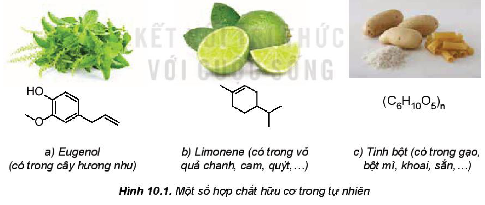
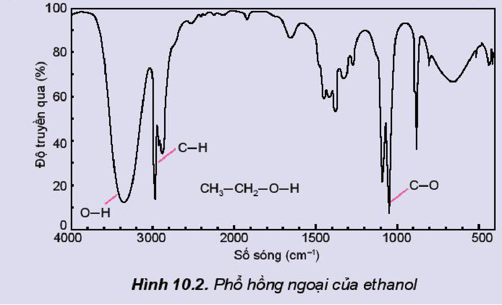
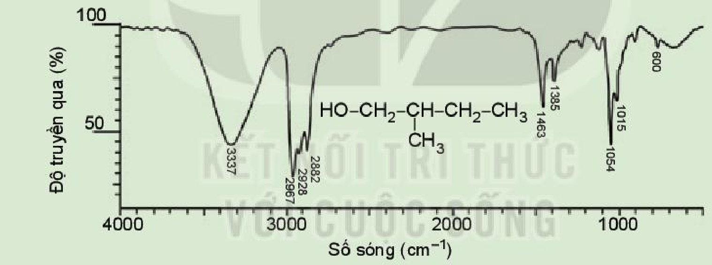
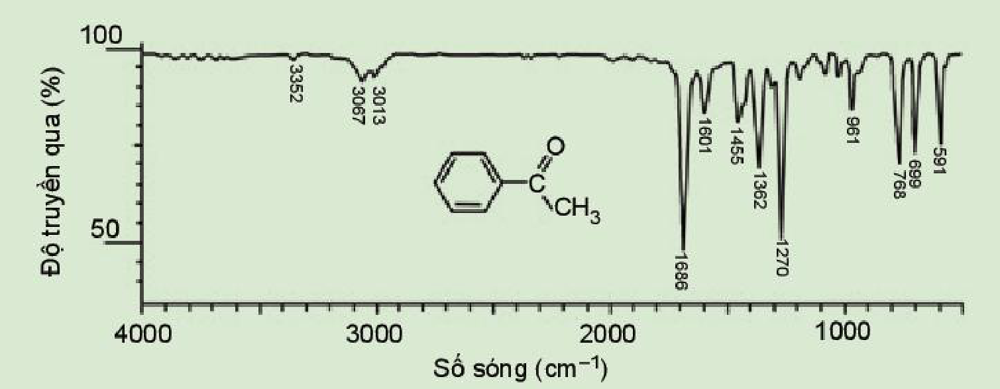
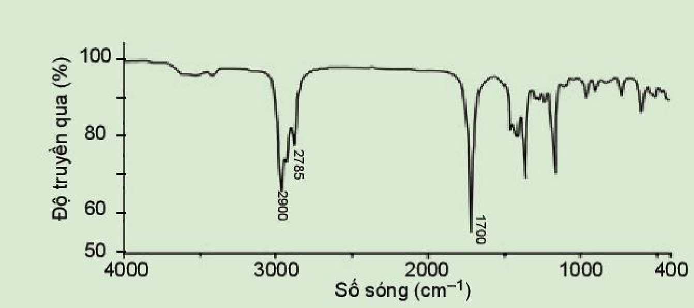

<!-- pdf:58 -->

# BÀI 10: HỢP CHẤT HỮU CƠ VÀ HOÁ HỌC HỮU CƠ

## 🎯 Mục tiêu

- Nêu được khái niệm hợp chất hữu cơ và hoá học hữu cơ; đặc điểm chung của các hợp chất hữu cơ.
- Phân loại được hợp chất hữu cơ (hydrocarbon và dẫn xuất).
- Nêu được khái niệm nhóm chức và một số loại nhóm chức cơ bản.
- Sử dụng được bảng tín hiệu phổ hồng ngoại (IR) để xác định một số nhóm chức cơ bản.

## 🔴 Mở đầu

Các hợp chất hữu cơ đóng vai trò quan trọng với sự sống như protein, nucleic acid, hormone,... Hợp chất hữu cơ là gì và chúng có những điểm chung gì?

## I. HỢP CHẤT HỮU CƠ VÀ HOÁ HỌC HỮU CƠ

### 1. Khái niệm

*Hình 10.1. Một số hợp chất hữu cơ trong tự nhiên: a) Eugenol (có trong cây hương nhu); b) Limonene (có trong vỏ quả chanh, cam, quýt,...); c) Tinh bột (có trong gạo, bột mì, khoai, sắn,...)*

Hợp chất của carbon là **hợp chất hữu cơ** (trừ một số các hợp chất như carbon monoxide, carbon dioxide, muối carbonate, cyanide, carbide,...).

Các hợp chất của carbon với các nguyên tố khác trong bảng tuần hoàn đã tạo nên hàng chục triệu hợp chất hữu cơ. Số lượng các chất hữu cơ mới vẫn đang tiếp tục tăng lên.

**Hoá học hữu cơ** là ngành hoá học chuyên nghiên cứu các hợp chất hữu cơ.

<!-- pdf:59 -->

> ❓ 1. Đối tượng nghiên cứu của hoá học hữu cơ là gì?
>
> 2. Trong các chất sau đây, chất nào là chất hữu cơ?
>
>    $\ce{C6H12O6}$, $\ce{C12H22O11}$, $\ce{C2H2}$, $\ce{CO2}$, $\ce{CaCO3}$.

> 💡 EM CÓ BIẾT
>
> **Lịch sử phát triển của hoá học hữu cơ**
>
> Từ thời xa xưa, người ta đã biết đến và sử dụng một số chất hữu cơ trong đời sống như giấm ăn, rượu uống, một số chất màu hữu cơ,... Đến cuối thế kỉ XVIII, đầu thế kỉ XIX, các nhà hoá học đã chiết tách được từ động vật, thực vật nhiều hợp chất hữu cơ như: oxalic acid (có trong sắn, rau chân vịt, măng,...), citric acid (có trong các cây họ cam quýt: cam, chanh, bưởi,...), lactic acid (có trong sữa chua, bánh bao, bánh mì, nước giải khát lên men,...).
>
> Năm 1806, lần đầu tiên Berzelius (Bơ-giê-li-ớt) đã dùng danh từ *hoá học hữu cơ* để chỉ ngành hoá học nghiên cứu về các hợp chất có nguồn gốc động vật, thực vật. Thời điểm này có thể xem như điểm mốc đánh dấu sự ra đời của hoá học hữu cơ.
>
> Đầu thế kỉ XX, trên thế giới đã phát triển mạnh các ngành công nghiệp sản xuất dược phẩm, sơn, nhựa, polymer, tơ sợi, cao su,...
>
> Thế kỉ XXI, **hoá học xanh** sẽ là một hướng đổi mới quan trọng để giúp ngành công nghiệp hoá chất phát triển. Trên thực tế, việc áp dụng những nguyên lí thân thiện với môi trường của hoá học xanh đã và đang góp phần giúp ngành hoá chất đi theo hướng phát triển bền vững, mang lại những lợi ích tích cực cho nhân loại cả về kinh tế, môi trường và xã hội.

### 2. Đặc điểm chung của các hợp chất hữu cơ

Các hợp chất hữu cơ có đặc điểm chung sau đây:

<!-- term: Đặc điểm chung của các hợp chất hữu cơ -->
- Thành phần phân tử nhất thiết phải chứa nguyên tố carbon, thường có hydrogen, oxygen, nitrogen, halogen, sulfur, phosphorus,...
- Liên kết hoá học chủ yếu là liên kết cộng hoá trị. Các nguyên tử carbon không những có khả năng liên kết với nguyên tử của các nguyên tố khác mà còn có thể liên kết với nhau tạo thành mạch carbon.
- Nhiệt độ nóng chảy thấp, nhiệt độ sôi thấp (dễ bay hơi) và thường không tan hoặc ít tan trong nước, tan trong các dung môi hữu cơ.
- Dễ cháy, kém bền với nhiệt nên dễ bị nhiệt phân huỷ.
- Phản ứng của các hợp chất hữu cơ thường xảy ra chậm, theo nhiều hướng và tạo ra hỗn hợp các sản phẩm. Để tăng tốc độ phản ứng thường cần đun nóng và có xúc tác.

> ❓ 3. So sánh thành phần nguyên tố, liên kết hoá học trong phân tử của hợp chất hữu cơ và của hợp chất vô cơ.

<!-- pdf:60 -->

## II. PHÂN LOẠI HỢP CHẤT HỮU CƠ

<!-- term: Phân loại hợp chất hữu cơ -->
Dựa vào thành phần nguyên tố, hợp chất hữu cơ có thể phân thành hai loại: *hydrocarbon* và *dẫn xuất của hydrocarbon*.

**Hydrocarbon** là những hợp chất được tạo thành chỉ từ hai nguyên tố carbon và hydrogen. Một số hydrocarbon tiêu biểu:

| Hydrocarbon | alkane | alkene | alkyne | arene |
|---|---|---|---|---|
| *Ví dụ* | $\ce{CH4}$ | $\ce{CH2=CH2}$ | $\ce{CH#CH}$ | $\ce{C6H6}$ |
<!-- ocr-ok: bảng một số hydrocarbon tiêu biểu trang 60, đã đối chiếu trực tiếp ảnh trang PDF 60 -->

Khi một hay nhiều nguyên tử hydrogen trong phân tử hydrocarbon được thay thế bằng một hay nhiều nguyên tử hay nhóm nguyên tử khác (thường chứa oxygen, nitrogen, sulfur, halogen,...), thu được **dẫn xuất của hydrocarbon**.

Dẫn xuất của hydrocarbon được phân thành nhiều loại:

| Dẫn xuất của hydrocarbon | dẫn xuất halogen | alcohol | carboxylic acid | ... |
|---|---|---|---|---|
| *Ví dụ* | $\ce{CH3Cl}$ | $\ce{C2H5OH}$ | $\ce{CH3COOH}$ | ... |
<!-- ocr-ok: bảng dẫn xuất của hydrocarbon trang 60, đã đối chiếu trực tiếp ảnh trang PDF 60 -->

> ❓ 4. Hãy phân loại các hợp chất hữu cơ cho dưới đây thành hai nhóm: hydrocarbon và dẫn xuất hydrocarbon.
>
> $$\ce{CH3-CH2-CH=CH-CH2-CH3}\quad;\quad \ce{C6H5-CH(CH3)2}\text{ (cumene)}\quad;\quad \ce{C6H5-OH}\text{ (phenol)}\quad;\quad \ce{C6H5-COOH}\text{ (benzoic acid)}$$
<!-- ocr-ok: công thức cấu tạo 4 chất trong hộp câu hỏi 4 trang 60, đã đối chiếu trực tiếp ảnh trang PDF 60 -->

## III. NHÓM CHỨC TRONG PHÂN TỬ HỢP CHẤT HỮU CƠ

### 1. Khái niệm

***Nhóm chức** là nguyên tử hoặc nhóm nguyên tử trong phân tử gây ra những tính chất hoá học đặc trưng của hợp chất hữu cơ.*

*Ví dụ:* Dimethyl ether ($\ce{H3C-O-CH3}$) và ethanol ($\ce{C2H5-OH}$) có cùng công thức phân tử $\ce{C2H6O}$ nhưng có các tính chất khác nhau. Dimethyl ether không phản ứng với sodium, trong khi ethanol phản ứng với sodium giải phóng hydrogen.

$$\ce{2C2H5OH + 2Na -> 2C2H5ONa + H2}$$
<!-- ocr-ok: phương trình phản ứng ethanol với sodium trang 60, đã đối chiếu trực tiếp ảnh trang PDF 60 -->

Nhóm $\ce{-OH}$ đã gây ra các phản ứng đặc trưng, phân biệt ethanol với dimethyl ether và với các loại hợp chất khác nên nhóm $\ce{-OH}$ được gọi là nhóm chức alcohol.

<!-- pdf:61 -->

### 2. Một số loại nhóm chức cơ bản

*Bảng 10.1. Một số nhóm chức cơ bản và công thức cấu tạo*

<!-- term: Một số nhóm chức cơ bản -->
| Loại hợp chất | Nhóm chức | Ví dụ | Loại hợp chất | Nhóm chức | Ví dụ |
|---|---|---|---|---|---|
| Dẫn xuất halogen | $\ce{-X}$ ($\ce{F, Cl, Br, I}$) | $\ce{CH3Cl}$ | Carboxylic acid | $\ce{-COOH}$ | $\ce{CH3COOH}$ |
| Alcohol | $\ce{-OH}$ | $\ce{CH3OH}$ | Ester | $\ce{-COO-}$ | $\ce{CH3COOCH3}$ |
| Aldehyde | $\ce{-CHO}$ | $\ce{CH3CHO}$ | Amine | $\ce{-NH2}$ | $\ce{CH3NH2}$ |
| Ketone | $\ce{>C=O}$ | $\ce{CH3COCH3}$ | Ether | $\ce{-O-}$ | $\ce{CH3OCH3}$ |
<!-- ocr-ok: Bảng 10.1 trang 61, đã đối chiếu trực tiếp ảnh trang PDF 61 -->

> ❓ 5. Glutamic acid là một chất dẫn truyền thần kinh, giúp phòng ngừa và điều trị các triệu chứng suy nhược thần kinh do thiếu hụt glutamic acid như mất ngủ, nhức đầu, ù tai, chóng mặt,... Glutamic acid có công thức cấu tạo:
>
>    $$\ce{HOOC-CH2-CH2-CH(NH2)-COOH}$$
>
>    Hãy nêu tên các nhóm chức có trong phân tử glutamic acid.

### 3. Phổ hồng ngoại và nhóm chức

**Phương pháp phổ hồng ngoại** (Infrared Spectroscopy, được viết tắt là IR) là phương pháp vật lí rất quan trọng và phổ biến để nghiên cứu cấu tạo phân tử hợp chất hữu cơ.

Mỗi liên kết trong phân tử hợp chất hữu cơ hấp thụ một vài bức xạ hồng ngoại đặc trưng cho liên kết đó.

**Phổ hồng ngoại** của một chất được máy phổ ghi lại tự động khi cho nguồn bức xạ hồng ngoại đi qua chất nghiên cứu. Phổ hồng ngoại thường biểu thị sự phụ thuộc của độ truyền qua (%) của bức xạ hồng ngoại vào **số sóng** ($\text{cm}^{-1}$). Các cực tiểu truyền qua (hoặc cực đại hấp thụ) ứng với dao động của các liên kết trong phân tử chất nghiên cứu được gọi là các **tín hiệu** (hoặc **peak**). Dựa vào các số sóng hấp thụ đặc trưng trên phổ IR có thể dự đoán nhóm chức trong phân tử chất nghiên cứu.

> ✋ Hãy quan sát phổ hồng ngoại của ethanol (Hình 10.2) và cho biết số sóng hấp thụ đặc trưng của liên kết $\ce{O-H}$, liên kết $\ce{C-H}$ và liên kết $\ce{C-O}$ nằm trong khoảng nào.
>
> 
>
> *Hình 10.2. Phổ hồng ngoại của ethanol*
<!-- ocr-ok: Hình 10.2 phổ hồng ngoại của ethanol trang 61, đã đối chiếu trực tiếp ảnh trang PDF 61 -->

<!-- pdf:62 -->

Bảng 10.2 là số sóng đặc trưng của một số nhóm chức cơ bản (phổ hồng ngoại).

*Bảng 10.2. Số sóng hấp thụ đặc trưng trên phổ hồng ngoại của một số nhóm chức cơ bản$^{(1)}$*

| Nhóm chức/liên kết | Số sóng ($\text{cm}^{-1}$) |
|---|---|
| $\ce{-OH}$ (alcohol) | $3\,500 - 3\,200$ |
| $\ce{>NH}$ (amine) | $3\,300 - 3\,000$ |
| $\ce{-CH=O}$ (aldehyde) | $2\,830 - 2\,695$ ($\ce{C-H}$) $1\,740 - 1\,685$ ($\ce{C=O}$) |
| $\ce{>C=O}$ (ketone) | $1\,715 - 1\,666$ ($\ce{C=O}$) |
| $\ce{-COOH}$ (carboxylic) | $3\,300 - 2\,500$ ($\ce{OH}$) $1\,760 - 1\,690$ ($\ce{C=O}$) |
| $\ce{-COO-}$ (ester) | $1\,750 - 1\,715$ ($\ce{C=O}$) |
<!-- ocr-ok: Bảng 10.2 trang 62, đã đối chiếu trực tiếp ảnh trang PDF 62 -->

> ❓ 6. Chỉ ra số sóng hấp thụ đặc trưng của nhóm $\ce{-OH}$ trên phổ hồng ngoại của chất sau:
>
> 
>
> 7. Chỉ ra số sóng hấp thụ đặc trưng của nhóm $\ce{C=O}$ (ketone) trên phổ hồng ngoại:
>
> 
<!-- ocr-ok: hộp câu hỏi 6 và 7 trang 62 kèm hình phổ hồng ngoại, đã đối chiếu trực tiếp ảnh trang PDF 62 -->

*(1) Nguồn: https://orgchemboulder.com/Spectroscopy.*

<!-- pdf:63 -->

> ❓ 8. Chất X có công thức phân tử là $\ce{C5H10O}$ và có phổ hồng ngoại như sau:
>
> 
>
> Dựa vào Bảng 10.2 và phổ hồng ngoại, hãy dự đoán nhóm chức có trong phân tử X.
<!-- ocr-ok: hộp câu hỏi 8 trang 63 kèm hình phổ hồng ngoại, đã đối chiếu trực tiếp ảnh trang PDF 63 -->

## 📌 Em đã học

- Hợp chất của carbon là hợp chất hữu cơ (trừ một số các hợp chất như carbon monoxide, carbon dioxide, muối carbonate, cyanide, carbide,...).
- Liên kết hoá học trong hợp chất hữu cơ thường là liên kết cộng hoá trị; nhiệt độ nóng chảy, nhiệt độ sôi thấp và thường không tan hoặc ít tan trong nước, tan trong các dung môi hữu cơ.
- Hợp chất hữu cơ dễ cháy, dễ bị nhiệt phân huỷ, các phản ứng thường xảy ra chậm, theo nhiều hướng và tạo ra hỗn hợp các sản phẩm.
- Hợp chất hữu cơ được phân thành hai loại: *hydrocarbon* và *dẫn xuất của hydrocarbon*.
- Nhóm chức là nguyên tử hoặc nhóm nguyên tử gây ra những tính chất hoá học đặc trưng của phân tử hợp chất hữu cơ.
- Phổ hồng ngoại thường được sử dụng để xác định sự có mặt của các nhóm chức trong phân tử hợp chất hữu cơ.

## ✏️ Em có thể

Sử dụng được bảng tín hiệu phổ hồng ngoại (IR) để xác định một số nhóm chức cơ bản trong phân tử hợp chất hữu cơ, từ đó có thể dự đoán cấu trúc phân tử hợp chất hữu cơ.

## 📷 Danh sách hình trong bài

| Mã hình | Trang PDF | Vị trí | Chú thích gốc |
|---|---|---|---|
| H11-hoa-b10-01 | 58 | Mục I.1 | Hình 10.1. Một số hợp chất hữu cơ trong tự nhiên |
| H11-hoa-b10-02 | 61 | Mục III.3, hộp hoạt động (nằm trong hộp hoạt động nền tím nhạt nên các cạnh khung cắt qua màu nền hộp) | Hình 10.2. Phổ hồng ngoại của ethanol |
| H11-hoa-b10-03 | 62 | Mục III.3, hộp câu hỏi 6 (nằm trong hộp câu hỏi nền xanh lục nhạt nên các cạnh khung cắt qua màu nền hộp) | (sách không đánh số, không có chú thích) |
| H11-hoa-b10-04 | 62 | Mục III.3, hộp câu hỏi 7 (nằm trong hộp câu hỏi nền xanh lục nhạt nên các cạnh khung cắt qua màu nền hộp) | (sách không đánh số, không có chú thích) |
| H11-hoa-b10-05 | 63 | Mục III.3, hộp câu hỏi 8 (nằm trong hộp câu hỏi nền xanh lục nhạt nên các cạnh khung cắt qua màu nền hộp) | (sách không đánh số, không có chú thích) |
