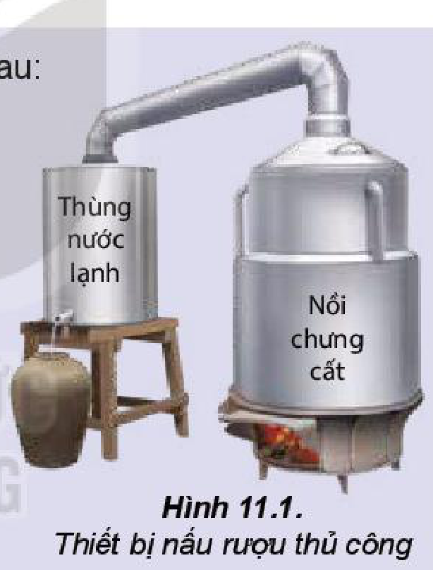
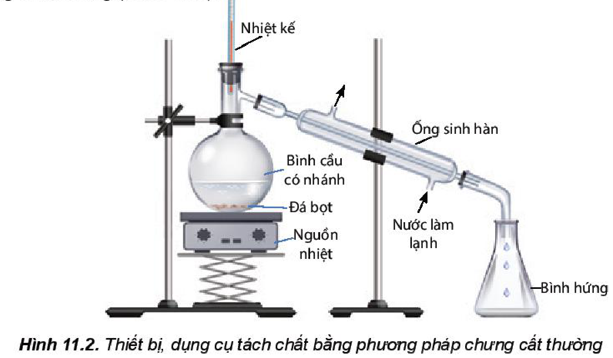
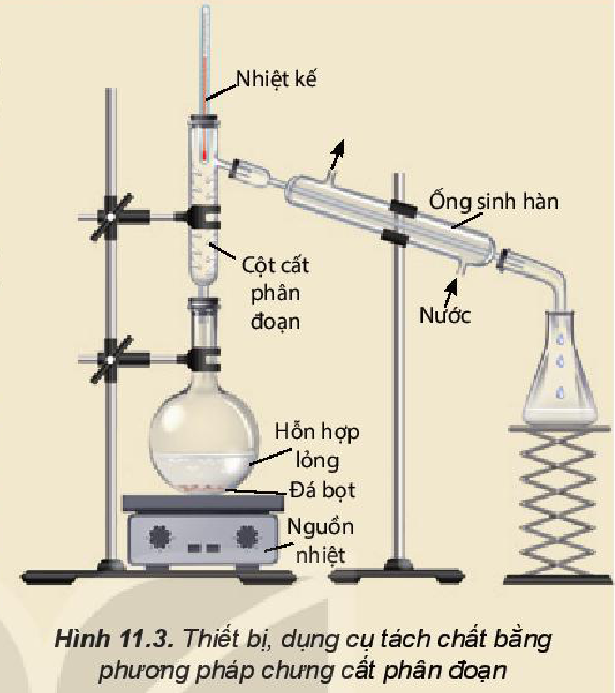
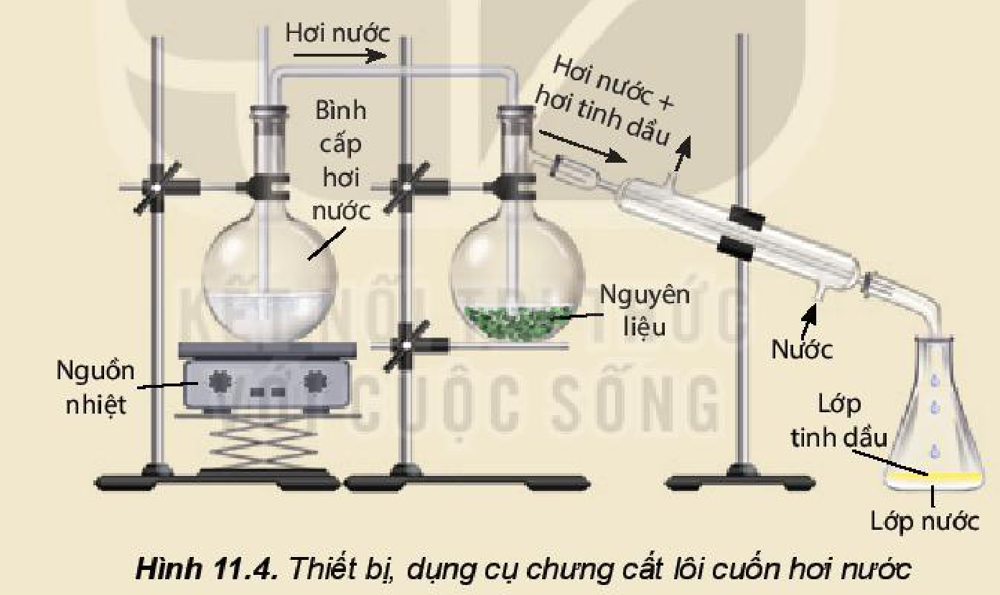
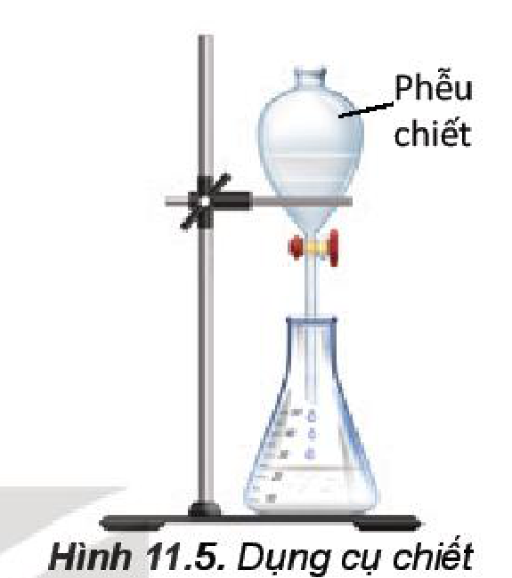
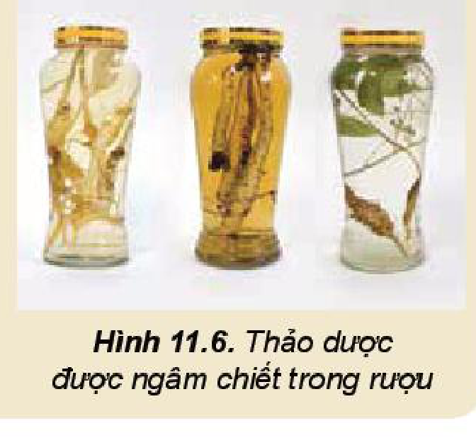
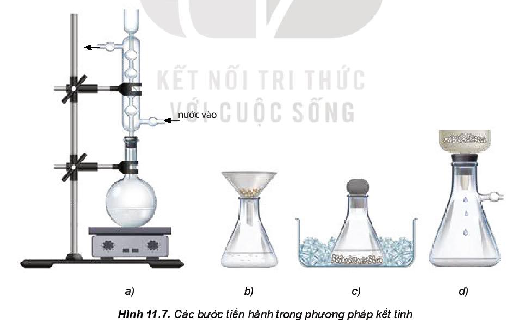
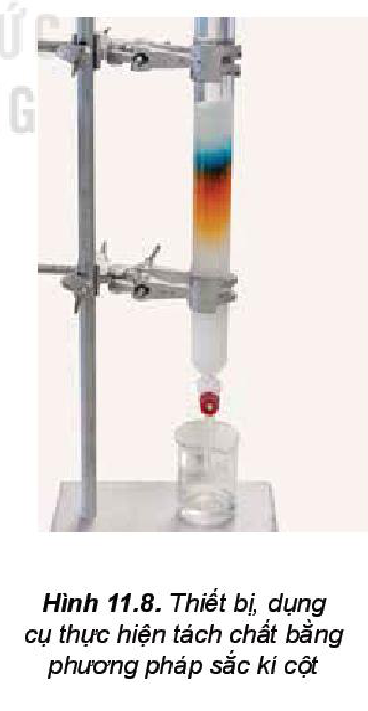

<!-- pdf:64 -->

# BÀI 11: PHƯƠNG PHÁP TÁCH BIỆT VÀ TINH CHẾ HỢP CHẤT HỮU CƠ

## 🎯 Mục tiêu

- Trình bày được nguyên tắc và cách thức tiến hành các phương pháp tách biệt và tinh chế hợp chất hữu cơ: chưng cất, chiết, kết tinh và sơ lược về sắc kí cột.
- Thực hiện được các thí nghiệm về chưng cất thường, chiết.
- Vận dụng được các phương pháp: chưng cất thường, chiết, kết tinh để tách biệt và tinh chế một số hợp chất hữu cơ trong cuộc sống.

## 🔴 Mở đầu

Các hợp chất hữu cơ thu được trong tự nhiên hay bằng con đường tổng hợp trong phòng thí nghiệm thường ở dạng thô, lẫn các tạp chất cần phải loại bỏ. Muốn có được sản phẩm hữu cơ tinh khiết, người ta sử dụng những biện pháp nào?

## I. PHƯƠNG PHÁP CHƯNG CẤT

> ✋ Quá trình nấu rượu gạo thủ công được thực hiện như sau:
>
> - Gạo được nấu chín, để nguội, rắc men, ủ kín $3 - 5$ ngày, thu được một hỗn hợp chủ yếu gồm nước, ethanol và bã rượu.
> - Đun nóng hỗn hợp trên đến nhiệt độ sôi, hơi bay ra đi vào đường ống dẫn. Hỗn hợp hơi trong đường ống được làm lạnh sẽ hoá lỏng và chảy vào bình hứng (Hình 11.1). Quá trình này gọi là chưng cất rượu.
>
> 
>
> *Hình 11.1. Thiết bị nấu rượu thủ công*
>
> *Trả lời câu hỏi:*
>
> 1. Trong quá trình chưng cất, tỉ lệ ethanol/nước giảm dần hay tăng dần, biết rằng ethanol có nhiệt độ sôi thấp hơn nước?
> 2. Vai trò của thùng nước lạnh là gì?

### 1. Nguyên tắc

**Chưng cất** là phương pháp tách chất dựa vào sự khác nhau về nhiệt độ sôi của các chất trong hỗn hợp ở một áp suất nhất định.

### 2. Cách tiến hành

Chất lỏng cần tách được chuyển sang pha hơi, rồi làm lạnh cho hơi ngưng tụ, thu lấy chất lỏng ở khoảng nhiệt độ thích hợp.

### 3. Ứng dụng

Phương pháp chưng cất dùng để tách các chất lỏng ra khỏi hỗn hợp các chất có nhiệt độ sôi khác nhau nhằm thu được chất lỏng tinh khiết hơn.

<!-- pdf:65 -->

Để tách các chất lỏng có nhiệt độ sôi khác nhau nhiều, người ta dùng phương pháp **chưng cất thường** (Hình 11.2).

*Hình 11.2. Thiết bị, dụng cụ tách chất bằng phương pháp chưng cất thường*

> 🔬 **Thí nghiệm: Chưng cất ethanol từ dung dịch ethanol – nước**
>
> *Chuẩn bị:* rượu (được nấu thủ công); bình cầu có nhánh $250\text{ mL}$, nhiệt kế, ống sinh hàn nước, ống nối, ống đong $50\text{ mL}$, bình tam giác $100\text{ mL}$, đá bọt, nguồn nhiệt (bếp điện, đèn cồn).
>
> *Tiến hành:*
>
> - Cho $60\text{ mL}$ rượu được nấu thủ công vào bình cầu có nhánh (chú ý chất lỏng trong bình không vượt quá $2/3$ thể tích bình), thêm vài viên đá bọt.
> - Lắp dụng cụ như Hình 11.2.
> - Đun nóng từ từ đến khi hỗn hợp sôi, quan sát nhiệt độ trên nhiệt kế thấy tăng dần, khi nhiệt độ trên nhiệt kế ổn định, đó chính là nhiệt độ sôi của hỗn hợp ethanol và nước. Khi nhiệt độ bắt đầu tăng trở lại thì tắt nguồn nhiệt, ngừng chưng cất.
>
> *Trả lời câu hỏi và thực hiện yêu cầu sau:*
>
> 1. Nhiệt độ sôi của hỗn hợp ethanol ban đầu và nước là bao nhiêu? So sánh với nhiệt độ sôi của ethanol.
> 2. Dự đoán độ cồn của sản phẩm thay đổi như thế nào so với rượu ban đầu. Giải thích.

> ❓ 1. Phương pháp chưng cất thường được áp dụng trong trường hợp nào? Hãy lấy ví dụ trong thực tế.

<!-- pdf:66 -->

> 💡 EM CÓ BIẾT
>
> **Chưng cất phân đoạn**
>
> Phương pháp **chưng cất phân đoạn** dùng để tách hai hay nhiều chất lỏng có nhiệt độ sôi khác nhau không nhiều và tan lẫn hoàn toàn trong nhau. Thiết bị, dụng cụ chưng cất phân đoạn được bố trí như Hình 11.3.
>
> Khi đun nóng, chất có nhiệt độ sôi thấp hơn sẽ bay hơi ra trước rồi được ngưng tụ và thu lấy ở bình hứng.
>
> 
>
> *Hình 11.3. Thiết bị, dụng cụ tách chất bằng phương pháp chưng cất phân đoạn*
>
> **Chưng cất lôi cuốn hơi nước**
>
> Trong phương pháp **chưng cất lôi cuốn hơi nước**, các chất có nhiệt độ sôi cao và không tan trong nước vẫn có thể tách ra khỏi hỗn hợp ở nhiệt độ sôi xấp xỉ nhiệt độ sôi của nước. Thiết bị chưng cất lôi cuốn hơi nước được bố trí như Hình 11.4. Hỗn hợp hơi nước và hơi chất hữu cơ cùng đi qua ống sinh hàn ngưng tụ và được thu ở bình hứng.
>
> 
>
> *Hình 11.4. Thiết bị, dụng cụ chưng cất lôi cuốn hơi nước*

## II. PHƯƠNG PHÁP CHIẾT

### 1. Nguyên tắc

**Chiết** là phương pháp tách biệt và tinh chế hỗn hợp các chất dựa vào sự hoà tan khác nhau của chúng trong hai môi trường không trộn lẫn vào nhau.

### 2. Cách tiến hành

- **Chiết lỏng – lỏng**: thường dùng để tách các chất hữu cơ hoà tan trong nước. Dùng một dung môi có khả năng hoà tan chất cần chiết, không trộn lẫn với dung môi ban đầu và có nhiệt độ sôi thấp để chiết. Sau khi lắc dung môi chiết với hỗn hợp chất

<!-- pdf:67 -->

  hữu cơ và nước, chất hữu cơ được chuyển phần lớn sang dung môi chiết và có thể dùng phễu chiết để tách riêng **dịch chiết** (dung dịch chứa chất cần chiết) khỏi nước. Khi hai chất lỏng không trộn lẫn được vào nhau, chất lỏng nào có khối lượng riêng nhỏ hơn sẽ tách thành lớp ở phía trên. Bằng cách lặp lại nhiều lần như trên, ta có thể tách được gần như hoàn toàn chất hữu cơ vào dung môi chiết. Sau đó, chưng cất dung môi ở nhiệt độ và áp suất thích hợp sẽ thu được chất hữu cơ.

- **Chiết lỏng – rắn**: dùng dung môi lỏng hoà tan chất hữu cơ để tách chúng ra khỏi hỗn hợp rắn.

### 3. Ứng dụng

Phương pháp chiết lỏng – lỏng dùng để tách lấy chất hữu cơ khi nó ở dạng nhũ tương hoặc huyền phù trong nước.

Áp dụng phương pháp chiết lỏng – rắn để tách lấy chất hữu cơ ra khỏi một hỗn hợp ở thể rắn, thường được áp dụng để ngâm rượu thuốc, phân tích thổ nhưỡng, phân tích dư lượng thuốc bảo vệ thực vật trong nông sản,...

*Hình 11.5. Dụng cụ chiết*

> 🔬 **Thí nghiệm: Tách $\beta$-carotene từ nước ép cà rốt**
>
> *Chuẩn bị:* nước ép cà rốt, hexane; cốc thuỷ tinh $100\text{ mL}$, bình tam giác $100\text{ mL}$, phễu chiết $60\text{ mL}$, giá thí nghiệm.
>
> *Tiến hành:*
>
> - Cho khoảng $20\text{ mL}$ nước ép cà rốt vào phễu chiết. Thêm tiếp khoảng $20\text{ mL}$ hexane, lắc đều khoảng $2\text{ phút}$.
> - Để yên phễu chiết trên giá thí nghiệm khoảng $5\text{ phút}$ để chất lỏng tách thành hai lớp.
> - Mở khoá phễu chiết cho phần nước ở dưới chảy xuống, còn lại phần dung dịch $\beta$-carotene hoà tan trong hexane.
>
> *Trả lời câu hỏi:*
>
> 1. Nhận xét màu sắc của lớp hexane trong phễu chiết trước và sau khi chiết.
> 2. Thí nghiệm tách $\beta$-carotene từ nước cà rốt dựa theo nguyên tắc nào?

> 💡 EM CÓ BIẾT
>
> **Phương pháp ngâm chiết**
>
> **Ngâm lạnh** là cách hay dùng nhất, áp dụng với đa số dược liệu. Cho dược liệu vào trong lọ, bình hoặc hũ, đổ một lượng rượu phù hợp rồi bịt kín lại, đặt ở nơi tối, mát. Ngâm từ $10$ đến $15\text{ ngày}$. Mùa đông có thể ngâm lâu hơn.
>
> **Ngâm nóng** thường áp dụng cho các dược liệu có cấu tạo rắn chắc, khó chiết xuất và có khả năng chịu nhiệt. Trước hết, người ta cho dược liệu và rượu vào dụng cụ thích hợp, đậy kín, đun cách thuỷ cho đến khi sôi rồi đổ ngay sang bình ngâm. Đậy kín và tiếp tục ngâm trong $7 - 10\text{ ngày}$ như ngâm lạnh.
>
> 
>
> *Hình 11.6. Thảo dược được ngâm chiết trong rượu*

<!-- pdf:68 -->

> ❓ 2. Tìm các ví dụ trong thực tế cuộc sống đã áp dụng phương pháp chiết. Mô tả cách thực hiện và cho biết em đã áp dụng phương pháp chiết lỏng – lỏng hay lỏng – rắn.

## III. PHƯƠNG PHÁP KẾT TINH

### 1. Nguyên tắc

**Kết tinh** là phương pháp tách biệt và tinh chế hỗn hợp các chất rắn dựa vào độ tan khác nhau và sự thay đổi độ tan của chúng theo nhiệt độ.

### 2. Cách tiến hành

- Hoà tan chất rắn lẫn tạp chất vào dung môi để tạo dung dịch bão hoà ở nhiệt độ cao. Dung môi thường dùng là nước, ethanol, acetone, ether, ethyl acetate,... hoặc đôi khi là hỗn hợp của chúng. Dung môi cần hoà tan tốt chất cần tinh chế ở nhiệt độ cao và hoà tan kém hơn chất cần tinh chế ở nhiệt độ thấp (Hình 11.7a).
- Lọc nóng loại bỏ chất không tan (Hình 11.7b).
- Để nguội và làm lạnh dung dịch thu được, chất cần tinh chế sẽ kết tinh (Hình 11.7c).
- Lọc để thu được chất rắn (Hình 11.7d).

*Hình 11.7. Các bước tiến hành trong phương pháp kết tinh*

Thực hiện kết tinh lại nhiều lần trong cùng một dung môi hoặc trong các dung môi khác nhau sẽ thu được tinh thể chất cần tinh chế.

<!-- pdf:69 -->

### 3. Ứng dụng

Phương pháp kết tinh được dùng để tách và tinh chế các chất rắn.

> ✋ **Tinh chế đường đỏ thành đường trắng**
>
> Đường được làm từ mật mía và chưa qua tinh luyện thường được gọi là đường đỏ (hoặc đường vàng). Trong đường đỏ có các chất màu và tạp chất. Để tinh luyện đường đỏ thành đường trắng, người ta làm như sau:
>
> - Hoà tan đường đỏ vào nước nóng, thêm than hoạt tính để khử màu, khuấy, lọc để thu được dung dịch trong suốt không màu.
> - Cô bớt nước, để nguội thu được đường trắng ở dạng tinh thể.
>
> *Hãy cho biết trong hai loại đường đỏ và đường trắng, đường nào tinh khiết hơn.*

## IV. SẮC KÍ CỘT

### 1. Nguyên tắc

**Sắc kí cột** là phương pháp tách biệt và tinh chế hỗn hợp các chất dựa vào sự phân bố khác nhau của chúng giữa hai pha động và pha tĩnh.

**Pha động** là dung môi và dung dịch mẫu chất cần tách di chuyển qua cột. **Pha tĩnh** là một chất rắn có diện tích bề mặt rất lớn, có khả năng hấp phụ khác nhau các chất trong hỗn hợp cần tách, ví dụ: silica gel, aluminium oxide,... Khi dung môi chạy qua cột, các chất hữu cơ được tách ra ở từng phân đoạn.

### 2. Cách tiến hành

- Sử dụng các cột thuỷ tinh có chứa các chất hấp phụ dạng bột (pha tĩnh), thường là aluminium oxide, silica gel,...
- Cho hỗn hợp cần tách lên cột sắc kí.
- Cho dung môi thích hợp chảy liên tục qua cột sắc kí. Thu các chất hữu cơ được tách ra ở từng phân đoạn khác nhau sau khi đi ra khỏi cột sắc kí.
- Loại bỏ dung môi để thu được chất cần tách.

### 3. Ứng dụng

Phương pháp sắc kí cột thường dùng để tách các chất hữu cơ có hàm lượng nhỏ và khó tách ra khỏi nhau.

*Hình 11.8. Thiết bị, dụng cụ thực hiện tách chất bằng phương pháp sắc kí cột*

<!-- pdf:70 -->

> ❓ 3. Hãy cho biết bản chất của các cách làm sau đây thuộc loại phương pháp tách biệt và tinh chế nào?
>
> a) Giã lá cây chàm, cho vào nước, lọc lấy dung dịch màu để nhuộm sợi, vải.
>
> b) Nấu rượu uống.
>
> c) Ngâm rượu thuốc.
>
> d) Làm đường cát, đường phèn từ nước mía.

## 📌 Em đã học

- *Chưng cất* là phương pháp dựa vào sự khác nhau về nhiệt độ sôi của các chất trong hỗn hợp ở một áp suất nhất định.
- *Chiết* là phương pháp tách biệt và tinh chế hỗn hợp các chất dựa vào sự hoà tan khác nhau của chúng trong hai dung môi không trộn lẫn vào nhau.
- *Kết tinh* là phương pháp được dùng để tách và tinh chế các chất rắn dựa trên nguyên tắc:
  (1) Các chất khác nhau có độ hoà tan khác nhau trong cùng một dung môi.
  (2) Độ tan của chất cần tách giảm nhanh khi giảm nhiệt độ.
- *Sắc kí cột* là phương pháp tách biệt và tinh chế hỗn hợp các chất dựa vào sự phân bố khác nhau của chúng giữa pha động và pha tĩnh.

## ✏️ Em có thể

- Tách được tinh dầu vỏ quả bưởi, cam, chanh,... bằng phương pháp chưng cất và chiết.
- Tinh chế một số chất thông dụng trong đời sống (như đường mía) bằng phương pháp kết tinh.

## 📷 Danh sách hình trong bài

| Mã hình | Trang PDF | Vị trí | Chú thích gốc |
|---|---|---|---|
| H11-hoa-b11-01 | 64 | Mục I, hộp hoạt động (nằm trong hộp hoạt động nền tím nhạt nên các cạnh khung cắt qua màu nền hộp) | Hình 11.1. Thiết bị nấu rượu thủ công |
| H11-hoa-b11-02 | 65 | Mục I.3 | Hình 11.2. Thiết bị, dụng cụ tách chất bằng phương pháp chưng cất thường |
| H11-hoa-b11-03 | 66 | Mục I.3, hộp Em có biết (nằm trong hộp Em có biết nền vàng nhạt nên các cạnh khung cắt qua màu nền hộp) | Hình 11.3. Thiết bị, dụng cụ tách chất bằng phương pháp chưng cất phân đoạn |
| H11-hoa-b11-04 | 66 | Mục I.3, hộp Em có biết (nằm trong hộp Em có biết nền vàng nhạt nên các cạnh khung cắt qua màu nền hộp) | Hình 11.4. Thiết bị, dụng cụ chưng cất lôi cuốn hơi nước |
| H11-hoa-b11-05 | 67 | Mục II.3 | Hình 11.5. Dụng cụ chiết |
| H11-hoa-b11-06 | 67 | Mục II.3, hộp Em có biết (nằm trong hộp Em có biết nền vàng nhạt nên các cạnh khung cắt qua màu nền hộp) | Hình 11.6. Thảo dược được ngâm chiết trong rượu |
| H11-hoa-b11-07 | 68 | Mục III.2 | Hình 11.7. Các bước tiến hành trong phương pháp kết tinh |
| H11-hoa-b11-08 | 69 | Mục IV.3 | Hình 11.8. Thiết bị, dụng cụ thực hiện tách chất bằng phương pháp sắc kí cột |
