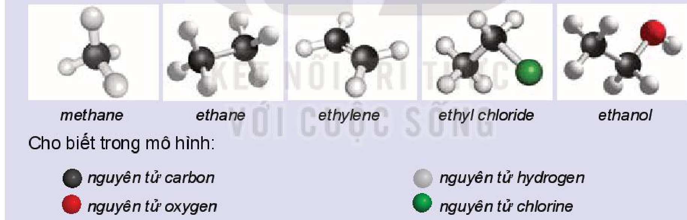
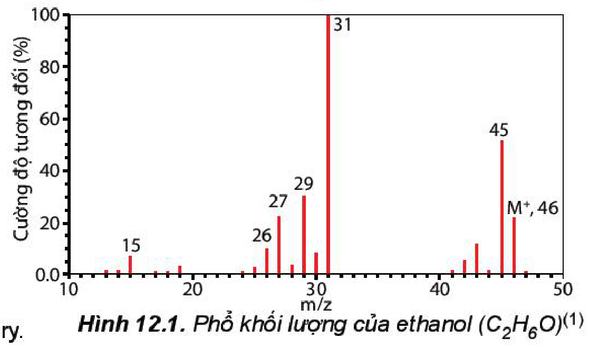
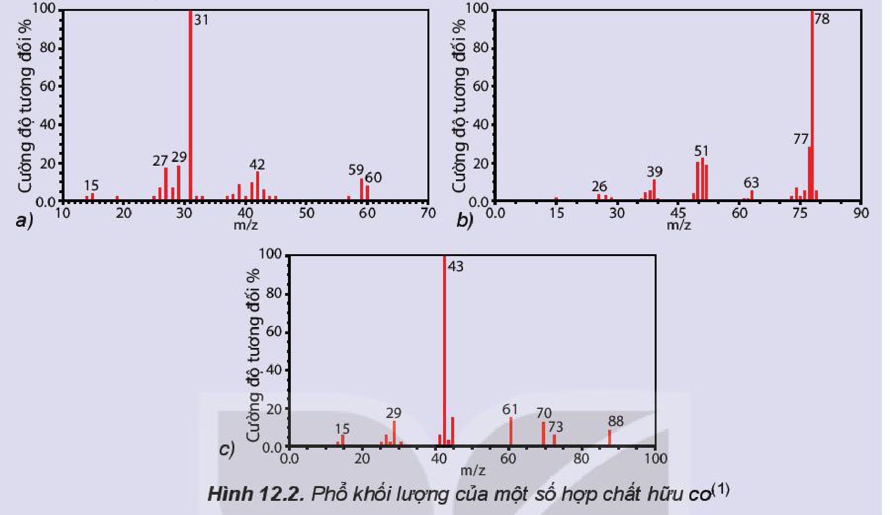
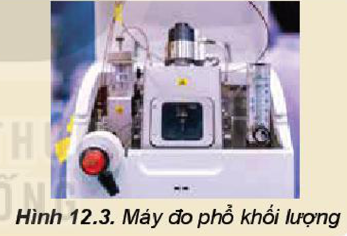
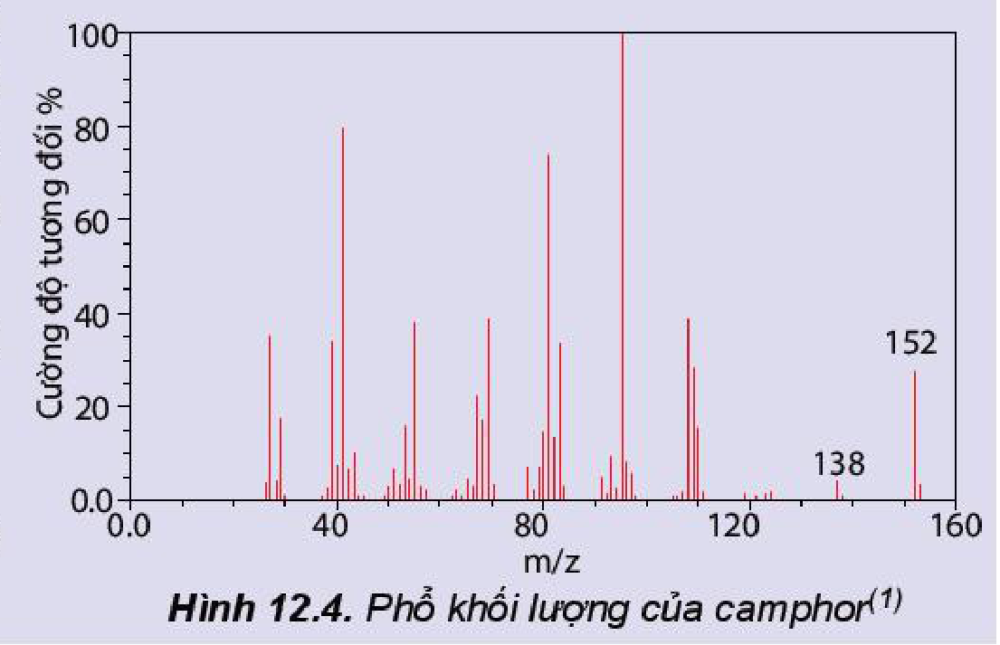

<!-- pdf:71 -->

# BÀI 12: CÔNG THỨC PHÂN TỬ HỢP CHẤT HỮU CƠ

## 🎯 Mục tiêu

- Nêu được khái niệm về công thức phân tử hợp chất hữu cơ.
- Sử dụng được kết quả phổ khối lượng (MS) để xác định phân tử khối của hợp chất hữu cơ.
- Lập được công thức phân tử hợp chất hữu cơ từ dữ liệu phân tích nguyên tố và phân tử khối.

## 🔴 Mở đầu

Làm thế nào để lập công thức phân tử hợp chất hữu cơ từ dữ liệu phân tích nguyên tố và phân tử khối?

## I. CÔNG THỨC PHÂN TỬ

### 1. Khái niệm

**Công thức phân tử** cho biết thành phần nguyên tố và số lượng nguyên tử của mỗi nguyên tố trong phân tử.

*Ví dụ:* Khí butane và propane là khí hoá lỏng được nén trong bình gas, được các gia đình sử dụng để đun, nấu có công thức phân tử là $\ce{C4H10}$ và $\ce{C3H8}$.

> ✋ Hãy viết công thức phân tử của các hợp chất hữu cơ có mô hình cho dưới đây:
>
> 
>
> Cho biết trong mô hình:
>
> - Quả cầu màu đen: *nguyên tử carbon*
> - Quả cầu màu trắng xám: *nguyên tử hydrogen*
> - Quả cầu màu đỏ: *nguyên tử oxygen*
> - Quả cầu màu xanh lục: *nguyên tử chlorine*
<!-- ocr-ok: mô hình phân tử methane, ethane, ethylene, ethyl chloride, ethanol trang 71, đã đối chiếu trực tiếp ảnh trang PDF 71 -->

### 2. Cách biểu diễn công thức phân tử hợp chất hữu cơ

a) **Công thức tổng quát:** cho biết các nguyên tố có trong phân tử hợp chất hữu cơ.

Ví dụ: $\ce{C_xH_yO_z}$ ($x, y, z$ là các số nguyên dương) cho biết phân tử chất hữu cơ đã cho chứa ba nguyên tố $\ce{C}$, $\ce{H}$ và $\ce{O}$.

b) **Công thức đơn giản nhất:** cho biết tỉ lệ số nguyên tử của các nguyên tố có trong phân tử hợp chất hữu cơ (tỉ lệ các số nguyên tối giản).

*Ví dụ:* Hợp chất có công thức phân tử là $\ce{C2H4O2}$ thì công thức đơn giản nhất là $\ce{CH2O}$.

<!-- pdf:72 -->

> ❓ 1. Khi nghiên cứu thành phần hoá học của tinh dầu quế, người ta thu được nhiều hợp chất hữu cơ trong đó có cinnamaldehyde và *o*-methoxycinnamaldehyde với công thức cấu tạo:
>
> - cinnamaldehyde: $\ce{C6H5-CH=CH-CHO}$
> - *o*-methoxycinnamaldehyde: $o\text{-}\ce{CH3O-C6H4-CH=CH-CHO}$
>
> Hãy viết công thức phân tử và công thức đơn giản nhất của các hợp chất này.
>
> 2. Viết công thức đơn giản nhất của các hợp chất hữu cơ có công thức phân tử sau:
>
> a) $\ce{C3H8}$;
>
> b) $\ce{C3H6O2}$;
>
> c) $\ce{C4H10O}$;
>
> d) $\ce{C4H8O2}$.
<!-- ocr-ok: công thức cấu tạo cinnamaldehyde và o-methoxycinnamaldehyde trong hộp câu hỏi 1 trang 72, đã đối chiếu trực tiếp ảnh trang PDF 72 -->

> 💡 EM CÓ BIẾT
>
> **Chất hữu cơ đầu tiên được tổng hợp như thế nào?**
>
> Năm 1828, Friedrich Wöhler (Phri-đrích Vô-lơ) (1800 – 1882), nhà hoá học người Đức, lần đầu tiên đã thực hiện thành công thí nghiệm tổng hợp chất hữu cơ urea (chất có trong nước tiểu) từ các chất không có trong cơ thể sống là potassium cyanide và ammonium sulfate. Điều này đã bác bỏ học thuyết cho rằng, các chất có trong cơ thể sinh vật về cơ bản, khác hẳn với các hoá chất không có nguồn gốc sinh vật, mở đầu cho sự phát triển của chuyên ngành hoá học hữu cơ.

## II. LẬP CÔNG THỨC PHÂN TỬ HỢP CHẤT HỮU CƠ

### 1. Xác định phân tử khối bằng phương pháp phổ khối lượng

**Phương pháp phổ khối lượng** được sử dụng để xác định khối lượng phân tử các hợp chất hữu cơ.

Trong máy khối phổ, chất nghiên cứu bị bắn phá bởi một dòng electron tạo ra các mảnh ion. *Ví dụ:*

$$\ce{M ->[+\text{E}][10 - 100\text{ eV}] M+ + e}$$
<!-- ocr-ok: sơ đồ bắn phá phân tử M bằng electron trong máy khối phổ trang 72, đã đối chiếu trực tiếp ảnh trang PDF 72 -->

Mảnh ion $[\ce{M+}]$ được gọi là **mảnh ion phân tử**. Giá trị $m/z$ của mỗi mảnh ion và hàm lượng của chúng được thể hiện trên **phổ khối lượng**.

Đối với các hợp chất đơn giản, thường mảnh có giá trị $m/z$ lớn nhất ứng với mảnh ion phân tử $[\ce{M+}]$ và giá trị này bằng giá trị phân tử khối của chất nghiên cứu.

*Ví dụ:* Phổ khối lượng của ethanol có peak (pic) ion phân tử $[\ce{C2H6O+}]$ có giá trị $m/z = 46$, đúng bằng phân tử khối của chất (Hình 12.1).

*Hình 12.1. Phổ khối lượng của ethanol ($\ce{C2H6O}$)$^{(1)}$*

*(1) Nguồn: http://webbook.nits.gov/chemistry.*

<!-- pdf:73 -->

> ✋ Hãy gán các chất hữu cơ sau: $\ce{C6H6}$, $\ce{C3H8O}$, $\ce{C4H8O2}$ vào các phổ khối lượng tương ứng dưới đây.
>
> 
>
> *Hình 12.2. Phổ khối lượng của một số hợp chất hữu cơ$^{(1)}$*
<!-- ocr-ok: Hình 12.2 phổ khối lượng trang 73, đã đối chiếu trực tiếp ảnh trang PDF 73 -->

> 💡 EM CÓ BIẾT
>
> **Phổ khối lượng ra đời như thế nào?**
>
> Phương pháp phổ khối lượng (Mass Spectrometry) được bắt đầu nghiên cứu từ cuối thế kỉ XIX. Năm 1886, Goldstein (Gót-xtên) đã chỉ ra rằng một chùm tia ion dương có thể tách biệt ra khỏi nhau dưới tác dụng của một điện trường và từ trường. Năm 1930, Conrad (Con-rát) đã đưa ra thông báo đầu tiên về nghiên cứu phổ khối lượng các hợp chất hữu cơ.
>
> 
>
> *Hình 12.3. Máy đo phổ khối lượng*

### 2. Lập công thức phân tử hợp chất hữu cơ

<!-- term: Lập công thức phân tử hợp chất hữu cơ -->
Một hợp chất hữu cơ có công thức phân tử là $\ce{C_xH_yO_z}$. Thiết lập công thức đơn giản nhất bằng cách lập tỉ lệ $x : y : z$ ở dạng số nguyên tối giản $p : q : r$.

Phân tích định lượng, ta được tỉ lệ phần trăm các nguyên tố trong phân tử.

$$x : y : z = \frac{\%m_{\ce{C}}}{12{,}0} : \frac{\%m_{\ce{H}}}{1{,}0} : \frac{\%m_{\ce{O}}}{16{,}0} = p : q : r$$
<!-- ocr-ok: công thức tỉ lệ x : y : z trang 73, đã đối chiếu trực tiếp ảnh trang PDF 73 -->

Từ đó thiết lập được công thức đơn giản nhất: $\ce{C_pH_qO_r}$.

Mối quan hệ giữa công thức phân tử và công thức đơn giản nhất:

$$\ce{C_xH_yO_z} = (\ce{C_pH_qO_r})_n$$
<!-- ocr-ok: hệ thức giữa công thức phân tử và công thức đơn giản nhất trang 73, đã đối chiếu trực tiếp ảnh trang PDF 73 -->

Trong đó: $p, q, r$ là các số nguyên tối giản; $x, y, z, n$ là số nguyên dương.

Khi biết phân tử khối, xác định được giá trị $n$, từ đó suy ra công thức phân tử.

*(1) Nguồn: http://webbook.nits.gov/chemistry.*

<!-- pdf:74 -->

> ✋ Camphor (có trong cây long não) là một chất rắn kết tinh màu trắng hay trong suốt giống như sáp với mùi thơm đặc trưng, thường dùng trong y học. Phần trăm khối lượng các nguyên tố trong camphor lần lượt là $78{,}94\%$ carbon, $10{,}53\%$ hydrogen và $10{,}53\%$ oxygen. Từ phổ khối lượng của camphor xác định được giá trị $m/z$ của peak $[\ce{M+}]$ bằng $152$.
>
> *Hãy lập công thức phân tử của camphor theo các bước:*
>
> - Lập công thức đơn giản nhất của camphor.
> - Xác định phân tử khối.
> - Xác định công thức phân tử của camphor.
>
> 
>
> *Hình 12.4. Phổ khối lượng của camphor$^{(1)}$*
<!-- ocr-ok: hộp hoạt động và Hình 12.4 trang 74, đã đối chiếu trực tiếp ảnh trang PDF 74 -->

> ❓ 3. Eugenol là thành phần chính trong tinh dầu đinh hương hoặc tinh dầu hương nhu. Chất này được sử dụng làm chất diệt nấm, dẫn dụ côn trùng. Phân tích phần trăm khối lượng các nguyên tố cho thấy, eugenol có $73{,}17\%$ carbon; $7{,}31\%$ hydrogen, còn lại là oxygen. Lập công thức phân tử của eugenol, biết rằng kết quả phân tích phổ khối lượng cho thấy phân tử khối của eugenol là $164$.

## 📌 Em đã học

- Công thức phân tử cho biết số lượng nguyên tử của mỗi nguyên tố trong phân tử.
- Công thức tổng quát cho biết thành phần định tính các nguyên tố.
- Công thức đơn giản nhất cho biết tỉ lệ số nguyên tử của các nguyên tố có trong phân tử (tỉ lệ theo các số nguyên tối giản).
- *Phổ khối lượng:* được sử dụng để xác định phân tử khối của hợp chất hữu cơ.
- *Lập công thức phân tử hợp chất hữu cơ ($\ce{C_xH_yO_z}$):*
  Công thức đơn giản nhất ($\ce{C_pH_qO_r}$):
  $$\ce{C_xH_yO_z} = (\ce{C_pH_qO_r})_n$$
  ($p, q, r$ là các số nguyên tối giản; $x, y, z, n$ là các số nguyên dương).

## ✏️ Em có thể

Xác định được công thức phân tử hợp chất hữu cơ dựa vào kết quả phân tích nguyên tố và phổ khối lượng.

*(1) Nguồn: http://webbook.nits.gov/chemistry.*
<!-- ocr-ok: chú thích nguồn chân trang 74 (OCR đọc nhầm thành http:/Awebbook.nits.govichemistry.), đã đối chiếu trực tiếp ảnh trang PDF 74 -->

## 📷 Danh sách hình trong bài

| Mã hình | Trang PDF | Vị trí | Chú thích gốc |
|---|---|---|---|
| H11-hoa-b12-01 | 71 | Mục I.1, hộp hoạt động (nằm trong hộp hoạt động nền tím nhạt nên các cạnh khung cắt qua màu nền hộp) | (sách không đánh số, không có chú thích) |
| H11-hoa-b12-02 | 72 | Mục II.1 | Hình 12.1. Phổ khối lượng của ethanol ($\ce{C2H6O}$)$^{(1)}$ |
| H11-hoa-b12-03 | 73 | Mục II.1, hộp hoạt động (nằm trong hộp hoạt động nền tím nhạt nên các cạnh khung cắt qua màu nền hộp) | Hình 12.2. Phổ khối lượng của một số hợp chất hữu cơ$^{(1)}$ |
| H11-hoa-b12-04 | 73 | Mục II.1, hộp Em có biết (nằm trong hộp Em có biết nền vàng nhạt nên các cạnh khung cắt qua màu nền hộp) | Hình 12.3. Máy đo phổ khối lượng |
| H11-hoa-b12-05 | 74 | Mục II.2, hộp hoạt động (nằm trong hộp hoạt động nền tím nhạt nên các cạnh khung cắt qua màu nền hộp) | Hình 12.4. Phổ khối lượng của camphor$^{(1)}$ |
