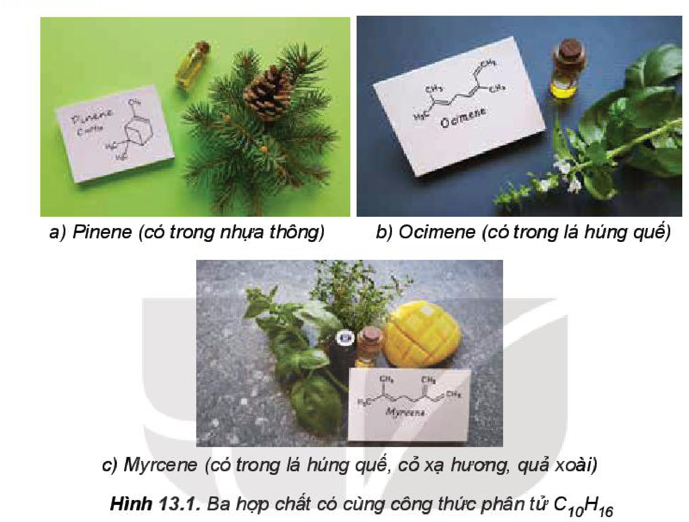

<!-- pdf:75 -->

# BÀI 13: CẤU TẠO HOÁ HỌC HỢP CHẤT HỮU CƠ

## 🎯 Mục tiêu

- Trình bày được nội dung thuyết cấu tạo hoá học trong hoá học hữu cơ.
- Giải thích được hiện tượng đồng phân trong hoá học hữu cơ.
- Nêu được khái niệm chất đồng đẳng và dãy đồng đẳng.
- Viết được công thức cấu tạo của một số hợp chất hữu cơ đơn giản (công thức cấu tạo đầy đủ, công thức cấu tạo thu gọn).
- Nêu được chất đồng đẳng, chất đồng phân dựa vào công thức cấu tạo cụ thể của các hợp chất hữu cơ.

## 🔴 Mở đầu

Tại sao số lượng các chất hữu cơ lớn hơn rất nhiều các chất vô cơ?

## I. THUYẾT CẤU TẠO HOÁ HỌC

<!-- term: Thuyết cấu tạo hoá học -->
Năm 1861, Butlerov (Bút-lê-rốp) đưa ra khái niệm cấu tạo hoá học và thuyết cấu tạo hoá học bao gồm những luận điểm chính sau:

<!-- term: Thuyết cấu tạo hoá học -->
1. Trong phân tử chất hữu cơ, các nguyên tử liên kết với nhau theo đúng hoá trị và theo một thứ tự nhất định. Thứ tự liên kết đó được gọi là **cấu tạo hoá học**. Sự thay đổi thứ tự liên kết đó sẽ tạo ra chất khác.

   *Ví dụ:* Ethanol và dimethyl ether đều có công thức phân tử $\ce{C2H6O}$ nhưng có tính chất vật lí và tính chất hoá học rất khác nhau do chúng có cấu tạo khác nhau.

| Ethanol | Dimethyl ether |
|---|---|
| $\ce{CH3-CH2-OH}$ | $\ce{CH3-O-CH3}$ |
| Nhiệt độ sôi: $78{,}3\ ^\circ\text{C}$ | Nhiệt độ sôi: $-24{,}9\ ^\circ\text{C}$ |
| Tan vô hạn trong nước | Ít tan trong nước |
| Tác dụng với sodium tạo khí hydrogen | Không tác dụng với sodium |
<!-- ocr-ok: bảng so sánh ethanol và dimethyl ether trang 75, đã đối chiếu trực tiếp ảnh trang PDF 75 -->

<!-- term: Thuyết cấu tạo hoá học -->
2. Trong phân tử chất hữu cơ, carbon có hoá trị IV. Các nguyên tử carbon không những liên kết với nguyên tử của các nguyên tố khác mà còn có thể liên kết trực tiếp với nhau tạo thành **mạch carbon** (mạch hở không phân nhánh, mạch hở phân nhánh hoặc mạch vòng). *Ví dụ:*

| Mạch hở không phân nhánh | Mạch hở phân nhánh | Mạch vòng |
|---|---|---|
| $\ce{CH3-CH2-CH2-CH2-CH3}$ | $\ce{CH3-CH2-CH(CH3)-CH3}$ ; $\ce{CH3-C(CH3)2-CH3}$ | $\ce{C5H10}$ (vòng 5 cạnh $\ce{CH2}$) |
<!-- ocr-ok: bảng ví dụ các loại mạch carbon trang 75, đã đối chiếu trực tiếp ảnh trang PDF 75 -->

<!-- pdf:76 -->

<!-- term: Thuyết cấu tạo hoá học -->
3. Tính chất của các chất phụ thuộc vào thành phần phân tử (bản chất và số lượng các nguyên tử) và cấu tạo hoá học. Các nguyên tử trong phân tử có ảnh hưởng qua lại lẫn nhau.

   *Ví dụ:*

| Đặc điểm | Hợp chất hữu cơ | Nhiệt độ sôi ($^\circ\text{C}$)$^{(1)}$ | Tính chất/ứng dụng |
|---|---|---|---|
| Khác nhau về loại nguyên tử | $\ce{CH4}$ | $-161{,}5$ | Không tan trong nước |
| Khác nhau về loại nguyên tử | $\ce{CH3OH}$ | $64{,}7$ | Tan vô hạn trong nước |
| Khác nhau về số lượng nguyên tử | $\ce{C3H8}$ | $-42{,}1$ | Dùng làm nhiên liệu (gas) |
| Khác nhau về số lượng nguyên tử | $\ce{C20H42}$ | $343$ | Dùng làm nến (sáp) |
| Cùng công thức phân tử, khác cấu tạo hoá học | $\ce{CH3-CH=CH2}$ | $-47{,}8$ | Dùng chế tạo nhựa polypropylene |
| Cùng công thức phân tử, khác cấu tạo hoá học | $\ce{C3H6}$ (vòng 3 cạnh $\ce{CH2}$) | $-32{,}8$ | Dùng làm chất gây mê qua đường hô hấp |
| Ảnh hưởng qua lại của các nhóm nguyên tử | $\ce{C6H5-OH}$ | $181{,}7$ | Tác dụng với dung dịch $\ce{NaOH}$ và nước bromine |
| Ảnh hưởng qua lại của các nhóm nguyên tử | $\ce{C6H11-OH}$ | $161{,}8$ | Không tác dụng với dung dịch $\ce{NaOH}$ và nước bromine |
<!-- ocr-ok: bảng ví dụ mục I.3 trang 76, đã đối chiếu trực tiếp ảnh trang PDF 76 -->

Thuyết cấu tạo hoá học giúp giải thích được hiện tượng đồng phân, hiện tượng đồng đẳng trong hoá học hữu cơ.

> ❓ 1. Viết công thức cấu tạo các hợp chất hữu cơ có cùng công thức phân tử sau:
>
> a) $\ce{C3H8O}$;
>
> b) $\ce{C4H8}$.
>
> 2. Hãy cho biết có loại mạch carbon nào trong công thức cấu tạo của các chất sau đây:
>
> a) $\ce{CH3-CH2-CH2-CH3}$;
>
> b) $\ce{CH3-CH(CH3)-CH3}$;
>
> c) Limonene (vòng 6 cạnh không no có nhánh $\ce{-CH3}$ và $\ce{-C(CH3)=CH2}$).
<!-- ocr-ok: công thức cấu tạo trong hộp câu hỏi 1, 2 trang 76, đã đối chiếu trực tiếp ảnh trang PDF 76 -->

*(1) Nguồn: pubchem.ncbi.nlm.nih.gov.*

<!-- pdf:77 -->

> 💡 EM CÓ BIẾT
>
> **Tác giả của thuyết cấu tạo hoá học**
>
> Aleksander Butlerov (A-lếch-xan-đơ Bút-lê-rốp) (1828 – 1886) là nhà hoá học hữu cơ người Nga, viện sĩ Viện Hàn lâm Khoa học Saint Petersburg (Xanh Pê-téc-bua). Ông là người sáng lập ra trường phái đầu tiên và cũng là lớn nhất của hoá học hữu cơ ở Nga. Ông đã xây dựng và chứng minh thuyết cấu tạo hoá học kinh điển của các hợp chất hữu cơ (1861). Công trình nghiên cứu của Butlerov đã chỉ ra định hướng phát triển trọng yếu của hoá học hữu cơ thế kỉ XIX – XX. Ông là người đầu tiên giải thích hiện tượng đồng phân (1864), phát hiện phản ứng trùng hợp isobutylene và dự đoán ứng dụng của phản ứng trùng hợp này trong tương lai.

## II. CÔNG THỨC CẤU TẠO

### 1. Khái niệm

Công thức biểu diễn cách liên kết và thứ tự liên kết giữa các nguyên tử trong phân tử được gọi là **công thức cấu tạo**.

*Ví dụ:* Ứng với công thức phân tử $\ce{C3H6O}$ có bốn công thức cấu tạo mạch hở như sau:

$$\ce{CH3-CH2-CHO}\text{ (propanal)}\quad;\quad \ce{CH3-CO-CH3}\text{ (acetone)}\quad;\quad \ce{CH2=CH-CH2-OH}\text{ (allyl alcohol)}\quad;\quad \ce{CH2=CH-O-CH3}\text{ (methyl vinyl ether)}$$
<!-- ocr-ok: bốn công thức cấu tạo của C3H6O trang 77, đã đối chiếu trực tiếp ảnh trang PDF 77 -->

### 2. Cách biểu diễn cấu tạo phân tử hợp chất hữu cơ

<!-- term: Cách biểu diễn cấu tạo phân tử hợp chất hữu cơ -->
| **Công thức cấu tạo đầy đủ** | **Công thức cấu tạo thu gọn** — Dạng 1: Các nguyên tử, nhóm nguyên tử cùng liên kết với một nguyên tử carbon được viết thành một nhóm | **Công thức cấu tạo thu gọn** — Dạng 2: Chỉ biểu diễn liên kết giữa các nguyên tử carbon với nhóm chức, mỗi đầu đoạn thẳng hoặc điểm gấp khúc ứng với 1 nguyên tử carbon (không biểu thị số nguyên tử hydrogen liên kết với mỗi nguyên tử carbon) |
|---|---|---|
| Khai triển toàn bộ liên kết $\ce{C-C}$ và $\ce{C-H}$ của butane ($\ce{C4H10}$) | $\ce{CH3-CH2-CH2-CH3}$ | Khung xương carbon dạng đường gấp khúc 4 đỉnh |
| Khai triển toàn bộ liên kết $\ce{C-C}$ và $\ce{C-H}$ của isobutane ($\ce{C4H10}$) | $\ce{CH3-CH(CH3)-CH2-CH3}$ | Khung xương carbon có nhánh methyl ở $\ce{C2}$ |
| Khai triển toàn bộ liên kết của but-2-ene ($\ce{C4H8}$) | $\ce{CH3-CH=CH-CH3}$ | Khung xương carbon có liên kết đôi ở giữa |
| Khai triển toàn bộ liên kết của propan-2-ol ($\ce{C3H8O}$) | $\ce{CH3-CH(OH)-CH3}$ | Khung xương carbon 3 đỉnh gắn nhóm $\ce{-OH}$ ở đỉnh giữa |
<!-- ocr-ok: bảng cách biểu diễn cấu tạo phân tử hợp chất hữu cơ trang 77, đã đối chiếu trực tiếp ảnh trang PDF 77 -->

<!-- pdf:78 -->

> ❓ 3. Viết công thức cấu tạo dạng thu gọn có thể có của các hợp chất hữu cơ ứng với công thức phân tử $\ce{C4H10O}$.

## III. ĐỒNG PHÂN

*Hình 13.1. Ba hợp chất có cùng công thức phân tử $\ce{C10H16}$: a) Pinene (có trong nhựa thông); b) Ocimene (có trong lá húng quế); c) Myrcene (có trong lá húng quế, cỏ xạ hương, quả xoài)*

Ba hợp chất pinene, ocimene, myrcene có tính chất khác nhau nhưng lại có cùng công thức phân tử là $\ce{C10H16}$ nên chúng là những chất đồng phân của nhau.

*Những hợp chất hữu cơ khác nhau nhưng có cùng công thức phân tử được gọi là các **chất đồng phân** của nhau.*

Các chất này có cùng công thức phân tử nhưng có tính chất khác nhau là do chúng có cấu tạo hoá học khác nhau.

Ứng với một công thức phân tử có thể có các **đồng phân cấu tạo** về mạch carbon, loại nhóm chức, vị trí nhóm chức.

*Ví dụ:*

| Loại đồng phân cấu tạo | Chất thứ nhất | Chất thứ hai |
|---|---|---|
| Đồng phân mạch carbon | $\ce{CH3-CH2-CH2-CH2-CH3}$ | $\ce{CH3-CH2-CH(CH3)-CH3}$ |
| Đồng phân loại nhóm chức | $\ce{CH3-CH2-CH2-OH}$ | $\ce{CH3-O-CH2-CH3}$ |
| Đồng phân vị trí nhóm chức | $\ce{CH3-CH2-CH2-OH}$ | $\ce{CH3-CH(OH)-CH3}$ |
<!-- ocr-ok: bảng ví dụ các loại đồng phân cấu tạo trang 78, đã đối chiếu trực tiếp ảnh trang PDF 78 -->

<!-- pdf:79 -->

> 💡 EM CÓ BIẾT
>
> Ngoài đồng phân cấu tạo, các hợp chất hữu cơ còn có **đồng phân hình học** và **đồng phân quang học**. Các loại đồng phân này có cấu tạo giống nhau, chỉ khác nhau vị trí không gian của nguyên tử, nhóm nguyên tử trong phân tử.
>
> *Đồng phân hình học* xuất hiện khi:
>
> - Phân tử có bộ phận cứng nhắc (nối đôi) làm cản trở sự quay tự do của các nguyên tử liên kết trực tiếp với carbon có nối đôi.
> - Hai nguyên tử hay nhóm nguyên tử gắn với cùng một nguyên tử carbon có nối đôi phải khác nhau.
>
> *Ví dụ:* *Cis*-but-2-ene (hai nhóm $\ce{-CH3}$ ở cùng một phía của liên kết đôi $\ce{C=C}$) và *Trans*-but-2-ene (hai nhóm $\ce{-CH3}$ ở hai phía khác nhau của liên kết đôi $\ce{C=C}$).
<!-- ocr-ok: công thức cấu tạo đồng phân cis- và trans- trong hộp Em có biết trang 79, đã đối chiếu trực tiếp ảnh trang PDF 79 -->

> ❓ 4. Viết các công thức cấu tạo của hợp chất có công thức phân tử $\ce{C5H12}$.
>
> 5. Cặp chất nào sau đây là đồng phân của nhau?
>
> A. $\ce{C2H5OH}$ và $\ce{CH3-O-C2H5}$.
>
> B. $\ce{CH3-O-CH3}$ và $\ce{CH3CHO}$.
>
> C. $\ce{CH3-CH2-CH2-OH}$ và $\ce{CH3-CH(OH)-CH3}$.
>
> D. $\ce{CH3-CH2-CH2-CH3}$ và $\ce{CH3-CH2-CH=CH2}$.

## IV. ĐỒNG ĐẲNG

> ✋ **Tìm hiểu về đồng đẳng**
>
> Trong quá trình chế biến dầu mỏ, người ta thu được nhiều khí như $\ce{C2H4}$, $\ce{C3H6}$, $\ce{C4H8}$,...
>
> | Công thức phân tử | Công thức cấu tạo | Nhiệt độ sôi ($^\circ\text{C}$)$^{(1)}$ | Phản ứng đặc trưng |
> |---|---|---|---|
> | $\ce{C2H4}$ | $\ce{CH2=CH2}$ | $-103{,}7$ | Làm mất màu dung dịch nước bromine |
> | $\ce{C3H6}$ | $\ce{CH2=CH-CH3}$ | $-47{,}6$ | Làm mất màu dung dịch nước bromine |
> | $\ce{C4H8}$ | $\ce{CH2=CH-CH2-CH3}$ | $-6{,}5$ | Làm mất màu dung dịch nước bromine |
>
> *Trả lời câu hỏi:*
>
> 1. So sánh thành phần phân tử và đặc điểm cấu tạo của ba hợp chất trên.
> 2. Theo em, tại sao các hợp chất trên đều có cùng tính chất hoá học đặc trưng là làm mất màu dung dịch bromine?
<!-- ocr-ok: bảng tìm hiểu về đồng đẳng trang 79, đã đối chiếu trực tiếp ảnh trang PDF 79 -->

*Các chất hữu cơ có tính chất hoá học tương tự nhau và thành phần phân tử hơn kém nhau một hay nhiều nhóm $\ce{CH2}$ được gọi là các **chất đồng đẳng** của nhau, chúng hợp thành một **dãy đồng đẳng**.*

*(1) Nguồn: pubchem.ncbi.nlm.nih.gov.*

<!-- pdf:80 -->

*Ví dụ:*

| Dãy đồng đẳng | Công thức chung | Một số hợp chất tiêu biểu |
|---|---|---|
| Alkane | $\ce{C_nH_{2n+2}}$ ($n \ge 1$) | $\ce{CH4}$, $\ce{C2H6}$, $\ce{C3H8}$,... |
| Alcohol no, đơn chức, mạch hở | $\ce{C_nH_{2n+2}O}$ ($n \ge 1$) | $\ce{CH3OH}$, $\ce{C2H5OH}$, $\ce{C3H7OH}$,... |
| Aldehyde no, đơn chức, mạch hở | $\ce{C_nH_{2n}O}$ ($n \ge 1$) | $\ce{HCHO}$, $\ce{CH3CHO}$, $\ce{C2H5CHO}$,... |
<!-- ocr-ok: bảng ví dụ dãy đồng đẳng trang 80, đã đối chiếu trực tiếp ảnh trang PDF 80 -->

> ❓ 6. Viết công thức phân tử của các chất có từ 3 đến 5 nguyên tử carbon trong phân tử trong dãy đồng đẳng của acetylene ($\ce{C2H2}$).
>
> 7. Trong các dãy chất sau đây, dãy nào gồm các chất là đồng đẳng của nhau?
>
> A. $\ce{CH3-CH2-OH}$ và $\ce{CH3-CH2-CH2-OH}$.
>
> B. $\ce{CH3-O-CH3}$ và $\ce{CH3-CH2-OH}$.
>
> C. $\ce{CH4}$, $\ce{C2H6}$ và $\ce{C4H8}$.
>
> D. $\ce{CH4}$ và $\ce{C3H6}$.
<!-- ocr-ok: hộp câu hỏi 6, 7 trang 80, đã đối chiếu trực tiếp ảnh trang PDF 80 -->

## 📌 Em đã học

- Các nguyên tử trong phân tử của mỗi hợp chất hữu cơ có một thứ tự liên kết xác định gọi là cấu tạo hoá học. Công thức biểu diễn cấu tạo hoá học gọi là công thức cấu tạo.
- Những hợp chất hữu cơ khác nhau nhưng có cùng công thức phân tử được gọi là các chất đồng phân của nhau. Có các đồng phân cấu tạo về mạch carbon, loại nhóm chức, vị trí nhóm chức.
- Các chất hữu cơ có tính chất hoá học tương tự nhau và thành phần phân tử hơn kém nhau một hay nhiều nhóm $\ce{CH2}$ được gọi là các chất đồng đẳng của nhau, chúng hợp thành một dãy đồng đẳng.

## ✏️ Em có thể

Vận dụng thuyết cấu tạo hoá học để viết được công thức cấu tạo của một số hợp chất hữu cơ đơn giản, thường gặp trong cuộc sống.

## 📷 Danh sách hình trong bài

| Mã hình | Trang PDF | Vị trí | Chú thích gốc |
|---|---|---|---|
| H11-hoa-b13-01 | 78 | Mục III | Hình 13.1. Ba hợp chất có cùng công thức phân tử $\ce{C10H16}$ |
