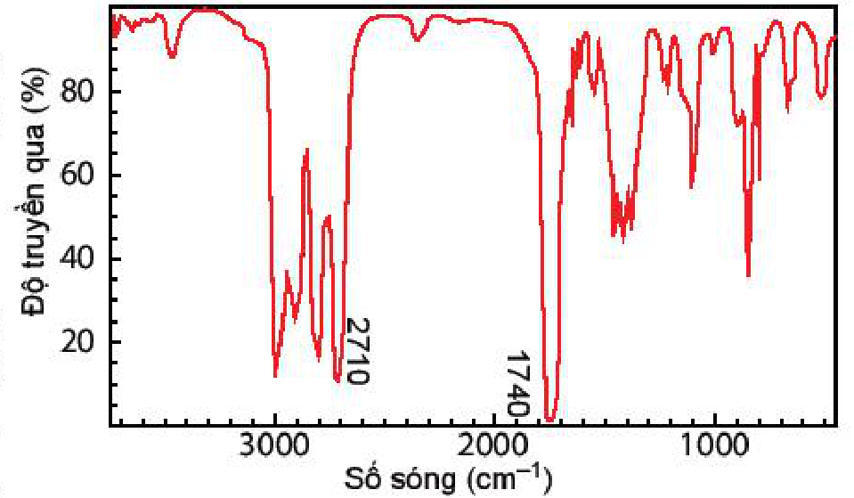

<!-- pdf:81 -->

# BÀI 14: ÔN TẬP CHƯƠNG 3

## I. HỆ THỐNG HOÁ KIẾN THỨC
<!-- ocr-ok: tiêu đề mục I trang 81 (OCR đọc nhầm thành "4 HỆ THỐNG HOÁ HIẾN THỨC"), đã đối chiếu trực tiếp ảnh trang PDF 81 -->

- **Hợp chất hữu cơ** gồm:
  - **Hydrocarbon**
  - **Dẫn xuất của hydrocarbon**
<!-- ocr-ok: sơ đồ phân loại hợp chất hữu cơ đầu mục I trang 81, đã đối chiếu trực tiếp ảnh trang PDF 81 -->

**PHƯƠNG PHÁP TÁCH VÀ TINH CHẾ HỢP CHẤT HỮU CƠ**

| Nội dung | Chưng cất | Chiết | Kết tinh | Sắc kí cột |
|---|---|---|---|---|
| **Nguyên tắc** | Chưng cất là phương pháp tách chất dựa vào sự khác nhau về nhiệt độ sôi của các chất trong hỗn hợp ở một áp suất nhất định. | Chiết là phương pháp dùng tách biệt và tinh chế hỗn hợp các chất dựa vào sự hoà tan khác nhau của chúng trong hai dung môi không trộn lẫn vào nhau. | Kết tinh là phương pháp tách biệt và tinh chế hỗn hợp các chất rắn dựa vào độ tan khác nhau và sự thay đổi độ tan của chúng theo nhiệt độ. | Sắc kí cột là phương pháp tách biệt và tinh chế hỗn hợp các chất dựa vào sự phân bố khác nhau của chúng giữa pha động và pha tĩnh. |
| **Cách tiến hành** | Khi nâng nhiệt độ của hỗn hợp gồm nhiều chất lỏng có nhiệt độ sôi khác nhau, thì chất nào có nhiệt độ sôi thấp hơn sẽ bay ra trước. Dùng sinh hàn lạnh sẽ thu được chất lỏng. | Dùng một dung môi thích hợp để chuyển chất cần tách sang pha lỏng (gọi là dịch chiết). Tách lấy dịch chiết, giải phóng dung môi sẽ thu được chất cần tách. | Dùng một dung môi thích hợp hoà tan chất cần tinh chế ở nhiệt độ cao tạo dung dịch bão hoà. Sau đó làm lạnh, chất rắn sẽ kết tinh, lọc, thu được sản phẩm. | Cho hỗn hợp cần tách lên cột sắc kí, sau đó cho dung môi thích hợp chảy liên tục qua cột sắc kí. Thu các chất hữu cơ được tách ra ở từng phân đoạn khác nhau sau khi đi ra khỏi cột sắc kí. Loại bỏ dung môi để thu được chất cần tách. |
| **Vận dụng** | Chưng cất thường: để tách các chất lỏng có nhiệt độ sôi khác nhau nhiều. | Phương pháp chiết lỏng – lỏng: để tách lấy chất hữu cơ khi nó ở dạng hỗn hợp lỏng. Phương pháp chiết lỏng – rắn: để tách lấy chất trong hỗn hợp rắn. | Phương pháp kết tinh: để tách và tinh chế các chất rắn. | Sử dụng phương pháp sắc kí có thể tách được hỗn hợp chứa nhiều chất khác nhau. |
<!-- ocr-ok: bảng phương pháp tách và tinh chế hợp chất hữu cơ trang 81, đã đối chiếu trực tiếp ảnh trang PDF 81 -->

<!-- pdf:82 -->

**CÔNG THỨC PHÂN TỬ HỢP CHẤT HỮU CƠ**

| Công thức tổng quát | Công thức đơn giản nhất |
|---|---|
| Cho biết các nguyên tố có trong hợp chất hữu cơ. | Cho biết: tỉ lệ tối giản của số nguyên tử các nguyên tố có trong phân tử. |
| $\ce{C_xH_yO_z}$ | $\ce{C_pH_qO_r}$ |
<!-- ocr-ok: bảng công thức phân tử hợp chất hữu cơ trang 82, đã đối chiếu trực tiếp ảnh trang PDF 82 -->

$$\ce{C_xH_yO_z} = (\ce{C_pH_qO_r})_n$$
<!-- ocr-ok: công thức liên hệ trong bảng công thức phân tử hợp chất hữu cơ trang 82, đã đối chiếu trực tiếp ảnh trang PDF 82 -->

Trong đó: $p, q, r$ là các số nguyên tối giản; $x, y, z, n$ là các số nguyên dương.

**CẤU TẠO PHÂN TỬ HỢP CHẤT HỮU CƠ**

- Trong phân tử hợp chất hữu cơ, các nguyên tử liên kết với nhau theo đúng hoá trị và theo một thứ tự nhất định. Thứ tự liên kết đó được gọi là cấu tạo hoá học. Công thức biểu diễn cách liên kết và thứ tự liên kết giữa các nguyên tử trong phân tử gọi là công thức cấu tạo.
- Đồng phân cấu tạo gồm đồng phân mạch carbon, đồng phân nhóm chức và đồng phân vị trí nhóm chức.
- Đồng đẳng là những hợp chất có tính chất hoá học tương tự nhau nhưng có thành phần phân tử hơn kém nhau một hay nhiều nhóm $\ce{CH2}$.

## II. LUYỆN TẬP

Câu 1. Viết công thức cấu tạo các đồng phân mạch hở có cùng công thức phân tử $\ce{C3H8O}$.

Câu 2. Tại sao khi đun nóng đến nhiệt độ thích hợp, đường kính (màu trắng) chuyển thành màu nâu rồi màu đen?

Câu 3. Hợp chất hữu cơ A có chứa carbon, hydrogen, oxygen, nitrogen. Thành phần phần trăm khối lượng của nguyên tố carbon, hydrogen, nitrogen lần lượt là $34{,}29\%$, $6{,}67\%$, $13{,}33\%$. Công thức phân tử của A cũng là công thức đơn giản nhất. Xác định công thức phân tử của A.

Câu 4. Hợp chất A có công thức phân tử $\ce{C3H6O}$. Khi đo phổ hồng ngoại cho kết quả như hình bên. Hãy xác định công thức cấu tạo của A.

Câu 5. Retinol là vitamin $\text{A}_1$ có nguồn gốc động vật, có vai trò hỗ trợ thị giác của mắt còn vitamin C giúp tăng khả năng miễn dịch của cơ thể. Để xác định công thức phân tử của các hợp chất này, người ta đã tiến hành phân tích nguyên tố và đo phổ khối lượng. Kết quả khảo sát được trình bày trong bảng sau:

| Hợp chất | $\% \ce{C}$ | $\% \ce{H}$ | $\% \ce{O}$ | Giá trị $m/z$ của peak ion phân tử $[\ce{M+}]$ |
|---|---|---|---|---|
| Vitamin C | $40{,}90$ | $4{,}55$ | $54{,}55$ | $176$ |
| Vitamin A | $83{,}92$ | $10{,}49$ | $5{,}59$ | $286$ |
<!-- ocr-ok: bảng số liệu Câu 5 trang 82, đã đối chiếu trực tiếp ảnh trang PDF 82 (5,59% O) -->

Hãy lập công thức phân tử của vitamin A và vitamin C.

## 📷 Danh sách hình trong bài

| Mã hình | Trang PDF | Vị trí | Chú thích gốc |
|---|---|---|---|
| H11-hoa-b14-01 | 82 | Mục II, Câu 4 | (sách không đánh số, không có chú thích) |
