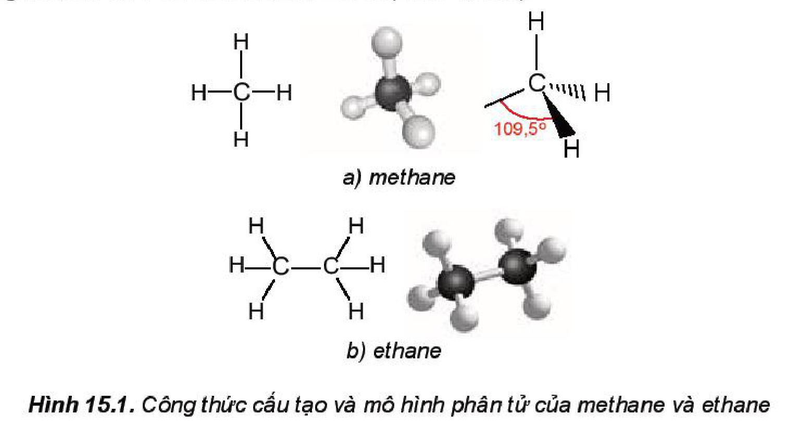

<!-- pdf:83 -->
# BÀI 15: ALKANE

## 🎯 Mục tiêu
- Nêu được khái niệm về alkane, nguồn alkane trong tự nhiên, công thức chung của alkane.
- Trình bày được quy tắc gọi tên theo danh pháp thay thế; áp dụng gọi được tên cho một số alkane ($\ce{C1}$ – $\ce{C10}$) mạch không phân nhánh và một số alkane mạch nhánh chứa không quá 5 nguyên tử $\ce{C}$.
- Trình bày được và giải thích được đặc điểm về tính chất vật lí của một số alkane.
- Trình bày được đặc điểm về liên kết hoá học trong phân tử alkane, hình dạng phân tử của methane, ethane; phản ứng thế, cracking, reforming, phản ứng oxi hoá hoàn toàn, phản ứng oxi hoá không hoàn toàn.
- Thực hiện được thí nghiệm: hexane với dung dịch thuốc tím, với nước bromine ở nhiệt độ thường và khi đun nóng (hoặc chiếu sáng), đốt cháy hexane; quan sát, mô tả các hiện tượng thí nghiệm và giải thích được tính chất hoá học của alkane.
- Trình bày được các ứng dụng của alkane trong thực tiễn và cách điều chế alkane trong công nghiệp.
- Trình bày được một trong các nguyên nhân gây ô nhiễm không khí là do các chất trong khí thải của các phương tiện giao thông; Hiểu và thực hiện được một số biện pháp hạn chế ô nhiễm môi trường do các phương tiện giao thông gây ra.

## 🔴 Mở đầu
Khí thiên nhiên, khí dầu mỏ, xăng, nhiên liệu phản lực (jet fuel) và dầu diesel có vai trò rất quan trọng trong mọi lĩnh vực của đời sống, kinh tế, công nghiệp. Vậy thành phần chính của các nhiên liệu này là gì? Ngoài ra, các alkane có phải là nguồn nguyên liệu quan trọng cho công nghiệp sản xuất các hoá chất hữu cơ hiện nay không?

## I. KHÁI NIỆM, DANH PHÁP

### 1. Khái niệm và công thức chung của alkane

**Alkane** là các hydrocarbon no mạch hở chỉ chứa liên kết đơn (liên kết $\sigma$) $\ce{C-H}$ và $\ce{C-C}$ trong phân tử.

Công thức chung của alkane: **$\ce{C_nH_{2n+2}}$** ($n$ là số nguyên, $n \ge 1$).

*Ví dụ:* $\ce{CH4}$, $\ce{C2H6}$, $\ce{C3H8}$, $\ce{C4H10}$, $\ce{C5H12}$,...

### 2. Danh pháp

**a) Alkane không phân nhánh**

<!-- term: Danh pháp thay thế của alkane mạch không phân nhánh -->
Tên theo danh pháp thay thế của alkane mạch không phân nhánh:
$$\text{Phần nền (chỉ số lượng nguyên tử carbon)} + \text{ane}$$
<!-- ocr-ok: đối chiếu trực tiếp ảnh trang PDF 83 (sơ đồ quy tắc gọi tên alkane không phân nhánh) -->

<!-- pdf:84 -->
**Bảng 15.1. Tên thay thế của một số alkane mạch không phân nhánh**

| Số nguyên tử carbon | Công thức alkane | Phần nền | Tên alkane |
| :---: | :---: | :---: | :---: |
| 1 | $\ce{CH4}$ | meth- | methane |
| 2 | $\ce{CH3CH3}$ | eth- | ethane |
| 3 | $\ce{CH3CH2CH3}$ | prop- | propane |
| 4 | $\ce{CH3[CH2]2CH3}$ | but- | butane |
| 5 | $\ce{CH3[CH2]3CH3}$ | pent- | pentane |
| 6 | $\ce{CH3[CH2]4CH3}$ | hex- | hexane |
| 7 | $\ce{CH3[CH2]5CH3}$ | hept- | heptane |
| 8 | $\ce{CH3[CH2]6CH3}$ | oct- | octane |
| 9 | $\ce{CH3[CH2]7CH3}$ | non- | nonane |
| 10 | $\ce{CH3[CH2]8CH3}$ | dec- | decane |

**b) Alkane mạch nhánh**

**Gốc alkyl**: Phần còn lại sau khi lấy đi một nguyên tử hydrogen từ phân tử alkane (công thức chung của gốc alkyl là $\ce{C_nH_{2n+1}}$).
Tên gốc alkyl:
$$\text{Phần nền (chỉ số lượng nguyên tử carbon)} + \text{yl}$$
<!-- ocr-ok: đối chiếu trực tiếp ảnh trang PDF 84 (sơ đồ quy tắc gọi tên gốc alkyl) -->

*Ví dụ:* methyl ($\ce{CH3-}$), ethyl ($\ce{C2H5-}$), propyl ($\ce{C3H7-}$),...
<!-- ocr-ok: đối chiếu trực tiếp ảnh trang PDF 84 (OCR đọc sai công thức gốc alkyl) -->

<!-- term: Danh pháp thay thế của alkane mạch phân nhánh -->
Alkane mạch nhánh gồm alkane mạch chính kết hợp với một hay nhiều nhánh. Tên theo danh pháp thay thế của alkane mạch phân nhánh:
$$\text{Số chỉ vị trí mạch nhánh-tên nhánh} + \text{tên alkane mạch chính}$$

<!-- term: Danh pháp thay thế của alkane mạch phân nhánh -->
*Lưu ý:*
- Chọn mạch dài nhất, có nhiều nhánh nhất làm mạch chính.
- Đánh số nguyên tử carbon mạch chính sao cho mạch nhánh có số chỉ vị trí nhỏ nhất.
- Dùng chữ số (1, 2, 3,...) và gạch nối (-) để chỉ vị trí nhánh, nhóm cuối cùng viết liền với tên mạch chính.
- Nếu có nhiều nhánh giống nhau: dùng các từ như *di-* (2), *tri-* (3), *tetra-* (4),... để chỉ số lượng nhóm giống nhau; tên nhánh viết theo thứ tự bảng chữ cái.

*Ví dụ:*
- $\ce{\overset{1}{C}H3-\overset{2}{C}H(CH3)-\overset{3}{C}H2-\overset{4}{C}H3}$: 2-methylbutane
- $\ce{\overset{1}{C}H3-\overset{2}{C}(CH3)2-\overset{3}{C}H3}$: 2,2-dimethylpropane (neopentane)

<!-- pdf:85 -->
> 💡 EM CÓ BIẾT
>
> *Chỉ số octane của xăng*
>
> Để đo chất lượng xăng, người ta dùng **chỉ số octane**, là đại lượng đặc trưng cho tính chống kích nổ của nhiên liệu. Chỉ số octane càng cao thì khả năng chịu nén của nhiên liệu trước khi phát nổ (đốt cháy) càng lớn. Chỉ số octane dựa trên thang điểm mà isooctane là 100, còn heptane là 0. Ví dụ: xăng RON 95 là hỗn hợp các hydrocarbon có tính chống kích nổ tương đương với hỗn hợp 95% isooctane và 5% heptane về thể tích.
>
> Alkane phân nhánh cao (ví dụ: isooctane) là thành phần quan trọng nhất trong xăng, còn các alkane không phân nhánh (ví dụ: dodecane) là thành phần quan trọng trong nhiên liệu diesel và nhiên liệu phản lực.
>
> - *dodecane*: $\ce{CH3-[CH2]10-CH3}$
> - *isooctane (2,2,4-trimethylpentane)*: $\ce{\overset{1}{C}H3-\overset{2}{C}(CH3)2-\overset{3}{C}H2-\overset{4}{C}H(CH3)-\overset{5}{C}H3}$

> ❓ 1. Viết các công thức cấu tạo và gọi tên theo danh pháp thay thế của alkane có công thức phân tử $\ce{C5H12}$ và phân loại các đồng phân đó.
> 2. Viết công thức cấu tạo của alkane có tên gọi 2-methylpropane.
> 3. Tên gọi của chất sau đây bị *sai*, em hãy giải thích và sửa lại cho đúng:
>    $$\ce{CH3-\underset{\underset{\ce{CH3}}{|}}{CH}-CH2-CH3}$$
>    1-methylbutane

## II. ĐẶC ĐIỂM CẤU TẠO

<!-- term: Đặc điểm cấu tạo của alkane -->
Trong phân tử alkane chỉ chứa các liên kết đơn $\ce{C-C}$ và $\ce{C-H}$, các liên kết này là liên kết $\sigma$ bền vững và kém phân cực. Do vậy, phân tử alkane hầu như không phân cực và ở điều kiện thường chúng tương đối trơ về mặt hoá học.

<!-- term: Đặc điểm cấu tạo của alkane -->
Trong phân tử methane, bốn liên kết $\ce{C-H}$ giống nhau tạo với nhau một góc $109,5^\circ$ và hướng về bốn đỉnh của một tứ diện đều (Hình 15.1a).

*Hình 15.1. Công thức cấu tạo và mô hình phân tử của methane và ethane*

<!-- pdf:86 -->
## III. TÍNH CHẤT VẬT LÍ

**Bảng 15.2. Tính chất vật lí của một số alkane $^{(1)}$**

| Alkane | Nhiệt độ nóng chảy ($^\circ\text{C}$) | Nhiệt độ sôi ($^\circ\text{C}$) | Khối lượng riêng ($\text{g/cm}^3$) ở $20\ ^\circ\text{C}$ |
| :--- | :---: | :---: | :---: |
| methane | $-182,5$ | $-161,5$ | – |
| ethane | $-183,3$ | $-88,6$ | – |
| propane | $-187,7$ | $-42,1$ | $0,501$ |
| butane | $-138,3$ | $-0,5$ | $0,579$ |
| pentane | $-129,7$ | $36,1$ | $0,626$ |
| hexane | $-95,3$ | $68,7$ | $0,659$ |
| heptane | $-90,6$ | $98,4$ | $0,684$ |
| octane | $-56,8$ | $125,7$ | $0,703$ |
| nonane | $-53,6$ | $150,8$ | $0,718$ |
| decane | $-29,7$ | $174,0$ | $0,730$ |
<!-- ocr-ok: đối chiếu trực tiếp ảnh trang PDF 86 (Bảng 15.2) -->

<!-- term: Tính chất vật lí của alkane -->
Ở điều kiện thường, alkane từ $\ce{C1}$ đến $\ce{C4}$ và neopentane ở trạng thái khí, từ $\ce{C5}$ đến $\ce{C17}$ (trừ neopentane) ở trạng thái lỏng, không màu, alkane từ $\ce{C18}$ trở lên là chất rắn màu trắng (còn gọi là **sáp paraffin**). Các alkane mạch nhánh thường có nhiệt độ sôi thấp hơn so với đồng phân alkane mạch không phân nhánh. Alkane không tan hoặc tan rất ít trong nước và nhẹ hơn nước, tan tốt hơn trong các dung môi hữu cơ.

> 💡 EM CÓ BIẾT
>
> *Các alkane trong tự nhiên*
>
> Lớp vỏ của các loại quả hoặc biểu bì của nhiều loại lá có chứa sáp. Thành phần của sáp thực vật này gồm các alkane dạng rắn, thường hay gặp là các alkane $\ce{C27H56}$, $\ce{C29H60}$ và $\ce{C31H64}$. Chức năng chính của sáp thực vật là ngăn chặn sự mất nước từ lá hoặc quả. Để bảo quản nhiều loại quả, trái cây, người ta phủ lên vỏ một lớp sáp mỏng nhằm mục đích giúp giữ hoa quả tươi lâu hơn.

> ❓ 4. Dựa vào Bảng 15.2, em hãy nhận xét về quy luật biến đổi nhiệt độ sôi của alkane theo phân tử khối.

*Chú thích:* $^{(1)}$ Nguồn: http://pubchem.ncbi.nlm.nih.gov.
<!-- ocr-ok: đối chiếu trực tiếp ảnh trang PDF 86 (chú thích chân trang Bảng 15.2) -->

<!-- pdf:87 -->
## IV. TÍNH CHẤT HOÁ HỌC

### 1. Phản ứng thế

Khi đặt bình chứa hỗn hợp của alkane với halogen (thường là chlorine hoặc bromine) trong phòng tối và ở nhiệt độ phòng, phản ứng không xảy ra. Nhưng nếu đun nóng hoặc chiếu ánh sáng sẽ xảy ra **phản ứng thế** nguyên tử hydrogen trong alkane bằng nguyên tử halogen:

$$\ce{\text{>}\overset{\overset{\ce{H}}{|}}{C}- + X-X ->[\text{ánh sáng}][t^\circ] \text{>}\overset{\overset{\ce{X}}{|}}{C}- + H-X} \quad (\ce{X = Cl, Br})$$
<!-- ocr-ok: đối chiếu trực tiếp ảnh trang PDF 87 (sơ đồ phản ứng thế halogen của alkane) -->

Phản ứng trên được gọi là **phản ứng halogen hoá alkane**. Sản phẩm của phản ứng halogen hoá là các dẫn xuất halogen.

*Ví dụ:* Khi trộn methane với chlorine và chiếu ánh sáng tử ngoại, sản phẩm thu được là chloromethane.

$$\ce{CH4 + Cl2 ->[\text{ánh sáng}] CH3Cl + HCl}$$
<!-- ocr-ok: đối chiếu trực tiếp ảnh trang PDF 87 (phương trình thế chlorine vào methane) -->

Phản ứng thế có thể tiếp tục diễn ra với các nguyên tử hydrogen còn lại của chloromethane cho hỗn hợp các sản phẩm chloromethane, dichloromethane, trichloromethane và tetrachloromethane.

$$\ce{CH3Cl + Cl2 ->[\text{ánh sáng}] CH2Cl2 + HCl}$$
<!-- ocr-ok: đối chiếu trực tiếp ảnh trang PDF 87 (phương trình thế chlorine vào chloromethane) -->

$$\ce{CH2Cl2 + Cl2 ->[\text{ánh sáng}] CHCl3 + HCl}$$
<!-- ocr-ok: đối chiếu trực tiếp ảnh trang PDF 87 (phương trình thế chlorine vào dichloromethane) -->

$$\ce{CHCl3 + Cl2 ->[\text{ánh sáng}] CCl4 + HCl}$$
<!-- ocr-ok: đối chiếu trực tiếp ảnh trang PDF 87 (phương trình thế chlorine vào trichloromethane) -->

Khi thực hiện phản ứng thế halogen vào các alkane có từ 3 nguyên tử carbon trở lên sẽ thu được hỗn hợp các sản phẩm thế monohalogen.

*Ví dụ:*

$$\ce{CH3-CH2-CH3 ->[+\ce{Cl2},\text{ ánh sáng}][-\ce{HCl}] \begin{cases} \ce{CH3-CHCl-CH3} \\ \ce{CH3-CH2-CH2-Cl} \end{cases}}$$
<!-- ocr-ok: đối chiếu trực tiếp ảnh trang PDF 87 (sơ đồ thế chlorine vào propane) -->

> 🔬 Thí nghiệm: phản ứng bromine hoá hexane
>
> *Chuẩn bị:* ống nghiệm, hexane, nước bromine, cốc thuỷ tinh.
>
> *Tiến hành:*
> - Cho vào ống nghiệm khoảng $1\text{ mL}$ hexane rồi cho tiếp vào đó khoảng $1\text{ mL}$ nước bromine. Quan sát thấy ống nghiệm có hai lớp, lớp dưới là nước bromine màu vàng, lớp trên là hexane không màu.
> - Lắc đều và quan sát hiện tượng.
> - Đặt ống nghiệm vào cốc nước ấm (khoảng $50\ ^\circ\text{C}$), quan sát hiện tượng xảy ra.
>
> *Trả lời câu hỏi:*
> 1. Nêu hiện tượng xảy ra trong quá trình thí nghiệm. Giải thích.
> 2. Viết phương trình hoá học ở dạng công thức phân tử của phản ứng xảy ra trong thí nghiệm trên (nếu có), giả thiết là chỉ có một nguyên tử hydrogen được thay thế.

<!-- pdf:88 -->
> ❓ 5. Viết sơ đồ phản ứng của butane với bromine trong điều kiện có chiếu sáng, tạo thành các sản phẩm monobromine.

### 2. Phản ứng cracking

**Cracking alkane** là quá trình phân cắt liên kết $\ce{C-C}$ (bẻ gãy mạch carbon) của các alkane mạch dài để tạo thành hỗn hợp các hydrocarbon có mạch carbon ngắn hơn.

Phản ứng cracking được ứng dụng trong công nghiệp lọc dầu. Phản ứng cracking được thực hiện trong điều kiện nhiệt độ cao và thường có xúc tác.

*Ví dụ:* Cracking nonane $\ce{C9H20}$ thu được các alkane mạch ngắn hơn là $\ce{C5}$ – $\ce{C7}$ và alkene $\ce{C2}$ – $\ce{C4}$. Sơ đồ phản ứng:

$$\ce{C9H20 ->[\text{cracking}] \begin{cases} \ce{C2H4 + C7H16} \\ \ce{C3H6 + C6H14} \\ \ce{C4H8 + C5H12} \end{cases}}$$
<!-- ocr-ok: đối chiếu trực tiếp ảnh trang PDF 88 (sơ đồ phản ứng cracking nonane) -->

### 3. Phản ứng reforming

**Reforming alkane** là quá trình chuyển các alkane mạch không phân nhánh thành các alkane mạch phân nhánh và các hydrocarbon mạch vòng nhưng không làm thay đổi số nguyên tử carbon trong phân tử và cũng không làm thay đổi đáng kể nhiệt độ sôi của chúng.

Reforming alkane xảy ra quá trình đồng phân hoá (isomer hoá) và arene hoá (thơm hoá). Quá trình reforming thường được thực hiện với các alkane $\ce{C5}$ – $\ce{C11}$ trong điều kiện nhiệt độ cao và thường có xúc tác.

*Ví dụ:* reforming hexane thu được các alkane mạch nhánh và các hydrocarbon mạch vòng.

$$\ce{CH3-[CH2]4-CH3 ->[\text{reforming}] \begin{cases} \ce{CH3-CH(CH3)-CH2-CH2-CH3} & \text{(2-methylpentane)} \\ \ce{CH3-CH2-CH(CH3)-CH2-CH3} & \text{(3-methylpentane)} \\ \ce{CH3-C(CH3)2-CH2-CH3} & \text{(2,2-dimethylbutane)} \\ \ce{C6H6 + 4H2} & \text{(benzene)} \\ \dots \end{cases}}$$
<!-- ocr-ok: đối chiếu trực tiếp ảnh trang PDF 88 (sơ đồ phản ứng reforming hexane) -->

Quá trình reforming được ứng dụng trong công nghiệp lọc dầu để làm tăng chỉ số octane của xăng và sản xuất các arene (benzene, toluene, xylene) làm nguyên liệu cho công nghiệp tổng hợp hữu cơ.

### 4. Phản ứng oxi hoá

**a) Phản ứng oxi hoá hoàn toàn (phản ứng cháy)**

<!-- term: Phản ứng oxi hoá hoàn toàn alkane -->
Khi tiếp xúc với oxygen và có tia lửa khơi mào, alkane bị đốt cháy tạo thành khí carbon dioxide, hơi nước và giải phóng năng lượng.

<!-- pdf:89 -->
$$\ce{C_nH_{2n+2} + \frac{3n+1}{2}O2 ->[t^\circ] nCO2 + (n+1)H2O}$$
<!-- ocr-ok: đối chiếu trực tiếp ảnh trang PDF 89 (phương trình tổng quát đốt cháy alkane) -->

*Ví dụ:*

$$\ce{CH4(g) + 2O2(g) ->[t^\circ] CO2(g) + 2H2O(g)} \quad \Delta_r H^\circ = -890\text{ kJ/mol}$$
<!-- ocr-ok: đối chiếu trực tiếp ảnh trang PDF 89 (phương trình nhiệt hoá học đốt cháy methane) -->

$$\ce{C3H8(g) + 5O2(g) ->[t^\circ] 3CO2(g) + 4H2O(g)} \quad \Delta_r H^\circ = -2216\text{ kJ/mol}$$
<!-- ocr-ok: đối chiếu trực tiếp ảnh trang PDF 89 (phương trình nhiệt hoá học đốt cháy propane) -->

<!-- term: Phản ứng oxi hoá hoàn toàn alkane -->
Phản ứng cháy của alkane có vai trò rất quan trọng đối với đời sống con người. Đốt cháy các alkane cung cấp nhiệt để đun nấu, sưởi ấm và cung cấp năng lượng cho các ngành công nghiệp.

**b) Phản ứng oxi hoá không hoàn toàn**

<!-- term: Phản ứng oxi hoá không hoàn toàn alkane -->
Ở nhiệt độ cao, có mặt xúc tác, alkane bị oxi hoá cắt mạch carbon bởi oxygen tạo thành hỗn hợp carboxylic acid:

$$\ce{RCH2-CH2R' + \frac{5}{2}O2 ->[\text{xúc tác}, t^\circ] RCOOH + R'COOH + H2O}$$
<!-- ocr-ok: đối chiếu trực tiếp ảnh trang PDF 89 (phương trình oxi hoá cắt mạch alkane) -->

<!-- term: Phản ứng oxi hoá không hoàn toàn alkane -->
Các acid béo mạch dài dùng để sản xuất xà phòng và các chất tẩy rửa được điều chế bằng phương pháp oxi hoá cắt mạch các alkane $\ce{C25}$ – $\ce{C35}$.

> 🔬 Thí nghiệm: phản ứng oxi hoá hexane
>
> *Chuẩn bị:* hexane, dung dịch $\ce{KMnO4}$ 1%; ống nghiệm, bát sứ, que đóm.
>
> *Tiến hành:*
> 1. *Phản ứng của hexane với dung dịch $\ce{KMnO4}$*
>    Cho khoảng $1\text{ mL}$ hexane vào ống nghiệm, thêm vài giọt dung dịch $\ce{KMnO4}$ 1%, lắc đều ống nghiệm trong khoảng 5 phút, sau đó đặt ống nghiệm vào giá rồi để yên khoảng 10 phút. Quan sát thấy ống nghiệm có 2 lớp, lớp dưới là dung dịch $\ce{KMnO4}$ trong nước màu tím, lớp trên là hexane không màu.
> 2. *Phản ứng đốt cháy hexane*
>    Cho khoảng $1\text{ mL}$ hexane (lưu ý không được lấy nhiều hơn) vào bát sứ nhỏ, cẩn thận đưa que đóm đang cháy vào bề mặt chất lỏng, hexane bốc cháy cho ngọn lửa màu vàng.
>
> *Trả lời câu hỏi:*
> a) Hexane có phản ứng với dung dịch $\ce{KMnO4}$ ở điều kiện thường không? Tại sao?
> b) Tại sao lại đốt cháy hexane trong bát sứ mà không nên đốt trong cốc thuỷ tinh? Viết phương trình hoá học của phản ứng xảy ra.
> c) Nếu đốt cháy hexane trong điều kiện thiếu oxygen sẽ tạo ra carbon monoxide và nước. Hãy viết phương trình hoá học của phản ứng này.

> ❓ 6. Viết phương trình hoá học của phản ứng đốt cháy hoàn toàn pentane.

<!-- pdf:90 -->
## V. ỨNG DỤNG

**Khí thiên nhiên** và khí dầu mỏ là nhiên liệu sạch và được sử dụng rộng rãi trên thế giới. Chúng được sử dụng làm nhiên liệu trong sản xuất và đời sống.

**LPG** (Liquefied Petroleum Gas) thương phẩm chứa propane $\ce{C3H8}$ và butane $\ce{C4H10}$.

Ngoài ra, khí thiên nhiên và khí dầu mỏ với thành phần chính là methane được dùng làm nguyên liệu để sản xuất phân bón urea, hydrogen và ammonia.

Các alkane lỏng được sử dụng làm nhiên liệu xăng, diesel và nhiên liệu phản lực (jet fuel),...

Các alkane $\ce{C6}$, $\ce{C7}$, $\ce{C8}$ là nguyên liệu để sản xuất benzene, toluene và các đồng phân xylene.

Các alkane từ $\ce{C11}$ đến $\ce{C20}$ (vaseline) được dùng làm kem dưỡng da, sáp nẻ, thuốc mỡ. Các alkane từ $\ce{C20}$ đến $\ce{C35}$ (paraffin) được dùng làm nến, sáp,...

> ❓ 7. Tại sao ở các cây xăng, kho chứa xăng dầu thường treo các biển cấm dưới đây?
> *(Biển báo: CẤM LỬA / NO FIRE và CẤM HÚT THUỐC / NO SMOKING)*
<!-- ocr-ok: đối chiếu trực tiếp ảnh trang PDF 90 (câu hỏi 7 và chữ trên hai biển cấm) -->

> 💡 EM CÓ BIẾT
>
> Hiện nay, nhà máy nhiệt điện Phú Mỹ tại tỉnh Bà Rịa – Vũng Tàu sử dụng nguồn nhiên liệu là khí mỏ Nam Côn Sơn và mỏ Bạch Hổ, cung cấp cho hệ thống điện quốc gia hàng tỉ $\text{kWh}$ mỗi năm. Nhà máy đạm Phú Mỹ và đạm Cà Mau là các nhà máy sản xuất phân bón lớn ở nước ta. Mỗi năm, hai nhà máy này cung cấp hàng triệu tấn phân bón, đảm bảo nhu cầu phân đạm của cả nước. Nguyên liệu chính của hai nhà máy là khí dầu mỏ từ mỏ dầu Bạch Hổ và khí thiên nhiên từ các mỏ trong bể Cửu Long thuộc thềm lục địa phía Nam.

## VI. ĐIỀU CHẾ

### 1. Phương pháp điều chế alkane ở thể khí trong công nghiệp

Các alkane ở thể khí chủ yếu được lấy từ khí thiên nhiên và khí dầu mỏ. Sau khi loại bỏ các hợp chất không phải là hydrocarbon (đặc biệt là $\ce{H2S}$ và $\ce{CO2}$), khí được dẫn qua đường ống dẫn đến nơi tiêu thụ hoặc được nén lại ở dạng lỏng (hoá lỏng ở áp suất cao) để dễ dàng vận chuyển. Khí dầu mỏ hoá lỏng là LPG, còn khí thiên nhiên hoá lỏng là **LNG** (liquefied natural gas).

### 2. Phương pháp điều chế alkane ở thể lỏng, rắn trong công nghiệp

Khi chưng cất dầu mỏ nhận được hỗn hợp alkane có chiều dài mạch carbon khác nhau ở các phân đoạn sôi khác nhau. Để nhận được các alkane tinh khiết cần phải có các công nghệ tách và tinh chế rất phức tạp.

<!-- pdf:91 -->
**Khí ngưng tụ** chứa chủ yếu alkane $\ce{C5}$ – $\ce{C8}$, là sản phẩm thu được khi khai thác dầu mỏ. Chúng được bơm lên cùng với dầu và được ngưng tụ thành chất lỏng. Khí ngưng tụ thường được chế biến thành xăng.

> 💡 EM CÓ BIẾT
>
> *Vi khuẩn methanogen*
>
> Vi khuẩn methanogen có khả năng xúc tác cho chuyển hoá carbon dioxide và hydrogen trong biogas tạo thành methane:
>
> $$\ce{CO2 + 4H2 ->[\text{vi khuẩn}] CH4 + 2H2O}$$
>
> Vi khuẩn methanogen cũng xúc tác cho quá trình chuyển hoá các phế thải sinh khối, các chất thải của động vật,... thành methane và giải phóng khoảng 2 tỉ tấn methane mỗi năm. Lượng methane trong khí quyển chủ yếu là do quá trình này tạo ra.

## VII. Ô NHIỄM KHÔNG KHÍ DO PHƯƠNG TIỆN GIAO THÔNG

### 1. Các chất trong khí thải của phương tiện giao thông gây ô nhiễm không khí

<!-- term: Ô nhiễm không khí do khí thải phương tiện giao thông -->
Quá trình cháy của xăng, dầu diesel trong động cơ các phương tiện giao thông tạo ra sản phẩm cuối cùng là $\ce{CO2}$. Khí này là nguyên nhân chính gây hiệu ứng nhà kính làm Trái Đất nóng lên. Nếu xăng, dầu diesel cháy không hoàn toàn, thiếu oxygen thì tạo ra khí $\ce{CO}$, VOCs (các hợp chất hữu cơ dễ bay hơi như formaldehyde, benzene, toluene,...) và các hạt bụi đen chứa các hợp chất arene đa vòng rất độc. Nhiên liệu chứa sulfur khi cháy sinh ra các oxide của sulfur $\ce{SO_x}$. Ngoài ra quá trình cháy tạo nhiệt độ cao khiến oxygen và nitrogen trong không khí phản ứng với nhau, tạo thành các loại oxide của nitrogen ($\ce{NO_x}$). Các chất này gây ô nhiễm môi trường không khí.

### 2. Một số biện pháp hạn chế ô nhiễm môi trường do các phương tiện giao thông

- *Sử dụng nhiên liệu cháy sạch:* Để bảo vệ sức khoẻ con người, trong tiêu chuẩn nhiên liệu có yêu cầu nghiêm ngặt về chỉ số octane$^{(1)}$ đối với xăng và **chỉ số cetane**$^{(2)}$ đối với diesel. Ngoài ra còn có yêu cầu về hàm lượng kim loại nặng.
  Đối với xăng, có yêu cầu về hàm lượng benzene. Theo tiêu chuẩn EURO 4 và EURO 5, hàm lượng benzene phải nhỏ hơn 1% về thể tích.
  Đối với nhiên liệu diesel, có yêu cầu về hàm lượng sulfur và hàm lượng arene đa vòng. Theo tiêu chuẩn EURO 4, hàm lượng sulfur phải dưới $50\text{ mg/kg}$ và theo EURO 5 phải dưới $10\text{ mg/kg}$. Theo tiêu chuẩn EURO 4 và EURO 5, hàm lượng arene đa vòng PAHs phải dưới 11%.
- *Sử dụng nhiên liệu sinh học* như xăng pha thêm ethanol (E5, E10,...), biodiesel. Ethanol vừa là phụ gia tăng chỉ số octane vừa là nhiên liệu cháy sạch. **Biodiesel** là methyl ester của các acid béo trong dầu mỡ động thực vật phi thực phẩm, nhiên liệu này có chỉ số cetane cao, không chứa sulfur và arene.
- *Sử dụng các phương tiện giao thông tiết kiệm năng lượng* và chuyển đổi sang các loại động cơ điện.

*Chú thích:*
- $^{(1)}$ Chỉ số octane (octane number) đặc trưng cho tính chống kích nổ của xăng.
- $^{(2)}$ Chỉ số cetane (cetane number) đặc trưng cho khả năng tự bốc cháy của nhiên liệu diesel.

<!-- pdf:92 -->
## 📌 Em đã học
- Công thức tổng quát của alkane: $\ce{C_nH_{2n+2}}$ ($n \ge 1$).
- Trong điều kiện thường, alkane $\ce{C1}$ – $\ce{C4}$ và neopentane ở trạng thái khí, $\ce{C5}$ – $\ce{C17}$ (trừ neopentane) là chất lỏng không màu, từ $\ce{C18}$ trở lên là chất rắn.
- Các phản ứng của alkane:
  - Phản ứng thế: $\ce{C_nH_{2n+2} ->[+\ce{X2}][-\ce{HX}] C_nH_{2n+1}X ->[+\ce{X2}][-\ce{HX}] C_nH_{2n}X2 ->[+\ce{X2}][-\ce{HX}] \dots}$
  - Cracking alkane mạch dài thu được hỗn hợp alkane mạch ngắn hơn để chế biến thành xăng và alkene $\ce{C2}$ – $\ce{C4}$ làm nguyên liệu cho tổng hợp hữu cơ.
  - Reforming alkane mạch không phân nhánh thu được alkane mạch nhánh để sản xuất xăng có chỉ số octane cao và các arene làm nguyên liệu cho tổng hợp hữu cơ.
  - Phản ứng oxi hoá:
    $$\ce{C_nH_{2n+2} + \frac{3n+1}{2}O2 ->[t^\circ] nCO2 + (n+1)H2O}$$
    $$\ce{RCH2-CH2R' + \frac{5}{2}O2 ->[\text{xúc tác}, t^\circ] RCOOH + R'COOH + H2O}$$
- Trong công nghiệp, nguyên liệu sản xuất alkane lấy từ khí thiên nhiên và dầu mỏ.
- Ứng dụng: nhiên liệu (LPG, LNG, xăng, diesel, nhiên liệu phản lực); nguyên liệu cho công nghiệp hoá chất, dược phẩm, mĩ phẩm, phân bón,...

## ✏️ Em có thể
- Vận dụng các kiến thức về alkane, giải thích: các ứng dụng của các alkane trong cuộc sống như làm nhiên liệu phục vụ sinh hoạt trong gia đình, phương tiện giao thông và trong công nghiệp; vì sao alkane là nguyên liệu đầu vào của tổng hợp hữu cơ, công nghiệp hoá chất.
- Bảo vệ môi trường sống bằng cách sử dụng các phương tiện giao thông tiết kiệm năng lượng, hạn chế sử dụng nhiên liệu hoá thạch là nguồn tài nguyên thiên nhiên không tái tạo, tăng cường sử dụng các nhiên liệu sạch như xăng E5, E10 và biodiesel.

## 📷 Danh sách hình trong bài

| Mã hình | Số hình | Trang PDF | Trang in | Chú thích |
| --- | --- | --- | --- | --- |
| H11-hoa-b15-01 | Hình 15.1 | 85 | 84 | Công thức cấu tạo và mô hình phân tử của methane và ethane |
