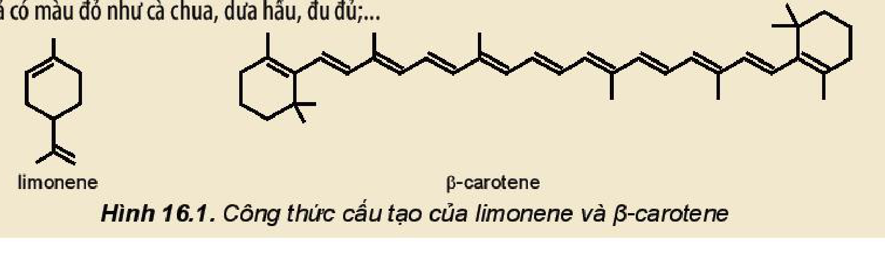
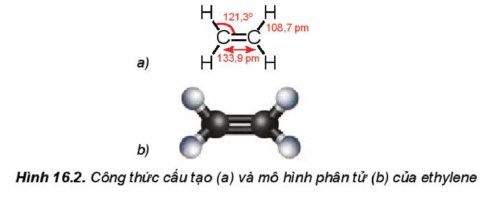
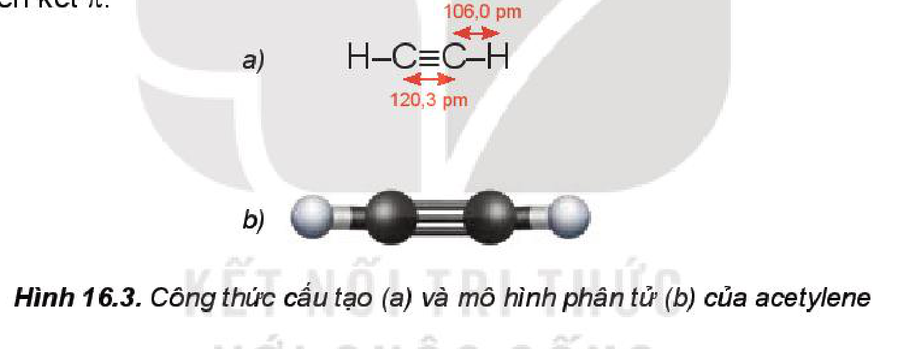
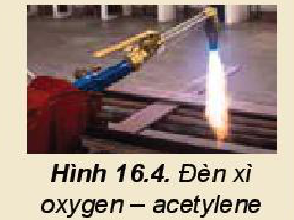
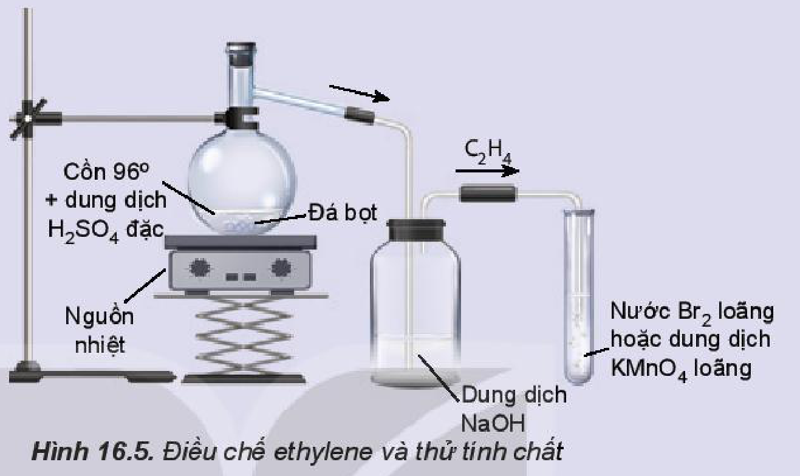
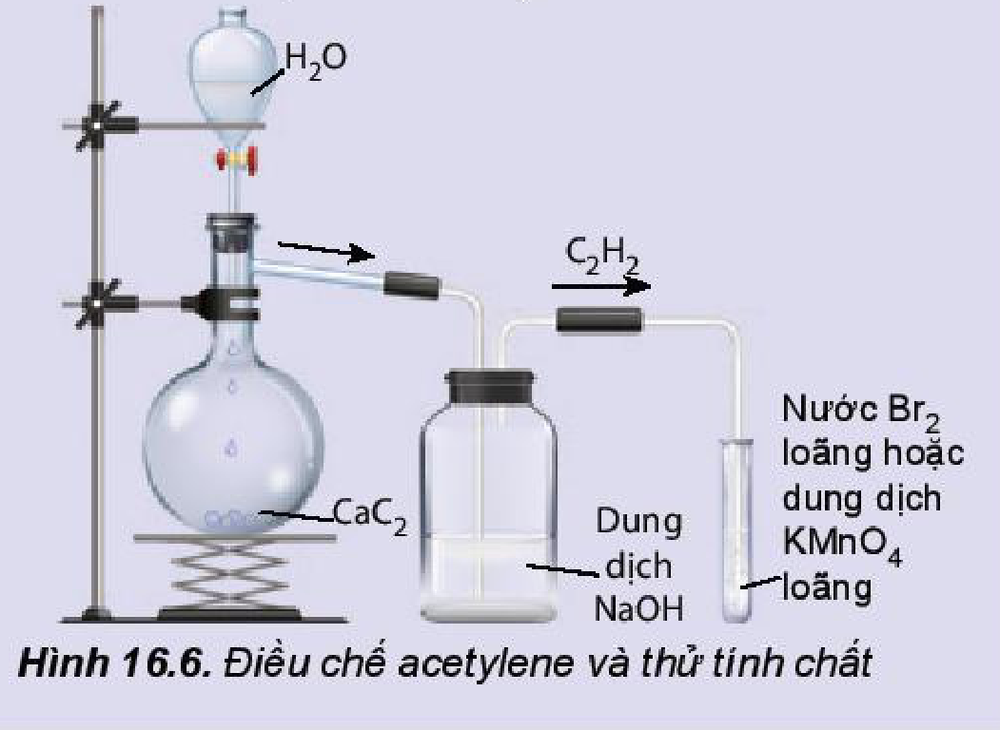
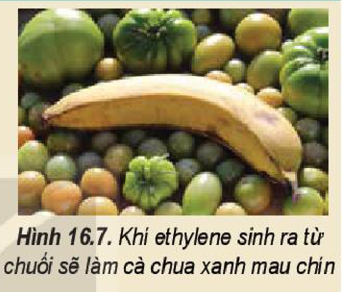

<!-- pdf:93 -->
# BÀI 16: HYDROCARBON KHÔNG NO

## 🎯 Mục tiêu
- Nêu được khái niệm về alkene và alkyne, công thức chung của alkene; đặc điểm liên kết, hình dạng phân tử của ethylene và acetylene.
- Gọi được tên một số alkene, alkyne đơn giản ($\ce{C2}$ – $\ce{C5}$), tên thông thường một vài alkene, alkyne thường gặp.
- Nêu được khái niệm và xác định được đồng phân hình học (*cis-*, *trans-*) trong một số trường hợp đơn giản.
- Nêu được đặc điểm về tính chất vật lí của một số alkene, alkyne.
- Trình bày được các tính chất hoá học của alkene, alkyne: phản ứng cộng hydrogen, cộng halogen (bromine); cộng hydrogen halide ($\ce{HBr}$) và cộng nước; quy tắc Markovnikov; phản ứng trùng hợp của alkene; phản ứng của alk-1-yne với dung dịch $\ce{AgNO3}$ trong $\ce{NH3}$; phản ứng oxi hoá.
- Thực hiện được thí nghiệm điều chế và thử tính chất của ethylene và acetylene; mô tả các hiện tượng thí nghiệm và giải thích được tính chất hoá học của alkene, alkyne.
- Trình bày được ứng dụng của các alkene và acetylene trong thực tiễn; phương pháp điều chế alkene, acetylene trong phòng thí nghiệm (phản ứng dehydrate hoá alcohol điều chế alkene, từ calcium carbide điều chế acetylene) và trong công nghiệp (phản ứng cracking điều chế alkene, điều chế acetylene từ methane).

## 🔴 Mở đầu
Sự ra đời của hoá học alkene khoảng giữa thế kỉ XX là một dấu mốc quan trọng tạo nên bước đột phá cho sự phát triển mạnh mẽ của công nghiệp hoá học hữu cơ.

Vậy alkene, alkyne có vai trò quan trọng thế nào trong hoá học nói chung và hoá hữu cơ nói riêng?

## I. KHÁI NIỆM, ĐỒNG PHÂN, DANH PHÁP

### 1. Khái niệm và công thức chung của alkene, alkyne

> ✋ Em hãy viết công thức electron, công thức Lewis của các hydrocarbon sau: $\ce{C2H6}$, $\ce{C2H4}$, $\ce{C2H2}$. Nhận xét sự khác nhau về đặc điểm liên kết trong phân tử của ba hydrocarbon trên.

**Hydrocarbon không no** là những hydrocarbon trong phân tử có chứa liên kết đôi, liên kết ba (gọi chung là liên kết bội) hoặc đồng thời cả liên kết đôi và liên kết ba.

| Hydrocarbon không no | Alkene | Alkyne |
| :--- | :--- | :--- |
| **Khái niệm** | **Alkene** là các hydrocarbon không no, mạch hở, có chứa một liên kết đôi $\ce{\text{>}C=C\text{<}}$ trong phân tử. | **Alkyne** là các hydrocarbon không no, mạch hở có chứa một liên kết ba $\ce{-C#C-}$ trong phân tử. |
| **Công thức chung** | $\ce{C_nH_{2n}}$ ($n \ge 2$) | $\ce{C_nH_{2n-2}}$ ($n \ge 2$) |
| **Ví dụ** | $\ce{C2H4}$, $\ce{C3H6}$, $\ce{C4H8}$,... | $\ce{C2H2}$, $\ce{C3H4}$, $\ce{C4H6}$,... |

<!-- pdf:94 -->
### 2. Đồng phân

**a) Đồng phân cấu tạo**

<!-- term: Đồng phân cấu tạo của alkene và alkyne -->
Alkene và alkyne có hai loại đồng phân cấu tạo là đồng phân vị trí liên kết bội (từ $\ce{C4}$ trở lên) và đồng phân mạch carbon (từ $\ce{C4}$ trở lên với alkene và từ $\ce{C5}$ trở lên với alkyne).

*Ví dụ:* alkene $\ce{C4H8}$ có ba đồng phân cấu tạo:

$$\ce{CH2=CH-CH2-CH3} \quad ; \quad \ce{CH3-CH=CH-CH3} \quad ; \quad \ce{CH2=\underset{\underset{\ce{CH3}}{|}}{C}-CH3}$$
<!-- ocr-ok: đối chiếu trực tiếp ảnh trang PDF 94 (công thức cấu tạo 3 đồng phân alkene C4H8) -->

**b) Đồng phân hình học**

Trong phân tử alkene nếu mỗi nguyên tử carbon của liên kết đôi liên kết với hai nguyên tử hoặc hai nhóm nguyên tử khác nhau thì sẽ có **đồng phân hình học**.

Nếu mạch chính nằm ở cùng một phía của liên kết đôi, gọi là **đồng phân hình học dạng *cis-***.

Nếu mạch chính nằm ở hai phía khác nhau của liên kết đôi, gọi là **đồng phân hình học dạng *trans-***.

*Ví dụ:* phân tử but-2-ene có hai đồng phân hình học dạng *cis-* và dạng *trans-*.

- *cis*-but-2-ene:
  $$\begin{matrix} \ce{H3C} \\ & \searrow & & \swarrow & \ce{CH3} \\ & & \ce{C=C} \\ & \nearrow & & \nwarrow \\ \ce{H} & & & & \ce{H} \end{matrix}$$
- *trans*-but-2-ene:
  $$\begin{matrix} \ce{H} \\ & \searrow & & \swarrow & \ce{CH3} \\ & & \ce{C=C} \\ & \nearrow & & \nwarrow \\ \ce{H3C} & & & & \ce{H} \end{matrix}$$
<!-- ocr-ok: đối chiếu trực tiếp ảnh trang PDF 94 (công thức đồng phân cis- và trans-but-2-ene) -->

> ✋ 1. Điều kiện để có đồng phân hình học của alkene $\ce{\text{abC=Ccd}}$ là gì?
> 2. Alkene $\ce{CH2=C(CH3)-CH3}$ có đồng phân hình học không? Giải thích.

> 💡 EM CÓ BIẾT
>
> Các hydrocarbon không no trong tự nhiên
>
> Trong tự nhiên, các hydrocarbon mạch hở và mạch vòng chứa liên kết đôi ở dạng alkadiene, alkatriene, alkapolyene, cycloalkene,... có nhiều trong tinh dầu thảo mộc. Các tinh dầu này có chứa các chất gọi là **terpene**. Phân tử của terpene được tạo thành từ các đơn vị mắt xích cơ bản là isoprene (2-methyl-buta-1,3-diene).
>
> *Ví dụ:* limonene có trong tinh dầu cam, chanh; myrcene được tìm thấy trong các thực vật có mùi thơm đậm như xoài, hoa bia, lá nguyệt quế, cỏ xạ hương, sả và húng quế; ocimene có trong lá cây húng quế, chúng có mùi thơm rất dễ chịu; $\alpha$-pinene và $\beta$-pinene là thành phần chính của dầu thông; $\beta$-carotene có thể được tìm thấy trong các loại rau, củ màu vàng, màu da cam như khoai lang, cà rốt; lycopene là sắc tố màu đỏ tươi được tìm thấy trong nhiều loại rau quả có màu đỏ như cà chua, dưa hấu, đu đủ;...
>
> 
> *Hình 16.1. Công thức cấu tạo của limonene và $\beta$-carotene*

<!-- pdf:95 -->
### 3. Danh pháp

<!-- term: Danh pháp thay thế của alkene và alkyne -->
Tên theo danh pháp thay thế của alkene và alkyne:

$$\text{Phần nền-vị trí liên kết bội} - \text{ene hoặc yne}$$
<!-- ocr-ok: đối chiếu trực tiếp ảnh trang PDF 95 (sơ đồ quy tắc gọi tên alkene và alkyne) -->

<!-- term: Danh pháp thay thế của alkene và alkyne -->
*Lưu ý:*
- Chọn mạch carbon dài nhất, có nhiều nhánh nhất và có chứa liên kết bội làm mạch chính.
- Đánh số sao cho nguyên tử carbon có liên kết bội (đôi hoặc ba) có chỉ số nhỏ nhất (đánh số mạch chính từ đầu gần liên kết bội).
- Dùng chữ số (1, 2, 3,...) và gạch nối (-) để chỉ vị trí liên kết bội (nếu chỉ có một vị trí duy nhất của liên kết bội thì không cần).
- Nếu alkene hoặc alkyne có nhánh thì cần thêm vị trí nhánh và tên nhánh trước tên của alkene và alkyne tương ứng với mạch chính.

**Bảng 16.1. Tên gọi của một số alkene, alkyne**

| Số carbon | Công thức alkene | Tên alkene | Công thức alkyne | Tên alkyne |
| :---: | :---: | :---: | :---: | :---: |
| 2 | $\ce{CH2=CH2}$ | ethene (ethylene) | $\ce{HC#CH}$ | ethyne (acetylene) |
| 3 | $\ce{CH2=CH-CH3}$ | propene (propylene) | $\ce{HC#C-CH3}$ | propyne |
| 4 | $\ce{CH2=CH-CH2-CH3}$ $\ce{CH3-CH=CH-CH3}$ $\ce{CH2=C(CH3)-CH3}$ | but-1-ene but-2-ene methylpropene | $\ce{HC#C-CH2-CH3}$ $\ce{CH3-C#C-CH3}$ | but-1-yne but-2-yne |
| 5 | $\ce{CH2=CH-CH2-CH2-CH3}$ | pent-1-ene | $\ce{HC#C-CH2-CH2-CH3}$ | pent-1-yne |
<!-- ocr-ok: đối chiếu trực tiếp ảnh trang PDF 95 (Bảng 16.1) -->

*(Tên thông thường của một số alkene, alkyne được để trong ngoặc)*

> ❓ 1. Viết các công thức cấu tạo và gọi tên theo danh pháp thay thế của các alkene và alkyne có công thức phân tử $\ce{C5H10}$, $\ce{C5H8}$.
> 2. Trong các chất sau, chất nào có đồng phân hình học?
>    a) $\ce{CH2=CH-CH3}$;
>    b) $\ce{CH3-CH2-CH=CH-CH3}$;
>    c) $\ce{CH3-C(CH3)=CH-CH3}$;
>    d) $\ce{CH2=CH-CH2-CH3}$.

<!-- pdf:96 -->
## II. ĐẶC ĐIỂM CẤU TẠO CỦA ETHYLENE VÀ ACETYLENE
<!-- ocr-ok: đối chiếu trực tiếp ảnh trang PDF 96 (OCR đọc lỗi tiêu đề mục II) -->

### 1. Ethylene

<!-- term: Đặc điểm cấu tạo của ethylene -->
Phân tử ethylene ($\ce{C2H4}$) có 2 nguyên tử carbon và 4 nguyên tử hydrogen đều nằm trên một mặt phẳng. Liên kết đôi $\ce{C=C}$ gồm một liên kết $\sigma$ và một liên kết $\pi$.

*Hình 16.2. Công thức cấu tạo (a) và mô hình phân tử (b) của ethylene*

### 2. Acetylene

<!-- term: Đặc điểm cấu tạo của acetylene -->
Phân tử acetylene ($\ce{C2H2}$) có 2 nguyên tử carbon và 2 nguyên tử hydrogen nằm trên một đường thẳng, góc liên kết $\widehat{\ce{CCH}}$ là $180^\circ$. Liên kết ba $\ce{C#C}$ bao gồm một liên kết $\sigma$ và hai liên kết $\pi$.

*Hình 16.3. Công thức cấu tạo (a) và mô hình phân tử (b) của acetylene*

## III. TÍNH CHẤT VẬT LÍ

<!-- term: Tính chất vật lí của alkene và alkyne -->
Nhiệt độ sôi, nhiệt độ nóng chảy và khối lượng riêng của alkene, alkyne không khác nhiều với alkane tương ứng. Các alkene, alkyne là những hợp chất không có mùi và đều nhẹ hơn nước.

<!-- term: Tính chất vật lí của alkene và alkyne -->
Ở nhiệt độ thường, phần lớn các alkene và alkyne từ $\ce{C2}$ đến $\ce{C4}$ ở trạng thái khí, từ $\ce{C5}$ đến $\ce{C17}$ ở trạng thái lỏng và từ $\ce{C18}$ trở lên ở trạng thái rắn. Chúng không tan hoặc rất ít tan trong nước, tan trong một số dung môi hữu cơ.

> 💡 EM CÓ BIẾT
>
> Ở nhiệt độ thường, độ tan của acetylene trong acetone là $2,79\text{ gam}/100\text{ gam}$ dung môi và trong dimethylformamide (DMF) là $5,1\text{ gam}/100\text{ gam}$ dung môi. Ở áp suất $20\text{ bar}$, độ tan của acetylene là $68,9\text{ gam}/100\text{ gam}$ acetone và $62,8\text{ gam}/100\text{ gam}$ DMF. Vì vậy, các dung môi này được sử dụng trong các bình khí nén để lưu trữ acetylene.

<!-- pdf:97 -->
**Bảng 16.2. Tính chất vật lí của một số alkene, alkyne$^{(1)}$**

| Alkene | Nhiệt độ nóng chảy ($^\circ\text{C}$) | Nhiệt độ sôi ($^\circ\text{C}$) | Khối lượng riêng ($\text{g/cm}^3$) | Alkyne | Nhiệt độ nóng chảy ($^\circ\text{C}$) | Nhiệt độ sôi ($^\circ\text{C}$) | Khối lượng riêng ($\text{g/cm}^3$) |
| :--- | :---: | :---: | :---: | :--- | :---: | :---: | :---: |
| ethene | $-169$ | $-105$ | – | ethyne | $-81$ | $-83$ | – |
| propene | $-185$ | $-47,8$ | – | propyne | $-102,7$ | $-23,2$ | – |
| but-1-ene | $-185$ | $-6,3$ | – | but-1-yne | $-126$ | $8,1$ | – |
| *trans*-but-2-ene | $-106$ | $0,9$ | – | but-2-yne | $-32$ | $27$ | $0,691$ |
| *cis*-but-2-ene | $-139$ | $3,7$ | – | pent-1-yne | $-106$ | $40,2$ | $0,690$ |
| pent-1-ene | $-165$ | $30$ | $0,641$ | pent-2-yne | $-109$ | $56,1$ | $0,711$ |
<!-- ocr-ok: đối chiếu trực tiếp ảnh trang PDF 97 (Bảng 16.2) -->

## IV. TÍNH CHẤT HOÁ HỌC CỦA ALKENE, ALKYNE

Các liên kết $\pi$ ở liên kết đôi (alkene) và liên kết ba (alkyne) kém bền vững, dễ bị đứt ra để tạo thành các liên kết mới. Vì vậy, các liên kết bội là trung tâm gây ra các phản ứng đặc trưng của hydrocarbon không no: **phản ứng cộng**, phản ứng trùng hợp, phản ứng oxi hoá.

### 1. Phản ứng cộng

**a) Phản ứng cộng hydrogen**

<!-- term: Phản ứng cộng hydrogen vào alkene, alkyne -->
Hydrogen hoá alkene và alkyne thu được alkane tương ứng. Phản ứng thường được thực hiện dưới áp suất cao, nhiệt độ cao và có mặt các chất xúc tác kim loại như platinum, nickel và palladium.

*Ví dụ:*

$$\ce{CH2=CH2 + H2 ->[\ce{Ni}, t^\circ,\text{ áp suất}] CH3-CH3}$$
<!-- ocr-ok: đối chiếu trực tiếp ảnh trang PDF 97 (phương trình cộng H2 vào ethylene) -->

<!-- term: Phản ứng cộng hydrogen vào alkene, alkyne -->
Hydrogen hoá alkyne, tuỳ vào điều kiện áp suất, nhiệt độ và xúc tác, có thể nhận được sản phẩm là alkene, alkane.

*Ví dụ:*

$$\ce{CH#CH + 2H2 ->[\ce{Ni}, t^\circ,\text{ áp suất}] CH3-CH3}$$
<!-- ocr-ok: đối chiếu trực tiếp ảnh trang PDF 97 (phương trình cộng H2 vào acetylene) -->

> 💡 EM CÓ BIẾT
>
> Phản ứng cộng chlorine vào ethylene tạo ra 1,2-dichloroethane, là chất trung gian để sản xuất vinyl chloride (VC), nguyên liệu tổng hợp poly(vinyl chloride) (PVC).

**b) Phản ứng cộng halogen**

<!-- term: Phản ứng cộng halogen vào alkene, alkyne -->
Khi cho alkene hoặc alkyne phản ứng với dung dịch bromine, dung dịch sẽ bị mất màu.

*Ví dụ:*

$$\ce{CH2=CH2 + Br2 -> BrCH2-CH2Br}$$
<!-- ocr-ok: đối chiếu trực tiếp ảnh trang PDF 97 (phương trình cộng Br2 vào ethylene) -->

$$\ce{CH#CH + 2Br2 -> Br2HC-CHBr2}$$
<!-- ocr-ok: đối chiếu trực tiếp ảnh trang PDF 97 (phương trình cộng Br2 vào acetylene) -->

**c) Phản ứng cộng hydrogen halide**

<!-- term: Phản ứng cộng hydrogen halide vào alkene, alkyne -->
Phản ứng cộng hydrogen halide vào alkene và alkyne tạo thành halogenoalkane

*Chú thích:* $^{(1)}$ Nguồn: http://pubchem.ncbi.nlm.nih.gov.
<!-- ocr-ok: đối chiếu trực tiếp ảnh trang PDF 97 (chú thích chân trang Bảng 16.2) -->

<!-- pdf:98 -->
tương ứng.

$$\ce{CH2=CH2 + HBr -> CH3-CH2Br}$$
<!-- ocr-ok: đối chiếu trực tiếp ảnh trang PDF 98 (phương trình cộng HBr vào ethylene) -->

$$\ce{CH#CH + HBr -> CH2=CHBr}$$
<!-- ocr-ok: đối chiếu trực tiếp ảnh trang PDF 98 (phương trình cộng 1 phân tử HBr vào acetylene) -->

$$\ce{CH#CH + 2HBr -> CH3-CHBr2}$$
<!-- ocr-ok: đối chiếu trực tiếp ảnh trang PDF 98 (phương trình cộng 2 phân tử HBr vào acetylene) -->

**d) Phản ứng cộng nước (hydrate hoá)**

**Phản ứng cộng nước vào alkene** hay còn gọi là **hydrate hoá alkene** tạo ra alcohol. Phản ứng thường sử dụng xúc tác phosphoric acid hoặc sulfuric acid.

$$\ce{CH2=CH2 + H2O ->[\ce{H3PO4}, t^\circ] CH3-CH2OH}$$
<!-- ocr-ok: đối chiếu trực tiếp ảnh trang PDF 98 (phương trình hydrate hoá ethylene) -->

Phản ứng này được thực hiện ở quy mô công nghiệp để sản xuất ethanol.

<!-- term: Phản ứng cộng nước vào alkyne -->
Phản ứng cộng một phân tử $\ce{HOH}$ vào alkyne diễn ra khi có mặt của xúc tác là muối $\ce{Hg(II)}$ trong $\ce{H2SO4}$, tạo thành aldehyde hoặc ketone.

*Ví dụ:*

$$\ce{HC#CH + H2O ->[\ce{Hg^2+}, \ce{H2SO4}, t^\circ] CH3-CH=O}$$
<!-- ocr-ok: đối chiếu trực tiếp ảnh trang PDF 98 (phương trình cộng H2O vào acetylene) -->

$$\ce{CH3C#CH + H2O ->[\ce{Hg^2+}, \ce{H2SO4}, t^\circ] CH3-\underset{\underset{\ce{O}}{||}}{C}-CH3}$$
<!-- ocr-ok: đối chiếu trực tiếp ảnh trang PDF 98 (phương trình cộng H2O vào propyne) -->

**Quy tắc Markovnikov** (Mác-cốp-nhi-cốp):
Phản ứng cộng một tác nhân không đối xứng $\ce{HX}$ như $\ce{HBr}$, $\ce{HCl}$, $\ce{HI}$, $\ce{HOH}$,... vào liên kết bội, nguyên tử hydrogen sẽ ưu tiên cộng vào nguyên tử carbon có nhiều hydrogen hơn và $\ce{X}$ sẽ cộng vào nguyên tử carbon có ít hydrogen hơn.

*Ví dụ:*

$$\ce{CH3-CH=CH2 ->[+\ce{H-Br}] \begin{cases} \ce{CH3-CH(Br)-CH2(H)} & \text{(sản phẩm chính)} \\ \ce{CH3-CH(H)-CH2(Br)} & \text{(sản phẩm phụ)} \end{cases}}$$
<!-- ocr-ok: đối chiếu trực tiếp ảnh trang PDF 98 (sơ đồ cộng HBr vào propene theo quy tắc Markovnikov) -->

Phản ứng cộng nước vào propene với xúc tác acid được thực hiện ở quy mô công nghiệp để sản xuất isopropanol.

Phản ứng cộng acid, cộng nước vào alkyne cũng tuân theo quy tắc Markovnikov.

### 2. Phản ứng trùng hợp của alkene

**Phản ứng trùng hợp alkene** là quá trình cộng hợp liên tiếp nhiều phân tử alkene giống nhau hoặc tương tự nhau (gọi là **monomer**) tạo thành phân tử có phân tử khối lớn (gọi là **polymer**).

*Ví dụ:* Phản ứng trùng hợp ethylene và propylene tạo thành polyethylene (PE) và polypropylene (PP).

$$\ce{nCH2=CH2 ->[t^\circ,\text{ áp suất, xúc tác}] (-CH2-CH2-)_n} \quad \text{(polyethylene)}$$
<!-- ocr-ok: đối chiếu trực tiếp ảnh trang PDF 98 (phương trình trùng hợp ethylene) -->

$$\ce{nCH2=\underset{\underset{\ce{CH3}}{|}}{CH} ->[t^\circ,\text{ áp suất, xúc tác}] (-CH2-\underset{\underset{\ce{CH3}}{|}}{CH}-)_n} \quad \text{(polypropylene)}$$
<!-- ocr-ok: đối chiếu trực tiếp ảnh trang PDF 98 (phương trình trùng hợp propylene) -->

$n$ được gọi là **hệ số trùng hợp**.

Phản ứng trùng hợp alkene có ứng dụng quan trọng để sản xuất vật liệu polymer.

<!-- pdf:99 -->
> ❓ 3. Viết phương trình hoá học của các phản ứng:
>    a) Propene tác dụng với hydrogen, xúc tác nickel.
>    b) Propene tác dụng với nước, xúc tác $\ce{H3PO4}$.
>    c) 2-Methylpropene tác dụng với nước, xúc tác acid $\ce{H3PO4}$.
>    d) But-1-ene tác dụng với $\ce{HCl}$.
> 4. Trong các chất sau, những chất nào làm mất màu nước bromine: propane, propene, propyne, 2-methylpropene?

### 3. Phản ứng của alk-1-yne với $\ce{AgNO3}$ trong $\ce{NH3}$

<!-- term: Phản ứng của alk-1-yne với dung dịch AgNO3 trong NH3 -->
Các alkyne có liên kết ba ở đầu mạch (alk-1-yne) có khả năng tham gia phản ứng với dung dịch $\ce{AgNO3}$ trong $\ce{NH3}$ tạo thành kết tủa.

*Ví dụ:*

$$\ce{HC#CH + 2AgNO3 + 2NH3 -> Ag-C#C-Ag v + 2NH4NO3}$$
*(kết tủa màu vàng nhạt)*
<!-- ocr-ok: đối chiếu trực tiếp ảnh trang PDF 99 (phương trình acetylene tác dụng AgNO3/NH3) -->

<!-- term: Phản ứng của alk-1-yne với dung dịch AgNO3 trong NH3 -->
Phản ứng này dùng để nhận biết các alkyne có liên kết ba ở đầu mạch.

### 4. Phản ứng oxi hoá

**a) Phản ứng oxi hoá không hoàn toàn**

<!-- term: Phản ứng oxi hoá không hoàn toàn alkene, alkyne -->
Các alkene và alkyne có khả năng làm mất màu dung dịch thuốc tím, đây là phản ứng oxi hoá không hoàn toàn.

*Ví dụ:*

$$\ce{3CH2=CH2 + 2KMnO4 + 4H2O -> 3HO-CH2-CH2-OH + 2MnO2 v + 2KOH}$$
*(ethylene glycol)*
<!-- ocr-ok: đối chiếu trực tiếp ảnh trang PDF 99 (phương trình oxi hoá ethylene bằng KMnO4) -->

<!-- term: Phản ứng oxi hoá không hoàn toàn alkene, alkyne -->
Phản ứng oxi hoá không hoàn toàn alkene được ứng dụng để sản xuất các dẫn xuất chứa oxygen của hydrocarbon trong công nghiệp.

**b) Phản ứng cháy**

<!-- term: Phản ứng cháy của alkene, alkyne -->
Alkene và alkyne đều dễ cháy khi có mặt oxygen, phản ứng toả nhiều nhiệt:

$$\ce{C_nH_{2n} + \frac{3n}{2}O2 ->[t^\circ] nCO2 + nH2O}$$
<!-- ocr-ok: đối chiếu trực tiếp ảnh trang PDF 99 (phương trình tổng quát đốt cháy alkene) -->

$$\ce{C_nH_{2n-2} + \frac{3n-1}{2}O2 ->[t^\circ] nCO2 + (n-1)H2O}$$
<!-- ocr-ok: đối chiếu trực tiếp ảnh trang PDF 99 (phương trình tổng quát đốt cháy alkyne) -->

<!-- term: Phản ứng cháy của alkene, alkyne -->
Acetylene cháy trong oxygen tạo ra ngọn lửa có nhiệt độ cao, có thể lên tới trên $3\,000\ ^\circ\text{C}$.

> 💡 EM CÓ BIẾT
>
> Đèn xì oxygen – acetylene được ứng dụng để cắt và hàn kim loại rất phổ biến trong những thập kỉ trước. Hiện nay, do sự phát triển của công nghệ hàn hồ quang nên việc sử dụng acetylene để hàn kim loại giảm đáng kể. Tuy nhiên, thiết bị hàn oxygen – acetylene khá linh hoạt, có thể được sử dụng ở những nơi không thể tiếp cận được điện và cần nguồn nhiệt cao.
>
> 
> *Hình 16.4. Đèn xì oxygen – acetylene*

<!-- pdf:100 -->
> 🔬 Thí nghiệm 1: Điều chế và thử tính chất hoá học của ethylene
>
> *Chuẩn bị:* cồn $96^\circ$, dung dịch sulfuric acid đặc, đá bọt; bình cầu có nhánh $250\text{ mL}$, ống nghiệm (1) chứa khoảng $2\text{ mL}$ dung dịch $\ce{KMnO4}$ loãng, ống nghiệm (2) chứa khoảng $2\text{ mL}$ nước $\ce{Br2}$ loãng, ống dẫn thuỷ tinh hình chữ L, ống dẫn thuỷ tinh đầu vuốt nhọn, giá để ống nghiệm, nguồn nhiệt, que đóm, lưới tản nhiệt, bình thuỷ tinh chứa dung dịch $\ce{NaOH}$.
>
> 
> *Hình 16.5. Điều chế ethylene và thử tính chất*
>
> *Tiến hành:*
> - Cho vài viên đá bọt, $20\text{ mL}$ cồn $96^\circ$ vào bình cầu. Rót $40\text{ mL}$ dung dịch $\ce{H2SO4}$ đặc vào ống đong, sau đó rót từ từ $\ce{H2SO4}$ đặc từ ống đong qua phễu vào bình cầu để tránh sự toả nhiệt quá mạnh.
> - Lắp bộ dụng cụ như Hình 16.5.
> - Đun nóng đến khi ethylene sinh ra và sục ngay vào các ống nghiệm (1) và (2).
> - Thay ống dẫn khí thuỷ tinh hình chữ L bằng ống dẫn thuỷ tinh có đầu vuốt nhọn. Dùng que đóm đang cháy để đốt ethylene ở đầu ống dẫn khí.
>
> *Lưu ý:* Dung dịch sulfuric acid đặc rơi vào da sẽ gây bỏng nặng, cần cẩn thận khi sử dụng.
>
> *Hãy giải thích hiện tượng và viết phương trình hoá học của phản ứng xảy ra.*

> 🔬 Thí nghiệm 2: Điều chế và thử tính chất hoá học của acetylene
>
> *Chuẩn bị:* đất đèn (chứa $\ce{CaC2}$), nước tinh khiết; ống nghiệm chứa khoảng $2\text{ mL}$ dung dịch $\ce{KMnO4}$ loãng, ống nghiệm chứa khoảng $2\text{ mL}$ dung dịch nước $\ce{Br2}$ loãng, bình cầu có nhánh $250\text{ mL}$, ống dẫn thuỷ tinh hình chữ L, ống dẫn thuỷ tinh đầu vuốt nhọn, giá để ống nghiệm, que đóm, bình thuỷ tinh chứa dung dịch $\ce{NaOH}$.
>
> 
> *Hình 16.6. Điều chế acetylene và thử tính chất*

<!-- pdf:101 -->
> *Tiến hành:*
> - Cho khoảng $5\text{ g}$ đất đèn vào bình cầu có nhánh và cho nước cất vào phễu nhỏ giọt. Lắp dụng cụ như Hình 16.6 (chú ý đuôi của phễu nhỏ giọt không chạm vào chất rắn).
> - Mở khoá phễu nhỏ giọt để nước chảy từ từ xuống, khí acetylene sinh ra được sục ngay vào các ống nghiệm chứa dung dịch $\ce{KMnO4}$ và nước $\ce{Br2}$ đã chuẩn bị ở trên đến khi dung dịch mất màu.
> - Thay ống dẫn khí thuỷ tinh hình chữ L bằng ống dẫn thuỷ tinh có đầu vuốt nhọn. Dùng que đóm đang cháy để đốt acetylene sinh ra ở đầu ống dẫn khí.
>
> *Hãy giải thích hiện tượng và viết phương trình hoá học của các phản ứng xảy ra.*

> ❓ 5. Hãy trình bày phương pháp hoá học nhận biết ba khí sau: ethane, ethylene, acetylene.
> 6. Viết phương trình hoá học của các phản ứng:
>    a) Propene tác dụng với dung dịch $\ce{KMnO4}$.
>    b) Propyne tác dụng với dung dịch $\ce{AgNO3/NH3}$.

## V. ĐIỀU CHẾ

### 1. Alkene

<!-- term: Điều chế alkene -->
Trong phòng thí nghiệm, ethylene được điều chế từ phản ứng dehydrate ethanol:

$$\ce{C2H5OH ->[\ce{H2SO4}\text{ đặc}, t^\circ] C2H4 + H2O}$$
<!-- ocr-ok: đối chiếu trực tiếp ảnh trang PDF 101 (phương trình dehydrate ethanol) -->

<!-- term: Điều chế alkene -->
Trong công nghiệp, alkene $\ce{C2}$ – $\ce{C4}$ được điều chế từ quá trình cracking alkane trong các nhà máy lọc dầu.

<!-- term: Điều chế alkene -->
Các alkene này còn có thể được sản xuất từ quá trình dehydrogen xúc tác với nguyên liệu là khí dầu mỏ (ethane, propane và butane). Dehydrogen butane tạo ra butadiene và các đồng phân butene.

### 2. Alkyne

<!-- term: Điều chế alkyne -->
Acetylene được điều chế từ phản ứng giữa calcium carbide với nước:

$$\ce{CaC2 + 2H2O -> C2H2 + Ca(OH)2}$$
<!-- ocr-ok: đối chiếu trực tiếp ảnh trang PDF 101 (phương trình điều chế acetylene từ CaC2) -->

<!-- term: Điều chế alkyne -->
Ngoài ra, acetylene còn được điều chế bằng cách nhiệt phân methane ở nhiệt độ $1\,500\ ^\circ\text{C}$, làm lạnh nhanh để tách acetylene ra khỏi hỗn hợp với hydrogen:

$$\ce{2CH4 ->[1\,500\ ^\circ\text{C}] C2H2 + 3H2}$$
<!-- ocr-ok: đối chiếu trực tiếp ảnh trang PDF 101 (phương trình nhiệt phân methane) -->

<!-- pdf:102 -->
## VI. ỨNG DỤNG

<!-- term: Ứng dụng của alkene và alkyne -->
Một số ứng dụng của alkene và alkyne:
- Đèn xì oxygen – acetylene.
- Sản xuất dược phẩm.
- Ethylene kích thích hoa quả mau chín.
- Tổng hợp polymer để sản xuất chất dẻo, tơ, sợi, cao su,...
- Công nghiệp hoá chất: sản xuất alcohol, aldehyde, ethylbenzene, cumene,...

> 💡 EM CÓ BIẾT
>
> - Quá trình hô hấp của quả chuối sau thu hoạch diễn ra khá mạnh mẽ, quá trình này sẽ sản sinh rất nhiều khí ethylene.
> - Các alkene được dùng làm monomer để tổng hợp thành polymer như PE, PP, cao su; nguyên liệu đầu để tổng hợp các hợp chất hữu cơ như alcohol, aldehyde, các dẫn xuất halogen và các chất khác.
>   Ethylene và acetylene được dùng làm nguyên liệu để chuyển hoá thành các monomer như styrene, vinyl chloride, vinyl acetate, acrylonitrile,... để tổng hợp các polymer.
>   Các alkyne là nguyên liệu sản xuất một số dược phẩm như thuốc kháng virus Efavirenz, thuốc kháng nấm Terbinafine,...
>
> 
> *Hình 16.7. Khí ethylene sinh ra từ chuối sẽ làm cà chua xanh mau chín*

## 📌 Em đã học
- Công thức tổng quát của alkene: $\ce{C_nH_{2n}}$ ($n \ge 2$); alkyne: $\ce{C_nH_{2n-2}}$ ($n \ge 2$).
- Trạng thái, nhiệt độ sôi và tính tan của một số alkene, alkyne.
- Alkene và alkyne có các đồng phân cấu tạo (đồng phân vị trí liên kết bội, alkene từ $\ce{C4}$ và alkyne từ $\ce{C5}$ có đồng phân mạch carbon); alkene từ $\ce{C4}$ có thể có đồng phân hình học.
- Alkene, alkyne có thể tham gia phản ứng cộng, phản ứng oxi hoá; alk-1-yne có thể tham gia phản ứng với dung dịch $\ce{AgNO3/NH3}$.
- Quy tắc Markovnikov: khi cộng $\ce{HX}$ vào liên kết bội, nguyên tử hydrogen sẽ ưu tiên cộng vào nguyên tử carbon có nhiều hydrogen hơn và $\ce{X}$ sẽ cộng vào nguyên tử carbon có ít hydrogen hơn.
- Phản ứng trùng hợp alkene.
- Phương pháp điều chế ethylene, acetylene.
- Alkene, alkyne được ứng dụng rộng rãi để sản xuất các hoá chất và vật liệu có ứng dụng trong công nghiệp và đời sống.

## ✏️ Em có thể
- Vận dụng các kiến thức về alkene, alkyne để giải thích được các vai trò quan trọng của alkene và alkyne trong công nghiệp hoá học, công nghiệp dược phẩm, vật liệu,...

## 📷 Danh sách hình trong bài

| Mã hình | Số hình | Trang PDF | Trang in | Chú thích |
| --- | --- | --- | --- | --- |
| H11-hoa-b16-01 | Hình 16.1 | 94 | 93 | Công thức cấu tạo của limonene và $\beta$-carotene |
| H11-hoa-b16-02 | Hình 16.2 | 96 | 95 | Công thức cấu tạo (a) và mô hình phân tử (b) của ethylene |
| H11-hoa-b16-03 | Hình 16.3 | 96 | 95 | Công thức cấu tạo (a) và mô hình phân tử (b) của acetylene |
| H11-hoa-b16-04 | Hình 16.4 | 99 | 98 | Đèn xì oxygen – acetylene |
| H11-hoa-b16-05 | Hình 16.5 | 100 | 99 | Điều chế ethylene và thử tính chất |
| H11-hoa-b16-06 | Hình 16.6 | 100 | 99 | Điều chế acetylene và thử tính chất |
| H11-hoa-b16-07 | Hình 16.7 | 102 | 101 | Khí ethylene sinh ra từ chuối sẽ làm cà chua xanh mau chín |
