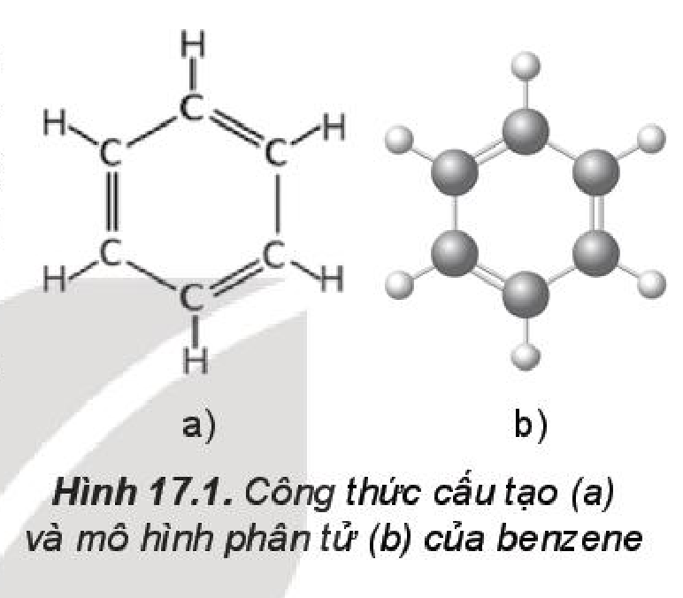
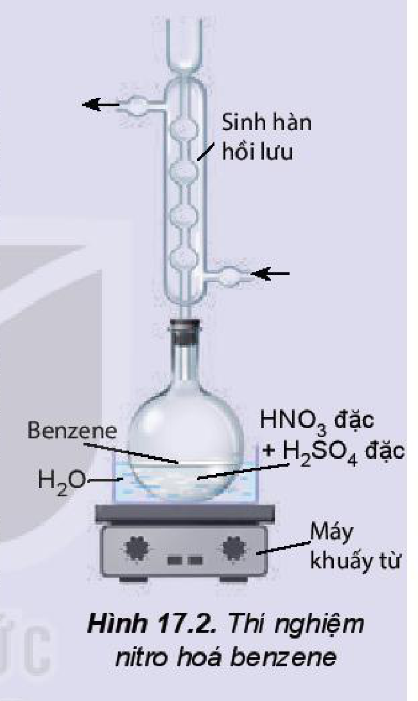
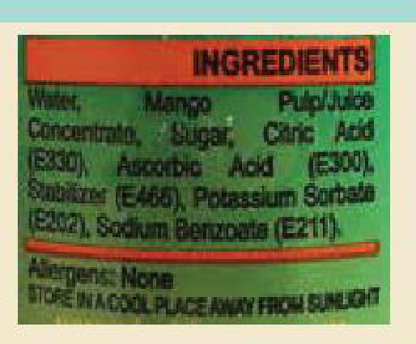

<!-- pdf:103 -->
# BÀI 17: ARENE (HYDROCARBON THƠM)

## 🎯 Mục tiêu
- Nêu được khái niệm về arene.
- Viết được công thức và gọi tên một số arene.
- Trình bày được đặc điểm về tính chất vật lí, trạng thái tự nhiên của một số arene, đặc điểm liên kết và hình dạng phân tử benzene.
- Trình bày được tính chất hoá học đặc trưng của arene (hoặc qua mô tả thí nghiệm): phản ứng thế của benzene và toluene; phản ứng cộng chlorine, hydrogen vào vòng benzene; phản ứng oxi hoá hoàn toàn, oxi hoá nhóm alkyl.
- Thực hiện được (hoặc quan sát qua video hoặc qua mô tả) thí nghiệm nitro hoá benzene, cộng chlorine vào benzene, oxi hoá benzene và toluene bằng dung dịch $\ce{KMnO4}$; mô tả các hiện tượng thí nghiệm và giải thích được tính chất hoá học của arene.
- Trình bày được ứng dụng của arene và đưa ra được cách ứng xử thích hợp đối với việc sử dụng arene trong việc bảo vệ sức khoẻ con người và môi trường.
- Trình bày được phương pháp điều chế arene trong công nghiệp.

## 🔴 Mở đầu
Làm thế nào có thể lựa chọn và sử dụng các sản phẩm được sản xuất từ arene và dẫn xuất của nó an toàn, thân thiện với môi trường?

## I. KHÁI NIỆM VÀ DANH PHÁP

### 1. Khái niệm

**Arene** hay còn gọi là **hydrocarbon thơm** là những hydrocarbon trong phân tử có chứa một hay nhiều vòng benzene.

Benzene có công thức $\ce{C6H6}$ là một hydrocarbon thơm đơn giản và điển hình nhất.

<!-- term: Dãy đồng đẳng của benzene -->
Benzene và các đồng đẳng của nó hợp thành dãy đồng đẳng của benzene có công thức chung là $\ce{C_nH_{2n-6}}$ ($n \ge 6$).

### 2. Công thức cấu tạo và danh pháp

<!-- term: Công thức cấu tạo và danh pháp một số arene, gốc aryl -->
Một số arene, gốc aryl thường gặp có công thức cấu tạo và tên gọi như sau:

<!-- term: Công thức cấu tạo và danh pháp một số arene, gốc aryl -->
- benzene: $\ce{C6H6}$ (vòng lục giác 6 nguyên tử $\ce{C}$ có 3 liên kết đôi xen kẽ 3 liên kết đơn)
- methylbenzene (toluene): $\ce{C6H5-CH3}$
- vinylbenzene (styrene): $\ce{C6H5-CH=CH2}$
- naphthalene: $\ce{C10H8}$ (hai vòng benzene ngưng tụ chung 2 nguyên tử $\ce{C}$)
<!-- ocr-ok: đối chiếu trực tiếp ảnh trang PDF 103 (công thức cấu tạo và tên gọi một số arene) -->

<!-- term: Công thức cấu tạo và danh pháp một số arene, gốc aryl -->
| Công thức gốc | Tên gốc aryl |
| :---: | :---: |
| $\ce{C6H5-}$ | phenyl |
| $\ce{C6H5-CH2-}$ | benzyl |
<!-- ocr-ok: đối chiếu trực tiếp ảnh trang PDF 103 (bảng Tên gốc aryl) -->

<!-- pdf:104 -->
<!-- term: Công thức cấu tạo và danh pháp một số arene, gốc aryl -->
- 1,2-dimethylbenzene (*o*-xylene): $\ce{1,2-(CH3)2C6H4}$
- 1,3-dimethylbenzene (*m*-xylene): $\ce{1,3-(CH3)2C6H4}$
- 1,4-dimethylbenzene (*p*-xylene): $\ce{1,4-(CH3)2C6H4}$

<!-- term: Công thức cấu tạo và danh pháp một số arene, gốc aryl -->
(*o-*; *m-*; *p-* là viết tắt của các từ tương ứng *ortho-*; *meta-*; *para-* chỉ vị trí 2, 3, 4 của nhóm thế thứ hai).

## II. ĐẶC ĐIỂM CẤU TẠO CỦA BENZENE
<!-- ocr-ok: đối chiếu trực tiếp ảnh trang PDF 104 (OCR đọc lỗi tiêu đề mục II) -->

<!-- term: Đặc điểm cấu tạo của benzene -->
Phân tử benzene có 6 nguyên tử carbon tạo thành hình lục giác đều, tất cả nguyên tử carbon và hydrogen đều nằm trên một mặt phẳng, các góc liên kết đều bằng $120^\circ$, độ dài liên kết carbon – carbon đều bằng $139\text{ pm}$.

<!-- term: Đặc điểm cấu tạo của benzene -->
Để đơn giản, benzene thường được biểu diễn bởi các kiểu công thức dưới đây:
- Công thức Kekulé (vòng lục giác đều với 3 liên kết đôi xen kẽ 3 liên kết đơn);
- Hoặc vòng lục giác đều có vòng tròn đồng tâm bên trong.
<!-- ocr-ok: đối chiếu trực tiếp ảnh trang PDF 104 (các kiểu công thức biểu diễn benzene) -->

*Hình 17.1. Công thức cấu tạo (a) và mô hình phân tử (b) của benzene*

## III. TÍNH CHẤT VẬT LÍ VÀ TRẠNG THÁI TỰ NHIÊN

<!-- term: Tính chất vật lí và trạng thái tự nhiên của arene -->
Benzene, toluene, xylene, styrene ở điều kiện thường là chất lỏng không màu, trong suốt, dễ cháy và có mùi đặc trưng. Naphthalene là chất rắn màu trắng, có mùi đặc trưng (có thể phát hiện được ở nồng độ thấp).

<!-- term: Tính chất vật lí và trạng thái tự nhiên của arene -->
Các arene không phân cực hoặc kém phân cực nên không tan trong nước và thường nhẹ hơn nước, tan được trong các dung môi hữu cơ.

**Bảng 17.1. Tính chất vật lí của một số arene$^{(1)}$**

| Arene | Nhiệt độ nóng chảy ($^\circ\text{C}$) | Nhiệt độ sôi ($^\circ\text{C}$) | Khối lượng riêng ($\text{g/cm}^3$) |
| :--- | :---: | :---: | :---: |
| Benzene | $5,5$ | $80,1$ | $0,878$ |
| Toluene | $-95,0$ | $110,6$ | $0,867$ |
| *o*-Xylene | $-25,2$ | $144$ | $0,880$ |
| *m*-Xylene | $-47,4$ | $139$ | $0,864$ |
| *p*-Xylene | $13,3$ | $138$ | $0,861$ |
| Styrene | $-30,0$ | $145$ | $0,909$ |
| Naphthalene | $80,26$ | $218$ | $1,0253\ (20\ ^\circ\text{C})$ $0,9625\ (100\ ^\circ\text{C})$ |

*Chú thích:* $^{(1)}$ Nguồn: http://pubchem.ncbi.nlm.nih.gov.
<!-- ocr-ok: đối chiếu trực tiếp ảnh trang PDF 104 (chú thích chân trang Bảng 17.1) -->

<!-- pdf:105 -->
<!-- term: Tính chất vật lí và trạng thái tự nhiên của arene -->
Benzene, toluene, xylene (được gọi chung là **BTX**) có trong dầu mỏ với hàm lượng thấp. Khi chưng cất dầu thô thường nhận được phân đoạn có chứa các arene này. Naphthalene và các arene đa vòng khác có trong dầu mỏ và nhựa than đá.

> ❓ 1. Hãy so sánh nhiệt độ sôi của benzene, toluene, *o*-xylene (Bảng 17.1) và giải thích.

## IV. TÍNH CHẤT HOÁ HỌC
<!-- ocr-ok: đối chiếu trực tiếp ảnh trang PDF 105 (OCR đọc lỗi tiêu đề mục IV) -->

### 1. Phản ứng thế

Arene có thể tham gia phản ứng thế nguyên tử hydrogen ở vòng benzene như phản ứng halogen hoá, nitro hoá,...

**Quy tắc thế**: Khi benzene có nhóm thế alkyl ($\ce{-CH3}$, $\ce{-C2H5}$,...), các phản ứng thế nguyên tử hydrogen ở vòng benzene xảy ra dễ dàng hơn so với benzene và ưu tiên thế vào vị trí số 2 hoặc số 4 (vị trí *ortho* hoặc *para*) so với nhóm alkyl.

**a) Phản ứng halogen hoá**

<!-- term: Phản ứng halogen hoá arene -->
Các arene tham gia phản ứng thế nguyên tử hydrogen gắn với vòng thơm bằng halogen (chlorine, bromine) ở nhiệt độ cao khi có xúc tác muối iron(III) halide.

$$\ce{C6H6 + Br2 ->[\ce{FeBr3}, t^\circ] C6H5Br + HBr}$$
<!-- ocr-ok: đối chiếu trực tiếp ảnh trang PDF 105 (phương trình bromine hoá benzene) -->

$$\ce{C6H5-CH3 ->[+\ce{Br2}, \ce{FeBr3}, t^\circ][-\ce{HBr}] \begin{cases} \ce{\mathit{o}-CH3-C6H4-Br} \\ \ce{\mathit{p}-CH3-C6H4-Br} \end{cases}}$$
<!-- ocr-ok: đối chiếu trực tiếp ảnh trang PDF 105 (sơ đồ bromine hoá toluene) -->

**b) Phản ứng nitro hoá**

**Phản ứng nitro hoá** là phản ứng trong đó một hay nhiều nguyên tử hydrogen ở vòng benzene được thay thế bằng nhóm nitro ($\ce{-NO2}$).

Benzene được nitro hoá bằng hỗn hợp $\ce{HNO3}$ đặc và $\ce{H2SO4}$ đặc ở nhiệt độ không quá $50\ ^\circ\text{C}$ tạo nitrobenzene dạng lỏng, màu vàng nhạt, sánh như dầu:

$$\ce{C6H6 + HNO3\text{ đặc} ->[\ce{H2SO4}\text{ đặc}, t^\circ] C6H5NO2 + H2O}$$
<!-- ocr-ok: đối chiếu trực tiếp ảnh trang PDF 105 (phương trình nitro hoá benzene) -->

Toluene được nitro hoá tạo thành hỗn hợp hai sản phẩm chính là *ortho* và *para*-nitrotoluene.

$$\ce{C6H5-CH3 ->[+\ce{HNO3}\text{ đặc}, \ce{H2SO4}\text{ đặc}, t^\circ][-\ce{H2O}] \begin{cases} \ce{\mathit{o}-CH3-C6H4-NO2} \\ \ce{\mathit{p}-CH3-C6H4-NO2} \end{cases}}$$
<!-- ocr-ok: đối chiếu trực tiếp ảnh trang PDF 105 (sơ đồ nitro hoá toluene) -->

<!-- pdf:106 -->
> 💡 EM CÓ BIẾT
>
> Nitrobenzene được ứng dụng trong nông nghiệp để tổng hợp chất kích thích tăng trưởng thực vật, kích thích cây ra hoa. Nitrobenzene là nguyên liệu để sản xuất aniline, tiền chất để tổng hợp polyaniline, cao su nhân tạo, thuốc trừ sâu, thuốc nhuộm azo và đặc biệt là nguyên liệu tổng hợp dược phẩm.
>
> 2,4,6-Trinitrotoluene (thường gọi là **TNT**) là một trong những chất nổ đã từng được sử dụng phổ biến nhất trong quân sự, công nghiệp và khai thác mỏ.
>
> TNT không hoà tan trong nước nên có thể sử dụng được trong môi trường ẩm ướt. Để kích nổ TNT cần được khơi mào bằng kíp nổ. Hiện nay, chất nổ dùng cho quân sự là amatol (hỗn hợp của TNT với ammonium nitrate).

> ✋ Nghiên cứu phản ứng nitro hoá benzene
>
> Phản ứng nitro hoá benzene được thực hiện như sau:
> - Cho con từ vào bình cầu dung tích $250\text{ mL}$, thêm khoảng $30\text{ mL}$ $\ce{H2SO4}$ đặc, làm lạnh trong chậu nước đá rồi thêm từ từ vào khoảng $30\text{ mL}$ $\ce{HNO3}$, sau đó thêm tiếp khoảng $10\text{ mL}$ benzene và lắp sinh hàn hồi lưu. Đun cách thuỷ hỗn hợp phản ứng trên bếp từ đến $80\ ^\circ\text{C}$ trong khoảng 60 phút (Hình 17.2).
> - Để nguội rồi cho hỗn hợp vào phễu chiết, quan sát thấy chất lỏng tách thành hai lớp, lớp trên là sản phẩm phản ứng, lớp dưới là dung dịch hỗn hợp hai acid.
> - Chiết lấy lớp chất lỏng phía trên, thêm khoảng $100\text{ mL}$ nước lạnh vào phễu chiết để rửa acid, thu được chất lỏng màu vàng, nặng hơn nước và nằm ở phần dưới của phễu chiết.
>
> *Hãy cho biết chất lỏng màu vàng là chất gì và giải thích.*
>
> 
> *Hình 17.2. Thí nghiệm nitro hoá benzene*

> ❓ 2. Viết phương trình phản ứng của ethylbenzene với các tác nhân sau:
>    a) $\ce{Br2/FeBr3}, t^\circ$;
>    b) $\ce{HNO3}$ đặc/$\ce{H2SO4}$ đặc.

### 2. Phản ứng cộng

**a) Phản ứng cộng chlorine**

<!-- term: Phản ứng cộng chlorine vào benzene -->
Phản ứng cộng chlorine vào benzene trong điều kiện có ánh sáng tử ngoại và đun nóng, sản phẩm thu được là 1,2,3,4,5,6-hexachlorocyclohexane.

$$\ce{C6H6 + 3Cl2 ->[\text{UV}, t^\circ] C6H6Cl6}$$
*(1,2,3,4,5,6-hexachlorocyclohexane)*
<!-- ocr-ok: đối chiếu trực tiếp ảnh trang PDF 106 (phương trình cộng chlorine vào benzene) -->

<!-- pdf:107 -->
> ✋ Nghiên cứu phản ứng cộng chlorine vào benzene
>
> Phản ứng cộng chlorine vào benzene được tiến hành như sau:
>
> Dẫn một lượng nhỏ khí chlorine vào bình nón chứa một ít benzene, đậy kín lại rồi đưa bình ra ngoài ánh nắng. Trong bình xuất hiện khói trắng và trên thành bình thấy xuất hiện một lớp bột màu trắng.
>
> *Hãy cho biết lớp bột màu trắng trên thành bình là chất gì. Giải thích.*

**b) Phản ứng cộng hydrogen**

<!-- term: Phản ứng cộng hydrogen vào benzene -->
Phản ứng cộng hydrogen vào benzene tạo thành cyclohexane. Phản ứng xảy ra ở điều kiện áp suất cao và nhiệt độ cao, với sự có mặt của các chất xúc tác dị thể như platinum, nickel.

$$\ce{C6H6 + 3H2 ->[\ce{Ni}, t^\circ,\text{ áp suất}] C6H12}$$
*(cyclohexane)*
<!-- ocr-ok: đối chiếu trực tiếp ảnh trang PDF 107 (phương trình cộng hydrogen vào benzene) -->

<!-- term: Phản ứng cộng hydrogen vào benzene -->
Phản ứng này được sử dụng trong công nghiệp để sản xuất cyclohexane.

> ❓ 3. Viết phương trình hoá học của phản ứng xảy ra khi hydrogen hoá hoàn toàn toluene và *p*-xylene, sử dụng xúc tác nickel.
> 4. Hydrogen hoá hoàn toàn arene $\ce{X}$ (công thức phân tử $\ce{C8H10}$) có xúc tác nickel thu được sản phẩm là ethylcyclohexane.
>    $$\ce{X ->[+\ce{H2}, \ce{Ni}, t^\circ] C6H11-C2H5}$$
>    Viết công thức cấu tạo của $\ce{X}$.

### 3. Phản ứng oxi hoá

**a) Phản ứng oxi hoá hoàn toàn (phản ứng cháy)**

<!-- term: Phản ứng oxi hoá hoàn toàn arene -->
Các arene như benzene, toluene, xylene dễ cháy và toả nhiều nhiệt.

$$\ce{C6H5CH3 + 9O2 ->[t^\circ] 7CO2 + 4H2O}$$
<!-- ocr-ok: đối chiếu trực tiếp ảnh trang PDF 107 (phương trình đốt cháy toluene) -->

**b) Phản ứng oxi hoá nhóm alkyl**

<!-- term: Phản ứng oxi hoá nhóm alkyl của arene -->
Toluene và các alkylbenzene khác có thể bị oxi hoá bởi các tác nhân oxi hoá như dung dịch $\ce{KMnO4}$.

*Ví dụ:*

$$\ce{C6H5CH3 + 2KMnO4 ->[t^\circ] C6H5COOK + 2MnO2 v + KOH + H2O}$$
<!-- ocr-ok: đối chiếu trực tiếp ảnh trang PDF 107 (phương trình oxi hoá toluene bằng KMnO4) -->

$$\ce{C6H5COOK + HCl -> C6H5COOH + KCl}$$
<!-- ocr-ok: đối chiếu trực tiếp ảnh trang PDF 107 (phương trình C6H5COOK + HCl) -->

> 💡 EM CÓ BIẾT
>
> Benzoic acid và sodium benzoate có khả năng ngăn ngừa sự phát triển của nấm mốc nên được sử dụng làm chất bảo quản thực phẩm (thường được kí hiệu là E210 và E211).
>
> 
> *Hình 17.3. Sodium benzoate (E211) có trong thành phần của một loại thực phẩm đóng hộp*

<!-- pdf:108 -->
> ✋ Nghiên cứu phản ứng oxi hoá toluene và benzene bằng dung dịch $\ce{KMnO4}$
> - Cho vào hai ống nghiệm, mỗi ống $1\text{ mL}$ dung dịch $\ce{KMnO4}$ $0,05\text{ M}$ và $1\text{ mL}$ dung dịch $\ce{H2SO4}$ $2\text{ M}$.
> - Cho tiếp vào ống (1) $1\text{ mL}$ benzene, ống nghiệm (2) $1\text{ mL}$ toluene. Lắc đều và đậy cả hai ống nghiệm bằng nút có ống thuỷ tinh thẳng.
> - Đun cách thuỷ hai ống nghiệm trong nồi nước nóng. Ống nghiệm (2) màu tím nhạt dần và mất màu, ống nghiệm (1) vẫn giữ nguyên màu tím.
>
> *Nhận xét khả năng phản ứng của benzene và toluene với $\ce{KMnO4}$. Giải thích.*

> ❓ 5. Terephthalic acid là nguyên liệu để tổng hợp nhựa poly(ethylene terephthalate) (PET) dùng để sản xuất tơ sợi, chai nhựa. Terephthalic acid có thể được tổng hợp từ arene $\ce{X}$ có công thức phân tử $\ce{C8H10}$, bằng cách oxi hoá $\ce{X}$ bởi dung dịch thuốc tím:
>    $$\ce{X ->[+\ce{KMnO4}, t^\circ] \mathit{p}-HOOC-C6H4-COOH -> \text{PET}}$$
>    Hãy xác định công thức cấu tạo của $\ce{X}$.

## V. ỨNG DỤNG

<!-- term: Ứng dụng của arene -->
Ứng dụng của arene:
- Benzene:
  - Chuyển hoá thành Styrene $\rightarrow$ sản xuất Polymer.
  - Chuyển hoá thành Cumene $\rightarrow$ sản xuất Acetone và phenol.
  - Sản xuất Polymer, dung môi, thuốc nhuộm, dược phẩm, chất dẻo, tơ sợi tổng hợp,...
- Toluene:
  - Sản xuất Thuốc nổ.
  - Sản xuất Polymer, dung môi, thuốc nhuộm, dược phẩm, chất dẻo, tơ sợi tổng hợp,...
- Xylene:
  - Sản xuất Polymer, dung môi, thuốc nhuộm, dược phẩm, chất dẻo, tơ sợi tổng hợp,...
- Naphthalene:
  - Sản xuất chất Diệt gián, côn trùng.
  - Sản xuất Polymer, dung môi, thuốc nhuộm, dược phẩm, chất dẻo, tơ sợi tổng hợp,...
<!-- ocr-ok: đối chiếu trực tiếp ảnh trang PDF 108 (sơ đồ ứng dụng của arene) -->

<!-- pdf:109 -->
**Cách ứng xử thích hợp với việc sử dụng arene**

<!-- term: Ứng dụng của arene -->
Arene (chủ yếu là benzene, toluene và xylene) là nguồn nguyên liệu để tổng hợp nhiều loại hoá chất và vật liệu hữu cơ quan trọng, có nhiều ứng dụng trong đời sống.

<!-- term: Ứng dụng của arene -->
Tuy nhiên, arene là những chất độc nên khi làm việc với arene cần tuân thủ đúng quy tắc an toàn. Benzene là chất làm tăng nguy cơ gây ung thư và các bệnh khác, vì vậy không được tiếp xúc trực tiếp với hoá chất này.

<!-- term: Ứng dụng của arene -->
Đặc biệt, các thuốc bảo vệ thực vật (thuốc trừ sâu, trừ cỏ) thế hệ cũ là dẫn xuất của benzene đều có tác hại đối với sức khoẻ con người và gây ô nhiễm môi trường, do vậy cần hết sức thận trọng khi sử dụng. Không được sử dụng các chất đã bị cấm như DDT (dichlorodiphenyltrichloroethane) hay 666 (1,2,3,4,5,6-hexachlorocyclohexane), thay vào đó là những thuốc thế hệ mới vừa hiệu quả vừa an toàn.

<!-- term: Ứng dụng của arene -->
Ngày nay, các nhà khoa học nghiên cứu và đưa ra công nghệ tổng hợp hữu cơ an toàn, thân thiện môi trường và hướng đến các nguồn nguyên liệu nguồn gốc thiên nhiên.

## VI. ĐIỀU CHẾ

<!-- term: Điều chế arene trong công nghiệp -->
Trong công nghiệp, benzene, toluene được điều chế từ quá trình reforming phân đoạn dầu mỏ chứa các alkane và cycloalkane $\ce{C6}$ – $\ce{C8}$.

*Ví dụ:*

$$\ce{CH3-[CH2]4-CH3 ->[\text{xúc tác}, t^\circ] C6H6 + 4H2}$$
<!-- ocr-ok: đối chiếu trực tiếp ảnh trang PDF 109 (phương trình reforming hexane tạo benzene) -->

$$\ce{CH3-[CH2]5-CH3 ->[\text{xúc tác}, t^\circ] C6H5-CH3 + 4H2}$$
<!-- ocr-ok: đối chiếu trực tiếp ảnh trang PDF 109 (phương trình reforming heptane tạo toluene) -->

<!-- term: Điều chế arene trong công nghiệp -->
Ethylbenzene được điều chế từ phản ứng giữa benzene và ethylene với xúc tác acid rắn là zeolite.

$$\ce{C6H6 ->[+\ce{CH2=CH2}, \ce{H+}] C6H5-CH2CH3 ->[\text{xúc tác}, t^\circ][-\ce{H2}] C6H5-CH=CH2}$$
*(ethylbenzene $\rightarrow$ styrene)*
<!-- ocr-ok: đối chiếu trực tiếp ảnh trang PDF 109 (sơ đồ điều chế ethylbenzene và styrene) -->

<!-- term: Điều chế arene trong công nghiệp -->
Naphthalene được điều chế chủ yếu bằng phương pháp chưng cất nhựa than đá.

<!-- pdf:110 -->
## 📌 Em đã học
- Arene là những hydrocarbon trong phân tử có chứa một hay nhiều vòng benzene.
- Benzene, toluene, xylene, styrene ở điều kiện thường là chất lỏng không màu, trong suốt, dễ cháy và có mùi đặc trưng. Naphthalene là chất rắn kết tinh màu trắng, có mùi đặc trưng. Các arene không tan trong nước và thường nhẹ hơn nước, tan trong các dung môi hữu cơ.
- Phản ứng thế vào vòng thơm benzene:
  - *Halogen hoá:*
    $$\ce{C6H6 ->[+\ce{Br2}, \ce{FeBr3}, t^\circ] C6H5Br}$$
    $$\ce{CH3C6H5 ->[+\ce{Br2}, \ce{FeBr3}, t^\circ] \mathit{o}-, \mathit{p}-CH3C6H4Br}$$
  - *Nitro hoá:*
    $$\ce{C6H6 ->[+\ce{HNO3}\text{ đặc}, \ce{H2SO4}\text{ đặc}, t^\circ][-\ce{H2O}] C6H5NO2}$$
    $$\ce{CH3C6H5 ->[+\ce{HNO3}\text{ đặc}, \ce{H2SO4}\text{ đặc}, t^\circ][-\ce{H2O}] \mathit{o}-, \mathit{p}-CH3C6H4NO2}$$
- Phản ứng cộng:
  - *Cộng chlorine:* $\ce{C6H6 ->[+\ce{Cl2}, \text{UV}, t^\circ] C6H6Cl6}$
  - *Cộng hydrogen:* $\ce{C6H6 ->[+\ce{H2}, t^\circ,\text{ áp suất, xúc tác }\ce{Ni}] C6H12}$
- Phản ứng oxi hoá:
  - *Phản ứng cháy:* Các arene dễ cháy và toả nhiều nhiệt.
  - *Phản ứng oxi hoá nhóm alkyl.*
- Ứng dụng của arene: nguyên liệu đầu để tổng hợp polymer, dung môi, thuốc nhuộm, dược phẩm, chất dẻo, tơ sợi tổng hợp,...
  Arene có độc tính, cần được sử dụng một cách hợp lí: hạn chế sử dụng thuốc bảo vệ thực vật và chỉ sử dụng thuốc thế hệ mới.
- Điều chế:
  $$\text{Dầu mỏ} \xrightarrow{\text{chưng cất phân đoạn}} \text{alkane và cycloalkane }\ce{C6}-\ce{C8} \xrightarrow{\text{reforming}} \text{benzene, toluene, xylene.}$$
  $$\text{Benzene} \xrightarrow{+\text{ethylene}} \text{ethylbenzene} \xrightarrow{-\ce{H2}} \text{styrene.}$$
  $$\text{Nhựa than đá} \xrightarrow{\text{chưng cất}} \text{naphthalene.}$$
<!-- ocr-ok: đối chiếu trực tiếp ảnh trang PDF 110 (khối Em đã học) -->

## ✏️ Em có thể
- Trình bày về tầm quan trọng của arene trong công nghiệp hoá học, dược phẩm, sản xuất thuốc bảo vệ thực vật,...

## 📷 Danh sách hình trong bài

| Mã hình | Số hình | Trang PDF | Trang in | Chú thích |
| --- | --- | --- | --- | --- |
| H11-hoa-b17-01 | Hình 17.1 | 104 | 103 | Công thức cấu tạo (a) và mô hình phân tử (b) của benzene |
| H11-hoa-b17-02 | Hình 17.2 | 106 | 105 | Thí nghiệm nitro hoá benzene |
| H11-hoa-b17-03 | Hình 17.3 | 107 | 106 | Sodium benzoate (E211) có trong thành phần của một loại thực phẩm đóng hộp |
