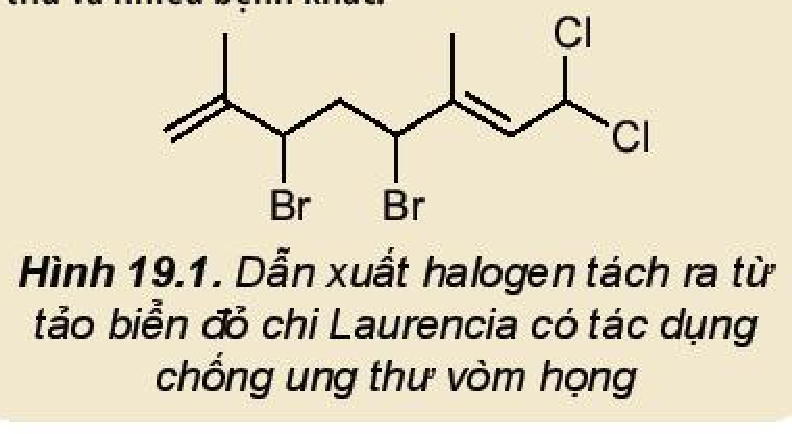
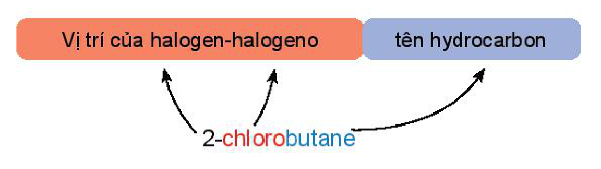
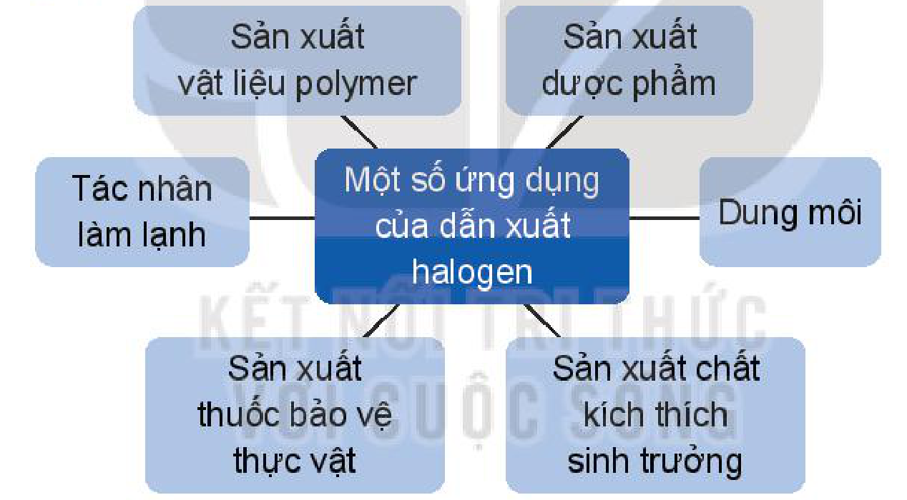
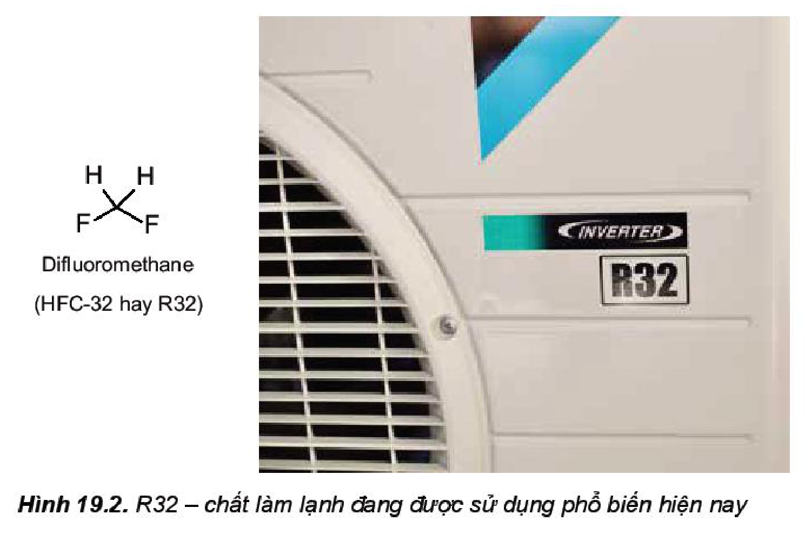

<!-- pdf:113 -->

# BÀI 19: DẪN XUẤT HALOGEN

## 🎯 Mục tiêu

- Nêu được khái niệm dẫn xuất halogen.
- Viết được công thức cấu tạo, gọi tên theo danh pháp thay thế và danh pháp thường của một vài dẫn xuất halogen thường gặp.
- Nêu được đặc điểm về tính chất vật lí của một số dẫn xuất halogen.
- Trình bày được tính chất hoá học cơ bản của dẫn xuất halogen: phản ứng thế nguyên tử halogen; phản ứng tách hydrogen halide theo quy tắc Zaitsev.
- Thực hiện được (hoặc quan sát video) thí nghiệm thuỷ phân bromoethane; mô tả các hiện tượng thí nghiệm, giải thích được tính chất hoá học của dẫn xuất halogen.
- Trình bày được ứng dụng của các dẫn xuất halogen; tác hại của việc sử dụng các hợp chất chlorofluorocarbon (CFC) trong công nghệ làm lạnh. Đưa ra được cách ứng xử thích hợp đối với việc lạm dụng các dẫn xuất halogen trong đời sống và sản xuất.

## 🔴 Mở đầu

Nhiều dẫn xuất halogen được sử dụng làm thuốc chữa bệnh, thuốc bảo vệ thực vật, chất làm lạnh,... Vậy dẫn xuất halogen là gì?

## I. KHÁI NIỆM, DANH PHÁP

### 1. Khái niệm

Khi thay thế nguyên tử hydrogen trong phân tử hydrocarbon bằng nguyên tử halogen, được **dẫn xuất halogen của hydrocarbon**.

Công thức tổng quát của dẫn xuất halogen: $\ce{RX_n}$

- R: gốc hydrocarbon
- X: F, Cl, Br, I
- $n$: số nguyên tử halogen
<!-- ocr-ok: đối chiếu trực tiếp ảnh trang PDF 113, chú thích công thức tổng quát RX_n -->

*Ví dụ:* $\ce{CH3Br}$, $\ce{CH2Cl2}$, $\ce{CHI3}$, $\ce{CH2=CHCl}$, $\ce{C6H5Br}$.
<!-- ocr-ok: đối chiếu trực tiếp ảnh trang PDF 113, công thức cấu tạo bromobenzene và chú thích RX_n -->

> 💡 EM CÓ BIẾT
>
> Hàng nghìn các dẫn xuất halogen đã được tách ra từ nhiều loại sinh vật biển khác nhau như rong, tảo biển, san hô,... Chúng có các hoạt tính sinh học rất quý giá như khả năng điều trị bệnh ung thư và nhiều bệnh khác.
>
> 
>
> *Hình 19.1. Dẫn xuất halogen tách ra từ tảo biển đỏ chi Laurencia có tác dụng chống ung thư vòm họng*

<!-- pdf:114 -->

### 2. Danh pháp

**a) Danh pháp thay thế**

<!-- term: Danh pháp thay thế của dẫn xuất halogen -->
Tên theo danh pháp thay thế của dẫn xuất halogen:

$$\text{Vị trí của halogen-halogeno} + \text{tên hydrocarbon}$$
<!-- ocr-ok: đối chiếu trực tiếp ảnh trang PDF 114, quy tắc gọi tên thay thế dẫn xuất halogen -->

*Ví dụ:* $\overset{1}{\ce{CH3}}-\overset{2}{\ce{CH}}(\ce{Cl})-\overset{3}{\ce{CH2}}-\overset{4}{\ce{CH3}}$: 2-chlorobutane.
<!-- ocr-ok: đối chiếu trực tiếp ảnh trang PDF 114, công thức đánh số mạch carbon của 2-chlorobutane -->

<!-- term: Danh pháp thay thế của dẫn xuất halogen -->
Halogeno: Đuôi *“-ine”* trong tên halogen được đổi thành đuôi *“-o”*.

*Chú ý:*

- Nếu halogen chỉ có một vị trí duy nhất thì không cần số chỉ vị trí halogen.
- Mạch carbon được ưu tiên đánh số từ phía gần nhóm thế hơn (từ nguyên tử halogen hoặc từ nhánh alkyl).
- Nếu có liên kết bội thì ưu tiên đánh số từ phía gần liên kết bội.
- Nếu có nhiều nguyên tử halogen thì cần thêm độ bội (di, tri, tetra,...) trước “halogeno”.

*Ví dụ:*

- $\ce{CH3-Br}$: bromomethane
- $\overset{1}{\ce{CH3}}-\overset{2}{\ce{CH}}(\ce{Cl})-\overset{3}{\ce{CH2}}-\overset{4}{\ce{CH3}}$: 2-chlorobutane
- $\overset{1}{\ce{CH2}}=\overset{2}{\ce{CH}}-\overset{3}{\ce{CH2}}-\ce{F}$: 3-fluoroprop-1-ene
- $\ce{CH2(Br)-CH2(Br)}$: 1,2-dibromoethane
<!-- ocr-ok: đối chiếu trực tiếp ảnh trang PDF 114, 4 công thức ví dụ danh pháp thay thế -->

**b) Tên thông thường**

<!-- term: Tên thông thường của dẫn xuất halogen -->
Một số dẫn xuất halogen thường gặp được gọi theo tên thông thường như **chloroform** ($\ce{CHCl3}$), **bromoform** ($\ce{CHBr3}$), **iodoform** ($\ce{CHI3}$), $\ce{CCl4}$ (**carbon tetrachloride**).

> 💡 EM CÓ BIẾT
>
> <!-- term: Danh pháp gốc – chức của dẫn xuất halogen -->
> Một số dẫn xuất halogen đơn giản được gọi tên theo danh pháp gốc – chức:
>
> $$\text{Tên gốc hydrocarbon} + \text{halide}$$
>
> *Ví dụ:*
> - $\ce{CH3CH2-Cl}$: ethyl chloride
> - $\ce{CH2=CH-Cl}$: vinyl chloride
> - $\ce{C6H5I}$: phenyl iodide
> - $\ce{C6H5CH2Br}$: benzyl bromide
<!-- ocr-ok: đối chiếu trực tiếp ảnh trang PDF 114, 4 ví dụ danh pháp gốc - chức -->

> ❓ 1. Viết các đồng phân cấu tạo của dẫn xuất halogen có công thức phân tử $\ce{C4H9Cl}$ và gọi tên theo danh pháp thay thế.
>
> 2. Gọi tên theo danh pháp thay thế các dẫn xuất halogen sau đây:
> a) $\ce{CH3CH2Br}$;
> b) $\ce{CH3CH(I)CH3}$;
> c) $\ce{CH2=CHCl}$;
> d) $\ce{C6H5F}$.
<!-- ocr-ok: đối chiếu trực tiếp ảnh trang PDF 114, câu hỏi 1 và 2 -->

<!-- pdf:115 -->

> ❓ 3. Viết công thức cấu tạo các dẫn xuất halogen có tên gọi sau đây:
> a) iodoethane;
> b) trichloromethane;
> c) 2-bromopentane;
> d) 2-chloro-3-methylbutane.

## II. ĐẶC ĐIỂM CẤU TẠO
<!-- ocr-ok: đối chiếu trực tiếp ảnh trang PDF 115, OCR đọc sai phông tiêu đề trang trí -->

<!-- term: Đặc điểm cấu tạo của dẫn xuất halogen -->
Trong phân tử dẫn xuất halogen, liên kết $\ce{C-X}$ phân cực về phía nguyên tử halogen, nguyên tử carbon mang một phần điện tích dương và nguyên tử halogen mang một phần điện tích âm ($\overset{\delta+}{\ce{R}}\!\to\!\overset{\delta-}{\ce{X}}$). Vì vậy, liên kết $\ce{C-X}$ dễ bị phân cắt trong các phản ứng hoá học.

> ✋ Cho biết năng lượng liên kết giảm dần theo thứ tự từ fluorine đến iodine:
>
> | Liên kết $\ce{C-X}$ | $\ce{C-F}$ | $\ce{C-Cl}$ | $\ce{C-Br}$ | $\ce{C-I}$ |
> |---|---|---|---|---|
> | Năng lượng liên kết (kJ/mol) | 486 | 327 | 285 | 214 |
>
> Từ giá trị năng lượng liên kết $\ce{C-X}$ ở trên, hãy so sánh khả năng phân cắt liên kết $\ce{C-X}$ của các dẫn xuất halogen.
<!-- ocr-ok: đối chiếu trực tiếp ảnh trang PDF 115, bảng năng lượng liên kết C-X -->

## III. TÍNH CHẤT VẬT LÍ

<!-- term: Tính chất vật lí của dẫn xuất halogen -->
Phân tử của dẫn xuất halogen phân cực nên chúng có nhiệt độ nóng chảy và nhiệt độ sôi cao hơn các hydrocarbon có phân tử khối tương đương.

Ở điều kiện thường, một số chất có phân tử khối nhỏ ($\ce{CH3Cl}$, $\ce{CH3F}$,...) ở trạng thái khí. Các dẫn xuất có phân tử khối lớn hơn ở trạng thái lỏng hoặc rắn.

Các dẫn xuất halogen hầu như không tan trong nước, tan tốt trong các dung môi hữu cơ như hydrocarbon, ether,...

## IV. TÍNH CHẤT HOÁ HỌC
<!-- ocr-ok: đối chiếu trực tiếp ảnh trang PDF 115, OCR đọc sai phông tiêu đề trang trí -->

Liên kết $\ce{C-X}$ phân cực về phía nguyên tử halogen nên phản ứng đặc trưng của dẫn xuất halogen là phản ứng thế nguyên tử halogen. Ngoài ra, dẫn xuất halogen còn tham gia phản ứng tách $\ce{HX}$.

### 1. Phản ứng thế nguyên tử halogen

> ✋ **Nghiên cứu phản ứng thuỷ phân bromoethane**
>
> Phản ứng thuỷ phân bromoethane được thực hiện như sau:
> - Cho khoảng 1 mL $\ce{C2H5Br}$ vào ống nghiệm (1), thêm khoảng 3 mL nước cất rồi lắc đều. Để hỗn hợp tách thành hai lớp, lấy phần trên của hỗn hợp nhỏ vào ống nghiệm có chứa sẵn 1 mL $\ce{AgNO3}$. Nếu thấy có kết tủa cần lặp lại đến khi không còn kết tủa (nước rửa không còn ion halogen).

<!-- pdf:116 -->

> - Thêm 2 mL dung dịch $\ce{NaOH}$ 10% vào ống nghiệm (1).
> - Lắc nhẹ ống nghiệm rồi ngâm vào cốc nước nóng khoảng 5 phút, thỉnh thoảng lắc đều ống nghiệm, để nguội rồi lấy khoảng 1 mL chất lỏng ở phần trên ống nghiệm (1) và chuyển sang ống nghiệm (2).
> - Trung hoà base dư ở ống nghiệm (2) sau khi nhỏ dung dịch $\ce{AgNO3}$ bằng dung dịch $\ce{HNO3}$ (thử bằng giấy chỉ thị pH) rồi nhỏ thêm vài giọt dung dịch $\ce{AgNO3}$ 1%, quan sát thấy có kết tủa vàng nhạt xuất hiện.
>
> *Trả lời câu hỏi và thực hiện yêu cầu sau:*
> 1. Tại sao ban đầu hỗn hợp lại tách thành hai lớp, bromoethane nằm ở lớp nào?
> 2. Kết tủa xuất hiện ở ống nghiệm (2) sau khi thêm dung dịch $\ce{AgNO3}$ vào là chất gì? Tại sao cần phải trung hoà dung dịch base dư trước khi cho dung dịch $\ce{AgNO3}$ 1% vào ống nghiệm (2)?
> 3. Dự đoán sản phẩm và viết phương trình hoá học của các phản ứng xảy ra trong quá trình thí nghiệm.

<!-- term: Phản ứng thế nguyên tử halogen -->
Các dẫn xuất halogen có thể tham gia phản ứng với dung dịch kiềm, nguyên tử halogen bị thay thế bởi nhóm $\ce{OH-}$, tạo thành alcohol theo phản ứng:

$$\ce{R-X + OH- -> R-OH + X-}$$

*(trong đó $\ce{R-OH}$ là alcohol; $\ce{X} = \ce{Cl, Br, I}$; $\ce{X}$ liên kết với nguyên tử carbon no)$^{(1)}$.*
<!-- ocr-ok: đối chiếu trực tiếp ảnh trang PDF 116, chú thích dưới phương trình thuỷ phân dẫn xuất halogen -->

*Ví dụ:* $\ce{CH3CH2CH2Cl + NaOH ->[t^o] CH3CH2CH2OH + NaCl}$

> ❓ 4. Benzyl alcohol là một hợp chất có tác dụng kháng khuẩn, chống vi sinh vật kí sinh trên da (chấy, rận,...) nên được sử dụng rộng rãi trong mĩ phẩm, dược phẩm. Benzyl alcohol thu được khi thuỷ phân benzyl chloride trong môi trường kiềm. Hãy xác định công thức của benzyl alcohol.
>
> $$\ce{C6H5CH2Cl ->[+ NaOH, t^o] \text{Benzyl alcohol}}$$

### 2. Phản ứng tách hydrogen halide

<!-- term: Phản ứng tách hydrogen halide -->
Các dẫn xuất monohalogen của alkane có thể bị tách hydrogen halide tạo thành alkene theo sơ đồ sau:

$$\ce{>CH-CX< ->[NaOH/C2H5OH, t^o] >C=C< + HX}$$
<!-- ocr-ok: đối chiếu trực tiếp ảnh trang PDF 116, sơ đồ phản ứng tách HX tạo alkene -->

Phản ứng xảy ra khi đun nóng dẫn xuất halogen với base mạnh như $\ce{NaOH}$, $\ce{RONa}$ trong dung môi alcohol.

*Ví dụ:* $\ce{CH3CH2Br ->[NaOH/C2H5OH, t^o] CH2=CH2 + HBr}$

(1) **Nguyên tử carbon no** là nguyên tử carbon liên kết với các nguyên tử khác bằng các liên kết đơn.

<!-- pdf:117 -->

Phản ứng tách xảy ra theo **quy tắc tách Zaitsev** (Zai-xép): *Trong phản ứng tách hydrogen halide, nguyên tử halogen bị tách ưu tiên cùng với nguyên tử hydrogen ở carbon bên cạnh có bậc cao hơn.*

*Ví dụ:*

$$\ce{CH2(H)-CH(Br)-CH(H)-CH3 ->[NaOH/C2H5OH, t^o][-HBr]} \begin{cases} \ce{CH3CH=CHCH3} & \text{(sản phẩm chính)} \\ \ce{CH2=CHCH2CH3} & \text{(sản phẩm phụ)} \end{cases}$$
<!-- ocr-ok: đối chiếu trực tiếp ảnh trang PDF 117, sơ đồ tách HBr của 2-bromobutane theo quy tắc Zaitsev -->

> ❓ 5. Viết phương trình hoá học xảy ra khi đun nóng 2-chloropropane ($\ce{CH3CHClCH3}$) với sodium hydroxide trong ethanol.
>
> 6. Thực hiện phản ứng tách hydrogen bromide của hợp chất 2-bromo-2-methylbutane thu được những alkene nào? Xác định sản phẩm chính của phản ứng.

## V. ỨNG DỤNG

### 1. Một số ứng dụng tiêu biểu của dẫn xuất halogen

<!-- term: Ứng dụng của dẫn xuất halogen -->
Một số ứng dụng của dẫn xuất halogen: Sản xuất vật liệu polymer; Sản xuất dược phẩm; Dung môi; Sản xuất chất kích thích sinh trưởng; Sản xuất thuốc bảo vệ thực vật; Tác nhân làm lạnh.

### 2. Dẫn xuất halogen với sức khoẻ và môi trường

**a) CFC và tầng ozone**

Một số dẫn xuất halogen chứa đồng thời chlorine, fluorine như $\ce{CF2Cl2}$, $\ce{CFCl3}$, $\ce{C2F4Cl2}$,...; được gọi chung là **chlorofluorocarbon** (viết tắt là **CFC**). Các hợp chất này trước đây được sử dụng phổ biến trong các hệ thống làm lạnh như tủ lạnh, máy điều hoà nhiệt độ, hệ thống làm lạnh công nghiệp; chất đẩy trong các bình xịt,... Tuy nhiên do ảnh hưởng gây hại đến tầng ozone nên CFC bị hạn chế và cấm sử dụng (Nghị định thư Montréal, 1987). Hiện nay CFC được thay thế bởi các dẫn xuất halogen không chứa chlorine như **hydrofluorocarbon** (**HFC**), **hydrofluoroolefin** (**HFO**).

Năm 2019, báo cáo của các nhà khoa học cho thấy lỗ thủng ozone đang dần được thu hẹp và dự kiến tầng ozone sẽ được phục hồi hoàn toàn vào năm 2070. Việc chúng ta chọn lựa, sử dụng các sản phẩm không chứa CFC (CFC free) cũng góp phần vào việc tái tạo tầng ozone của Trái Đất.

<!-- pdf:118 -->

*Hình 19.2. R32 – chất làm lạnh đang được sử dụng phổ biến hiện nay (Difluoromethane, HFC-32 hay R32)*
<!-- ocr-ok: đối chiếu trực tiếp ảnh trang PDF 118, Hình 19.2 -->

**b) Thuốc trừ sâu, thuốc diệt cỏ và chất kích thích sinh trưởng thực vật**

Nhiều dẫn xuất của chlorine trước đây được sử dụng phổ biến trong nông nghiệp dùng làm thuốc bảo vệ thực vật, chất kích thích sinh trưởng như thuốc trừ sâu, diệt côn trùng (dichlorodiphenyltrichloroethane – DDT, hexachlorocyclohexane – 666), thuốc diệt cỏ, làm rụng lá (2,4-dichlorophenoxyacetic acid – 2,4-D; 2,4,5-trichlorophenoxyacetic acid – 2,4,5-T),...

Tuy nhiên, do đặc tính khó phân huỷ, tồn dư lâu trong môi trường và có tác hại đến sức khoẻ con người nên các loại hợp chất này hiện nay bị hạn chế hoặc bị cấm sử dụng tại nhiều quốc gia. Để giảm thiểu tác động đến môi trường và con người, xu hướng trong nông nghiệp hiện nay là hướng tới một nền “nông nghiệp xanh” với việc giảm thiểu, tránh lạm dụng thuốc bảo vệ thực vật hoá học và thay thế dần bằng thuốc bảo vệ thực vật có nguồn gốc sinh học thân thiện với môi trường. Ngoài ra, các quy trình canh tác không sử dụng phân bón hoá học và thuốc bảo vệ thực vật hoá học cũng đang dần được áp dụng phổ biến trong nông nghiệp.

> ✋ 1. Sưu tầm tranh, ảnh, tài liệu minh hoạ cho các ứng dụng của dẫn xuất halogen trong thực tế cuộc sống.
>
> 2. Hiện nay, điều hoà, tủ lạnh thường sử dụng một số loại chất làm lạnh phổ biến như R22 ($\ce{CHClF2}$), R32 ($\ce{CH2F2}$), R410A (50% $\ce{CH2F2}$ và 50% $\ce{CHF2-CF3}$). Loại chất làm lạnh nào không nên sử dụng? Giải thích.
>
> 3. Hãy tìm hiểu và cho biết thành phần thuốc bảo vệ thực vật thường dùng ở Việt Nam. Các thuốc này có nguồn gốc hoá học hay sinh học? Lựa chọn và sử dụng các loại thuốc bảo vệ thực vật như thế nào để bảo đảm an toàn, hiệu quả?

<!-- pdf:119 -->

## 📌 Em đã học

- Công thức tổng quát của dẫn xuất halogen: $\ce{RX_n}$.
- Danh pháp thay thế của dẫn xuất halogen: $\text{Vị trí của halogen-halogeno} + \text{tên hydrocarbon}$.
- Dẫn xuất halogen có nhiệt độ nóng chảy và nhiệt độ sôi cao hơn hydrocarbon có phân tử khối tương đương; khó tan trong nước, tan tốt trong các dung môi hữu cơ.
- Dẫn xuất halogen có khả năng bị thế nguyên tử halogen:

  $$\underset{\text{(X liên kết với nguyên tử carbon no)}}{\ce{R-X}} + \ce{OH- ->} \underset{\text{alcohol}}{\ce{R-OH}} + \ce{X-}$$
<!-- ocr-ok: đối chiếu trực tiếp ảnh trang PDF 119, phương trình thế nguyên tử halogen trong hộp Em đã học -->

- Phản ứng tách $\ce{HX}$ theo quy tắc Zaitsev: Nguyên tử halogen bị tách ưu tiên cùng với nguyên tử hydrogen ở nguyên tử carbon bên cạnh có bậc cao hơn.

  $$\ce{>CH-CX< ->[NaOH/C2H5OH, t^o] >C=C< + HX}$$
<!-- ocr-ok: đối chiếu trực tiếp ảnh trang PDF 119, sơ đồ tách HX trong hộp Em đã học -->

- Ứng dụng của dẫn xuất halogen: dung môi, vật liệu polymer, chất làm lạnh, dược phẩm, thuốc bảo vệ thực vật, chất bảo vệ thực vật, kích thích sinh trưởng,...

## ✏️ Em có thể

- Giải thích được tác hại của: các chất CFC đến tầng ozone, một số loại thuốc bảo vệ thực vật có hại đến sức khoẻ con người và môi trường.
- Đọc và nhận biết được thành phần của các sản phẩm gia dụng có chứa các dẫn xuất halogen của hydrocarbon, từ đó hiểu được giá trị ứng dụng của các hợp chất này và biết sử dụng các đồ dùng trong gia đình đúng cách, đảm bảo an toàn.
- Lựa chọn các sản phẩm gia dụng không chứa CFC, các thuốc bảo vệ thực vật an toàn để bảo vệ sức khoẻ và môi trường sống.

## 📷 Danh sách hình trong bài

| Mã hình | Trang PDF | Vị trí | Chú thích gốc |
|---|---|---|---|
| H11-hoa-b19-01 | 113 | Mục I.1, hộp "Em có biết" | Hình 19.1. Dẫn xuất halogen tách ra từ tảo biển đỏ chi Laurencia có tác dụng chống ung thư vòm họng |
| H11-hoa-b19-02 | 114 | Mục I.2.a (sơ đồ danh pháp thay thế của dẫn xuất halogen) | (sách không đánh số, không có chú thích) |
| H11-hoa-b19-03 | 117 | Mục V.1 (sơ đồ một số ứng dụng của dẫn xuất halogen) | (sách không đánh số, không có chú thích) |
| H11-hoa-b19-04 | 118 | Mục V.2.a | Hình 19.2. R32 – chất làm lạnh đang được sử dụng phổ biến hiện nay |
