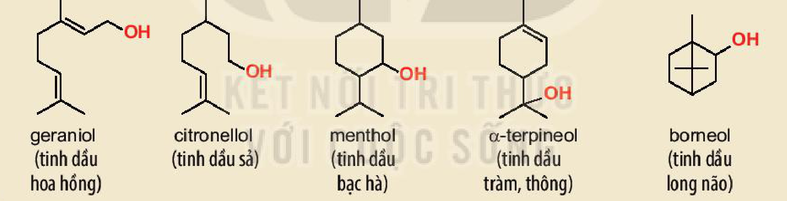
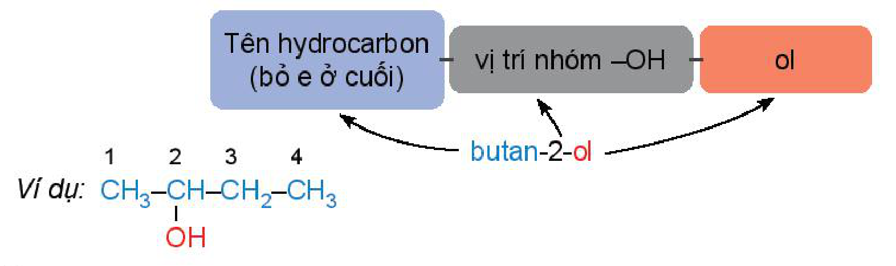
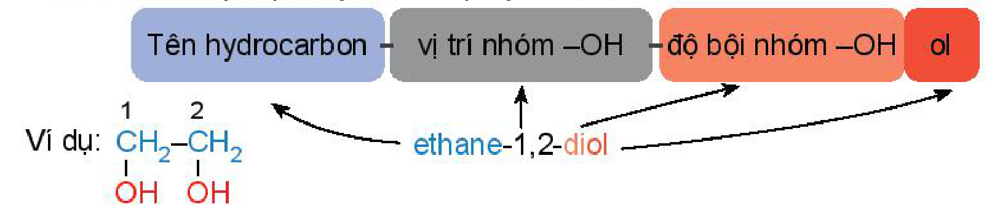
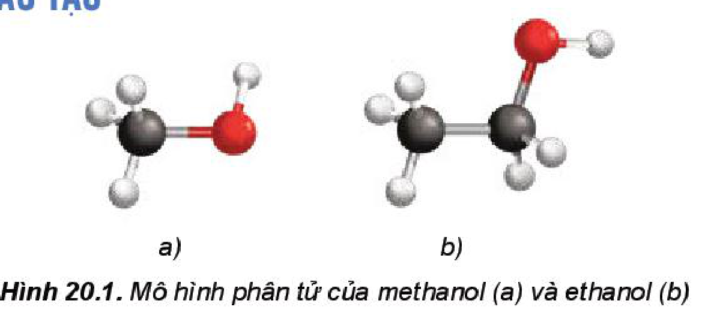
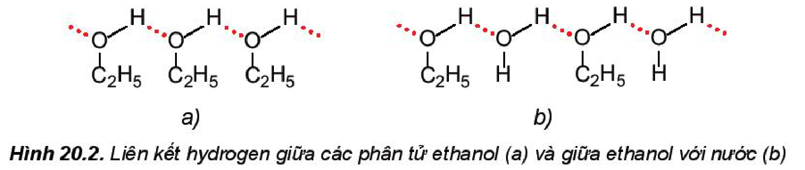
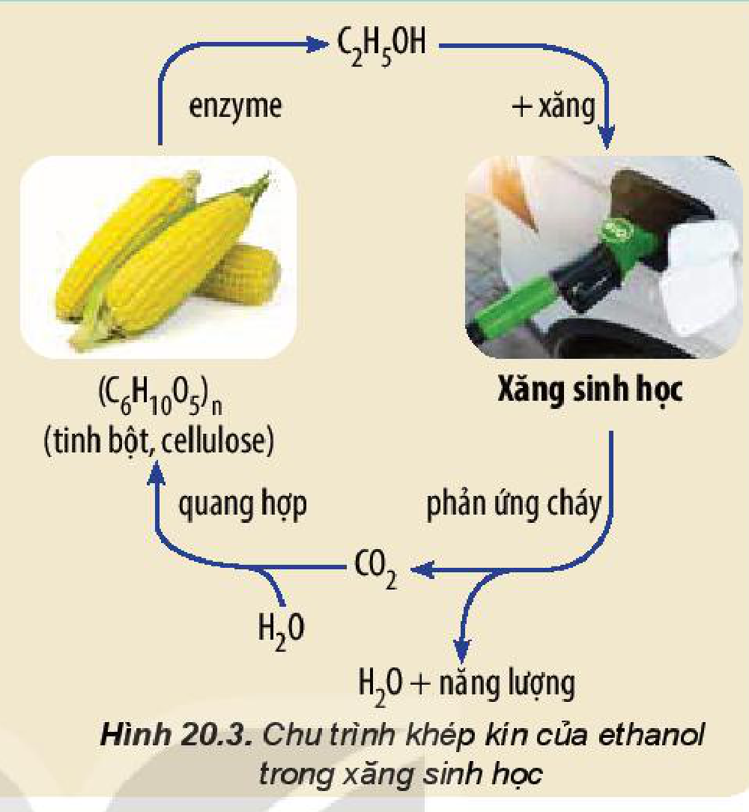
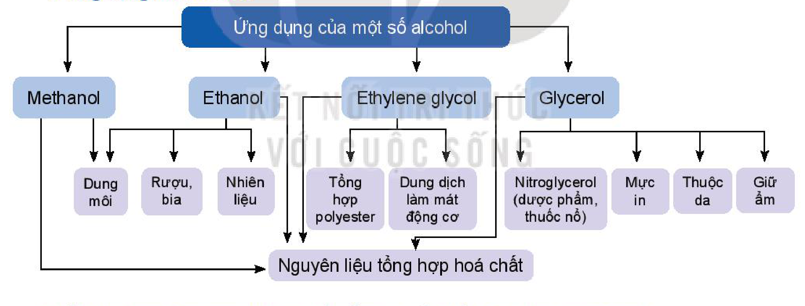

<!-- pdf:120 -->

# BÀI 20: ALCOHOL

## 🎯 Mục tiêu

- Nêu được khái niệm alcohol; công thức tổng quát của alcohol no, đơn chức, mạch hở; khái niệm về bậc của alcohol; đặc điểm liên kết và hình dạng phân tử của methanol, ethanol.
- Viết được công thức cấu tạo, gọi tên theo danh pháp thay thế một số alcohol đơn giản, tên thông thường của một vài alcohol thường gặp.
- Trình bày được đặc điểm về tính chất vật lí của alcohol, giải thích được ảnh hưởng của liên kết hydrogen đến nhiệt độ sôi và khả năng hoà tan trong nước của các alcohol.
- Trình bày được tính chất hoá học của alcohol: phản ứng thế nguyên tử H của nhóm $\ce{-OH}$; phản ứng tạo thành alkene hoặc ether; phản ứng oxi hoá alcohol bậc I, bậc II thành aldehyde, ketone bằng $\ce{CuO}$; phản ứng cháy.
- Thực hiện được các thí nghiệm đốt cháy ethanol, glycerol tác dụng với copper(II) hydroxide; mô tả được các hiện tượng thí nghiệm và giải thích được tính chất hoá học của alcohol.
- Trình bày được ứng dụng của alcohol, tác hại của việc lạm dụng rượu bia và đồ uống có cồn; Nêu thái độ, cách ứng xử của cá nhân với việc bảo vệ sức khoẻ bản thân, gia đình và cộng đồng.
- Trình bày được phương pháp điều chế ethanol bằng phương pháp hydrate hoá ethylene, lên men tinh bột; điều chế glycerol từ propylene.

## 🔴 Mở đầu

Từ xa xưa con người đã biết lên men các loại ngũ cốc, hoa quả để tạo ra các đồ uống có cồn (có chứa ethanol – một alcohol quen thuộc). Ngày nay, alcohol được sử dụng phổ biến trong nhiều lĩnh vực khác nhau như làm dung môi, nguyên liệu hoá học, nhiên liệu, xăng sinh học,... Vậy alcohol là gì và có những tính chất đặc trưng nào?

## I. KHÁI NIỆM, DANH PHÁP

### 1. Khái niệm

**Alcohol** là những hợp chất hữu cơ trong phân tử có chứa nhóm hydroxy ($\ce{-OH}$) liên kết với nguyên tử carbon no.

$$\underset{\text{nguyên tử carbon no}}{\ce{>C\!-}}\!\underset{\text{nhóm chức hydroxy}}{\ce{OH}}$$
<!-- ocr-ok: đối chiếu trực tiếp ảnh trang PDF 120, sơ đồ nhóm chức hydroxy liên kết với nguyên tử carbon no -->

**Alcohol no, đơn chức, mạch hở** trong phân tử có một nhóm $\ce{-OH}$ liên kết với gốc alkyl, có công thức tổng quát là $\ce{C_nH_{2n+1}OH}$ ($n \ge 1$).

*Ví dụ:* $\ce{CH3-OH}$ (methanol); $\ce{CH3-CH2-OH}$ (ethanol); ...

Nếu alcohol có hai hay nhiều nhóm $\ce{-OH}$ thì các alcohol đó được gọi là các **alcohol đa chức** (**polyalcohol**).

*Ví dụ:* $\ce{CH2(OH)-CH2(OH)}$ (ethylene glycol); $\ce{CH2(OH)-CH(OH)-CH2(OH)}$ (glycerol).
<!-- ocr-ok: đối chiếu trực tiếp ảnh trang PDF 120, công thức ethylene glycol và glycerol -->

<!-- pdf:121 -->

**Bậc của alcohol** là bậc của nguyên tử carbon liên kết với nhóm hydroxy. Ta có alcohol bậc I, alcohol bậc II và alcohol bậc III (Bảng 20.1).

*Bảng 20.1. Bậc của alcohol*

| Alcohol | Công thức tổng quát | Ví dụ |
|---|---|---|
| Bậc I | $\ce{R-CH2-OH}$ | $\ce{CH3-CH2-OH}$; $\ce{C6H5-CH2OH}$ |
| Bậc II | $\ce{R-CH(R')-OH}$ | $\ce{CH3-CH(CH3)-OH}$; $\ce{C6H11-OH}$ (cyclohexanol) |
| Bậc III | $\ce{R-C(R')(R'')-OH}$ | $\ce{CH3-C(CH3)2-OH}$ |
<!-- ocr-ok: đối chiếu trực tiếp ảnh trang PDF 121, Bảng 20.1 -->

*(R, R', R'' là các gốc hydrocarbon.)*

> 💡 EM CÓ BIẾT
>
> Trong tinh dầu của nhiều loại thảo mộc chứa các alcohol có bậc khác nhau. Những alcohol này có mùi thơm dễ chịu nên được sử dụng phổ biến làm hương liệu, mĩ phẩm.
>
> 
>
> geraniol (tinh dầu hoa hồng); citronellol (tinh dầu sả); menthol (tinh dầu bạc hà); $\alpha$-terpineol (tinh dầu tràm, thông); borneol (tinh dầu long não).

> ❓ 1. Viết các đồng phân cấu tạo của alcohol có công thức $\ce{C4H9OH}$ và xác định bậc của các alcohol đó.

### 2. Danh pháp

**a) Danh pháp thay thế**

<!-- term: Danh pháp thay thế của alcohol -->
Tên theo danh pháp thay thế của monoalcohol:

$$\text{Tên hydrocarbon (bỏ } e \text{ ở cuối)} - \text{vị trí nhóm } \ce{-OH} - \text{ol}$$
<!-- ocr-ok: đối chiếu trực tiếp ảnh trang PDF 121, quy tắc gọi tên thay thế của monoalcohol -->

*Ví dụ:* $\overset{1}{\ce{CH3}}-\overset{2}{\ce{CH}}(\ce{OH})-\overset{3}{\ce{CH2}}-\overset{4}{\ce{CH3}}$: butan-2-ol.
<!-- ocr-ok: đối chiếu trực tiếp ảnh trang PDF 121, sơ đồ danh pháp thay thế của monoalcohol -->

<!-- pdf:122 -->

Tên theo danh pháp thay thế của polyalcohol:

$$\text{Tên hydrocarbon} - \text{vị trí nhóm } \ce{-OH} - \text{độ bội nhóm } \ce{-OH} + \text{ol}$$
<!-- ocr-ok: đối chiếu trực tiếp ảnh trang PDF 122, quy tắc gọi tên thay thế của polyalcohol -->

*Ví dụ:* $\overset{1}{\ce{CH2}}(\ce{OH})-\overset{2}{\ce{CH2}}(\ce{OH})$: ethane-1,2-diol.
<!-- ocr-ok: đối chiếu trực tiếp ảnh trang PDF 122, sơ đồ danh pháp thay thế của polyalcohol -->

*Chú ý:*

- Nếu nhóm $\ce{-OH}$ chỉ có một vị trí duy nhất thì không cần số chỉ vị trí nhóm $\ce{-OH}$.
- Mạch carbon được ưu tiên đánh số từ phía gần nhóm $\ce{-OH}$ hơn.
- Nếu mạch carbon có nhánh thì cần thêm tên nhánh ở phía trước.
- Nếu có nhiều nhóm $\ce{-OH}$ thì cần thêm độ bội (di, tri,...) trước “ol” và giữ nguyên tên hydrocarbon.

*Ví dụ:*

- $\ce{CH3-CH2-OH}$: ethanol
- $\overset{3}{\ce{CH2}}=\overset{2}{\ce{CH}}-\overset{1}{\ce{CH2}}-\ce{OH}$: prop-2-en-1-ol
- $\overset{1}{\ce{CH3}}-\overset{2}{\ce{CH}}(\ce{OH})-\overset{3}{\ce{CH}}(\ce{CH3})-\overset{4}{\ce{CH3}}$: 3-methylbutan-2-ol
- $\overset{1}{\ce{CH2}}(\ce{OH})-\overset{2}{\ce{CH}}(\ce{OH})-\overset{3}{\ce{CH3}}$: propane-1,2-diol
<!-- ocr-ok: đối chiếu trực tiếp ảnh trang PDF 122, 4 công thức ví dụ gọi tên alcohol -->

<!-- term: Tên thông thường của alcohol -->
*Bảng 20.2. Tên theo danh pháp thay thế và tên thông thường của một số alcohol*

<!-- term: Tên thông thường của alcohol -->
| Công thức cấu tạo | Tên theo danh pháp thay thế | Tên thông thường |
|---|---|---|
| $\ce{CH3OH}$ | methanol | methyl alcohol |
| $\ce{CH3CH2OH}$ | ethanol | ethyl alcohol |
| $\ce{CH3CH2CH2OH}$ | propan-1-ol | propyl alcohol |
| $\ce{CH3CH(OH)CH3}$ | propan-2-ol | isopropyl alcohol |
| $\ce{CH2(OH)-CH2(OH)}$ | ethane-1,2-diol | ethylene glycol |
| $\ce{CH2(OH)-CH(OH)-CH2(OH)}$ | propane-1,2,3-triol | glycerol |
<!-- ocr-ok: đối chiếu trực tiếp ảnh trang PDF 122, Bảng 20.2 -->

> ❓ 2. Gọi tên theo danh pháp thay thế các alcohol dưới đây:
> a) $\ce{CH3CH(OH)CH2CH3}$;
> b) $\ce{HOCH2CH2CH(OH)CH3}$;
> c) $\ce{(CH3)2CHCH(OH)CH3}$.
>
> 3. Viết công thức cấu tạo của các alcohol có tên gọi dưới đây:
> a) pentan-1-ol;
> b) but-3-en-1-ol;
> c) 2-methylpropan-2-ol;
> d) butane-2,3-diol.
<!-- ocr-ok: đối chiếu trực tiếp ảnh trang PDF 122, câu hỏi 2 và 3 -->

<!-- pdf:123 -->

## II. ĐẶC ĐIỂM CẤU TẠO
<!-- ocr-ok: đối chiếu trực tiếp ảnh trang PDF 123, OCR đọc sai phông tiêu đề trang trí -->

*Hình 20.1. Mô hình phân tử của methanol (a) và ethanol (b)*

<!-- term: Đặc điểm cấu tạo của alcohol -->
Trong phân tử alcohol, các liên kết $\ce{O-H}$ và $\ce{C-O}$ đều phân cực về phía nguyên tử oxygen do oxygen có độ âm điện lớn:

$$\overset{\delta+}{\ce{R}}\!\to\!\overset{\delta-}{\ce{O}}\!\leftarrow\!\overset{\delta+}{\ce{H}}$$
<!-- ocr-ok: đối chiếu trực tiếp ảnh trang PDF 123, sơ đồ phân cực liên kết R-O-H -->

Vì vậy, trong các phản ứng hoá học, alcohol thường bị phân cắt ở liên kết $\ce{O-H}$ hoặc liên kết $\ce{C-O}$.

## III. TÍNH CHẤT VẬT LÍ

> ✋ Các hợp chất propane, dimethyl ether và ethanol có phân tử khối gần tương đương nhau và có một số tính chất như sau:
>
> | Đại lượng | $\ce{CH3CH2CH3}$ (propane) | $\ce{CH3OCH3}$ (dimethyl ether) | $\ce{CH3CH2OH}$ (ethanol) |
> |---|---|---|---|
> | Phân tử khối | 44 | 46 | 46 |
> | $t_{\text{s}}$ (°C) | $-42,1$ | $-24,9$ | $78,3$ |
> | Độ tan (g/100 g nước) | không tan | $7,4$ | tan vô hạn |
>
> Hãy giải thích tại sao ethanol có nhiệt độ sôi cao hơn và tan trong nước tốt hơn so với hai chất còn lại.
<!-- ocr-ok: đối chiếu trực tiếp ảnh trang PDF 123, bảng so sánh propane, dimethyl ether và ethanol -->

<!-- term: Tính chất vật lí của alcohol -->
Ở điều kiện thường, các alcohol no, đơn chức từ $\ce{C1}$ đến $\ce{C12}$ ở trạng thái lỏng, các alcohol từ $\ce{C13}$ trở lên ở trạng thái rắn. Các polyalcohol như ethylene glycol, glycerol là chất lỏng sánh, nặng hơn nước và có vị ngọt.

Alcohol có nhiệt độ sôi cao hơn các hydrocarbon, dẫn xuất halogen có phân tử khối tương đương và dễ tan trong nước do các phân tử alcohol có thể tạo liên kết hydrogen với nhau và với nước.

*Hình 20.2. Liên kết hydrogen giữa các phân tử ethanol (a) và giữa ethanol với nước (b)*

Khi số nguyên tử carbon trong phân tử tăng lên, độ tan trong nước của alcohol giảm nhanh do gốc hydrocarbon là phần kị nước tăng lên.

<!-- pdf:124 -->

*Bảng 20.3. Nhiệt độ sôi và độ tan của một số alcohol$^{(1)}$*

| Alcohol | Nhiệt độ sôi (°C) | Độ tan (g/100 g nước ở 20 °C) |
|---|---|---|
| $\ce{CH3OH}$ | $64,7$ | tan vô hạn |
| $\ce{CH3CH2OH}$ | $78,3$ | tan vô hạn |
| $\ce{CH3CH2CH2OH}$ | $97,2$ | tan vô hạn |
| $\ce{CH3CH2CH2CH2OH}$ | $117,7$ | $8,3$ |
| $\ce{CH3CH2CH2CH2CH2OH}$ | $138$ | $2,2$ |
| $\ce{HOCH2CH2OH}$ | $197$ | tan vô hạn |
| $\ce{HOCH2CH(OH)CH2OH}$ | $290$ | tan vô hạn |

> ❓ 4. Từ số liệu ở Bảng 20.3, em hãy giải thích tại sao trong dãy alcohol no, đơn chức, mạch hở, nhiệt độ sôi của các alcohol tăng dần từ $\ce{C1}$ đến $\ce{C5}$ còn độ tan trong nước giảm dần từ $\ce{C3}$ đến $\ce{C5}$.

## IV. TÍNH CHẤT HOÁ HỌC
<!-- ocr-ok: đối chiếu trực tiếp ảnh trang PDF 124, OCR đọc sai phông tiêu đề trang trí -->

### 1. Phản ứng thế nguyên tử H của nhóm –OH

<!-- term: Phản ứng thế nguyên tử H của nhóm -OH ở alcohol -->
Liên kết $\ce{O-H}$ phân cực nên trong một số phản ứng, nguyên tử hydrogen trong nhóm hydroxy có thể bị thay thế.

Alcohol phản ứng với các kim loại mạnh như sodium, potassium giải phóng khí hydrogen:

$$\ce{2R-OH + 2Na -> 2RONa + H2}$$

### 2. Phản ứng tạo ether

<!-- term: Phản ứng tạo ether của alcohol -->
Khi đun nóng alcohol với $\ce{H2SO4}$ đặc ở nhiệt độ thích hợp thì thu được ether$^{(2)}$.

*Ví dụ:* $\ce{C2H5OH + HOC2H5 ->[H2SO4 \text{ đặc}, 140 ^oC] C2H5-O-C2H5 + H2O}$ (diethyl ether)

### 3. Phản ứng tạo alkene

<!-- term: Phản ứng tách nước tạo alkene của alcohol -->
Khi cho hơi alcohol no, đơn chức, mạch hở đi qua bột $\ce{Al2O3}$ nung nóng hoặc đun alcohol với $\ce{H2SO4}$ đặc, $\ce{H3PO4}$ đặc, alcohol bị tách nước tạo thành alkene:

$$\ce{>CH-C(OH)< ->[\text{xúc tác}, t^o] >C=C< + H-OH}$$
<!-- ocr-ok: đối chiếu trực tiếp ảnh trang PDF 124, sơ đồ phản ứng tách nước tạo alkene -->

*Ví dụ:* $\ce{C2H5OH ->[H2SO4 \text{ đặc}, 180 ^oC] CH2=CH2 + H2O}$

(1) *Nguồn: Organic chemistry, T.W. Graham Solomons, Craig B. Fryhle, Scott A. Snyder, John Wiley & Sons, 2016.*

(2) **Ether** là hợp chất hữu cơ có hai gốc hydrocarbon liên kết với nguyên tử oxygen.

<!-- pdf:125 -->

Phản ứng tách nước của alcohol tạo alkene ưu tiên theo quy tắc Zaitsev:

*Trong phản ứng tách nước của alcohol, nhóm $\ce{-OH}$ bị tách ưu tiên cùng với nguyên tử hydrogen ở carbon bên cạnh có bậc cao hơn.*

*Ví dụ:*

$$\ce{CH3CH2CH2CH(OH)CH3 ->[H2SO4 \text{ đặc}, t^o][-H2O]} \begin{cases} \ce{CH3CH2CH=CHCH3} & \text{pent-2-ene (sản phẩm chính)} \\ \ce{CH3CH2CH2CH=CH2} & \text{pent-1-ene (sản phẩm phụ)} \end{cases}$$
<!-- ocr-ok: đối chiếu trực tiếp ảnh trang PDF 125, sơ đồ tách nước của pentan-2-ol -->

> ❓ 5. Đun nóng butan-2-ol với sulfuric acid đặc thu được các alkene nào? Sản phẩm nào là sản phẩm chính.

### 4. Phản ứng oxi hoá

**a) Oxi hoá không hoàn toàn**

<!-- term: Phản ứng oxi hoá không hoàn toàn của alcohol -->
Khi phản ứng với các chất oxi hoá (ví dụ: $\ce{CuO}$), các alcohol bị oxi hoá không hoàn toàn tạo thành các sản phẩm khác nhau tuỳ theo bậc của alcohol: alcohol bậc I bị oxi hoá thành aldehyde, alcohol bậc II bị oxi hoá thành ketone, alcohol bậc III không bị oxi hoá trong điều kiện này.

$$\underset{\text{alcohol bậc I}}{\ce{R-CH2-OH}} + \ce{CuO ->[t^o]} \underset{\text{aldehyde}}{\ce{R-CH=O}} + \ce{Cu + H2O}$$
<!-- ocr-ok: đối chiếu trực tiếp ảnh trang PDF 125, phương trình tổng quát oxi hoá alcohol bậc I -->

$$\underset{\text{alcohol bậc II}}{\ce{R-CH(OH)-R'}} + \ce{CuO ->[t^o]} \underset{\text{ketone}}{\ce{R-C(=O)-R'}} + \ce{Cu + H2O}$$
<!-- ocr-ok: đối chiếu trực tiếp ảnh trang PDF 125, phương trình tổng quát oxi hoá alcohol bậc II -->

*Ví dụ:*

$$\ce{CH3CH2OH + CuO ->[t^o] CH3CH=O + Cu + H2O}$$
<!-- ocr-ok: đối chiếu trực tiếp ảnh trang PDF 125, phương trình oxi hoá ethanol bằng CuO -->

$$\ce{CH3CH(OH)CH3 + CuO ->[t^o] CH3C(=O)CH3 + Cu + H2O}$$
<!-- ocr-ok: đối chiếu trực tiếp ảnh trang PDF 125, phương trình oxi hoá propan-2-ol bằng CuO -->

> ❓ 6. Viết công thức cấu tạo sản phẩm của phản ứng khi oxi hoá các alcohol sau bằng $\ce{CuO}$ đun nóng:
> a) $\ce{CH3OH}$;
> b) $\ce{CH3CH(OH)CH2CH3}$.

**b) Phản ứng cháy của alcohol**

> 🔬 **Thí nghiệm: Nghiên cứu về phản ứng cháy của alcohol**
>
> *Chuẩn bị:* cồn $90^\circ$ (cồn y tế), bát sứ, que đóm dài khoảng 20 cm.
>
> *Tiến hành:* Lấy khoảng 1 mL ethanol (chú ý không lấy nhiều hơn) cho vào bát sứ. Đốt cháy que đóm và đưa ngọn lửa vào gần miệng bát sứ để đốt cháy ethanol.
>
> *Lưu ý:* Cẩn thận bỏng khi thực hiện thí nghiệm đốt cháy cồn.
>
> *Quan sát hiện tượng và viết phương trình hoá học của phản ứng xảy ra.*

<!-- pdf:126 -->

<!-- term: Phản ứng cháy của alcohol -->
Các alcohol có thể bị đốt cháy trong không khí tạo thành carbon dioxide, hơi nước và toả nhiệt:

$$\ce{C_nH_{2n+1}OH + \frac{3n}{2}O2 ->[t^o] nCO2 + (n + 1)H2O}$$
<!-- ocr-ok: đối chiếu trực tiếp ảnh trang PDF 126, phương trình tổng quát phản ứng cháy của alcohol no, đơn chức, mạch hở -->

*Ví dụ:* $\ce{C2H5OH(l) + 3O2(g) ->[t^o] 2CO2(g) + 3H2O(g)} \quad \Delta_{\text{r}}H_{298}^\circ = -1367\text{ kJ/mol}$

Ethanol được sử dụng phổ biến làm nhiên liệu cho đèn cồn, bếp cồn hoặc phối trộn với xăng để làm nhiên liệu cho động cơ đốt trong.

### 5. Phản ứng riêng của polyalcohol với $\ce{Cu(OH)2}$

<!-- term: Phản ứng riêng của polyalcohol với Cu(OH)2 -->
Các polyalcohol có các nhóm $\ce{-OH}$ liền kề như ethylene glycol, glycerol có thể tác dụng với copper(II) hydroxide tạo dung dịch màu xanh lam đậm.

$$2\underset{\text{ethylene glycol}}{\ce{C2H4(OH)2}} + \underset{\text{copper(II) hydroxide}}{\ce{Cu(OH)2}} \ce{-> [C2H4(OH)O]2Cu + 2H2O}$$
<!-- ocr-ok: đối chiếu trực tiếp ảnh trang PDF 126, phương trình phản ứng của ethylene glycol với Cu(OH)2 -->

Vì vậy, phản ứng này có thể dùng để nhận biết các polyalcohol có các nhóm $\ce{-OH}$ liền kề.

> 🔬 **Thí nghiệm: Copper(II) hydroxide tác dụng với alcohol đa chức**
>
> *Chuẩn bị:* dung dịch $\ce{CuSO4}$ 2%, dung dịch $\ce{NaOH}$ 10%, ethanol, glycerol; 2 ống nghiệm.
>
> *Tiến hành:*
> - Cho vào 2 ống nghiệm, mỗi ống khoảng 1 mL dung dịch $\ce{CuSO4}$ 2% và 1 mL dung dịch $\ce{NaOH}$ 10%.
> - Lắc nhẹ 2 ống nghiệm rồi nhỏ vào từng ống:
>   - Ống nghiệm (1): 5 giọt ethanol.
>   - Ống nghiệm (2): 5 giọt glycerol.
> - Lắc đều cả 2 ống nghiệm.
>
> *Quan sát hiện tượng xảy ra ở từng ống nghiệm, giải thích và viết phương trình hoá học.*

> ❓ 7. Viết phương trình hoá học của phản ứng giữa methanol với sodium.
>
> 8. Nêu phương pháp hoá học để phân biệt methanol và ethylene glycol.

<!-- pdf:127 -->

> 💡 EM CÓ BIẾT
>
> **Xăng sinh học**
>
> **Xăng sinh học** (**gasohol** hay **biogasoline**) được tạo ra bằng cách phối trộn ethanol với xăng thông thường theo một tỉ lệ nhất định. Ví dụ xăng E5 RON 92 gồm 5% ethanol và 95% xăng RON 92 về thể tích. Gọi là xăng sinh học vì ethanol dùng để phối trộn với xăng được điều chế thông qua quá trình lên men các sản phẩm hữu cơ như tinh bột, cellulose.
>
> Việc sử dụng xăng sinh học góp phần bảo vệ môi trường do giảm sự phụ thuộc vào nguồn nhiên liệu hoá thạch và thay thế bằng nguồn nhiên liệu tái tạo thân thiện với môi trường.
>
> 
>
> *Hình 20.3. Chu trình khép kín của ethanol trong xăng sinh học*

## V. ỨNG DỤNG

### 1. Ứng dụng của alcohol

<!-- term: Ứng dụng của alcohol -->
Ứng dụng của một số alcohol:
- Methanol: Dung môi; Nguyên liệu tổng hợp hoá chất.
- Ethanol: Dung môi; Rượu, bia; Nhiên liệu; Nguyên liệu tổng hợp hoá chất.
- Ethylene glycol: Tổng hợp polyester; Dung dịch làm mát động cơ; Nguyên liệu tổng hợp hoá chất.
- Glycerol: Nitroglycerol (dược phẩm, thuốc nổ); Mực in; Thuộc da; Giữ ẩm; Nguyên liệu tổng hợp hoá chất.
<!-- ocr-ok: đối chiếu trực tiếp ảnh trang PDF 127, sơ đồ ứng dụng của một số alcohol -->

### 2. Ảnh hưởng của rượu, bia và đồ uống có cồn đến sức khoẻ con người

Sau khi uống đồ uống có cồn, ethanol sẽ được hấp thụ vào cơ thể thông qua hệ tiêu hoá. Một phần ethanol sẽ được hấp thụ tại dạ dày, ruột non, thẩm thấu vào máu và được đưa đến các cơ quan trong cơ thể, phần còn lại sẽ được chuyển hoá ở gan.

Việc lạm dụng rượu, bia quá mức sẽ gây ảnh hưởng nghiêm trọng đến sức khoẻ con người như tổn thương hệ thần kinh, rối loạn tâm thần, viêm gan, xơ gan, viêm loét dạ dày, viêm tụy,... Trong thời gian mang thai, nếu người mẹ lạm dụng rượu, bia thì sẽ gây độc cho thai nhi, có thể gây dị tật ở trẻ.

<!-- pdf:128 -->

> ❓ 9. Một đơn vị cồn tương đương 10 mL (hoặc 7,89 gam) ethanol nguyên chất. Theo khuyến cáo của ngành y tế, để đảm bảo sức khoẻ mỗi người trưởng thành không nên uống quá 2 đơn vị cồn mỗi ngày. Vậy mỗi người trưởng thành không nên uống quá bao nhiêu mL rượu $40^\circ$ một ngày?

> 💡 EM CÓ BIẾT
>
> Nhiều tai nạn giao thông nghiêm trọng xảy ra do lạm dụng rượu, bia. Hiện nay, nhiều quốc gia, trong đó có Việt Nam nghiêm cấm sử dụng rượu, bia khi điều khiển các phương tiện giao thông và xử phạt nghiêm khắc đối với những người vi phạm.

## VI. ĐIỀU CHẾ

### 1. Hydrate hoá alkene

<!-- term: Điều chế alcohol -->
Các alcohol có thể được điều chế bằng phản ứng hydrate hoá alkene. Phương pháp này được sử dụng phổ biến trong công nghiệp để điều chế ethanol:

$$\ce{CH2=CH2 + H2O ->[H3PO4, t^o] C2H5OH}$$
<!-- ocr-ok: đối chiếu trực tiếp ảnh trang PDF 128, phương trình hydrate hoá ethylene -->

### 2. Điều chế ethanol bằng phương pháp sinh hoá

Khi lên men tinh bột, enzyme sẽ phân giải tinh bột thành glucose, sau đó glucose sẽ chuyển hoá thành ethanol:

$$\underset{\text{tinh bột}}{\ce{(C6H10O5)_n}} + n\ce{H2O ->[\text{enzyme}]} n\underset{\text{glucose}}{\ce{C6H12O6}}$$
<!-- ocr-ok: đối chiếu trực tiếp ảnh trang PDF 128, phương trình thuỷ phân tinh bột thành glucose -->

$$\underset{\text{glucose}}{\ce{C6H12O6}} \ce{->[\text{enzyme}] 2C2H5OH + 2CO2}$$
<!-- ocr-ok: đối chiếu trực tiếp ảnh trang PDF 128, phương trình lên men glucose thành ethanol -->

Ngoài các sản phẩm chứa tinh bột (gạo, ngô, sắn,...), người ta còn sử dụng các phế phẩm của công nghiệp đường, chế phẩm thuỷ phân cellulose,... để sản xuất ethanol.

Phương pháp sinh hoá được sử dụng phổ biến để sản xuất các đồ uống có cồn, điều chế ethanol làm nhiên liệu sinh học.

### 3. Điều chế glycerol

Trong công nghiệp, glycerol được tổng hợp từ propylene theo sơ đồ sau:

$$\ce{CH2=CHCH3 ->[Cl2][450 ^oC] CH2=CH-CH2Cl ->[Cl2, H2O] CH2(Cl)-CH(OH)-CH2Cl ->[NaOH] CH2(OH)-CH(OH)-CH2(OH)}$$
<!-- ocr-ok: đối chiếu trực tiếp ảnh trang PDF 128, sơ đồ điều chế glycerol từ propylene -->

Ngoài ra, glycerol còn thu được khi thuỷ phân chất béo trong quá trình sản xuất xà phòng.

> ❓ 10. Viết phương trình hoá học của các phản ứng trong sơ đồ điều chế glycerol từ propylene.

<!-- pdf:129 -->

## 📌 Em đã học

- Alcohol là những hợp chất hữu cơ trong phân tử có chứa nhóm $\ce{-OH}$ liên kết với nguyên tử carbon no.
- Công thức tổng quát của alcohol no, đơn chức, mạch hở: $\ce{C_nH_{2n+1}OH}$ ($n \ge 1$).
- Bậc của alcohol là bậc của nguyên tử C liên kết với nhóm $\ce{-OH}$.
- So với hydrocarbon và dẫn xuất halogen có phân tử khối tương đương, các alcohol thường có nhiệt độ sôi cao hơn và dễ tan trong nước.
- Tính chất hoá học:
  - $\ce{ROH ->[+Na] RONa}$
  - $\ce{ROH + O2 ->[t^o] CO2 + H2O}$
  - $\ce{ROH ->[H2SO4 \text{ đặc}][t^o] ROR}$ hoặc $\text{alkene}$ (Alcohol no, đơn chức, mạch hở, từ $\ce{C2}$ trở lên)
  - $\ce{R-CH2-OH ->[+CuO, t^o] R-CH=O}$
  - $\ce{R-CH(OH)-R' ->[+CuO, t^o] R-C(=O)-R'}$
<!-- ocr-ok: đối chiếu trực tiếp ảnh trang PDF 129, tóm tắt tính chất hoá học của alcohol -->
- Điều chế ethanol từ $\ce{C2H4}$ hoặc từ tinh bột (lên men). Điều chế glycerol từ propene.

## ✏️ Em có thể

- Giải thích được nguyên nhân nhiệt độ sôi của alcohol cao hơn so với hydrocarbon, dẫn xuất halogen có phân tử khối tương đương; tính tan trong nước và các tính chất hoá học đặc trưng của alcohol.
- Sử dụng phù hợp nguồn nhiên liệu sinh học từ ethanol góp phần bảo vệ môi trường.
- Biết được tác hại của rượu, bia và đồ uống có cồn, từ đó tránh lạm dụng các loại đồ uống này để bảo vệ sức khoẻ.

## 📷 Danh sách hình trong bài

| Mã hình | Trang PDF | Vị trí | Chú thích gốc |
|---|---|---|---|
| H11-hoa-b20-01 | 121 | Mục I.1, hộp "Em có biết" (các alcohol trong tinh dầu thảo mộc) | (sách không đánh số, không có chú thích) |
| H11-hoa-b20-02 | 121 | Mục I.2.a (sơ đồ danh pháp thay thế của monoalcohol) | (sách không đánh số, không có chú thích) |
| H11-hoa-b20-03 | 122 | Mục I.2.a (sơ đồ danh pháp thay thế của polyalcohol) | (sách không đánh số, không có chú thích) |
| H11-hoa-b20-04 | 123 | Mục II | Hình 20.1. Mô hình phân tử của methanol (a) và ethanol (b) |
| H11-hoa-b20-05 | 123 | Mục III | Hình 20.2. Liên kết hydrogen giữa các phân tử ethanol (a) và giữa ethanol với nước (b) |
| H11-hoa-b20-06 | 127 | Mục IV.5, hộp "Em có biết" | Hình 20.3. Chu trình khép kín của ethanol trong xăng sinh học |
| H11-hoa-b20-07 | 127 | Mục V.1 (sơ đồ ứng dụng của một số alcohol) | (sách không đánh số, không có chú thích) |
