<!-- pdf:130 -->

# BÀI 21: PHENOL

## 🎯 Mục tiêu

- Nêu được khái niệm về phenol, tên gọi, công thức cấu tạo một số phenol đơn giản, đặc điểm cấu tạo và hình dạng phân tử của phenol.
- Nêu được tính chất vật lí của phenol.
- Trình bày được tính chất hoá học cơ bản của phenol: phản ứng thế H ở nhóm $\ce{-OH}$, phản ứng thế ở vòng thơm.
- Thực hiện được (hoặc quan sát video, hoặc qua mô tả: thí nghiệm của phenol với sodium hydroxide, sodium carbonate, với nước bromine) với $\ce{HNO3}$ đặc trong $\ce{H2SO4}$ đặc; mô tả hiện tượng thí nghiệm, giải thích được tính chất hoá học của phenol.
- Trình bày được ứng dụng của phenol và điều chế phenol (từ cumene và từ nhựa than đá).

## 🔴 Mở đầu

Catechin là một hợp chất phenol có trong lá chè xanh. Catechin có tác dụng chống oxi hoá, diệt khuẩn, kháng viêm, ngăn ngừa một số bệnh về tim mạch, cao huyết áp, tiêu hoá, làm chậm quá trình lão hoá,... Vậy hợp chất phenol là gì và có các tính chất đặc trưng nào?

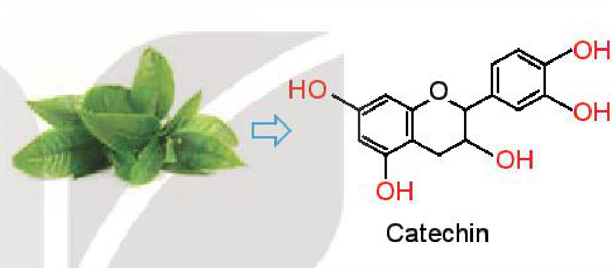

## I. KHÁI NIỆM

**Phenol** là những hợp chất hữu cơ trong phân tử có nhóm $\ce{-OH}$ liên kết trực tiếp với nguyên tử carbon của vòng benzene.

Hợp chất phenol đơn giản nhất có công thức là $\ce{C6H5OH}$ cũng có tên gọi riêng là phenol.

Tên thông thường của một số phenol:

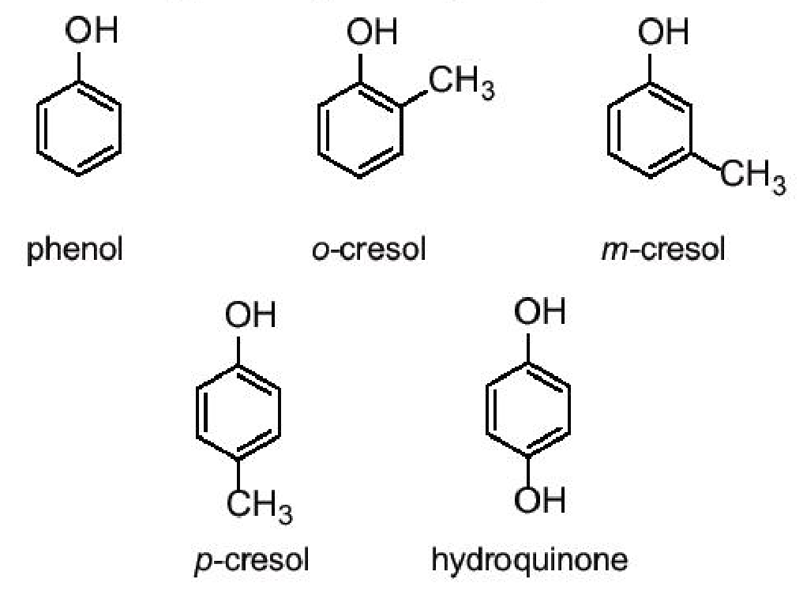

phenol; *o*-cresol; *m*-cresol; *p*-cresol; hydroquinone.
<!-- ocr-ok: đối chiếu trực tiếp ảnh trang PDF 130, công thức cấu tạo của 5 phenol -->

> 💡 EM CÓ BIẾT
>
> **Các hợp chất thiên nhiên chứa phenol**
>
> Trong tự nhiên, các hợp chất phenol tồn tại khá phổ biến trong nhiều loài thực vật.
>
> *Ví dụ:*
>
> 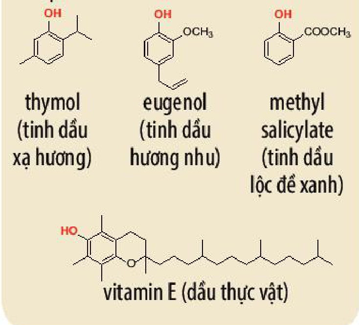
>
> thymol (tinh dầu xạ hương); eugenol (tinh dầu hương nhu); methyl salicylate (tinh dầu lộc đề xanh); vitamin E (dầu thực vật).
<!-- ocr-ok: đối chiếu trực tiếp ảnh trang PDF 130, hộp Em có biết -->

<!-- pdf:131 -->

## II. ĐẶC ĐIỂM CẤU TẠO CỦA PHENOL
<!-- ocr-ok: đối chiếu trực tiếp ảnh trang PDF 131, OCR đọc sai phông tiêu đề trang trí -->

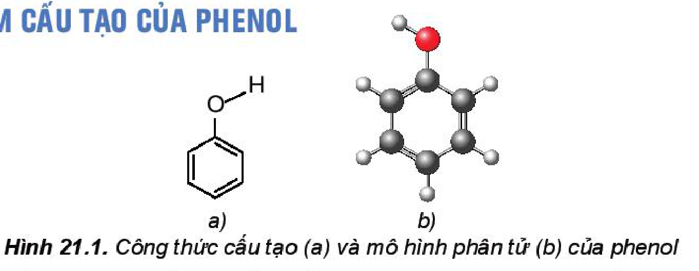

*Hình 21.1. Công thức cấu tạo (a) và mô hình phân tử (b) của phenol*

<!-- term: Đặc điểm cấu tạo của phenol -->
Trong phân tử phenol, do ảnh hưởng của vòng benzene nên liên kết $\ce{O-H}$ của phenol phân cực mạnh hơn so với alcohol, vì vậy phenol thể hiện tính acid yếu.

Ngoài ra, do có vòng benzene nên phenol có thể tham gia phản ứng thế nguyên tử hydrogen của vòng benzene.

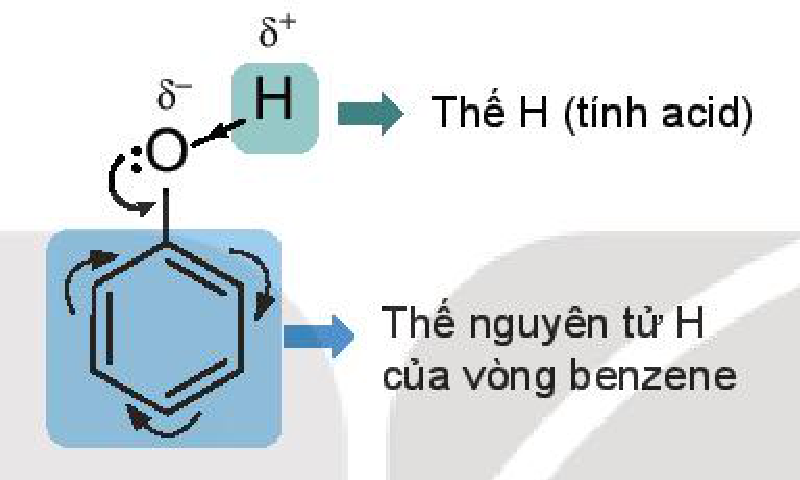

Thế H (tính acid); Thế nguyên tử H của vòng benzene.
<!-- ocr-ok: đối chiếu trực tiếp ảnh trang PDF 131, sơ đồ đặc điểm cấu tạo của phenol -->

## III. TÍNH CHẤT VẬT LÍ

<!-- term: Tính chất vật lí của phenol -->
Ở điều kiện thường, phenol là chất rắn không màu, nóng chảy ở $43\text{ }^\circ\text{C}$, sôi ở $181,8\text{ }^\circ\text{C}$.

Phenol ít tan trong nước ở điều kiện thường (độ tan trong nước ở $25\text{ }^\circ\text{C}$: $8,42\text{ g/100 g}$ nước), tan nhiều khi đun nóng (tan vô hạn ở $66\text{ }^\circ\text{C}$); tan tốt trong các dung môi hữu cơ như ethanol, ether và acetone. Phenol độc và có thể gây bỏng khi tiếp xúc với da nên phải cẩn thận khi sử dụng.

## IV. TÍNH CHẤT HOÁ HỌC

### 1. Phản ứng thế nguyên tử H của nhóm –OH (tính acid của phenol)

<!-- term: Tính acid của phenol -->
Trong dung dịch nước, phenol phân li theo cân bằng sau:

$$\ce{C6H5OH + H2O <=> C6H5O- + H3O+}$$
<!-- ocr-ok: đối chiếu trực tiếp ảnh trang PDF 131, phương trình phân li của phenol trong nước -->

*(trong đó $\ce{C6H5O-}$ là **ion phenolate**).*
<!-- ocr-ok: đối chiếu trực tiếp ảnh trang PDF 131, chú thích ion phenolate dưới phương trình phân li -->

Phenol là một acid yếu, dung dịch phenol không làm đổi màu quỳ tím.

Phenol có thể phản ứng được với kim loại kiềm, dung dịch base, muối sodium carbonate,...

*Ví dụ:*

$$\ce{C6H5OH + NaOH -> C6H5ONa + H2O}$$
<!-- ocr-ok: đối chiếu trực tiếp ảnh trang PDF 131, phương trình phenol tác dụng với NaOH -->

$$\ce{C6H5OH + Na2CO3 <=> C6H5ONa + NaHCO3}\text{ }^{(1)}$$
<!-- ocr-ok: đối chiếu trực tiếp ảnh trang PDF 131, phương trình phenol tác dụng với Na2CO3 -->

(1) Phenol có tính acid mạnh hơn nấc hai của carbonic acid ($\ce{H2CO3}$) nên có thể phản ứng được với muối carbonate.

<!-- pdf:132 -->

> ✋ **Nghiên cứu phản ứng của phenol với dung dịch $\ce{NaOH}$ và dung dịch $\ce{Na2CO3}$**
>
> Thí nghiệm phenol tác dụng với dung dịch $\ce{NaOH}$ và với dung dịch $\ce{Na2CO3}$ được tiến hành như sau:
> - Cho vào hai ống nghiệm, mỗi ống nghiệm khoảng 1 mL dung dịch phenol bão hoà (có màu trắng đục).
> - Cho khoảng 1 mL dung dịch $\ce{NaOH}$ 2 M vào ống nghiệm (1) và lắc đều.
> - Cho khoảng 1 mL dung dịch $\ce{Na2CO3}$ 2 M vào ống nghiệm (2) và lắc đều.
>
> Cả hai ống nghiệm đều quan sát được dung dịch từ màu trắng đục chuyển sang trong suốt.
>
> *Hãy giải thích các hiện tượng xảy ra.*
>
> 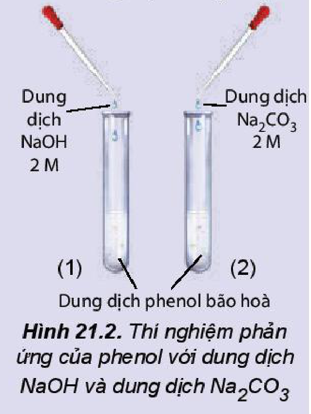
>
> *Hình 21.2. Thí nghiệm phản ứng của phenol với dung dịch $\ce{NaOH}$ và dung dịch $\ce{Na2CO3}$*

> ❓ 1. Hãy giải thích tại sao phenol có thể phản ứng được với dung dịch $\ce{NaOH}$ còn alcohol thì không phản ứng với dung dịch $\ce{NaOH}$.

### 2. Phản ứng thế ở vòng thơm

<!-- term: Phản ứng thế ở vòng thơm của phenol -->
Phenol có thể tham gia phản ứng thế nguyên tử hydrogen của vòng benzene. Phản ứng thế ưu tiên vào vị trí 2, 4 và 6 (*ortho* và *para*).

**a) Phản ứng bromine hoá**

<!-- term: Phản ứng bromine hoá của phenol -->
Phenol phản ứng với nước bromine tạo sản phẩm thế 2,4,6-tribromophenol ở dạng kết tủa màu trắng.

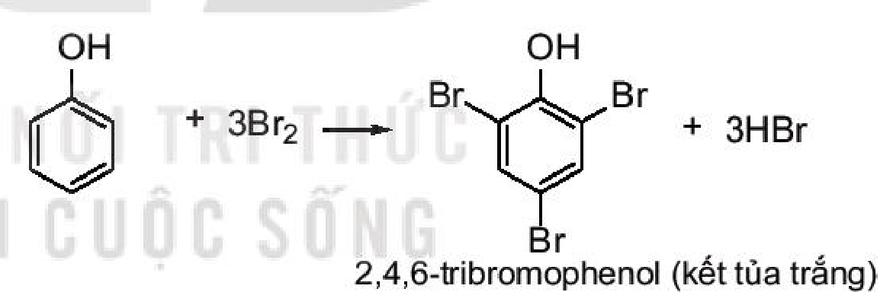

$$\ce{C6H5OH + 3Br2 -> C6H2Br3OH v + 3HBr}$$
<!-- ocr-ok: đối chiếu trực tiếp ảnh trang PDF 132, phương trình phản ứng bromine hoá phenol tạo 2,4,6-tribromophenol kết tủa trắng -->

Do ảnh hưởng của nhóm $\ce{-OH}$, phản ứng thế nguyên tử hydrogen ở vòng benzene của phenol xảy ra dễ dàng hơn so với benzene.

> ✋ **Phản ứng của phenol với nước bromine**
>
> Phản ứng của phenol với nước bromine được tiến hành như sau:
> - Cho khoảng 1,0 mL dung dịch phenol 5% vào ống nghiệm.
> - Nhỏ vài giọt nước bromine bão hoà vào ống nghiệm, lắc đều. Nước bromine mất màu và xuất hiện kết tủa trắng.
>
> *Hãy giải thích hiện tượng xảy ra và viết phương trình hoá học của phản ứng.*
>
> 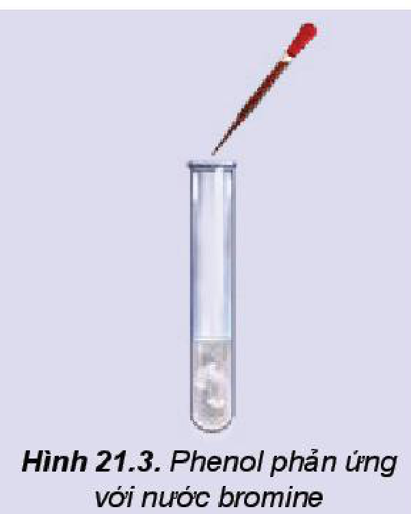
>
> *Hình 21.3. Phenol phản ứng với nước bromine*

<!-- pdf:133 -->

> ❓ 2. So sánh điều kiện phản ứng bromine hoá vào vòng benzene của phenol và benzene. Từ đó, rút ra nhận xét khả năng thế nguyên tử hydrogen ở vòng benzene của phenol so với benzene.
>
> 3. Viết phương trình hoá học của phản ứng xảy ra khi cho 4-methylphenol tác dụng với nước bromine.

**b) Phản ứng nitro hoá**

<!-- term: Phản ứng nitro hoá của phenol -->
Phenol phản ứng với dung dịch nitric acid đặc trong dung dịch sulfuric acid đặc tạo thành sản phẩm 2,4,6-trinitrophenol (**picric acid**):

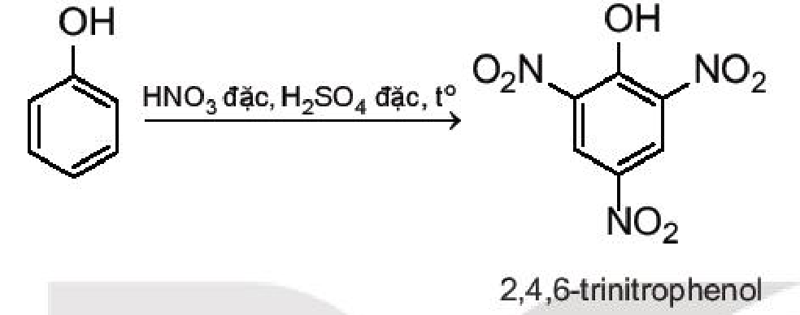

> ✋ **Nghiên cứu phản ứng nitro hoá phenol – tổng hợp picric acid**
>
> Thí nghiệm nitro hoá phenol được tiến hành như sau:
> - Cho 0,5 g phenol và khoảng 1,5 mL $\ce{H2SO4}$ đặc vào ống nghiệm, đun nhẹ hỗn hợp trong khoảng 10 phút để thu được chất lỏng đồng nhất.
> - Để nguội ống nghiệm rồi ngâm bình trong cốc nước đá.
> - Nhỏ từ từ 3 mL dung dịch $\ce{HNO3}$ đặc vào hỗn hợp và lắc đều. Nút bằng bông tẩm dung dịch $\ce{NaOH}$.
> - Đun cách thuỷ hỗn hợp trong nồi nước nóng 15 phút.
> - Làm lạnh hỗn hợp rồi đem pha loãng hỗn hợp với khoảng 10 mL nước cất, picric acid kết tủa ở dạng tinh thể màu vàng.
>
> *Hãy giải thích hiện tượng xảy ra và viết phương trình hoá học của phản ứng.*
>
> *Chú ý:* Thí nghiệm thực hiện trong tủ hốt hoặc nơi thoáng khí. Cần thận trọng khi làm việc với dung dịch $\ce{HNO3}$ đặc và dung dịch $\ce{H2SO4}$ đặc.

## V. ỨNG DỤNG

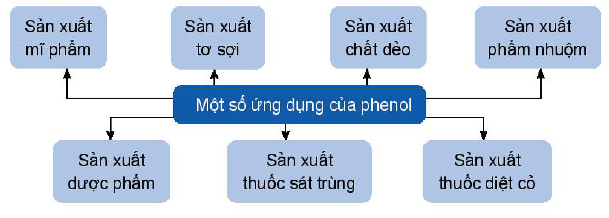

<!-- term: Ứng dụng của phenol -->
Một số ứng dụng của phenol: Sản xuất mĩ phẩm; Sản xuất tơ sợi; Sản xuất chất dẻo; Sản xuất phẩm nhuộm; Sản xuất dược phẩm; Sản xuất thuốc sát trùng; Sản xuất thuốc diệt cỏ.

<!-- pdf:134 -->

> 💡 EM CÓ BIẾT
>
> Phenol được sử dụng chủ yếu làm nguyên liệu để tổng hợp các vật liệu nhựa, chất dẻo, tơ sợi. Từ phenol tổng hợp bisphenol A để sản xuất nhựa polycarbonate; tổng hợp cyclohexanol để sản xuất nylon-6,6; nhựa phenolformaldehyde;...

## VI. ĐIỀU CHẾ

<!-- term: Điều chế phenol -->
Phenol được tổng hợp từ **cumene** (isopropylbenzene) bằng phản ứng oxi hoá bởi oxygen rồi thuỷ phân trong môi trường acid thu được hai sản phẩm là phenol và acetone:

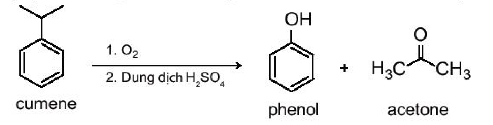

$$\underset{\text{cumene}}{\ce{C6H5CH(CH3)2}} \ce{->[1. O2][2. \text{Dung dịch } H2SO4]} \underset{\text{phenol}}{\ce{C6H5OH}} + \underset{\text{acetone}}{\ce{CH3COCH3}}$$
<!-- ocr-ok: đối chiếu trực tiếp ảnh trang PDF 134, sơ đồ điều chế phenol từ cumene -->

Hiện nay, phần lớn phenol và acetone đều được sản xuất trong công nghiệp theo phương pháp này.

Ngoài ra, phenol còn được điều chế từ nhựa than đá.

> ✋ Sưu tầm, tìm hiểu thông tin và trình bày một số ứng dụng của phenol trong đời sống và trong sản xuất.

## 📌 Em đã học

- Phenol là những hợp chất hữu cơ trong phân tử có nhóm $\ce{-OH}$ liên kết trực tiếp với nguyên tử carbon của vòng benzene.
- Phenol là chất rắn, không màu, ít tan trong nước ở điều kiện thường, tan nhiều khi đun nóng, có tính độc, có thể gây bỏng khi tiếp xúc với da.
- Tính chất hoá học của phenol:
  - Phenol có tính acid yếu.
  - Phản ứng thế ở vòng benzene.
- Phenol được dùng làm nguyên liệu để sản xuất chất dẻo, tơ sợi, mĩ phẩm, dược phẩm, phẩm nhuộm, thuốc sát trùng, thuốc diệt cỏ,...
- Phenol được điều chế từ cumene, nhựa than đá.

## ✏️ Em có thể

- Tuân thủ các quy tắc về an toàn khi làm việc với phenol.
- Sưu tầm một số sản phẩm có phenol trong thành phần để trình bày về các ứng dụng đa dạng của phenol trong cuộc sống.

## 📷 Danh sách hình trong bài

| Mã hình | Trang PDF | Vị trí | Chú thích gốc |
|---|---|---|---|
| H11-hoa-b21-01 | 130 | Hộp Mở đầu (lá chè xanh và công thức cấu tạo của Catechin) | (sách không đánh số, không có chú thích) |
| H11-hoa-b21-02 | 130 | Mục I (tên thông thường của một số phenol) | (sách không đánh số, không có chú thích) |
| H11-hoa-b21-03 | 130 | Mục I, hộp "Em có biết" (các hợp chất thiên nhiên chứa phenol) | (sách không đánh số, không có chú thích) |
| H11-hoa-b21-04 | 131 | Mục II | Hình 21.1. Công thức cấu tạo (a) và mô hình phân tử (b) của phenol |
| H11-hoa-b21-05 | 131 | Mục II (sơ đồ phân cực liên kết O–H và vòng benzene của phenol) | (sách không đánh số, không có chú thích) |
| H11-hoa-b21-06 | 132 | Mục IV.1, hộp hoạt động nghiên cứu | Hình 21.2. Thí nghiệm phản ứng của phenol với dung dịch NaOH và dung dịch Na2CO3 |
| H11-hoa-b21-07 | 132 | Mục IV.2.a (phương trình phản ứng bromine hoá phenol) | (sách không đánh số, không có chú thích) |
| H11-hoa-b21-08 | 132 | Mục IV.2.a, hộp hoạt động nghiên cứu | Hình 21.3. Phenol phản ứng với nước bromine |
| H11-hoa-b21-09 | 133 | Mục IV.2.b (phương trình phản ứng nitro hoá phenol) | (sách không đánh số, không có chú thích) |
| H11-hoa-b21-10 | 133 | Mục V (sơ đồ một số ứng dụng của phenol) | (sách không đánh số, không có chú thích) |
| H11-hoa-b21-11 | 134 | Mục VI (sơ đồ điều chế phenol và acetone từ cumene) | (sách không đánh số, không có chú thích) |
