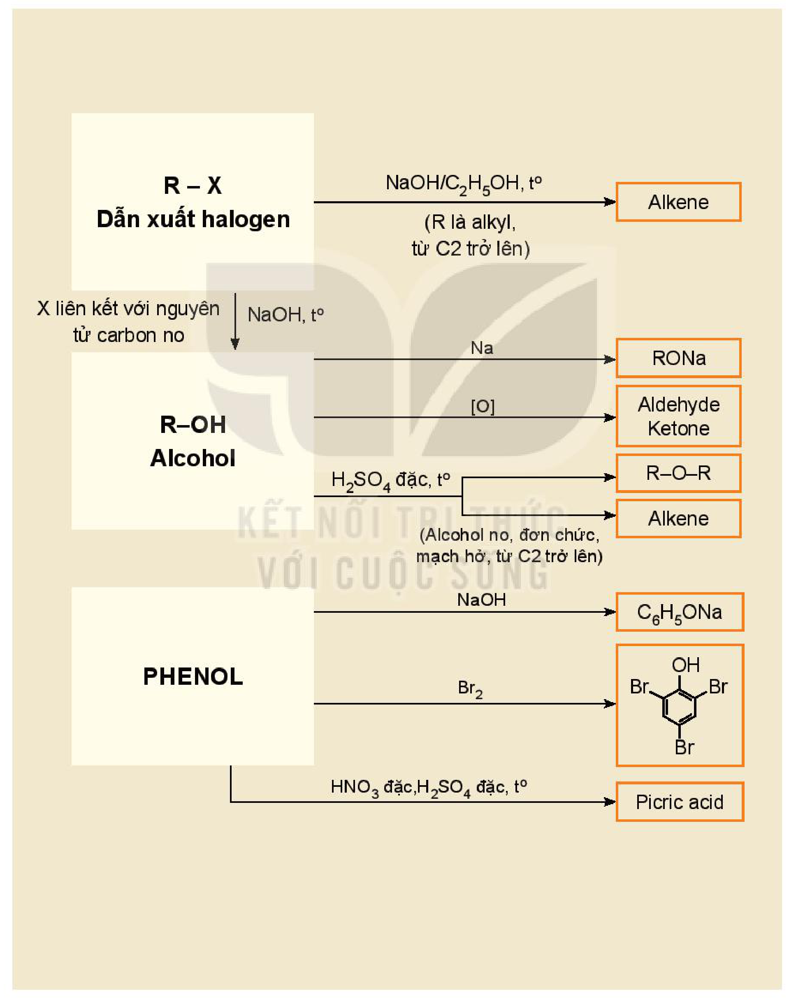
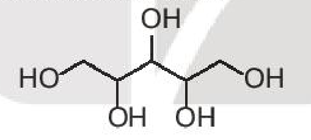
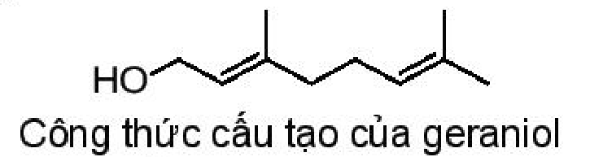

<!-- pdf:135 -->

# BÀI 22: ÔN TẬP CHƯƠNG 5

## I. HỆ THỐNG HOÁ KIẾN THỨC
<!-- ocr-ok: đối chiếu trực tiếp ảnh trang PDF 135, OCR đọc sai phông tiêu đề trang trí -->

- **Dẫn xuất halogen ($\ce{R-X}$):**
  - Tác dụng với $\ce{NaOH/C2H5OH}$, $t^\circ$ ($\ce{R}$ là alkyl, từ $\ce{C2}$ trở lên) $\ce{->}$ Alkene.
  - Tác dụng với $\ce{NaOH}$, $t^\circ$ ($\ce{X}$ liên kết với nguyên tử carbon no) $\ce{->}$ Alcohol ($\ce{R-OH}$).
- **Alcohol ($\ce{R-OH}$):**
  - Tác dụng với $\ce{Na -> RONa}$.
  - Tác dụng với $\ce{[O] ->}$ Aldehyde, Ketone.
  - Đun nóng với $\ce{H2SO4}$ đặc, $t^\circ \ce{-> R-O-R}$ hoặc Alkene (Alcohol no, đơn chức, mạch hở, từ $\ce{C2}$ trở lên).
- **Phenol:**
  - Tác dụng với $\ce{NaOH -> C6H5ONa}$.
  - Tác dụng với $\ce{Br2 ->}$ 2,4,6-tribromophenol ($\ce{C6H2Br3OH}$).
  - Tác dụng với $\ce{HNO3}$ đặc, $\ce{H2SO4}$ đặc, $t^\circ \ce{->}$ Picric acid.
<!-- ocr-ok: đối chiếu trực tiếp ảnh trang PDF 135, sơ đồ hệ thống hoá kiến thức Chương 5 -->

<!-- pdf:136 -->

## II. LUYỆN TẬP

**Câu 1.** Cho các hợp chất: hexane, bromoethane, ethanol, phenol. Trong số các hợp chất này, hợp chất tan tốt nhất trong nước là

A. hexane.

B. bromoethane.

C. ethanol.

D. phenol.

**Câu 2.** Phản ứng thuỷ phân dẫn xuất halogen trong môi trường kiềm thuộc loại phản ứng gì?

$$\ce{R-X + OH- -> R-OH + X-}$$
<!-- ocr-ok: đối chiếu trực tiếp ảnh trang PDF 136, phương trình thuỷ phân dẫn xuất halogen ở Câu 2 -->

A. Phản ứng thế.

B. Phản ứng cộng.

C. Phản ứng tách.

D. Phản ứng oxi hoá.

**Câu 3.** Cho các phát biểu sau về phenol:

a) Phenol có nhiệt độ sôi cao hơn ethanol.

b) Phenol tác dụng được với dung dịch $\ce{NaOH}$.

c) Phenol phản ứng được với dung dịch $\ce{Na2CO3}$.

d) Phản ứng thế vào vòng thơm của phenol dễ hơn thế vào vòng benzene.

Trong số các phát biểu trên, số phát biểu đúng là

A. 1.

B. 2.

C. 3.

D. 4.

**Câu 4.** Xylitol là một hợp chất hữu cơ được sử dụng như một chất tạo ngọt tự nhiên, có vị ngọt như đường nhưng có hàm lượng calo thấp nên được đưa thêm vào các sản phẩm chăm sóc răng miệng như kẹo cao su, kẹo bạc hà, thực phẩm ăn kiêng cho người bị bệnh tiểu đường. Xylitol có công thức cấu tạo như sau:

a) Xylitol thuộc loại hợp chất alcohol đơn chức hay đa chức?

b) Dự đoán xylitol có tan tốt trong nước không? Giải thích.
<!-- ocr-ok: sách in lặp hai ý a), đã đối chiếu trực tiếp ảnh trang PDF 136 -->

**Câu 5.** Hợp chất X hiện nay được sử dụng phổ biến trong công nghiệp làm lạnh để thay thế CFC do X không gây hại đến tầng ozone. Biết thành phần của X chứa $23,08\%$ C, $3,84\%$ H và $73,08\%$ F về khối lượng và có phân tử khối là 52. Hãy xác định công thức cấu tạo của X.

**Câu 6.** Geraniol là một alcohol không no có trong tinh dầu hoa hồng, tinh dầu sả và nhiều loại tinh dầu thảo mộc khác.

*Công thức cấu tạo của geraniol*

a) Geraniol thuộc loại alcohol bậc mấy?

b) Geraniol được hoà tan vào ethanol cùng một số hương liệu khác để làm nước hoa. Hãy giải thích tại sao geraniol tan tốt trong ethanol.

**Câu 7.** Thực hiện phản ứng tách nước các alcohol có cùng công thức phân tử $\ce{C5H11OH}$ thu được sản phẩm chính là 2-methylbut-2-ene. Hãy xác định công thức cấu tạo của các alcohol này.

## 📷 Danh sách hình trong bài

| Mã hình | Trang PDF | Vị trí | Chú thích gốc |
|---|---|---|---|
| H11-hoa-b22-01 | 135 | Mục I (sơ đồ hệ thống hoá kiến thức Chương 5) | (sách không đánh số, không có chú thích) |
| H11-hoa-b22-02 | 136 | Mục II, Câu 4 (công thức cấu tạo của xylitol) | (sách không đánh số, không có chú thích) |
| H11-hoa-b22-03 | 136 | Mục II, Câu 6 | Công thức cấu tạo của geraniol |
