<!-- pdf:137 -->

# BÀI 23: HỢP CHẤT CARBONYL

## 🎯 Mục tiêu

- Nêu được khái niệm hợp chất carbonyl (aldehyde và ketone).
- Gọi được tên theo danh pháp thay thế một số hợp chất carbonyl đơn giản (C1–C5), tên thông thường một vài hợp chất carbonyl thường gặp.
- Mô tả được đặc điểm liên kết của nhóm chức carbonyl, hình dạng phân tử của methanal, ethanal.
- Nêu được đặc điểm về tính chất vật lí (trạng thái, nhiệt độ sôi, tính tan) của hợp chất carbonyl.
- Trình bày được tính chất hoá học của aldehyde, ketone: phản ứng khử (với $\ce{NaBH4}$ hoặc $\ce{LiAlH4}$; phản ứng oxi hoá aldehyde (với nước bromine, thuốc khử Tollens, $\ce{Cu(OH)2/OH-}$); phản ứng cộng vào nhóm carbonyl (với $\ce{HCN}$); phản ứng tạo iodoform.
- Thực hiện được (hoặc quan sát qua video, hoặc qua mô tả) các thí nghiệm: phản ứng tráng bạc, phản ứng với $\ce{Cu(OH)2/OH-}$, phản ứng tạo iodoform từ acetone; mô tả hiện tượng thí nghiệm, giải thích tính chất hoá học của hợp chất carbonyl và xác định hợp chất có chứa nhóm $\ce{CH3CO-}$.
- Trình bày được ứng dụng của hợp chất carbonyl và phương pháp điều chế acetaldehyde bằng cách oxi hoá ethylene, điều chế acetone từ cumene.

## 🔴 Mở đầu

Các aldehyde, ketone tạo nên mùi thơm đặc trưng của các loài động vật và thực vật. Nhiều aldehyde, ketone đóng vai trò quan trọng đối với cơ thể: tế bào trong võng mạc giúp mắt tiếp nhận ánh sáng được tạo thành từ aldehyde, các hormone giới tính nam và nữ là các ketone.

Vậy, hợp chất carbonyl là gì và chúng có những tính chất nào?

## I. KHÁI NIỆM, DANH PHÁP

### 1. Khái niệm

**Hợp chất carbonyl** là các hợp chất hữu cơ trong phân tử có chứa **nhóm chức carbonyl** ($>\!\ce{C=O}$). Nhóm chức carbonyl có trong *aldehyde*, *ketone*,...

***Aldehyde*** là hợp chất hữu cơ có nhóm $\ce{-CHO}$ liên kết với nguyên tử carbon (trong gốc hydrocarbon hoặc $\ce{-CHO}$) hoặc nguyên tử hydrogen.

***Ketone*** là hợp chất hữu cơ có nhóm $>\!\ce{C=O}$ liên kết với hai gốc hydrocarbon.

<!-- pdf:138 -->

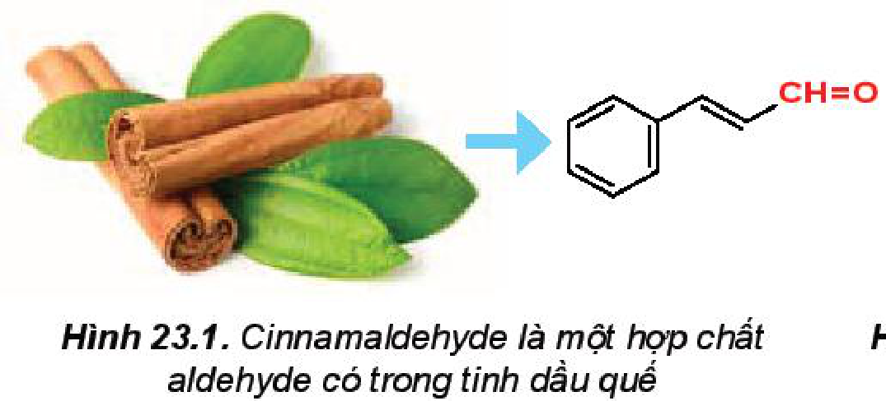

Hình 23.1. Cinnamaldehyde là một hợp chất aldehyde có trong tinh dầu quế

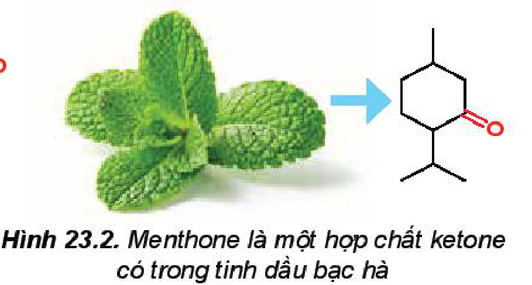

Hình 23.2. Menthone là một hợp chất ketone có trong tinh dầu bạc hà

> 💡 EM CÓ BIẾT
>
> Trong tự nhiên, các hợp chất chứa nhóm chức aldehyde và ketone tồn tại khá phổ biến trong tinh dầu của nhiều loài cây cỏ.
>
> *Ví dụ:*
>
> 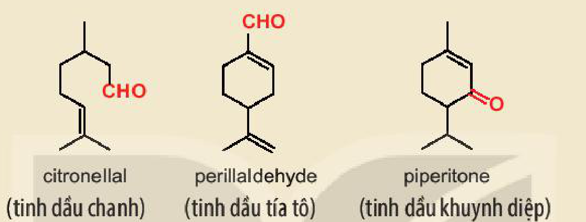
>
> - citronellal (tinh dầu chanh)
> - perillaldehyde (tinh dầu tía tô)
> - piperitone (tinh dầu khuynh diệp)
<!-- ocr-ok: OCR đọc sai "loài cây cỏ" thành "loài dây dỏ", "Ví dụ:" thành "Wau:" và dính chữ chú thích; đã đối chiếu ảnh -->

### 2. Danh pháp

**a) Danh pháp thay thế**

Tên gọi theo danh pháp thay thế của aldehyde đơn chức và ketone đơn chức:

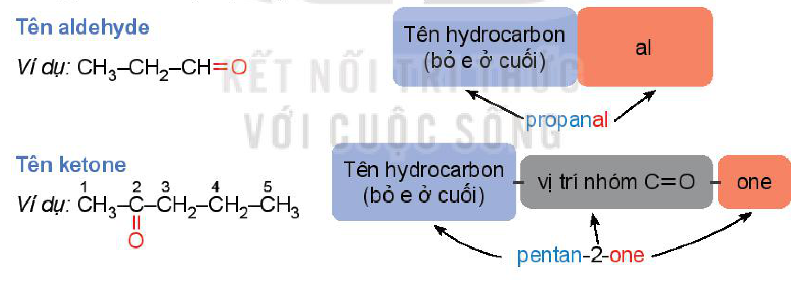

- Tên aldehyde: Tên hydrocarbon (bỏ e ở cuối) + al
  - *Ví dụ:* $\ce{CH3-CH2-CH=O}$: propanal
- Tên ketone: Tên hydrocarbon (bỏ e ở cuối) - vị trí nhóm $\ce{C=O}$ - one
  - *Ví dụ:* $\ce{\overset{1}{C}H3-\overset{2}{C}(=O)-\overset{3}{C}H2-\overset{4}{C}H2-\overset{5}{C}H3}$: pentan-2-one
<!-- ocr-ok: OCR bỏ sót chữ trong các ô màu của sơ đồ danh pháp; đã đối chiếu ảnh -->

*Chú ý:*

- Mạch carbon là mạch dài nhất chứa nhóm $>\!\ce{C=O}$.
- Mạch carbon được đánh số từ nhóm $\ce{-CHO}$ (đối với aldehyde) hoặc từ phía gần nhóm $>\!\ce{C=O}$ hơn (đối với ketone).
- Đối với ketone, nếu nhóm $>\!\ce{C=O}$ chỉ có một vị trí duy nhất thì không cần số chỉ vị trí nhóm $>\!\ce{C=O}$.
- Nếu mạch carbon có nhánh thì cần thêm vị trí và tên nhánh ở phía trước.

<!-- pdf:139 -->

*Ví dụ:*

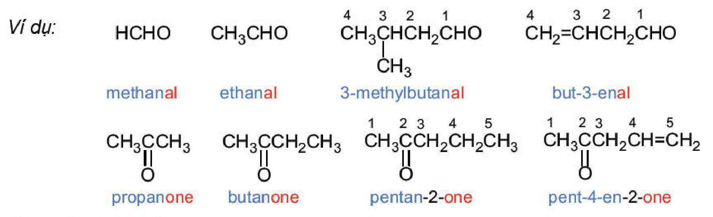

- $\ce{HCHO}$: methanal
- $\ce{CH3CHO}$: ethanal
- $\ce{\overset{4}{C}H3\overset{3}{C}H(CH3)\overset{2}{C}H2\overset{1}{C}HO}$: 3-methylbutanal
- $\ce{\overset{4}{C}H2=\overset{3}{C}H\overset{2}{C}H2\overset{1}{C}HO}$: but-3-enal
- $\ce{CH3C(=O)CH3}$: propanone
- $\ce{CH3C(=O)CH2CH3}$: butanone
- $\ce{\overset{1}{C}H3\overset{2}{C}(=O)\overset{3}{C}H2\overset{4}{C}H2\overset{5}{C}H3}$: pentan-2-one
- $\ce{\overset{1}{C}H3\overset{2}{C}(=O)\overset{3}{C}H2\overset{4}{C}H=\overset{5}{C}H2}$: pent-4-en-2-one

**b) Tên gọi thông thường**

Một số aldehyde, ketone đơn giản được gọi theo tên thông thường có nguồn gốc lịch sử. Tên thông thường của các aldehyde có nguồn gốc từ tên của acid tương ứng.

*Ví dụ:*

- $\ce{HCHO}$: aldehyde formic (formaldehyde)
- $\ce{CH3CHO}$: aldehyde acetic (acetaldehyde)
- $\ce{C6H5CHO}$: aldehyde benzoic (benzaldehyde)
- $\ce{CH3COCH3}$: acetone

> ❓ 1. Viết các công thức cấu tạo và gọi tên theo danh pháp thay thế của hợp chất carbonyl có công thức phân tử $\ce{C4H8O}$.
>
> 2. Viết công thức cấu tạo của các hợp chất carbonyl có tên gọi dưới đây:
>
> a) propanal; b) 3-methylbut-2-enal;
>
> c) pentan-2-one; d) 3-methylbutan-2-one.

## II. ĐẶC ĐIỂM CẤU TẠO
<!-- ocr-ok: OCR đọc sai tiêu đề mục II thành "( bẶC DIỀM DẤU TẠO"; đã đối chiếu ảnh -->

Liên kết đôi $\ce{C=O}$ phân cực về phía nguyên tử oxygen (Hình 23.3).

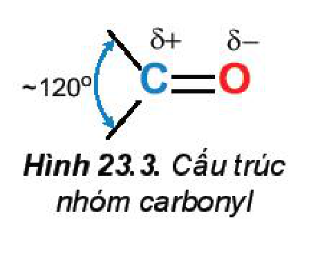

Hình 23.3. Cấu trúc nhóm carbonyl ($\sim 120^\circ$, $>\!\ce{\overset{\delta+}{C}=\overset{\delta-}{O}}$)

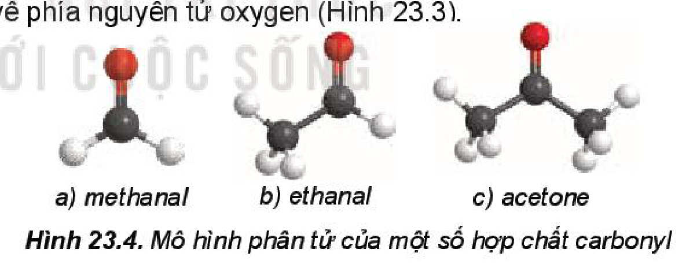

Hình 23.4. Mô hình phân tử của một số hợp chất carbonyl: a) methanal; b) ethanal; c) acetone

## III. TÍNH CHẤT VẬT LÍ

> ✋ Cho biết các hợp chất dưới đây có khối lượng phân tử gần tương đương nhau và có nhiệt độ sôi như sau:
>
> | Chất | $\ce{CH3CH2CH2CH3}$ | $\ce{CH3CH2CHO}$ | $\ce{CH3CH2CH2OH}$ |
> |---|---|---|---|
> | $t_{\text{s}}\text{ }(^\circ\text{C})$ | $-0,5$ | $49$ | $97,1$ |
>
> So sánh nhiệt độ sôi của hợp chất carbonyl với alkane và alcohol có khối lượng phân tử tương đương. Dựa vào khả năng tạo liên kết hydrogen và sự phân cực của phân tử để giải thích.

<!-- pdf:140 -->

Các aldehyde, ketone có nhiệt độ sôi cao hơn các hydrocarbon có khối lượng phân tử tương đương do trong phân tử chứa nhóm carbonyl phân cực làm cho phân tử aldehyde, ketone phân cực nên có nhiệt độ sôi cao hơn.

Ở nhiệt độ thường, các aldehyde có phân tử khối nhỏ (methanal, ethanal) ở trạng thái khí, các hợp chất carbonyl thông dụng khác ở trạng thái lỏng.

Các aldehyde, ketone có mạch carbon ngắn tan tốt trong nước. Khi số nguyên tử carbon tăng thì độ tan của hợp chất carbonyl giảm dần.

*Bảng 23.1. Nhiệt độ sôi và tính tan của một số hợp chất carbonyl$^{(1)}$*

| Loại hợp chất | Công thức | Tên | Nhiệt độ sôi ($^\circ\text{C}$) | Độ tan trong nước ở $20\text{ }^\circ\text{C}$ ($\text{g/100 g}$) |
|---|---|---|---|---|
| aldehyde | $\ce{HCHO}$ | methanal | $-21$ | tan vô hạn |
| aldehyde | $\ce{CH3CHO}$ | ethanal | $20$ | tan vô hạn |
| aldehyde | $\ce{CH3CH2CHO}$ | propanal | $49$ | $20$ |
| aldehyde | $\ce{CH3CH2CH2CHO}$ | butanal | $76$ | $7$ |
| ketone | $\ce{CH3COCH3}$ | propanone | $56$ | tan vô hạn |
| ketone | $\ce{CH3COCH2CH3}$ | butanone | $80$ | $26$ |
| ketone | $\ce{CH3CH2COCH2CH3}$ | pentan-3-one | $101$ | $5$ |
<!-- ocr-ok: cột đầu của Bảng 23.1 in chữ dọc "aldehyde" và "ketone" nên OCR đọc lỗi kí tự; đã đối chiếu ảnh -->

## IV. TÍNH CHẤT HOÁ HỌC

### 1. Phản ứng khử

<!-- term: Phản ứng khử hợp chất carbonyl -->
Các hợp chất carbonyl bị khử bởi các tác nhân khử như $\ce{NaBH4}$, $\ce{LiAlH4}$,... (kí hiệu: $\ce{[H]}$) tạo thành các alcohol tương ứng: aldehyde bị khử tạo thành alcohol bậc I, ketone bị khử tạo thành alcohol bậc II.

*Ví dụ:* $\underset{\text{ethanal}}{\ce{CH3CH=O}} + 2\ce{[H] ->} \underset{\text{ethanol}}{\ce{CH3CH2OH}}$ ; $\underset{\text{propanone}}{\ce{CH3-C(=O)-CH3}} + 2\ce{[H] ->} \underset{\text{propan-2-ol}}{\ce{CH3-CH(OH)-CH3}}$

> ❓ 3. Khử các hợp chất carbonyl sau bởi $\ce{NaBH4}$, hãy viết công thức cấu tạo của các sản phẩm:
>
> a) propanal; b) 2-methylbutanal;
>
> c) butanone; d) 3-methylbutan-2-one.

> (1) Nguồn: *Organic chemistry*, William H. Brown, Cengage Learning, 2018.

<!-- pdf:141 -->

> 💡 EM CÓ BIẾT
>
> Muscone là hợp chất ketone tạo nên mùi thơm đặc trưng của xạ hương và được sử dụng phổ biến trong công nghiệp nước hoa, mỹ phẩm và y học. Trước đây, xạ hương tự nhiên được lấy từ tuyến thơm của hươu xạ.
>
> Tuy nhiên, để bảo vệ loài hươu xạ, ngày nay xạ hương được tổng hợp bằng con đường hoá học. Dưới đây là một phương pháp tổng hợp muscone, trong đó giai đoạn đầu là phản ứng khử hợp chất ketone thành alcohol bởi tác nhân khử $\ce{NaBH4}$.
>
> 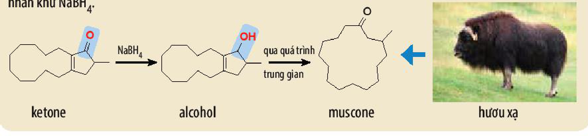
>
> $\text{ketone} \xrightarrow{\ce{NaBH4}} \text{alcohol} \xrightarrow[\text{trung gian}]{\text{qua quá trình}} \text{muscone} \longleftarrow \text{hươu xạ}$

### 2. Phản ứng oxi hoá aldehyde

<!-- term: Phản ứng oxi hoá aldehyde -->
Aldehyde dễ bị oxi hoá bởi các tác nhân oxi hoá thông thường như: $\ce{Br2/H2O}$, $\ce{[Ag(NH3)2]OH}$, $\ce{Cu(OH)2/OH-}$,...

**a) Oxi hoá aldehyde bởi nước bromine**

Aldehyde bị oxi hoá bởi nước bromine tạo thành carboxylic acid.

*Ví dụ:* $\ce{CH3CHO + Br2 + H2O -> CH3COOH + 2HBr}$

**b) Oxi hoá aldehyde bởi thuốc thử Tollens**

**Thuốc thử Tollens** là phức chất của ion $\ce{Ag+}$ với ammonia, có công thức $\ce{[Ag(NH3)2]OH}$. Ion $\ce{Ag+}$ trong thuốc thử Tollens đóng vai trò là chất oxi hoá:

$\ce{RCHO + 2[Ag(NH3)2]OH ->[t^o] RCOONH4 + 2Ag + 3NH3 + H2O}$

*Ví dụ:* $\ce{CH3CHO + 2[Ag(NH3)2]OH ->[t^o] CH3COONH4 + 2Ag + 3NH3 + H2O}$

Phản ứng tạo thành lớp bạc sáng bóng bám vào bình phản ứng, vì vậy phản ứng này còn được gọi là ***phản ứng tráng bạc***.

Ketone không bị oxi hoá bởi thuốc thử Tollens, vì vậy có thể dùng thuốc thử Tollens để phân biệt aldehyde với ketone và các hợp chất khác.

> 🔬 Thí nghiệm phản ứng của aldehyde với thuốc thử Tollens
>
> *Chuẩn bị:* dung dịch $\ce{CH3CHO}$ 5%, dung dịch $\ce{AgNO3}$ 1%, dung dịch $\ce{NH3}$ 5%, cốc nước nóng, ống nghiệm.
>
> *Tiến hành:*
>
> - Cho khoảng 1 mL dung dịch $\ce{AgNO3}$ 1% vào ống nghiệm, thêm vài giọt dung dịch $\ce{NaOH}$ 10%.
> - Thêm từ từ dung dịch $\ce{NH3}$ 5% vào ống nghiệm và lắc đều đến khi kết tủa tan hoàn toàn.
> - Nhỏ vài giọt dung dịch $\ce{CH3CHO}$ 5% vào ống nghiệm, lắc đều.

<!-- pdf:142 -->

> - Đặt ống nghiệm vào cốc chứa nước nóng (khoảng $70 - 80\text{ }^\circ\text{C}$), để yên khoảng 5 phút.
>
> *Giải thích hiện tượng quan sát được và viết phương trình hoá học của phản ứng xảy ra.*

**c) Oxi hoá aldehyde bằng copper(II) hydroxide**

Aldehyde có thể bị oxi hoá bởi copper(II) hydroxide $\ce{Cu(OH)2}$ trong môi trường kiềm khi đun nóng tạo thành kết tủa copper(I) oxide ($\ce{Cu2O}$) màu đỏ gạch:

$\ce{RCHO + 2Cu(OH)2 + NaOH ->[t^o] RCOONa + Cu2O + 3H2O}$

> ✋ Nghiên cứu phản ứng oxi hoá aldehyde bằng copper(II) hydroxide
>
> Thí nghiệm oxi hoá $\ce{CH3CHO}$ bằng $\ce{Cu(OH)2}$ được tiến hành như sau:
>
> - Cho khoảng 0,5 mL dung dịch $\ce{CuSO4}$ 5% và khoảng 1 mL dung dịch $\ce{NaOH}$ 10% vào ống nghiệm, lắc đều hỗn hợp.
> - Thêm khoảng 1 mL $\ce{CH3CHO}$ 5% vào ống nghiệm, lắc đều ống nghiệm.
> - Đun nóng nhẹ ống nghiệm trên ngọn lửa đèn cồn. Hỗn hợp phản ứng chuyển dần từ màu xanh lam sang màu đỏ gạch.
>
> 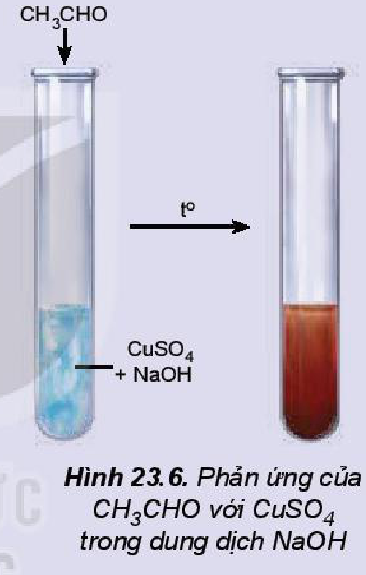
>
> Hình 23.6. Phản ứng của $\ce{CH3CHO}$ với $\ce{CuSO4}$ trong dung dịch $\ce{NaOH}$
>
> *Trả lời câu hỏi và thực hiện yêu cầu sau:*
>
> 1. Khi cho dung dịch $\ce{CuSO4}$ vào dung dịch $\ce{NaOH}$, hỗn hợp tạo kết tủa màu xanh lam, kết tủa đó là chất gì?
> 2. Viết phương trình hoá học của các phản ứng xảy ra trong thí nghiệm trên.

> ❓ 4. Viết phương trình hoá học của phản ứng giữa $\ce{HCHO}$ với các tác nhân sau:
>
> a) Thuốc thử Tollens; b) $\ce{Cu(OH)2/NaOH}$.

### 3. Phản ứng cộng

<!-- term: Phản ứng cộng vào nhóm carbonyl -->
Hợp chất carbonyl có thể tham gia phản ứng cộng với $\ce{HCN}$ vào liên kết đôi $\ce{C=O}$.

$>\!\ce{\overset{\delta+}{C}=\overset{\delta-}{O} + H-CN ->} >\!\ce{C(OH)(CN)}$

<!-- pdf:143 -->

*Ví dụ:*

$\ce{CH3-CH=O + HCN -> CH3-CH(OH)-CN}$

$\ce{(CH3)2C=O + HCN -> (CH3)2C(OH)-CN}$

### 4. Phản ứng tạo iodoform

Các hợp chất aldehyde, ketone có nhóm methyl cạnh nhóm carbonyl có thể phản ứng với $\ce{I2}$ trong môi trường kiềm.

*Ví dụ:* $\ce{C2H5-C(=O)-CH3 + 3I2 + 4NaOH -> C2H5-C(=O)-ONa} + \underset{\substack{\text{Iodoform}\\\text{(kết tủa màu vàng)}}}{\ce{CHI3}} + \ce{3NaI + 3H2O}$

$\ce{CH3-CHO + 3I2 + 4NaOH -> H-COONa + CHI3 + 3NaI + 3H2O}$

Phản ứng tạo sản phẩm kết tủa iodoform nên phản ứng này được gọi là ***phản ứng iodoform*** và được dùng để nhận biết các aldehyde, ketone có nhóm methyl cạnh nhóm carbonyl.

> ✋ Nghiên cứu phản ứng tạo iodoform từ acetone
>
> Phản ứng tạo iodoform từ acetone được tiến hành như sau:
>
> - Cho khoảng 2 mL dung dịch $\ce{I2}$ bão hoà trong $\ce{KI}$ vào ống nghiệm.
> - Thêm khoảng 2 mL dung dịch $\ce{NaOH}$ 2 M.
> - Thêm tiếp khoảng 0,5 mL acetone vào hỗn hợp trên và lắc đều ống nghiệm, quan sát thấy xuất hiện kết tủa màu vàng.
>
> 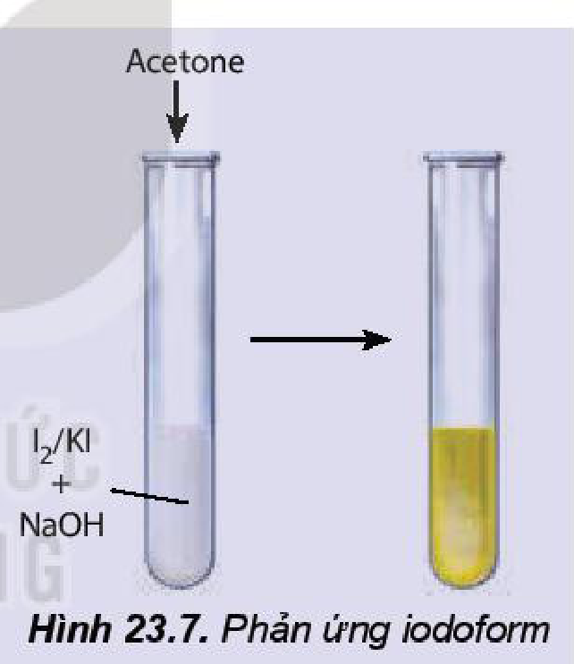
>
> Hình 23.7. Phản ứng iodoform
>
> *Viết phương trình hoá học của phản ứng xảy ra.*

> ❓ 5. Hoàn thành các phản ứng sau:
>
> a) $\ce{HCHO + HCN ->}$ b) $\ce{CH3COCH(CH3)2 + I2 + NaOH ->}$
>
> 6. Trong các hợp chất sau, hợp chất nào tham gia phản ứng iodoform?
>
> a) methanal; b) ethanal;
>
> c) butanone; d) pentan-3-one.

<!-- pdf:144 -->

## V. ỨNG DỤNG

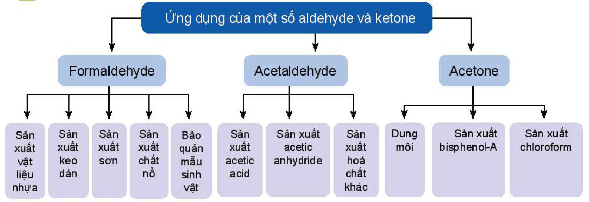

- Ứng dụng của một số aldehyde và ketone:
  - Formaldehyde: Sản xuất vật liệu nhựa; Sản xuất keo dán; Sản xuất sơn; Sản xuất chất nổ; Bảo quản mẫu sinh vật.
  - Acetaldehyde: Sản xuất acetic acid; Sản xuất acetic anhydride; Sản xuất hoá chất khác.
  - Acetone: Dung môi; Sản xuất bisphenol-A; Sản xuất chloroform.

> ✋ Hãy tìm hiểu và trình bày ứng dụng của một số aldehyde.
>
> 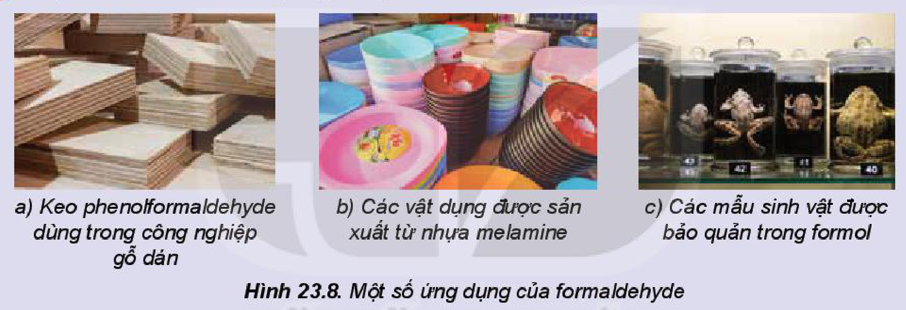
>
> Hình 23.8. Một số ứng dụng của formaldehyde: a) Keo phenolformaldehyde dùng trong công nghiệp gỗ dán; b) Các vật dụng được sản xuất từ nhựa melamine; c) Các mẫu sinh vật được bảo quản trong formol

> 💡 EM CÓ BIẾT
>
> Một lượng nhỏ acetone được tạo ra trong cơ thể con người qua quá trình chuyển hoá chất béo không hoàn toàn. Ở người khoẻ mạnh, acetone được hình thành ở gan và được chuyển hoá gần như hoàn toàn, chỉ có một lượng rất nhỏ xuất hiện trong nước tiểu. Sự hiện diện của acetone bất thường trong nước tiểu là một dấu hiệu của bệnh tiểu đường và được phát hiện qua việc xét nghiệm nước tiểu (chỉ số KET).

## VI. ĐIỀU CHẾ

Một số hợp chất carbonyl được tổng hợp trong công nghiệp bằng phương pháp oxi hoá các hydrocarbon, oxi hoá ethylene thành acetaldehyde, oxi hoá cumene thành acetone (quy trình cumene, xem *Bài 21. Phenol*).

*Ví dụ:*

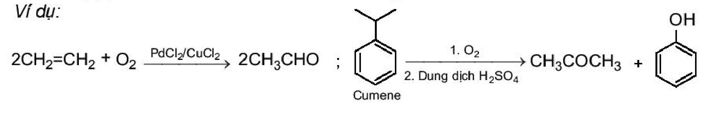

$\ce{2CH2=CH2 + O2 ->[PdCl2/CuCl2] 2CH3CHO}$ ; $\underset{\text{Cumene}}{\ce{C6H5CH(CH3)2}} \ce{->[1.\text{ }O2][2.\text{ Dung dịch }H2SO4] CH3COCH3 + C6H5OH}$

<!-- pdf:145 -->

## 📌 Em đã học

- *Aldehyde* là hợp chất hữu cơ có nhóm $\ce{-CHO}$ liên kết với nguyên tử carbon (trong gốc hydrocarbon hoặc $\ce{-CHO}$) hoặc nguyên tử hydrogen.

  *Ketone* là hợp chất hữu cơ có nhóm $>\!\ce{C=O}$ liên kết với hai gốc hydrocarbon.
- Tên gọi theo danh pháp thay thế:
  - Aldehyde đơn chức: Tên hydrocarbon (bỏ e ở cuối) + al
  - Ketone đơn chức: Tên hydrocarbon (bỏ e ở cuối) - vị trí nhóm $\ce{C=O}$ - one
- Cấu trúc nhóm carbonyl: $\sim 120^\circ$, $>\!\ce{\overset{\delta+}{C}=\overset{\delta-}{O}}$
- Các aldehyde, ketone có nhiệt độ sôi cao hơn các hydrocarbon có phân tử khối tương đương. Các aldehyde, ketone có mạch carbon ngắn tan tốt trong nước.
  - Phản ứng khử:
    - $\text{Aldehyde} + 2\ce{[H] -> \text{Alcohol bậc I}}$
    - $\text{Ketone} + 2\ce{[H] -> \text{Alcohol bậc II}}$
  - Phản ứng oxi hoá aldehyde: $\text{Aldehyde} \ce{->[\ce{[O]}] \text{Carboxylic acid}}$
  - Phản ứng cộng: $>\!\ce{\overset{\delta+}{C}=\overset{\delta-}{O} + H-CN ->} >\!\ce{C(OH)(CN)}$
  - Phản ứng tạo iodoform:

    $\ce{R-C(=O)-CH3 + 3I2 + 4NaOH -> R-C(=O)-ONa} + \underset{\substack{\text{Iodoform}\\\text{(kết tủa màu vàng)}}}{\ce{CHI3}} + \ce{3NaI + 3H2O}$

- Ứng dụng của aldehyde và ketone: formaldehyde dùng để sản xuất vật liệu nhựa, keo dán, sơn, chất nổ, bảo quản mẫu sinh vật,...; acetaldehyde dùng để sản xuất acetic acid, acetic anhydride,...; acetone dùng làm dung môi, sản xuất chloroform, bisphenol-A,...
- Điều chế aldehyde và ketone bằng cách oxi hoá hydrocarbon.

## ✏️ Em có thể

- Vận dụng các kiến thức về hợp chất carbonyl để giải thích: các ứng dụng của các aldehyde, ketone trong cuộc sống như quá trình sản xuất gương, làm dung môi,...
- Tìm hiểu về ứng dụng các hợp chất aldehyde, ketone có trong tự nhiên và vai trò của một số aldehyde, ketone quan trọng trong cơ thể người.

## 📷 Danh sách hình trong bài

| Mã hình | Trang PDF | Vị trí | Chú thích gốc |
|---|---|---|---|
| H11-hoa-b23-01 | 138 | Mục I.1 | Hình 23.1. Cinnamaldehyde là một hợp chất aldehyde có trong tinh dầu quế |
| H11-hoa-b23-02 | 138 | Mục I.1 | Hình 23.2. Menthone là một hợp chất ketone có trong tinh dầu bạc hà |
| H11-hoa-b23-03 | 138 | Mục I.1, hộp "Em có biết" | (sách không đánh số, không có chú thích) |
| H11-hoa-b23-04 | 138 | Mục I.2.a (sơ đồ danh pháp thay thế của aldehyde đơn chức và ketone đơn chức) | (sách không đánh số, không có chú thích) |
| H11-hoa-b23-05 | 139 | Mục I.2.a (ví dụ gọi tên aldehyde và ketone theo danh pháp thay thế) | (sách không đánh số, không có chú thích) |
| H11-hoa-b23-06 | 139 | Mục II | Hình 23.3. Cấu trúc nhóm carbonyl |
| H11-hoa-b23-07 | 139 | Mục II | Hình 23.4. Mô hình phân tử của một số hợp chất carbonyl |
| H11-hoa-b23-08 | 141 | Mục IV.1, hộp "Em có biết" (sơ đồ tổng hợp muscone và hươu xạ) | (sách không đánh số, không có chú thích) |
| H11-hoa-b23-09 | 142 | Mục IV.2.c, hộp "Nghiên cứu phản ứng oxi hoá aldehyde bằng copper(II) hydroxide" | Hình 23.6. Phản ứng của $\ce{CH3CHO}$ với $\ce{CuSO4}$ trong dung dịch $\ce{NaOH}$ |
| H11-hoa-b23-10 | 143 | Mục IV.4, hộp "Nghiên cứu phản ứng tạo iodoform từ acetone" | Hình 23.7. Phản ứng iodoform |
| H11-hoa-b23-11 | 144 | Mục V (sơ đồ "Ứng dụng của một số aldehyde và ketone") | (sách không đánh số, không có chú thích) |
| H11-hoa-b23-12 | 144 | Mục V, hộp hoạt động | Hình 23.8. Một số ứng dụng của formaldehyde |
| H11-hoa-b23-13 | 144 | Mục VI (ví dụ điều chế acetaldehyde và acetone từ cumene) | (sách không đánh số, không có chú thích) |
