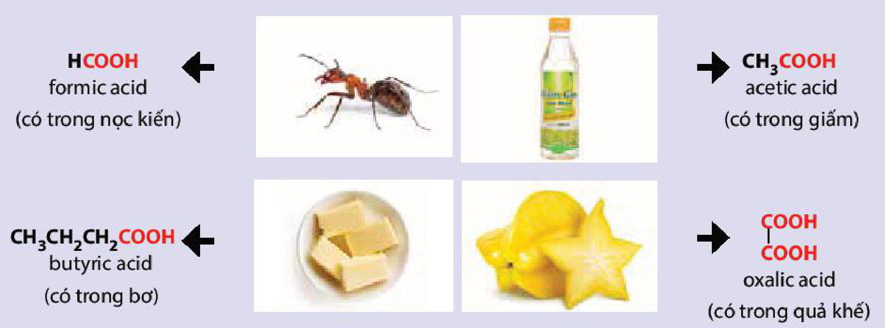
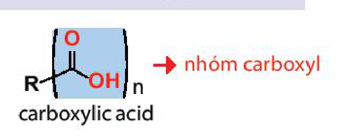
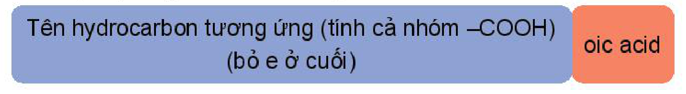
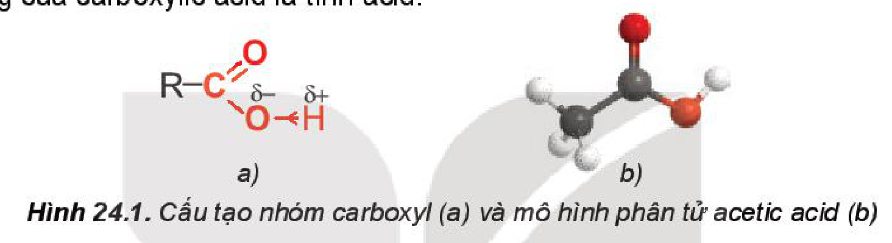
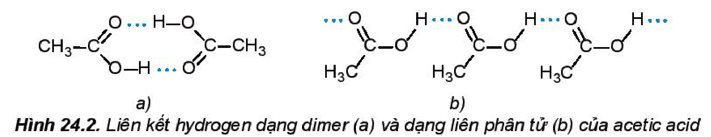
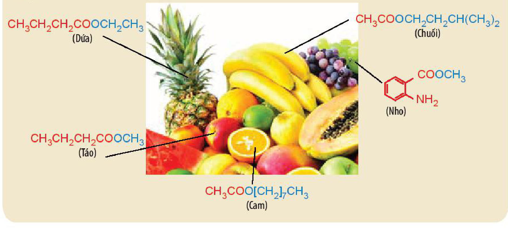
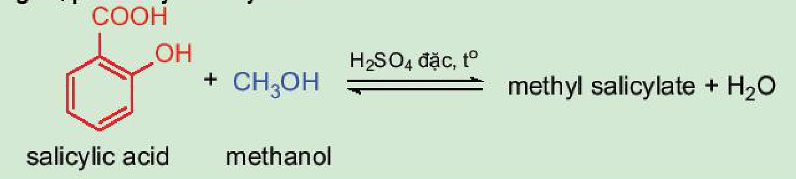
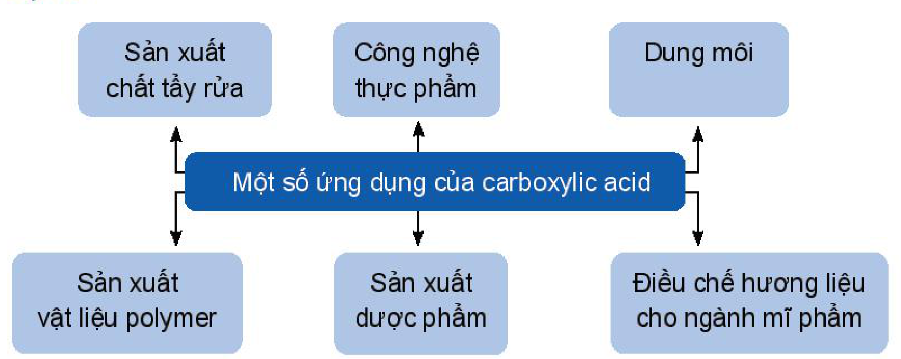

<!-- pdf:146 -->

# BÀI 24: CARBOXYLIC ACID

## 🎯 Mục tiêu

- Nêu được khái niệm về carboxylic acid.
- Viết được công thức cấu tạo và gọi tên một số acid theo danh pháp thay thế (C1–C5) và, một vài acid thường gặp theo tên thông thường.
- Trình bày được đặc điểm cấu tạo và hình dạng phân tử acetic acid.
- Nêu và giải thích được đặc điểm về tính chất vật lí (trạng thái, nhiệt độ sôi, tính tan) của carboxylic acid.
- Trình bày được tính chất hoá học cơ bản của carboxylic acid: Thể hiện tính acid (phản ứng với chất chỉ thị; phản ứng với kim loại, oxide kim loại, base, muối) và phản ứng ester hoá.
- Thực hiện được thí nghiệm về phản ứng của acetic acid (hoặc citric acid) với quỳ tím, sodium carbonate (hoặc calcium carbonate), magnesium; điều chế ethyl acetate (hoặc quan sát qua video thí nghiệm); mô tả được các hiện tượng thí nghiệm và giải thích được tính chất hoá học của carboxylic acid.
- Trình bày được ứng dụng của một số carboxylic acid thông dụng và phương pháp điều chế carboxylic acid (điều chế acetic acid bằng phương pháp lên men giấm và phản ứng oxi hoá alkane).

## 🔴 Mở đầu

Vị chua của giấm và các loại quả như khế, chanh, táo, me,... đều được tạo bởi carboxylic acid. Vậy carboxylic acid chứa nhóm chức nào và có các tính chất đặc trưng gì?

## I. KHÁI NIỆM, DANH PHÁP

### 1. Khái niệm

> ✋ Nhiều carboxylic acid tồn tại trong tự nhiên. Hãy nhận xét đặc điểm chung về cấu tạo của các carboxylic acid dưới đây:
>
> 
>
> - $\ce{HCOOH}$: formic acid (có trong nọc kiến)
> - $\ce{CH3COOH}$: acetic acid (có trong giấm)
> - $\ce{CH3CH2CH2COOH}$: butyric acid (có trong bơ)
> - $\ce{HOOC-COOH}$: oxalic acid (có trong quả khế)

***Carboxylic acid*** là các hợp chất hữu cơ trong phân tử có nhóm $\ce{-COOH}$ liên kết với nguyên tử carbon (trong gốc hydrocarbon hoặc $\ce{-COOH}$) hoặc nguyên tử hydrogen.

$\underset{\text{carboxylic acid}}{\ce{R-(C(=O)-OH)_n}} \longrightarrow \text{nhóm carboxyl}$

<!-- pdf:147 -->

Công thức của các **carboxylic acid đơn chức** thường được viết ở dạng thu gọn là $\ce{RCOOH}$.

*Ví dụ:* $\ce{CH3COOH}$, $\ce{CH2=CHCOOH}$, $\ce{C6H5COOH}$.

### 2. Danh pháp

**a) Danh pháp thay thế**

Tên theo danh pháp thay thế của carboxylic acid đơn chức:

Tên hydrocarbon tương ứng (tính cả nhóm $\ce{-COOH}$) (bỏ e ở cuối) + oic acid
<!-- ocr-ok: OCR bỏ sót chữ trong hai ô màu của sơ đồ danh pháp; đã đối chiếu ảnh -->

*Ví dụ:*

- $\ce{HCOOH}$: methanoic acid
- $\ce{CH3CH2CH2COOH}$: butanoic acid
- $\ce{CH2=CHCOOH}$: propenoic acid

*Chú ý:*

- Mạch chính là mạch carbon dài nhất chứa nhóm $\ce{-COOH}$ và được đánh số bắt đầu từ nhóm $\ce{-COOH}$.
- Nếu mạch carbon có nhánh thì cần thêm vị trí và tên nhánh ở phía trước.

*Ví dụ:*

- $\ce{\overset{3}{C}H3-\overset{2}{C}H(CH3)-\overset{1}{C}OOH}$: 2-methylpropanoic acid
- $\ce{\overset{4}{C}H3-\overset{3}{C}H(CH3)-\overset{2}{C}H2-\overset{1}{C}OOH}$: 3-methylbutanoic acid
- $\ce{\overset{4}{C}H3-\overset{3}{C}(CH3)=\overset{2}{C}H-\overset{1}{C}OOH}$: 3-methylbut-2-enoic acid

**b) Tên thông thường**

Tên thông thường của carboxylic acid thường xuất phát từ nguồn gốc tìm ra chúng trong tự nhiên.

*Bảng 24.1. Tên theo danh pháp thay thế, tên thông thường của một số carboxylic acid và nguồn gốc của tên gọi*

| Công thức cấu tạo | Tên theo danh pháp thay thế | Tên thông thường | Nguồn gốc |
|---|---|---|---|
| $\ce{HCOOH}$ | methanoic acid | formic acid | formica (La-tinh): con kiến |
| $\ce{CH3COOH}$ | ethanoic acid | acetic acid | acetum (La-tinh): giấm ăn |
| $\ce{CH3CH2COOH}$ | propanoic acid | propionic acid | propion (Hy Lạp): chất béo đầu tiên |
| $\ce{CH3[CH2]14COOH}$ | hexadecanoic acid | palmitic acid | palma (La-tinh): cây cọ |
| $\ce{CH3[CH2]16COOH}$ | octadecanoic acid | stearic acid | stear (Hy Lạp): chất béo dạng rắn |
| $\ce{C6H5COOH}$ | phenylmethanoic acid | benzoic acid | benzoin: tên một loại nhựa cây |
| $\ce{HOOC-COOH}$ | ethanedioic acid | oxalic acid | oxalis: tên một chi của thực vật |

<!-- pdf:148 -->

> ❓ 1. Viết các công thức cấu tạo và gọi tên theo danh pháp thay thế của các acid có công thức $\ce{C4H9COOH}$.
>
> 2. Viết công thức cấu tạo của các carboxylic acid có tên gọi dưới đây:
>
> a) pentanoic acid; b) but-3-enoic acid;
>
> c) 2-methylbutanoic acid; d) 2,2-dimethylpropanoic acid.

## II. ĐẶC ĐIỂM CẤU TẠO
<!-- ocr-ok: OCR đọc sai tiêu đề mục II thành "“(?vDẶC DIỂM CẤU TẠO"; đã đối chiếu ảnh -->

**Nhóm carboxyl** gồm có nhóm hydroxy ($\ce{-O-H}$) liên kết với nhóm carbonyl ($>\!\ce{C=O}$). Nhóm $>\!\ce{C=O}$ là nhóm hút electron nên liên kết $\ce{O-H}$ trong carboxylic acid phân cực hơn so với alcohol, phenol. Nhóm $\ce{-COOH}$ có thể phân li ra $\ce{H+}$ nên tính chất hoá học đặc trưng của carboxylic acid là tính acid.

Hình 24.1. Cấu tạo nhóm carboxyl (a: $\ce{R-C(=O)-\overset{\delta-}{O}<-\overset{\delta+}{H}}$) và mô hình phân tử acetic acid (b)

## III. TÍNH CHẤT VẬT LÍ

> ✋ Tại sao trong các hợp chất hữu cơ có phân tử khối xấp xỉ nhau dưới đây, carboxylic acid có nhiệt độ sôi cao nhất?
>
> | Loại hợp chất | alkane | aldehyde | alcohol | carboxylic acid |
> |---|---|---|---|---|
> | Công thức cấu tạo | $\ce{CH3CH2CH2CH3}$ | $\ce{CH3CH2CHO}$ | $\ce{CH3CH2CH2OH}$ | $\ce{CH3COOH}$ |
> | $M$ | $58$ | $58$ | $60$ | $60$ |
> | $t_{\text{s}}\text{ }(^\circ\text{C})^{(1)}$ | $-0,5$ | $49$ | $97,2$ | $118$ |

Phân tử carboxylic acid chứa nhóm carboxyl phân cực. Các phân tử carboxylic acid liên kết hydrogen với nhau tạo thành dạng dimer hoặc dạng liên phân tử.

Hình 24.2. Liên kết hydrogen dạng dimer (a) và dạng liên phân tử (b) của acetic acid

> (1) Nguồn: *Organic chemistry: A Short Course*, Harold Hart, Christopher M. Hadad, Leslie E. Craine, Cengage Learning, 2011.

<!-- pdf:149 -->

Do vậy, carboxylic acid có nhiệt độ sôi cao hơn so với hydrocarbon, alcohol, hợp chất carbonyl có phân tử khối tương đương.

Carboxylic acid mạch ngắn là chất lỏng ở nhiệt độ phòng, carboxylic acid mạch dài là chất rắn dạng sáp. Carboxylic acid thường có mùi chua nồng.

Carboxylic acid mạch ngắn tan tốt trong nước. Khi tăng số nguyên tử carbon trong gốc hydrocarbon thì độ tan của các carboxylic acid giảm.

*Bảng 24.2. Nhiệt độ sôi và tính tan của một số carboxylic acid$^{(1)}$*

| Công thức | Tên gọi | Nhiệt độ nóng chảy ($^\circ\text{C}$) | Nhiệt độ sôi ($^\circ\text{C}$) | Độ tan trong nước ở $25\text{ }^\circ\text{C}$ ($\text{g/100 g}$) |
|---|---|---|---|---|
| $\ce{HCOOH}$ | methanoic acid | $8$ | $101$ | tan vô hạn |
| $\ce{CH3COOH}$ | ethanoic acid | $17$ | $118$ | tan vô hạn |
| $\ce{CH3CH2COOH}$ | propanoic acid | $-22$ | $141$ | tan vô hạn |
| $\ce{CH3[CH2]2COOH}$ | butanoic acid | $-8$ | $164$ | tan vô hạn |
| $\ce{CH3[CH2]3COOH}$ | pentanoic acid | $-34$ | $186$ | $4,97$ |
| $\ce{CH3[CH2]4COOH}$ | hexanoic acid | $-1,5$ | $205$ | $1,0$ |
| $\ce{CH3[CH2]8COOH}$ | decanoic acid | $31$ | $270$ | $0,01$ |
<!-- ocr-ok: OCR đọc sai một số giá trị và chỉ số công thức trong Bảng 24.2 ("8" thành "ö", "118" thành "115", "-8" thành "m2)"); đã đối chiếu ảnh -->

## IV. TÍNH CHẤT HOÁ HỌC

### 1. Tính acid

> ✋ Trong dung dịch nước, carboxylic acid phân li không hoàn toàn theo cân bằng:
>
> $\underset{\text{carboxylic acid}}{\ce{R-C(=O)-OH}} \ce{<=>} \underset{\text{ion carboxylate}}{\ce{R-C(=O)-O-}} + \ce{H+}$
>
> Hằng số cân bằng của phương trình phân li một số carboxylic acid được cho trong Bảng 24.3.
>
> *Bảng 24.3. Hằng số cân bằng của phương trình phân li một số carboxylic acid$^{(1)}$*
>
> | Carboxylic acid | Hằng số cân bằng của phương trình phân li carboxylic acid | Phần trăm phân li (dung dịch $0,1\text{ M}$) (%) |
> |---|---|---|
> | $\ce{HCOOH}$ | $1,8 \cdot 10^{-4}$ | $4,2$ |
> | $\ce{CH3COOH}$ | $1,8 \cdot 10^{-5}$ | $1,3$ |
> | $\ce{CH3CH2COOH}$ | $1,3 \cdot 10^{-5}$ | $1,2$ |
> | $\ce{CH3CH2CH2COOH}$ | $1,5 \cdot 10^{-5}$ | $1,2$ |
>
> Hãy nhận xét về khả năng phân li của carboxylic acid. Chúng là các acid mạnh hay yếu và có các phản ứng đặc trưng nào?

> (1) Nguồn: *Organic chemistry: A Short Course*, Harold Hart, Christopher M. Hadad, Leslie E. Craine, Cengage Learning, 2011.

<!-- pdf:150 -->

> 🔬 Thí nghiệm: Tính acid của acetic acid
>
> *Chuẩn bị:* dung dịch acetic acid 10%, dung dịch $\ce{Na2CO3}$ 10%, bột $\ce{Mg}$; ống nghiệm, giấy quỳ.
>
> *Tiến hành:*
>
> 1. Phản ứng với chất chỉ thị:
>
>    Nhỏ một giọt dung dịch acetic acid 10% lên mẩu giấy quỳ.
>
>    *Quan sát và mô tả sự thay đổi màu sắc của giấy quỳ.*
>
> 2. Phản ứng với kim loại:
>    - Cho 1 – 2 mL dung dịch acetic acid 10% vào ống nghiệm (1).
>    - Thêm tiếp một ít bột $\ce{Mg}$ vào ống nghiệm (1).
>
>    *Quan sát và mô tả hiện tượng xảy ra trong ống nghiệm (1).*
>
> 3. Phản ứng với muối:
>    - Cho 1 – 2 mL dung dịch $\ce{Na2CO3}$ 10% vào ống nghiệm (2).
>    - Thêm tiếp 1 – 2 mL dung dịch acetic acid 10% vào ống nghiệm (2).
>
> *Thực hiện yêu cầu sau:*
>
> *Quan sát và mô tả hiện tượng xảy ra trong ống nghiệm (2).*
>
> Viết phương trình hoá học của các phản ứng xảy ra trong các thí nghiệm trên và giải thích hiện tượng.

<!-- term: Tính acid của carboxylic acid -->
Trong dung dịch nước, chỉ một phần nhỏ carboxylic acid phân li thành ion, vì vậy carboxylic acid là những acid yếu. Chúng thể hiện đầy đủ tính chất của acid.

*Ví dụ:*

$\ce{2CH3COOH + Zn -> (CH3COO)2Zn + H2}$

$\ce{2CH3COOH + CaCO3 -> (CH3COO)2Ca + H2O + CO2}$

$\ce{2CH3COOH + Ca(OH)2 -> (CH3COO)2Ca + 2H2O}$

$\ce{2CH3COOH + CuO -> (CH3COO)2Cu + H2O}$

> ❓ 4. Viết phương trình hoá học phản ứng giữa acetic acid với các chất sau:
>
> a) $\ce{Ca}$; b) $\ce{Cu(OH)2}$; c) $\ce{CaO}$; d) $\ce{K2CO3}$.
>
> 5. a) Khi có cặn màu trắng (thành phần chính là $\ce{CaCO3}$) bám ở đáy ấm đun nước, vòi nước, thiết bị vệ sinh,... có thể dùng giấm để loại bỏ các vết cặn này. Hãy giải thích.
>
> b) Các đồ vật bằng đồng sau một thời gian để trong không khí thường bị xỉn màu, dùng khăn tẩm một ít giấm rồi lau các đồ vật này, chúng sáng bóng trở lại. Hãy giải thích.

> (1) Nguồn: *General, Organic and Biological Chemistry, Sixth Edition*, H. Stephen Stoker, Cengage Learning, 2013.

<!-- pdf:151 -->

### 2. Phản ứng ester hoá

Carboxylic acid phản ứng với alcohol tạo thành ester và nước theo phản ứng:

$\underset{\text{carboxylic acid}}{\ce{R-C(=O)-O-H}} + \underset{\text{alcohol}}{\ce{R'-O-H}} \ce{<=>[H2SO4 \text{đặc}, t^o]} \underset{\text{ester}}{\ce{R-C(=O)-O-R'}} + \ce{H2O}$

Phản ứng giữa carboxylic acid và alcohol được gọi là ***phản ứng ester hoá***. Phản ứng có đặc điểm thuận nghịch và thường dùng sulfuric acid đặc làm xúc tác.

*Ví dụ:* $\underset{\text{acetic acid}}{\ce{CH3COOH}} + \underset{\text{methanol}}{\ce{CH3OH}} \ce{<=>[H2SO4 \text{đặc}, t^o]} \underset{\text{methyl acetate}}{\ce{CH3COOCH3}} + \ce{H2O}$

> ✋ Nghiên cứu phản ứng ester hoá – điều chế ethyl acetate
>
> Điều chế ethyl acetate trong phòng thí nghiệm được tiến hành như sau:
>
> - Cho khoảng 2 mL ethanol và 2 mL acetic acid tuyệt đối vào ống nghiệm, lắc đều hỗn hợp.
> - Thêm khoảng 1 mL dung dịch $\ce{H2SO4}$ đặc, lắc nhẹ để các chất trộn đều với nhau.
> - Kẹp ống nghiệm vào kẹp gỗ rồi đặt ống nghiệm vào cốc nước nóng (khoảng $60\text{ }^\circ\text{C} - 70\text{ }^\circ\text{C}$) trong khoảng 5 phút, thỉnh thoảng lắc đều hỗn hợp. Sau đó lấy ống nghiệm ra khỏi cốc nước nóng, để nguội hỗn hợp rồi rót sang ống nghiệm khác chứa 5 mL dung dịch muối ăn bão hoà.
>
> *Thực hiện yêu cầu:*
>
> 1. Mô tả hiện tượng, viết phương trình hoá học của phản ứng ester hoá xảy ra trong thí nghiệm trên.
> 2. Vai trò của sulfuric acid trong thí nghiệm trên là gì?

> 💡 EM CÓ BIẾT
>
> Nhiều hợp chất ester tạo nên mùi hương đặc trưng của các loại hoa quả.
>
> *Ví dụ:*
>
> 
>
> - $\ce{CH3CH2CH2COOCH2CH3}$ (Dứa)
> - $\ce{CH3CH2CH2COOCH3}$ (Táo)
> - $\ce{CH3COO[CH2]7CH3}$ (Cam)
> - $\ce{CH3COOCH2CH2CH(CH3)2}$ (Chuối)
> - $\ce{o-NH2-C6H4-COOCH3}$ (Nho)

<!-- pdf:152 -->

> ❓ 6. Methyl butyrate là ester tạo mùi đặc trưng của quả táo, em hãy viết phương trình hoá học của phản ứng điều chế methyl butyrate từ carboxylic acid và alcohol tương ứng.
>
> 7. Methyl salicylate là hợp chất thuộc loại ester được dùng làm cao dán giảm đau, kháng viêm ngoài da. Methyl salicylate được tổng hợp từ phản ứng ester hoá giữa salicylic acid và methanol. Hãy hoàn thành phương trình hoá học của phản ứng tổng hợp methyl salicylate:
>
> 
>
> $\underset{\text{salicylic acid}}{\ce{o-HO-C6H4-COOH}} + \underset{\text{methanol}}{\ce{CH3OH}} \ce{<=>[H2SO4 \text{đặc}, t^o] \text{methyl salicylate} + H2O}$

## V. ĐIỀU CHẾ

### 1. Phương pháp lên men giấm

<!-- term: Phương pháp lên men giấm -->
Phương pháp lên men được sử dụng từ thời xa xưa để làm giấm. Nguyên liệu thường là các loại rượu như rượu gạo, rượu táo, rượu vang,... Quá trình lên men nhờ vi khuẩn *acetobacter* (men giấm) chuyển hoá ethanol thành acetic acid bởi oxygen không khí.

$\ce{C2H5OH + O2 ->[\text{men giấm}] CH3COOH + H2O}$

Trong công nghiệp, người ta cung cấp thêm oxygen để tăng tốc độ phản ứng lên men.

### 2. Phương pháp oxi hoá alkane

<!-- term: Phương pháp oxi hoá alkane -->
Các alkane bị oxi hoá cắt mạch tạo thành các acid:

$\ce{R-CH2-CH2-R' ->[\ce{[O]}] RCOOH + R'COOH}$

*Ví dụ:* $\ce{2CH3CH2CH2CH3 + 5O2 ->[\text{xúc tác, }t^o\text{, áp suất}] 4CH3COOH + 2H2O}$

## VI. ỨNG DỤNG

- Một số ứng dụng của carboxylic acid: Sản xuất chất tẩy rửa; Công nghệ thực phẩm; Dung môi; Sản xuất vật liệu polymer; Sản xuất dược phẩm; Điều chế hương liệu cho ngành mĩ phẩm.

> ✋ Em hãy tìm hiểu và trình bày ứng dụng của một carboxylic acid.

<!-- pdf:153 -->

## 📌 Em đã học

- Carboxylic acid là các hợp chất hữu cơ trong phân tử có nhóm $\ce{-COOH}$ liên kết với nguyên tử carbon (trong gốc hydrocarbon hoặc $\ce{-COOH}$) hoặc nguyên tử hydrogen.

  Có thể biểu diễn công thức của carboxylic acid đơn chức dưới dạng $\ce{RCOOH}$.
- Danh pháp thay thế của carboxylic acid đơn chức:

  Tên hydrocarbon mạch chính (tính cả nhóm $\ce{-COOH}$) (bỏ e ở cuối) + oic acid
- Nhóm $\ce{-COOH}$ có liên kết $\ce{O-H}$ phân cực: $\ce{R-C(=O)-\overset{\delta-}{O}<-\overset{\delta+}{H}}$

  Nhóm $\ce{-COOH}$ có thể phân li thành $\ce{H+}$ nên tính chất hoá học đặc trưng của carboxylic acid là tính acid.
- Carboxylic acid mạch ngắn là chất lỏng, tan tốt trong nước. Carboxylic acid mạch dài là chất rắn và ít tan trong nước.
- Phản ứng ester hoá:

  $\underset{\text{carboxylic acid}}{\ce{R-C(=O)-O-H}} + \underset{\text{alcohol}}{\ce{R'-O-H}} \ce{<=>[H2SO4 \text{đặc}, t^o]} \underset{\text{ester}}{\ce{R-C(=O)-O-R'}} + \ce{H2O}$

- Điều chế:
  1. Phương pháp lên men giấm:

     $\ce{C2H5OH + O2 ->[\text{men giấm}] CH3COOH + H2O}$

  2. Phương pháp oxi hoá alkane:

     $\ce{R-CH2-CH2-R' ->[\ce{[O]}] RCOOH + R'COOH}$

- Ứng dụng: vật liệu sản xuất polymer, dược phẩm, dung môi, hương liệu, phụ gia thực phẩm, chất tẩy rửa,...

## ✏️ Em có thể

- Biết cách làm giấm bằng phương pháp lên men để sử dụng trong gia đình.
- Vận dụng các tính chất của carboxylic acid để giải thích các ứng dụng của chúng trong đời sống: tẩy cặn ở đáy ấm, loại bỏ các lớp gỉ bám trên bề mặt kim loại,...

## 📷 Danh sách hình trong bài

| Mã hình | Trang PDF | Vị trí | Chú thích gốc |
|---|---|---|---|
| H11-hoa-b24-01 | 146 | Mục I.1, hộp hoạt động | (sách không đánh số, không có chú thích) |
| H11-hoa-b24-02 | 146 | Mục I.1 (sơ đồ nhóm carboxyl trong carboxylic acid) | (sách không đánh số, không có chú thích) |
| H11-hoa-b24-03 | 147 | Mục I.2.a (sơ đồ danh pháp thay thế của carboxylic acid đơn chức) | (sách không đánh số, không có chú thích) |
| H11-hoa-b24-04 | 148 | Mục II | Hình 24.1. Cấu tạo nhóm carboxyl (a) và mô hình phân tử acetic acid (b) |
| H11-hoa-b24-05 | 148 | Mục III | Hình 24.2. Liên kết hydrogen dạng dimer (a) và dạng liên phân tử (b) của acetic acid |
| H11-hoa-b24-06 | 151 | Mục IV.2, hộp "Em có biết" | (sách không đánh số, không có chú thích) |
| H11-hoa-b24-07 | 152 | Mục IV.2, hộp câu hỏi 7 | (sách không đánh số, không có chú thích) |
| H11-hoa-b24-08 | 152 | Mục VI (sơ đồ "Một số ứng dụng của carboxylic acid") | (sách không đánh số, không có chú thích) |
