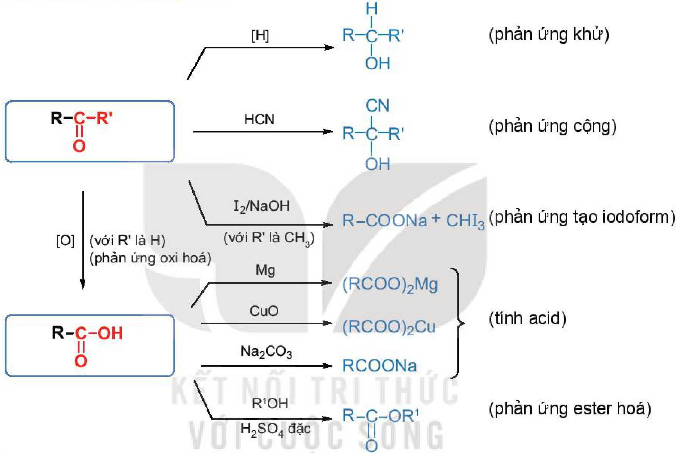
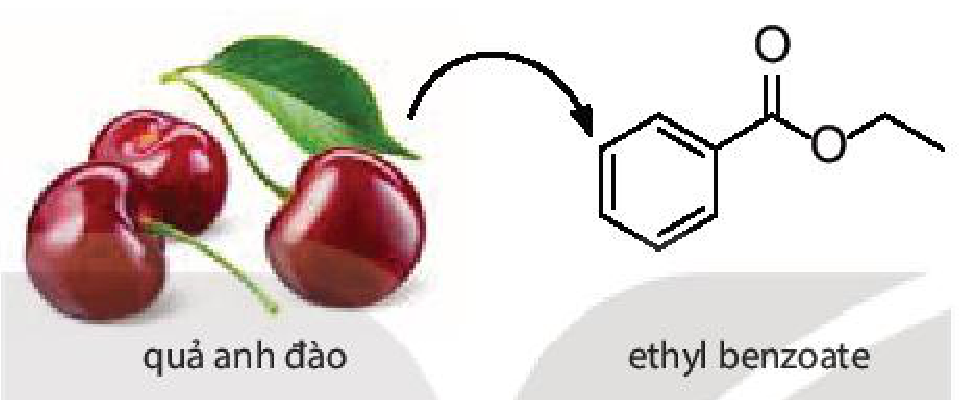

<!-- pdf:154 -->

# BÀI 25: ÔN TẬP CHƯƠNG 6

## I. HỆ THỐNG HOÁ KIẾN THỨC
<!-- ocr-ok: OCR đọc sai tiêu đề mục I thành "{3 HỆ THỐNG HOÁ HIẾN THỨC"; đã đối chiếu ảnh -->

- $\ce{R-C(=O)-R'}$:
  - $\ce{->[\ce{[H]}] R-CH(OH)-R'}$ (phản ứng khử)
  - $\ce{->[HCN] R-C(OH)(CN)-R'}$ (phản ứng cộng)
  - $\ce{->[I2/NaOH][\text{(với }R'\text{ là }CH3\text{)}] R-COONa + CHI3}$ (phản ứng tạo iodoform)
  - $\ce{->[\ce{[O]}\text{ (với }R'\text{ là H)}][\text{(phản ứng oxi hoá)}] R-C(=O)-OH}$
- $\ce{R-C(=O)-OH}$:
  - Tính acid:
    - $\ce{->[Mg] (RCOO)2Mg}$
    - $\ce{->[CuO] (RCOO)2Cu}$
    - $\ce{->[Na2CO3] RCOONa}$
  - $\ce{->[R^1OH][H2SO4 \text{đặc}] R-C(=O)-OR^1}$ (phản ứng ester hoá)

## II. LUYỆN TẬP

Câu 1. Cho bốn hợp chất sau: ethanol, propanal, acetone, acetic acid.

a) Chất nào trong các chất trên có nhiệt độ sôi cao nhất?

b) Trình bày cách phân biệt các chất trên bằng phương pháp hoá học.

Câu 2. Viết công thức cấu tạo và gọi tên theo danh pháp thay thế của các aldehyde, ketone có công thức phân tử $\ce{C4H8O}$ và carboxylic acid có công thức phân tử $\ce{C4H8O2}$.

Câu 3. Viết công thức cấu tạo của các hợp chất có tên gọi dưới đây:

a) 3-methylbutanal; b) pentan-2-one;

c) pentanoic acid; d) 2-methylbutanoic acid.

Câu 4. Hãy viết các phương trình hoá học để chứng minh các aldehyde vừa có tính oxi hoá, vừa có tính khử.

<!-- pdf:155 -->

Câu 5. Xác định sản phẩm của các phản ứng sau:

a) $\text{propanal} + 2\ce{[H] ->}$

b) $\text{ethanal} + \ce{AgNO3 + NH3 + H2O ->}$

c) $\text{butanone} + \ce{HCN ->}$

d) $\text{propanone} + \ce{I2 ->[NaOH]}$

Câu 6. Viết phương trình phản ứng giữa propanoic acid với các chất sau:

a) $\ce{Zn}$; b) $\ce{MgO}$;

c) $\ce{CaCO3}$; d) $\ce{CH3OH/H2SO4}$ đặc.

Câu 7. Ethyl benzoate là hợp chất chính tạo mùi thơm của quả anh đào (cherry). Hãy viết phương trình hoá học của phản ứng tổng hợp ethyl benzoate từ carboxylic acid và alcohol tương ứng.

- quả anh đào $\longrightarrow \ce{C6H5COOCH2CH3}$ (ethyl benzoate)

Câu 8. Cho $12\text{ g}$ acetic acid phản ứng với $12\text{ g}$ ethanol (có $\ce{H2SO4}$ đặc làm xúc tác) thu được $8\text{ g}$ ester. Tính hiệu suất phản ứng ester hoá.

Câu 9. Trong thành phần của bột vệ sinh lồng máy giặt thường có mặt citric acid (acid chanh). Hãy giải thích vai trò của citric acid trong trường hợp này.

## 📷 Danh sách hình trong bài

| Mã hình | Trang PDF | Vị trí | Chú thích gốc |
|---|---|---|---|
| H11-hoa-b25-01 | 154 | Mục I (sơ đồ hệ thống hoá kiến thức chương 6) | (sách không đánh số, không có chú thích) |
| H11-hoa-b25-02 | 155 | Mục II, Câu 7 (quả anh đào và công thức cấu tạo ethyl benzoate) | (sách không đánh số, không có chú thích) |
