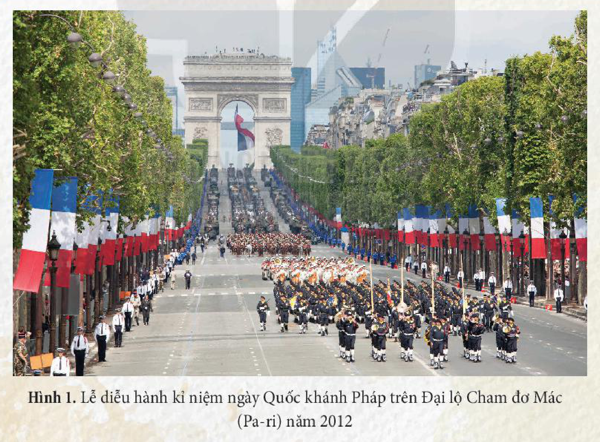
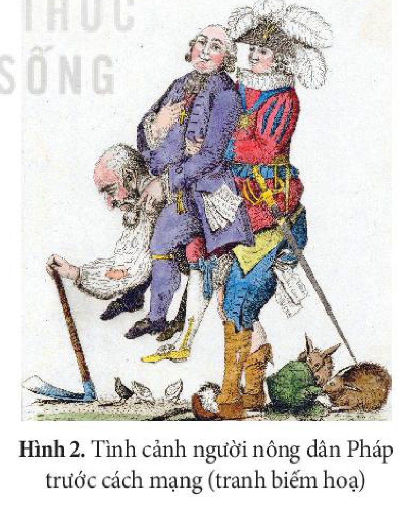
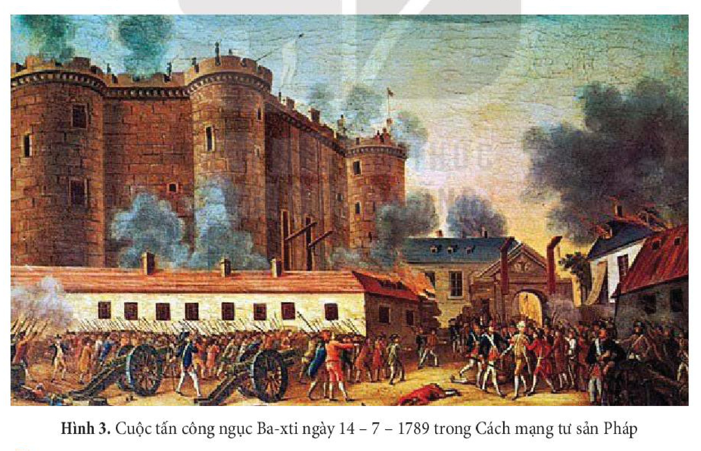

<!-- pdf:7 -->
# BÀI 1: MỘT SỐ VẤN ĐỀ CHUNG VỀ CÁCH MẠNG TƯ SẢN

## 🎯 Học xong bài này, em sẽ:
- Trình bày được tiền đề của các cuộc cách mạng tư sản về kinh tế, chính trị, xã hội, tư tưởng.
- Phân tích được mục tiêu, nhiệm vụ, giai cấp lãnh đạo, động lực của các cuộc cách mạng tư sản.
- Trình bày được kết quả, ý nghĩa của các cuộc cách mạng tư sản.

## 🔴 Mở đầu

Ngày 14 – 7 – 1789 – Ngày phá ngục Ba-xti, mở đầu Cách mạng tư sản Pháp, sau này được chọn là ngày Quốc khánh của nước Pháp. Vì sao sự kiện này lại được tôn vinh như vậy? Hãy kể tên một số cuộc cách mạng tư sản trong lịch sử nhân loại mà em đã được học. Các cuộc cách mạng tư sản đó có điểm gì chung nổi bật?

<!-- pdf:8 -->
## 1. Tiền đề của các cuộc cách mạng tư sản

### a) Kinh tế

Các cuộc cách mạng tư sản thời cận đại nổ ra dựa trên những tiền đề về kinh tế, chính trị, xã hội và tư tưởng. Về kinh tế, sự phát triển của kinh tế tư bản chủ nghĩa thể hiện qua nhiều biểu hiện khác nhau ở mỗi nước:
<!-- ocr-ok: đã đối chiếu ảnh trang 8 -->

Ở Anh, từ đầu thế kỉ XVII, nền kinh tế đã phát triển nhất châu Âu, đặc biệt là ngành len, dạ. Lực lượng sản xuất tư bản chủ nghĩa phát triển mạnh trong các lĩnh vực nông nghiệp, công nghiệp, dẫn đến việc sử dụng phổ biến lao động làm thuê và sự xuất hiện ngày càng nhiều công trường thủ công. Tuy nhiên, sự phát triển của kinh tế tư bản chủ nghĩa ở Anh vấp phải sự kìm hãm nặng nề của chế độ phong kiến chuyên chế (chế độ phường hội, độc quyền thương mại của Nhà nước phong kiến,...).
<!-- ocr-ok: đã đối chiếu ảnh trang 8 -->

Tại 13 thuộc địa Anh ở Bắc Mỹ, đến giữa thế kỉ XVIII, nền kinh tế công, thương nghiệp tư bản chủ nghĩa phát triển ngày càng mạnh mẽ, theo hướng tự chủ. Tuy nhiên, sự phát triển kinh tế ở đây lại bị kìm hãm bởi chính sách bóc lột của Chính phủ Anh (ban hành các đạo luật về ruộng đất, thuế khoá và các quy định nghiêm ngặt trong quan hệ thương mại giữa chính quốc và thuộc địa,...).
<!-- ocr-ok: đã đối chiếu ảnh trang 8 -->

Ở Pháp, đến cuối thế kỉ XVIII, công, thương nghiệp phát triển mạnh (đặc biệt là ở các vùng ven biển). Các công ti thương mại của Pháp đẩy mạnh buôn bán với nhiều nước châu Âu và châu Á. Tuy nhiên, sự phát triển này gặp phải nhiều rào cản của nhà nước phong kiến chuyên chế và chính sách thuế quan nặng nề giữa các vùng lãnh thổ. Ngoài ra, sự tồn tại của chế độ đẳng cấp trong xã hội cùng sự lạc hậu trong sản xuất nông nghiệp do chế độ phong kiến đưa lại đã kìm hãm sự phát triển kinh tế Pháp.
<!-- ocr-ok: đã đối chiếu ảnh trang 8 -->

> TƯ LIỆU 1. Cho đến trước năm 1789, kinh tế công, thương nghiệp của Pháp phát triển nhất châu lục nhưng vẫn bị kìm hãm bởi những quy định ngặt nghèo của chế độ phường hội. Thuế má nặng nề, đơn vị đo lường và tiền tệ khác nhau ở mỗi địa phương dẫn đến sự lộn xộn trên thị trường, sức mua của dân chúng giảm sút, cản trở sự lưu thông hàng hoá và phát triển kinh tế đất nước.
>
> (Theo A. Man-phờ-rét, *Đại Cách mạng Pháp 1789*, NXB Khoa học, 1965, tr. 20 – 25)
<!-- ocr-ok: đã đối chiếu ảnh trang 8 -->

> ❓ Trình bày tiền đề về kinh tế của các cuộc cách mạng tư sản.

### b) Chính trị

Trước khi các cuộc cách mạng tư sản bùng nổ, chế độ phong kiến chuyên chế hoặc chế độ thực dân đang thống trị ở nhiều nước châu Âu và Bắc Mỹ đã bộc lộ nhiều khủng hoảng.
<!-- ocr-ok: đã đối chiếu ảnh trang 8 -->

Ở Anh, bước sang thế kỉ XVII, chế độ phong kiến suy yếu, tình hình chính trị rối ren, mâu thuẫn giữa Quốc hội với các thế lực phong kiến ngày càng gay gắt, đặc biệt xoay quanh vấn đề tài chính.
<!-- ocr-ok: đã đối chiếu ảnh trang 8 -->

Ở Pháp, sự chuyên chế của vua Lu-i XVI và sự suy yếu của vương triều đã làm cho tình hình chính trị rối ren và khủng hoảng trầm trọng vào cuối thế kỉ XVIII.
<!-- ocr-ok: đã đối chiếu ảnh trang 8 -->

<!-- pdf:9 -->
Tại 13 thuộc địa Anh ở Bắc Mỹ, chính sách cai trị của thực dân Anh đã tác động tiêu cực đến các tầng lớp trong xã hội. Người dân phải tuân theo các đạo luật khắt khe do Chính phủ Anh đề ra.

> TƯ LIỆU 2. “Ở Pháp, vương quyền là đỉnh cao của lâu đài phong kiến và chuyên chế. Nhà vua luôn có quyền hành chuyên chế và vô hạn;... quyết định mọi công việc đối nội và đối ngoại của quốc gia. Suốt triều vua Lu-i XVI là một sự chuyên quyền cao độ. Theo những “mật lệnh có ấn vua” nhằm khủng bố nhân dân, hàng trăm người bị bắt, tù đày ở các nơi trong nước”.
>
> (A. Man-phờ-rét, *Đại Cách mạng Pháp 1789*, NXB Khoa học, 1965, tr. 18 – 19)

> ❓ Khai thác Tư liệu 2 và thông tin trong mục, trình bày tiền đề về chính trị của các cuộc cách mạng tư sản.

### c) Xã hội

Những biến đổi về kinh tế làm cho mâu thuẫn xã hội ngày càng gay gắt. Giai cấp tư sản và đồng minh (quý tộc mới ở Anh, chủ nô ở Bắc Mỹ,...) tuy giàu có về kinh tế nhưng không có quyền lực chính trị tương xứng. Họ tìm cách tập hợp quần chúng nhân dân để làm cách mạng.

Ở Anh, nông dân là giai cấp đông đảo nhất trong xã hội. Họ không chỉ chịu ách áp bức nặng nề của Nhà nước, quý tộc phong kiến và giáo hội Anh giáo mà còn liên tục bị tước đoạt ruộng đất. Nông dân mất đất phải ra thành thị, làm thuê trong các công xưởng hay di cư sang Bắc Mỹ. Ngoài nông dân, cuộc sống của các giai cấp, tầng lớp khác như công nhân, thợ thủ công cũng rất khổ cực.

Ở 13 thuộc địa Anh ở Bắc Mỹ, chính sách khai thác thuộc địa của thực dân Anh đã gây ra mâu thuẫn ngày càng gay gắt giữa các tầng lớp nhân dân thuộc địa (tư sản, chủ nô, trại chủ, nông dân,...) với chế độ thực dân.

Ở Pháp, nông dân là giai cấp chiếm đa số. Ngoài việc phải nộp nhiều loại tô thuế cho lãnh chúa, họ còn phải chịu nhiều nghĩa vụ khác đối với Nhà nước và nhà thờ. Công nhân tập trung ở các thành thị lớn, điều kiện lao động và đời sống rất khó khăn (ngày làm việc kéo dài, lương thấp,...). Những người bình dân thành thị khác như thợ thủ công, người buôn bán nhỏ,... sống tạm bợ, chen chúc nhau trong những vùng ngoại ô. Mâu thuẫn giữa tăng lữ và quý tộc phong kiến với tư sản và các tầng lớp nhân dân ngày càng sâu sắc.

> ❓ Trình bày tiền đề về xã hội của các cuộc cách mạng tư sản.

<!-- pdf:10 -->
### d) Tư tưởng

Để tập hợp quần chúng nhân dân, giai cấp tư sản cần có hệ tư tưởng để chống lại hệ tư tưởng phong kiến bảo thủ. Với các cuộc cách mạng nổ ra sớm (ở Nê-đéc-lan, Anh), giai cấp tư sản, quý tộc mới đã mượn ngọn cờ tôn giáo cải cách để tập hợp quần chúng (Chủ nghĩa Can-vanh ở Nê-đéc-lan, Thanh giáo ở Anh).

<!-- term: Triết học Ánh sáng -->
Tại Pháp, trào lưu tư tưởng Triết học Ánh sáng đã phê phán những bất cập, lỗi thời, mục nát của chế độ phong kiến chuyên chế, giáo hội Thiên Chúa đương thời, đồng thời đề xuất những tư tưởng mới tiến bộ nhằm thúc đẩy xã hội phát triển.
<!-- ocr-ok: đã đối chiếu ảnh trang 10 -->

> 💡 EM CÓ BIẾT ?
>
> Trào lưu Triết học Ánh sáng ở Pháp thế kỉ XVIII với các đại diện tiêu biểu là S. Mông-te-xki-ơ, Ph. Vôn-te và G. G. Rút-xô đã công kích chế độ quân chủ chuyên chế; đề xướng quyền tự do của con người và nguyên tắc chủ quyền thuộc về nhân dân; khẳng định vai trò của khoa học tự nhiên cùng sự tiến bộ của văn minh nhân loại.
<!-- ocr-ok: đã đối chiếu ảnh trang 10 -->

Ở Bắc Mỹ, tư tưởng dân chủ tư sản của giai cấp tư sản và chủ nô thể hiện qua khẩu hiệu: “Tự do và tư hữu”, “Thống nhất hoàn toàn hay là chết”. Các tổ chức tiên phong như “Hội những người con của tự do” có vai trò quan trọng trong việc tuyên truyền và tổ chức quần chúng đấu tranh.
<!-- ocr-ok: đã đối chiếu ảnh trang 10 -->

> ❓ Trình bày tiền đề về tư tưởng của các cuộc cách mạng tư sản.

## 2. Mục tiêu, nhiệm vụ, giai cấp lãnh đạo, động lực của các cuộc cách mạng tư sản

### a) Mục tiêu, nhiệm vụ của các cuộc cách mạng tư sản

- ***Mục tiêu***

Các cuộc cách mạng tư sản đều nhằm lật đổ chế độ phong kiến, thực dân cùng những tàn tích của nó, tạo điều kiện cho sự phát triển của nền kinh tế tư bản chủ nghĩa. Đồng thời, các cuộc cách mạng tư sản cũng nhằm thiết lập nền thống trị của giai cấp tư sản, mở đường cho sự phát triển của chủ nghĩa tư bản.
<!-- ocr-ok: đã đối chiếu ảnh trang 10 -->

Ở Anh, mục tiêu cụ thể của cuộc cách mạng là lật đổ chế độ phong kiến chuyên chế (đứng đầu là vua Sác-lơ I), thiết lập nền thống trị của giai cấp tư sản và quý tộc mới, mở đường cho chủ nghĩa tư bản phát triển. Tại 13 thuộc địa Anh ở Bắc Mỹ, mục tiêu của cuộc cách mạng là lật đổ ách thống trị của thực dân Anh, giành độc lập dân tộc, thiết lập chính quyền của giai cấp tư sản và chủ nô, mở đường cho chủ nghĩa tư bản phát triển. Ở Pháp, mục tiêu của cuộc cách mạng là lật đổ chế độ quân chủ chuyên chế (đứng đầu là vua Lu-i XVI), thiết lập nền thống trị của giai cấp tư sản và mở đường cho sự phát triển của chủ nghĩa tư bản.
<!-- ocr-ok: đã đối chiếu ảnh trang 10 -->

- ***Nhiệm vụ***

<!-- term: Nhiệm vụ dân tộc và nhiệm vụ dân chủ -->
Các cuộc cách mạng tư sản có hai nhiệm vụ cơ bản là dân tộc và dân chủ. Nhiệm vụ dân tộc là xoá bỏ tình trạng phong kiến cát cứ, đánh đuổi thực dân, giải phóng dân tộc, thống nhất thị trường, tạo thành một quốc gia dân tộc gồm đầy đủ bốn yếu tố (lãnh thổ chung, ngôn ngữ chung, nền văn hoá chung và kinh tế chung). Nhiệm vụ dân chủ thể hiện thông qua việc xoá bỏ chế độ phong kiến chuyên chế, xác lập nền dân chủ tư sản, mỗi người dân đều có quyền tự do chính trị, tự do kinh doanh và có quyền tư hữu.
<!-- ocr-ok: đã đối chiếu ảnh trang 10 -->

> ❓ Phân tích mục tiêu, nhiệm vụ của các cuộc cách mạng tư sản.

<!-- pdf:11 -->
### b) Giai cấp lãnh đạo và động lực của các cuộc cách mạng tư sản

- ***Giai cấp lãnh đạo***

Lãnh đạo cách mạng tư sản là giai cấp tư sản, chủ nô và tầng lớp quý tộc mới,...

Cách mạng tư sản Anh diễn ra dưới sự lãnh đạo của liên minh tư sản và quý tộc mới, song vai trò quan trọng thuộc về quý tộc mới. Cuộc Chiến tranh giành độc lập của 13 thuộc địa Anh ở Bắc Mỹ diễn ra dưới sự lãnh đạo của liên minh tư sản và chủ nô. Trong Cách mạng tư sản Pháp cuối thế kỉ XVIII, giai cấp tư sản giành độc quyền lãnh đạo cách mạng.

- ***Động lực cách mạng***

<!-- term: Động lực cách mạng tư sản -->
Trong các cuộc cách mạng tư sản, giai cấp lãnh đạo và quần chúng nhân dân giữ vai trò quan trọng và là động lực quyết định thắng lợi của cách mạng. Khi quần chúng nhân dân tham gia đông đảo, liên tục thì thắng lợi của cách mạng càng triệt để, tiêu biểu như Cách mạng tư sản Pháp cuối thế kỉ XVIII.

Trong Cách mạng tư sản Anh, quần chúng nhân dân (nông dân, thợ thủ công,...) giữ vai trò quyết định thắng lợi của cách mạng. Trong Chiến tranh giành độc lập ở Bắc Mỹ, trại chủ, nông dân, công nhân ở 13 thuộc địa là lực lượng chính. Với Cách mạng tư sản Pháp, nông dân, thợ thủ công và công nhân tích cực tham gia chống phong kiến cùng các thế lực phản động trong và ngoài nước, trở thành đồng minh quan trọng của giai cấp tư sản.

> ❓ Phân tích giai cấp lãnh đạo và động lực của các cuộc cách mạng tư sản.

<!-- pdf:12 -->
## 3. Kết quả, ý nghĩa của các cuộc cách mạng tư sản

Thắng lợi của các cuộc cách mạng tư sản đã lật đổ chế độ phong kiến, thực dân và thiết lập chế độ tư bản chủ nghĩa.

Do điều kiện lịch sử và tương quan lực lượng giữa các giai cấp, tầng lớp mà mức độ thắng lợi của các cuộc cách mạng tư sản có sự khác nhau. Cách mạng tư sản Anh đã lật đổ chế độ quân chủ chuyên chế, thiết lập chế độ quân chủ lập hiến. Chiến tranh giành độc lập của 13 thuộc địa Anh ở Bắc Mỹ đã lật đổ sự thống trị của thực dân Anh, giành được độc lập dân tộc, đưa đến sự ra đời của Hợp chúng quốc Hoa Kỳ. Cách mạng tư sản Pháp đã lật đổ chế độ quân chủ chuyên chế, thiết lập nền cộng hoà ở Pháp.
<!-- ocr-ok: đã đối chiếu ảnh trang 12 -->

Sau khi các cuộc cách mạng tư sản giành thắng lợi, giai cấp tư sản đã thiết lập nhà nước tư sản và xây dựng hệ thống pháp luật mới thông qua các bản tuyên ngôn và hiến pháp, tạo điều kiện thuận lợi cho sự phát triển của chủ nghĩa tư bản.
<!-- ocr-ok: đã đối chiếu ảnh trang 12 -->

Với thắng lợi của các cuộc cách mạng tư sản, quan hệ sản xuất tư bản chủ nghĩa được xác lập, thúc đẩy lực lượng sản xuất phát triển; làm cho thời đại phong kiến bị sụp đổ, thời đại tư bản chủ nghĩa ra đời. Đây là một bước tiến lớn trong lịch sử nhân loại.
<!-- ocr-ok: đã đối chiếu ảnh trang 12 -->

Các bản tuyên ngôn, hiến pháp được công bố sau các cuộc cách mạng tư sản mang tư tưởng tiến bộ về quyền dân tộc, quyền con người và quyền công dân. Do đó, nhân loại đã bước sang một thời kì mới, thời kì mà chế độ dân chủ đã trở thành một giá trị chung, có tính phổ biến, thành quả lớn của văn minh nhân loại.
<!-- ocr-ok: đã đối chiếu ảnh trang 12 -->

> TƯ LIỆU 3. “Cách mạng Pháp đã làm được nhiều việc cho giai cấp của nó, tức là giai cấp tư sản, đến nỗi trọn cả thế kỉ XIX, một thế kỉ đã đem lại văn minh và văn hoá cho toàn thể nhân loại, đã trôi qua dưới dấu hiệu của cuộc cách mạng Pháp. Ở khắp nơi trên thế giới, thế kỉ này chỉ làm mỗi việc là thực hiện từng phần một, hoàn thành việc thực hiện những việc mà các nhà cách mạng tư sản Pháp vĩ đại đã sáng tạo ra”.
>
> (V. I. Lê-nin, *Toàn tập*, Tập 38, NXB Tiến bộ, Mát-xcơ-va, 1977, tr. 435)
<!-- ocr-ok: đã đối chiếu ảnh trang 12 -->

> TƯ LIỆU 4. Ph. Ăng-ghen đã đánh giá rằng Cách mạng tư sản Pháp là “Một cuộc cách mạng triệt để nhất đã từng làm rung chuyển trái đất này”.
>
> (Theo C. Mác và Ph. Ăng-ghen, *Toàn tập*, Tập 4, NXB Chính trị quốc gia, 1995, tr. 283)
<!-- ocr-ok: đã đối chiếu ảnh trang 12 -->

> ❓
> 1. Trình bày kết quả, ý nghĩa của các cuộc cách mạng tư sản.
> 2. Vì sao trong các cuộc cách mạng tư sản, Cách mạng tư sản Pháp cuối thế kỉ XVIII được đánh giá là “đại cách mạng”?

## ✏️ Luyện tập và vận dụng

**1.** Lập bảng tóm tắt các vấn đề cơ bản của Cách mạng tư sản Anh, Chiến tranh giành độc lập của 13 thuộc địa Anh ở Bắc Mỹ, Cách mạng tư sản Pháp cuối thế kỉ XVIII theo các tiêu chí: mục tiêu, nhiệm vụ, giai cấp lãnh đạo, động lực cách mạng, kết quả, ý nghĩa.

**2.** Tìm hiểu thông tin từ sách, báo và internet, hãy viết một đoạn văn ngắn (khoảng 5 – 7 dòng) giới thiệu về bản *Tuyên ngôn Độc lập* của Mỹ (năm 1776) hoặc bản *Tuyên ngôn Nhân quyền và Dân quyền* của Pháp (năm 1789).
<!-- ocr-ok: đã đối chiếu ảnh trang 12 -->

## 📷 Danh sách hình trong bài

| Mã hình | Chú thích | Trang PDF |
| --- | --- | --- |
| H11-lich_su-b01-01 | Hình 1. Lễ diễu hành kỉ niệm ngày Quốc khánh Pháp trên Đại lộ Cham đơ Mác (Pa-ri) năm 2012 | 7 |
| H11-lich_su-b01-02 | Hình 2. Tình cảnh người nông dân Pháp trước cách mạng (tranh biếm hoạ) | 9 |
| H11-lich_su-b01-03 | Hình 3. Cuộc tấn công ngục Ba-xti ngày 14 – 7 – 1789 trong Cách mạng tư sản Pháp | 11 |
