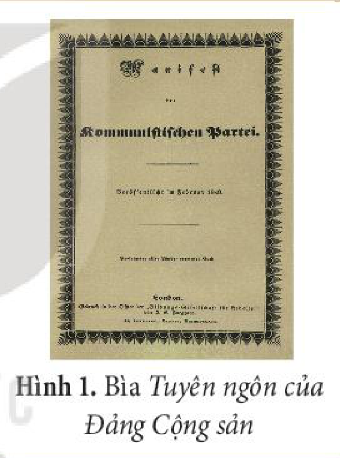
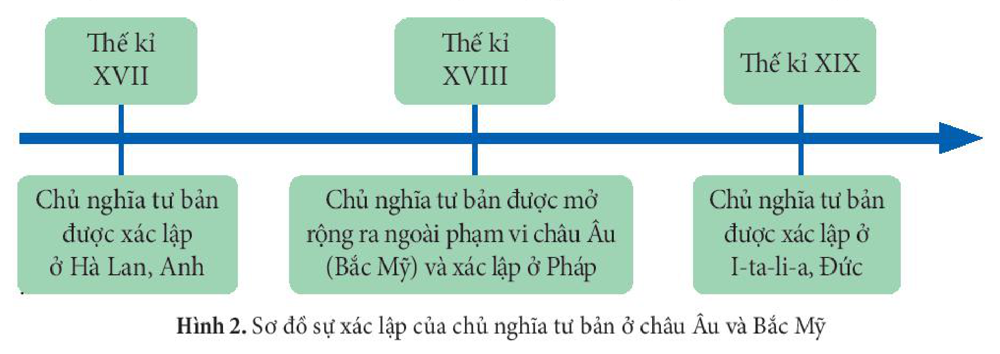
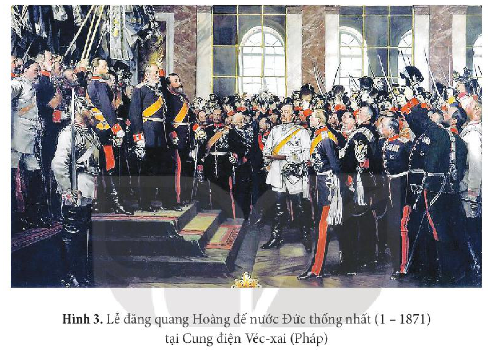
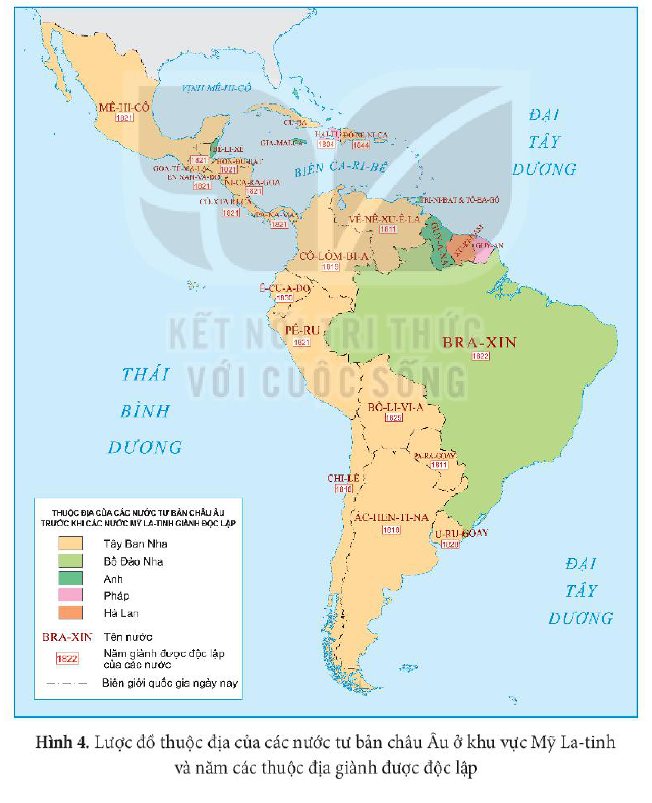
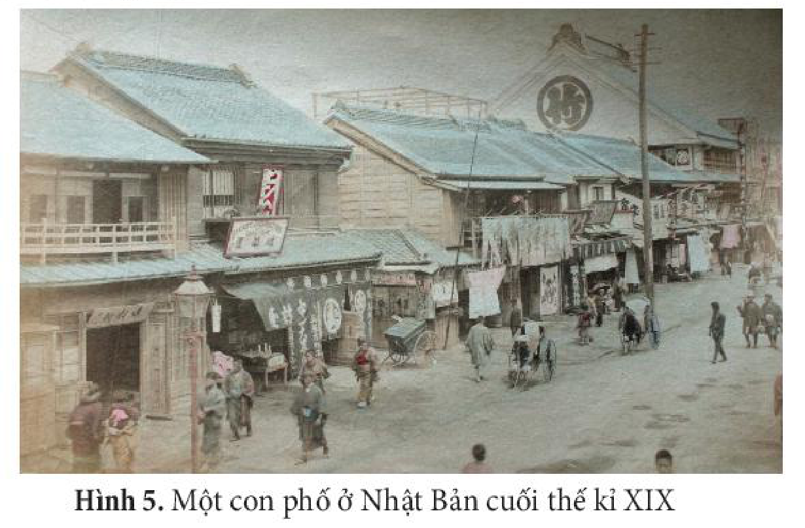
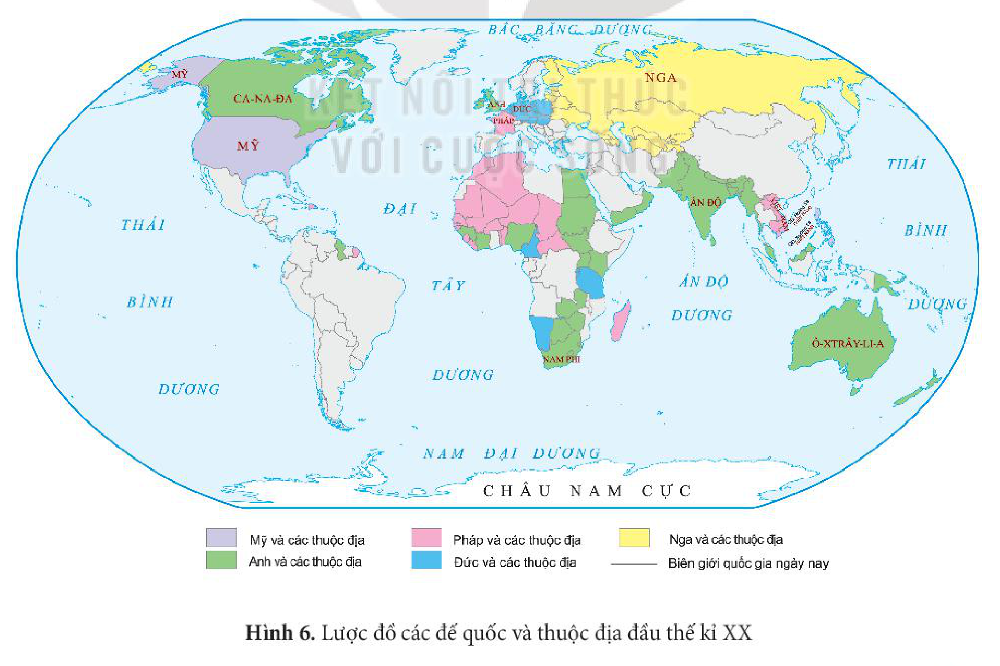
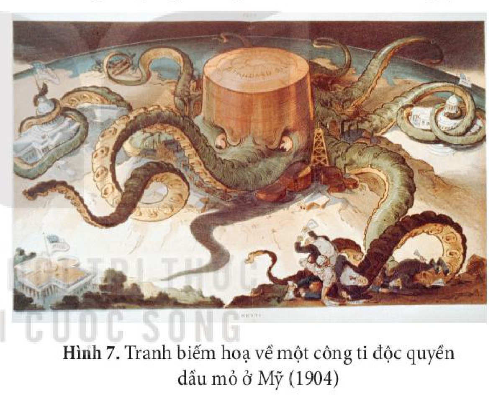
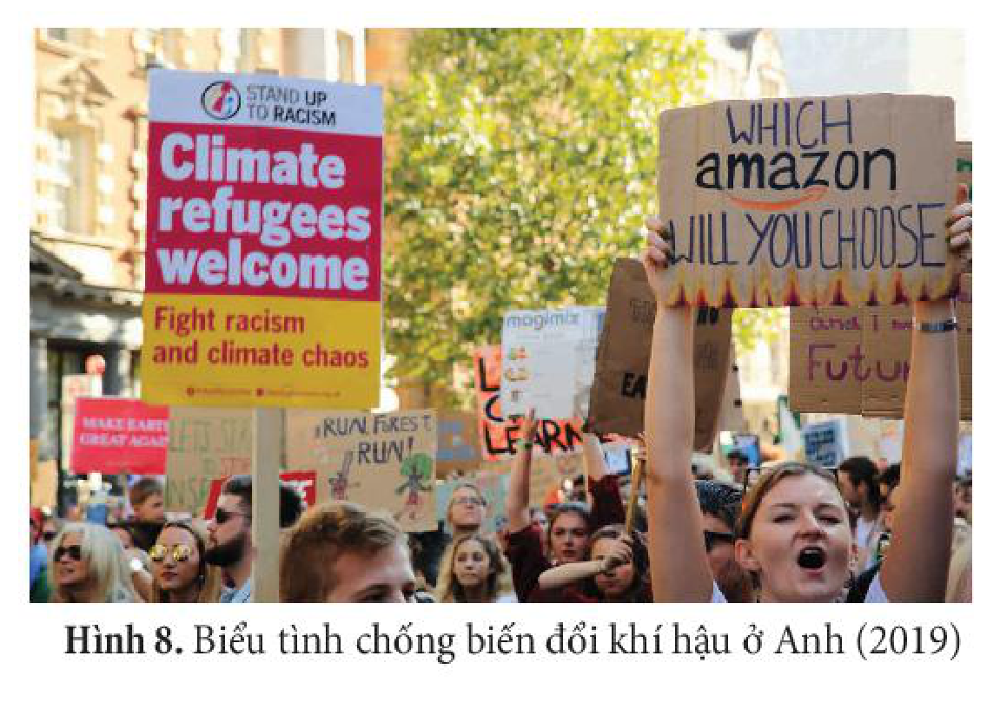
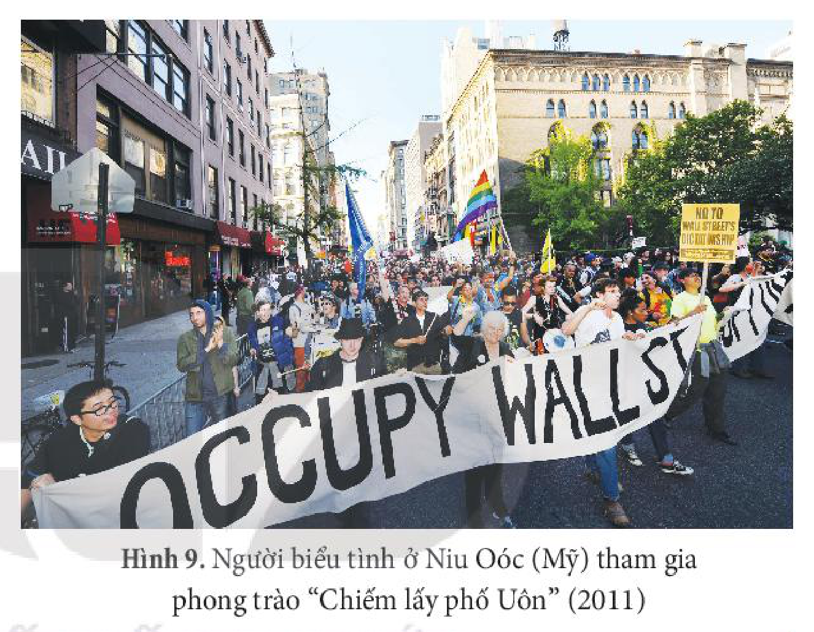

<!-- pdf:13 -->
# BÀI 2: SỰ XÁC LẬP VÀ PHÁT TRIỂN CỦA CHỦ NGHĨA TƯ BẢN

## 🎯 Học xong bài này, em sẽ:
- Trình bày được sự xác lập của chủ nghĩa tư bản ở châu Âu và Bắc Mỹ.
- Trình bày được quá trình mở rộng xâm lược thuộc địa và phát triển của chủ nghĩa tư bản.
- Trình bày được sự phát triển của chủ nghĩa tư bản từ tự do cạnh tranh sang độc quyền.
- Nêu được khái niệm chủ nghĩa tư bản hiện đại, tiềm năng và thách thức của chủ nghĩa tư bản hiện đại.
- Có nhận thức đúng đắn về tiềm năng và hạn chế của chủ nghĩa tư bản hiện đại. Vận dụng được những hiểu biết về lịch sử chủ nghĩa tư bản để giải thích những vấn đề thời sự của xã hội tư bản hiện nay.

## 🔴 Mở đầu

“Giai cấp tư sản trong quá trình thống trị giai cấp chưa đầy một thế kỉ đã tạo những lực lượng sản xuất nhiều hơn và đồ sộ hơn lực lượng sản xuất của tất cả các thế hệ trước cộng lại” (C. Mác – Ph. Ăng-ghen, *Tuyên ngôn của Đảng Cộng sản*, NXB Sự thật, 1983, tr. 60).

Từ nhận định trên của C. Mác và Ph. Ăng-ghen, hãy chia sẻ những hiểu biết của em về sự xác lập, mở rộng và phát triển của chủ nghĩa tư bản.

## 1. Sự xác lập chủ nghĩa tư bản ở châu Âu và Bắc Mỹ

Ở châu Âu, sau Cách mạng tư sản Anh và đặc biệt là Cách mạng tư sản Pháp, chủ nghĩa tư bản từng bước được xác lập. Chiến tranh giành độc lập của 13 thuộc địa Anh ở Bắc Mỹ nửa sau thế kỉ XVIII đánh dấu sự mở rộng của chủ nghĩa tư bản ở ngoài châu Âu.

| Thời gian | Sự kiện |
| --- | --- |
| Thế kỉ XVII | Chủ nghĩa tư bản được xác lập ở Hà Lan, Anh |
| Thế kỉ XVIII | Chủ nghĩa tư bản được mở rộng ra ngoài phạm vi châu Âu (Bắc Mỹ) và xác lập ở Pháp |
| Thế kỉ XIX | Chủ nghĩa tư bản được xác lập ở I-ta-li-a, Đức |

<!-- pdf:14 -->
Từ thập kỉ 60 của thế kỉ XVIII, cuộc cách mạng công nghiệp bắt đầu từ Anh, sau đó lan ra các nước Pháp, Đức,... đã tạo ra những chuyển biến to lớn về kinh tế – xã hội, làm thay đổi bộ mặt của các nước này và khẳng định sự thắng lợi của chủ nghĩa tư bản.

Nửa sau thế kỉ XIX, các cuộc cách mạng tư sản tiếp diễn dưới những hình thức khác nhau và giành được thắng lợi (như cuộc đấu tranh thống nhất I-ta-li-a, Đức), dẫn đến sự xác lập chủ nghĩa tư bản ở châu Âu và Bắc Mỹ.

> ❓ Trình bày sự xác lập của chủ nghĩa tư bản ở châu Âu và Bắc Mỹ.

## 2. Sự phát triển của chủ nghĩa tư bản

### a) Chủ nghĩa đế quốc và quá trình xâm lược thuộc địa

Sự phát triển nhanh chóng của chủ nghĩa tư bản kéo theo nhu cầu ngày càng cao về nguyên liệu và nhân công, dẫn tới việc tăng cường chính sách xâm lược, mở rộng thuộc địa. Cuối thế kỉ XIX – đầu thế kỉ XX, các nước tư bản chuyển sang giai đoạn đế quốc chủ nghĩa.

Chủ nghĩa đế quốc là hệ quả trực tiếp của quá trình xâm lược thuộc địa nhằm tìm kiếm thị trường, thu lợi nhuận và đầu tư tư bản ở nước ngoài.

> TƯ LIỆU. “Điều quan trọng là chủ nghĩa tư bản không thể tồn tại và phát triển được nếu không thường xuyên mở rộng phạm vi thống trị của nó, không khai phá những xứ sở mới và không lôi cuốn các xứ sở không phải tư bản chủ nghĩa vào cơn lốc kinh tế thế giới.”
>
> (V. I. Lê-nin, *Toàn tập*, Tập 3, NXB Chính trị quốc gia, 2005, tr. 751)

<!-- pdf:15 -->
Trong quá trình xâm lược thuộc địa, các nước đế quốc đã thiết lập hệ thống thuộc địa ở châu Á, châu Phi và khu vực Mỹ La-tinh.

Trong số các nước đế quốc, nước Anh được mệnh danh là “đế quốc mà Mặt Trời không bao giờ lặn”. Đến năm 1914, thuộc địa của Anh đã rộng tới 33 triệu $\text{km}^2$ với 400 triệu người, chiếm 1/4 diện tích và 1/4 dân số thế giới, gấp 12 lần thuộc địa của Đức và 3 lần thuộc địa của Pháp.

> ❓ Trình bày quá trình mở rộng xâm lược thuộc địa của chủ nghĩa tư bản.

### b) Sự mở rộng và phát triển của chủ nghĩa tư bản

Nửa đầu thế kỉ XIX, tại hàng loạt các thuộc địa của thực dân Tây Ban Nha và Bồ Đào Nha ở khu vực Mỹ La-tinh đã bùng nổ phong trào đấu tranh giành độc lập, đưa đến sự thành lập các quốc gia tư sản.

<!-- pdf:16 -->
Ở châu Á, cuộc Duy tân Minh Trị bắt đầu từ năm 1868, đưa Nhật Bản từ một nước phong kiến trở thành nước tư bản chủ nghĩa.

<!-- term: Duy tân Minh Trị -->
Cuộc Duy tân Minh Trị bao gồm những cải cách trên các lĩnh vực: chính trị, kinh tế, quân sự, văn hoá, xã hội, giáo dục,... Cuộc cải cách đã đưa nền kinh tế Nhật Bản phát triển mạnh mẽ trong 30 năm cuối thế kỉ XIX, đồng thời giúp Nhật Bản tránh được nguy cơ bị xâm lược từ các cường quốc thực dân phương Tây.

<!-- term: Cách mạng Tân Hợi -->
Ở Trung Quốc, Cách mạng Tân Hợi (1911) do những trí thức cấp tiến và tiểu tư sản lãnh đạo đã lật đổ triều đại Mãn Thanh, chấm dứt chế độ quân chủ chuyên chế tồn tại lâu đời ở Trung Quốc. Mặc dù cuộc cách mạng này không thực sự thủ tiêu giai cấp phong kiến nhưng đã mở đường cho chủ nghĩa tư bản phát triển ở quốc gia lớn nhất, đông dân nhất châu Á.

Trong những năm cuối thế kỉ XIX – đầu thế kỉ XX, cùng với việc các nước đế quốc đẩy mạnh xâm lược thuộc địa, chủ nghĩa tư bản đã mở rộng phạm vi ảnh hưởng trên toàn thế giới.

<!-- pdf:17 -->
> ❓
> 1. Trình bày sự mở rộng và phát triển của chủ nghĩa tư bản cuối thế kỉ XIX – đầu thế kỉ XX.
> 2. Em có nhận xét gì về tốc độ mở rộng và phát triển của chủ nghĩa tư bản cuối thế kỉ XIX – đầu thế kỉ XX?

### c) Chủ nghĩa tư bản từ tự do cạnh tranh sang độc quyền

<!-- term: Chủ nghĩa tư bản độc quyền -->
Thời kì xác lập chủ nghĩa tư bản là thời kì tự do cạnh tranh của chủ nghĩa tư bản. Cuối thế kỉ XIX – đầu thế kỉ XX, chủ nghĩa tư bản chuyển sang giai đoạn độc quyền.

Trong khoảng 3 thập kỉ (cuối thế kỉ XIX – đầu thế kỉ XX), việc sử dụng những nguồn năng lượng mới cùng nhiều thành tựu khoa học – kĩ thuật đã thúc đẩy sự phát triển mạnh mẽ của nền kinh tế tư bản chủ nghĩa.

Cùng với sự phát triển kinh tế, quá trình cạnh tranh gay gắt làm cho các xí nghiệp vừa và nhỏ bị phá sản, dẫn đến sự xuất hiện những xí nghiệp khổng lồ và các tổ chức độc quyền.

<!-- term: Tổ chức độc quyền -->
Tổ chức độc quyền là sự liên minh giữa các nhà tư bản lớn để tập trung vào tay mình phần lớn việc sản xuất hoặc tiêu thụ một số hàng hoá nhằm thu lợi nhuận cao. Các hình thức tiêu biểu của tổ chức độc quyền là các-ten, xanh-đi-ca ở Đức và Pháp, tơ-rớt ở Mỹ.

Sự phát triển của các tổ chức độc quyền tạo ra cơ sở cho bước chuyển của chủ nghĩa tư bản từ tự do cạnh tranh sang độc quyền. Trong giai đoạn này, các tổ chức tư bản độc quyền đã chi phối sự phát triển của toàn bộ nền kinh tế.

Đầu thế kỉ XX, các tổ chức độc quyền ở Pháp, Mỹ, Anh chỉ chiếm khoảng 1% tổng số xí nghiệp toàn thế giới nhưng lại chiếm hơn 3/4 tổng số máy hơi nước và động cơ điện, số lượng công nhân; tổng số sản phẩm được làm ra chiếm gần một nửa so với toàn thế giới.

> ❓
> 1. Khai thác Hình 7 và thông tin trong mục, cho biết quyền lực của các tổ chức độc quyền được thể hiện như thế nào?
> 2. Trình bày sự phát triển của chủ nghĩa tư bản từ tự do cạnh tranh sang độc quyền.

<!-- pdf:18 -->
## 3. Chủ nghĩa tư bản hiện đại

### a) Khái niệm chủ nghĩa tư bản hiện đại

<!-- term: Chủ nghĩa tư bản hiện đại -->
Chủ nghĩa tư bản hiện đại là thuật ngữ dùng để chỉ một giai đoạn phát triển của chủ nghĩa tư bản từ sau Chiến tranh thế giới thứ hai đến nay với những biểu hiện mới, tiêu biểu là sự kết hợp giữa sức mạnh kinh tế của các tổ chức độc quyền tư nhân với sức mạnh chính trị của nhà nước tư sản. Chủ nghĩa tư bản hiện đại có sức sản xuất phát triển cao trên cơ sở những thành tựu của cách mạng khoa học – công nghệ, có lực lượng lao động đáp ứng sự phát triển nhảy vọt của nền sản xuất, đồng thời không ngừng điều chỉnh để tồn tại và phát triển trong bối cảnh mới.

> ❓ Nêu khái niệm chủ nghĩa tư bản hiện đại.

### b) Tiềm năng và thách thức của chủ nghĩa tư bản hiện đại

- ***Tiềm năng***

Tiềm năng của chủ nghĩa tư bản hiện đại được biểu hiện cụ thể trên các lĩnh vực như: kinh tế, khoa học – công nghệ, kinh nghiệm quản lí, khả năng tự điều chỉnh để tồn tại và phát triển,...

Chủ nghĩa tư bản có ưu thế trong việc sử dụng những thành tựu của cuộc Cách mạng công nghiệp lần thứ tư để phát triển kinh tế. Các nước tư bản phát triển trở thành trung tâm kinh tế, tài chính, khoa học – công nghệ của thế giới, có quy mô nền kinh tế và thu nhập bình quân đầu người thuộc hàng cao nhất thế giới.

> 💡 EM CÓ BIẾT ?
>
> Nhóm G7 được sáng lập năm 1976 là diễn đàn kinh tế của 7 quốc gia tư bản phát triển là Mỹ, Ca-na-đa, Anh, Pháp, Đức, I-ta-li-a và Nhật Bản.

- ***Thách thức***

Chủ nghĩa tư bản hiện đại đang phải đối mặt với nhiều thách thức.

*Thứ nhất,* chủ nghĩa tư bản đang phải đối mặt và khó có thể giải quyết được những cuộc khủng hoảng kinh tế, tài chính mang tính toàn cầu.

Từ cuộc khủng hoảng dầu mỏ năm 1973 đến nay, tuy các nước tư bản phát triển đã coi trọng tìm kiếm các nguồn năng lượng mới, xanh và sạch, song quá trình chuyển đổi diễn ra chậm, sự phụ thuộc của các nước vào dầu mỏ vẫn rất lớn. Khủng hoảng năng lượng tiếp tục gây ra nhiều tác động tiêu cực đến các nước tư bản, lạm phát cao, ô nhiễm môi trường,...).

<!-- pdf:19 -->
*Thứ hai,* chủ nghĩa tư bản đã và đang phải đối mặt và không thể giải quyết được những vấn đề chính trị, xã hội nan giải.

Tình trạng bất an trong xã hội Mỹ là điều đáng lo ngại cho người dân. Tội ác, bạo lực, tệ nạn xã hội thường xuyên xảy ra. Nạn phân biệt chủng tộc, nhất là sự đối xử bất công với người Mỹ gốc Phi vẫn diễn ra. Nhiều vụ xả súng xảy ra ở các trường học, trên đường phố gây thương vong cho nhiều nạn nhân, chủ yếu là trẻ em.

*Thứ ba,* chủ nghĩa tư bản không có khả năng giải quyết triệt để mâu thuẫn xã hội ngày càng gia tăng. Sự chênh lệch giàu nghèo làm sâu sắc thêm tình trạng bất bình đẳng trong xã hội.

<!-- term: Phong trào “Chiếm lấy phố Uôn” -->
“Chiếm lấy phố Uôn” hay còn gọi là phong trào “99 chống lại 1” là một phong trào xuất hiện ở nước Mỹ vào đầu năm 2011. Tên của phong trào này nói lên rằng: 1% dân số Mỹ giàu có sở hữu tài sản quốc gia bằng số tài sản của 99% dân số. Phong trào đã lan sang nhiều nước tư bản chủ nghĩa.

> ❓ Nêu tiềm năng và thách thức của chủ nghĩa tư bản hiện đại.

## ✏️ Luyện tập và vận dụng

**Luyện tập**

Lập bảng tóm tắt những nét chính về sự mở rộng và phát triển của chủ nghĩa tư bản từ cuối thế kỉ XIX đến đầu thế kỉ XX.

**Vận dụng**

**1.** Có quan điểm cho rằng: Chủ nghĩa tư bản hiện đại ngày nay đã thay đổi về bản chất, không còn là chủ nghĩa tư bản như trước đây. Nêu ý kiến của em về quan điểm này.

**2.** Sưu tầm tư liệu từ sách, báo, internet về phong trào “Chiếm lấy phố Uôn” và giải thích vì sao phong trào này chỉ sau một thời gian ngắn đã lan ra các bang ở Mỹ và hàng trăm thành phố ở nhiều nước tư bản trên thế giới.

## 📷 Danh sách hình trong bài

| Mã hình | Chú thích | Trang PDF |
| --- | --- | --- |
| H11-lich_su-b02-01 | Hình 1. Bìa Tuyên ngôn của Đảng Cộng sản | 13 |
| H11-lich_su-b02-02 | Hình 2. Sơ đồ sự xác lập của chủ nghĩa tư bản ở châu Âu và Bắc Mỹ | 13 |
| H11-lich_su-b02-03 | Hình 3. Lễ đăng quang Hoàng đế nước Đức thống nhất (1 – 1871) tại Cung điện Véc-xai (Pháp) | 14 |
| H11-lich_su-b02-04 | Hình 4. Lược đồ thuộc địa của các nước tư bản châu Âu ở khu vực Mỹ La-tinh và năm các thuộc địa giành được độc lập | 15 |
| H11-lich_su-b02-05 | Hình 5. Một con phố ở Nhật Bản cuối thế kỉ XIX | 16 |
| H11-lich_su-b02-06 | Hình 6. Lược đồ các đế quốc và thuộc địa đầu thế kỉ XX | 16 |
| H11-lich_su-b02-07 | Hình 7. Tranh biếm hoạ về một công ti độc quyền dầu mỏ ở Mỹ (1904) | 17 |
| H11-lich_su-b02-08 | Hình 8. Biểu tình chống biến đổi khí hậu ở Anh (2019) | 18 |
| H11-lich_su-b02-09 | Hình 9. Người biểu tình ở Niu Oóc (Mỹ) tham gia phong trào “Chiếm lấy phố Uôn” (2011) | 19 |
