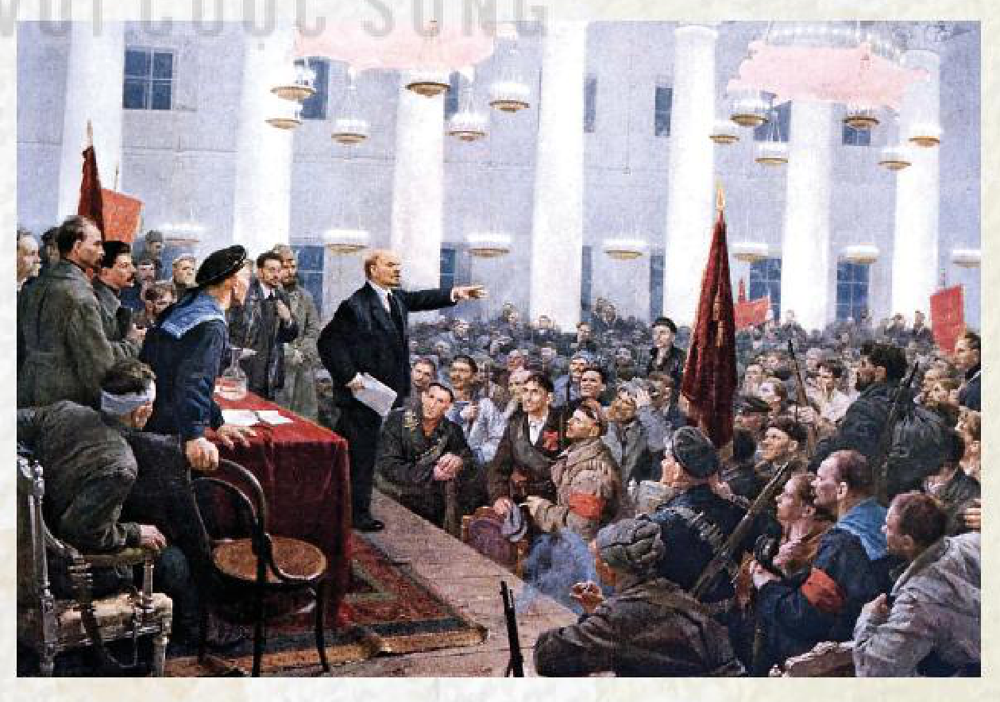
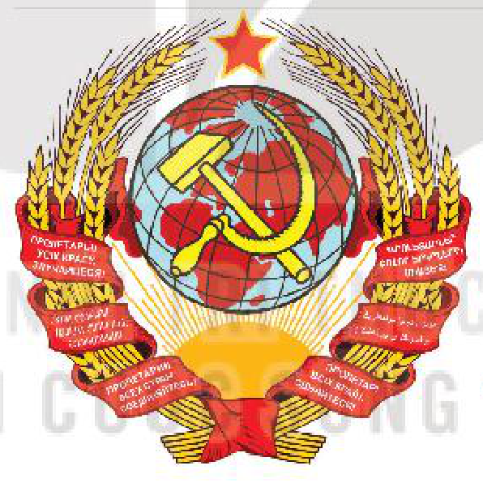
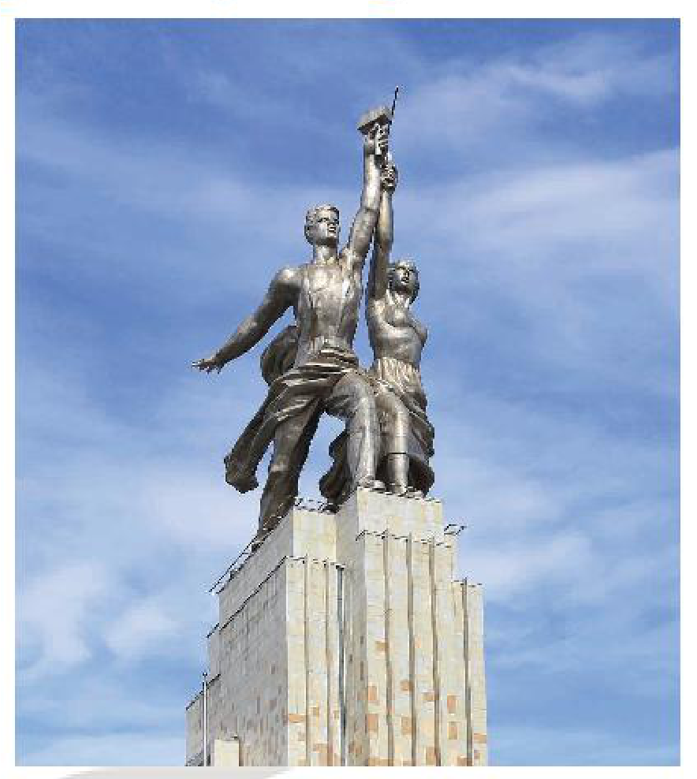

<!-- pdf:20 -->

# BÀI 3: SỰ HÌNH THÀNH LIÊN BANG CỘNG HOÀ XÃ HỘI CHỦ NGHĨA XÔ VIẾT

## 🎯 Học xong bài này, em sẽ:

- Trình bày được quá trình hình thành Liên bang Cộng hoà xã hội chủ nghĩa Xô viết.
- Phân tích được ý nghĩa ra đời của Liên bang Cộng hoà xã hội chủ nghĩa Xô viết.

## 🔴 Mở đầu

Trong *Lời mở đầu* của tác phẩm *Mười ngày rung chuyển thế giới (Ten days that shook the World)*, nhà báo Giôn Rít (Mỹ) đã đánh giá Cách mạng tháng Mười Nga năm 1917 là “một trong những sự kiện vĩ đại nhất của lịch sử”, mở đường cho sự ra đời Liên bang Cộng hoà xã hội chủ nghĩa Xô viết. Tác phẩm đã được xuất bản ở nhiều nước trên thế giới. Vì sao Cách mạng tháng Mười Nga được đánh giá cao như vậy? Hãy chia sẻ những hiểu biết của em về quá trình hình thành và ý nghĩa của sự ra đời Liên bang Cộng hoà xã hội chủ nghĩa Xô viết.

## 1. Quá trình hình thành Liên bang Cộng hoà xã hội chủ nghĩa Xô viết

<!-- term: Thành lập Chính quyền Xô viết -->
Sau thắng lợi của Cách mạng tháng Mười Nga, nhiệm vụ hàng đầu của Chính quyền Xô viết là đập tan bộ máy nhà nước cũ, xây dựng nhà nước mới của những người lao động. Đại hội Xô viết toàn Nga lần thứ hai, khai mạc đêm 25 – 10 – 1917 (ngày 7 – 11 – 1917 theo lịch mới) tại Điện Xmô-nưi, ra tuyên bố thành lập Chính quyền Xô viết do Lê-nin đứng đầu.

*Hình 1. Lê-nin tuyên bố thành lập Chính quyền Xô viết (1917)*

<!-- pdf:21 -->

> TƯ LIỆU. Tại Đại hội Xô viết toàn Nga lần thứ hai, Lê-nin nhấn mạnh: “Bây giờ đây, ở nước Nga, chúng ta cần phải đặt hết tâm trí vào việc xây dựng một nhà nước vô sản xã hội chủ nghĩa”.
>
> *(V. I. Lê-nin, Toàn tập, Tập 35, NXB Chính trị quốc gia, 2006, tr. 3)*

Trong cuộc chiến đấu chống thù trong, giặc ngoài, các nước Cộng hoà xã hội chủ nghĩa trên đất nước Xô viết đã đoàn kết, giúp đỡ lẫn nhau để giữ vững chính quyền Xô viết. Chiến tranh kết thúc, nhiệm vụ khôi phục kinh tế, xây dựng chủ nghĩa xã hội và bảo vệ đất nước đòi hỏi sự liên minh chặt chẽ hơn nữa, nhất là sự thống nhất trên cơ sở nhà nước của các nước Cộng hoà Xô viết.

<!-- term: Tư tưởng chỉ đạo của Lê-nin về thành lập Liên Xô -->
Tư tưởng chỉ đạo của Lê-nin trong việc thành lập Liên bang Cộng hoà xã hội chủ nghĩa Xô viết là sự bình đẳng về mọi mặt, quyền dân tộc tự quyết và xây dựng một cộng đồng anh em giữa các dân tộc.

<!-- term: Thành lập Liên bang Cộng hoà xã hội chủ nghĩa Xô viết -->
Ngày 30 – 12 – 1922, tại Mát-xcơ-va, dưới sự chỉ đạo trực tiếp của Lê-nin, Đại hội lần thứ nhất các Xô viết toàn Liên bang đã thông qua bản *Tuyên ngôn* thành lập Liên bang Cộng hoà xã hội chủ nghĩa Xô viết (gọi tắt là Liên Xô) và bản Hiệp ước Liên bang.

<!-- term: Thành lập Liên bang Cộng hoà xã hội chủ nghĩa Xô viết -->
Khi mới thành lập, Liên Xô gồm 4 nước Cộng hoà Xô viết là Nga, U-crai-na, Bê-lô-rút-xi-a và Ngoại Cáp-ca-dơ. Đến năm 1940, Liên Xô gồm 15 nước cộng hoà.

> 💡 EM CÓ BIẾT ?
>
> Hiến pháp Liên Xô (1923) mô tả: Quốc huy Liên Xô là biểu tượng quốc gia, bao gồm hình ảnh búa liềm trên quả địa cầu được vẽ trên nền những tia nắng Mặt Trời, xung quanh là những bông lúa mì, với dòng chữ “Giai cấp vô sản thế giới đoàn kết lại”.

*Hình 2. Quốc huy đầu tiên của Liên Xô (1923)*

<!-- term: Hiến pháp đầu tiên của Liên Xô -->
Tháng 1 – 1924, bản Hiến pháp đầu tiên của Liên Xô được thông qua, hoàn thành quá trình thành lập Nhà nước Liên bang Cộng hoà xã hội chủ nghĩa đầu tiên trên thế giới.

<!-- term: Hiến pháp đầu tiên của Liên Xô -->
Hiến pháp Liên Xô năm 1924 ghi nhận việc hợp tác trên cơ sở tự nguyện của các nước Cộng hoà Xô viết thành một nhà nước Liên bang, phân định các quyền của Liên bang và của các nước Cộng hoà, quy định cơ cấu tổ chức cơ quan Nhà nước tối cao Liên bang và các nước Cộng hoà.

<!-- term: Hiến pháp đầu tiên của Liên Xô -->
Hiến pháp phản ánh con đường giải quyết vấn đề dân tộc trong một quốc gia nhiều dân tộc, trên cơ sở nguyên tắc bình đẳng và tình hữu nghị giữa các dân tộc.

Ngày 21 – 1 – 1924, V. I. Lê-nin – vị lãnh tụ vĩ đại của giai cấp vô sản, người đứng đầu Đảng và Nhà nước Xô viết qua đời. Xta-lin lên thay, tiếp tục lãnh đạo công cuộc xây dựng và bảo vệ đất nước Liên Xô.

> ❓ Trình bày quá trình hình thành Liên bang Cộng hoà xã hội chủ nghĩa Xô viết.

<!-- pdf:22 -->

## 2. Ý nghĩa của sự ra đời Liên bang Cộng hoà xã hội chủ nghĩa Xô viết

<!-- term: Ý nghĩa ra đời của Liên bang Cộng hoà xã hội chủ nghĩa Xô viết -->
Quá trình thành lập Liên bang Cộng hoà xã hội chủ nghĩa Xô viết phù hợp với lợi ích chung của các dân tộc trên đất nước Xô viết. Sức mạnh của tình đoàn kết và sự hợp tác, giúp đỡ giữa các dân tộc tạo điều kiện cho sự phát triển nhanh chóng về kinh tế, xã hội của tất cả các nước Cộng hoà, đồng thời tăng cường vị thế của Liên Xô trên trường quốc tế.

<!-- term: Ý nghĩa ra đời của Liên bang Cộng hoà xã hội chủ nghĩa Xô viết -->
Việc thành lập Liên Xô dưới sự chỉ đạo của V. I. Lê-nin đã mở ra con đường giải quyết đúng đắn vấn đề dân tộc trên đất nước Xô viết trên cơ sở bình đẳng và sự giúp đỡ nhau.

<!-- term: Ý nghĩa ra đời của Liên bang Cộng hoà xã hội chủ nghĩa Xô viết -->
Liên Xô trở thành biểu tượng và là chỗ dựa tinh thần, vật chất to lớn cho phong trào cách mạng thế giới. Những thành tựu của Liên Xô đã cổ vũ, lôi cuốn mạnh mẽ phong trào giải phóng dân tộc ở những nước thuộc địa ở châu Á, châu Phi và khu vực Mỹ La-tinh, đồng thời tạo tiền đề cho sự ra đời của hệ thống xã hội chủ nghĩa.

*Hình 3. Tượng Liên minh công nông – biểu tượng của Nhà nước Xô viết ở ngoại ô Mát-xcơ-va (Nga) ngày nay*

> ❓ Phân tích ý nghĩa việc thành lập Liên bang Cộng hoà xã hội chủ nghĩa Xô viết.

## ✏️ Luyện tập và vận dụng

1. Lập bảng tóm tắt quá trình hình thành Liên bang Cộng hoà xã hội chủ nghĩa Xô viết.

2. Vì sao nói: Liên Xô trở thành chỗ dựa tinh thần, vật chất cho phong trào cách mạng thế giới.

Sưu tầm tư liệu, hình ảnh từ sách, báo và internet, hãy xây dựng một bài giới thiệu về sự thành lập Liên bang Cộng hoà xã hội chủ nghĩa Xô viết (theo ý tưởng của em).

## 📷 Danh sách hình trong bài

| Mã hình | Trang PDF | Vị trí trong bài | Chú thích gốc |
| --- | --- | --- | --- |
| H11-lich_su-b03-01 | 20 | Mục 1 | Hình 1. Lê-nin tuyên bố thành lập Chính quyền Xô viết (1917) |
| H11-lich_su-b03-02 | 21 | Mục 1 | Hình 2. Quốc huy đầu tiên của Liên Xô (1923) |
| H11-lich_su-b03-03 | 22 | Mục 2 | Hình 3. Tượng Liên minh công nông – biểu tượng của Nhà nước Xô viết ở ngoại ô Mát-xcơ-va (Nga) ngày nay |
