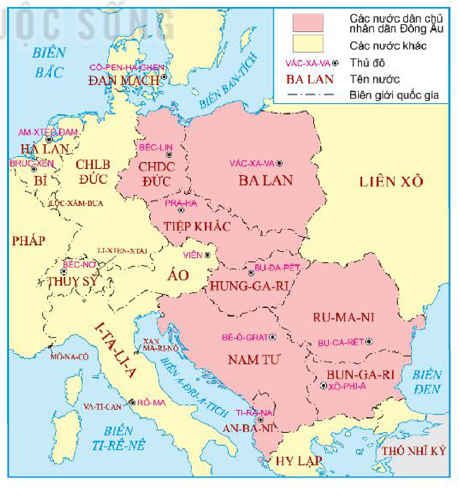
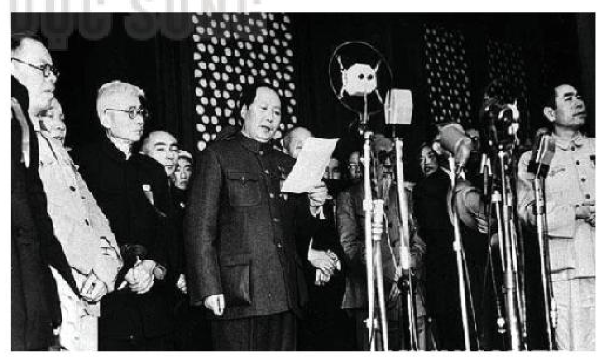
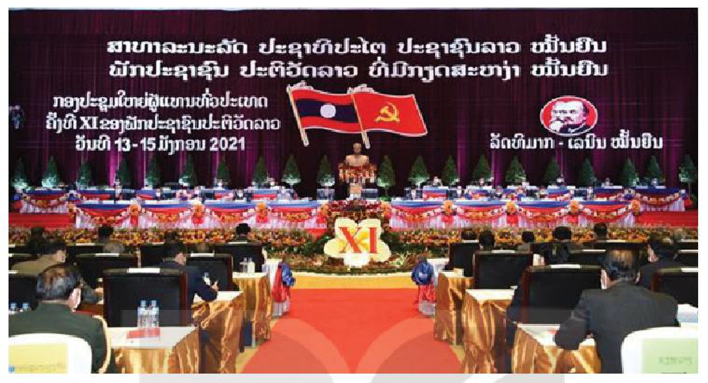
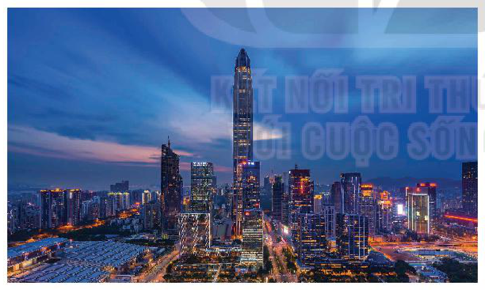

<!-- pdf:23 -->

# BÀI 4: SỰ PHÁT TRIỂN CỦA CHỦ NGHĨA XÃ HỘI TỪ SAU CHIẾN TRANH THẾ GIỚI THỨ HAI ĐẾN NAY

## 🎯 Học xong bài này, em sẽ:

- Trình bày được sự phát triển của chủ nghĩa xã hội ở Đông Âu sau Chiến tranh thế giới thứ hai, nêu được sự mở rộng của chủ nghĩa xã hội ở châu Á và khu vực Mỹ La-tinh.
- Giải thích được nguyên nhân dẫn tới sự sụp đổ của mô hình chủ nghĩa xã hội ở Đông Âu và Liên Xô.
- Nêu được nét chính về chủ nghĩa xã hội từ năm 1991 đến nay và những thành tựu, ý nghĩa của công cuộc cải cách – mở cửa ở Trung Quốc.
- Có ý thức trân trọng thành tựu, giá trị của chủ nghĩa xã hội, sẵn sàng tham gia đóng góp vào công cuộc xây dựng chủ nghĩa xã hội ở Việt Nam.

## 🔴 Mở đầu

Sau Chiến tranh thế giới thứ hai, chủ nghĩa xã hội được mở rộng ở Đông Âu, một số nước châu Á và khu vực Mỹ La-tinh, trở thành một hệ thống thế giới. Trong quá trình phát triển, chủ nghĩa xã hội đã vượt qua những khó khăn, thách thức, tiến hành cải cách, đổi mới và tiếp tục khẳng định vị trí quan trọng của mình trong tiến trình lịch sử thế giới. Hãy chia sẻ những điều em biết về sự phát triển và thành tựu của chủ nghĩa xã hội từ sau Chiến tranh thế giới thứ hai đến nay.

## 1. Sự phát triển của chủ nghĩa xã hội sau Chiến tranh thế giới thứ hai

### a) Sự phát triển của chủ nghĩa xã hội ở Đông Âu

<!-- term: Sự phát triển của chủ nghĩa xã hội ở Đông Âu -->
Thắng lợi của Hồng quân Liên Xô trong việc tiêu diệt chủ nghĩa phát xít ở châu Âu đã tạo điều kiện thuận lợi cho nhân dân các nước Đông Âu nổi dậy giành chính quyền, thành lập nhà nước dân chủ nhân dân.

<!-- term: Sự phát triển của chủ nghĩa xã hội ở Đông Âu -->
Cộng hoà Nhân dân Ba Lan (1944), Cộng hoà Nhân dân Ru-ma-ni (1944), Cộng hoà Hung-ga-ri (1945), Cộng hoà Tiệp Khắc (1945), Liên bang Cộng hoà Dân chủ Nhân dân Nam Tư (1945), Cộng hoà Nhân dân An-ba-ni (1945), Cộng hoà Bun-ga-ri (1946), Cộng hoà Dân chủ Đức (1949).

*Hình 1. Lược đồ các nước dân chủ nhân dân ở Đông Âu sau Chiến tranh thế giới thứ hai*

<!-- pdf:24 -->

<!-- term: Sự phát triển của chủ nghĩa xã hội ở Đông Âu -->
Những thành tựu của Liên Xô sau Chiến tranh thế giới thứ hai là nguồn cổ vũ mạnh mẽ cho công cuộc xây dựng chủ nghĩa xã hội ở Đông Âu. Quá trình phát triển của chủ nghĩa xã hội ở Đông Âu từ năm 1945 đến giữa những năm 70 của thế kỉ XX trải qua hai giai đoạn chính.

*Bảng tóm tắt nét chính về sự phát triển của chủ nghĩa xã hội ở Đông Âu từ năm 1945 đến giữa những năm 70 của thế kỉ XX*

<!-- term: Sự phát triển của chủ nghĩa xã hội ở Đông Âu -->
| Giai đoạn | Nét chính |
| --- | --- |
| **Từ năm 1945 đến năm 1949** | Sau khi thành lập chính quyền dân chủ nhân dân, các nước Đông Âu hoàn thành việc thực hiện những nhiệm vụ của cách mạng dân chủ nhân dân: tiến hành cải cách ruộng đất; quốc hữu hoá các nhà máy, xí nghiệp của tư bản; thực hiện các quyền tự do, dân chủ;... |
| **Từ năm 1949 đến giữa những năm 70** | • Đây là giai đoạn phát triển của công cuộc xây dựng chủ nghĩa xã hội ở Đông Âu. • Với sự giúp đỡ của Liên Xô, sự nỗ lực của toàn thể nhân dân, các nước Đông Âu thực hiện công nghiệp hoá, điện khí hoá toàn quốc, phát triển nông nghiệp,... Từ những nước nghèo, các nước xã hội chủ nghĩa Đông Âu trở thành những quốc gia có nền công nghiệp, nông nghiệp phát triển. |

> ❓ Trình bày nét chính về sự phát triển của chủ nghĩa xã hội ở các nước Đông Âu từ sau Chiến tranh thế giới thứ hai đến giữa những năm 70 của thế kỉ XX.

### b) Sự mở rộng của chủ nghĩa xã hội ở châu Á và khu vực Mỹ La-tinh

• *Sự mở rộng của chủ nghĩa xã hội ở châu Á*

<!-- term: Sự mở rộng của chủ nghĩa xã hội ở châu Á -->
Thắng lợi của Hồng quân Liên Xô trong Chiến tranh thế giới thứ hai đã thúc đẩy phong trào giải phóng dân tộc ở châu Á phát triển mạnh mẽ.

<!-- term: Sự mở rộng của chủ nghĩa xã hội ở châu Á -->
Sau khi Trung Quốc hoàn thành cuộc cách mạng dân tộc dân chủ nhân dân, năm 1949, nước Cộng hoà Nhân dân Trung Hoa được thành lập và lựa chọn con đường đi lên chủ nghĩa xã hội.

*Hình 2. Mao Trạch Đông tuyên bố thành lập nước Cộng hoà Nhân dân Trung Hoa (1949)*

<!-- term: Sự mở rộng của chủ nghĩa xã hội ở châu Á -->
Cuộc kháng chiến chống thực dân Pháp thắng lợi năm 1954, miền Bắc Việt Nam được giải phóng và đi lên con đường xây dựng chủ nghĩa xã hội. Sau khi giải phóng hoàn toàn miền Nam (4 – 1975) và thực hiện thống nhất đất nước (1976), cả nước Việt Nam tiến lên xây dựng chủ nghĩa xã hội.

<!-- pdf:25 -->

<!-- term: Sự mở rộng của chủ nghĩa xã hội ở châu Á -->
Tháng 12 – 1975, sau khi hoàn thành cách mạng giải phóng đất nước, nước Cộng hoà Dân chủ Nhân dân Lào chính thức thành lập và đi lên con đường xây dựng chủ nghĩa xã hội.

<!-- term: Sự mở rộng của chủ nghĩa xã hội ở châu Á -->
Việc các nước châu Á lựa chọn con đường xây dựng chủ nghĩa xã hội đã đánh dấu sự mở rộng, tăng cường sức mạnh của chủ nghĩa xã hội trên phạm vi toàn cầu.

• *Sự mở rộng chủ nghĩa xã hội ở khu vực Mỹ La-tinh*

<!-- term: Sự mở rộng chủ nghĩa xã hội ở khu vực Mỹ La-tinh -->
Sau thắng lợi của cách mạng Cu-ba năm 1959, nước Cộng hoà Cu-ba được thành lập. Chính phủ cách mạng đã tiến hành những cải cách dân chủ trên các lĩnh vực kinh tế, chính trị, xã hội. Từ năm 1961, Cu-ba bước vào thời kì xây dựng xã hội chủ nghĩa. Mặc dù phải đối mặt với nhiều khó khăn, thách thức, đặc biệt là chính sách cấm vận của Mỹ, nhưng nhân dân Cu-ba vẫn kiên định đi theo con đường xã hội chủ nghĩa.

<!-- term: Sự mở rộng chủ nghĩa xã hội ở khu vực Mỹ La-tinh -->
Công cuộc xây dựng chủ nghĩa xã hội của Cu-ba đạt được nhiều thành tựu to lớn. Từ nền nông nghiệp độc canh (bông, mía) và công nghiệp đơn nhất (khai thác mỏ), Cu-ba đã xây dựng được nền công nghiệp với cơ cấu các ngành hợp lí; nền nông nghiệp phát triển đa dạng; giáo dục, y tế, văn hoá đạt trình độ phát triển cao.

> 💡 EM CÓ BIẾT ?
>
> Trước Chiến tranh thế giới thứ hai, Liên Xô là nước xã hội chủ nghĩa duy nhất trên thế giới, chiếm khoảng 17% diện tích, 9% dân số và 7% sản lượng công nghiệp của thế giới. Sau Chiến tranh thế giới thứ hai, hệ thống xã hội chủ nghĩa chiếm khoảng 1/4 diện tích, 35% dân số và 30% giá trị tổng sản lượng công nghiệp toàn thế giới.

<!-- term: Sự mở rộng chủ nghĩa xã hội ở khu vực Mỹ La-tinh -->
Sau Chiến tranh thế giới thứ hai, chủ nghĩa xã hội từ phạm vi một nước đã trở thành một hệ thống thế giới, trải dài từ châu Âu sang châu Á, lan tới vùng biển Ca-ri-bê thuộc khu vực Mỹ La-tinh. Các nước xã hội chủ nghĩa ngày càng phát triển và lớn mạnh, có vị trí quan trọng trên thế giới.

> ❓ Nêu những nét chính về sự mở rộng của chủ nghĩa xã hội ở châu Á (Trung Quốc, Việt Nam, Lào) và khu vực Mỹ La-tinh (Cu-ba).

## 2. Nguyên nhân khủng hoảng, sụp đổ của chủ nghĩa xã hội ở Đông Âu và Liên Xô

<!-- term: Khủng hoảng và sụp đổ của chủ nghĩa xã hội ở Đông Âu và Liên Xô -->
Từ nửa sau những năm 70, tốc độ tăng trưởng kinh tế của các nước xã hội chủ nghĩa Đông Âu bắt đầu có sự suy giảm.

<!-- term: Khủng hoảng và sụp đổ của chủ nghĩa xã hội ở Đông Âu và Liên Xô -->
Từ những năm 80, các nước Đông Âu lâm vào thời kì suy thoái, khủng hoảng kinh tế – xã hội trầm trọng. Cuối những năm 80, chế độ chủ nghĩa xã hội tan rã ở các nước Đông Âu. Ở Đức, sau khi “Bức tường Béc-lin” sụp đổ (1989), việc thống nhất nước Đức được thực hiện với sự sáp nhập Cộng hoà Dân chủ Đức vào Cộng hoà Liên bang Đức (1990).

*Hình 3. “Bức tường Béc-lin” bị sụp đổ (11 – 1989)*

<!-- pdf:26 -->

<!-- term: Khủng hoảng và sụp đổ của chủ nghĩa xã hội ở Đông Âu và Liên Xô -->
Ở Liên Xô, sự thất bại của công cuộc cải tổ đã đẩy đất nước lâm vào tình trạng khủng hoảng. Tháng 12 – 1991, Nhà nước Liên bang Xô viết tan rã, chấm dứt chế độ xã hội chủ nghĩa ở Liên Xô sau 74 năm tồn tại.

> TƯ LIỆU. “Do duy trì quá lâu những khiếm khuyết của mô hình cũ của chủ nghĩa xã hội, chậm trễ trong cách mạng khoa học và công nghệ, nhiều nước xã hội chủ nghĩa đã lâm vào khủng hoảng trầm trọng. Ở một số nước, Đảng Cộng sản và công nhân không còn nắm vai trò lãnh đạo, chế độ xã hội đã thay đổi.”
>
> *(Đảng Cộng sản Việt Nam, Cương lĩnh xây dựng đất nước trong thời kì quá độ lên chủ nghĩa xã hội, Văn kiện Đảng Toàn tập, Tập 51, NXB Chính trị quốc gia, 1991, tr. 132)*

<!-- term: Nguyên nhân sụp đổ của chủ nghĩa xã hội ở Đông Âu và Liên Xô -->
Nguyên nhân dẫn đến sự khủng hoảng và sụp đổ của chủ nghĩa xã hội ở Đông Âu và Liên Xô là tổng hợp của nhiều yếu tố. Trong đó, nguyên nhân cơ bản bao gồm:

<!-- term: Nguyên nhân sụp đổ của chủ nghĩa xã hội ở Đông Âu và Liên Xô -->
*Thứ nhất,* do đường lối lãnh đạo của Đảng Cộng sản Liên Xô và các nước Đông Âu mang tính chủ quan, duy ý chí; áp dụng máy móc mô hình kinh tế tập trung, quan liêu, bao cấp trong nhiều năm; chậm đổi mới cơ chế và hệ thống quản lí kinh tế.

<!-- term: Nguyên nhân sụp đổ của chủ nghĩa xã hội ở Đông Âu và Liên Xô -->
*Thứ hai,* những thành tựu của cuộc cách mạng khoa học – công nghệ hiện đại không được áp dụng kịp thời vào sản xuất; năng suất lao động xã hội suy giảm dẫn tới tình trạng trì trệ kéo dài về kinh tế; sự sa sút, khủng hoảng lòng tin trong xã hội.

<!-- term: Nguyên nhân sụp đổ của chủ nghĩa xã hội ở Đông Âu và Liên Xô -->
*Thứ ba,* quá trình cải cách, cải tổ phạm sai lầm nghiêm trọng về đường lối, cách thức tiến hành. Sự xoá bỏ vai trò lãnh đạo của Đảng Cộng sản khiến cho khủng hoảng ngày càng nghiêm trọng, trực tiếp dẫn đến sự sụp đổ của chủ nghĩa xã hội ở Đông Âu, sự tan rã của Liên Xô.

<!-- term: Nguyên nhân sụp đổ của chủ nghĩa xã hội ở Đông Âu và Liên Xô -->
*Thứ tư,* hoạt động chống phá của các lực lượng thù địch ở trong nước và các thế lực bên ngoài góp phần làm gia tăng tình trạng bất ổn và rối loạn.

> ❓ Khai thác tư liệu trên và thông tin trong mục, giải thích nguyên nhân dẫn tới sự sụp đổ mô hình chủ nghĩa xã hội ở Đông Âu và Liên Xô.

## 3. Chủ nghĩa xã hội từ năm 1991 đến nay

### a) Khái quát về chủ nghĩa xã hội từ năm 1991 đến nay

<!-- term: Chủ nghĩa xã hội từ năm 1991 đến nay -->
Từ năm 1991 đến nay, ở châu Á, các nước Trung Quốc, Việt Nam, Lào,... từng bước tiến hành cải cách, mở cửa, đổi mới, kiên định đi lên con đường xây dựng xã hội chủ nghĩa, đạt được những thành tựu to lớn về kinh tế, chính trị, xã hội và các lĩnh vực khác.

<!-- term: Chủ nghĩa xã hội từ năm 1991 đến nay -->
Công cuộc đổi mới ở Việt Nam (bắt đầu từ năm 1986) đã đưa đất nước ra khỏi khủng hoảng kinh tế – xã hội và tình trạng kém phát triển, trở thành nước đang phát triển có thu nhập trung bình, đời sống vật chất, tinh thần của người dân được cải thiện rõ rệt. Những thành tựu to lớn về kinh tế, chính trị, xã hội đã khẳng định con đường đi lên chủ nghĩa xã hội phù hợp với thực tiễn Việt Nam.

<!-- pdf:27 -->

<!-- term: Chủ nghĩa xã hội từ năm 1991 đến nay -->
Từ năm 1986, Lào thực hiện đường lối đổi mới toàn diện theo định hướng xã hội chủ nghĩa, tiến hành công nghiệp hoá, hiện đại hoá. Sau hơn 35 năm đổi mới, nhân dân Lào giành được những thành tựu cơ bản, thực hiện thành công hai nhiệm vụ chiến lược: xây dựng, bảo vệ đất nước và hội nhập quốc tế, đồng thời tạo điều kiện cho người dân được thụ hưởng thành quả phát triển kinh tế, xã hội.

*Hình 4. Đại hội đại biểu toàn quốc Đảng Nhân dân Cách mạng Lào lần thứ XI (1 – 2021)*

<!-- term: Chủ nghĩa xã hội từ năm 1991 đến nay -->
Ở khu vực Mỹ La-tinh, từ năm 1991, mặc dù phải tiếp tục đối mặt với nhiều khó khăn, thách thức, đặc biệt là lệnh cấm vận kéo dài của Mỹ và phương Tây, Cu-ba vẫn quyết tâm đi theo con đường xây dựng chủ nghĩa xã hội, thực hiện cải cách kinh tế và đạt được những thành tựu quan trọng.

<!-- term: Chủ nghĩa xã hội từ năm 1991 đến nay -->
Thực hiện cải cách kinh tế từng bước, có chọn lọc, Cu-ba chủ trương xây dựng nền kinh tế với cơ cấu đa dạng, phát triển theo định hướng thị trường nhưng đảm bảo kế thừa những nguyên tắc của chủ nghĩa xã hội, chú trọng nâng cao đời sống nhân dân. Các ngành nghề mới phát triển và có đóng góp quan trọng vào sự phát triển kinh tế như: công nghiệp du lịch, công nghệ sinh học, khai thác dầu khí,... Hệ thống giáo dục, y tế miễn phí luôn là ưu tiên hàng đầu của Chính phủ Cu-ba, thể hiện tính ưu việt của chủ nghĩa xã hội.

*Hình 5. Thủ đô La Ha-ba-na (Cu-ba) ngày nay*

<!-- pdf:28 -->

Từ sau năm 1991, phong trào đấu tranh của giai cấp công nhân và nhân dân lao động ở các nước thuộc khu vực Mỹ La-tinh phát triển mạnh mẽ.

Việc Cu-ba kiên trì con đường xây dựng xã hội chủ nghĩa là một trong những nguồn động viên, cổ vũ cho phong trào đấu tranh bảo vệ độc lập, chủ quyền dân tộc và quyền phân phối phúc lợi xã hội công bằng cho người dân ở một số nước Mỹ La-tinh.

<!-- term: Chủ nghĩa xã hội từ năm 1991 đến nay -->
Những thành tựu của công cuộc đổi mới, cải cách ở các nước châu Á, khu vực Mỹ La-tinh là cơ sở vững chắc để chứng minh chủ nghĩa xã hội có sức sống, có triển vọng thực sự trên thế giới, đồng thời khẳng định con đường đi lên chủ nghĩa xã hội là phù hợp với thực tiễn và xu thế phát triển của thời đại.

> ❓ Nêu những nét chính về chủ nghĩa xã hội từ năm 1991 đến nay.

### b) Thành tựu chính của công cuộc cải cách – mở cửa ở Trung Quốc

<!-- term: Công cuộc cải cách – mở cửa ở Trung Quốc -->
Từ tháng 12 – 1978, Trung Quốc thực hiện công cuộc cải cách – mở cửa, chuyển đổi thành công sang nền kinh tế thị trường xã hội chủ nghĩa và đạt được thành tựu to lớn về kinh tế, xã hội.

<!-- term: Công cuộc cải cách – mở cửa ở Trung Quốc -->
Về kinh tế, tổng sản phẩm trong nước (GDP) đã tăng từ 367,9 tỉ nhân dân tệ (1978) lên hơn 114 nghìn tỉ nhân dân tệ (2021). Bình quân tăng trưởng hằng năm là 9,5%, vượt xa mức trung bình thế giới là 2,9%. Quy mô GDP của Trung Quốc từ vị trí thứ tám thế giới (trong những năm 80), vươn lên vị trí thứ hai thế giới (từ năm 2010).

*Hình 6. Một góc thành phố Thâm Quyến (Quảng Đông, Trung Quốc) ngày nay*

> 💡 EM CÓ BIẾT ?
>
> Trải qua 40 năm phát triển “thần tốc” (1980 – 2020), từ một làng chài hoang vắng ở tỉnh Quảng Đông, Thâm Quyến trở thành trung tâm công nghệ cao, một trong những đặc khu kinh tế hàng đầu của Trung Quốc và đứng thứ năm trong danh sách các thành phố đứng đầu châu Á.

<!-- term: Công cuộc cải cách – mở cửa ở Trung Quốc -->
Về khoa học – công nghệ, Trung Quốc đạt được những thành tựu nổi bật như: phát triển ngành hàng không vũ trụ (phóng được tàu Thần Châu vào không gian); xây dựng hệ thống định vị vệ tinh Bắc Đẩu, hệ thống đường sắt cao tốc; phát triển hạ tầng kĩ thuật số, các trung tâm dữ liệu hiện đại. Đặc biệt, Trung Quốc đạt được những tiến bộ vượt bậc trong các lĩnh vực công nghệ mới như: công nghệ thông tin – viễn thông thế hệ mới, trí tuệ nhân tạo, công nghệ sinh học,...

<!-- pdf:29 -->

<!-- term: Công cuộc cải cách – mở cửa ở Trung Quốc -->
Về văn hoá – giáo dục, Trung Quốc thực hiện cải cách giáo dục toàn diện, nâng cao vị trí của nền giáo dục trong việc cung cấp nguồn nhân lực chất lượng cao phục vụ cho công cuộc xây dựng và hiện đại hoá đất nước. Trung Quốc đã thực hiện kế hoạch quốc gia trung hạn và dài hạn về cải cách giáo dục và phát triển (2010 – 2020) với mục tiêu phát triển Trung Quốc trở thành một trong số những cường quốc đổi mới sáng tạo hàng đầu trên thế giới.

<!-- term: Công cuộc cải cách – mở cửa ở Trung Quốc -->
Bên cạnh đó, Trung Quốc đạt được những bước tiến cơ bản trong việc giải quyết những vấn đề xã hội như: xoá đói giảm nghèo, thực hiện các chính sách an sinh xã hội,... Những thành tựu trong công cuộc cải cách – mở cửa cho thấy sự đúng đắn của con đường xây dựng chủ nghĩa xã hội của Trung Quốc.

> ❓ Nêu thành tựu và ý nghĩa của công cuộc cải cách – mở cửa của Trung Quốc.

## ✏️ Luyện tập và vận dụng

Lập bảng tóm tắt những nét chính về sự phát triển của chủ nghĩa xã hội ở các nước Đông Âu, châu Á và khu vực Mỹ La-tinh sau Chiến tranh thế giới thứ hai.

1. Sự sụp đổ mô hình chủ nghĩa xã hội ở Đông Âu và Liên Xô đã để lại những bài học gì đối với công cuộc xây dựng chủ nghĩa xã hội ở Việt Nam hiện nay?

2. Nêu hành động cụ thể mà em có thể làm để đóng góp vào công cuộc xây dựng chủ nghĩa xã hội ở Việt Nam.

## 📷 Danh sách hình trong bài

| Mã hình | Trang PDF | Vị trí trong bài | Chú thích gốc |
| --- | --- | --- | --- |
| H11-lich_su-b04-01 | 23 | Mục 1.a | Hình 1. Lược đồ các nước dân chủ nhân dân ở Đông Âu sau Chiến tranh thế giới thứ hai |
| H11-lich_su-b04-02 | 24 | Mục 1.b | Hình 2. Mao Trạch Đông tuyên bố thành lập nước Cộng hoà Nhân dân Trung Hoa (1949) |
| H11-lich_su-b04-03 | 25 | Mục 2 | Hình 3. “Bức tường Béc-lin” bị sụp đổ (11 – 1989) |
| H11-lich_su-b04-04 | 27 | Mục 3.a | Hình 4. Đại hội đại biểu toàn quốc Đảng Nhân dân Cách mạng Lào lần thứ XI (1 – 2021) |
| H11-lich_su-b04-05 | 27 | Mục 3.a | Hình 5. Thủ đô La Ha-ba-na (Cu-ba) ngày nay |
| H11-lich_su-b04-06 | 28 | Mục 3.b | Hình 6. Một góc thành phố Thâm Quyến (Quảng Đông, Trung Quốc) ngày nay |
