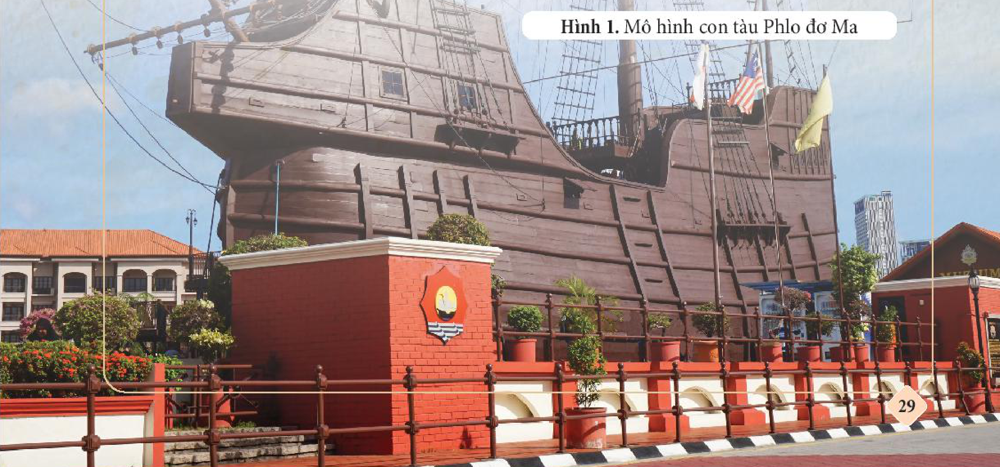
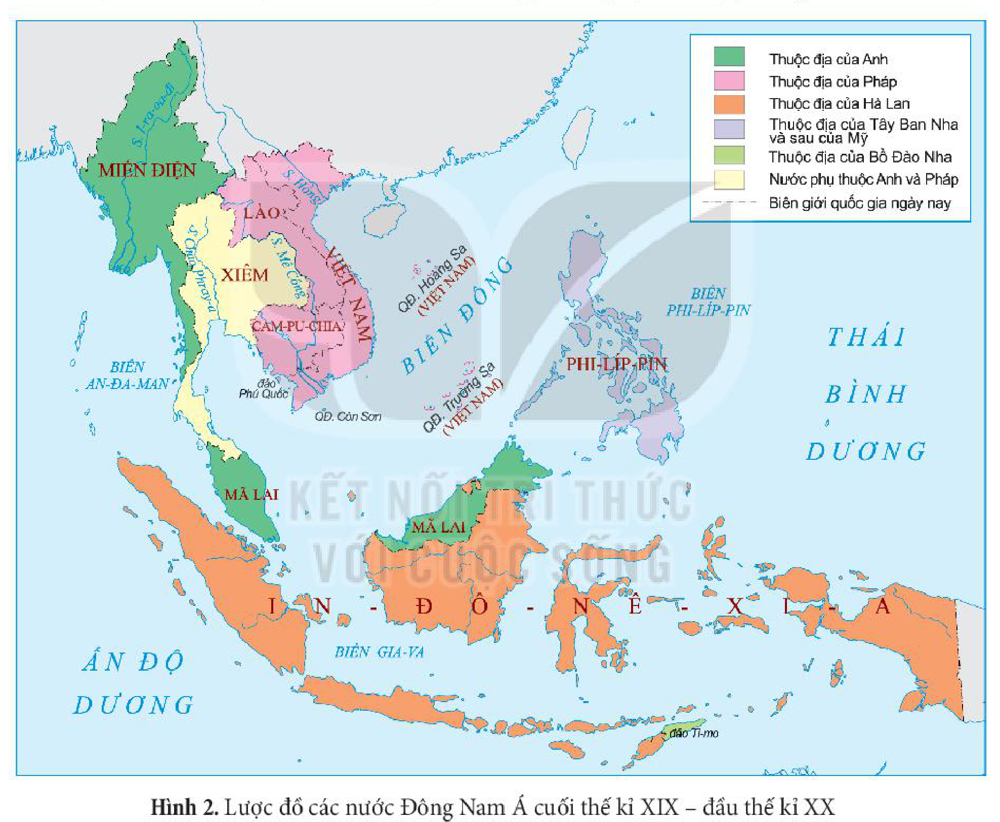
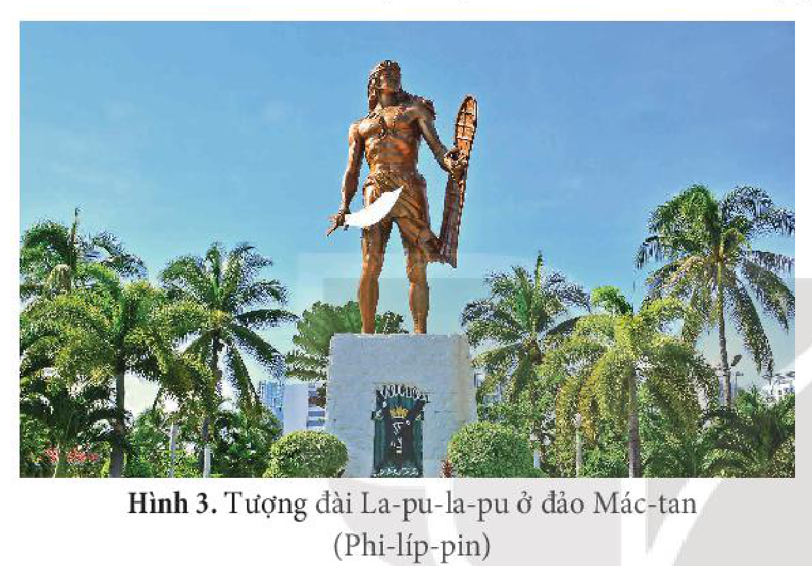
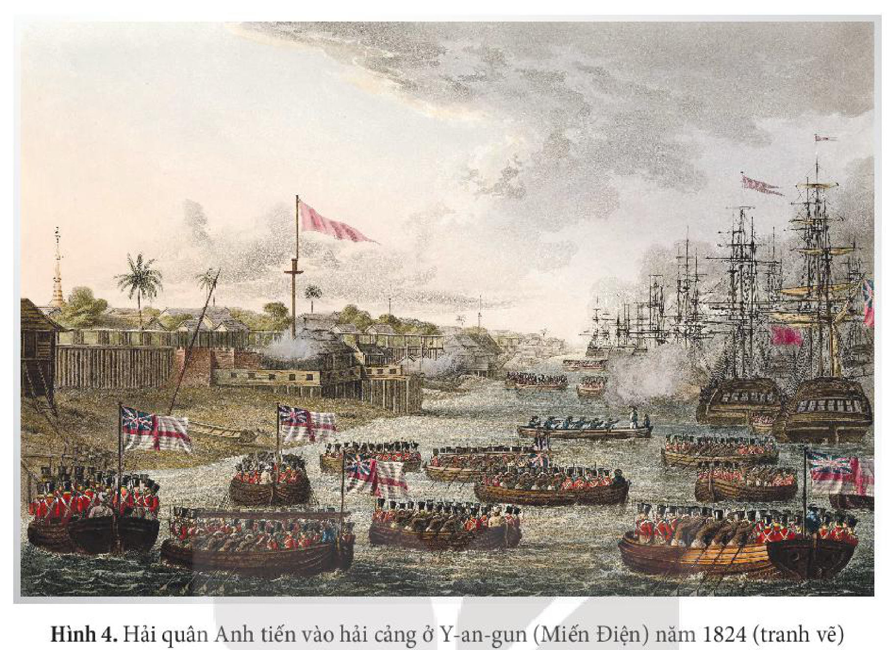
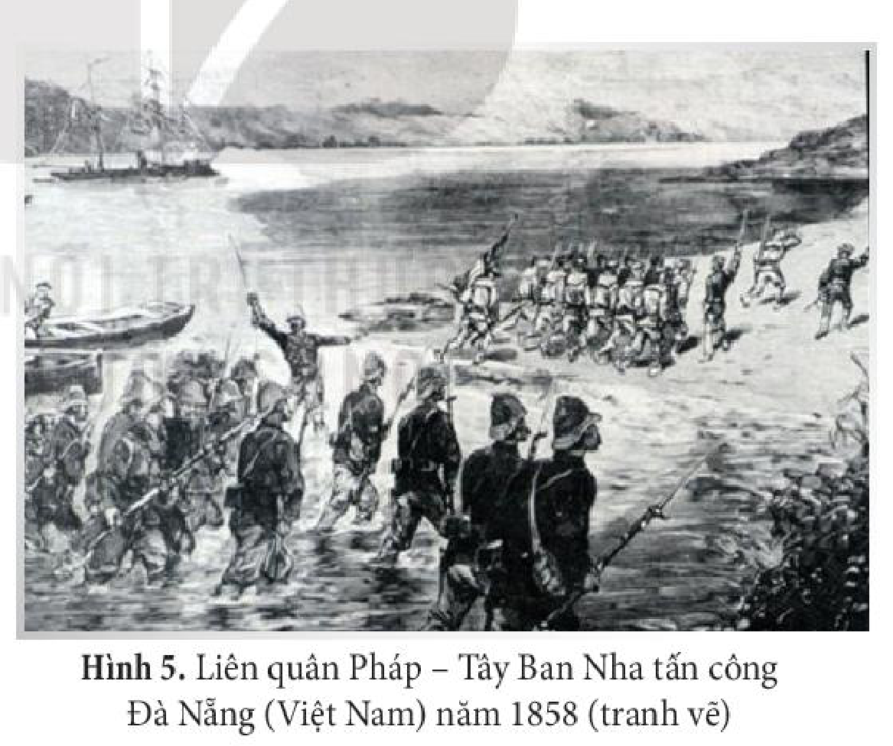
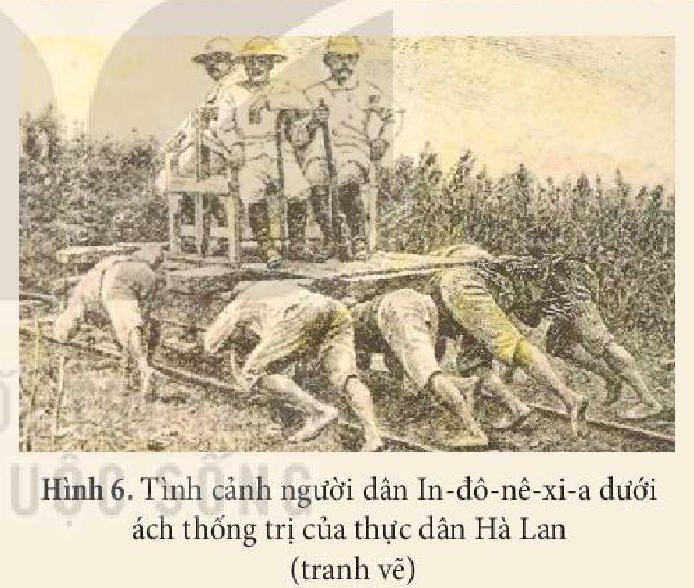
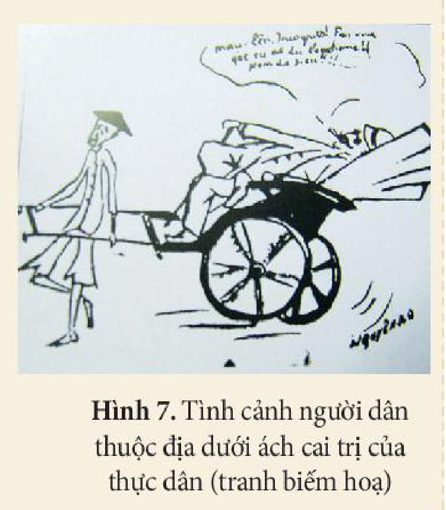
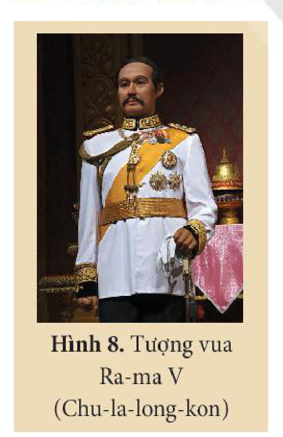
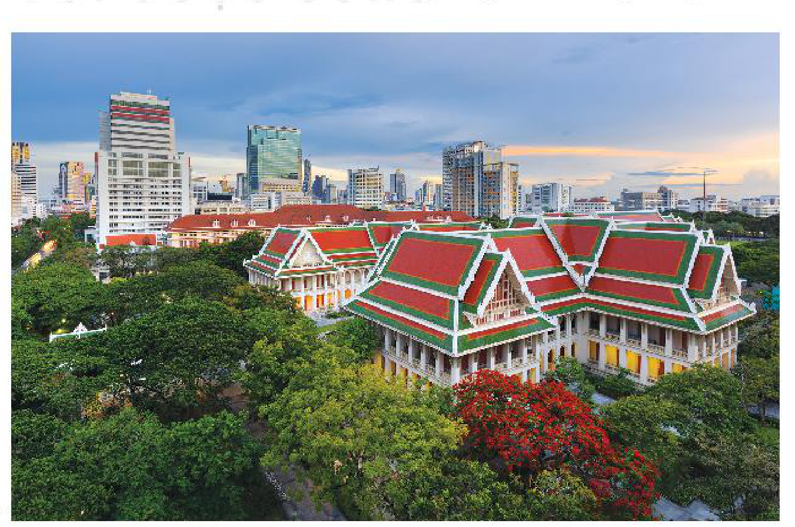
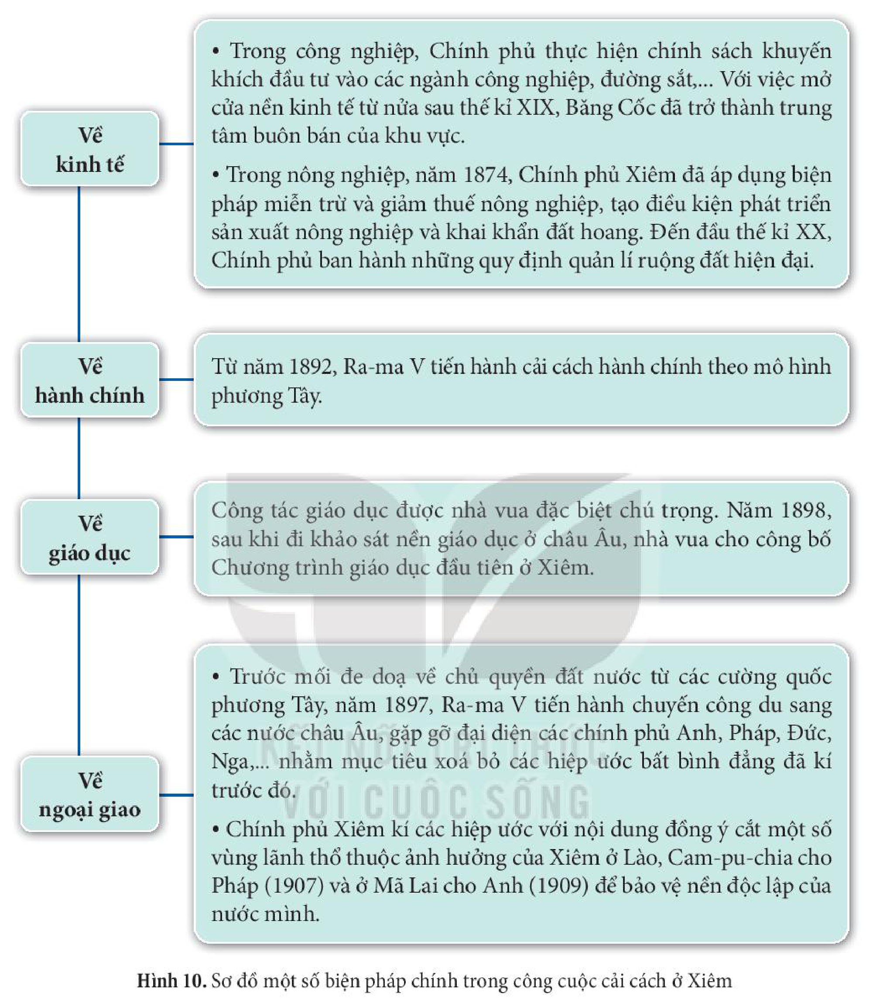

<!-- pdf:30 -->

# BÀI 5: QUÁ TRÌNH XÂM LƯỢC VÀ CAI TRỊ CỦA CHỦ NGHĨA THỰC DÂN Ở ĐÔNG NAM Á

## 🎯 Học xong bài này, em sẽ:

- Trình bày được quá trình các nước thực dân phương Tây xâm lược và thiết lập nền thống trị ở Đông Nam Á hải đảo và Đông Nam Á lục địa.
- Trình bày được công cuộc cải cách ở Xiêm.
- Giải thích được vì sao Xiêm là nước duy nhất ở Đông Nam Á không trở thành thuộc địa của thực dân phương Tây.

## 🔴 Mở đầu

Tại Bảo tàng Hàng hải ở Ma-lắc-ca (Ma-lai-xi-a), mô hình con tàu Phlo đơ Ma của Bồ Đào Nha bị đắm ở Ma-lắc-ca thu hút sự chú ý của đông đảo khách tham quan. Đây là một trong số những con tàu thuộc hạm thuyền hùng mạnh của thực dân Bồ Đào Nha tấn công xâm lược Vương quốc Ma-lắc-ca, cũng là một thương cảng sầm uất ở Đông Nam Á vào năm 1511. Sự kiện này đã mở đầu cho quá trình xâm lược và thống trị kéo dài nhiều thế kỉ của thực dân phương Tây ở Đông Nam Á. Quá trình thực dân phương Tây xâm lược và cai trị ở các nước Đông Nam Á diễn ra như thế nào?

*Hình 1. Mô hình con tàu Phlo đơ Ma*

<!-- pdf:31 -->

## 1. Quá trình xâm lược và cai trị của thực dân phương Tây ở Đông Nam Á

### a) Quá trình xâm lược

<!-- term: Bối cảnh thực dân xâm lược Đông Nam Á -->
Từ đầu thế kỉ XVI, các nước phương Tây bắt đầu mở rộng quá trình xâm nhập vào các nước Đông Nam Á. Trong thời gian đầu, quá trình này được tiến hành thông qua các hoạt động buôn bán và truyền giáo. Thông qua các thương điếm, các nước châu Âu mở rộng giao thương và từng bước chuẩn bị cho quá trình xâm lược.

<!-- term: Bối cảnh thực dân xâm lược Đông Nam Á -->
Quá trình xâm lược của thực dân phương Tây diễn ra trong bối cảnh phần lớn các nước Đông Nam Á bước vào thời kì suy thoái, khủng hoảng của chế độ phong kiến về chính trị, kinh tế, xã hội với nhiều cuộc nổi dậy chống lại chế độ phong kiến.

*Hình 2. Lược đồ các nước Đông Nam Á cuối thế kỉ XIX – đầu thế kỉ XX*

• *Đối với Đông Nam Á hải đảo*

<!-- term: Xâm lược Đông Nam Á hải đảo -->
Các nước Đông Nam Á hải đảo là đối tượng đầu tiên thu hút sự chú ý của thực dân phương Tây, bởi đây là khu vực giàu tài nguyên, có nguồn hương liệu và hàng hoá phong phú, lại nằm trên tuyến đường biển huyết mạch nối liền phương Đông và phương Tây với nhiều thương cảng sầm uất.

<!-- pdf:32 -->

> TƯ LIỆU 1. Năm 1511, thực dân Bồ Đào Nha đánh chiếm Ma-lắc-ca (nay thuộc Ma-lai-xi-a)... Việc đánh chiếm Ma-lắc-ca là “một trong những đặc điểm quan trọng nhất của một kế hoạch chiến lược toàn diện” của người Bồ Đào Nha ở khu vực này.
>
> *(Theo D. G. E. Hôn, Lịch sử Đông Nam Á, NXB Chính trị quốc gia, Hà Nội, 1997, tr. 379)*

<!-- term: Xâm lược Đông Nam Á hải đảo -->
Giữa thế kỉ XVI, Phi-líp-pin chính thức bị thực dân Tây Ban Nha xâm lược và thống trị. Sau cuộc chiến tranh Mỹ – Tây Ban Nha (1898), Phi-líp-pin đã trở thành thuộc địa của Mỹ.

*Hình 3. Tượng đài La-pu-la-pu ở đảo Mác-tan (Phi-líp-pin)*

<!-- term: La-pu-la-pu -->
> 💡 EM CÓ BIẾT ?
>
> La-pu-la-pu, người anh hùng dân tộc của Phi-líp-pin, thủ lĩnh của thổ dân ở đảo Mác-tan, đã lãnh đạo đội quân đánh thắng thực dân Tây Ban Nha năm 1521. Hình ảnh của ông đã được chọn làm biểu tượng cho ý chí chiến đấu, sự dũng cảm của lực lượng Cảnh sát và Cục Phòng cháy chữa cháy của Phi-líp-pin ngày nay.

<!-- term: Xâm lược Đông Nam Á hải đảo -->
Cuối thế kỉ XVI, thực dân Hà Lan bắt đầu quá trình xâm nhập In-đô-nê-xi-a. Nhưng phải đến giữa thế kỉ XIX, trải qua cuộc cạnh tranh quyết liệt với Bồ Đào Nha, Hà Lan mới hoàn thành việc kiểm soát nước này.

<!-- term: Xâm lược Đông Nam Á hải đảo -->
Mặc dù đến muộn hơn, nhưng thực dân Anh đã nhanh chóng mở rộng ảnh hưởng ở khu vực Đông Nam Á. Đầu thế kỉ XX, toàn bộ vùng lãnh thổ ngày nay của Ma-lai-xi-a, Xin-ga-po, Bru-nây rơi vào tay người Anh dưới những hình thức cai trị khác nhau.

<!-- term: Xâm lược Đông Nam Á hải đảo -->
Trải qua gần 4 thế kỉ (từ đầu thế kỉ XVI đến đầu thế kỉ XX), bằng những thủ đoạn khác nhau, từ buôn bán, xâm nhập thị trường, đến tiến hành chiến tranh xâm lược và cạnh tranh quyết liệt với nhau, thực dân phương Tây đã hoàn thành quá trình xâm lược các nước Đông Nam Á hải đảo.

• *Đối với Đông Nam Á lục địa*

<!-- term: Xâm lược Đông Nam Á lục địa -->
Quá trình xâm lược của thực dân phương Tây đối với các nước Đông Nam Á lục địa bắt đầu vào thế kỉ XIX, muộn hơn so với các nước Đông Nam Á hải đảo.

<!-- term: Xâm lược Đông Nam Á lục địa -->
Thực dân Anh sau hơn 60 năm (1824 – 1885), tiến hành 3 cuộc chiến tranh mới chiếm được Miến Điện (Mi-an-ma). Thực dân Pháp phải trải qua cuộc chiến tranh xâm lược kéo dài gần nửa thế kỉ (1858 – 1893) mới hoàn thành việc xâm chiếm 3 nước Đông Dương.

<!-- pdf:33 -->

*Hình 4. Hải quân Anh tiến vào hải cảng ở Y-an-gun (Miến Điện) năm 1824 (tranh vẽ)*

<!-- term: Xâm lược Đông Nam Á lục địa -->
Đến đầu thế kỉ XX, các nước thực dân phương Tây đã hoàn thành quá trình thôn tính Đông Nam Á. Hầu hết các nước trong khu vực đều trở thành thuộc địa của thực dân phương Tây. Vương quốc Xiêm (Thái Lan) tuy giữ được nền độc lập nhưng bị lệ thuộc vào nước ngoài về nhiều mặt và trở thành “vùng đệm” giữa khu vực thuộc địa của thực dân Anh và thực dân Pháp.

*Hình 5. Liên quân Pháp – Tây Ban Nha tấn công Đà Nẵng (Việt Nam) năm 1858 (tranh vẽ)*

> ❓ 1. Khai thác Tư liệu 1 (tr. 31) và thông tin trong mục, trình bày quá trình thực dân phương Tây xâm lược các nước Đông Nam Á.
>
> 2. Theo em, cách thức tiến hành xâm lược các nước Đông Nam Á của thực dân phương Tây có những điểm chung gì?

<!-- pdf:34 -->

### b) Chính sách cai trị

<!-- term: Chính sách cai trị về chính trị -->
*Về chính trị,* thực dân phương Tây tiến hành thiết lập nền thống trị ở Đông Nam Á dưới các hình thức khác nhau, nhưng đều có điểm chung là bên cạnh sự cai trị của chính quyền thực dân thì các thế lực phong kiến địa phương vẫn được duy trì như một công cụ để thi hành chính sách cai trị thuộc địa.

<!-- term: Chính sách cai trị về chính trị -->
Về hình thức cai trị, dù các nước thực dân áp đặt hình thức cai trị trực tiếp hay gián tiếp, nhưng các quyền hành chính, lập pháp, tư pháp, ngoại giao, quân sự,... của các thuộc địa vẫn tập trung trong tay đại diện của chính quyền thực dân.

<!-- term: Chính sách cai trị về chính trị -->
Chính sách “chia để trị” là phương thức phổ biến được thực dân phương Tây sử dụng nhằm chia rẽ, làm suy yếu sức mạnh dân tộc của các nước Đông Nam Á. Ngoài ra, chính quyền thực dân chú trọng việc xây dựng và sử dụng lực lượng quân đội người bản địa để bảo vệ bộ máy cai trị và đàn áp sự phản kháng của người dân thuộc địa.

<!-- term: Chính sách cai trị về kinh tế -->
*Về kinh tế,* chính quyền thực dân thực hiện chính sách bóc lột, khai thác các thuộc địa, biến các nước trong khu vực thành nơi cung cấp nguồn nguyên liệu và thị trường tiêu thụ hàng hoá, phục vụ lợi ích cho chính quốc.

<!-- term: Chính sách cai trị về kinh tế -->
> TƯ LIỆU 2. Điểm chung của chính sách thống trị thực dân ở Đông Nam Á là khai thác, vơ vét và bòn rút các quốc gia trong khu vực bằng chính sách thuế khoá đánh vào các tầng lớp nhân dân bản địa, cướp ruộng đất lập đồn điền, bóc lột sức người, khai thác tài nguyên; thông qua khai thác triệt để sản phẩm nông nghiệp, tiếp tục đầu tư để bóc lột lâu dài trong công nghiệp... Vì vậy, cao su, cà phê, chè, lúa gạo là những sản vật đặc trưng của Đông Nam Á được thực dân phương Tây chú ý khai thác từ sớm.
>
> *(Lương Ninh (Chủ biên), Đông Nam Á: Lịch sử từ nguyên thuỷ đến ngày nay, NXB Chính trị quốc gia, Hà Nội, 2018, tr. 377)*

*Hình 6. Tình cảnh người dân In-đô-nê-xi-a dưới ách thống trị của thực dân Hà Lan (tranh vẽ)*

<!-- term: Chính sách cai trị văn hoá xã hội -->
*Về văn hoá – xã hội,* các nước thực dân phương Tây đã tìm mọi cách kìm hãm người dân ở các nước thuộc địa trong tình trạng lạc hậu, nghèo đói, đồng thời làm xói mòn giá trị truyền thống của các quốc gia Đông Nam Á.

<!-- term: Chính sách cai trị văn hoá xã hội -->
Hầu hết người dân các nước thuộc địa đều mù chữ: ở Mã Lai, năm 1931 chỉ có 8,5% dân số biết chữ; ở Việt Nam, năm 1926 chỉ có khoảng 6% trẻ em ở độ tuổi đi học được tới trường, hơn 90% dân số không biết chữ. Cùng với chính sách ngu dân, thực dân phương Tây thi hành chính sách đầu độc người dân bản địa bằng rượu, thuốc phiện để dễ bề cai trị. Hệ thống y tế lạc hậu khiến cho tỉ lệ tử vong vì ốm đau, bệnh tật tăng cao, đặc biệt là trẻ em.

<!-- pdf:35 -->

> TƯ LIỆU 3. Trong tác phẩm *Bản án chế độ thực dân Pháp*, Nguyễn Ái Quốc đã tố cáo chính sách thống trị của thực dân Pháp: “Một bên là những người bản xứ,... họ phải đổ mồ hôi, sôi nước mắt trong những lao tác nặng nhọc nhất và bạc bẽo nhất để kiếm sống một cách chật vật, và hầu như chỉ bằng sức của họ thôi, để nuôi mọi ngân quỹ của chính quyền. Một bên là những người Pháp và người nước ngoài: họ đều đi lại tự do, tự dành cho mình tất cả các tài nguyên của đất nước, chiếm đoạt toàn bộ xuất nhập khẩu và tất cả các ngành nghề béo bở nhất, bóc lột trâng tráo trong cảnh dốt nát và nghèo khốn của nhân dân”.
>
> *(Hồ Chí Minh, Toàn tập, Tập 1, NXB Chính trị quốc gia Sự thật, 2011, tr. 12)*

*Hình 7. Tình cảnh người dân thuộc địa dưới ách cai trị của thực dân (tranh biếm hoạ)*

> ❓ Khai thác các tư liệu 2, 3 và thông tin trong mục, trình bày chính sách cai trị của thực dân phương Tây đối với các nước Đông Nam Á.

## 2. Công cuộc cải cách ở Xiêm

<!-- term: Công cuộc cải cách ở Xiêm -->
Vào giữa thế kỉ XIX, Vương quốc Xiêm đứng trước sự đe doạ xâm lược của thực dân phương Tây. Từ năm 1851, vua Ra-ma IV đã tiến hành cải cách, chủ trương mở cửa buôn bán với nước ngoài. Đặc biệt, từ năm 1868, dưới thời vua Ra-ma V, Xiêm đã tiến hành hàng loạt cải cách quan trọng về kinh tế, xã hội, hành chính, giáo dục, ngoại giao,...

*Hình 8. Tượng vua Ra-ma V (Chu-la-long-kon)*

*Hình 9. Trường Đại học Chu-la-long-kon (Thái Lan) thành lập năm 1917*

<!-- pdf:36 -->

*Hình 10. Sơ đồ một số biện pháp chính trong công cuộc cải cách ở Xiêm*

<!-- term: Công cuộc cải cách ở Xiêm -->
| Lĩnh vực | Nội dung cải cách |
| --- | --- |
| **Về kinh tế** | • Trong công nghiệp, Chính phủ thực hiện chính sách khuyến khích đầu tư vào các ngành công nghiệp, đường sắt,... Với việc mở cửa nền kinh tế từ nửa sau thế kỉ XIX, Băng Cốc đã trở thành trung tâm buôn bán của khu vực. • Trong nông nghiệp, năm 1874, Chính phủ Xiêm đã áp dụng biện pháp miễn trừ và giảm thuế nông nghiệp, tạo điều kiện phát triển sản xuất nông nghiệp và khai khẩn đất hoang. Đến đầu thế kỉ XX, Chính phủ ban hành những quy định quản lí ruộng đất hiện đại. |
| **Về hành chính** | Từ năm 1892, Ra-ma V tiến hành cải cách hành chính theo mô hình phương Tây. |
| **Về giáo dục** | Công tác giáo dục được nhà vua đặc biệt chú trọng. Năm 1898, sau khi đi khảo sát nền giáo dục ở châu Âu, nhà vua cho công bố Chương trình giáo dục đầu tiên ở Xiêm. |
| **Về ngoại giao** | • Trước mối đe doạ về chủ quyền đất nước từ các cường quốc phương Tây, năm 1897, Ra-ma V tiến hành chuyến công du sang các nước châu Âu, gặp gỡ đại diện các chính phủ Anh, Pháp, Đức, Nga,... nhằm mục tiêu xoá bỏ các hiệp ước bất bình đẳng đã kí trước đó. • Chính phủ Xiêm kí các hiệp ước với nội dung đồng ý cắt một số vùng lãnh thổ thuộc ảnh hưởng của Xiêm ở Lào, Cam-pu-chia cho Pháp (1907) và ở Mã Lai cho Anh (1909) để bảo vệ nền độc lập của nước mình. |

<!-- term: Ý nghĩa công cuộc cải cách ở Xiêm -->
Công cuộc cải cách đã góp phần thúc đẩy sản xuất phát triển, mở cửa cho hàng hoá xuất khẩu,... đưa Vương quốc Xiêm phát triển theo con đường tư bản chủ nghĩa, từng bước hội nhập với thế giới trong những thập niên tiếp theo.

<!-- term: Ý nghĩa công cuộc cải cách ở Xiêm -->
Trên cơ sở những thành tựu của công cuộc cải cách, Chính phủ Xiêm có thực lực để thực hiện đường lối ngoại giao mềm dẻo, nhằm giữ vững nền độc lập và chủ quyền đất nước, không bị rơi vào tình trạng thuộc địa.

<!-- pdf:37 -->

<!-- term: Ý nghĩa công cuộc cải cách ở Xiêm -->
Trong bối cảnh hầu hết các quốc gia trong khu vực đều trở thành thuộc địa của thực dân, công cuộc cải cách của Xiêm chính là một trong những con đường ứng phó hiệu quả với làn sóng xâm lược của thực dân phương Tây ở Đông Nam Á.

> ❓ 1. Trình bày nét chính về công cuộc cải cách ở Xiêm.
>
> 2. Vì sao Xiêm là nước duy nhất ở Đông Nam Á không trở thành thuộc địa của thực dân phương Tây?

## ✏️ Luyện tập và vận dụng

1. Xây dựng trục thời gian thể hiện những nét chính về quá trình thực dân phương Tây xâm lược các nước Đông Nam Á.

2. Theo em, những chính sách cai trị của thực dân phương Tây ở Đông Nam Á đã tác động như thế nào đối với các nước trong khu vực?

Sưu tầm tài liệu từ sách, báo, internet, viết một bài (khoảng 300 chữ) về quá trình thực dân phương Tây xâm lược và thiết lập nền thống trị ở một nước Đông Nam Á.

## 📷 Danh sách hình trong bài

| Mã hình | Trang PDF | Vị trí trong bài | Chú thích gốc |
| --- | --- | --- | --- |
| H11-lich_su-b05-01 | 30 | Mở đầu | Hình 1. Mô hình con tàu Phlo đơ Ma |
| H11-lich_su-b05-02 | 31 | Mục 1.a | Hình 2. Lược đồ các nước Đông Nam Á cuối thế kỉ XIX – đầu thế kỉ XX |
| H11-lich_su-b05-03 | 32 | Mục 1.a | Hình 3. Tượng đài La-pu-la-pu ở đảo Mác-tan (Phi-líp-pin) |
| H11-lich_su-b05-04 | 33 | Mục 1.a | Hình 4. Hải quân Anh tiến vào hải cảng ở Y-an-gun (Miến Điện) năm 1824 (tranh vẽ) |
| H11-lich_su-b05-05 | 33 | Mục 1.a | Hình 5. Liên quân Pháp – Tây Ban Nha tấn công Đà Nẵng (Việt Nam) năm 1858 (tranh vẽ) |
| H11-lich_su-b05-06 | 34 | Mục 1.b | Hình 6. Tình cảnh người dân In-đô-nê-xi-a dưới ách thống trị của thực dân Hà Lan (tranh vẽ) |
| H11-lich_su-b05-07 | 35 | Mục 1.b | Hình 7. Tình cảnh người dân thuộc địa dưới ách cai trị của thực dân (tranh biếm hoạ) |
| H11-lich_su-b05-08 | 35 | Mục 2 | Hình 8. Tượng vua Ra-ma V (Chu-la-long-kon) |
| H11-lich_su-b05-09 | 35 | Mục 2 | Hình 9. Trường Đại học Chu-la-long-kon (Thái Lan) thành lập năm 1917 |
| H11-lich_su-b05-10 | 36 | Mục 2 | Hình 10. Sơ đồ một số biện pháp chính trong công cuộc cải cách ở Xiêm |
