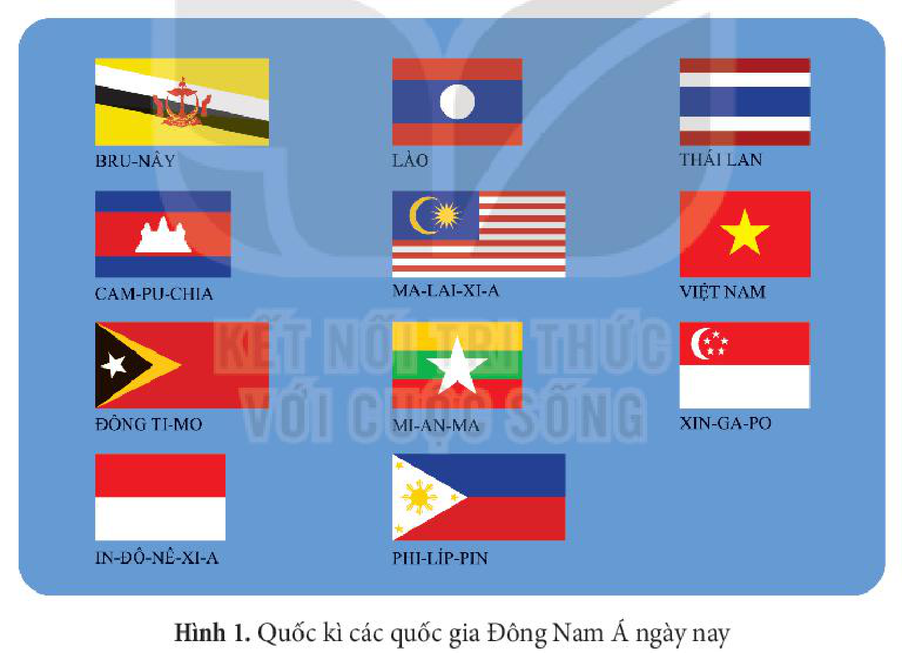
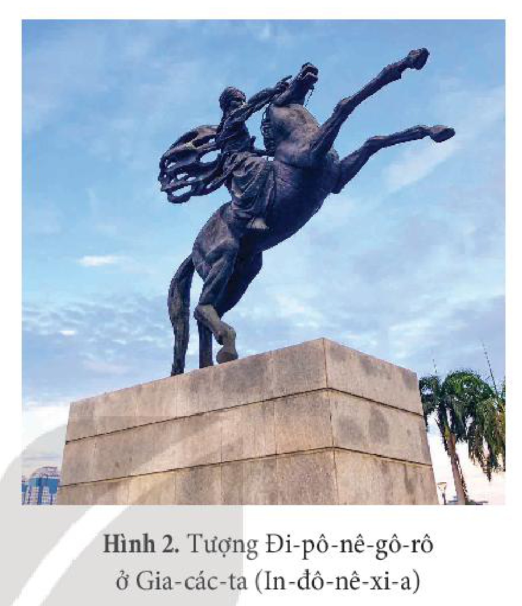
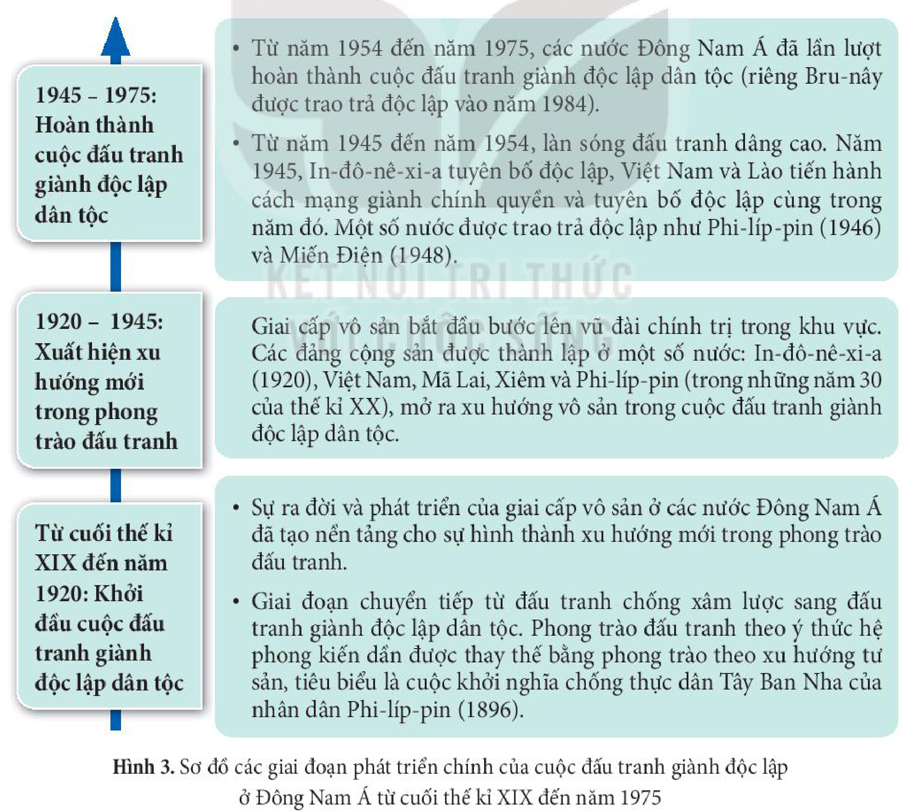
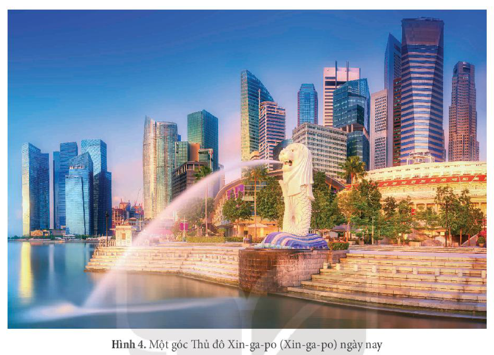

<!-- pdf:38 -->

# BÀI 6: HÀNH TRÌNH ĐI ĐẾN ĐỘC LẬP DÂN TỘC Ở ĐÔNG NAM Á

## 🎯 Học xong bài này, em sẽ:

- Tóm tắt được những nét chính về cuộc đấu tranh chống thực dân xâm lược ở một số nước Đông Nam Á hải đảo và Đông Nam Á lục địa.
- Nêu được các giai đoạn phát triển của cuộc đấu tranh giành độc lập dân tộc ở Đông Nam Á.
- Nêu được những ảnh hưởng của chế độ thực dân đối với các thuộc địa. Liên hệ với thực tế ở Việt Nam.
- Tóm tắt được những nét chính về quá trình tái thiết và phát triển ở Đông Nam Á.
- Có ý thức trân trọng thành quả đấu tranh giành độc lập dân tộc và phát triển của các dân tộc ở Đông Nam Á hiện nay.

## 🔴 Mở đầu

*Hình 1. Quốc kì các quốc gia Đông Nam Á ngày nay*

Quốc kì của các quốc gia Đông Nam Á hiện nay rất đa dạng và là biểu tượng cho nền độc lập dân tộc của mỗi quốc gia. Hầu hết các nước trong khu vực đều phải trải qua quá trình đấu tranh lâu dài, gian khổ để giành độc lập dân tộc, sau đó là quá trình tái thiết và phát triển đất nước, đưa Đông Nam Á trở thành khu vực năng động như ngày nay. Hành trình đó diễn ra như thế nào? Hãy chia sẻ một số sự kiện liên quan đến cuộc đấu tranh giành độc lập và quá trình phát triển của các nước ở Đông Nam Á mà em biết.

<!-- pdf:39 -->

## 1. Phong trào đấu tranh chống thực dân xâm lược ở Đông Nam Á

### a) Đông Nam Á hải đảo

<!-- term: Phong trào chống thực dân ở hải đảo -->
Phong trào chống thực dân xâm lược ở các nước Đông Nam Á hải đảo bùng nổ từ rất sớm, tiêu biểu là ở In-đô-nê-xi-a và Phi-líp-pin.

<!-- term: Phong trào chống thực dân ở hải đảo -->
<!-- term: Khởi nghĩa Đi-pô-nê-gô-rô -->
Từ thế kỉ XVI đến thế kỉ XIX, phong trào đấu tranh chống thực dân Hà Lan đã bùng nổ mạnh mẽ ở In-đô-nê-xi-a. Trong số đó, nổi bật là cuộc khởi nghĩa của Hoàng tử Đi-pô-nê-gô-rô (1825 – 1830), với sự hưởng ứng của các lãnh chúa và sự tham gia của đông đảo người dân trên đảo Gia-va và các đảo khác. Cuộc khởi nghĩa tuy thất bại nhưng đã gây tổn thất nặng nề cho chính quyền thực dân. Sau cuộc khởi nghĩa, phong trào đấu tranh vẫn tiếp tục lan rộng khắp các đảo ở In-đô-nê-xi-a, kéo dài đến cuối thế kỉ XIX – đầu thế kỉ XX.

*Hình 2. Tượng Đi-pô-nê-gô-rô ở Gia-các-ta (In-đô-nê-xi-a)*

<!-- term: Phong trào chống thực dân ở hải đảo -->
Ở Phi-líp-pin, cuộc đấu tranh chống thực dân Tây Ban Nha bùng nổ ở Phi-líp-pin từ năm 1521, lan rộng ra các đảo khác và kéo dài hơn 3 thế kỉ. Trong số đó, cuộc khởi nghĩa của Đa-ga-hô ở Bô-hô là cuộc khởi nghĩa kéo dài nhất (1744 – 1829).

> ❓ Nêu những nét chính về phong trào đấu tranh chống thực dân xâm lược ở In-đô-nê-xi-a và Phi-líp-pin.

### b) Đông Nam Á lục địa

<!-- term: Phong trào chống thực dân ở lục địa -->
Ở Miến Điện, thực dân Anh phải trải qua 3 cuộc chiến tranh kéo dài hơn 60 năm (1821 – 1885) mới chiếm được Miến Điện. Phong trào chiến tranh du kích lan rộng trong cả nước, khiến cho thực dân Anh bị tổn thất nặng nề. Sau khi hoàn thành quá trình xâm lược, thực dân Anh phải tiếp tục đối phó với cuộc chiến tranh du kích kéo dài hơn 10 năm sau.

<!-- term: Phong trào chống thực dân ở lục địa -->
Trên bán đảo Đông Dương, từ nửa sau thế kỉ XIX, phong trào chống thực dân Pháp xâm lược bùng nổ mạnh mẽ và từng bước lan rộng.

<!-- term: Phong trào chống thực dân ở lục địa -->
Ở Việt Nam, từ năm 1858, cuộc chiến đấu chống xâm lược của nhân dân Việt Nam đã làm thất bại kế hoạch “đánh nhanh, thắng nhanh” của thực dân Pháp. Phong trào kháng chiến lan rộng ra các tỉnh Nam Kì và Bắc Kì, thu hút sự tham gia của đông đảo các tầng lớp nhân dân. Thực dân Pháp phải mất 26 năm (1858 – 1884) mới đặt được ách đô hộ trên toàn bộ đất nước Việt Nam.

<!-- pdf:40 -->

<!-- term: Phong trào chống thực dân ở lục địa -->
Ở Cam-pu-chia, nhiều cuộc khởi nghĩa chống thực dân Pháp diễn ra sôi nổi trong cả nước, mở đầu là cuộc khởi nghĩa của Hoàng thân Si-vô-tha (1861 – 1892). Các cuộc khởi nghĩa của A-cha Xoa (1863 – 1866), Pu-côm-bô (1866 – 1867) có quy mô lớn, gây nhiều tổn thất cho thực dân Pháp.

<!-- term: Khởi nghĩa Pu-côm-bô -->
> 💡 EM CÓ BIẾT ?
>
> Trong cuộc khởi nghĩa của Pu-côm-bô, nghĩa quân đã lập căn cứ ở Tây Ninh (Việt Nam), liên kết với Trương Quyền (con của Trương Định) trong những trận đánh Pháp. Cuộc khởi nghĩa của Pu-côm-bô là biểu tượng của sự đoàn kết chiến đấu giữa nhân dân Cam-pu-chia với nhân dân Việt Nam trong cuộc đấu tranh chống thực dân Pháp.

> ❓ Trình bày những nét chính về phong trào đấu tranh chống thực dân xâm lược ở Đông Nam Á lục địa.

## 2. Các giai đoạn phát triển của cuộc đấu tranh giành độc lập dân tộc ở Đông Nam Á

<!-- term: Các giai đoạn đấu tranh giành độc lập -->
Từ cuối thế kỉ XIX, sau khi chủ nghĩa thực dân áp đặt được ách cai trị đối với các nước Đông Nam Á, cuộc đấu tranh của nhân dân các nước này chuyển sang một thời kì mới – thời kì đấu tranh giành lại độc lập dân tộc và trải qua 3 giai đoạn phát triển chính.

*Hình 3. Sơ đồ các giai đoạn phát triển chính của cuộc đấu tranh giành độc lập ở Đông Nam Á từ cuối thế kỉ XIX đến năm 1975*

<!-- term: Các giai đoạn đấu tranh giành độc lập -->
| Giai đoạn | Nội dung chính |
| --- | --- |
| **Từ cuối thế kỉ XIX đến năm 1920: Khởi đầu cuộc đấu tranh giành độc lập dân tộc** | • Sự ra đời và phát triển của giai cấp vô sản ở các nước Đông Nam Á đã tạo nền tảng cho sự hình thành xu hướng mới trong phong trào đấu tranh. • Giai đoạn chuyển tiếp từ đấu tranh chống xâm lược sang đấu tranh giành độc lập dân tộc. Phong trào đấu tranh theo ý thức hệ phong kiến dần được thay thế bằng phong trào theo xu hướng tư sản, tiêu biểu là cuộc khởi nghĩa chống thực dân Tây Ban Nha của nhân dân Phi-líp-pin (1896). |
| **1920 – 1945: Xuất hiện xu hướng mới trong phong trào đấu tranh** | Giai cấp vô sản bắt đầu bước lên vũ đài chính trị trong khu vực. Các đảng cộng sản được thành lập ở một số nước: In-đô-nê-xi-a (1920), Việt Nam, Mã Lai, Xiêm và Phi-líp-pin (trong những năm 30 của thế kỉ XX), mở ra xu hướng vô sản trong cuộc đấu tranh giành độc lập dân tộc. |
| **1945 – 1975: Hoàn thành cuộc đấu tranh giành độc lập dân tộc** | • Từ năm 1945 đến năm 1954, làn sóng đấu tranh dâng cao. Năm 1945, In-đô-nê-xi-a tuyên bố độc lập, Việt Nam và Lào tiến hành cách mạng giành chính quyền và tuyên bố độc lập cùng trong năm đó. Một số nước được trao trả độc lập như Phi-líp-pin (1946) và Miến Điện (1948). • Từ năm 1954 đến năm 1975, các nước Đông Nam Á đã lần lượt hoàn thành cuộc đấu tranh giành độc lập dân tộc (riêng Bru-nây được trao trả độc lập vào năm 1984). |

<!-- pdf:41 -->

> ❓ Trình bày các giai đoạn phát triển của cuộc đấu tranh giành độc lập dân tộc ở Đông Nam Á. Từ đó, em có nhận xét gì?

## 3. Thời kì tái thiết và phát triển sau khi giành được độc lập

### a) Những ảnh hưởng của chế độ thực dân

<!-- term: Ảnh hưởng của chế độ thực dân -->
*Về kinh tế,* sau nhiều thế kỉ là thuộc địa của chủ nghĩa thực dân, phần lớn các nước Đông Nam Á vẫn là những nước nông nghiệp lạc hậu và lệ thuộc nặng nề vào nước ngoài. Một số nước trong khu vực mặc dù được coi là “vựa lúa” của thế giới nhưng lại rơi vào tình trạng thiếu lương thực, đói kém triền miên.

> TƯ LIỆU 1. Sau gần 150 năm là thuộc địa của Anh, Xin-ga-po chỉ là một hải cảng trung chuyển hàng hoá, nền kinh tế hoàn toàn phụ thuộc vào thị trường bên ngoài, tỉ lệ thất nghiệp tăng cao. Thủ tướng Lý Quang Diệu cho rằng: “Những gì mà người Xin-ga-po cần là sự trợ giúp tạo công ăn việc làm cho người lao động thông qua các ngành công nghiệp sản xuất chứ không phải là sự phụ thuộc vào những chuyến viện trợ liên tục... Chúng ta không thể sống bằng cái bát đi ăn xin”.
>
> *(Theo Lý Quang Diệu, Bí quyết hoá rồng: Lịch sử Xin-ga-po 1965 – 2000, NXB Trẻ, 2001, tr. 67)*

<!-- term: Ảnh hưởng của chế độ thực dân -->
*Về chính trị,* việc áp đặt bộ máy cai trị, thực hiện chính sách “chia để trị”, chính sách “ngu dân” của các chính quyền thực dân đã để lại những hậu quả nặng nề và lâu dài cho các nước Đông Nam Á.

<!-- term: Ảnh hưởng của chế độ thực dân -->
Chính sách “chia để trị”, sự phân biệt đối xử với các tộc người khác nhau là một trong những nguyên nhân sâu xa dẫn đến sự chia rẽ sâu sắc giữa các cộng đồng dân cư. Tình trạng xung đột về sắc tộc, tôn giáo,... còn kéo dài nhiều năm sau khi giành độc lập ở một số nước như Mi-an-ma, In-đô-nê-xi-a, Phi-líp-pin,...

> TƯ LIỆU 2. Trong tác phẩm *Bản án chế độ thực dân Pháp*, Nguyễn Ái Quốc viết: “Nhân dân Đông Dương khẩn khoản đòi mở trường học vì trường học thiếu một cách nghiêm trọng... “Làm cho dân ngu để dễ trị” đó là chính sách mà các nhà cầm quyền ở các thuộc địa của chúng ta ưa dùng nhất”.
>
> *(Hồ Chí Minh, Toàn tập, Tập 2, NXB Chính trị quốc gia Sự thật, 2011, tr. 107 – 108)*

<!-- term: Ảnh hưởng của chế độ thực dân -->
*Về văn hoá,* chính sách nô dịch, áp đặt văn hoá ngoại lai của chính quyền thực dân đã ảnh hưởng tiêu cực đến việc bảo vệ và phát huy những giá trị truyền thống của nền văn hoá các dân tộc ở Đông Nam Á.

<!-- pdf:42 -->

<!-- term: Ảnh hưởng của chế độ thực dân -->
Bên cạnh những tác động tiêu cực nêu trên, sự thống trị của chủ nghĩa thực dân phương Tây cũng tạo ra những chuyển biến nhất định đến quá trình phát triển của một số nước Đông Nam Á về hạ tầng cơ sở (mở mang đường giao thông, xây dựng thành phố, hải cảng mới,...).

> ❓ Khai thác các tư liệu 1, 2 (tr. 40) và thông tin trong mục, nêu những ảnh hưởng của chế độ thực dân đối với các nước Đông Nam Á.

### b) Quá trình tái thiết và phát triển

<!-- term: Quá trình tái thiết và phát triển -->
Để thoát khỏi tình trạng nghèo nàn, lạc hậu sau khi giành độc lập, các nước Đông Nam Á như In-đô-nê-xi-a, Ma-lai-xi-a, Phi-líp-pin, Xin-ga-po tiến hành chiến lược công nghiệp hoá từ giữa những năm 50 của thế kỉ XX, sớm hơn so với các nước còn lại trong khu vực.

<!-- term: Quá trình tái thiết và phát triển -->
<!-- term: Chiến lược công nghiệp hoá Đông Nam Á -->
Trong giai đoạn đầu, các nước Đông Nam Á thực hiện chiến lược công nghiệp hoá thay thế nhập khẩu với mục tiêu xây dựng nền kinh tế độc lập tự chủ, nhằm giải quyết những vấn đề cấp bách đặt ra cho nền kinh tế. Trong giai đoạn tiếp theo, các nước lần lượt chuyển sang thực hiện chiến lược công nghiệp hoá hướng về xuất khẩu, tập trung phát triển khu vực sản xuất hàng hoá xuất khẩu, lấy đó làm động lực chủ yếu để phát triển toàn bộ nền kinh tế.

<!-- term: Quá trình tái thiết và phát triển -->
Các nước Việt Nam, Lào, Cam-pu-chia từng bước chuyển sang nền kinh tế thị trường, tiến hành công nghiệp hoá từ cuối thập kỉ 80 – 90 của thế kỉ XX. Sau khi giành độc lập năm 1984, Bru-nây tiến hành điều chỉnh chính sách nhằm đa dạng hoá nền kinh tế. Mi-an-ma bắt đầu tiến hành cải cách kinh tế từ cuối năm 1998.

<!-- term: Quá trình tái thiết và phát triển -->
Trải qua quá trình phát triển, bằng những chính sách năng động và linh hoạt, các nước Đông Nam Á đã đạt được những thành tựu to lớn trong phát triển kinh tế với tốc độ tăng trưởng hằng năm đạt mức cao. Đời sống xã hội có những chuyển biến căn bản.

<!-- term: Quá trình tái thiết và phát triển -->
<!-- term: Hiệp hội các quốc gia Đông Nam Á -->
Kể từ năm 1967, tốc độ tăng trưởng GDP của các nước Đông Nam Á luôn đạt mức cao (trừ năm 1998, năm đỉnh điểm của khủng hoảng tài chính châu Á). Từ năm 1999, tốc độ tăng trưởng GDP cao hơn so với mức trung bình của thế giới. Hiệp hội các quốc gia Đông Nam Á (ASEAN) trở thành nền kinh tế lớn thứ năm thế giới với GDP đạt khoảng 3 000 tỉ USD từ năm 2018.

<!-- term: Hiệp hội các quốc gia Đông Nam Á -->
> 💡 EM CÓ BIẾT ?
>
> Hiệp hội các quốc gia Đông Nam Á (ASEAN) được thành lập ngày 8 – 8 – 1967 tại Băng Cốc (Thái Lan) với 5 thành viên ban đầu, phát triển dần thành một tổ chức khu vực hợp tác toàn diện, chặt chẽ với 10 thành viên và trở thành “mái nhà chung” của 10 quốc gia Đông Nam Á.
<!-- ocr-ok: đối chiếu ảnh p042.png (hộp Em có biết 2 cột bị OCR trộn dòng với cột trái) -->

<!-- pdf:43 -->

*Hình 4. Một góc Thủ đô Xin-ga-po (Xin-ga-po) ngày nay*

> ❓ Tóm tắt những nét chính về quá trình tái thiết và phát triển của các nước Đông Nam Á sau khi giành được độc lập.

## ✏️ Luyện tập và vận dụng

1. Nêu nhận xét của em về phong trào đấu tranh chống thực dân xâm lược ở khu vực Đông Nam Á.

2. Xây dựng trục thời gian tóm tắt các giai đoạn đấu tranh giành độc lập dân tộc ở khu vực Đông Nam Á.

1. Sưu tầm tài liệu từ sách, báo và internet, viết một bài (khoảng 300 chữ) về quá trình tái thiết và phát triển của một quốc gia Đông Nam Á mà em ấn tượng nhất.

2. Tìm hiểu và nêu ví dụ về những ảnh hưởng tiêu cực của chế độ thực dân Pháp đối với Việt Nam.

## 📷 Danh sách hình trong bài

| Mã hình | Trang PDF | Vị trí trong bài | Chú thích gốc |
| --- | --- | --- | --- |
| H11-lich_su-b06-01 | 38 | Mở đầu | Hình 1. Quốc kì các quốc gia Đông Nam Á ngày nay |
| H11-lich_su-b06-02 | 39 | Mục 1.a | Hình 2. Tượng Đi-pô-nê-gô-rô ở Gia-các-ta (In-đô-nê-xi-a) |
| H11-lich_su-b06-03 | 40 | Mục 2 | Hình 3. Sơ đồ các giai đoạn phát triển chính của cuộc đấu tranh giành độc lập ở Đông Nam Á từ cuối thế kỉ XIX đến năm 1975 |
| H11-lich_su-b06-04 | 43 | Mục 3.b | Hình 4. Một góc Thủ đô Xin-ga-po (Xin-ga-po) ngày nay |
