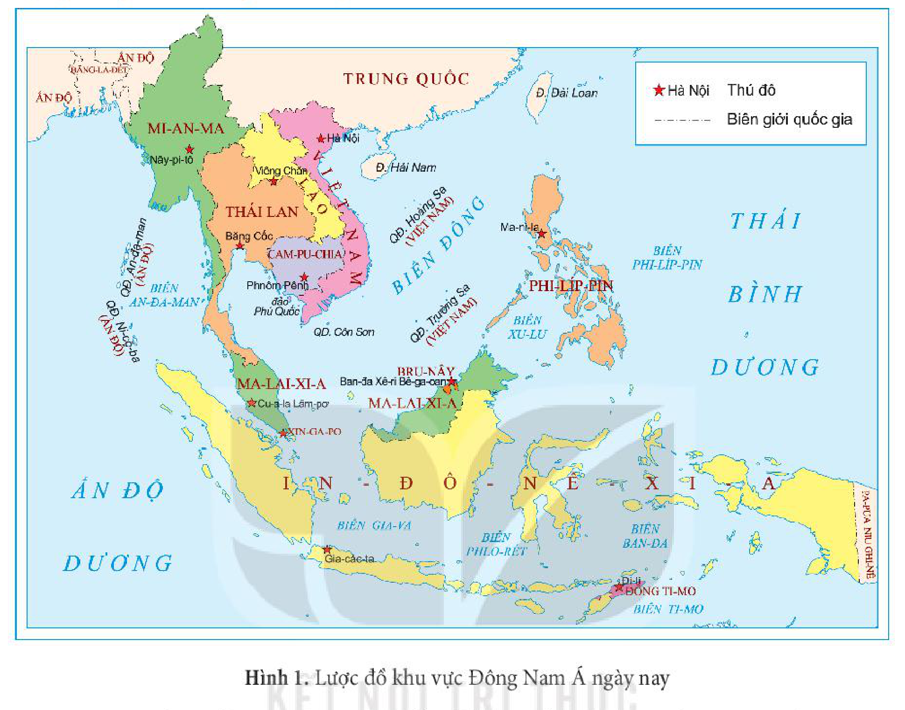
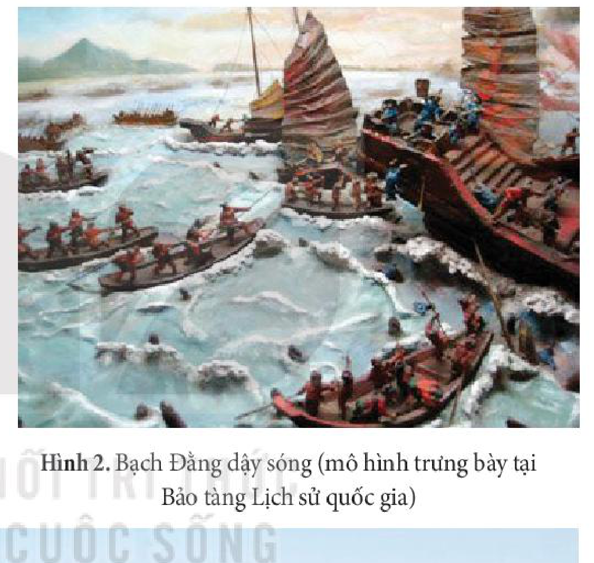
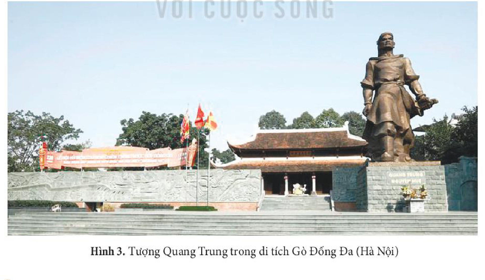

<!-- pdf:44 -->

# BÀI 7: CHIẾN TRANH BẢO VỆ TỔ QUỐC TRONG LỊCH SỬ VIỆT NAM

## 🎯 Học xong bài này, em sẽ:

- Nêu được vị trí địa chiến lược của Việt Nam. Phân tích được vai trò, ý nghĩa của chiến tranh bảo vệ Tổ quốc trong lịch sử Việt Nam.
- Trình bày được nội dung chính của các cuộc kháng chiến thắng lợi tiêu biểu và các cuộc kháng chiến không thành công của dân tộc Việt Nam.
- Giải thích được nguyên nhân chính dẫn đến thắng lợi và không thành công của các cuộc kháng chiến chống xâm lược.
- Vận dụng kiến thức đã học, rút ra được những bài học lịch sử cơ bản từ lịch sử chống ngoại xâm của dân tộc Việt Nam, nhận thức được giá trị của các bài học lịch sử đối với sự nghiệp xây dựng và bảo vệ Tổ quốc hiện nay.
- Biết cách sưu tầm và sử dụng tư liệu lịch sử để tìm hiểu về các cuộc kháng chiến thắng lợi tiêu biểu của dân tộc Việt Nam.
- Có ý thức trân trọng, tự hào về truyền thống đấu tranh bảo vệ, xây dựng đất nước của dân tộc Việt Nam, tham gia vào công tác đền ơn đáp nghĩa ở địa phương và sẵn sàng tham gia đóng góp xây dựng, bảo vệ Tổ quốc.
<!-- ocr-ok: đối chiếu trực tiếp ảnh p044.png (OCR đọc lỗi dấu đầu dòng và chữ trong mục Học xong bài này) -->

## 🔴 Mở đầu

*Đánh cho để tóc dài,*
*Đánh cho để răng đen,*
*Đánh cho nó chích luân bất phản,*
*Đánh cho nó phiến giáp bất hoàn*
*Đánh cho sử tri Nam quốc anh hùng chi hữu chủ.*

*(Theo Phan Huy Lê (Chủ biên), Lịch sử Việt Nam, Tập II, NXB Giáo dục Việt Nam, 2012, tr. 615)*

Lời dụ trên tương truyền là của vua Quang Trung khi tiến quân ra Bắc, đánh đuổi quân Thanh xâm lược (cuối năm 1788). Ý nghĩa của lời dụ trên là gì? Hãy kể tên một số cuộc kháng chiến thắng lợi tiêu biểu trong lịch sử Việt Nam mà em biết. Theo em, những nguyên nhân nào làm nên thắng lợi của các cuộc kháng chiến đó?

<!-- pdf:45 -->

## 1. Khái quát về chiến tranh bảo vệ Tổ quốc trong lịch sử Việt Nam

### a) Vị trí địa chiến lược của Việt Nam

*Hình 1. Lược đồ khu vực Đông Nam Á ngày nay*

<!-- term: Vị trí địa chiến lược của Việt Nam -->
Việt Nam thuộc khu vực Đông Nam Á – khu vực nằm trên trục đường giao thông quan trọng kết nối châu Á và châu Đại Dương, Ấn Độ Dương và Thái Bình Dương. Việt Nam cũng là cầu nối giữa Trung Quốc với khu vực Đông Nam Á, giữa Đông Nam Á lục địa và Đông Nam Á hải đảo. Cùng với nguồn tài nguyên phong phú, dân cư đông đúc,... Việt Nam trở thành một trong những quốc gia có vị trí địa chiến lược quan trọng. Vì vậy, trong suốt tiến trình lịch sử, Việt Nam luôn phải đối phó với nhiều thế lực ngoại xâm và tiến hành nhiều cuộc chiến tranh bảo vệ Tổ quốc.

### b) Vai trò, ý nghĩa của chiến tranh bảo vệ Tổ quốc trong lịch sử Việt Nam

<!-- term: Vai trò, ý nghĩa của chiến tranh bảo vệ Tổ quốc trong lịch sử Việt Nam -->
Chiến tranh bảo vệ Tổ quốc có vai trò quan trọng đối với sự sinh tồn và phát triển của dân tộc Việt Nam. Thắng lợi của những cuộc kháng chiến góp phần bảo vệ vững chắc nền độc lập, giữ gìn bản sắc văn hoá và tạo điều kiện thuận lợi cho quá trình xây dựng đất nước.

Sau cuộc kháng chiến chống quân Nguyên năm 1287 – 1288 thắng lợi, vua Trần Nhân Tông đến lễ tại lăng vua Trần Thái Tông. Nhìn con ngựa đá lấm bùn, vua đã làm những câu thơ:

*Xã tắc hai phen chồn ngựa đá*
*Non sông nghìn thuở vững âu vàng.*

<!-- pdf:46 -->

<!-- term: Vai trò, ý nghĩa của chiến tranh bảo vệ Tổ quốc trong lịch sử Việt Nam -->
Chiến tranh bảo vệ Tổ quốc có ý nghĩa to lớn trong việc hình thành và nâng cao lòng tự hào, ý thức tự cường và tô đậm những truyền thống tốt đẹp của dân tộc, đồng thời để lại nhiều bài học kinh nghiệm sâu sắc.

> TƯ LIỆU 1. Lịch sử chống ngoại xâm vừa thử thách, vừa tôi luyện dân tộc ta. Những cuộc chiến tranh yêu nước đã tạo nên cho dân tộc ta một bản lĩnh kiên cường, một sức sống bền bỉ, mãnh liệt, đã hun đúc nên nhiều truyền thống tốt đẹp, tiêu biểu là: lòng yêu nước tha thiết, ý chí độc lập tự chủ mạnh mẽ, tinh thần đoàn kết keo sơn, chí quật cường bất khuất, trí thông minh sáng tạo,...
>
> *(Theo Phan Huy Lê,..., Một số trận quyết chiến chiến lược trong lịch sử dân tộc, NXB Hồng Đức, 2019, tr. 15)*

> ❓ 1. Khai thác Hình 1 và thông tin trong mục, nêu vị trí địa chiến lược của Việt Nam.
>
> 2. Cho biết vị trí đó ảnh hưởng như thế nào đến lịch sử chống ngoại xâm của dân tộc Việt Nam?
>
> 3. Phân tích vai trò và ý nghĩa của chiến tranh bảo vệ Tổ quốc trong lịch sử Việt Nam.

## 2. Khái quát về các cuộc kháng chiến thắng lợi

### a) Một số cuộc kháng chiến thắng lợi

<!-- term: Một số cuộc kháng chiến thắng lợi tiêu biểu trước Cách mạng tháng Tám năm 1945 -->
Cho đến trước Cách mạng tháng Tám năm 1945, dân tộc Việt Nam đã tiến hành nhiều cuộc kháng chiến chống ngoại xâm giành thắng lợi.

*Bảng 1. Tóm tắt một số cuộc kháng chiến thắng lợi tiêu biểu trước Cách mạng tháng Tám năm 1945*

<!-- term: Một số cuộc kháng chiến thắng lợi tiêu biểu trước Cách mạng tháng Tám năm 1945 -->
| Tên cuộc kháng chiến | Thời gian | Người chỉ huy | Trận quyết chiến |
| --- | --- | --- | --- |
| Kháng chiến chống quân Nam Hán | 938 | Ngô Quyền | Sông Bạch Đằng (Quảng Ninh, Hải Phòng) |
| Kháng chiến chống quân Tống | 981 | Lê Hoàn | Sông Bạch Đằng (Quảng Ninh, Hải Phòng) |
| Kháng chiến chống quân Tống | 1075 – 1077 | Lý Thường Kiệt | Phòng tuyến Như Nguyệt (Bắc Ninh) |
| Kháng chiến chống quân Mông Cổ | 1258 | Trần Thái Tông, Trần Thủ Độ | Bình Lệ Nguyên (Vĩnh Phúc), Đông Bộ Đầu (Hà Nội) |
<!-- ocr-ok: đối chiếu trực tiếp ảnh p046.png (Bảng 1 phần 1) -->

<!-- pdf:47 -->

<!-- term: Một số cuộc kháng chiến thắng lợi tiêu biểu trước Cách mạng tháng Tám năm 1945 -->
| Tên cuộc kháng chiến | Thời gian | Người chỉ huy | Trận quyết chiến |
| --- | --- | --- | --- |
| Kháng chiến chống quân Nguyên | 1285 | Trần Thánh Tông, Trần Quốc Tuấn | Tây Kết, Hàm Tử (Hưng Yên), Chương Dương, Thăng Long (Hà Nội) |
| Kháng chiến chống quân Nguyên | 1287 – 1288 | Trần Nhân Tông, Trần Quốc Tuấn | Sông Bạch Đằng (Quảng Ninh, Hải Phòng) |
| Kháng chiến chống quân Xiêm | 1785 | Nguyễn Huệ | Rạch Gầm – Xoài Mút (Tiền Giang) |
| Kháng chiến chống quân Thanh | 1789 | Quang Trung (Nguyễn Huệ) | Ngọc Hồi – Đống Đa (Hà Nội) |
<!-- ocr-ok: đối chiếu trực tiếp ảnh p047.png (Bảng 1 phần 2) -->

> 💡 EM CÓ BIẾT ?
>
> Năm 1637, Giang Văn Minh được vua Lê cử đi sứ sang triều Minh. Trong buổi triều kiến, vua Minh ra vế đối: *Đồng trụ chí kim đài dĩ lục (Cột đồng đến giờ rêu đã mọc xanh)* nhắc đến sự tích cột đồng Mã Viện và thất bại của cuộc khởi nghĩa Hai Bà Trưng. Giang Văn Minh đã đối lại: *Đằng Giang tự cổ huyết do hồng (Sông Bạch Đằng xưa máu vẫn còn loang đỏ)* gợi lại việc ba lần đánh bại quân xâm lược phương Bắc trên sông Bạch Đằng của dân tộc ta.

*Hình 2. Bạch Đằng dậy sóng (mô hình trưng bày tại Bảo tàng Lịch sử quốc gia)*

*Hình 3. Tượng Quang Trung trong di tích Gò Đống Đa (Hà Nội)*

<!-- pdf:48 -->

> ❓ 1. Kể tên một số cuộc kháng chiến thắng lợi tiêu biểu của dân tộc Việt Nam trước Cách mạng tháng Tám năm 1945.
>
> 2. Trình bày một số nét chính về các cuộc kháng chiến thắng lợi đó.

### b) Nguyên nhân thắng lợi

<!-- term: Nguyên nhân thắng lợi của các cuộc kháng chiến chống ngoại xâm -->
*Trước hết,* các cuộc kháng chiến của nhân dân Việt Nam đều là các cuộc chiến tranh chính nghĩa nhằm bảo vệ độc lập dân tộc.

<!-- term: Nguyên nhân thắng lợi của các cuộc kháng chiến chống ngoại xâm -->
*Thứ hai,* nhân dân Việt Nam có lòng yêu nước nồng nàn. Tất cả các tầng lớp nhân dân, các dân tộc đều tham gia kháng chiến, tạo thành khối đoàn kết toàn dân vững chắc.

Để chuẩn bị cho cuộc kháng chiến chống quân Nguyên năm 1285, nhà Trần đã tổ chức Hội nghị Bình Than (1282) triệu tập vương hầu, quý tộc, tướng lĩnh để bàn kế sách đánh giặc. Trong thời gian này, Trần Quốc Tuấn viết *Hịch tướng sĩ* khích lệ quân sĩ đứng lên đánh giặc. Năm 1285, tại điện Diên Hồng ở kinh thành Thăng Long, khi Thượng hoàng Trần Thánh Tông hỏi về quyết tâm đánh giặc, các bô lão đồng thanh hô lớn: “Đánh!”.

<!-- term: Nguyên nhân thắng lợi của các cuộc kháng chiến chống ngoại xâm -->
*Thứ ba,* kế sách đánh giặc đúng đắn, linh hoạt, nghệ thuật quân sự độc đáo, sáng tạo cũng là nguyên nhân quan trọng đưa đến thắng lợi của các cuộc kháng chiến.

Trong cuộc kháng chiến chống Tống (1075 – 1077), triều Lý đã thực hiện kế sách “tiên phát chế nhân”, chủ động tập kích vào các căn cứ Khâm Châu, Liêm Châu, Ung Châu (Trung Quốc) nhằm ngăn chặn âm mưu xâm lược của quân Tống.

Trong cuộc kháng chiến chống quân Thanh, Quang Trung đã vận dụng nghệ thuật “đánh nhanh, thắng nhanh” một cách chủ động, bằng trận quyết chiến chiến lược ở Ngọc Hồi – Đống Đa (Hà Nội) đã đánh tan hàng chục vạn quân Thanh xâm lược chỉ trong thời gian ngắn.

> TƯ LIỆU 2. Trần Quốc Tuấn đã tổng kết nguyên nhân thắng lợi: “vì vua tôi đồng tâm, anh em hoà mục, cả nước nhà góp sức, giặc phải bị bắt...”.
>
> *(Ngô Sỹ Liên, Đại Việt sử ký toàn thư, Tập II, NXB Khoa học xã hội, Hà Nội, 1998, tr. 79)*

<!-- term: Nguyên nhân thắng lợi của các cuộc kháng chiến chống ngoại xâm -->
*Thứ tư,* những người lãnh đạo, chỉ huy các cuộc kháng chiến chống ngoại xâm đều là các vị tướng lĩnh tài năng, mưu lược như: Ngô Quyền, Lê Hoàn, Lý Thường Kiệt, Trần Quốc Tuấn, Nguyễn Huệ,...

<!-- term: Nguyên nhân thắng lợi của các cuộc kháng chiến chống ngoại xâm -->
Ngoài ra, các cuộc chiến tranh xâm lược của ngoại bang là chiến tranh phi nghĩa. Trong quá trình xâm lược, quân giặc còn gặp một số khó khăn như đường hành quân xa, thiếu lương thực, không quen địa hình và điều kiện tự nhiên của Đại Việt,...

> ❓ 1. Khai thác Tư liệu 2 và thông tin trong mục, nêu những biểu hiện của tinh thần đoàn kết toàn dân trong các cuộc kháng chiến.
>
> 2. Giải thích những nguyên nhân chính đưa đến thắng lợi của các cuộc kháng chiến.

<!-- pdf:49 -->

## 3. Một số cuộc kháng chiến không thành công

### a) Khái quát về một số cuộc kháng chiến không thành công

<!-- term: Một số cuộc kháng chiến không thành công trong lịch sử Việt Nam -->
Trong các cuộc kháng chiến chống ngoại xâm của dân tộc Việt Nam, có một số cuộc kháng chiến không thành công như: kháng chiến chống quân Triệu của An Dương Vương (179 TCN), kháng chiến chống quân Minh của nhà Hồ (1406 – 1407) và kháng chiến chống thực dân Pháp của nhà Nguyễn (1858 – 1884).

*Bảng 2. Tóm tắt một số cuộc kháng chiến không thành công*

<!-- term: Một số cuộc kháng chiến không thành công trong lịch sử Việt Nam -->
| Tên cuộc kháng chiến | Nội dung chính |
| --- | --- |
| Kháng chiến chống quân Triệu (179 TCN) | Sau nhiều năm tấn công Âu Lạc thất bại, Triệu Đà lập kế giảng hoà với An Dương Vương để tìm hiểu bí mật quân sự của thành Cổ Loa, rồi bất ngờ đánh úp. Cuộc kháng chiến của nhân dân Âu Lạc thất bại. |
| Kháng chiến chống quân Minh (1406 – 1407) | • Cuối năm 1406, nhà Minh huy động một lực lượng quân đội lớn do Trương Phụ và Mộc Thạnh chỉ huy sang xâm lược nước Đại Ngu. Thành Đa Bang, Đông Đô (Hà Nội) lần lượt thất thủ, nhà Hồ phải rút quân về cố thủ ở thành Tây Đô (Thanh Hoá). • Đến tháng 6 – 1407, cuộc kháng chiến của nhà Hồ bị thất bại. |
| Kháng chiến chống thực dân Pháp (1858 – 1884) | • Năm 1858, liên quân Pháp và Tây Ban Nha tấn công Đà Nẵng, mở đầu cho cuộc chiến tranh xâm lược Việt Nam. • Nhân dân ta phối hợp với quân đội triều đình anh dũng chiến đấu chống quân xâm lược Pháp ở các mặt trận: Đà Nẵng, Gia Định, Bắc Kì,... Một số cuộc nổi dậy chống quân Pháp xâm lược do Trương Định, Nguyễn Trung Trực, Võ Duy Dương, Nguyễn Hữu Huân,... lãnh đạo và chiến thắng Cầu Giấy lần 1, lần 2,... đã gây cho Pháp nhiều thiệt hại. • Trong lúc phong trào kháng chiến đang diễn ra mạnh mẽ thì triều đình nhà Nguyễn đã từng bước nhượng bộ, lần lượt kí với Pháp các bản hiệp ước Nhâm Tuất (1862), Giáp Tuất (1874), Hác-măng (1883) và Pa-tơ-nốt (1884). • Hiệp ước Pa-tơ-nốt đánh dấu sự đầu hàng hoàn toàn của triều Nguyễn trước thực dân Pháp, kết thúc giai đoạn tồn tại của Nhà nước phong kiến Việt Nam độc lập. |

> ❓ Trình bày một số nét chính về các cuộc kháng chiến không thành công trong lịch sử dân tộc.

<!-- pdf:50 -->

### b) Nguyên nhân kháng chiến không thành công

<!-- term: Nguyên nhân không thành công của một số cuộc kháng chiến chống ngoại xâm -->
Các cuộc kháng chiến không thành công là do một số nguyên nhân chủ yếu sau đây:

<!-- term: Nguyên nhân không thành công của một số cuộc kháng chiến chống ngoại xâm -->
Những người lãnh đạo kháng chiến đã không tập hợp được đông đảo quần chúng nhân dân tham gia, không xây dựng được khối đoàn kết toàn dân.

Tương truyền, An Dương Vương không nghe lời khuyên bảo, can ngăn của các tướng giỏi như Cao Lỗ, Nồi Hầu,... làm cho nội bộ bất hoà.

> TƯ LIỆU 3. Khi họp bàn về kế sách chống giặc Minh, Hồ Nguyên Trừng nói: “Thần không sợ đánh, chỉ sợ lòng dân không theo mà thôi”.
>
> *(Theo Ngô Sỹ Liên, Đại Việt sử ký toàn thư, Tập II, Sđd, tr. 211)*

<!-- term: Nguyên nhân không thành công của một số cuộc kháng chiến chống ngoại xâm -->
Trong quá trình tổ chức kháng chiến, những người lãnh đạo, chỉ huy phạm phải một số sai lầm nghiêm trọng.

Triều Hồ quá chú trọng vào việc xây dựng các phòng tuyến quân sự và lực lượng quân đội chính quy. Trong chiến đấu chủ yếu phòng ngự, cố thủ trong các thành Đa Bang, Đông Đô (Hà Nội), Tây Đô (Thanh Hoá).

Triều Nguyễn không có đường lối kháng chiến đúng đắn lại thiên về chủ hoà. Các phong trào kháng chiến của nhân dân tuy diễn ra quyết liệt nhưng thiếu sự lãnh đạo thống nhất của triều đình nhà Nguyễn.

<!-- term: Nguyên nhân không thành công của một số cuộc kháng chiến chống ngoại xâm -->
Bên cạnh đó, tương quan lực lượng chênh lệch không có lợi cho cuộc kháng chiến của nhân dân Việt Nam cũng là nguyên nhân khách quan dẫn đến sự thất bại của các cuộc kháng chiến.

> ❓ 1. Khai thác Tư liệu 3, em rút ra bài học lịch sử gì?
>
> 2. Giải thích nguyên nhân không thành công của các cuộc kháng chiến chống ngoại xâm.

## ✏️ Luyện tập và vận dụng

1. Lập sơ đồ tư duy tóm tắt nội dung chính của một số cuộc kháng chiến thắng lợi tiêu biểu trước Cách mạng tháng Tám năm 1945 (thời gian, đối tượng xâm lược/kẻ thù, chiến thắng tiêu biểu, kết quả).

2. Kể tên một số vị tướng tài giỏi trong các cuộc kháng chiến chống ngoại xâm của dân tộc. Em có ấn tượng với vị tướng nào nhất? Vì sao?

Sưu tầm thêm tư liệu từ sách, báo và internet, hãy chỉ ra những bài học từ lịch sử chống ngoại xâm của dân tộc Việt Nam. Những bài học đó có giá trị như thế nào đối với công cuộc xây dựng đất nước và bảo vệ Tổ quốc hiện nay?

## 📷 Danh sách hình trong bài

| Mã hình | Số hình | Trang PDF | Trang in | Chú thích |
| --- | --- | --- | --- | --- |
| H11-lich_su-b07-01 | Hình 1 | 45 | 44 | Lược đồ khu vực Đông Nam Á ngày nay |
| H11-lich_su-b07-02 | Hình 2 | 47 | 46 | Bạch Đằng dậy sóng (mô hình trưng bày tại Bảo tàng Lịch sử quốc gia) |
| H11-lich_su-b07-03 | Hình 3 | 47 | 46 | Tượng Quang Trung trong di tích Gò Đống Đa (Hà Nội) |
