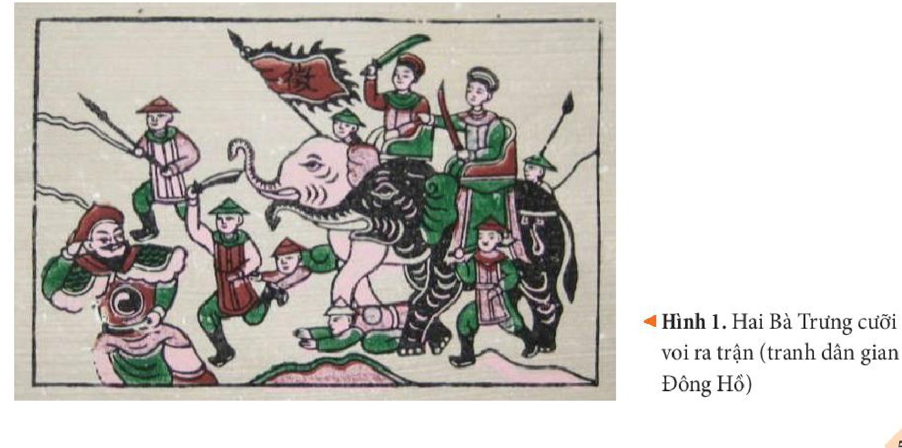
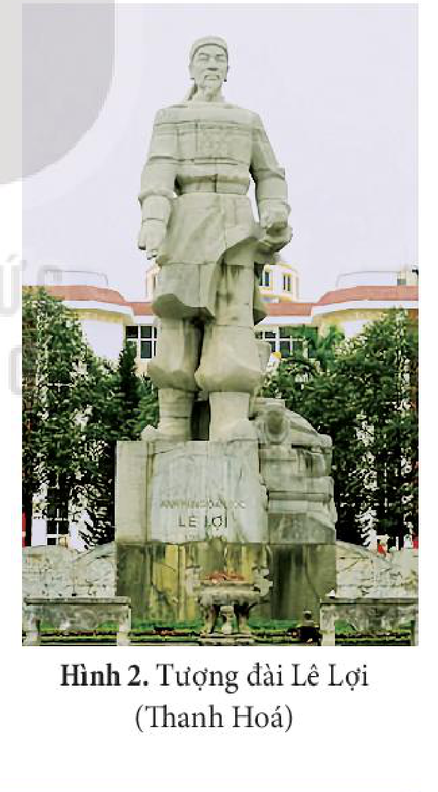
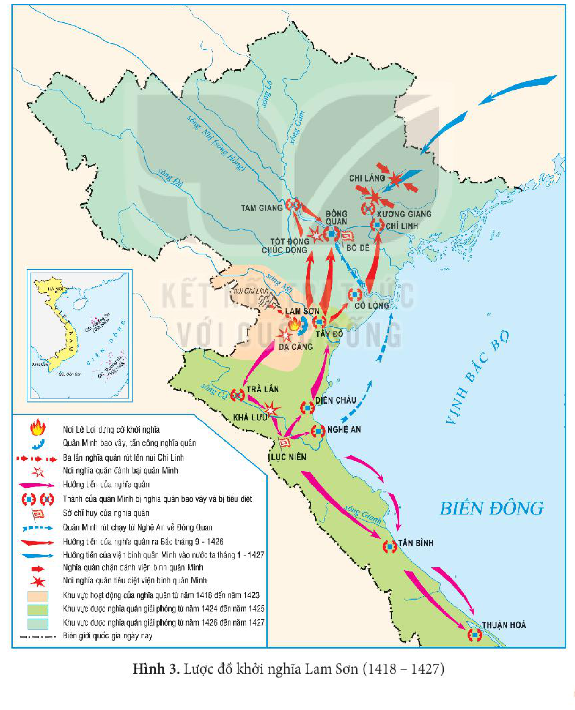
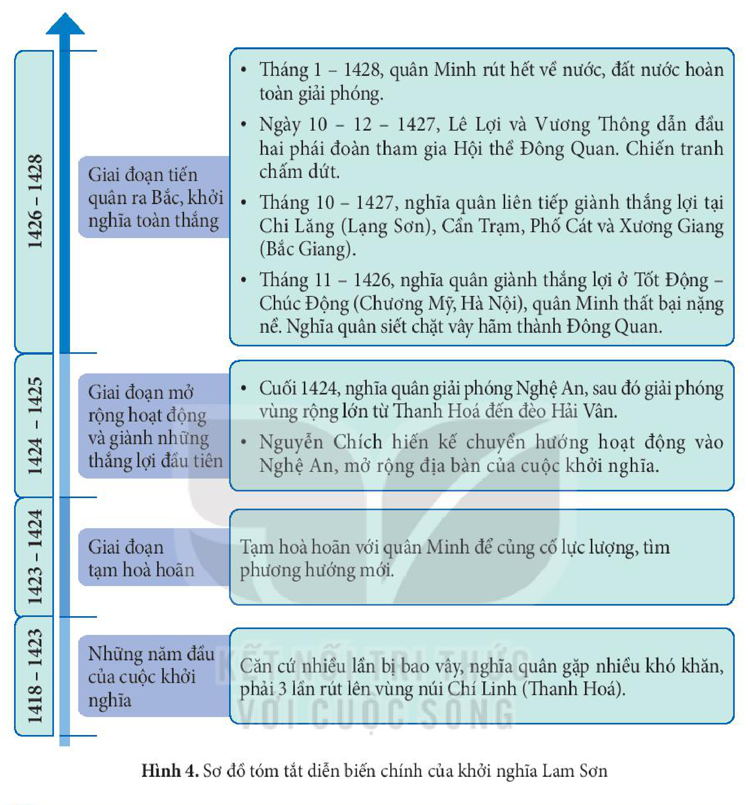
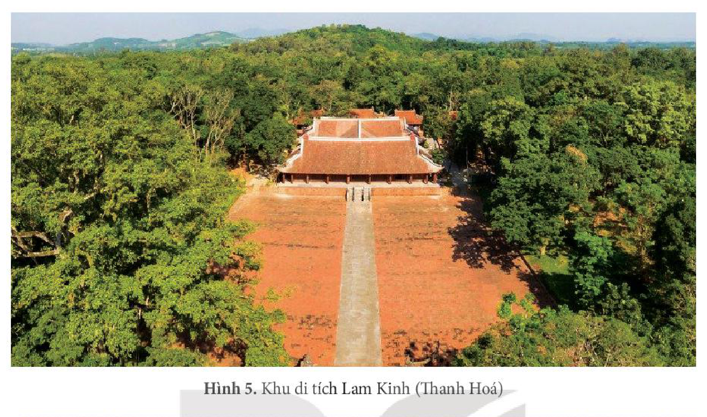
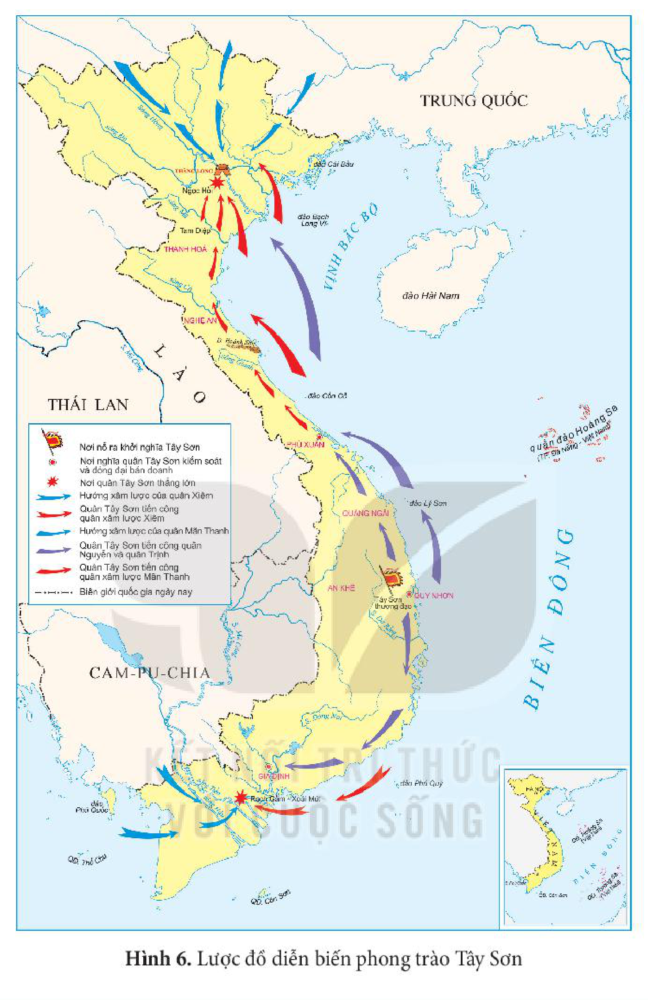
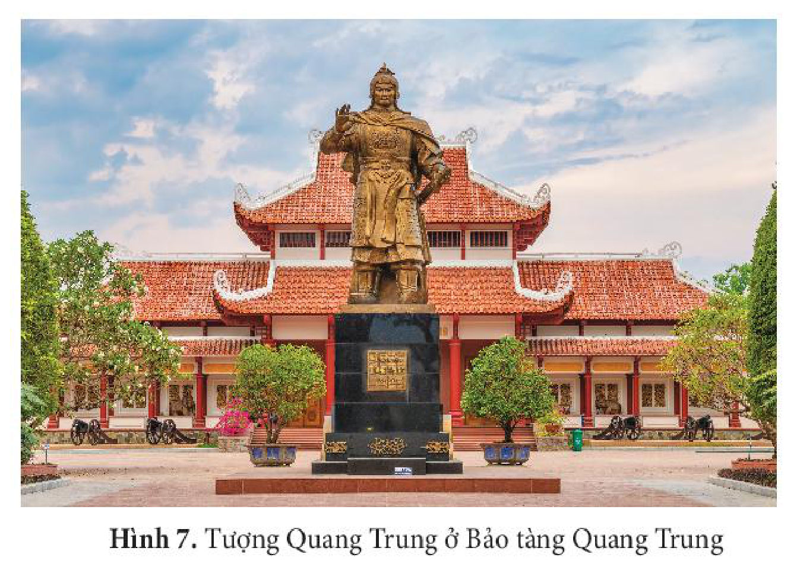

<!-- pdf:51 -->

# BÀI 8: MỘT SỐ CUỘC KHỞI NGHĨA VÀ CHIẾN TRANH GIẢI PHÓNG TRONG LỊCH SỬ VIỆT NAM (TỪ THẾ KỈ III TRƯỚC CÔNG NGUYÊN ĐẾN CUỐI THẾ KỈ XIX)

## 🎯 Học xong bài này, em sẽ:

- Trình bày được nội dung chính của các cuộc khởi nghĩa tiêu biểu trong thời kì Bắc thuộc và nêu được ý nghĩa của các cuộc khởi nghĩa đó.
- Nêu được bối cảnh lịch sử, trình bày được diễn biến chính và ý nghĩa của khởi nghĩa Lam Sơn.
- Biết cách sưu tầm và sử dụng tư liệu lịch sử về phong trào Tây Sơn.
- Trình bày được bối cảnh lịch sử, diễn biến chính và nêu được ý nghĩa của phong trào Tây Sơn.
- Rút ra được những bài học lịch sử chính của các cuộc khởi nghĩa và chiến tranh giải phóng trong lịch sử Việt Nam.
- Nêu được các bài học lịch sử đối với sự nghiệp xây dựng và bảo vệ Tổ quốc hiện nay.
- Tự hào về truyền thống đấu tranh bất khuất của dân tộc Việt Nam trong lịch sử, sẵn sàng tham gia đóng góp vào sự nghiệp xây dựng và bảo vệ Tổ quốc.

## 🔴 Mở đầu

Chủ tịch Hồ Chí Minh đã khẳng định: “Dân ta có một lòng nồng nàn yêu nước. Đó là một truyền thống quý báu của ta. Từ xưa đến nay, mỗi khi Tổ quốc bị xâm lăng, thì tinh thần ấy lại sôi nổi, nó kết thành một làn sóng vô cùng mạnh mẽ, to lớn, nó lướt qua mọi sự nguy hiểm, khó khăn, nó nhấn chìm tất cả lũ bán nước và lũ cướp nước” *(Hồ Chí Minh, Toàn tập, Tập 6, NXB Chính trị quốc gia, 2002, tr. 171)*.

Lời khẳng định trên gợi cho em suy nghĩ gì về truyền thống yêu nước của dân tộc Việt Nam? Hãy kể tên và chia sẻ hiểu biết của em về một số cuộc khởi nghĩa và chiến tranh giải phóng dân tộc trong lịch sử Việt Nam mà em đã được học.

## 1. Một số cuộc khởi nghĩa tiêu biểu trong thời kì Bắc thuộc

<!-- term: Một số cuộc khởi nghĩa tiêu biểu trong thời kì Bắc thuộc -->
Trong hơn một nghìn năm Bắc thuộc, nhiều cuộc khởi nghĩa giành độc lập của nhân dân Việt Nam đã nổ ra liên tục và mạnh mẽ.

<!-- pdf:52 -->

*Bảng 1. Tóm tắt một số cuộc khởi nghĩa tiêu biểu trong thời kì Bắc thuộc*

<!-- term: Một số cuộc khởi nghĩa tiêu biểu trong thời kì Bắc thuộc -->
| Tên cuộc khởi nghĩa | Năm khởi nghĩa | Người lãnh đạo | Chống chính quyền cai trị | Tóm tắt diễn biến chính và kết quả |
| --- | --- | --- | --- | --- |
| Hai Bà Trưng | 40 | Trưng Trắc, Trưng Nhị | Nhà Hán | • Năm 40, Hai Bà Trưng khởi nghĩa ở Hát Môn (Phúc Thọ, Hà Nội). Nghĩa quân đánh chiếm Mê Linh (Hà Nội), Cổ Loa (Đông Anh, Hà Nội) và Luy Lâu (Thuận Thành, Bắc Ninh). Thái thú Tô Định bỏ chạy về nước. Cuộc khởi nghĩa thắng lợi bước đầu, Trưng Trắc lên làm vua. • Năm 43, khởi nghĩa Hai Bà Trưng bị đàn áp. |
| Bà Triệu | 248 | Triệu Thị Trinh | Nhà Ngô | Năm 248, Triệu Thị Trinh lãnh đạo nhân dân khởi nghĩa. Nhà Ngô huy động một lực lượng lớn mới đàn áp được. |
| Lý Bí | 542 | Lý Bí, Triệu Quang Phục | Nhà Lương và nhà Tuỳ | • Năm 542, Lý Bí khởi nghĩa chống nhà Lương. Năm 544, cuộc khởi nghĩa thắng lợi, thành lập nước Vạn Xuân. Sau khi Lý Bí qua đời, Triệu Quang Phục lên nắm quyền lãnh đạo tiếp tục cuộc khởi nghĩa. • Năm 545, nhà Lương cho quân sang xâm lược, Triệu Quang Phục chỉ huy nghĩa quân chiến đấu dũng cảm, sáng tạo và giành thắng lợi. • Năm 602, nhà Tuỳ đem quân sang đàn áp, cuộc khởi nghĩa thất bại. |
| Phùng Hưng | Khoảng năm 776 | Phùng Hưng | Nhà Đường | • Khoảng năm 776, Phùng Hưng khởi nghĩa ở Đường Lâm (Sơn Tây, Hà Nội), đánh chiếm phủ thành Tống Bình, quản lí đất nước trong một thời gian. • Năm 791, nhà Đường đem quân đàn áp. |
<!-- ocr-ok: đối chiếu trực tiếp ảnh p052.png (Bảng 1) -->

*Hình 1. Hai Bà Trưng cưỡi voi ra trận (tranh dân gian Đông Hồ)*

<!-- pdf:53 -->

<!-- term: Một số cuộc khởi nghĩa tiêu biểu trong thời kì Bắc thuộc -->
Đầu thế kỉ X, cuộc nổi dậy của Khúc Thừa Dụ và trận chiến trên sông Bạch Đằng do Ngô Quyền lãnh đạo giành thắng lợi đã kết thúc hoàn toàn hơn 1 000 năm đô hộ của phong kiến phương Bắc, mở ra thời kì độc lập, tự chủ lâu dài của dân tộc.

<!-- term: Một số cuộc khởi nghĩa tiêu biểu trong thời kì Bắc thuộc -->
Các cuộc khởi nghĩa trong thời kì Bắc thuộc thể hiện tinh thần yêu nước, ý chí quật cường của dân tộc trong đấu tranh chống ách đô hộ của các triều đại phong kiến phương Bắc, giành độc lập dân tộc.

> ❓ 1. Khai thác Bảng 1 (tr. 51) và thông tin trong mục, trình bày nét chính về một số cuộc khởi nghĩa tiêu biểu trong thời kì Bắc thuộc.
>
> 2. Nêu ý nghĩa của các cuộc khởi nghĩa tiêu biểu trong thời kì Bắc thuộc.

## 2. Khởi nghĩa Lam Sơn (1418 – 1427)

### a) Bối cảnh lịch sử

<!-- term: Bối cảnh lịch sử của khởi nghĩa Lam Sơn -->
Năm 1407, cuộc kháng chiến chống quân Minh của nhà Hồ thất bại, đất nước ta bước vào thời kì bị nhà Minh đô hộ (1407 – 1427). Nhà Minh đã thi hành chính sách cai trị, bóc lột nặng nề đối với nhân dân Việt Nam.

<!-- term: Bối cảnh lịch sử của khởi nghĩa Lam Sơn -->
Về hành chính, đặt Đại Ngu thành quận Giao Chỉ, chia thành các phủ, huyện để cai trị.

<!-- term: Bối cảnh lịch sử của khởi nghĩa Lam Sơn -->
Về kinh tế – xã hội, đặt ra nhiều thứ thuế nặng nề, lùng bắt những người tài đem về nước phục dịch.

<!-- term: Bối cảnh lịch sử của khởi nghĩa Lam Sơn -->
Về văn hoá, bắt dân ta phải theo phong tục của Trung Hoa, dùng nhiều thủ đoạn để thủ tiêu nền văn hoá Việt như ra lệnh đục bia, đốt sách,...

<!-- term: Bối cảnh lịch sử của khởi nghĩa Lam Sơn -->
Dưới ách thống trị của nhà Minh, nhân dân ta đã nổi dậy ở nhiều nơi, tiêu biểu là các cuộc khởi nghĩa của Trần Ngỗi (1407 – 1409), Trần Quý Khoáng (1409 – 1414),... song đều bị đàn áp.

<!-- term: Bối cảnh lịch sử của khởi nghĩa Lam Sơn -->
Trước cảnh nước mất, nhân dân lầm than, Lê Lợi – một hào trưởng có uy tín lớn ở vùng Lam Sơn (Thanh Hoá) đã dốc hết tài sản để triệu tập nghĩa sĩ, bí mật liên lạc với các hào kiệt, xây dựng lực lượng và chọn Lam Sơn làm căn cứ cho cuộc khởi nghĩa.

*Hình 2. Tượng đài Lê Lợi (Thanh Hoá)*
<!-- ocr-ok: đối chiếu trực tiếp ảnh p053.png (OCR bỏ sót dòng chú thích Hình 2) -->

> ❓ Trình bày bối cảnh lịch sử của cuộc khởi nghĩa Lam Sơn.

<!-- pdf:54 -->

### b) Diễn biến chính

<!-- term: Diễn biến chính của khởi nghĩa Lam Sơn -->
Năm 1416, Lê Lợi cùng các hào kiệt tổ chức Hội thề ở Lũng Nhai (Thanh Hoá), quyết tâm đánh đuổi giặc Minh. Đầu năm 1418, tại vùng núi rừng Lam Sơn, Lê Lợi tự xưng là Bình Định Vương, kêu gọi nhân dân đứng lên đánh giặc cứu nước.

> 💡 EM CÓ BIẾT ?
>
> Trong khởi nghĩa Lam Sơn từng diễn ra hai hội thề mở đầu và kết thúc cuộc khởi nghĩa tiêu biểu trong lịch sử:
> - Năm 1416, Lê Lợi cùng các hào kiệt tổ chức hội thề ở Lũng Nhai (Thanh Hoá) nguyện một lòng đánh giặc cứu nước.
> - Hội thề Đông Quan (Hà Nội), do Lê Lợi và Vương Thông dẫn đầu hai phía để bàn về kết thúc chiến tranh, quân Minh rút về nước, thể hiện khát vọng cao cả: *Mở nền thái bình muôn thuở, tắt muôn đời chiến tranh.*

*Hình 3. Lược đồ khởi nghĩa Lam Sơn (1418 – 1427)*

<!-- pdf:55 -->

*Hình 4. Sơ đồ tóm tắt diễn biến chính của khởi nghĩa Lam Sơn*

<!-- term: Diễn biến chính của khởi nghĩa Lam Sơn -->
- *1418 – 1423 (Những năm đầu của cuộc khởi nghĩa):* Căn cứ nhiều lần bị bao vây, nghĩa quân gặp nhiều khó khăn, phải 3 lần rút lên vùng núi Chí Linh (Thanh Hoá).
- *1423 – 1424 (Giai đoạn tạm hoà hoãn):* Tạm hoà hoãn với quân Minh để củng cố lực lượng, tìm phương hướng mới.
- *1424 – 1425 (Giai đoạn mở rộng hoạt động và giành những thắng lợi đầu tiên):*
  - Nguyễn Chích hiến kế chuyển hướng hoạt động vào Nghệ An, mở rộng địa bàn của cuộc khởi nghĩa.
  - Cuối 1424, nghĩa quân giải phóng Nghệ An, sau đó giải phóng vùng rộng lớn từ Thanh Hoá đến đèo Hải Vân.
- *1426 – 1428 (Giai đoạn tiến quân ra Bắc, khởi nghĩa toàn thắng):*
  - Tháng 11 – 1426, nghĩa quân giành thắng lợi ở Tốt Động – Chúc Động (Chương Mỹ, Hà Nội), quân Minh thất bại nặng nề. Nghĩa quân siết chặt vây hãm thành Đông Quan.
  - Tháng 10 – 1427, nghĩa quân liên tiếp giành thắng lợi tại Chi Lăng (Lạng Sơn), Cần Trạm, Phố Cát và Xương Giang (Bắc Giang).
  - Ngày 10 – 12 – 1427, Lê Lợi và Vương Thông dẫn đầu hai phái đoàn tham gia Hội thề Đông Quan. Chiến tranh chấm dứt.
  - Tháng 1 – 1428, quân Minh rút hết về nước, đất nước hoàn toàn giải phóng.

> ❓ 1. Khai thác lược đồ Hình 3 và sơ đồ Hình 4, trình bày diễn biến chính của khởi nghĩa Lam Sơn.
>
> 2. Việc tổ chức Hội thề Đông Quan có ý nghĩa như thế nào?

### c) Ý nghĩa lịch sử

<!-- term: Ý nghĩa lịch sử của khởi nghĩa Lam Sơn -->
Khởi nghĩa Lam Sơn đã phát triển thành một cuộc chiến tranh giải phóng dân tộc, có tính chất nhân dân rộng rãi. Cuộc khởi nghĩa thắng lợi đã chấm dứt thời kì đô hộ của nhà Minh, khôi phục nền độc lập dân tộc, đập tan âm mưu thủ tiêu nền văn hoá Đại Việt, mở ra thời kì phát triển mới của đất nước.

<!-- pdf:56 -->

*Hình 5. Khu di tích Lam Kinh (Thanh Hoá)*

> TƯ LIỆU 2.
>
> *... Xã tắc do đó vững bền,*
> *Non sông từ đây đổi mới.*
> *...*
> *Để mở nền thái bình muôn thuở,*
> *Để rửa mối sỉ nhục ngàn thu.*
>
> *(Trích Bình Ngô đại cáo trong Đại Việt sử ký toàn thư, Tập II, Sđd, tr. 287 – 288)*

> ❓ Khai thác Tư liệu 2 và thông tin trong mục, trình bày ý nghĩa lịch sử của cuộc khởi nghĩa Lam Sơn.

## 3. Phong trào Tây Sơn

### a) Bối cảnh lịch sử

<!-- term: Bối cảnh lịch sử của phong trào Tây Sơn -->
Từ giữa thế kỉ XVIII, tình hình chính trị, kinh tế, xã hội ở Đàng Trong đã có những dấu hiệu khủng hoảng.

<!-- term: Bối cảnh lịch sử của phong trào Tây Sơn -->
Về chính trị, chúa Nguyễn Phúc Thuần nối ngôi lúc 12 tuổi, chỉ thích chơi bời múa hát,... quyền hành tập trung vào tay quyền thần Trương Phúc Loan. Bộ máy quan lại các cấp cồng kềnh và tệ tham nhũng trở nên nghiêm trọng. Do tệ mua bán quan chức nên một xã có thể lên đến 16 – 17 người thu thuế và hơn 20 xã trưởng.

> 💡 EM CÓ BIẾT ?
>
> Trương Phúc Loan (? – 1776) quê ở Thanh Hoá, là cậu ruột của chúa Nguyễn Phúc Khoát. Sau khi chúa Nguyễn Phúc Khoát mất, ông tìm cách đưa Nguyễn Phúc Thuần lên ngôi chúa. Năm 1765, ông tự xưng làm Quốc phó, chuyên quyền hơn 30 năm, là người rất tham lam và tàn nhẫn, “nhà chứa vàng bạc, của cải vô số”.

<!-- pdf:57 -->

<!-- term: Bối cảnh lịch sử của phong trào Tây Sơn -->
Về kinh tế, chế độ thuế khoá, binh dịch nặng nề làm cho đời sống nhân dân gặp nhiều khó khăn.

<!-- term: Bối cảnh lịch sử của phong trào Tây Sơn -->
Dưới ách cai trị của chính quyền chúa Nguyễn, các tầng lớp nhân dân đều bất bình, đứng lên đấu tranh, tiêu biểu như: cuộc nổi dậy của Lý Văn Quang (Biên Hoà), cuộc khởi nghĩa của Lía ở Truông Mây (Bình Định),... Tuy nhiên, các cuộc đấu tranh này đều bị dập tắt.

> ❓ Trình bày bối cảnh lịch sử của phong trào Tây Sơn.

### b) Diễn biến chính

> 💡 EM CÓ BIẾT ?
>
> Tây Sơn thượng đạo là một vùng cao nguyên rộng lớn, bằng phẳng, bốn mặt có núi cao và rừng già bao bọc. Đất đai ở đây phì nhiêu, có nhiều lâm thổ sản quý, voi, ngựa,...

<!-- term: Diễn biến chính của phong trào Tây Sơn -->
Mùa xuân năm 1771, ba anh em Nguyễn Nhạc, Nguyễn Huệ, Nguyễn Lữ dựng cờ khởi nghĩa ở Tây Sơn thượng đạo (An Khê, Gia Lai) chống lại chính quyền chúa Nguyễn.

*Bảng 2. Tóm tắt một số sự kiện chính của phong trào Tây Sơn*

<!-- term: Diễn biến chính của phong trào Tây Sơn -->
| Năm | Sự kiện |
| --- | --- |
| 1773 | Chiếm được phủ thành Quy Nhơn. |
| 1774 | Kiểm soát được vùng đất rộng lớn từ Quảng Nam đến Bình Thuận. |
| 1777 | Lật đổ chính quyền chúa Nguyễn. |
| 1778 | Nguyễn Nhạc lên ngôi hoàng đế, đóng đô ở thành Đồ Bàn (Quy Nhơn, Bình Định). |
| 1785 | Chiến thắng Rạch Gầm – Xoài Mút (Tiền Giang), đánh tan 5 vạn quân Xiêm. |
| 1786 | • Hạ thành Phú Xuân, giải phóng toàn bộ vùng đất Đàng Trong. • Lật đổ chính quyền họ Trịnh. |
| 1788 | Nguyễn Huệ lên ngôi hoàng đế, lấy niên hiệu là Quang Trung, tiến quân ra Bắc. |
| 1789 | Chiến thắng Ngọc Hồi – Đống Đa (Hà Nội), đánh tan 29 vạn quân Thanh. |

<!-- pdf:58 -->

*Hình 6. Lược đồ diễn biến phong trào Tây Sơn*

> ❓ Khai thác Bảng 2 (tr. 56) và lược đồ Hình 6, trình bày diễn biến chính của phong trào Tây Sơn.

### c) Ý nghĩa lịch sử

<!-- term: Ý nghĩa lịch sử của phong trào Tây Sơn -->
Phong trào Tây Sơn từ một cuộc khởi nghĩa địa phương đã phát triển thành phong trào dân tộc rộng lớn, lập nên những chiến công hiển hách. Phong trào đã lật đổ các chính quyền phong kiến Nguyễn – Trịnh, xoá bỏ tình trạng chia cắt đất nước. Đồng thời, phong trào còn đánh tan các thế lực ngoại xâm hùng mạnh, bảo vệ vững chắc nền độc lập dân tộc và chủ quyền lãnh thổ của Tổ quốc.

<!-- pdf:59 -->

> 💡 EM CÓ BIẾT ?
>
> Bảo tàng Quang Trung ở huyện Tây Sơn, tỉnh Bình Định, cách thành phố Quy Nhơn khoảng 45 km, khánh thành vào năm 1978. Nơi đây được coi là bảo tàng Danh nhân lớn nhất, lưu giữ nhiều hiện vật lịch sử liên quan đến cuộc khởi nghĩa Tây Sơn. Hằng năm, bảo tàng thu hút được đông đảo người dân đến tham quan, tìm hiểu về lịch sử.

*Hình 7. Tượng Quang Trung ở Bảo tàng Quang Trung*

> ❓ Trình bày ý nghĩa lịch sử của phong trào Tây Sơn.

## 4. Bài học lịch sử của các cuộc khởi nghĩa và chiến tranh giải phóng trong lịch sử Việt Nam

<!-- term: Bài học lịch sử của các cuộc khởi nghĩa và chiến tranh giải phóng trong lịch sử Việt Nam -->
Các cuộc khởi nghĩa và chiến tranh giải phóng trong lịch sử dân tộc dù thắng lợi hay thất bại đều để lại những bài học lịch sử sâu sắc và giữ nguyên giá trị đến ngày nay.

<!-- term: Bài học lịch sử của các cuộc khởi nghĩa và chiến tranh giải phóng trong lịch sử Việt Nam -->
*Thứ nhất,* bài học về xây dựng lực lượng. Đây là một trong những nhân tố quyết định thắng lợi của công cuộc chống ngoại xâm của dân tộc.

Hội thề Lũng Nhai với sự tập hợp của các anh hùng hào kiệt các nơi đã đặt cơ sở cho sự hình thành hạt nhân đầu tiên của bộ tham mưu khởi nghĩa Lam Sơn.

Khi Quang Trung tiến quân ra Bắc, đến Nghệ An, ông tổ chức một cuộc duyệt binh lớn, tự mình cưỡi voi ra trận để khích lệ quân sĩ. Tại Thanh Hoá, Quang Trung cũng dừng lại để tuyển mộ thêm binh sĩ và đọc bài dụ quân sĩ tham gia đánh giặc. Nhờ vậy, lực lượng quân Tây Sơn đã tăng lên nhanh chóng.

<!-- term: Bài học lịch sử của các cuộc khởi nghĩa và chiến tranh giải phóng trong lịch sử Việt Nam -->
*Thứ hai,* bài học về xây dựng khối đại đoàn kết toàn dân. Đoàn kết là sức mạnh giúp nhân dân Việt Nam có thể vượt qua mọi khó khăn, thử thách.

Với tư tưởng “Lấy nhân nghĩa đến thắng hung tàn, đem chí nhân mà thay cường bạo”, khởi nghĩa Lam Sơn không chỉ lôi cuốn được sự ủng hộ nhiệt tình, đoàn kết của nhân dân mà còn phân hoá được lực lượng của kẻ thù. Bộ chỉ huy nghĩa quân Lam Sơn là hình ảnh thu nhỏ của khối đoàn kết toàn dân, với đầy đủ thành phần, lứa tuổi như: địa chủ (Lê Lợi), nho sĩ (Nguyễn Trãi), quý tộc (Trần Nguyên Hãn), thương nhân (Nguyễn Xí), dân nghèo (Nguyễn Chích), thủ lĩnh dân tộc thiểu số (Lê Lai),...

<!-- pdf:60 -->

> TƯ LIỆU 3.
>
> *Dựng gậy làm cờ, tụ hội bốn phương manh lệ,*
> *Hoà rượu mời lính, dưới trên một dạ cha con.*
>
> *(Trích Bình Ngô đại cáo trong Đại Việt sử ký toàn thư, Tập II, Sđd, tr. 285)*

<!-- term: Bài học lịch sử của các cuộc khởi nghĩa và chiến tranh giải phóng trong lịch sử Việt Nam -->
*Thứ ba,* bài học về nghệ thuật quân sự với những kinh nghiệm đánh giặc dũng cảm và mưu trí, phong phú và độc đáo.

> TƯ LIỆU 4. Trần Quốc Tuấn từng nói: “Nó cậy trường trận, ta dựa vào đoản binh. Dùng đoản [binh] chế trường [trận] là sự thường của binh pháp. Nếu chỉ thấy quân nó kéo đến như lửa, như gió thì thế dễ chế ngự. Nếu nó tiến chậm như cách tằm ăn, không cầu thắng chóng, thì phải chọn dùng tướng giỏi, xem xét quyền biến, như đánh cờ vậy, tuỳ thời tạo thế, có được đội quân một lòng như cha con thì mới dùng được”.
>
> *(Ngô Sỹ Liên, Đại Việt sử ký toàn thư, Tập II, Sđd, tr. 79)*

> ❓ Khai thác các tư liệu 3, 4 và thông tin trong mục, nêu những bài học lịch sử của các cuộc khởi nghĩa và chiến tranh giải phóng dân tộc trong lịch sử Việt Nam.

## ✏️ Luyện tập và vận dụng

1. Hoàn thành bảng thống kê (theo gợi ý dưới đây) về nội dung chính của các cuộc khởi nghĩa diễn ra từ thế kỉ III TCN đến cuối thế kỉ XIX.

| Tên cuộc khởi nghĩa | Thời gian | Địa điểm | Người lãnh đạo | Trận đánh lớn | Kết quả |
| --- | --- | --- | --- | --- | --- |
| ? | ? | ? | ? | ? | ? |
<!-- ocr-ok: đối chiếu trực tiếp ảnh p060.png (bảng mẫu Luyện tập câu 1) -->

2. Xây dựng trục thời gian thể hiện những sự kiện chính của phong trào Tây Sơn.

1. Khai thác bài *Bình Ngô đại cáo* của Nguyễn Trãi, chỉ ra một số sự kiện lịch sử tiêu biểu của cuộc khởi nghĩa Lam Sơn (1418 – 1427).

2. Theo em, các bài học lịch sử từ các cuộc khởi nghĩa và chiến tranh giải phóng dân tộc có ý nghĩa như thế nào đối với sự nghiệp xây dựng và bảo vệ Tổ quốc hiện nay? Lấy ví dụ chứng minh.

## 📷 Danh sách hình trong bài

| Mã hình | Số hình | Trang PDF | Trang in | Chú thích |
| --- | --- | --- | --- | --- |
| H11-lich_su-b08-01 | Hình 1 | 52 | 51 | Hai Bà Trưng cưỡi voi ra trận (tranh dân gian Đông Hồ) |
| H11-lich_su-b08-02 | Hình 2 | 53 | 52 | Tượng đài Lê Lợi (Thanh Hoá) |
| H11-lich_su-b08-03 | Hình 3 | 54 | 53 | Lược đồ khởi nghĩa Lam Sơn (1418 – 1427) |
| H11-lich_su-b08-04 | Hình 4 | 55 | 54 | Sơ đồ tóm tắt diễn biến chính của khởi nghĩa Lam Sơn |
| H11-lich_su-b08-05 | Hình 5 | 56 | 55 | Khu di tích Lam Kinh (Thanh Hoá) |
| H11-lich_su-b08-06 | Hình 6 | 58 | 57 | Lược đồ diễn biến phong trào Tây Sơn |
| H11-lich_su-b08-07 | Hình 7 | 59 | 58 | Tượng Quang Trung ở Bảo tàng Quang Trung |
