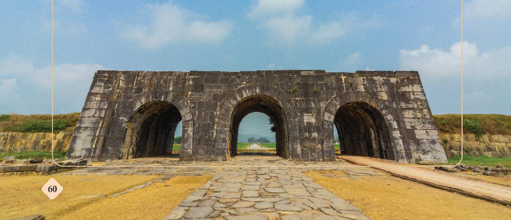
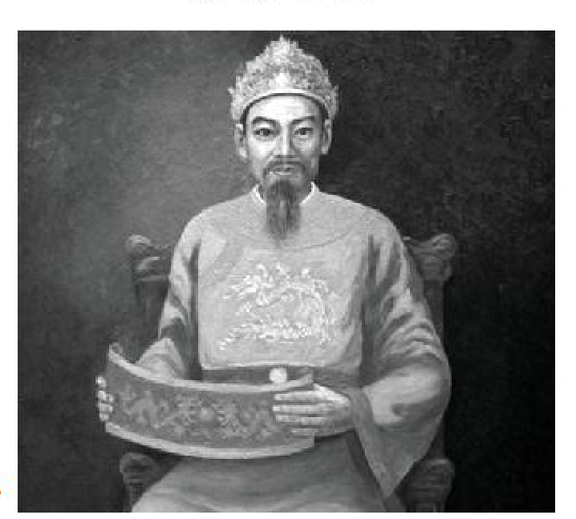

<!-- pdf:61 -->
# BÀI 9: CUỘC CẢI CÁCH CỦA HỒ QUÝ LY VÀ TRIỀU HỒ

## 🎯 Học xong bài này, em sẽ:

- Trình bày được bối cảnh lịch sử, nội dung, kết quả, ý nghĩa cuộc cải cách của Hồ Quý Ly và triều Hồ.
- Có ý thức trân trọng giá trị cuộc cải cách của Hồ Quý Ly và triều Hồ.

## 🔴 Mở đầu

Thành Tây Đô (Thanh Hoá) là toà thành kiên cố với kiến trúc độc đáo bằng đá có quy mô lớn ở Việt Nam được Hồ Quý Ly cho xây dựng vào cuối thế kỉ XIV. Đây cũng là một trong những cải cách nổi bật của ông nhằm tăng cường sức mạnh quân sự để chuẩn bị đối phó với cuộc xâm lược của nhà Minh. Ngoài ra, Hồ Quý Ly còn tiến hành cải cách trên các lĩnh vực kinh tế, xã hội, quân sự, văn hoá, giáo dục. Hãy chia sẻ những điều em biết về bối cảnh, nội dung chính và kết quả cuộc cải cách của Hồ Quý Ly và triều Hồ.

*Hình 1. Cửa Nam thành Tây Đô (Thanh Hoá)*
<!-- ocr-ok: chú thích Hình 1 nằm trên nền ảnh nên OCR không nhận diện -->

<!-- pdf:62 -->
## 1. Bối cảnh lịch sử

- ***Về kinh tế – xã hội***

Từ nửa sau thế kỉ XIV, nhà nước không còn quan tâm đến sản xuất nông nghiệp, không chăm lo tu sửa, bảo vệ đê điều, các công trình thuỷ lợi,... nên nhiều năm bị mất mùa, đói kém. Vương hầu, quý tộc, địa chủ nắm trong tay nhiều ruộng đất khiến ruộng đất của nông dân bị thu hẹp, đời sống bấp bênh, khổ cực. Nhiều nông dân phải bán ruộng đất, vợ, con cho các quý tộc, địa chủ giàu có và biến thành nô tì. Mâu thuẫn giữa nông dân nghèo, nô tì với giai cấp thống trị trở nên gay gắt. Các cuộc khởi nghĩa của nông dân và nô tì đã nổ ra như: khởi nghĩa Ngô Bệ (Hải Dương), khởi nghĩa Phạm Sư Ôn (Hà Nội),...

> 💡 EM CÓ BIẾT ?
>
> Dưới triều vua Trần Dụ Tông, Chu Văn An từng dâng sớ chém 7 gian thần nhưng không được chấp nhận. Ông từ quan về ở ẩn và dạy học ở Chí Linh (Hải Dương).
<!-- ocr-ok: hộp EM CÓ BIẾT nằm ở cột phụ nên OCR chỉ đọc được một phần -->

> TƯ LIỆU 1.
>
> *Ruộng lúa ngàn dặm đỏ như cháy*
> *Đồng quê than vãn trông vào đâu?*
> *... Lưới chài quan lại còn vơ vét*
> *Máu thịt nhân dân cạn nửa rồi...*
>
> (Theo Trương Hữu Quýnh (Chủ biên), *Đại cương lịch sử Việt Nam*, Tập I, NXB Giáo dục, 1998, tr. 249)

- ***Về chính trị***

Mặc cho đời sống của nhân dân sa sút nghiêm trọng, tầng lớp vua, quan, quý tộc nhà Trần ngày càng ăn chơi, hưởng lạc. Trong triều, trung thần thì ít mà kẻ gian nịnh, cơ hội thì nhiều.

Triều Trần suy yếu đến mức không còn khả năng bảo vệ sự an toàn của đất nước, bất lực trước các cuộc tấn công của Chăm-pa và những yêu sách ngang ngược của nhà Minh (Trung Quốc).

Hồ Quý Ly – một quý tộc thuộc dòng họ ngoại của nhà Trần từng bước thâu tóm quyền lực, buộc vua Trần nhường ngôi, lập ra triều Hồ (1400).

*Hình 2. Hồ Quý Ly (1336 – 1407)*

> 💡 EM CÓ BIẾT ?
>
> Hồ Quý Ly là cháu bốn đời của Hồ Liêm (Hồ Liêm từ quê Nghệ An ra Thanh Hoá, được một viên đại thần họ Lê nhận làm con nuôi). Ông là người tài năng, lại có hai người cô là phi tần của vua Trần Minh Tông, nhờ đó ông rất được vua Trần trọng dụng. Ông dần vươn lên nắm giữ chức vụ cao nhất trong triều đình.

> ❓ Khai thác Tư liệu 1 và thông tin trong mục, trình bày bối cảnh lịch sử diễn ra cải cách của Hồ Quý Ly và triều Hồ.

<!-- pdf:63 -->
## 2. Nội dung cải cách

<!-- term: Cuộc cải cách của Hồ Quý Ly và triều Hồ -->
Ngay từ khi còn là một đại thần, đặc biệt sau khi lên ngôi vua, Hồ Quý Ly đã tiến hành một cuộc cải cách khá hệ thống trên hầu hết các lĩnh vực, nhằm củng cố chế độ quân chủ tập quyền và giải quyết các mâu thuẫn về kinh tế, xã hội xuất hiện cuối thời Trần.

> 💡 EM CÓ BIẾT ?
>
> Theo *Từ điển Thuật ngữ lịch sử dùng trong nhà trường*: **Cải cách** là sự đổi mới cho tiến bộ hơn, phù hợp với sự phát triển chung của xã hội mà không đụng tới nền tảng của chế độ hiện hành. Trong lịch sử Việt Nam đã diễn ra nhiều cuộc cải cách với quy mô, nội dung và tác dụng, ý nghĩa khác nhau.

- ***Về kinh tế, xã hội***

<!-- term: Chính sách hạn điền -->
Hồ Quý Ly và triều Hồ ban hành chính sách hạn điền nhằm hạn chế sự phát triển của chế độ sở hữu lớn về ruộng đất trong các điền trang, thái ấp của tầng lớp quý tộc.

> TƯ LIỆU 2. “Các đại vương và trưởng công chúa thì ruộng không hạn chế, cho đến thứ dân thì ruộng chỉ 10 mẫu thôi”.
>
> (Theo Ngô Sỹ Liên, *Đại Việt sử ký toàn thư*, Tập II, Sđd, tr. 192)

<!-- term: Tiền giấy thời Hồ -->
Triều Hồ còn cho phát hành tiền giấy, cải cách chế độ thuế khoá, thống nhất đơn vị đo lường trong cả nước.

<!-- term: Tiền giấy thời Hồ -->
Vua hạ lệnh cho người đem tiền đến đổi, mỗi quan tiền đồng đổi lấy 1 quan 2 tiền giấy. Ai làm tiền giấy giả thì bị tội chém. Ai giấu tiền đồng, không nộp thì phải tội như làm tiền giấy giả.

<!-- term: Phép hạn gia nô -->
Triều Hồ cũng quy định số lượng gia nô được sở hữu của mỗi vương hầu, quý tộc, quan lại.

> TƯ LIỆU 3. “Phép hạn gia nô, chiếu theo phẩm cấp mà có số khác nhau, thừa ra thì sung vào Nhà nước. Mỗi người phải trả 5 quan tiền. Người nào đáng được có gia nô phải xuất trình chúc thư ba đời,...”.
>
> (Theo Ngô Sỹ Liên, *Đại Việt sử ký toàn thư*, Tập II, Sđd, tr. 201)

- ***Về quân sự***

Hồ Quý Ly và triều Hồ đã thực hiện một số biện pháp nhằm tăng cường lực lượng quân đội chính quy và phòng thủ ở những nơi hiểm yếu.

Triều Hồ cho biên hết vào sổ các nhân khẩu từ 2 tuổi trở lên. Khi làm xong, số lượng binh lính trong quân đội tăng lên nhiều lần.

Triều Hồ cũng cho xây dựng nhiều thành luỹ kiên cố như Tây Đô (Thanh Hoá), Đa Bang (Hà Nội),...; chế tạo súng thần cơ, đóng thuyền chiến;...

- ***Về văn hoá, giáo dục***

Hồ Quý Ly bắt các nhà sư dưới 50 tuổi phải hoàn tục nhằm hạn chế sự phát triển của Phật giáo; chấn chỉnh lại chế độ thi cử, mở rộng việc học, đặt học quan đến cấp phủ, châu.

<!-- pdf:64 -->
Triều Hồ chú trọng tổ chức các kì thi, tuyển chọn được nhiều nhân tài cho đất nước. Trong 7 năm (1400 – 1407), triều Hồ đã tổ chức hai kì thi, lấy đỗ gần 200 người, trong đó có một Trạng nguyên.

Dưới triều Hồ, chữ Nôm được đề cao, sử dụng trong các sáng tác văn chương, nhiều sách chữ Hán được dịch sang chữ Nôm để dạy cho phi tần, cung nữ như *Quốc ngữ thi nghĩa*, chương *Vô dật* trong *Kinh thư*,...

> ❓ Khai thác các tư liệu 2, 3 và thông tin trong mục, trình bày nội dung cuộc cải cách của Hồ Quý Ly và triều Hồ.

## 3. Kết quả và ý nghĩa

<!-- term: Cuộc cải cách của Hồ Quý Ly và triều Hồ -->
Cuộc cải cách của Hồ Quý Ly và triều Hồ có nhiều điểm tiến bộ, đã đưa đất nước thoát khỏi tình trạng khủng hoảng, củng cố quyền lực của chính quyền trung ương.

<!-- term: Chính sách hạn điền -->
<!-- term: Phép hạn gia nô -->
Chính sách hạn điền, hạn nô đã làm suy yếu thế lực của tầng lớp quý tộc, tôn thất triều Trần, đồng thời tăng nguồn thu nhập cho Nhà nước, tăng cường quyền lực của Nhà nước quân chủ trung ương tập quyền.

Những cải cách trên lĩnh vực văn hoá, giáo dục của Hồ Quý Ly và triều Hồ thể hiện tư tưởng tiến bộ nhằm xây dựng một nền văn hoá, giáo dục mang bản sắc dân tộc.

Cuộc cải cách có ý nghĩa trong việc bước đầu ổn định tình hình xã hội, củng cố tiềm lực của đất nước để chuẩn bị đối phó với giặc ngoại xâm.

Tuy nhiên, những cải cách của Hồ Quý Ly và triều Hồ vẫn còn chưa triệt để và kết quả trong thực tế còn hạn chế.

> ❓ Trình bày kết quả và ý nghĩa cuộc cải cách của Hồ Quý Ly và triều Hồ.

## ✏️ Luyện tập và vận dụng

**Luyện tập**

Hoàn thành bảng thống kê (theo gợi ý dưới đây) về các nội dung chủ yếu trong cuộc cải cách của Hồ Quý Ly và triều Hồ.

| Lĩnh vực | Nội dung cải cách | Ý nghĩa |
| :--- | :--- | :--- |
| ? | ? | ? |

**Vận dụng**

Có nhận định cho rằng: “Hồ Quý Ly là một nhà cải cách lớn, kiên quyết và táo bạo”. Em đồng ý với nhận định đó không? Vì sao? Sưu tầm thêm tư liệu từ sách, báo và internet để tìm dẫn chứng chứng minh cho ý kiến của em.

## 📷 Danh sách hình trong bài

| Mã hình | Số hình | Trang PDF | Chú thích |
| --- | --- | --- | --- |
| H11-lich_su-b09-01 | 1 | 61 | Cửa Nam thành Tây Đô (Thanh Hoá) |
| H11-lich_su-b09-02 | 2 | 62 | Hồ Quý Ly (1336 – 1407) |
