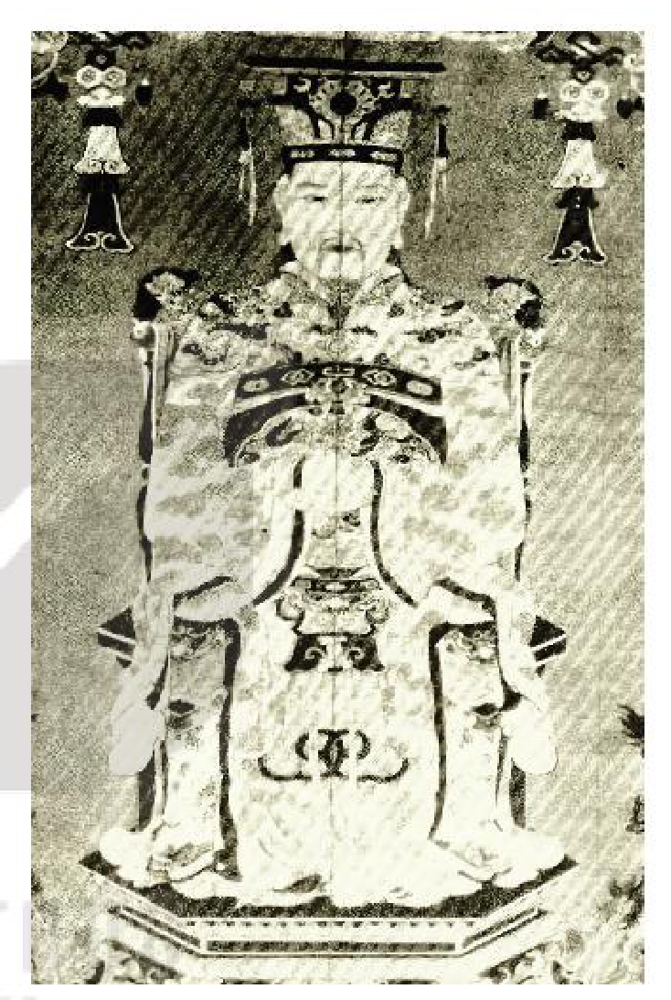
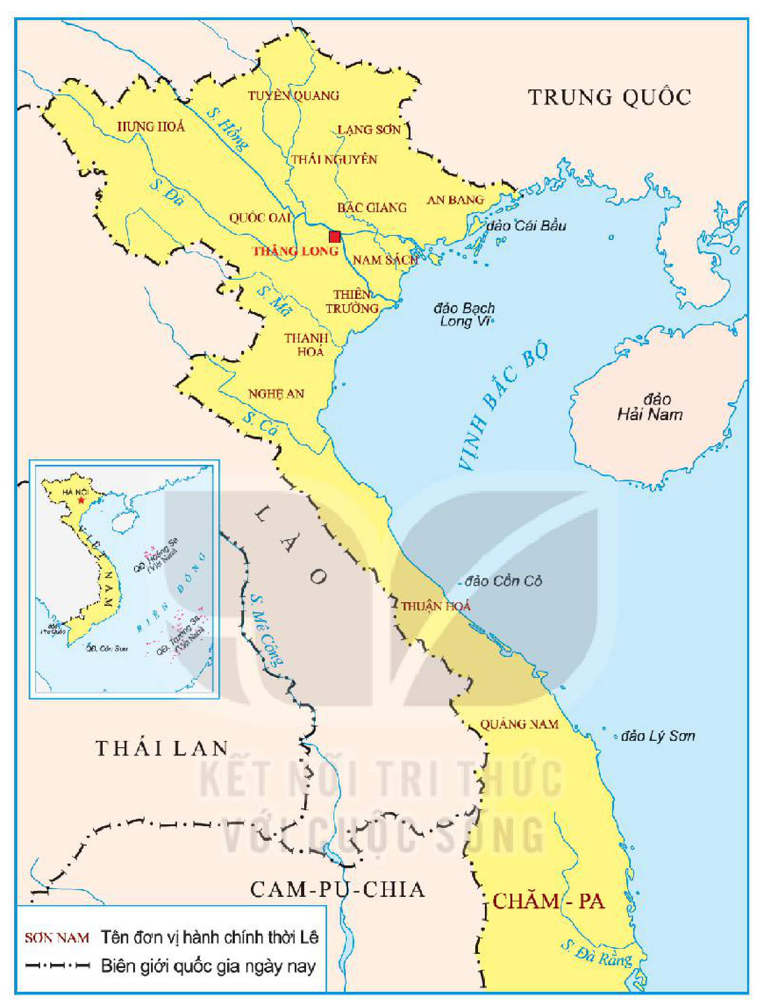

<!-- pdf:65 -->
# BÀI 10: CUỘC CẢI CÁCH CỦA LÊ THÁNH TÔNG (THẾ KỈ XV)

## 🎯 Học xong bài này, em sẽ:

- Trình bày được bối cảnh lịch sử, nội dung, kết quả, ý nghĩa của cuộc cải cách thời Lê Thánh Tông.
- Có ý thức trân trọng giá trị cuộc cải cách của Lê Thánh Tông.

## 🔴 Mở đầu

Lê Thánh Tông là một vị vua nổi tiếng trong lịch sử Việt Nam, ông được coi là vị vua “sáng lập chế độ, văn vật khả quan, mở mang đất đai, cõi bờ khá rộng, thực là bậc vua anh hùng tài lược” (Ngô Sỹ Liên, *Đại Việt sử ký toàn thư*, Tập II, Sđd, tr. 387).

Theo em, vì sao vua Lê Thánh Tông lại được đánh giá cao như vậy? Chia sẻ hiểu biết của em về những chính sách cải cách của Lê Thánh Tông, cũng như kết quả, ý nghĩa của các chính sách đó.

*Hình 1. Chân dung vua Lê Thánh Tông (Tranh vẽ ở Thái miếu Lam Kinh)*

## 1. Bối cảnh lịch sử

Năm 1460, vua Lê Thánh Tông lên ngôi trong bối cảnh tình hình chính trị, kinh tế, xã hội của đất nước đã từng bước ổn định. Tuy nhiên, bộ máy hành chính nhà nước bắt đầu bộc lộ một số hạn chế.

Ở cấp trung ương, sự tập trung quyền lực chủ yếu trong tay các quan đại thần – những võ quan, công thần trong cuộc khởi nghĩa Lam Sơn đã ảnh hưởng đến tính tập quyền của nhà nước.

Sau khi vua Lê Thái Tổ qua đời, các vị vua kế vị thường ít tuổi. Tình trạng quan lại lộng quyền, tham nhũng,... ngày càng trở nên phổ biến.

Vua Lê Thái Tông lên ngôi vua lúc 10 tuổi, Lê Nhân Tông lên ngôi lúc 2 tuổi không đủ khả năng kiềm chế tình trạng mâu thuẫn trong nội bộ triều đình. Sự lộng hành của một số quyền thần đã gây nên vụ án oan “Lệ Chi Viên” đối với gia đình Nguyễn Trãi.

<!-- pdf:66 -->
Ở địa phương, đất nước rộng lớn nhưng chỉ được chia thành 5 đạo (Đông, Tây, Nam, Bắc và Hải Tây) khiến cho quyền lực của những người đứng đầu mỗi đạo rất lớn, là mầm mống của xu hướng phân tán quyền lực.

Vì vậy, sau khi lên ngôi, vua Lê Thánh Tông đã từng bước tiến hành cải cách nhằm tăng cường quyền lực của hoàng đế và bộ máy nhà nước.

> ❓ Trình bày bối cảnh lịch sử cuộc cải cách của vua Lê Thánh Tông.

## 2. Nội dung cải cách

- ***Hành chính***

*Ở trung ương*, Lê Thánh Tông xoá bỏ hầu hết các chức quan đại thần có quyền lực lớn, chỉ giữ lại một số ít quan đại thần để cùng vua bàn bạc công việc khi cần thiết. Vua nắm mọi quyền hành và trực tiếp chỉ đạo các cơ quan chuyên môn.

<!-- term: Lục Bộ, lục Tự, lục Khoa -->
Ông tổ chức hoàn thiện cơ cấu, chức năng của lục Bộ (sáu bộ) đồng thời, đặt ra lục Tự (sáu tự) để giúp việc cho lục Bộ, lục Khoa (sáu khoa) để theo dõi, giám sát hoạt động của lục Bộ.

> 💡 EM CÓ BIẾT ?
>
> - **Lục Bộ** (Lại, Hộ, Lễ, Binh, Hình, Công) là cơ quan chuyên môn quan trọng. Đầu triều Lê sơ, nhà nước chỉ có bộ Lại và bộ Lễ. Năm 1460, vua Lê Nghi Dân đặt lục Bộ, nhưng đến năm 1465, vua Lê Thánh Tông mới đưa lục Bộ trở thành cơ quan có quyền lực thực sự.
> - Đô ty phụ trách quân sự. Thừa ty trông coi dân sự. Hiến ty nắm quyền tư pháp.

<!-- term: Đạo thừa tuyên -->
*Ở địa phương*, năm 1466, vua Lê Thánh Tông xoá bỏ 5 đạo, chia đất nước thành 12 đạo thừa tuyên và phủ Trung Đô (Thăng Long); năm 1469, đổi tên một số đạo thừa tuyên như Quốc Oai thành Sơn Tây, Bắc Giang thành Kinh Bắc, Nam Sách thành Hải Dương, Thiên Trường thành Sơn Nam; năm 1471, đặt thêm đạo thừa tuyên thứ 13 là Quảng Nam. Đứng đầu Thừa tuyên là Đô ty, Thừa ty và Hiến ty có quyền ngang nhau, cùng quản lí công việc chung. Dưới đạo thừa tuyên là phủ, huyện, châu và cuối cùng là xã.

Quan lại trong bộ máy nhà nước được tuyển chọn chủ yếu thông qua khoa cử. Nhà nước chú trọng xây dựng đội ngũ quan lại có năng lực và phẩm chất tốt.

Trong thời kì trị vì của vua Lê Thánh Tông, nhiều khoa thi được tổ chức, chọn được nhiều người tài. Vua cũng đặt ra lệ định kì kiểm tra năng lực quan lại, ai làm tốt thì được thăng chức, ai phạm lỗi thì bị phạt.

<!-- pdf:67 -->

*Hình 2. Lược đồ Đại Việt thời vua Lê Thánh Tông (1460 – 1497)*

- ***Pháp luật***

<!-- term: Quốc triều hình luật -->
Vua Lê Thánh Tông chú trọng hoàn thiện hệ thống pháp luật để quản lí nhà nước. Năm 1483, Nhà nước ban hành bộ *Quốc triều hình luật* (*Luật Hồng Đức*) gồm 722 điều với nhiều quy định mang tính dân tộc sâu sắc như các điều luật bảo vệ phụ nữ, người già, người tàn tật, trẻ em, bảo vệ sản xuất nông nghiệp,...

> 💡 EM CÓ BIẾT ?
>
> *Luật Hồng Đức* đã được dịch và xuất bản bằng tiếng Pháp (1911) và gần đây đã được dịch và xuất bản bằng tiếng Anh (1987).

<!-- pdf:68 -->
> TƯ LIỆU 1.
>
> - “Con gái hứa gả chồng mà chưa thành hôn nếu người con trai bị ác tật hay phạm tội hoặc phá tán gia sản thì cho phép người con gái kêu quan mà trả lại đồ lễ. Nếu người con gái bị ác tật hay phạm tội thì không phải trả lại đồ lễ, trái luật bị phạt 80 trượng” (Điều 322).
> - “Phá trộm đê làm thiệt hại nhà cửa, lúa má của dân thì xử tội đồ hay tội lưu và bắt đền thiệt hại” (Điều 596).
>
> (*Quốc triều hình luật (Luật hình triều Lê)* (Viện Sử học dịch), NXB Chính trị quốc gia Sự thật, Hà Nội, 2017, tr. 113 – 114, 190)

- ***Quân đội và quốc phòng***

<!-- term: Cấm binh và ngoại binh -->
Năm 1466, vua Lê Thánh Tông tiến hành cải tổ hệ thống quân đội. Quân đội được chia làm hai loại: quân thường trực bảo vệ kinh thành gọi là cấm binh hay thân binh và quân các đạo, gọi là ngoại binh. Ở mỗi đạo chia binh làm 5 phủ do đô đốc phủ đứng đầu; mỗi phủ gồm 6 vệ; mỗi vệ có 5 hoặc 6 sở. Nhà nước cũng rất chú ý đến rèn luyện quân đội như duyệt binh sĩ hằng năm, quy định cứ 3 năm tổ chức một kì thi khảo võ nghệ của quân sĩ và định lệ thưởng phạt,...

- ***Kinh tế***

Vua Lê Thánh Tông ban hành các chính sách phát triển kinh tế như chế độ lộc điền và chế độ quân điền.

**Chế độ lộc điền** là chế độ ban cấp ruộng đất làm bổng lộc cho quý tộc, quan lại cao cấp từ tứ phẩm trở lên.

**Chế độ quân điền** là chế độ chia ruộng đất thành các phần bằng nhau, ban cấp lần lượt cho quan lại từ tam phẩm trở xuống đến tất cả các tầng lớp nhân dân, trong đó có cả trẻ em mồ côi, đàn bà goá, người tàn tật,... Nguyên tắc ban cấp là ruộng xã nào chia cho dân xã ấy.

- ***Văn hoá, giáo dục***

Vua Lê Thánh Tông coi trọng biên soạn quốc sử, “xem sử như một tấm gương” để soi vào mà biết đúng sai. Việc sử dụng lễ, nhạc, quy chế thi cử,... cũng được luật hoá nghiêm túc.

Ông đặc biệt chú trọng giáo dục và khoa cử để đào tạo, tuyển dụng nhân tài cho đất nước. Ông cho xây dựng lại Văn Miếu, mở rộng Thái Học viện và lập trường học ở nhiều địa phương. Ông cũng cho dựng bia đá ở Văn Miếu để tôn vinh những người đỗ đại khoa. Trong thời kì trị vì của vua Lê Thánh Tông, nhà nước đã tổ chức được 12 khoa thi Hội, lấy đỗ hơn 500 Tiến sĩ.

> ❓
> 1. Khai thác Tư liệu 1 chỉ ra những điểm tiến bộ của bộ *Luật Hồng Đức*.
> 2. Trình bày những nội dung cơ bản trong cải cách của vua Lê Thánh Tông.

<!-- pdf:69 -->
## 3. Kết quả và ý nghĩa

<!-- term: Cuộc cải cách của Lê Thánh Tông -->
Cuộc cải cách của vua Lê Thánh Tông đã làm cho bộ máy nhà nước trở nên quy củ, chặt chẽ, tập trung cao độ, đề cao quyền hành toàn diện của hoàng đế. Các chức danh được quy định rõ ràng, hệ thống giám sát được tăng cường, hạn chế sự tập trung quyền lực dẫn đến chuyên quyền và nguy cơ cát cứ.

> TƯ LIỆU 2. Cuộc cải cách của vua Lê Thánh Tông “khiến cho quan to, quan nhỏ đều ràng buộc với nhau. Chức trọng, chức khinh cùng kiềm chế lẫn nhau. Uy quyền không bị lợi dụng, thế nước vậy là khó lay”.
>
> (Ngô Sỹ Liên, *Đại Việt sử ký toàn thư*, Tập II, Sđd, tr. 454)

Các chính sách về ruộng đất góp phần khẳng định quyền sở hữu tối cao của Nhà nước tạo nền tảng cho kinh tế nông nghiệp phát triển. Chính sách giáo dục, khoa cử đã đào tạo được hệ thống quan lại trí thức có tài, đủ năng lực quản lí đất nước.

<!-- term: Cuộc cải cách của Lê Thánh Tông -->
Cuộc cải cách của vua Lê Thánh Tông có ý nghĩa quan trọng trong việc làm chuyển biến toàn bộ các hoạt động của quốc gia, tạo cơ sở cho Vương triều Lê sơ phát triển vững mạnh, đất nước hưng thịnh.

> ❓ Khai thác Tư liệu 2 và thông tin trong mục, trình bày kết quả, ý nghĩa cuộc cải cách của vua Lê Thánh Tông.

## ✏️ Luyện tập và vận dụng

**Luyện tập**

1. Lập sơ đồ tư duy về bối cảnh lịch sử, nội dung chủ yếu và kết quả, ý nghĩa cải cách của vua Lê Thánh Tông.

2. Vẽ sơ đồ tổ chức bộ máy nhà nước thời vua Lê Thánh Tông.

**Vận dụng**

Dựa vào kiến thức đã học và tìm hiểu thêm từ sách, báo, internet về cải cách của vua Lê Thánh Tông (thế kỉ XV), em hãy nêu ra một số bài học có thể vận dụng, kế thừa trong công cuộc xây dựng và phát triển đất nước hiện nay.

## 📷 Danh sách hình trong bài

| Mã hình | Số hình | Trang PDF | Chú thích |
| --- | --- | --- | --- |
| H11-lich_su-b10-01 | 1 | 65 | Chân dung vua Lê Thánh Tông (Tranh vẽ ở Thái miếu Lam Kinh) |
| H11-lich_su-b10-02 | 2 | 67 | Lược đồ Đại Việt thời vua Lê Thánh Tông (1460 – 1497) |
