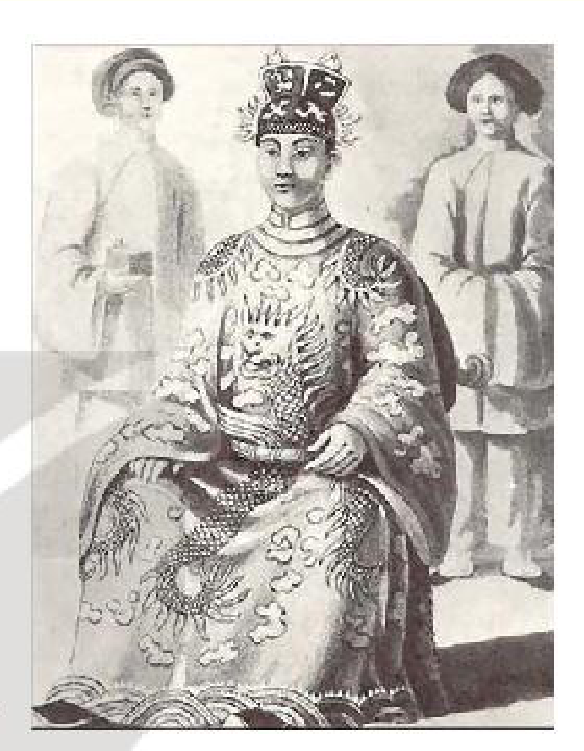
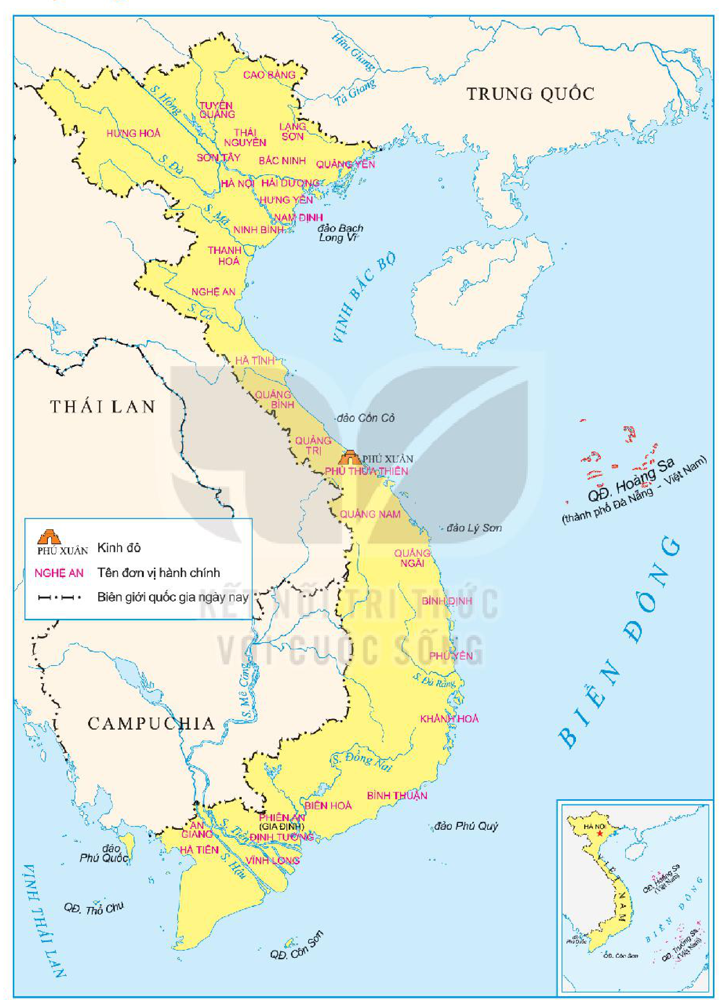
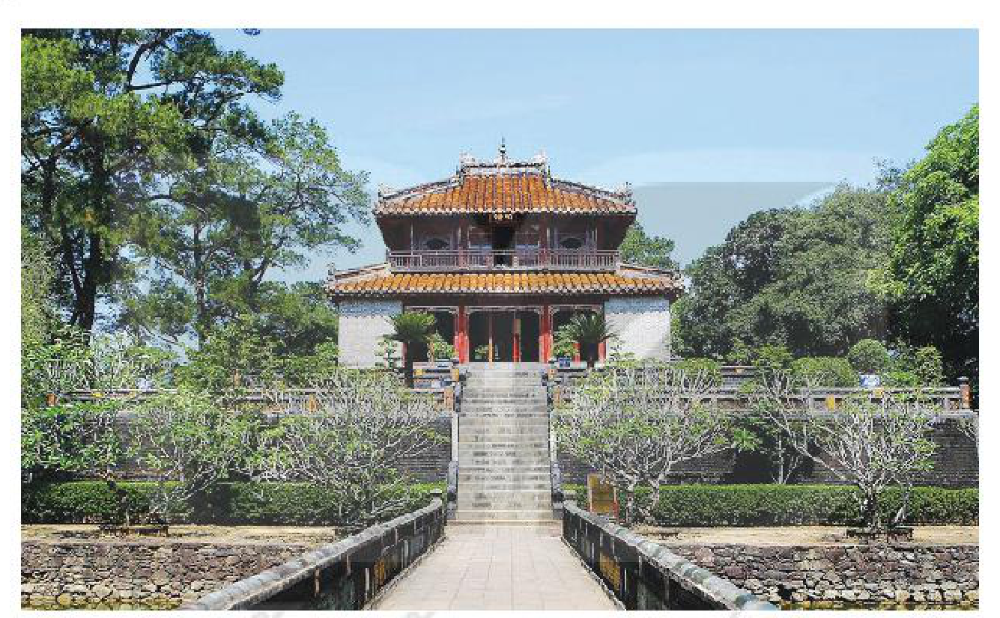

<!-- pdf:70 -->
# BÀI 11: CUỘC CẢI CÁCH CỦA MINH MẠNG (NỬA ĐẦU THẾ KỈ XIX)

## 🎯 Học xong bài này, em sẽ:

- Trình bày được bối cảnh lịch sử, nội dung, kết quả, ý nghĩa cuộc cải cách của Minh Mạng.
- Có ý thức trân trọng giá trị của các cuộc cải cách trong lịch sử dân tộc.

## 🔴 Mở đầu

Minh Mạng được xem là một vị vua năng động, quyết đoán của triều Nguyễn. Trong thời gian trị vì, ông đã thực hiện một số cải cách nhằm tăng cường tính thống nhất và tiềm lực của đất nước. Vậy, nội dung chủ yếu của cuộc cải cách thời vua Minh Mạng là gì? Những cải cách đó đạt được kết quả và ý nghĩa như thế nào?

*Hình 1. Vua Minh Mạng (1791 – 1841)*

## 1. Bối cảnh lịch sử

Năm 1802, triều Nguyễn được thành lập, cai quản đất nước rộng lớn, kéo dài từ Bắc vào Nam. Trong bối cảnh đất nước vừa trải qua thời gian chiến tranh và bị chia cắt lâu dài, đặt ra rất nhiều khó khăn. Dưới thời vua Gia Long, nhà Nguyễn tập trung chủ yếu vào công cuộc ổn định tình hình đất nước và ưu tiên cho sự nghiệp thống nhất về mặt lãnh thổ.

Bộ máy hành chính nhà nước thời kì này còn chưa hoàn chỉnh. Ở trung ương, nhiều cơ quan chưa được hoàn thiện. Ở địa phương, tính phân quyền còn đậm nét với sự tồn tại của Bắc Thành và Gia Định Thành. Tổ chức hành chính giữa các khu vực thiếu thống nhất. Quan lại trong bộ máy nhà nước chủ yếu do các võ quan nắm giữ.

> 💡 EM CÓ BIẾT ?
>
> **Bắc Thành và Gia Định Thành** là đơn vị hành chính cao hơn trấn. Bắc Thành tồn tại từ năm 1802 đến năm 1831, cai quản 11 trấn phía Bắc. Gia Định Thành tồn tại từ năm 1808 đến năm 1832, cai quản 5 trấn phía Nam.

Để khắc phục tình trạng phân quyền, thiếu thống nhất, sau khi lên ngôi hoàng đế (1820), vua Minh Mạng đã thi hành các biện pháp cải cách để tập trung quyền lực và hoàn thiện bộ máy nhà nước.

> ❓ Nêu bối cảnh lịch sử của cuộc cải cách Minh Mạng.

<!-- pdf:71 -->
## 2. Nội dung cải cách

*Hình 2. Lược đồ hành chính Việt Nam (sau cải cách Minh Mạng)*

<!-- pdf:72 -->
Trọng tâm cuộc cải cách của vua Minh Mạng là hành chính.

*Ở trung ương*, bước đầu tiên trong công cuộc tập trung quyền lực của vua Minh Mạng là tiến hành cải tổ hệ thống Văn thư phòng và thành lập Cơ mật viện.

<!-- term: Nội các -->
Năm 1820, đổi Thị thư viện thành Văn thư phòng. Năm 1829, lập Nội các thay thế cho Văn thư phòng với chức năng như một cơ quan hành chính trung ương, chuyển và tiếp nhận công văn từ triều đình đến các địa phương và ngược lại, khởi thảo các chế cáo, lưu giữ công văn.

<!-- term: Cơ mật viện -->
Năm 1834, lập Cơ mật viện làm cơ quan tư vấn tối cao cho nhà vua về những vấn đề quân sự quan trọng, đứng đầu là quan văn, võ do đích thân nhà vua lựa chọn.

<!-- term: Nội các -->
<!-- term: Cơ mật viện -->
Nội các cùng với Cơ mật viện là hai cơ quan tham mưu và tư vấn tối cao của hoàng đế về hành chính, chính trị và an ninh, quân sự.

Cải cách quan trọng tiếp theo là hoàn thiện cơ cấu, chức năng của lục Bộ và cải tổ các cơ quan chuyên môn như Quốc tử giám, Hàn lâm viện,...

Vua Minh Mạng cũng thực hiện chế độ giám sát, thanh tra chéo giữa các cơ quan trung ương thông qua hoạt động của Đô sát viện và lục Khoa.

<!-- term: Cải cách hành chính địa phương thời Minh Mạng -->
*Ở địa phương*, cải cách quan trọng nhất là về hành chính, đặc biệt là chia đất nước thành các tỉnh. Vua Minh Mạng chia cả nước thành 30 tỉnh và phủ Thừa Thiên. Đứng đầu tỉnh là Tổng đốc, Tuần phủ. Tổng đốc thường là người phụ trách hai tỉnh, trực tiếp cai trị một tỉnh. Tỉnh còn lại do Tuần phủ đứng đầu, đặt dưới sự kiêm quản của Tổng đốc.

<!-- term: Cải cách hành chính địa phương thời Minh Mạng -->
Năm 1831, xoá bỏ Bắc Thành, chia vùng lãnh thổ từ phủ Phụng Thiên ra Bắc thành 18 tỉnh. Năm 1832, xoá bỏ Gia Định Thành, chia vùng lãnh thổ từ phủ Phụng Thiên vào Nam thành 12 tỉnh.

Đối với vùng dân tộc thiểu số, vua Minh Mạng cho đổi các động, sách thành xã như vùng đồng bằng, đồng thời bãi bỏ chế độ cai trị của các tù trưởng địa phương, bổ dụng quan lại của triều đình đến cai trị trực tiếp.

> 💡 EM CÓ BIẾT ?
>
> <!-- term: Chế độ hồi tỵ -->
> Hồi tỵ có nghĩa là *tránh đi*. Chế độ hồi tỵ quy định những người thân như anh, em, cha, con, thầy, trò,... không được làm quan cùng một chỗ.

<!-- term: Chế độ hồi tỵ -->
Vua Minh Mạng cũng cải tổ chế độ hồi tỵ bằng việc mở rộng phạm vi, đối tượng áp dụng và bổ sung những quy định mới rất nghiêm ngặt.

> ❓
> 1. Khai thác lược đồ Hình 2, nêu nhận xét của em về đơn vị hành chính Việt Nam sau cải cách Minh Mạng.
> 2. Trình bày một số biện pháp cải cách của vua Minh Mạng.

<!-- pdf:73 -->
## 3. Kết quả, ý nghĩa

<!-- term: Cuộc cải cách của Minh Mạng -->
Cuộc cải cách của vua Minh Mạng đã mang lại nhiều kết quả như: xây dựng được chế độ quân chủ trung ương tập quyền cao độ (vua nắm trong tay quyền lập pháp, hành pháp, tư pháp và thống lĩnh quân đội); thống nhất đơn vị hành chính địa phương trong cả nước; tổ chức cơ cấu bộ máy nhà nước gọn nhẹ, chặt chẽ; phân định cụ thể chức năng, nhiệm vụ của các cơ quan.

<!-- term: Cuộc cải cách của Minh Mạng -->
Cuộc cải cách có ý nghĩa quan trọng trong việc hoàn thành thống nhất đất nước về mặt hành chính, làm cho hoạt động của bộ máy nhà nước có hiệu quả hơn trước.

Cuộc cải cách Minh Mạng cũng để lại bài học kinh nghiệm đối với tổ chức hoạt động của bộ máy nhà nước. Trong đó, cách thức phân chia đơn vị hành chính cấp tỉnh thời Minh Mạng là một trong những di sản lớn nhất của cuộc cải cách, còn có giá trị đến ngày nay.

*Hình 3. Lăng Minh Mạng (Thừa Thiên Huế)*

> ❓ Trình bày kết quả, ý nghĩa của cuộc cải cách Minh Mạng.

## ✏️ Luyện tập và vận dụng

**Luyện tập**

1. Lập sơ đồ tư duy tóm tắt bối cảnh, nội dung chính và ý nghĩa của cuộc cải cách Minh Mạng.

2. Nêu nhận xét của em về cuộc cải cách Minh Mạng.

**Vận dụng**

Liên hệ với thực tiễn và tìm hiểu thêm từ sách, báo, internet, cho biết những bài học kinh nghiệm nào từ cuộc cải cách của vua Minh Mạng có thể áp dụng vào việc xây dựng nền hành chính Việt Nam hiện đại? Lấy ví dụ cụ thể.

## 📷 Danh sách hình trong bài

| Mã hình | Số hình | Trang PDF | Chú thích |
| --- | --- | --- | --- |
| H11-lich_su-b11-01 | 1 | 70 | Vua Minh Mạng (1791 – 1841) |
| H11-lich_su-b11-02 | 2 | 71 | Lược đồ hành chính Việt Nam (sau cải cách Minh Mạng) |
| H11-lich_su-b11-03 | 3 | 73 | Lăng Minh Mạng (Thừa Thiên Huế) |
