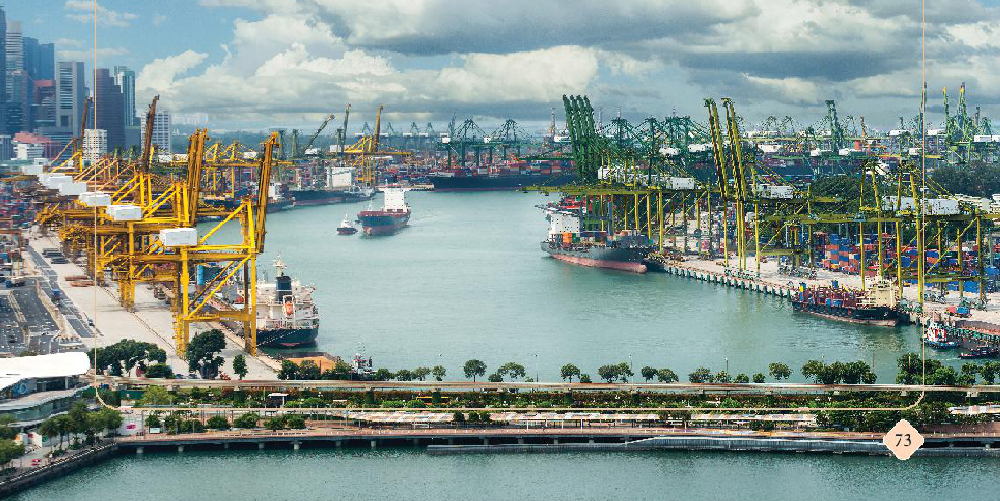
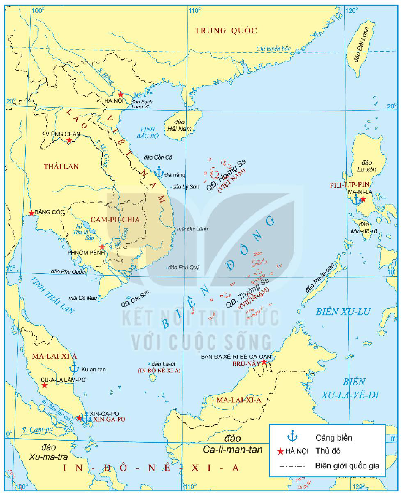
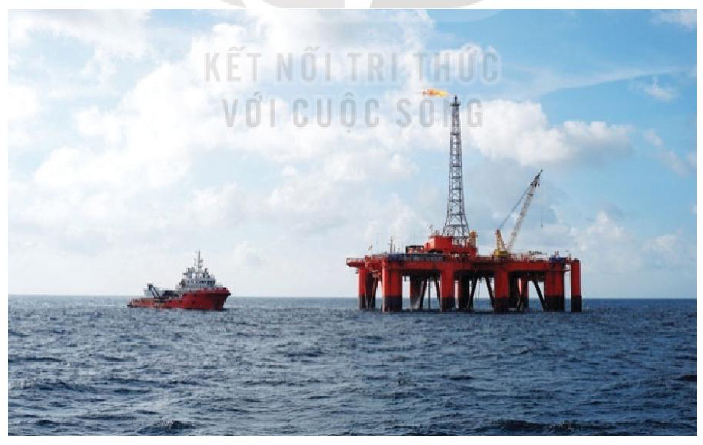
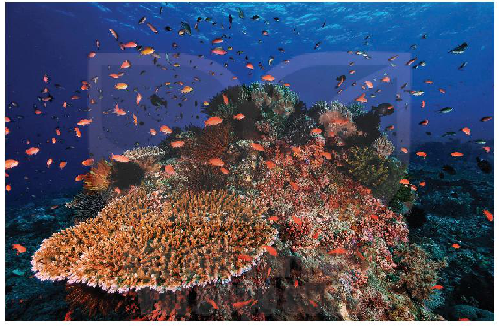
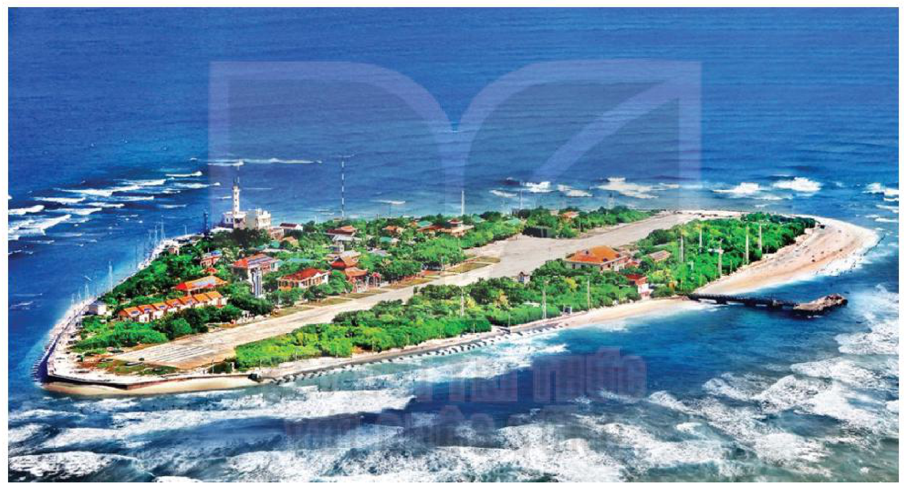

<!-- pdf:74 -->

# BÀI 12: VỊ TRÍ VÀ TẦM QUAN TRỌNG CỦA BIỂN ĐÔNG

## 🎯 Học xong bài này, em sẽ:

- Xác định được vị trí của Biển Đông trên bản đồ. Giải thích được tầm quan trọng chiến lược của Biển Đông về giao thông biển, vị trí chiến lược, nguồn tài nguyên thiên nhiên biển.
- Xác định được vị trí của các đảo, quần đảo ở Biển Đông trên bản đồ. Giải thích được tầm quan trọng chiến lược của các đảo và quần đảo ở Biển Đông.

## 🔴 Mở đầu

Biển Đông là một trong những biển lớn và là đường vận chuyển huyết mạch của khu vực châu Á – Thái Bình Dương. Hãy chia sẻ những hiểu biết của em về Biển Đông. Theo em, Biển Đông có tầm quan trọng như thế nào đối với các nước trong khu vực?

*Hình 1. Cảng Xin-ga-po (Xin-ga-po) – một trong những cảng biển sầm uất và hiện đại ở Biển Đông*

<!-- pdf:75 -->

## 1. Vị trí của Biển Đông

*Hình 2. Lược đồ khu vực Biển Đông*

<!-- pdf:76 -->

<!-- term: Vị trí địa lí của Biển Đông -->
Biển Đông là biển rìa lục địa nằm ở bờ Tây Thái Bình Dương, trải rộng từ khoảng 3°N đến 26°B và từ khoảng 100°Đ đến 121°Đ. Đây là biển tương đối kín vì các đường thông ra đại dương đều bị vây bọc bởi hệ thống đảo và quần đảo.
<!-- ocr-ok: đã đối chiếu ảnh p076.png, OCR lỗi nhận diện kí hiệu độ và ghép dòng -->

<!-- term: Vị trí địa lí của Biển Đông -->
Biển Đông có diện tích khoảng 3,5 triệu $\text{km}^2$, trải dài khoảng 3 000 km theo trục đông bắc – tây nam, nối liền Thái Bình Dương và Ấn Độ Dương. Có 9 quốc gia tiếp giáp với Biển Đông là: Việt Nam, Trung Quốc, Phi-líp-pin, In-đô-nê-xi-a, Bru-nây, Ma-lai-xi-a, Xin-ga-po, Thái Lan, Cam-pu-chia và 1 vùng lãnh thổ là Đài Loan.
<!-- ocr-ok: đã đối chiếu ảnh p076.png, OCR lỗi ghép 2 cột với hộp Em có biết -->

> 💡 EM CÓ BIẾT ?
>
> Biển Đông là một trong sáu biển lớn nhất thế giới, tiếp giáp phần đất liền của Đông Nam Á và phần đảo thuộc Đông Nam Á (Philippin, Ma-lai-xi-a, Bru-nây, Xin-ga-po, In-đô-nê-xi-a). Biển Đông sâu trung bình hơn 1 000 m, nơi sâu nhất trên 5 000 m.
<!-- ocr-ok: đã đối chiếu ảnh p076.png, OCR lỗi ghép 2 cột -->

Biển Đông là vị trí địa – chiến lược quan trọng ở khu vực châu Á – Thái Bình Dương và thế giới; là cầu nối giữa Thái Bình Dương và Ấn Độ Dương.

> ❓ Xác định vị trí của Biển Đông trên lược đồ Hình 2 (tr. 74).

## 2. Tầm quan trọng chiến lược của Biển Đông

### a) Tuyến đường giao thông biển huyết mạch

<!-- term: Tuyến đường giao thông biển huyết mạch qua Biển Đông -->
Khu vực châu Á – Thái Bình Dương có hoạt động hàng hải vô cùng nhộn nhịp, đứng đầu thế giới. Biển Đông có vị trí vô cùng quan trọng trong giao thông hàng hải quốc tế vì nơi đây tập trung các tuyến đường biển chiến lược kết nối Thái Bình Dương – Ấn Độ Dương, châu Âu – châu Á, Trung Đông – Đông Á. Trong đó có tuyến đường biển vận chuyển hàng hoá nhộn nhịp thứ hai thế giới.

<!-- term: Eo biển Ma-lắc-ca -->
Trên tuyến đường giao thông biển này, có nhiều eo biển quan trọng đối với nhiều quốc gia và nền kinh tế trên thế giới, từ các biển phía bắc như biển Nhật Bản, biển Hoàng Hải, biển Hoa Đông đi qua vùng biển các nước Đông Nam Á như eo biển Ma-lắc-ca (giữa đảo Xu-ma-tra của In-đô-nê-xi-a và phần đất liền của Ma-lai-xi-a), eo biển Xun-đa (giữa đảo Xu-ma-tra và đảo Gia-va của In-đô-nê-xi-a), eo biển Lôm-bốc (giữa đảo Ba-li và đảo Lôm-bốc của In-đô-nê-xi-a),... Đặc biệt, eo biển Ma-lắc-ca là điểm điều tiết giao thông đường biển quan trọng bậc nhất ở châu Á, tạo nên hành lang hàng hải chính kết nối Ấn Độ Dương và Thái Bình Dương, từ Trung Đông đến Đông Á.
<!-- ocr-ok: đã đối chiếu ảnh p076.png, OCR lỗi nhận diện tên phiên âm có gạch nối -->

> ❓ Vì sao Biển Đông là tuyến đường giao thông biển huyết mạch?

### b) Địa bàn chiến lược quan trọng ở khu vực châu Á – Thái Bình Dương

<!-- term: Địa bàn chiến lược của Biển Đông ở châu Á – Thái Bình Dương -->
Biển Đông có vị trí chiến lược quan trọng ở khu vực châu Á – Thái Bình Dương cả về kinh tế và quốc phòng – an ninh. Các vùng biển của các quốc gia ở khu vực Biển Đông nối liền với nhau tạo thành trung tâm giao thông của mạng lưới đường biển và đường hàng không quốc tế.
<!-- ocr-ok: đã đối chiếu ảnh p076.png, OCR lỗi sót chữ cuối trang -->

<!-- term: Địa bàn chiến lược của Biển Đông ở châu Á – Thái Bình Dương -->
Các đường hàng hải qua Biển Đông tạo điều kiện thuận lợi cho việc giao thương, phát triển kinh tế biển toàn diện của các quốc gia tiếp giáp với vùng biển này, giúp cho các quốc gia có thể phát triển tổng hợp các ngành kinh tế biển như đánh bắt, nuôi trồng thuỷ sản, khai thác khoáng sản, giao thông hàng hải, công nghiệp đóng tàu, du lịch,...
<!-- ocr-ok: đã đối chiếu ảnh p076.png, OCR lỗi sót chữ cuối trang -->

<!-- pdf:77 -->

> 💡 EM CÓ BIẾT ?
>
> - Các nước giáp Biển Đông có sản lượng đánh bắt và nuôi trồng hải sản đứng hàng đầu thế giới như: Trung Quốc, Thái Lan, Việt Nam, In-đô-nê-xi-a và Phi-líp-pin.
> - Theo Tổ chức Lương thực và Nông nghiệp Liên hợp quốc (FAO), Biển Đông là vùng biển có sản lượng đánh bắt hải sản hàng đầu thế giới với khoảng 6 triệu tấn, chiếm 10% tổng khối lượng toàn thế giới, riêng sản lượng cá xếp thứ 4/19 thế giới.

Các nước như Ấn Độ, Nhật Bản, Trung Quốc, Xin-ga-po, Ma-lai-xi-a, Việt Nam,... đều có các hoạt động thương mại hàng hải, khai thác hải sản và dầu khí rất sôi động trên vùng biển này.

Các cảng biển lớn trên Biển Đông là điểm trung chuyển của tàu thuyền, trao đổi và bốc dỡ hàng hoá quan trọng như các cảng: Xin-ga-po (Xin-ga-po), Ku-an-tan (Ma-lai-xi-a), Ma-ni-la (Phi-líp-pin), Đà Nẵng (Việt Nam), Hồng Công (Trung Quốc),...

Biển Đông có ảnh hưởng trực tiếp tới cuộc sống của người dân ở một số nước thuộc khu vực châu Á – Thái Bình Dương. Các nước Đông Nam Á ven biển đang được hưởng lợi ích trực tiếp từ Biển Đông trong phát triển kinh tế và giải quyết các vấn đề xã hội.

> ❓ Vì sao Biển Đông là địa bàn chiến lược quan trọng ở khu vực châu Á – Thái Bình Dương?

### c) Nguồn tài nguyên thiên nhiên biển

<!-- term: Tài nguyên thiên nhiên của Biển Đông -->
Biển Đông là khu vực có nguồn tài nguyên thiên nhiên phong phú với trữ lượng lớn như: sinh vật biển, khoáng sản (ti-tan, thiếc, chì, kẽm,...). Đặc biệt, Biển Đông là một trong những bồn trũng chứa dầu khí lớn nhất thế giới.

*Hình 3. Giàn khoan Đại Hùng 01 của Tập đoàn Dầu khí Quốc gia Việt Nam trên Biển Đông*

<!-- pdf:78 -->

> TƯ LIỆU. Biển Đông là nơi cư trú của trên 12 000 loài sinh vật, trong đó có khoảng 2 040 loài cá, 350 loài san hô, 662 loài rong biển, 12 loài có vú,... Trong khu vực này tập trung 221 loài cây nước mặn tạo nên diện tích rừng ngập mặn tương đối lớn.
>
> Khu vực thềm lục địa của Biển Đông có tiềm năng dầu khí cao như bồn trũng Bru-nây, Nam Côn Sơn, Hoàng Sa,...
>
> *(Theo Nguyễn Văn Âu, Địa lí tự nhiên Biển Đông, NXB Đại học Quốc gia Hà Nội, 2002, tr. 33, 71 – 72)*

<!-- term: Tài nguyên thiên nhiên của Biển Đông -->
Nguồn tài nguyên thiên nhiên đa dạng của Biển Đông có giá trị cao đối với hoạt động nghiên cứu khoa học, phục vụ đời sống hằng ngày của người dân và phát triển kinh tế – xã hội của các nước trong khu vực.

*Hình 4. Sinh vật dưới Biển Đông*

> ❓ Khai thác tư liệu và thông tin trong mục, phân tích vai trò của nguồn tài nguyên thiên nhiên biển đối với sự phát triển kinh tế – xã hội của các nước trong khu vực.

## 3. Tầm quan trọng của các đảo và quần đảo trên Biển Đông

### a) Vị trí của quần đảo Hoàng Sa và quần đảo Trường Sa

Biển Đông có hàng nghìn đảo và quần đảo nằm rải rác với diện tích khác nhau.

Quần đảo Hoàng Sa và quần đảo Trường Sa thuộc chủ quyền của Việt Nam nằm ở trung tâm của Biển Đông và có vị trí chiến lược quan trọng. Địa hình của hai quần đảo này là sự nối tiếp liên tục của lục địa Việt Nam từ đất liền ra biển.

<!-- pdf:79 -->

<!-- term: Quần đảo Hoàng Sa -->
Quần đảo Hoàng Sa là một quần đảo san hô ở phía bắc Biển Đông, gồm có hơn 37 đảo, đá, bãi cạn,...

<!-- term: Quần đảo Hoàng Sa -->
Quần đảo Hoàng Sa nằm giữa kinh tuyến từ khoảng 111°Đ đến 113°Đ,... trải từ khoảng vĩ tuyến 15°45'B đến 17°15'B với các đảo lớn như đảo Phú Lâm, đảo Lin Côn,... Một số đảo rất gần lục địa Việt Nam như đảo Tri Tôn, đảo Hoàng Sa.

<!-- term: Quần đảo Trường Sa -->
Quần đảo Trường Sa nằm ở phía đông nam của bờ biển Việt Nam, bao gồm hơn 100 đảo, đá, bãi ngầm, bãi san hô nằm trong vùng biển rộng gấp nhiều lần so với quần đảo Hoàng Sa.

<!-- term: Quần đảo Trường Sa -->
Quần đảo Trường Sa nằm ở vĩ tuyến từ khoảng 6°30'B đến 12°B và kinh tuyến từ khoảng 111°30'Đ đến 117°20'Đ. Đảo gần đất liền nhất là đảo Trường Sa, đảo cao nhất so với mực nước biển là Song Tử Tây và đảo có diện tích lớn nhất là Ba Bình (0,6 $\text{km}^2$).

<!-- term: Quần đảo Trường Sa -->
Quần đảo được chia làm 8 cụm: Song Tử, Thị Tứ, Loại Ta, Nam Yết, Sinh Tồn, Trường Sa, Thám Hiểm, Bình Nguyên.

*Hình 5. Đảo Trường Sa thuộc quần đảo Trường Sa (huyện Trường Sa, tỉnh Khánh Hoà)*

> ❓ Xác định vị trí của một số đảo, quần đảo thuộc Biển Đông và quần đảo Hoàng Sa, quần đảo Trường Sa trên lược đồ Hình 2 (tr. 74).

### b) Tầm quan trọng chiến lược của quần đảo Trường Sa và quần đảo Hoàng Sa

<!-- term: Tầm quan trọng chiến lược của quần đảo Hoàng Sa và quần đảo Trường Sa -->
Hệ thống đảo, quần đảo trên Biển Đông nằm trên những tuyến đường hàng hải quốc tế quan trọng, kết nối các châu lục nên có ý nghĩa chiến lược về quốc phòng, an ninh đối với nhiều quốc gia ven biển. Một số đảo, quần đảo có vị trí, điều kiện tự nhiên thích hợp để phát triển nền kinh tế biển toàn diện, xây dựng thành cơ sở hậu cần – kĩ thuật phục vụ hoạt động quân sự và kinh tế.

<!-- pdf:80 -->

<!-- term: Tầm quan trọng chiến lược của quần đảo Hoàng Sa và quần đảo Trường Sa -->
Quần đảo Hoàng Sa và quần đảo Trường Sa có vị trí chiến lược quan trọng, giúp kiểm soát và bảo đảm an ninh cho các tuyến đường giao thông trên biển, trên không có tính huyết mạch ở khu vực Biển Đông. Với nguồn tài nguyên sinh vật, khoáng sản và du lịch đa dạng, các quần đảo trên Biển Đông là không gian hoạt động kinh tế có tầm quan trọng chiến lược.

Tại các đảo và vùng biển thuộc quần đảo Hoàng Sa và quần đảo Trường Sa có nguồn tài nguyên khoáng sản gồm cát, sỏi, phân chim, dầu khí,... Tài nguyên sinh vật dưới biển đa dạng, tạo thế mạnh cho phát triển **ngư trường** đánh bắt hải sản khổng lồ với nhiều loài quý hiếm, có giá trị kinh tế cao như: tôm hùm, hải sâm, đồi mồi, vích, ốc tai voi, rau câu,...

Một số ngành kinh tế có thể phát triển bền vững ở hai quần đảo này như du lịch biển đảo, nuôi trồng và chế biến thuỷ sản, khai thác dược liệu biển và hàng hải. Ngoài ra, trên hai quần đảo có thể xây dựng các trạm thông tin, trạm dừng chân và tiếp nhiên liệu cho các tàu di chuyển trên biển,... phục vụ tuyến đường hàng hải huyết mạch trên Biển Đông.
<!-- ocr-ok: đã đối chiếu ảnh p080.png, OCR lỗi sót chữ do watermark nền -->

> ❓ Phân tích tầm quan trọng chiến lược của các đảo, quần đảo ở Biển Đông.

## ✏️ Luyện tập và vận dụng

1. Trình bày vị trí của Biển Đông và các đảo, quần đảo trên Biển Đông.

2. Phân tích tầm quan trọng chiến lược của Biển Đông, các đảo và quần đảo ở Biển Đông.

3. Giả sử có một cuộc hành trình trên biển xuất phát từ cảng Hải Phòng (Việt Nam) hoặc cảng Xin-ga-po (Xin-ga-po) đi đến một trong các cảng: Tô-ky-ô (Nhật Bản), Vla-đi-vô-xtốc (Nga), Đại Liên (Trung Quốc), Mác-xây (Pháp), Niu Oóc (Mỹ) và ngược lại, theo em, các nhà hàng hải sẽ lựa chọn lộ trình như thế nào để thuận lợi nhất (hãy vẽ lộ trình đó vào lược đồ của em và giải thích sự lựa chọn đó).
<!-- ocr-ok: đã đối chiếu ảnh p080.png, OCR lỗi bỏ sót chữ trong khung Luyện tập – Vận dụng -->

## 📷 Danh sách hình trong bài

| Mã hình | Trang PDF | Vị trí trong bài | Chú thích gốc |
| --- | --- | --- | --- |
| H11-lich_su-b12-01 | 74 | Mở đầu | Hình 1. Cảng Xin-ga-po (Xin-ga-po) – một trong những cảng biển sầm uất và hiện đại ở Biển Đông |
| H11-lich_su-b12-02 | 75 | Mục 1 | Hình 2. Lược đồ khu vực Biển Đông |
| H11-lich_su-b12-03 | 77 | Mục 2.c | Hình 3. Giàn khoan Đại Hùng 01 của Tập đoàn Dầu khí Quốc gia Việt Nam trên Biển Đông |
| H11-lich_su-b12-04 | 78 | Mục 2.c | Hình 4. Sinh vật dưới Biển Đông |
| H11-lich_su-b12-05 | 79 | Mục 3.a | Hình 5. Đảo Trường Sa thuộc quần đảo Trường Sa (huyện Trường Sa, tỉnh Khánh Hoà) |
