<!-- pdf:81 -->

# BÀI 13: VIỆT NAM VÀ BIỂN ĐÔNG

## 🎯 Học xong bài này, em sẽ:

- Nêu được tầm quan trọng chiến lược của Biển Đông đối với Việt Nam về quốc phòng, an ninh, về phát triển các ngành kinh tế trọng điểm.
- Nêu được Việt Nam là Nhà nước đầu tiên xác lập chủ quyền và quản lí liên tục đối với quần đảo Hoàng Sa và quần đảo Trường Sa trong lịch sử.
- Trình bày được nét chính về cuộc đấu tranh bảo vệ, thực thi chủ quyền, các quyền và lợi ích hợp pháp của Việt Nam ở Biển Đông.
- Nêu được chủ trương giải quyết của Việt Nam các tranh chấp bằng biện pháp hoà bình.
- Trân trọng những thành quả đấu tranh bảo vệ chủ quyền, các quyền và lợi ích hợp pháp của Việt Nam ở Biển Đông trong lịch sử, sẵn sàng tham gia đóng góp vào cuộc đấu tranh bảo vệ chủ quyền, các quyền và lợi ích hợp pháp của Nhà nước Việt Nam.

## 🔴 Mở đầu

Biển Việt Nam là một phần của Biển Đông với 28 tỉnh, thành phố giáp biển, cứ 100 $\text{km}^2$ lãnh thổ đất liền có 1 km bờ biển, cao gấp sáu lần tỉ lệ trung bình của thế giới. Theo em, biển có vai trò như thế nào đối với sự phát triển của đất nước? Những hình ảnh dưới đây gợi cho em suy nghĩ gì về việc bảo vệ, thực thi chủ quyền, các quyền và lợi ích hợp pháp của Việt Nam ở Biển Đông?

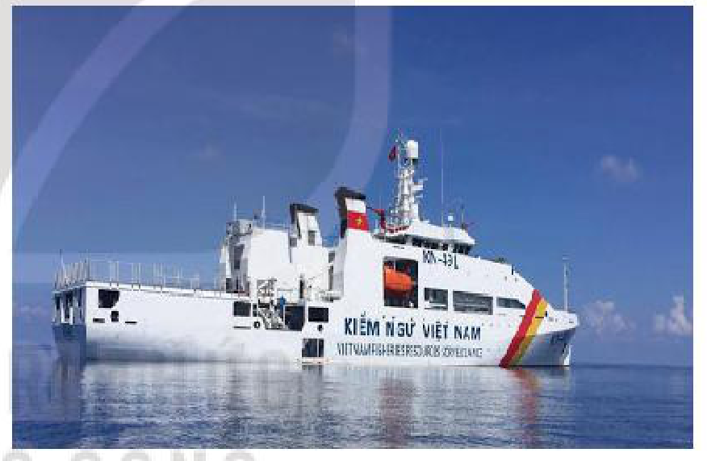

*Hình 1. Tàu Kiểm ngư KN-491 của Việt Nam*

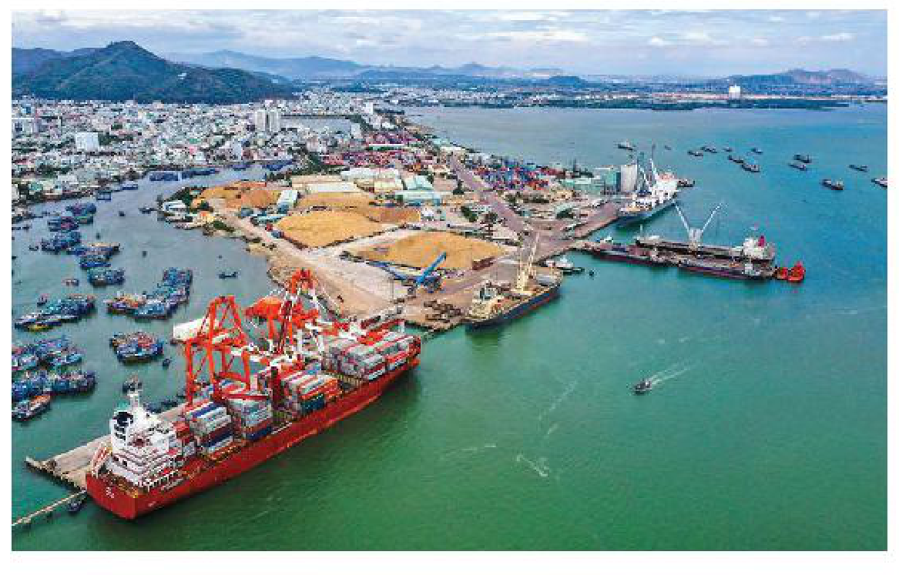

*Hình 2. Cảng Quy Nhơn (Bình Định)*

<!-- pdf:82 -->

## 1. Tầm quan trọng của Biển Đông đối với Việt Nam

Việt Nam giáp với Biển Đông ở ba phía (đông, nam và tây nam) và có đường bờ biển dài khoảng 3 260 km, từ tỉnh Quảng Ninh đến tỉnh Kiên Giang. Biển Đông đóng vai trò quan trọng đối với sự nghiệp xây dựng và bảo vệ Tổ quốc trong lịch sử, hiện tại và tương lai.

### a) Về quốc phòng, an ninh

<!-- term: Tầm quan trọng của Biển Đông đối với Việt Nam về quốc phòng, an ninh -->
Biển Đông là tuyến phòng thủ phía đông của đất nước. Hệ thống các đảo, quần đảo của Việt Nam trên Biển Đông hợp thành tuyến phòng thủ bảo vệ vùng trời, vùng biển và đất liền.

<!-- term: Vịnh Cam Ranh -->
> 💡 EM CÓ BIẾT ?
>
> Vịnh Cam Ranh (tỉnh Khánh Hoà) được coi là một trong những cảng nước sâu tốt nhất châu Á. Vị trí và địa hình của vịnh rất thuận lợi cho xây dựng các cơ sở phòng vệ chiến lược quan trọng.

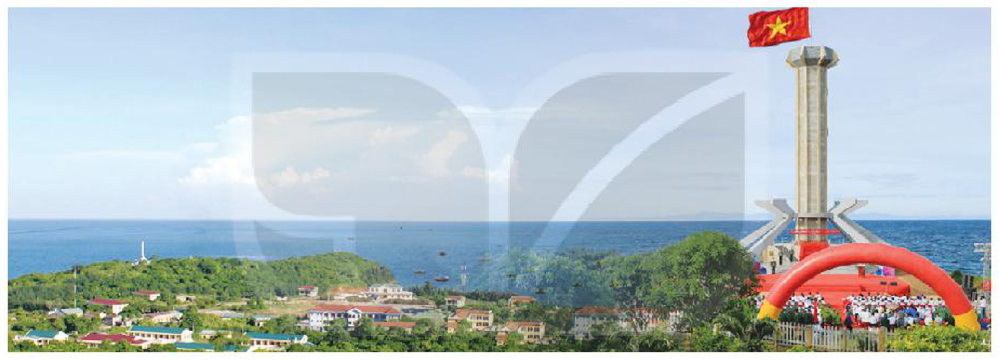

*Hình 3. Một góc đảo Cồn Cỏ (Quảng Trị) – “vọng gác tiền tiêu” của Việt Nam ở phía nam vịnh Bắc Bộ*

> ❓ Trình bày tầm quan trọng của Biển Đông đối với Việt Nam về quốc phòng, an ninh.

### b) Về phát triển các ngành kinh tế trọng điểm

<!-- term: Tầm quan trọng của Biển Đông đối với Việt Nam về phát triển kinh tế -->
Vị trí địa lí và tài nguyên của Biển Đông tạo điều kiện thuận lợi cho phát triển kinh tế biển đa dạng với các ngành mũi nhọn như: thương mại biển, khai thác và nuôi trồng thuỷ sản, khai thác khoáng sản, sửa chữa và đóng tàu, du lịch,...

<!-- term: Tầm quan trọng của Biển Đông đối với Việt Nam về phát triển kinh tế -->
Trữ lượng cá ở vùng biển Việt Nam có khả năng khai thác hằng năm đạt khoảng 2,3 triệu tấn. Trữ lượng dầu mỏ và khí đốt được xác minh là gần 550 triệu tấn dầu và trên 610 tỉ $\text{m}^3$ khí.

<!-- term: Tầm quan trọng của Biển Đông đối với Việt Nam về phát triển kinh tế -->
Vùng ven biển Việt Nam còn có tiềm năng to lớn về quặng sa khoáng như: ti-tan, thiếc, vàng, sắt, man-gan, đất hiếm,... trong đó, cát nặng, cát đen là nguồn tài nguyên quý giá của đất nước.

> 💡 EM CÓ BIẾT ?
>
> Huyện đảo Cát Bà (Hải Phòng) là một quần đảo với hơn 300 đảo lớn nhỏ, có vị trí địa lí thuận lợi trong giao lưu kinh tế với vùng kinh tế trọng điểm Bắc Bộ và có tiềm năng du lịch phong phú. Đây là địa bàn trọng điểm được thành phố Hải Phòng đầu tư xây dựng và phát triển du lịch bền vững để trở thành điểm du lịch xanh đẳng cấp quốc tế.

<!-- pdf:83 -->

<!-- term: Tầm quan trọng của Biển Đông đối với Việt Nam về phát triển kinh tế -->
Đường bờ biển dài có nhiều bãi cát, vịnh, hang động tự nhiên đẹp như Hạ Long, Cửa Lò, Đà Nẵng, Nha Trang, Phú Quốc,... tạo điều kiện cho Việt Nam trở thành một “điểm du lịch hấp dẫn”. Dọc bờ biển có thể xây dựng các cảng biển nước sâu (Cái Lân, Nghi Sơn, Dung Quất, Vân Phong, Cam Ranh, Vũng Tàu,...) và cảng trung bình (Hải Phòng, Đà Nẵng, Quy Nhơn, Nha Trang,...).

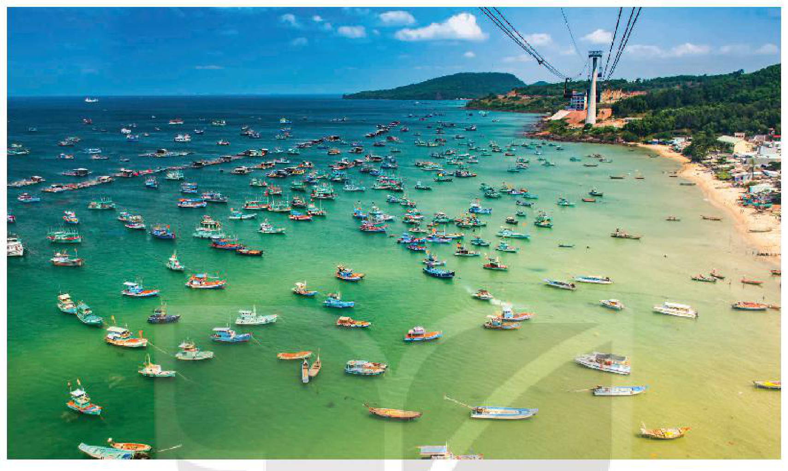

*Hình 4. Một góc đảo Phú Quốc (Kiên Giang)*

<!-- term: Tầm quan trọng của Biển Đông đối với Việt Nam về phát triển kinh tế -->
Biển Đông còn là “cửa ngõ” để Việt Nam giao lưu kinh tế và hợp tác với các nước trên thế giới, đặc biệt là với khu vực châu Á – Thái Bình Dương. Hàng hoá xuất – nhập khẩu của Việt Nam chủ yếu được vận chuyển bằng đường biển qua Biển Đông.

> ❓ 1. Nêu tầm quan trọng của Biển Đông đối với Việt Nam về phát triển các ngành kinh tế.
>
> 2. Liên hệ với địa phương em hoặc địa phương mà em biết (tỉnh/thành phố), chỉ ra một số vai trò của biển đối với việc phát triển kinh tế.

## 2. Lịch sử bảo vệ chủ quyền, các quyền và lợi ích hợp pháp của Việt Nam đối với quần đảo Hoàng Sa và quần đảo Trường Sa

### a) Quá trình Việt Nam xác lập chủ quyền và quản lí đối với quần đảo Hoàng Sa và quần đảo Trường Sa

Các bằng chứng khảo cổ học đã chứng minh rằng ngay từ đầu Công nguyên, người Việt đã tích cực, chủ động và sớm có hoạt động kinh tế và văn hoá ở Biển Đông. Cùng với những nguồn sử liệu tin cậy, có giá trị pháp lí cao của Việt Nam và nước ngoài (văn bản hành chính, tư liệu lịch sử,...) qua các thời kì đã khẳng định Việt Nam là Nhà nước đầu tiên xác lập chủ quyền và thực hiện quản lí liên tục đối với quần đảo Hoàng Sa và quần đảo Trường Sa.

<!-- pdf:84 -->

**• Trước năm 1884**

<!-- term: Xác lập chủ quyền của Việt Nam đối với quần đảo Hoàng Sa và Trường Sa trước năm 1884 -->
Nhiều tập bản đồ của các triều đại quân chủ Việt Nam như *Toản tập Thiên Nam tứ chí lộ đồ thư* (1686), *Giáp Ngọ bình Nam đồ* (1774), *Đại Nam nhất thống toàn đồ* (1838),... và của người phương Tây như: Bộ *Át lát thế giới* (1827), *An Nam đại quốc hoạ đồ* (1838),... đã thể hiện quần đảo Hoàng Sa, quần đảo Trường Sa thuộc lãnh thổ Việt Nam.

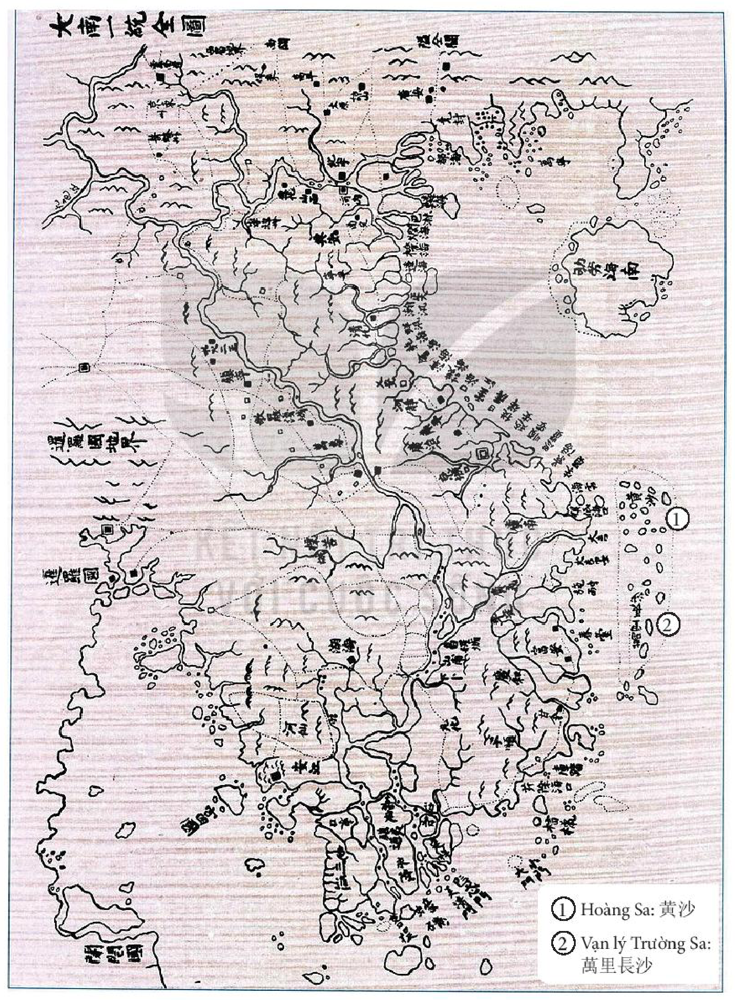

*Hình 5. Bản đồ Đại Nam nhất thống toàn đồ (1838)*

<!-- pdf:85 -->

<!-- term: Xác lập chủ quyền của Việt Nam đối với quần đảo Hoàng Sa và Trường Sa trước năm 1884 -->
Một số công trình sử học và địa lí của Việt Nam cũng ghi chép tường tận về cương vực lãnh thổ và những hoạt động thực thi, bảo vệ chủ quyền của các chính quyền chúa Nguyễn, vua Lê – chúa Trịnh, triều Tây Sơn và triều Nguyễn ở quần đảo Hoàng Sa, quần đảo Trường Sa như: *Đại Việt sử ký tục biên*, *Phủ biên tạp lục*, *Đại Nam thực lục*, *Hoàng Việt địa dư chí*, *Đại Nam nhất thống chí*,...

<!-- term: Lễ Khao lề thế lính Hoàng Sa -->
> 🔗 KẾT NỐI VỚI NGÀY NAY
>
> Lễ Khao lề thế lính là một tập tục cổ truyền có từ thời Hải đội Hoàng Sa (thế kỉ XVII) nhằm tri ân những người đi làm nhiệm vụ và cầu cho họ được bình an trở về,... Ngày nay, lễ Khao lề thế lính vẫn được duy trì nhằm tri ân Hải đội Hoàng Sa năm xưa, đồng thời giáo dục thế hệ trẻ về trách nhiệm giữ gìn biển đảo quê hương.

<!-- term: Đội Hoàng Sa và đội Bắc Hải -->
Hoạt động xác lập chủ quyền, quản lí liên tục mang tính nhà nước đối với quần đảo Hoàng Sa, quần đảo Trường Sa được khẳng định thông qua việc thành lập và hoạt động của các đội Hoàng Sa, Bắc Hải từ thế kỉ XVII đến đầu thế kỉ XIX.

<!-- term: Đội Hoàng Sa và đội Bắc Hải -->
> TƯ LIỆU 1. Họ Nguyễn đặt đội Hoàng Sa 70 suất, lấy người xã An Vĩnh sung vào, cắt phiên mỗi năm cứ tháng 2 nhận giấy sai đi, mang lương đủ ăn sáu tháng, đi bằng năm chiếc thuyền nhỏ, ra biển ba ngày ba đêm thì đến đảo ấy. Lấy được hoá vật của tàu như là gươm ngựa, hoa bạc, hòn bạc, đồ đồng, khối chì, súng, ngà voi, đồ sứ, đồ chiêm, cùng là vỏ đồi mồi, hải sâm, hạt ốc vân rất nhiều... Đến kì tháng 8 thì về.
>
> Họ Nguyễn lại đặt đội Bắc Hải. Lệnh cho đi chiếc thuyền câu nhỏ ra các xứ Bắc Hải, cù lao Côn Lôn và các đảo ở Hà Tiên.
>
> *(Theo Lê Quý Đôn, Phủ biên tạp lục, NXB Văn hoá – Thông tin, 2007, tr. 155)*

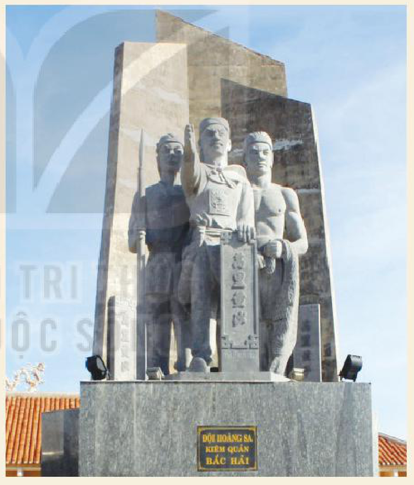

*Hình 6. Tượng đài đội Hoàng Sa kiêm quản Bắc Hải ở đảo Lý Sơn (Quảng Ngãi)*

<!-- term: Xác lập chủ quyền của Việt Nam đối với quần đảo Hoàng Sa và Trường Sa trước năm 1884 -->
Dưới thời vua Gia Long, triều đình đã tiến hành các hoạt động khẳng định chủ quyền ở quần đảo Trường Sa và quần đảo Hoàng Sa một cách quy củ như tổ chức đội thuỷ quân chuyên trách thực thi chủ quyền ở đây. Đến thời vua Minh Mạng, việc cử thuỷ quân ra quần đảo Hoàng Sa và quần đảo Trường Sa đã trở thành lệ đều đặn hằng năm. Nhà vua cũng coi việc vẽ bản đồ khu vực Hoàng Sa và Trường Sa là trọng trách của Nhà nước, lệnh cho cắm dấu mốc tại nơi khảo sát và thực hiện cứu nạn, bảo đảm an toàn cho tàu thuyền qua lại khu vực Biển Đông,... Năm 1835, vua Minh Mạng cho người dựng miếu và trồng cây ở một số đảo thuộc quần đảo Hoàng Sa.

<!-- pdf:86 -->

<!-- term: Xác lập chủ quyền của Việt Nam đối với quần đảo Hoàng Sa và Trường Sa trước năm 1884 -->
Việc tổ chức đơn vị hành chính của Hoàng Sa trong hệ thống tổ chức hành chính Nhà nước lúc bấy giờ cũng được thực hiện. Thời chúa Nguyễn, Hoàng Sa thuộc phủ Quảng Nghĩa (Quảng Ngãi). Thời nhà Nguyễn, Hoàng Sa thuộc tỉnh Quảng Ngãi.

**• Từ năm 1884 đến năm 1975**

<!-- term: Quản lí và bảo vệ chủ quyền quần đảo Hoàng Sa, Trường Sa từ năm 1884 đến năm 1975 -->
Cuối thế kỉ XIX, chính quyền thực dân Pháp (khi đó là đại diện ngoại giao của triều Nguyễn) tiếp tục khẳng định chủ quyền của Việt Nam, quản lí, bảo vệ quần đảo Hoàng Sa và quần đảo Trường Sa theo đúng thông lệ pháp lí quốc tế.

<!-- term: Quản lí và bảo vệ chủ quyền quần đảo Hoàng Sa, Trường Sa từ năm 1884 đến năm 1975 -->
Năm 1909, người Pháp đã nêu rõ các cuộc khảo sát của Trung Quốc tại quần đảo Hoàng Sa thuộc chủ quyền của Việt Nam là trái phép.

> 💡 EM CÓ BIẾT ?
>
> Cuối thế kỉ XIX, công ty bảo hiểm Anh đòi Trung Quốc bồi thường vì không đảm bảo an ninh hàng hải khi ngư dân nước này đã lấy hàng hoá từ con tàu Bê-lô-na (Đức) bị đắm ở khu vực quần đảo Hoàng Sa. Tuy nhiên, chính quyền Mãn Thanh đã từ chối bồi thường với lí do quần đảo Hoàng Sa không thuộc chủ quyền của Trung Quốc.

<!-- term: Quản lí và bảo vệ chủ quyền quần đảo Hoàng Sa, Trường Sa từ năm 1884 đến năm 1975 -->
Sau đó, chính quyền Pháp chú trọng hơn việc nghiên cứu quá trình xác lập chủ quyền của Việt Nam tại quần đảo này. Cuộc khảo sát khoa học đầu tiên của các nhà khoa học người Pháp đã được tiến hành tại quần đảo Hoàng Sa vào năm 1925 và tại quần đảo Trường Sa vào năm 1927.

<!-- term: Quản lí và bảo vệ chủ quyền quần đảo Hoàng Sa, Trường Sa từ năm 1884 đến năm 1975 -->
Quần đảo Trường Sa cũng được sáp nhập vào tỉnh Bà Rịa và quần đảo Hoàng Sa thuộc tỉnh Thừa Thiên.

<!-- term: Quản lí và bảo vệ chủ quyền quần đảo Hoàng Sa, Trường Sa từ năm 1884 đến năm 1975 -->
Từ những năm 30 của thế kỉ XX, người Pháp đã tiến hành xây dựng cột mốc chủ quyền, đèn biển, trạm khí tượng, trạm vô tuyến điện và thực hiện nhiều khảo sát khoa học,...

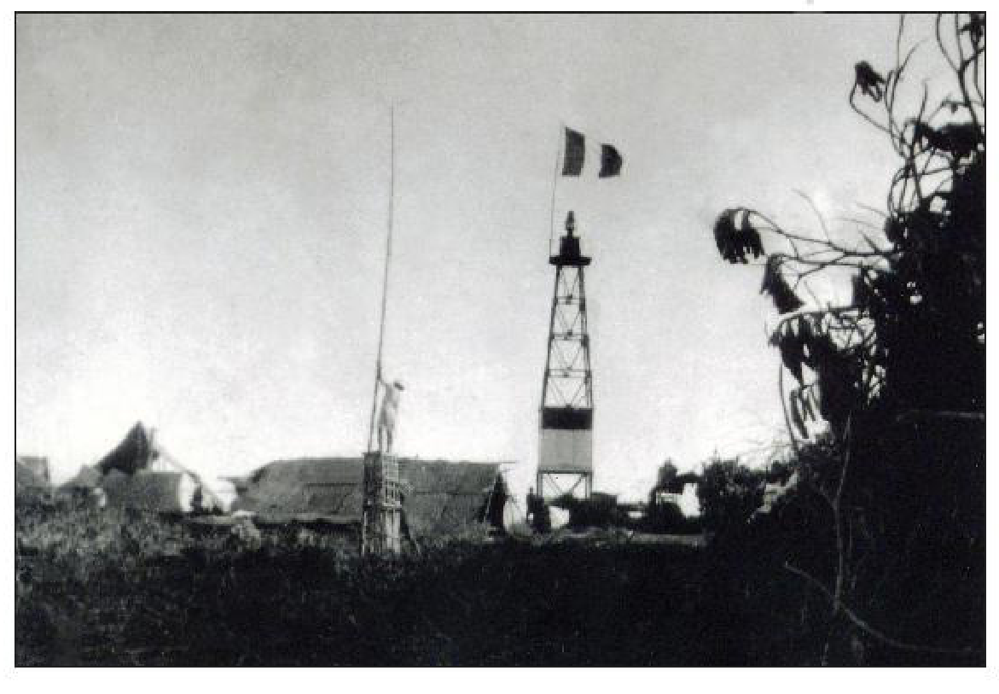

*Hình 7. Cột hải đăng trên quần đảo Hoàng Sa được xây dựng năm 1937*

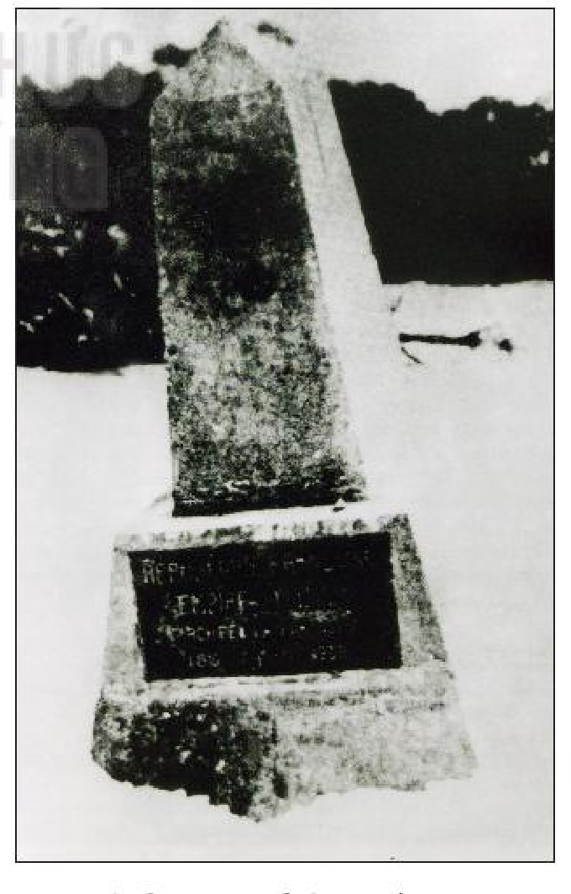

*Hình 8. Bia chủ quyền trên quần đảo Hoàng Sa do người Pháp xây dựng năm 1938*

<!-- pdf:87 -->

> TƯ LIỆU 2. Trong bản ghi chú gửi Vụ Châu Á đại dương, Cố vấn pháp luật Bộ Ngoại giao Pháp đã viết: “Việc chiếm hữu quần đảo Spartly (Trường Sa) do Pháp tiến hành năm 1930 – 1932 là nhân danh Hoàng đế An Nam. Trong trường hợp này, danh nghĩa mà Pháp đòi hỏi ở đây là việc thực thi chủ quyền có từ trước [...], và với tư cách là nước **bảo hộ**, chịu trách nhiệm về các quan hệ đối ngoại của An Nam, Pháp có thể sử dụng các quyền đó để chặn nước thứ ba, và có thể nhận được xét xử quốc tế việc thừa nhận các quyền nói trên”.
>
> *(Theo Hãn Nguyên Nguyễn Nhã, Những bằng chứng về chủ quyền của Việt Nam đối với hai quần đảo Hoàng Sa và Trường Sa, NXB Giáo dục Việt Nam, 2013, tr. 124)*

<!-- term: Quản lí và bảo vệ chủ quyền quần đảo Hoàng Sa, Trường Sa từ năm 1884 đến năm 1975 -->
Đến tháng 9 – 1951, chủ quyền của Việt Nam đối với quần đảo Hoàng Sa và quần đảo Trường Sa tiếp tục được tuyên bố tại Hội nghị Hoà bình Xan Phran-xi-xcô mà không bị các quốc gia tham dự hội nghị phản đối.

<!-- term: Quản lí và bảo vệ chủ quyền quần đảo Hoàng Sa, Trường Sa từ năm 1884 đến năm 1975 -->
Từ năm 1954 đến năm 1975, hai quần đảo được đặt dưới sự quản lí hành chính của chính quyền Sài Gòn.

<!-- term: Quản lí và bảo vệ chủ quyền quần đảo Hoàng Sa, Trường Sa từ năm 1884 đến năm 1975 -->
Chính quyền Sài Gòn đã liên tục thực thi chủ quyền của Việt Nam ở quần đảo Hoàng Sa và quần đảo Trường Sa thông qua việc ban hành các văn bản hành chính nhà nước, cử quân đồn trú, dựng bia chủ quyền, treo cờ trên các đảo chính. Về mặt hành chính, quần đảo Hoàng Sa thuộc tỉnh Quảng Nam và quần đảo Trường Sa thuộc tỉnh Phước Tuy (tỉnh Bà Rịa – Vũng Tàu ngày nay).

<!-- term: Quản lí và bảo vệ chủ quyền quần đảo Hoàng Sa, Trường Sa từ năm 1884 đến năm 1975 -->
Từ ngày 13 đến ngày 28 – 4 – 1975, Quân giải phóng miền Nam Việt Nam đã tiếp quản các đảo và triển khai lực lượng thực thi chủ quyền đối với quần đảo Trường Sa.

**• Từ sau năm 1975 đến nay**

<!-- term: Quản lí và thực thi chủ quyền quần đảo Hoàng Sa, Trường Sa từ sau năm 1975 đến nay -->
Sau khi đất nước thống nhất, Nhà nước Cộng hoà xã hội chủ nghĩa Việt Nam đã tiếp tục quản lí và thực thi chủ quyền của Việt Nam đối với quần đảo Hoàng Sa và quần đảo Trường Sa. Các đơn vị hành chính tại hai quần đảo này đã được thành lập.

<!-- term: Quản lí và thực thi chủ quyền quần đảo Hoàng Sa, Trường Sa từ sau năm 1975 đến nay -->
Năm 1982, huyện Hoàng Sa thuộc tỉnh Quảng Nam – Đà Nẵng (từ năm 1997 thuộc thành phố Đà Nẵng) và huyện Trường Sa thuộc tỉnh Khánh Hoà được thành lập. Trong huyện Trường Sa có các đơn vị hành chính nhỏ hơn như: thị trấn Trường Sa (bao gồm đảo Trường Sa và phụ cận), xã Song Tử Tây (đảo Song Tử Tây và phụ cận), xã Sinh Tồn (đảo Sinh Tồn và phụ cận),...

> ❓ 1. Các tư liệu 1, 2 cung cấp cho em thông tin gì về hoạt động xác lập, thực thi chủ quyền của Việt Nam đối với quần đảo Hoàng Sa và quần đảo Trường Sa?
>
> 2. Trình bày khái quát quá trình xác lập chủ quyền và quản lí liên tục của Việt Nam đối với quần đảo Hoàng Sa và quần đảo Trường Sa trong lịch sử.

<!-- pdf:88 -->

### b) Cuộc đấu tranh bảo vệ, thực thi chủ quyền, các quyền và lợi ích hợp pháp của Việt Nam ở Biển Đông

<!-- term: Cuộc đấu tranh bảo vệ chủ quyền biển đảo của Việt Nam -->
Nhà nước Việt Nam qua các thời kì lịch sử có những hoạt động đấu tranh kiên quyết nhằm bảo vệ, thực thi chủ quyền đối với quần đảo Hoàng Sa và quần đảo Trường Sa.

**• Từ sau năm 1975 đến nay**

<!-- term: Cuộc đấu tranh bảo vệ chủ quyền biển đảo của Việt Nam -->
- Từ tháng 3 – 1988 đến nay, nhà nước Cộng hoà xã hội chủ nghĩa Việt Nam kiên trì đấu tranh ngoại giao và pháp lí để khẳng định, bảo vệ chủ quyền của Việt Nam tại quần đảo Hoàng Sa, quần đảo Trường Sa và môi trường hoà bình, hợp tác trên Biển Đông.

<!-- term: Hải chiến Gạc Ma – Cô Lin – Len Đao -->
- Tháng 3 – 1988, nhiều chiến sĩ Hải quân Nhân dân Việt Nam đã hi sinh anh dũng khi chiến đấu bảo vệ chủ quyền tại các đảo Gạc Ma, Cô Lin, Len Đao trước cuộc tấn công của quân đội Trung Quốc.

**• Từ năm 1954 đến năm 1975**

<!-- term: Cuộc đấu tranh bảo vệ chủ quyền biển đảo của Việt Nam -->
- Chính phủ Cách mạng lâm thời Cộng hoà miền Nam Việt Nam ra tuyên bố khẳng định chủ quyền, toàn vẹn lãnh thổ là những vấn đề thiêng liêng và bất khả xâm phạm.
- Tháng 1 – 1974, quân đội Sài Gòn thất bại trong chiến đấu bảo vệ quần đảo Hoàng Sa trước cuộc tấn công của quân đội Trung Quốc.

**• Từ năm 1884 đến năm 1954**

<!-- term: Cuộc đấu tranh bảo vệ chủ quyền biển đảo của Việt Nam -->
- Năm 1946, chính quyền thực dân Pháp cho hải quân trú đóng ở các đảo chính thuộc quần đảo Trường Sa và yêu cầu quân đội Trung Hoa Dân quốc rút khỏi các đảo đã chiếm đóng trái phép.
- Năm 1939, chính quyền thực dân Pháp gửi công hàm phản đối việc Nhật Bản kiểm soát một số đảo thuộc quần đảo Trường Sa.

**• Trước năm 1884**

<!-- term: Cuộc đấu tranh bảo vệ chủ quyền biển đảo của Việt Nam -->
- Dưới triều Nguyễn, các đội thuỷ quân chuyên trách công việc bảo vệ, thực thi chủ quyền ở quần đảo Hoàng Sa, quần đảo Trường Sa được tổ chức.
- Từ thời chúa Nguyễn, Vương triều Tây Sơn, các đội Hoàng Sa, Bắc Hải có nhiệm vụ tuần tiễu giữ gìn vùng biển, ứng chiến với nạn cướp biển và những xâm phạm tại quần đảo Hoàng Sa,...

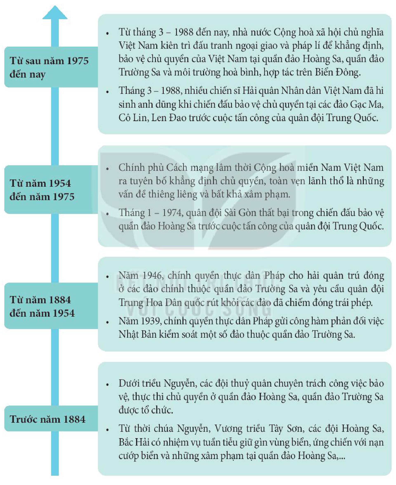

*Hình 9. Sơ đồ khái quát về cuộc đấu tranh bảo vệ chủ quyền biển đảo của Việt Nam*

<!-- pdf:89 -->

> 💡 EM CÓ BIẾT ?
>
> Khu tưởng niệm chiến sĩ Gạc Ma được xây dựng ở huyện Cam Lâm để tưởng nhớ những chiến sĩ hải quân Việt Nam đã hi sinh trong cuộc chiến đấu bảo vệ chủ quyền biển đảo Tổ quốc năm 1988.

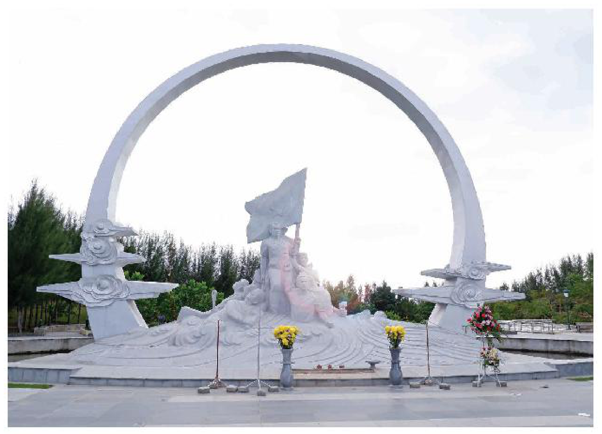

*Hình 10. Đài tưởng niệm chiến sĩ Gạc Ma (Khánh Hoà)*

> ❓ Trình bày nét chính về cuộc đấu tranh bảo vệ và thực thi chủ quyền, các quyền và lợi ích hợp pháp của Việt Nam ở Biển Đông.

## 3. Chủ trương của Việt Nam trong giải quyết các tranh chấp chủ quyền ở Biển Đông

<!-- term: Chủ trương của Việt Nam trong giải quyết tranh chấp ở Biển Đông -->
Nhà nước Việt Nam thực hiện các biện pháp toàn diện trên các lĩnh vực chính trị, ngoại giao, kinh tế và quân sự nhằm bảo vệ quyền, chủ quyền và các lợi ích hợp pháp của Việt Nam ở Biển Đông.

<!-- term: Chủ trương của Việt Nam trong giải quyết tranh chấp ở Biển Đông -->
Đối với các tranh chấp chủ quyền, Việt Nam chủ trương giải quyết các tranh chấp trên Biển Đông thông qua biện pháp hoà bình với tinh thần hiểu biết và tôn trọng lẫn nhau, tuân thủ luật pháp quốc tế.

<!-- term: Chủ trương của Việt Nam trong giải quyết tranh chấp ở Biển Đông -->
1. Ban hành văn bản pháp luật khẳng định chủ quyền:
- Tuyên bố về các vùng biển và thềm lục địa Việt Nam (5 – 1977).
- Các Sách trắng khẳng định chủ quyền của Việt Nam đối với quần đảo Hoàng Sa và quần đảo Trường Sa theo luật pháp quốc tế (9 – 1979, 12 – 1981, 4 – 1988,...).
- Luật biên giới quốc gia (6 – 2003).
- Luật hàng hải Việt Nam (11 – 2015).

<!-- pdf:90 -->

<!-- term: Công ước của Liên hợp quốc về Luật Biển năm 1982 -->
2. Tham gia Công ước Luật Biển năm 1982 của Liên hợp quốc (UNCLOS).
Theo Công ước Luật Biển UNCLOS, Việt Nam là quốc gia ven biển có các vùng biển và thềm lục địa để thăm dò và khai thác với diện tích khoảng một triệu ki-lô-mét vuông, rộng gấp ba lần diện tích lãnh thổ đất liền.

<!-- term: Luật Biển Việt Nam năm 2012 -->
3. Thông qua Luật Biển Việt Nam năm 2012.
Luật Biển Việt Nam quy định Nhà nước giải quyết các tranh chấp liên quan đến biển, đảo với các nước khác bằng các biện pháp hoà bình, phù hợp với Công ước của Liên hợp quốc về Luật Biển năm 1982, pháp luật và thực tiễn quốc tế.

<!-- term: Tuyên bố về ứng xử của các bên ở Biển Đông -->
4. Thúc đẩy và thực hiện đầy đủ Tuyên bố về ứng xử của các bên ở Biển Đông (DOC).

<!-- term: Tuyên bố về ứng xử của các bên ở Biển Đông -->
> TƯ LIỆU 3. Điều 4: Các bên liên quan chịu trách nhiệm giải quyết các tranh chấp về lãnh thổ và về quyền thực thi luật pháp bằng các phương tiện hoà bình mà không viện đến sự đe doạ hoặc sử dụng vũ lực, thông qua các cuộc tham vấn thân thiện và những cuộc đàm phán bởi các quốc gia có chủ quyền có liên quan trực tiếp, phù hợp với những nguyên tắc được thừa nhận phổ quát của luật pháp quốc tế, kể cả Công ước Liên hợp quốc về Luật Biển năm 1982.
>
> *(Trích Tuyên bố về Cách ứng xử của các bên ở Biển Đông (DOC) được các nước ASEAN và Trung Quốc kí ngày 4 – 11 – 2002 tại Thủ đô Phnôm Pênh, Cam-pu-chia)*

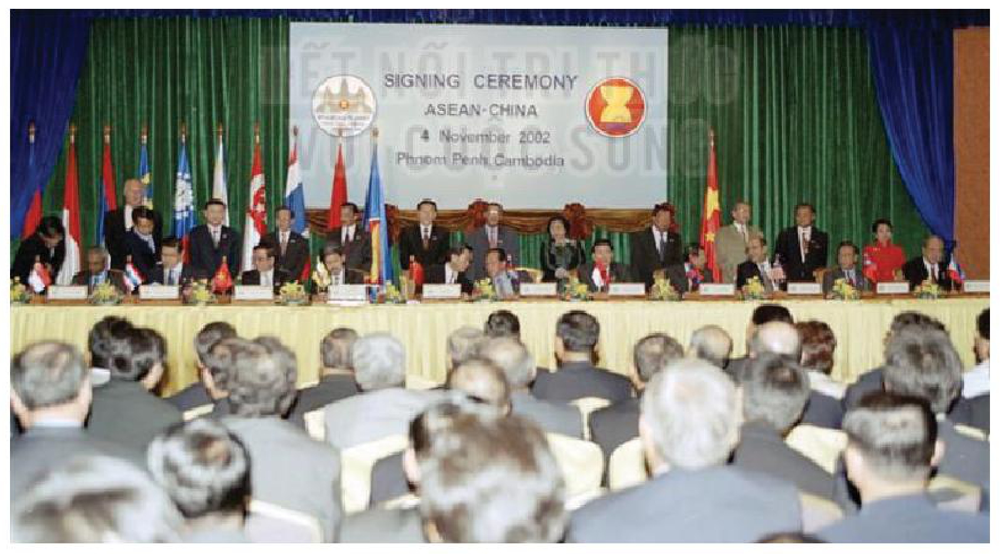

*Hình 11. Lễ kí kết Tuyên bố về Cách ứng xử của các bên ở Biển Đông (DOC) tại Cam-pu-chia (2002)*

<!-- term: Chủ trương của Việt Nam trong giải quyết tranh chấp ở Biển Đông -->
Đồng thời, để tăng cường tiềm lực quốc gia phục vụ hoạt động bảo vệ chủ quyền biển đảo, Việt Nam thực hiện phát triển kinh tế biển gắn với tăng cường quốc phòng, an ninh trên biển và xây dựng thế trận quốc phòng toàn dân trên biển.

<!-- pdf:91 -->

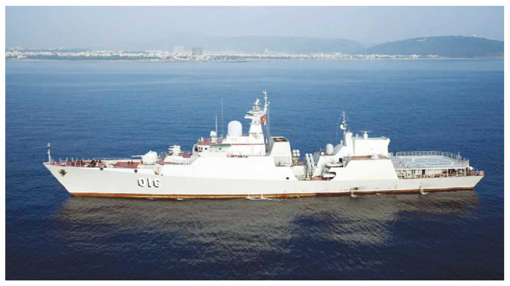

*Hình 12. Tàu Hộ vệ tên lửa 016 – Quang Trung của Hải quân Nhân dân Việt Nam*

> ❓ 1. Khai thác Tư liệu 3 (tr. 89) và thông tin trong mục, hãy trình bày chủ trương của Việt Nam khi giải quyết các tranh chấp chủ quyền ở Biển Đông.
>
> 2. Nêu một số ví dụ thực tiễn về việc thực hiện chủ trương này của Việt Nam mà em biết.

## ✏️ Luyện tập và vận dụng

1. Lập sơ đồ tư duy về tầm quan trọng chiến lược của Biển Đông trên các mặt quốc phòng, an ninh, kinh tế đối với Việt Nam.

2. Sử dụng tư liệu lịch sử để chứng minh rằng: Việt Nam là Nhà nước đầu tiên xác lập, quản lí liên tục và thực thi, bảo vệ chủ quyền ở quần đảo Hoàng Sa và quần đảo Trường Sa.

3. Giải thích vì sao Việt Nam chủ trương giải quyết các tranh chấp ở Biển Đông bằng biện pháp hoà bình?

1. Là một học sinh, em cần làm gì để góp phần bảo vệ chủ quyền biển đảo của Tổ quốc?

2. Sưu tầm tư liệu từ sách, báo và internet, hãy viết bài (khoảng 300 chữ) về hoạt động bảo vệ chủ quyền biển đảo của Việt Nam hiện nay.

## 📷 Danh sách hình trong bài

| Mã hình | Trang PDF | Vị trí trong bài | Chú thích gốc |
| --- | --- | --- | --- |
| H11-lich_su-b13-01 | 81 | Mở đầu | Hình 1. Tàu Kiểm ngư KN-491 của Việt Nam |
| H11-lich_su-b13-02 | 81 | Mở đầu | Hình 2. Cảng Quy Nhơn (Bình Định) |
| H11-lich_su-b13-03 | 82 | Mục 1.a | Hình 3. Một góc đảo Cồn Cỏ (Quảng Trị) – “vọng gác tiền tiêu” của Việt Nam ở phía nam vịnh Bắc Bộ |
| H11-lich_su-b13-04 | 83 | Mục 1.b | Hình 4. Một góc đảo Phú Quốc (Kiên Giang) |
| H11-lich_su-b13-05 | 84 | Mục 2.a | Hình 5. Bản đồ Đại Nam nhất thống toàn đồ (1838) |
| H11-lich_su-b13-06 | 85 | Mục 2.a | Hình 6. Tượng đài đội Hoàng Sa kiêm quản Bắc Hải ở đảo Lý Sơn (Quảng Ngãi) |
| H11-lich_su-b13-07 | 86 | Mục 2.a | Hình 7. Cột hải đăng trên quần đảo Hoàng Sa được xây dựng năm 1937 |
| H11-lich_su-b13-08 | 86 | Mục 2.a | Hình 8. Bia chủ quyền trên quần đảo Hoàng Sa do người Pháp xây dựng năm 1938 |
| H11-lich_su-b13-09 | 88 | Mục 2.b | Hình 9. Sơ đồ khái quát về cuộc đấu tranh bảo vệ chủ quyền biển đảo của Việt Nam |
| H11-lich_su-b13-10 | 89 | Mục 2.b | Hình 10. Đài tưởng niệm chiến sĩ Gạc Ma (Khánh Hoà) |
| H11-lich_su-b13-11 | 90 | Mục 3 | Hình 11. Lễ kí kết Tuyên bố về Cách ứng xử của các bên ở Biển Đông (DOC) tại Cam-pu-chia (2002) |
| H11-lich_su-b13-12 | 91 | Mục 3 | Hình 12. Tàu Hộ vệ tên lửa 016 – Quang Trung của Hải quân Nhân dân Việt Nam |
