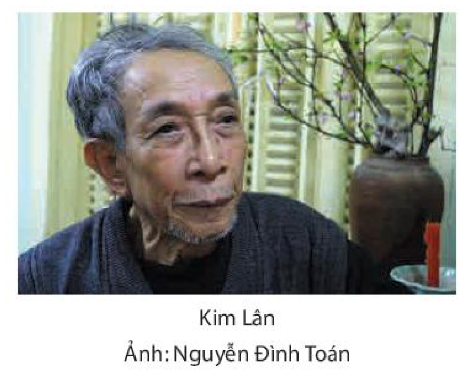
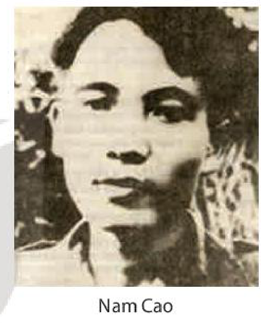

<!-- pdf:10 -->

# BÀI 1: CÂU CHUYỆN VÀ ĐIỂM NHÌN TRONG TRUYỆN KỂ
<!-- ocr-ok: nhãn Bài 1 trên nền trắng-cam bị OCR bỏ sót và chữ KỂ đọc nhầm thành KẾ, đã đối chiếu ảnh trang PDF 10 -->

## 🎯 Yêu cầu cần đạt

- Nhận biết và phân tích được một số yếu tố của truyện ngắn hiện đại như: không gian, thời gian, câu chuyện, nhân vật, người kể chuyện ngôi thứ ba, người kể chuyện ngôi thứ nhất, sự thay đổi điểm nhìn, sự nối kết giữa lời người kể chuyện và lời nhân vật.
- Phân tích được các chi tiết tiêu biểu, đề tài, câu chuyện, sự kiện, nhân vật và mối quan hệ của chúng trong tính chỉnh thể của tác phẩm; nhận xét được những chi tiết quan trọng trong việc thể hiện nội dung văn bản.
<!-- ocr-ok: chữ chi tiết bị OCR đọc nhầm thành chỉ tiết, đã đối chiếu ảnh trang PDF 10 -->
- Nhận biết được các đặc điểm cơ bản của ngôn ngữ viết và ngôn ngữ nói để có hướng vận dụng phù hợp, hiệu quả.
- Viết được văn bản nghị luận về một tác phẩm truyện, chú ý phân tích đặc điểm riêng trong cách kể của tác giả.
- Biết thuyết trình về nghệ thuật kể chuyện trong một tác phẩm truyện.
- Thể hiện được tinh thần nhân văn trong việc nhìn nhận, đánh giá con người: đồng cảm với những hoàn cảnh, số phận không may mắn; trân trọng niềm khát khao được chia sẻ, yêu thương.

## ĐỌC
<!-- ocr-ok: tiêu đề ĐỌC chữ trắng trên băng màu cam bị OCR bỏ sót, đã đối chiếu ảnh trang PDF 10 -->

### TRI THỨC NGỮ VĂN

**Truyện ngắn hiện đại**

**Truyện ngắn hiện đại** là thể loại tự sự cỡ nhỏ, ở đó, sự ngắn gọn được nhìn nhận là một đặc trưng nổi bật, phản ánh nét riêng của tư duy thể loại. Truyện ngắn thường chỉ xoay quanh một, hai tình huống diễn ra trong khoảng thời gian, không gian hạn chế. Tuy nhiên, những lát cắt đời sống này lại giàu sức khơi gợi, có thể gây ấn tượng mạnh đối với người đọc. Do dung lượng bị giới hạn, truyện ngắn đòi hỏi sự chắt lọc, dồn nén của các chi tiết và việc vận dụng bút pháp chấm phá trong trần thuật.
<!-- ocr-ok: chữ chi tiết bị OCR đọc nhầm thành chỉ tiết, đã đối chiếu ảnh trang PDF 10 -->

**Câu chuyện và truyện kể**

**Câu chuyện** (còn có thể gọi là truyện gốc) là nội dung của tác phẩm tự sự bao gồm nhân vật, bối cảnh và sự kiện được sắp xếp theo trật tự thời gian.

<!-- pdf:11 -->

**Truyện kể** gắn liền với câu chuyện nhưng không đồng nhất: nó bao gồm các sự kiện được tổ chức theo mạch kể của văn bản tự sự, gắn liền với vai trò của người kể chuyện, hệ thống điểm nhìn và lớp lời văn nghệ thuật. Chú ý đến truyện kể tức là chú ý đến cách câu chuyện được kể như thế nào.

**Điểm nhìn trong truyện kể**
<!-- ocr-ok: chữ kể màu cam bị OCR đọc nhầm thành kê, đã đối chiếu ảnh trang PDF 11 -->

Để câu chuyện được kể ra, nhất thiết phải có người kể chuyện (tức người biết, nhìn thấy và kể lại câu chuyện ấy). Người kể chuyện bao giờ cũng kể câu chuyện từ **điểm nhìn** nhất định, được hiểu là vị trí để quan sát, trần thuật, đánh giá.

Có thể phân chia điểm nhìn trong tác phẩm tự sự thành nhiều loại khác nhau như: điểm nhìn của người kể chuyện và điểm nhìn của nhân vật được kể; điểm nhìn bên ngoài (miêu tả sự vật, con người ở những bình diện ngoại hiện, kể về những điều mà nhân vật không biết) và điểm nhìn bên trong (kể và tả xuyên qua cảm nhận, ý thức của nhân vật); điểm nhìn không gian (nhìn xa – nhìn gần) và điểm nhìn thời gian (nhìn từ thời điểm hiện tại, miêu tả sự việc như nó đang diễn ra hay nhìn lại quá khứ, kể lại qua lăng kính hồi ức,...);... Điểm nhìn còn mang tính tâm lí, tư tưởng, gắn liền với vai kể của người kể chuyện hoặc hoàn cảnh, trải nghiệm của nhân vật.
<!-- ocr-ok: chữ kể về bị OCR đọc nhầm thành kế về, đã đối chiếu ảnh trang PDF 11 -->

Câu chuyện được kể có thể gắn với một điểm nhìn thấu suốt mọi sự việc, một quan điểm, một cách đánh giá mang tính định hướng cho người đọc. Nhưng cũng có thể câu chuyện được kể từ nhiều điểm nhìn, gắn với nhiều quan điểm, cách đánh giá khác nhau, thậm chí đối lập nhau, xoay quanh sự việc hay nhân vật. Điều này tạo nên tính đối thoại của tác phẩm và đặt người đọc vào một vai trò chủ động, tích cực hơn trong việc diễn giải và đánh giá.

**Lời người kể chuyện và lời nhân vật**

Lời người kể chuyện và lời nhân vật là những yếu tố cấu thành lớp lời văn nghệ thuật của văn bản tự sự.

**Lời người kể chuyện** gắn với ngôi kể, điểm nhìn, ý thức và giọng điệu của người kể chuyện. Chức năng của nó là miêu tả, trần thuật, đưa ra những phán đoán, đánh giá đối với đối tượng được miêu tả, trần thuật cũng như định hướng việc hình dung, theo dõi mạch kể của người đọc. Trong khi đó, **lời nhân vật** là ngôn ngữ độc thoại hay đối thoại gắn với ý thức, quan điểm, giọng điệu của chính nhân vật.

<!-- term: Lời nửa trực tiếp --><!-- term: Lời độc thoại nội tâm --><!-- term: Lời nhại -->
Trong văn bản tự sự, đặc biệt ở các thể loại tự sự hiện đại, lời người kể chuyện và lời nhân vật có khả năng kết nối, cộng hưởng, giao thoa với nhau tạo nên một số hiện tượng đặc biệt về lời văn như lời nửa trực tiếp (lời của người kể chuyện nhưng tái hiện ý thức, giọng điệu của nhân vật), lời độc thoại nội tâm (tái hiện tiếng nói bên trong của nhân vật), lời nhại (lời mô phỏng quan điểm, ý thức của nhân vật với chủ ý mỉa mai hay bông đùa,...).

<!-- pdf:12 -->

**Ngôn ngữ nói và ngôn ngữ viết**

**Ngôn ngữ nói** (còn gọi là khẩu ngữ) là ngôn ngữ âm thanh, được tiếp nhận bằng thính giác. Ngôn ngữ nói gắn liền với hoạt động giao tiếp của con người trong đời sống thường nhật như trò chuyện ở gia đình, nhà trường, nhà máy, công sở,...; phát biểu trong giờ học, cuộc họp, hội thảo; trao đổi khi mua bán ở chợ, siêu thị;...

Trong một số trường hợp đặc biệt, ngôn ngữ nói cũng xuất hiện dưới hình thức văn bản viết, ví dụ: tin nhắn qua điện thoại hoặc qua các ứng dụng trên mạng xã hội, văn bản bóc băng ghi âm một cuộc phỏng vấn hay lời khai,... Những đoạn hội thoại giữa các nhân vật trong tác phẩm truyện thực chất là ngôn ngữ viết mô phỏng ngôn ngữ nói. Ở đây, ngôn ngữ nói đã được tái tạo, nghệ thuật hoá nhằm thực hiện chức năng thẩm mĩ, không còn là ngôn ngữ nói đích thực, “nguyên dạng”.

**Ngôn ngữ viết** là ngôn ngữ được thể hiện bằng chữ viết, được dùng trong sách, báo, văn bản hành chính, thư từ,... Ngôn ngữ viết tồn tại trong các văn bản xuất hiện dưới nhiều hình thức vật thể khác nhau: bản viết tay, bản đánh máy, bản in, bản chữ nổi dành cho người khiếm thị,...

Có những văn bản viết mà nội dung thông tin được truyền tải bằng âm thanh, chẳng hạn bài diễn văn, bản tin trên truyền hình,... Tuy các văn bản này được tiếp nhận bằng thính giác, nhưng ngôn ngữ trong đó vẫn mang đầy đủ đặc điểm của ngôn ngữ viết.

<!-- pdf:13 -->

### VĂN BẢN 1: Vợ nhặt
<!-- ocr-ok: nhãn VĂN BẢN 1 và nhan đề Vợ nhặt màu cam bị OCR bỏ sót, đã đối chiếu ảnh trang PDF 13 -->

**(Trích)**

**Kim Lân**

- Bạn biết gì về nạn đói năm Ất Dậu (1945) xảy ra ở Việt Nam?
- Theo bạn, có phải lúc nào nghịch cảnh trong đời sống (như nạn đói, thiên tai, chiến tranh, dịch bệnh,...) cũng chỉ đẩy con người vào tình thế bi quan, tuyệt vọng hay không? Vì sao?

(**Lược phần đầu**: *Tràng sống ở xóm ngụ cư, ngày đi làm trên chợ, chiều muộn mới trở về nhà. Tràng vốn vui tính, hiền lành, hay vui đùa với mấy đứa trẻ con trong xóm. Nhưng độ này, mỗi lần đi làm về, Tràng trông mệt mỏi và lo lắng. Bọn trẻ cũng ủ rũ ngồi yên trong các xó tường, không buồn ra đón anh nữa.*)
<!-- ocr-ok: đoạn tóm tắt in nghiêng bị OCR đọc lỗi nhiều chữ (Trùng, gu cu, ngầu, cề, gốn pui Hnh...), đã đối chiếu ảnh trang PDF 13 -->

Cái đói đã tràn đến xóm này tự lúc nào. Những gia đình từ những vùng Nam Định, Thái Bình, đội chiếu lũ lượt bồng bế, dắt díu nhau lên xanh xám như những bóng ma, và nằm ngổn ngang khắp lều chợ. Người chết như ngả rạ. Không buổi sáng nào người trong làng đi chợ, đi làm đồng không gặp ba bốn cái thây nằm còng queo bên đường. Không khí vẩn lên mùi ẩm thối của rác rưởi và mùi gây của xác người.
<!-- ocr-ok: văn bản đặt cạnh hộp chỉ dẫn đọc bị OCR trộn dòng và đọc nhầm ngổn thành ngồn, đã đối chiếu ảnh trang PDF 13 -->

> Khung cảnh ngày đói được gợi ra qua những hình ảnh và cảm giác nào?
<!-- ocr-ok: thẻ chỉ dẫn đọc ở cột phải bị OCR đọc lỗi hình ảnh và cảm giác, đã đối chiếu ảnh trang PDF 13 -->

Giữa cái cảnh tối sầm lại vì đói khát ấy, một buổi chiều người trong xóm bỗng thấy Tràng về với một người đàn bà nữa. Mặt hắn có một vẻ gì phớn phở khác thường. Hắn tủm tỉm cười nụ một mình và hai mắt thì sáng lên lấp lánh. Người đàn bà đi sau hắn chừng ba bốn bước. Thị cắp cái thúng con, đầu hơi cúi xuống, cái nón rách tàng nghiêng nghiêng che khuất đi nửa mặt. Thị có vẻ rón rén, e thẹn. Mấy đứa trẻ con thấy lạ vội chạy ra đón xem. Sợ chúng nó đùa như ngày trước, Tràng vội vàng nghiêm nét mặt, lắc đầu ra hiệu không bằng lòng.
<!-- ocr-ok: văn bản đặt cạnh hộp chỉ dẫn đọc bị OCR trộn dòng và đọc nhầm hắn thành hăn, đã đối chiếu ảnh trang PDF 13 -->

> Tâm trạng của Tràng và người “vợ nhặt” được bộc lộ qua những biểu hiện bên ngoài (ngôn ngữ, cử chỉ, điệu bộ,...) nào?
<!-- ocr-ok: thẻ chỉ dẫn đọc ở cột phải bị OCR gộp lẫn vào dòng văn bản chính và đọc nhầm Tâm trạng, cử chỉ, đã đối chiếu ảnh trang PDF 13 -->

<!-- pdf:14 -->

Mấy đứa trẻ đứng dừng lại, nhìn Tràng, đột nhiên có đứa gào lên:

– Anh Tràng ơi! – Tràng quay đầu lại. Nó lại cong cổ gào lên lần nữa – Chông vợ hài(1)!

Tràng bật cười:

– Bố ranh!

Người đàn bà có vẻ khó chịu lắm. Thị nhíu đôi lông mày lại, đưa tay lên xóc xóc lại tà áo. Ngã tư xóm chợ về chiều càng xác xơ, heo hút. Từng trận gió từ cánh đồng thổi vào, ngăn ngắt. Hai bên dãy phố, úp súp, tối om, không nhà nào có ánh đèn, lửa. Dưới những gốc đa, gốc gạo xù xì, bóng những người đói dật dờ đi lại lặng lẽ như những bóng ma. Tiếng quạ trên mấy cây gạo ngoài bãi chợ cứ gào lên từng hồi thê thiết.

Nhìn theo bóng Tràng và bóng người đàn bà lủi thủi đi về bến, người trong xóm lạ lắm. Họ đứng cả trong ngưỡng cửa nhìn ra bàn tán. Hình như họ cũng hiểu được đôi phần. Những khuôn mặt hốc hác u tối của họ bỗng dưng rạng rỡ hẳn lên. Có cái gì lạ lùng và tươi mát thổi vào cuộc sống đói khát, tăm tối ấy của họ. Một người thở dài. Người khác khẽ thì thầm hỏi:
<!-- ocr-ok: văn bản đặt cạnh hộp chỉ dẫn đọc và logo chìm bị OCR trộn dòng, đọc nhầm lắm, dưng, hẳn, đã đối chiếu ảnh trang PDF 14 -->

> Người dân trong xóm nghĩ và bàn luận gì khi thấy Tràng dẫn một người phụ nữ lạ về nhà?
<!-- ocr-ok: thẻ chỉ dẫn đọc ở cột phải bị OCR gộp lẫn và đọc nhầm bàn luận, Tràng, đã đối chiếu ảnh trang PDF 14 -->

– Ai đây nhỉ?... Hay là người dưới quê bà cụ Tứ mới lên?

– Chả phải, từ ngày còn mồ ma ông cụ Tứ(2) có thấy họ mạc nào lên thăm đâu.

– Quái nhỉ?

Im một lúc, có người bỗng lại cười lên rung rúc.

– Hay là vợ anh cu Tràng? Ừ khéo mà vợ anh cu Tràng thật anh em ạ, trông chị ta thèn thẹn hay đáo để.
<!-- ocr-ok: chữ Ừ và đáo để bị OCR đọc nhầm thành Ư và đáo đề, đã đối chiếu ảnh trang PDF 14 -->

– Ôi chao! Giời đất này còn rước cái của nợ đời về. Biết có nuôi nổi nhau sống qua được cái thì này không?
<!-- ocr-ok: chữ Ôi bị OCR đọc nhầm thành Oi, đã đối chiếu ảnh trang PDF 14 -->

Họ cùng nín lặng.

Người đàn bà như cũng biết xung quanh người ta đang nhìn dồn cả về phía mình, thị càng ngượng nghịu, chân nọ bước díu cả vào chân kia. Hắn cũng biết thế, nhưng hắn lại lấy vậy làm thích ý lắm, cái mặt cứ vênh lên tự đắc với mình.
<!-- ocr-ok: chữ Hắn bị OCR đọc nhầm thành Hăn, đã đối chiếu ảnh trang PDF 14 -->

> (1) *Chông vợ hài* (nói lái): hai vợ chồng.
> (2) *Còn mồ ma ông cụ Tứ*: ý nói lúc ông cụ Tứ còn sống.

<!-- pdf:15 -->

(**Lược một đoạn**: *Dọc đường về, Tràng làm vui bằng những chuyện vu vơ, tỏ rõ sự hãnh diện và tâm trạng phấn khởi. Người đàn bà thoáng bối rối trước những ánh nhìn của người dân xóm ngụ cư, bắt chuyện Tràng với chút giữ ý nhưng vẫn thể hiện cảm giác tin cậy.*)
<!-- ocr-ok: đoạn tóm tắt in nghiêng bị OCR đọc lỗi nhiều chữ, đã đối chiếu ảnh trang PDF 15 -->

Thị lẳng lặng theo hắn vào trong nhà, cái nhà vắng teo đứng rúm ró trên mảnh vườn mọc lổn nhổn những búi cỏ dại. Thị đảo mắt nhìn xung quanh, cái ngực gầy lép nhô lên, nén một tiếng thở dài. Tràng xăm xăm bước vào trong nhà, nhấc tấm phên rách sang một bên, thu dọn những niêu bát, xống áo vứt bừa bộn cả trên giường, dưới đất. Hắn quay lại nhìn thị cười cười:
<!-- ocr-ok: văn bản đặt cạnh hộp chỉ dẫn đọc bị OCR trộn dòng và đọc nhầm lẳng lặng, lổn nhổn, một, đã đối chiếu ảnh trang PDF 15 -->

> Những chi tiết nào thể hiện sự thay đổi trong tâm trạng của Tràng và người vợ nhặt khi về đến nhà?
<!-- ocr-ok: thẻ chỉ dẫn đọc ở cột phải bị OCR gộp lẫn và đọc nhầm chi tiết, thay đổi, vợ nhặt, đã đối chiếu ảnh trang PDF 15 -->

– Không có người đàn bà, nhà cửa thế đấy!

Thị nhếch mép cười nhạt nhẽo. Tràng vỗ vỗ xuống giường đon đả:

– Ngồi đây!... Ngồi xuống đây, tự nhiên...

Người đàn bà theo lời hắn ngồi mớm xuống mép giường. Cả hai bỗng nhiên cùng ngượng nghịu. Tràng đứng tây ngây giữa nhà một lúc, chợt hắn thấy sờ sợ. Chính hắn cũng không hiểu sao hắn sợ, hắn lấm lét bước vội mấy bước ra sân gắt lên:
<!-- ocr-ok: các chữ hắn, mớm, mép, bỗng, một, lên bị OCR đọc nhầm do vướng nền chìm, đã đối chiếu ảnh trang PDF 15 -->

– Sao hôm nay bà lão về muộn thế không biết!

Hắn loanh quanh hết chạy ra ngõ đứng ngóng, lại chạy vào sân nhìn trộm vào trong nhà. Thị vẫn ngồi mớm ở mép giường, hai tay ôm khư khư cái thúng, mặt bần thần.
<!-- ocr-ok: chữ Hắn và khư khư bị OCR đọc nhầm thành Hăn và khư khu, đã đối chiếu ảnh trang PDF 15 -->

Hắn nghĩ bụng: “Quái sao nó lại buồn thế nhỉ?... Ồ sao nó lại buồn thế nhỉ?...”. Hắn nhổ vu vơ một bãi nước bọt, tủm tỉm cười một mình. Nhìn thị ngồi ngay giữa nhà, đến bây giờ hắn vẫn còn ngờ ngợ như không phải thế. Ra hắn đã có vợ rồi đấy ư? Hà! Việc xảy ra thật hắn cũng không ngờ, hắn chỉ tầm phơ tầm phào đâu có hai bận, ấy thế mà thành vợ thành chồng...
<!-- ocr-ok: chữ Ồ và ư bị OCR đọc nhầm thành ÔÔ và u, đã đối chiếu ảnh trang PDF 15 -->

Ít lâu nay hắn xe thóc Liên đoàn(1) lên tỉnh. Mỗi bận qua cửa nhà kho lại thấy mấy chị con gái ngồi vêu ra ở đấy. Hắn đoán họ ngồi đấy nhặt hạt rơi hạt vãi, hay ai có công việc gì gọi đến thì làm. Một lần hắn đang gò lưng kéo cái xe bò thóc vào dốc tỉnh, hắn hò một câu chơi cho đỡ nhọc. Hắn hò rằng:
<!-- ocr-ok: chữ dốc, Hắn, rằng bị OCR đọc nhầm thành đốc, Hăn, răng, đã đối chiếu ảnh trang PDF 15 -->

*“Muốn ăn cơm trắng mấy giò này!*
*Lại đây mà đẩy xe bò với anh, nì!”*
<!-- ocr-ok: câu hò in nghiêng bị OCR đọc lỗi nặng dòng đầu, đã đối chiếu ảnh trang PDF 15 -->

> (1) *Liên đoàn*: tổ chức chuyên thu mua thóc cho quân Nhật trong thời gian phát xít Nhật chiếm đóng nước ta.

<!-- pdf:16 -->

Chủ tâm hắn cũng chẳng có ý chòng ghẹo cô nào, nhưng mấy cô gái lại cứ đẩy vai cô ả này ra với hắn, cười như nắc nẻ:
<!-- ocr-ok: chữ chẳng, hắn bị OCR đọc nhầm thành chăng, hăn, đã đối chiếu ảnh trang PDF 16 -->

– Kìa anh ấy gọi! Có muốn ăn cơm trắng mấy giò thì ra đẩy xe bò với anh ấy!
<!-- ocr-ok: chữ Kìa, trắng, đẩy bị OCR đọc nhầm thành Kia, trăng, đấy, đã đối chiếu ảnh trang PDF 16 -->

Thị cong cớn:

– Có khối cơm trắng mấy giò đấy! Này, nhà tôi ơi, nói thật hay nói khoác đấy?

> Chú ý ngôn ngữ và cách ứng xử của người phụ nữ trước khi theo Tràng về nhà.
<!-- ocr-ok: thẻ chỉ dẫn đọc ở cột phải bị OCR gộp lẫn vào dòng văn bản chính, đã đối chiếu ảnh trang PDF 16 -->

Tràng ngoái cổ lại vuốt mồ hôi trên mặt cười:

– Thật đấy, có đẩy thì ra mau lên!

Thị vùng đứng dậy, ton ton chạy lại đẩy xe cho Tràng.

– Đã thật thì đẩy chứ sợ gì, đằng ấy nhỉ. – Thị liếc mắt, cười tít.

Tràng thích lắm. Từ cha sinh mẹ đẻ đến giờ, chưa có người con gái nào cười với hắn tình tứ như thế.

Lần thứ hai, Tràng vừa trả hàng xong, ngồi uống nước ở ngoài cổng chợ tỉnh thì thị ở đâu sầm sập chạy đến. Thị đứng trước mặt hắn sưng sỉa nói:
<!-- ocr-ok: chữ sầm sập, hắn bị OCR đọc nhầm thành sâm sập, hăn, đã đối chiếu ảnh trang PDF 16 -->

– Điêu! Người thế mà điêu!

Hắn giương mắt nhìn thị, không hiểu. Thật ra lúc ấy hắn cũng chưa nhận ra thị là ai. Hôm nay thị rách quá, áo quần tả tơi như tổ đỉa, thị gầy sọp hẳn đi, trên cái khuôn mặt lưỡi cày xám xịt chỉ còn thấy hai con mắt.
<!-- ocr-ok: chữ Hắn, hẳn bị OCR đọc nhầm thành Hãn, hăn, đã đối chiếu ảnh trang PDF 16 -->

– Hôm ấy leo lẻo cái mồm hẹn xuống, thế mà mất mặt.

À, hắn nhớ ra rồi, hắn toét miệng cười.

– Chả hôm ấy thì hôm nay vậy. Này hẵng ngồi xuống ăn miếng giầu đã.
<!-- ocr-ok: chữ hẵng bị OCR đọc nhầm thành hăng, đã đối chiếu ảnh trang PDF 16 -->

– Có ăn gì thì ăn, chả ăn giầu.

Thị vẫn đứng cong cớn trước mặt hắn.

– Đấy, muốn ăn gì thì ăn.

Hắn vỗ vỗ vào túi.
<!-- ocr-ok: chữ vỗ vỗ bị OCR đọc nhầm thành vỗ võ, đã đối chiếu ảnh trang PDF 16 -->

– Rích bố cu(1), hở!
<!-- ocr-ok: chỉ số cước chú (1) bị OCR bỏ sót trong câu thoại, đã đối chiếu ảnh trang PDF 16 -->

> (1) *Rích bố cu* (tiếng Pháp phát âm theo kiểu mô phỏng, nguyên văn là *riche beaucoup*): rất giàu.

<!-- pdf:17 -->

Hai con mắt trũng hoáy của thị tức thì sáng lên, thị đon đả:

– Ăn thật nhá! Ừ ăn thì ăn sợ gì.

Thế là thị ngồi sà xuống, ăn thật. Thị cắm đầu ăn một chặp bốn bát bánh đúc liền chẳng chuyện trò gì. Ăn xong thị cầm dọc đôi đũa quệt ngang miệng, thở:
<!-- ocr-ok: chữ cắm, chẳng, Ăn bị OCR đọc nhầm thành căm, chăng, Ấn, đã đối chiếu ảnh trang PDF 17 -->

– Hà, ngon! Về chị ấy thấy hụt tiền thì bỏ bố.

Hắn cười:

– Làm đếch gì có vợ. Này nói đùa chứ có về với tớ thì ra khuân hàng lên xe rồi cùng về.

Nói thế Tràng cũng tưởng là nói đùa, ai ngờ thị về thật. Mới đầu anh chàng cũng chợn(1), nghĩ: thóc gạo này đến cái thân mình cũng chả biết có nuôi nổi không, lại còn đèo bòng(2). Sau không biết nghĩ thế nào hắn tặc lưỡi một cái:
<!-- ocr-ok: văn bản đặt cạnh hộp chỉ dẫn đọc bị OCR trộn dòng, đã đối chiếu ảnh trang PDF 17 -->

> Việc Tràng chấp nhận hành động “theo về” của một người phụ nữ xa lạ thể hiện nét tính cách gì của nhân vật?

– Chậc, kệ!

Hôm ấy hắn đưa thị vào chợ tỉnh bỏ tiền ra mua cho thị cái thúng con đựng vài thứ lặt vặt và ra hàng cơm đánh một bữa thật no nê rồi cùng đẩy xe bò về...
<!-- ocr-ok: chữ hắn bị OCR đọc nhầm thành hãn, đã đối chiếu ảnh trang PDF 17 -->

\*
\* \*

Tràng chợt đứng dừng lại, lắng tai nghe. Ngoài đầu ngõ có tiếng người húng hắng ho, một bà lão từ ngoài rặng tre lọng khọng đi vào. Bà lão vừa đi vừa lẩm bẩm tính toán gì trong miệng. Thấy mẹ, Tràng reo lên như một đứa trẻ, và gọi với vào trong nhà:
<!-- ocr-ok: chữ tiếng, lọng khọng bị OCR đọc nhầm thành Hếng, lọng khong, đã đối chiếu ảnh trang PDF 17 -->

– U đã về đấy!

Hắn lật đật chạy ra đón.

– Hôm nay sao u về muộn thế! Làm tôi đợi nóng cả ruột.

Bà cụ Tứ nhấp nháy hai con mắt nhìn Tràng, chậm chạp hỏi:

– Có việc gì thế vậy?

– Thì u hẵng cứ vào trong nhà đã nào.
<!-- ocr-ok: chữ hẵng bị OCR đọc nhầm thành hăng, đã đối chiếu ảnh trang PDF 17 -->

> (1) *Chợn*: e ngại, lo sợ.
> (2) *Đèo bòng*: tự mình mang lấy, chuốc lấy những phiền luỵ, lo toan vì tình thương hoặc vì trách nhiệm.
<!-- ocr-ok: chữ phiền luỵ bị OCR đọc nhầm thành phiền luy, đã đối chiếu ảnh trang PDF 17 -->

<!-- pdf:18 -->

Bà lão phấp phỏng bước theo con vào trong nhà. Đến giữa sân bà lão đứng sững lại, bà lão càng ngạc nhiên hơn. Quái, sao lại có người đàn bà nào ở trong ấy nhỉ? Người đàn bà nào lại đứng ngay đầu giường thằng con mình thế kia? Sao lại chào mình bằng u? Không phải con cái Đục mà. Ai thế nhỉ? Bà lão hấp háy cặp mắt cho đỡ nhoèn vì tự dưng bà lão thấy mắt mình nhoèn ra thì phải. Bà lão nhìn kĩ người đàn bà lần nữa, vẫn chưa nhận ra người nào. Bà lão quay lại nhìn con tỏ ý không hiểu.
<!-- ocr-ok: văn bản đặt cạnh hộp chỉ dẫn đọc bị OCR trộn dòng và đọc nhầm thằng, thế, vẫn, đã đối chiếu ảnh trang PDF 18 -->

> Chú ý hình thức lời văn được tác giả sử dụng để thể hiện tâm trạng bà cụ Tứ trong tình huống này.
<!-- ocr-ok: thẻ chỉ dẫn đọc ở cột phải bị OCR gộp lẫn và đọc nhầm Tứ trong thành Tưtrong, đã đối chiếu ảnh trang PDF 18 -->

Tràng tươi cười:

– Thì u hẵng vào ngồi lên giường lên giếc chĩnh chện cái đã nào.
<!-- ocr-ok: chữ Thì u hẵng bị OCR đọc nhầm thành Thu hăng, đã đối chiếu ảnh trang PDF 18 -->

Bà lão lập cập bước vào. Người đàn bà tưởng bà lão già cả, điếc lác, thị cất tiếng chào lần nữa:

– U đã về ạ!
<!-- ocr-ok: câu thoại bị OCR đọc nhầm thành Uđãvềêa!, đã đối chiếu ảnh trang PDF 18 -->

Ô hay, thế là thế nào nhỉ? Bà lão băn khoăn ngồi xuống giường. Tràng nhắc mẹ:

– Kìa nhà tôi nó chào u.
<!-- ocr-ok: chữ Kìa bị OCR đọc nhầm thành Kia, đã đối chiếu ảnh trang PDF 18 -->

Thấy mẹ vẫn chưa hiểu, hắn bước lại gần nói tiếp:

– Nhà tôi nó mới về làm bạn với tôi đấy u ạ! Chúng tôi phải duyên phải kiếp với nhau... Chẳng qua nó cũng là cái số cả...
<!-- ocr-ok: chữ Chẳng bị OCR đọc nhầm thành Chăng, đã đối chiếu ảnh trang PDF 18 -->

Bà lão cúi đầu nín lặng. Bà lão hiểu rồi. Lòng người mẹ nghèo khổ ấy còn hiểu ra biết bao nhiêu cơ sự, vừa ai oán vừa xót thương cho số kiếp đứa con mình. Chao ôi, người ta dựng vợ gả chồng cho con là lúc trong nhà ăn nên làm nổi, những mong sinh con đẻ cái mở mặt sau này. Còn mình thì... Trong kẽ mắt kèm nhèm của bà rỉ xuống hai dòng nước mắt... Biết rằng chúng nó có nuôi nổi nhau sống qua được cơn đói khát này không.
<!-- ocr-ok: chữ kẽ mắt bị OCR đọc nhầm thành kế mắt, đã đối chiếu ảnh trang PDF 18 -->

Bà lão khẽ thở dài ngửng lên, đăm đăm nhìn người đàn bà. Thị cúi mặt xuống, tay vân vê tà áo đã rách bợt. Bà lão nhìn thị và bà nghĩ: Người ta có gặp bước khó khăn, đói khổ này, người ta mới lấy đến con mình. Mà con mình mới có vợ được... Thôi thì bổn phận bà là mẹ, bà đã chẳng lo lắng được cho con... May ra mà qua khỏi được cái tao đoạn(1) này thì thằng con bà cũng có vợ, nó yên bề nó, chẳng may ra ông giời bắt chết cũng phải chịu chứ biết thế nào mà lo cho hết được?
<!-- ocr-ok: chữ chẳng bị OCR đọc nhầm thành chăng, đã đối chiếu ảnh trang PDF 18 -->

> (1) *Tao đoạn*: thời buổi khó khăn.

<!-- pdf:19 -->

Bà lão khẽ dặng hắng một tiếng, nhẹ nhàng nói với “nàng dâu mới”:
<!-- ocr-ok: chữ hắng một bị OCR đọc nhầm thành hăng nnột, đã đối chiếu ảnh trang PDF 19 -->

> Tình cảm của bà cụ Tứ dành cho người con dâu mới được thể hiện qua giọng điệu và những từ ngữ nào?
<!-- ocr-ok: thẻ chỉ dẫn đọc ở cột phải bị OCR gộp lẫn và đọc nhầm từ ngữ nào, đã đối chiếu ảnh trang PDF 19 -->

– Ừ, thôi thì các con đã phải duyên phải kiếp với nhau, u cũng mừng lòng...
<!-- ocr-ok: chữ Ừ bị OCR đọc nhầm thành U và tách dòng do vướng hộp chỉ dẫn, đã đối chiếu ảnh trang PDF 19 -->

Tràng thở đánh phào một cái, ngực nhẹ hẳn đi. Hắn ho khẽ một tiếng, bước từng bước dài ra sân. Bà cụ Tứ vẫn từ tốn tiếp lời:
<!-- ocr-ok: chữ hẳn bị OCR đọc nhầm thành hăn, đã đối chiếu ảnh trang PDF 19 -->

– Nhà ta thì nghèo con ạ. Vợ chồng chúng mày liệu mà bảo nhau làm ăn. Rồi ra may mà ông giời cho khá... Biết thế nào hở con, ai giàu ba họ, ai khó ba đời? Có ra thì rồi con cái chúng mày về sau.
<!-- ocr-ok: chữ may mà bị OCR đọc nhầm thành imay mmà, đã đối chiếu ảnh trang PDF 19 -->

Bà lão đăm đăm nhìn ra ngoài. Bóng tối trùm lấy hai con mắt. Ngoài xa dòng sông sáng trắng uốn khúc trong cánh đồng tối. Mùi đốt đống rấm(1) ở những nhà có người chết theo gió thoảng vào khét lẹt. Bà lão thở nhẹ ra một hơi dài. Bà lão nghĩ đến ông lão, nghĩ đến đứa con gái út. Bà lão nghĩ đến cuộc đời cực khổ dài dằng dặc của mình. Vợ chồng chúng nó lấy nhau, cuộc đời chúng nó liệu có hơn bố mẹ trước kia không?...
<!-- ocr-ok: chữ mắt, trắng, khổ dài dằng dặc bị OCR đọc nhầm thành mặt, trăng, khô dài dăng đặc, đã đối chiếu ảnh trang PDF 19 -->

– Con ngồi xuống đây. Ngồi xuống đây cho đỡ mỏi chân.

Bà lão nhìn người đàn bà, lòng đầy thương xót. Nó bây giờ là dâu là con trong nhà rồi. Người đàn bà khẽ nhúc nhích, thị vẫn khép nép đứng nguyên chỗ cũ. Bà lão hạ thấp giọng xuống thân mật:
<!-- ocr-ok: chữ vẫn bị OCR đọc nhầm thành vân, đã đối chiếu ảnh trang PDF 19 -->

– Kể có ra làm được dăm ba mâm thì phải đấy, nhưng nhà mình nghèo, cũng chả ai người ta chấp nhặt chi cái lúc này. Cốt làm sao chúng mày hoà thuận là mừng rồi. Năm nay thì đói to đấy. Chúng mày lấy nhau lúc này, u thương quá...
<!-- ocr-ok: chữ Kể, chi, đấy bị OCR đọc nhầm thành Kế, chỉ, đ ấy, đã đối chiếu ảnh trang PDF 19 -->

Bà cụ nghẹn lời không nói được nữa, nước mắt cứ chảy xuống ròng ròng.

(**Lược một đoạn**: *Đêm tối, trước khi đi ngủ, mỗi người như muốn giấu những cảm giác và ý nghĩ riêng; từ bên ngoài, tiếng hờ khóc tỉ tê vọng đến mỗi lúc một rõ.*)
<!-- ocr-ok: đoạn tóm tắt in nghiêng bị OCR đọc lỗi nhiều chữ (Đôm tối, mới người, cà, Hồng hờ...), đã đối chiếu ảnh trang PDF 19 -->

Sáng hôm sau, mặt trời lên bằng con sào, Tràng mới trở dậy. Trong người êm ái lửng lơ như người vừa ở trong giấc mơ đi ra. Việc hắn có vợ đến hôm nay hắn vẫn còn ngỡ ngàng như không phải.
<!-- ocr-ok: chữ bằng, hắn bị OCR đọc nhầm thành băng, hăn, đã đối chiếu ảnh trang PDF 19 -->

Hắn chắp hai tay sau lưng lững thững bước ra sân. Ánh nắng buổi sáng mùa hè sáng loá xói vào hai con mắt còn cay sè của hắn. Hắn chớp chớp liên hồi mấy cái,
<!-- ocr-ok: chữ Hắn chắp, Ánh nắng, hắn bị OCR đọc nhầm thành Hăãn chặp, Anh năng, hăn, đã đối chiếu ảnh trang PDF 19 -->

> (1) *Đốt đống rấm*: đốt đống trấu cho cháy âm ỉ, tạo khói nhằm xua bớt hơi lạnh người chết.
<!-- ocr-ok: chữ âm ỉ bị OCR đọc nhầm thành âm Ï, đã đối chiếu ảnh trang PDF 19 -->

<!-- pdf:20 -->

và bỗng vừa chợt nhận ra, xung quanh mình có cái gì vừa thay đổi mới mẻ, khác lạ. Nhà cửa, sân vườn hôm nay đều được quét tước, thu dọn sạch sẽ gọn gàng. Mấy chiếc quần áo rách như tổ đỉa vẫn vắt khươm mươi niên(1) ở một góc nhà đã thấy đem ra sân hong. Hai cái ang(2) nước vẫn để khô cong ở dưới gốc ổi đã kín nước(3) đầy ăm ắp. Đống rác mùn tung bành ngay lối đi đã hót sạch.
<!-- ocr-ok: văn bản đặt cạnh hộp chỉ dẫn đọc bị OCR trộn dòng và đọc nhầm vẫn, ổi, ăm ắp, đã đối chiếu ảnh trang PDF 20 -->

> Khung cảnh ngày mới được cảm nhận chủ yếu từ điểm nhìn của nhân vật nào?

Ngoài vườn người mẹ đang lúi húi giẫy những búi cỏ mọc nham nhở. Vợ hắn quét lại cái sân, tiếng chổi từng nhát kêu sàn sạt trên mặt đất. Cảnh tượng thật đơn giản, bình thường nhưng đối với hắn lại rất thấm thía cảm động. Bỗng nhiên hắn thấy hắn thương yêu gắn bó với cái nhà của hắn lạ lùng. Hắn đã có một gia đình. Hắn sẽ cùng vợ sinh con đẻ cái ở đấy. Cái nhà như cái tổ ấm che mưa che nắng. Một nguồn vui sướng, phấn chấn đột ngột tràn ngập trong lòng. Bây giờ hắn mới thấy hắn nên người, hắn thấy hắn có bổn phận phải lo lắng cho vợ con sau này. Hắn xăm xăm chạy ra giữa sân, hắn cũng muốn làm một việc gì để dự phần tu sửa lại căn nhà.
<!-- ocr-ok: chữ giẫy, hắn, nắng, bổn phận, lo lắng, Hắn bị OCR đọc nhầm do vướng nền chìm, đã đối chiếu ảnh trang PDF 20 -->

Bà cụ Tứ chợt thấy con giai đã dậy, bà lão nhẹ nhàng bảo nàng dâu:

– Anh ấy dậy rồi đấy. Con đi dọn cơm ăn chẳng muộn.
<!-- ocr-ok: chữ chẳng bị OCR đọc nhầm thành chăng, đã đối chiếu ảnh trang PDF 20 -->

– Vâng.

Người đàn bà lẳng lặng đi vào trong bếp. Tràng nom thị hôm nay khác lắm, rõ ràng là người đàn bà hiền hậu đúng mực không còn vẻ gì chao chát, chỏng lỏn(4) như mấy lần Tràng gặp ở ngoài tỉnh. Không biết có phải vì mới làm dâu mà thị tu chí làm ăn không? Bà mẹ Tràng cũng nhẹ nhõm, tươi tỉnh khác ngày thường, cái mặt bủng beo u ám của bà rạng rỡ hẳn lên. Bà lão xăm xắn(5) thu dọn, quét tước nhà cửa. Hình như ai nấy đều có ý nghĩ rằng thu xếp cửa nhà cho quang quẻ, nên nếp thì cuộc đời họ có thể khác đi, làm ăn có cơ khấm khá hơn.
<!-- ocr-ok: chữ lẳng lặng, lắm, hiền, tỉnh, hẳn, xắn, rằng bị OCR đọc nhầm, đã đối chiếu ảnh trang PDF 20 -->

> Chú ý những chi tiết miêu tả sự thay đổi của nhân vật bà cụ Tứ và người vợ nhặt trong buổi sáng của ngày đầu tiên sau khi Tràng nhặt được vợ.
<!-- ocr-ok: thẻ chỉ dẫn đọc ở cột phải bị OCR đọc nhầm chi tiết, thay đổi, đầu tiên, Tràng nhặt, đã đối chiếu ảnh trang PDF 20 -->

> (1) *Khươm mươi niên* (khẩu ngữ): từ đời thuở nào.
> (2) *Ang*: vật dụng bằng sành để chứa nước sinh hoạt.
> (3) *Kín nước*: gánh nước về.
> (4) *Chao chát, chỏng lỏn*: (nói năng, đối đáp) đanh đá, thô lỗ.
> (5) *Xăm xắn*: mau mắn, chủ động.

<!-- pdf:21 -->

Bữa cơm ngày đói trông thật thảm hại. Giữa cái mẹt rách có độc một lùm rau chuối thái rối, và một đĩa muối ăn với cháo, nhưng cả nhà đều ăn rất ngon lành. Bà cụ vừa ăn vừa kể chuyện làm ăn, gia cảnh với con dâu. Bà lão nói toàn chuyện vui, toàn chuyện sung sướng về sau này:
<!-- ocr-ok: chữ Giữa bị OCR đọc nhầm thành Ciữa, đã đối chiếu ảnh trang PDF 21 -->

– Tràng ạ. Khi nào có tiền ta mua lấy đôi gà. Tao tính rằng cái chỗ đầu bếp kia làm cái chuồng gà thì tiện quá. Này ngoảnh đi ngoảnh lại chả mấy mà có ngay đàn gà cho mà xem...
<!-- ocr-ok: chữ rằng bị OCR đọc nhầm thành răng, đã đối chiếu ảnh trang PDF 21 -->

Tràng chỉ vâng. Tràng vâng rất ngoan ngoãn. Chưa bao giờ trong nhà này mẹ con lại đầm ấm, hoà hợp như thế. Câu chuyện trong bữa ăn đang đà vui bỗng ngừng lại. Niêu cháo lõng bõng, mỗi người được có lưng lưng hai bát đã hết nhẵn.
<!-- ocr-ok: chữ nhẵn bị OCR đọc nhầm thành nhãn, đã đối chiếu ảnh trang PDF 21 -->

Bà lão đặt đũa bát xuống, nhìn hai con vui vẻ:

– Chúng mày đợi u nhá. Tao có cái này hay lắm cơ.
<!-- ocr-ok: chữ lắm bị OCR đọc nhầm thành lăm, đã đối chiếu ảnh trang PDF 21 -->

Bà lão lật đật chạy xuống bếp, lễ mễ bưng ra một cái nồi khói bốc lên nghi ngút. Bà lão đặt cái nồi xuống bên cạnh mẹt cơm, cầm cái môi vừa khuấy khuấy vừa cười:
<!-- ocr-ok: chữ lễ mễ bị OCR đọc nhầm thành lễ mê, đã đối chiếu ảnh trang PDF 21 -->

– Chè đây – Bà lão múc ra một bát – Chè khoán(1) đây, ngon đáo để cơ.

> Chú ý vai trò của chi tiết nồi chè khoán.
<!-- ocr-ok: thẻ chỉ dẫn đọc ở cột phải bị OCR gộp lẫn và đọc nhầm chi tiết nồi thành chỉ tiết nổi, đã đối chiếu ảnh trang PDF 21 -->

Người con dâu đón lấy cái bát, đưa lên mắt nhìn, hai con mắt thị tối lại. Thị điềm nhiên và vào miệng. Tràng cầm cái bát thứ hai mẹ đưa cho, người mẹ vẫn tươi cười, đon đả:

– Cám đấy mày ạ, hì. Ngon đáo để, cứ thử ăn mà xem. Xóm ta khối nhà còn chả có cám mà ăn đấy.
<!-- ocr-ok: chữ để, mà bị OCR đọc nhầm thành đề, mã, đã đối chiếu ảnh trang PDF 21 -->

Tràng cầm đôi đũa, gọt một miếng bỏ vội vào miệng. Mặt hắn chun ngay lại, miếng cám đắng chát và nghẹn bứ trong cổ. Bữa cơm từ đấy không ai nói câu gì, họ cắm đầu ăn cho xong lần, họ tránh nhìn mặt nhau. Một nỗi tủi hờn len vào tâm trí mọi người.
<!-- ocr-ok: chữ cầm, gọt, miếng cám đắng, cắm bị OCR đọc nhầm thành cằm, gợt, miềng cám đăng, căm, đã đối chiếu ảnh trang PDF 21 -->

Ngoài đình bỗng dội lên một hồi trống, dồn dập, vội vã. Đàn quạ trên những cây gạo cao chót vót ngoài bãi chợ hốt hoảng bay vù lên, lượn thành từng đám bay vẩn trên nền trời như những đám mây đen.
<!-- ocr-ok: chữ dồn dập, vẩn, mây bị OCR đọc nhầm thành dồn đập, vấn, nmây, đã đối chiếu ảnh trang PDF 21 -->

Người con dâu khẽ thở dài, thị nói lí nhí trong miệng:
<!-- ocr-ok: chữ dài bị OCR đọc nhầm thành đài, đã đối chiếu ảnh trang PDF 21 -->

– Trống gì đấy, u nhỉ?

> (1) *Chè khoán*: còn gọi là chè kho, một thứ chè nấu đặc với nguyên liệu chính là đỗ (đậu) xanh được đãi sạch vỏ.

<!-- pdf:22 -->

– Trống thúc thuế đấy. Đằng thì nó bắt giồng đay, đằng thì nó bắt đóng thuế. Giời đất này không chắc đã sống qua được đâu các con ạ... – Bà lão ngoảnh vội ra ngoài. Bà lão không dám để con dâu nhìn thấy bà khóc.
<!-- ocr-ok: văn bản đặt cạnh hộp chỉ dẫn đọc bị OCR trộn dòng và đọc nhầm giồng, Giời, để, đã đối chiếu ảnh trang PDF 22 -->

> Tại sao bà cụ Tứ ngoảnh vội ra ngoài, “không dám để con dâu nhìn thấy” mình khóc?
<!-- ocr-ok: thẻ chỉ dẫn đọc ở cột phải bị OCR gộp lẫn và đọc nhầm ngoảnh, mình, đã đối chiếu ảnh trang PDF 22 -->

Người con dâu có vẻ lạ lắm, thị lẩm bẩm:

– Ở đây vẫn phải đóng thuế cơ à?

Im lặng một lúc thị lại tiếp:

– Trên mạn Thái Nguyên, Bắc Giang người ta không chịu đóng thuế nữa đâu. Người ta còn phá cả kho thóc của Nhật, chia cho người đói nữa đấy.
<!-- ocr-ok: chữ Giang bị OCR đọc nhầm thành C.iang, đã đối chiếu ảnh trang PDF 22 -->

Tràng thần mặt ra nghĩ ngợi. Cái mặt to lớn bặm lại, khó đăm đăm. Miếng cám ngậm trong miệng hắn đã bã ra chát xít... Hắn đang nghĩ đến những người phá kho thóc Nhật.

> Tràng có tâm trạng như thế nào khi nghe câu chuyện mà người vợ nhặt kể?
<!-- ocr-ok: thẻ chỉ dẫn đọc ở cột phải bị OCR gộp lẫn và đọc nhầm khi, mà, nhặt kể, đã đối chiếu ảnh trang PDF 22 -->

Tràng hỏi vội trong miếng ăn:

– Việt Minh phải không?

– Ừ, sao nhà biết?
<!-- ocr-ok: chữ Ừ bị OCR đọc nhầm thành Ù, đã đối chiếu ảnh trang PDF 22 -->

Tràng không trả lời. Trong ý nghĩ của hắn vụt hiện ra cảnh những người nghèo đói ầm ầm kéo nhau đi trên đê Sộp. Đằng trước có lá cờ đỏ to lắm.
<!-- ocr-ok: chữ ầm ầm, Đằng, lắm bị OCR đọc nhầm thành âm ầm, Đăng, lăm, đã đối chiếu ảnh trang PDF 22 -->

Hôm ấy hắn láng máng nghe người ta nói họ là Việt Minh đấy. Họ đi cướp thóc đấy. Tràng không hiểu gì sợ quá, kéo vội xe thóc của Liên đoàn tắt cánh đồng đi lối khác.

À ra họ đi phá kho thóc chia cho người đói. Tự dưng hắn thấy ân hận, tiếc rẻ vẩn vơ, khó hiểu.

Ngoài đình tiếng trống thúc thuế vẫn dồn dập. Mẹ và vợ Tràng đã buông đũa đứng dậy.

Trong óc Tràng vẫn thấy đám người đói và lá cờ đỏ bay phấp phới...
<!-- ocr-ok: chữ vẫn bị OCR đọc nhầm thành vân, đã đối chiếu ảnh trang PDF 22 -->

> Hình ảnh “lá cờ đỏ” hiện lên trong tâm trí của Tràng có ý nghĩa gì?
<!-- ocr-ok: thẻ chỉ dẫn đọc ở cột phải bị OCR gộp lẫn và đọc nhầm lá cờ đỏ, tâm trí của Tràng, có ý nghĩa gì, đã đối chiếu ảnh trang PDF 22 -->

(*Truyện ngắn Việt Nam 1945 – 1985*, NXB Giáo dục, Hà Nội, 1985 in trong *Ngữ văn 12 Nâng cao*, tập hai, NXB Giáo dục Việt Nam, Hà Nội, 2021, tr. 23 – 32)
<!-- ocr-ok: chữ Nâng cao bị OCR đọc nhầm thành Nông cơo, đã đối chiếu ảnh trang PDF 22 -->

<!-- pdf:23 -->

Kim Lân
Ảnh: Nguyễn Đình Toán

**Kim Lân** (1920 – 2007) tên khai sinh là Nguyễn Văn Tài, quê ở huyện Từ Sơn, tỉnh Bắc Ninh. Ông bắt đầu sáng tác từ trước 1945, tập trung vào mảng đề tài người nông dân và nông thôn Bắc Bộ. Di sản văn học của Kim Lân không đồ sộ nhưng ông được ghi nhận như một tác giả truyện ngắn xuất sắc của văn học Việt Nam hiện đại. Các tác phẩm chính: *Nên vợ nên chồng* (tập truyện ngắn, 1955), *Con chó xấu xí* (tập truyện ngắn, 1962). Năm 2001, ông được trao Giải thưởng Nhà nước về Văn học nghệ thuật.

Truyện ngắn ***Vợ nhặt*** viết về nạn đói năm Ất Dậu (1945). Tiền thân của truyện ngắn này là tiểu thuyết *Xóm ngụ cư* mà Kim Lân viết ngay sau Cách mạng tháng Tám. Tuy nhiên, bản thảo tiểu thuyết còn dang dở và bị thất lạc. Tác giả sau đó đã dựa vào cốt truyện của tiểu thuyết này để viết truyện ngắn *Vợ nhặt*.

Về truyện ngắn này, Kim Lân đã tâm sự: “Khi viết về nạn đói, người ta thường viết về sự khốn cùng và bi thảm... Tôi muốn truyện ngắn với ý khác. Trong hoàn cảnh khốn cùng, dù cận kề bên cái chết nhưng những con người ấy không nghĩ đến cái chết mà vẫn hướng tới sự sống, vẫn hi vọng, tin tưởng ở tương lai. Họ vẫn muốn sống, sống cho ra con người.”.

**Trả lời câu hỏi**

1. Nhan đề *Vợ nhặt* có quan hệ như thế nào với nội dung câu chuyện?
2. Xác định tình huống truyện và nêu ý nghĩa của nó.
3. Câu chuyện trong *Vợ nhặt* được kể theo trình tự nào và có thể chia làm mấy phần?
4. Theo trình tự của câu chuyện, các nhân vật đã có những thay đổi như thế nào từ diện mạo, tâm trạng đến cách ứng xử?
<!-- ocr-ok: chữ thay đổi, ứng xử bị OCR đọc nhầm thành thay đối, ứng xủ, đã đối chiếu ảnh trang PDF 23 -->
5. Phân tích những nét đáng chú ý trong cách người kể chuyện quan sát và miêu tả sự thay đổi của các nhân vật (thể hiện ở các khía cạnh: điểm nhìn, lời kể và giọng điệu).
6. Hãy nêu chủ đề và đánh giá giá trị tư tưởng của tác phẩm.
7. Có thể xem truyện ngắn *Vợ nhặt* là một câu chuyện cổ tích trong nạn đói hay không? Hãy nêu và phân tích quan điểm của bạn về điều này.

#### Kết nối đọc – viết

Viết đoạn văn (khoảng 150 chữ) trình bày suy nghĩ của bạn về một thông điệp có ý nghĩa với bản thân được rút ra từ truyện ngắn *Vợ nhặt*.

<!-- pdf:24 -->

### VĂN BẢN 2: Chí Phèo
<!-- ocr-ok: nhãn VĂN BẢN 2 trên nền màu cam bị OCR bỏ sót, đã đối chiếu ảnh trang PDF 24 -->

**(Trích)**

**Nam Cao**

- Thế nào là định kiến xã hội? Các định kiến xã hội có thể ảnh hưởng đến cá nhân và cộng đồng như thế nào?
- Có thể bạn đã từng nghe thấy người ta gọi tính cách hay cách ứng xử của một ai đó là “Chí Phèo”. Cách gọi ấy đã hàm ẩn sự đánh giá như thế nào đối với tính cách hay cách ứng xử này?
<!-- ocr-ok: chữ hàm ẩn bị OCR đọc nhầm thành hàm ổn, đã đối chiếu ảnh trang PDF 24 -->

Hắn vừa đi vừa chửi. Bao giờ cũng thế, cứ rượu xong là hắn chửi. Bắt đầu hắn chửi trời. Có hề gì? Trời có của riêng nhà nào? Rồi hắn chửi đời. Thế cũng chẳng sao: đời là tất cả nhưng chẳng là ai. Tức mình, hắn chửi ngay tất cả làng Vũ Đại. Nhưng cả làng Vũ Đại ai cũng nhủ: “Chắc nó trừ mình ra!”. Không ai lên tiếng cả. Tức thật! Tức thật! Ồ! Thế này thì tức thật! Tức chết đi được mất! Đã thế, hắn phải chửi cha đứa nào không chửi nhau với hắn. Nhưng cũng không ai ra điều. Mẹ kiếp! Thế thì có phí rượu không? Thế thì nó có khổ hắn không? Không biết đứa chết mẹ nào lại đẻ ra thân hắn cho hắn khổ đến nông nỗi này? A ha! Phải đấy, hắn cứ thế mà chửi, hắn cứ chửi đứa chết mẹ nào đẻ ra thân hắn, đẻ ra cái thằng Chí Phèo! Hắn nghiến răng vào mà chửi cái đứa đã đẻ ra Chí Phèo. Nhưng mà biết đứa nào đã đẻ ra Chí Phèo? Có mà trời biết! Hắn không biết, cả làng Vũ Đại cũng không ai biết...
<!-- ocr-ok: văn bản đặt cạnh hộp chỉ dẫn đọc bị OCR trộn dòng và đọc nhầm chẳng, Ồ!, đã đối chiếu ảnh trang PDF 24 -->

> Chú ý sự luân phiên của các điểm nhìn (điểm nhìn của người kể chuyện và nhân vật, điểm nhìn bên ngoài và bên trong).
<!-- ocr-ok: thẻ chỉ dẫn đọc ở cột phải bị OCR gộp lẫn và đọc nhầm nhân vật, ngoài và bên trong thành 090702000006, đã đối chiếu ảnh trang PDF 24 -->

(**Lược một đoạn**: *Chí Phèo nguyên là đứa bé sơ sinh bị bỏ rơi bên chiếc lò gạch bỏ không, được một anh đi thả ống lươn bắt gặp, đem về cho người làng nuôi. Lúc nhỏ, Chí Phèo đã đi ở cho nhiều nhà. Khi trưởng thành, Chí Phèo làm canh điền(1) cho lí(2) Kiến, bị lí Kiến đẩy vào tù vì nguyên nhân gì không rõ. Khi hết hạn tù sau chừng bảy, tám năm, Chí Phèo “lù lù” trở về làng.*)
<!-- ocr-ok: đoạn tóm tắt in nghiêng bị OCR đọc lỗi nhiều chữ (thủ ống lươn, uề, đũ, If Kiến, đấu mào tù...), đã đối chiếu ảnh trang PDF 24 -->

> (1) *Canh điền*: cày ruộng, ở đây chỉ người làm thợ cày hoặc người làm ruộng nói chung.
> (2) *Lí*: gọi tắt của từ *lí trưởng*, người đứng đầu chính quyền trong làng xã Việt Nam thời Pháp thuộc. Tại thời điểm được kể ở đây, nhân vật bá Kiến trong truyện mới chỉ làm lí trưởng nên được gọi là lí Kiến.

<!-- pdf:25 -->

Hắn về lớp này trông khác hẳn, mới đầu chẳng ai biết hắn là ai. Trông đặc như thằng săng đá(1)! Cái đầu thì trọc lốc, cái răng cạo trắng hớn, cái mặt thì đen mà rất cơng cơng, hai mắt gườm gườm trông gớm chết! Hắn mặc quần nái đen(2) với cái áo tây vàng. Cái ngực phanh, đầy những nét chạm trổ rồng, phượng với một ông tướng cầm chuỳ(3), cả hai cánh tay cũng thế. Trông gớm chết!
<!-- ocr-ok: văn bản đặt cạnh hộp chỉ dẫn đọc bị OCR trộn dòng và đọc nhầm hẳn, thằng, mắt, Hắn mặc quần, đã đối chiếu ảnh trang PDF 25 -->

> Vì sao Chí Phèo lại khiến dân làng Vũ Đại e sợ khi hắn mới từ nhà tù trở về làng?
<!-- ocr-ok: thẻ chỉ dẫn đọc ở cột phải bị OCR gộp lẫn và đọc nhầm Vì sao, nhà tù, đã đối chiếu ảnh trang PDF 25 -->

Hắn về hôm trước, hôm sau đã thấy ngồi ở chợ uống rượu với thịt chó suốt từ trưa đến xế chiều. Rồi say khướt, hắn xách một cái vỏ chai đến cổng nhà bá(4) Kiến, gọi tận tên tục ra mà chửi. Cụ bá không có nhà. Thấy bộ điệu hung hăng của hắn, bà cả đùn bà hai, bà hai thúc bà ba, bà ba gọi bà tư, nhưng kết cục chẳng bà nào dám ra nói với hắn một vài lời phải chăng. Mắc cái phải cái thằng liều lĩnh quá, nó lại say rượu, tay nó lại nhăm nhăm cầm cái vỏ chai, mà nhà lúc ấy toàn đàn bà cả... Thôi thì cứ đóng cái cổng cho thật chặt rồi mặc thây cha nó, nó có chửi thì tai liền miệng đấy, chửi rồi lại nghe! Thành thử chỉ có ba con chó dữ với một thằng say rượu!... Thật là ầm ĩ! Hàng xóm phải một bữa điếc tai, nhưng có lẽ trong bụng thì họ hả: xưa nay họ mới chỉ được nghe bà cả, bà hai, bà ba, bà tư nhà cụ bá chửi người ta, bây giờ họ mới được nghe người ta chửi lại cả nhà cụ bá. Mà chửi mới sướng miệng làm sao! Mới ngoa ngoắt làm sao! Họ bảo nhau: “Phen này cha con thằng bá Kiến đố còn dám vác mặt đi đâu nữa! Mồ mả tổ tiên đến lộn lên mất”. Cũng có người hiền lành hơn thì bảo: “Phúc đời nhà nó, chắc ông lí không có nhà...”. Ông lí đây là ông lí Cường, con giai cụ bá nổi tiếng là hách dịch, coi người như rơm như rác. Phải ông lí Cường thử có nhà xem nào! Quả nhiên họ nói có sai đâu! Đấy, có tiếng người sang sảng quát: “Mày muốn lôi thôi gì?... Cái thằng không cha không mẹ này! Mày muốn lôi thôi gì?...”. Đã bảo mà! Cái tiếng quát tháo kia là tiếng lí Cường. Lí Cường đã về! Lí Cường đã về! Phải biết... A ha! Một cái tát rất kêu. Ôi! Cái gì thế này? Tiếng đấm, tiếng đá nhau bình bịch. Thôi, cứ gọi là tan xương! Bỗng “choang” một cái. Thôi, phải rồi, hắn đập cái chai vào cột cổng... Ồ hắn kêu! Hắn vừa chửi vừa kêu làng như bị người ta cắt họng. Ồ hắn kêu!
<!-- ocr-ok: văn bản đặt cạnh hộp chỉ dẫn đọc bị OCR trộn dòng và đọc nhầm chẳng, liều lĩnh, liền, ầm ĩ, hiền, tiếng, Bỗng, Ồ, đã đối chiếu ảnh trang PDF 25 -->

> Người kể chuyện có hoàn toàn miêu tả cảnh Chí Phèo gây sự với người nhà bá Kiến chỉ từ điểm nhìn của mình?
<!-- ocr-ok: thẻ chỉ dẫn đọc ở cột phải bị OCR gộp lẫn và đọc lỗi dòng Chí Phèo gây sự với người, đã đối chiếu ảnh trang PDF 25 -->

> (1) *Săng đá*: phiên âm từ tiếng Pháp *gendarme*, chỉ lính thuộc lực lượng vũ trang đặc biệt chuyên giữ gìn an ninh chính trị ở các nước đế quốc, thuộc địa.
> (2) *Quần nái đen*: quần dệt bằng tơ gốc, thô, được nhuộm đen.
> (3) *Chuỳ*: một binh khí thời xưa, gồm phần cán để cầm và phần quả chuỳ để đánh.
> (4) *Bá*: nói tắt của từ *bá hộ*, một phẩm hàm được cấp cho những người giàu và có thế lực ở nông thôn Việt Nam trước Cách mạng tháng Tám năm 1945.
<!-- ocr-ok: cước chú cỡ chữ nhỏ bị OCR đọc nhầm Săng đá, Quần, gồm, đã đối chiếu ảnh trang PDF 25 -->

<!-- pdf:26 -->

– Ối làng nước ôi! Cứu tôi với... Ối làng nước ôi! Bố con thằng Kiến nó đâm chết tôi! Thằng lí Cường nó đâm chết tôi rồi, làng nước ôi!...
<!-- ocr-ok: chữ Ối, thằng, Thằng bị OCR đọc nhầm thành Öi,Ôi, thăng, Thăng, đã đối chiếu ảnh trang PDF 26 -->

Và họ thấy Chí Phèo lăn lộn dưới đất, vừa kêu vừa lấy mảnh chai cào vào mặt. Máu ra loe loét trông gớm quá! Mấy con chó xông xáo quanh hắn, sủa rất hăng. Lí Cường hơi tái mặt, đứng nhìn mà cười nhạt, cười khinh bỉ. Hừ! Ngỡ là gì, chẳng hoá ra nằm vạ! Thì ra hắn định đến đây nằm vạ!
<!-- ocr-ok: chữ quá!, hắn, Ngỡ, chẳng, nằm vạ bị OCR đọc nhầm thành quái, hăn, N gỡ, chăng, năm vạ, đã đối chiếu ảnh trang PDF 26 -->

Người ta tuôn đến xem. Mấy cái ngõ tối xung quanh đùn ra biết bao nhiêu là người. Thật ồn ào như chợ. Bà cả, bà hai, bà ba, bà tư nhà cụ bá vững dạ vì có anh lí, cũng xưng xỉa ra chửi góp. Thật ra, các bà muốn xem Chí Phèo làm ra sao? Không khéo nó có ý gieo vạ cho cụ ông phen này...

Nhưng kìa cụ ông đã về. Cụ cất tiếng rất sang hỏi: “Cái gì mà đông như thế này?”. Chỗ này “Lạy cụ” chỗ kia “Lạy cụ”, người ta kính cẩn đứng dãn ra, và Chí Phèo bỗng nằm dài, không nhúc nhích rên khẽ như gần chết.
<!-- ocr-ok: chữ kìa, bỗng bị OCR đọc nhầm thành kia, bông, đã đối chiếu ảnh trang PDF 26 -->

Thoáng nhìn qua, cụ đã hiểu cơ sự rồi. Làm lí trưởng rồi chánh tổng(1), bây giờ lại đến lượt con cụ làm lí trưởng, những việc như thế này cụ không lạ gì. Cụ hãy quát mấy bà vợ đang xưng xỉa chực tâng công với chồng:

– Các bà đi vào nhà; đàn bà chỉ lôi thôi, biết gì?

Rồi quay lại bọn người làng, cụ dịu giọng hơn một chút:

– Cả các ông, các bà nữa, về đi thôi chứ! Có gì mà xúm lại như thế này?

> Chú ý những chi tiết miêu tả cách “ứng phó” của bá Kiến đối với Chí Phèo và người nhà của mình.
<!-- ocr-ok: thẻ chỉ dẫn đọc ở cột phải bị OCR gộp lẫn và đọc nhầm chi tiết, miêu tả, đã đối chiếu ảnh trang PDF 26 -->

Không ai nói gì, người ta lảng dần đi. Vì nể cụ bá cũng có, nhưng vì nghĩ đến sự yên ổn của mình cũng có: người nhà quê vốn ghét lôi thôi! Ai dại gì mà đứng ỳ ra đấy, có làm sao họ triệu mình đi làm chứng! Sau còn trơ lại Chí Phèo và cha con cụ bá. Bây giờ cụ mới lại gần hắn, khẽ lay và gọi:
<!-- ocr-ok: chữ dần, thôi!, hắn bị OCR đọc nhầm thành đần, thôi?, hăn, đã đối chiếu ảnh trang PDF 26 -->

– Anh Chí ơi! Sao anh lại làm ra thế?

Chí Phèo lim dim mắt, rên lên:

– Tao chỉ liều chết với bố con nhà mày đấy thôi. Nhưng tao mà chết thì có thằng sạt nghiệp, mà còn rũ tù chưa biết chừng.
<!-- ocr-ok: chữ mắt, thằng bị OCR đọc nhầm thành mất, thăng, đã đối chiếu ảnh trang PDF 26 -->

> (1) *Chánh tổng*: người đứng đầu chính quyền một tổng (đơn vị hành chính thời Pháp thuộc, dưới cấp huyện).

<!-- pdf:27 -->

Cụ bá cười nhạt, nhưng tiếng cười giòn giã lắm; người ta bảo cụ hơn người cũng chỉ bởi cái cười:
<!-- ocr-ok: chữ lắm bị OCR đọc nhầm thành lăm, đã đối chiếu ảnh trang PDF 27 -->

– Cái anh này nói mới hay! Ai làm gì anh mà anh phải chết? Đời người chứ có phải con ngoé(1) đâu? Lại say rồi phải không?

Rồi đổi giọng, cụ thân mật hỏi:

– Về bao giờ thế? Sao không vào tôi chơi? Đi vào nhà uống nước.

Thấy Chí Phèo không nhúc nhích, cụ tiếp luôn:

– Nào đứng lên đi. Cứ vào đây uống nước đã. Có cái gì, ta nói chuyện tử tế với nhau. Cần gì mà phải làm thanh động(2) lên như thế, người ngoài biết, mang tiếng cả.

Rồi vừa xốc Chí Phèo, cụ vừa phàn nàn:

– Khổ quá. Giá có tôi ở nhà thì có đâu đến nỗi. Ta nói chuyện với nhau, thế nào cũng xong. Người lớn cả, chỉ một câu chuyện với nhau là đủ. Chỉ tại thằng lí Cường nóng tính không nghĩ trước nghĩ sau. Ai, chứ anh với nó còn có họ kia đấy.
<!-- ocr-ok: chữ Khổ, nỗi, thằng bị OCR đọc nhầm thành Khô, nôi, thăng, đã đối chiếu ảnh trang PDF 27 -->

Chí Phèo chả biết họ hàng ra làm sao, nhưng cũng thấy lòng nguôi nguôi. Hắn cố làm ra vẻ nặng nề, ngồi lên. Cụ bá biết rằng mình đã thắng, đưa mắt nháy con một cái, quát:
<!-- ocr-ok: chữ rằng, mắt bị OCR đọc nhầm thành răng, mặt, đã đối chiếu ảnh trang PDF 27 -->

– Lí Cường đâu! Tội mày đáng chết. Không bảo người nhà đun nước, mau lên!

(**Lược một đoạn**: *Sau cuộc đụng độ kể trên, Chí Phèo bị bá Kiến lợi dụng làm tay sai đắc lực, giúp hắn đi đòi nợ và chống lại các phe cánh đối địch trong làng. Theo thời gian, Chí Phèo trở thành “con quỷ dữ của làng Vũ Đại”, bị mọi người sợ hãi, nguyền rủa và xa lánh. Một buổi chiều, sau khi sà vào nhà một lão thầy cúng và uống rượu say khướt, Chí Phèo trở về túp lều ven sông của mình thì gặp thị Nở – một người đàn bà xấu xí, ngẩn ngơ, ế chồng – đang ngủ quên trong vườn chuối dưới ánh trăng. Hai người ăn nằm với nhau. Nửa đêm, Chí Phèo đau bụng, nôn mửa. Thị Nở dìu hắn vào trong lều rồi ra về.*)
<!-- ocr-ok: đoạn tóm tắt in nghiêng bị OCR đọc lỗi nhiều chữ (Szu cuộc ẩụi! độ, gTúp hăn, đồi nợ, IIiguyồn rủa...), đã đối chiếu ảnh trang PDF 27 -->

Khi Chí Phèo mở mắt thì trời đã sáng lâu. Mặt trời chắc đã cao, và nắng bên ngoài chắc là rực rỡ. Cứ nghe chim ríu rít bên ngoài đủ biết. Nhưng trong cái lều ẩm thấp vẫn mới chỉ hơi lờ mờ. Ở đây người ta thấy chiều lúc xế trưa và gặp đêm khi bên ngoài vẫn sáng. Chưa bao giờ Chí Phèo nhận thấy thế bởi chưa bao giờ hết say.
<!-- ocr-ok: văn bản đặt cạnh hộp chỉ dẫn đọc bị OCR trộn dòng và đọc nhầm nắng, lều ẩm thấp vẫn, đã đối chiếu ảnh trang PDF 27 -->

> Sự thay đổi bên trong con người Chí Phèo bắt đầu từ những cảm giác, ấn tượng gì?
<!-- ocr-ok: thẻ chỉ dẫn đọc ở cột phải bị OCR gộp lẫn và đọc nhầm ấn tượng thành ẩn tượng, đã đối chiếu ảnh trang PDF 27 -->

> (1) *Ngoé*: nhái, một loài động vật lưỡng cư, thân nhỏ hơn ếch, vừa sống được ở dưới nước, vừa sống được ở trên cạn.
> (2) *Thanh động*: làm ồn ào.

<!-- pdf:28 -->

Nhưng bây giờ thì hắn tỉnh. Hắn bâng khuâng như tỉnh dậy sau một cơn say rất dài. Cũng như những người say tỉnh dậy, hắn thấy miệng đắng, lòng mơ hồ buồn. Người thì bủn rủn, chân tay không buồn nhấc, hay là đói rượu, hắn hơi rùng mình. Ruột gan lại nôn nao lên một tí. Hắn sợ rượu cũng như những người ốm thường sợ cơm. Tiếng chim hót ngoài kia vui vẻ quá! Có tiếng cười nói của những người đi chợ. Anh thuyền chài gõ mái chèo đuổi cá. Những tiếng quen thuộc ấy hôm nào chả có. Nhưng hôm nay hắn mới nghe thấy... Chao ôi là buồn!
<!-- ocr-ok: chữ nhấc bị OCR đọc nhầm thành nhất, đã đối chiếu ảnh trang PDF 28 -->

– Vải hôm nay bán mấy?

– Kém ba xu dì ạ.

– Thế thì còn ăn thua gì!

– Cố kéo co mới được một tấm năm xu.

– Thật thế đấy. Nhưng chẳng lẽ rằng lại chơi.
<!-- ocr-ok: chữ chẳng bị OCR đọc nhầm thành chắng, đã đối chiếu ảnh trang PDF 28 -->

Chí Phèo đoán chắc rằng một người đàn bà hỏi một người đàn bà khác đi bán vải ở Nam Định về. Hắn lại nao nao buồn, là vì mẩu chuyện ấy nhắc cho hắn một cái gì rất xa xôi. Hình như có một thời hắn đã ao ước có một gia đình nho nhỏ. Chồng cuốc mướn cày thuê, vợ dệt vải, chúng bỏ lại một con lợn nuôi để làm vốn liếng. Khá giả thì mua dăm ba sào ruộng làm.
<!-- ocr-ok: chữ buồn bị OCR đọc nhầm thành buôn, đã đối chiếu ảnh trang PDF 28 -->

Tỉnh dậy hắn thấy hắn già mà vẫn còn cô độc. Buồn thay cho đời! Có lí nào như thế được? Hắn đã già rồi hay sao? Ngoài bốn mươi tuổi đầu... Dẫu sao, đó không phải tuổi mà người ta mới bắt đầu sửa soạn. Hắn đã tới cái dốc bên kia của đời. Ở những người như hắn, chịu đựng biết bao nhiêu là chất độc, đày đoạ cực nhọc mà chưa bao giờ ốm, một trận ốm có thể gọi là dấu hiệu báo rằng cơ thể đã hư hỏng nhiều. Nó là một cơn mưa gió cuối thu cho biết trời gió rét, nay mùa đông đã đến. Chí Phèo hình như đã trông trước thấy tuổi già của hắn, đói rét và ốm đau, và cô độc, cái này còn đáng sợ hơn đói rét và ốm đau.
<!-- ocr-ok: chữ dậy, dốc bị OCR đọc nhầm thành đậy, đốc và văn bản bị trộn với hộp chỉ dẫn đọc, đã đối chiếu ảnh trang PDF 28 -->

> Điều gì ám ảnh Chí Phèo nhất khi nghĩ về cuộc đời của mình?

Cũng may thị Nở vào. Nếu thị không vào, cứ để hắn vẩn vơ nghĩ mãi, thì đến khóc được mất. Thị vào cắp một rổ, trong có một nồi gì đậy vung. Đó là một nồi cháo hành còn nóng nguyên. Là vì lúc còn đêm, thị trằn trọc một lát, thị bỗng nhiên nghĩ rằng: cái thằng liều lĩnh ấy kể ra thì đáng thương, còn gì đáng thương bằng đau ốm mà nằm còng queo một mình. Giá thử đêm qua không có thị thì hắn chết. Thị kiêu ngạo vì đã cứu sống cho một người. Thị thấy như yêu hắn: đó là
<!-- ocr-ok: chữ trằn trọc, liều lĩnh, hắn bị OCR đọc nhầm thành trần trọc, liều lmh, hăn, đã đối chiếu ảnh trang PDF 28 -->

<!-- pdf:29 -->

một cái lòng yêu của một người làm ơn. Nhưng cũng có cả lòng yêu của một người chịu ơn. Một người như thị Nở càng không quên được. Cho nên thị nghĩ: mình bỏ hắn lúc này thì cũng bạc. Dẫu sao cũng đã ăn nằm với nhau! Ăn nằm với nhau như “vợ chồng”. Tiếng “vợ chồng”, thấy ngường ngượng mà thinh thích. Đó vẫn là điều mong muốn âm thầm của con người khốn nạn ấy chăng! Hay sự khoái lạc của xác thịt đã làm nổi dậy những tính tình mà thị chưa bao giờ biết?
<!-- ocr-ok: chữ thinh thích bị OCR đọc nhầm thành thỉnh thích, đã đối chiếu ảnh trang PDF 29 -->

Chỉ biết rằng thị muốn gặp Chí Phèo, gặp hắn mà nhắc lại chuyện đêm qua thì chắc buồn cười lắm. Gớm! Sao lại có thứ người đâu mà lì quá thế! Người ta ngồi đấy mà dám xán lăn ngay vào, nó chả ngang ngược mà người ta kêu bé, nó lại làm to hơn. Mà kể thì cũng ngù ngờ. Cái thằng trời đánh không chết ấy, nó còn sợ ai mà hòng kêu. Nhưng mà đáng kiếp. Thổ trận ấy thật là phải biết. Cứ gọi là hôm nay nhọc đừ. Phải cho hắn ăn tí gì thì mới được. Đang ốm thế thì chỉ ăn cháo hành. Ra được mồ hôi thì là nhẹ nhõm người ngay đó mà... Thế là vừa sáng thị đã chạy đi tìm gạo. Hành thì nhà thị may lại còn. Thị nấu bỏ vào cái rổ, mang ra cho Chí Phèo.
<!-- ocr-ok: văn bản đặt cạnh hộp chỉ dẫn đọc bị OCR trộn dòng và đọc nhầm mồ hôi, cái rổ, đã đối chiếu ảnh trang PDF 29 -->

> Lòng trắc ẩn của thị Nở dành cho Chí Phèo được thể hiện qua ý nghĩ và hành động nào?
<!-- ocr-ok: thẻ chỉ dẫn đọc ở cột phải bị OCR gộp lẫn và đọc nhầm dành thành đành, đã đối chiếu ảnh trang PDF 29 -->

Thằng này rất ngạc nhiên. Hết ngạc nhiên thì hắn thấy mắt hình như ươn ướt. Bởi vì lần này là lần thứ nhất hắn được một người đàn bà cho. Xưa nay, nào hắn có thấy ai tự nhiên cho cái gì. Hắn vẫn phải doạ nạt hay là giật cướp. Hắn phải làm cho người ta sợ. Hắn nhìn bát cháo bốc khói mà bâng khuâng. Thị Nở thì chỉ nhìn trộm hắn, rồi lại toe toét cười. Trông thị thế mà có duyên. Tình yêu làm cho có duyên. Hắn thấy vừa vui vừa buồn. Và một cái gì nữa, giống như là ăn năn. Cũng có thể như thế lắm. Người ta hay hối hận về tội ác khi không đủ sức mà ác nữa. Thị Nở giục hắn ăn nóng. Hắn cầm lấy bát cháo đưa lên mồm. Trời ơi cháo mới thơm sao! Chỉ khói xông vào mũi cũng đủ làm người nhẹ nhõm. Hắn húp một húp và nhận ra rằng: những người suốt đời không ăn cháo hành không biết rằng cháo ăn rất ngon. Nhưng tại sao lại mãi đến tận bây giờ hắn mới nếm vị mùi cháo?
<!-- ocr-ok: văn bản đặt cạnh hộp chỉ dẫn đọc bị OCR trộn dòng và đọc nhầm Người, cầm, hắn, đã đối chiếu ảnh trang PDF 29 -->

> Người kể chuyện đặt điểm nhìn ở đâu khi miêu tả những cảm xúc của Chí Phèo lúc đón nhận bát cháo hành của thị Nở?
<!-- ocr-ok: thẻ chỉ dẫn đọc ở cột phải bị OCR gộp lẫn và đọc nhầm miêu tả, của Chí Phèo, đã đối chiếu ảnh trang PDF 29 -->

Hắn tự hỏi rồi lại tự trả lời: Và có ai nấu cho ăn đâu? Mà còn ai nấu cho mà ăn nữa! Đời hắn chưa bao giờ được săn sóc bởi một bàn tay “đàn bà”. Hắn nhớ đến “bà ba”, cái con quỷ cái hay bắt hắn bóp chân mà lại cứ bắt bóp lên trên, trên nữa. Nó chỉ nghĩ đến sao cho thoả nó chứ có yêu hắn đâu. Hồi ấy hắn hai mươi. Hai mươi tuổi, người ta không là đá, nhưng cũng không toàn là xác thịt. Người ta không thích cái gì người ta khinh. Vả lại bị một con đàn bà gọi đến mà bóp chân!

<!-- pdf:30 -->

Hắn thấy nhục hơn là thích, huống hồ lại sợ. Quả thật, từ khi biết rằng con vợ chủ sai hắn làm một việc không chính đáng, hắn vừa làm vừa run. Không làm thì không được; mọi việc trong nhà, quyền đàn bà. Chứ hắn, hắn còn lòng nào đâu! Đến nỗi người đàn bà phát cáu. Bà thấy xa xôi không được, phải làm đến nơi. Bà bảo hắn rằng: “Mày thực thà quá! Con trai gì hai mươi tuổi mà đã như ông già”. Hắn vẫn giả vờ không hiểu. Bà lẳng lơ bảo: “Chả nhẽ tao gọi mày vào chỉ để bóp chân thế này thôi ư?...” và thấy hắn dùng dằng, bà mắng xơi xơi vào mặt. Hắn chỉ thấy nhục, chứ yêu đương gì. Không, hắn chưa được một người đàn bà nào yêu cả. Vì thế mà bát cháo hành của thị Nở làm hắn suy nghĩ nhiều. Hắn có thể tìm bạn được, sao lại chỉ gây kẻ thù?
<!-- ocr-ok: văn bản đặt cạnh hộp chỉ dẫn đọc bị OCR trộn dòng và đọc nhầm rằng, mà, lẳng lơ bảo, ư, đã đối chiếu ảnh trang PDF 30 -->

> Lời và điểm nhìn của người kể chuyện thể hiện thái độ như thế nào đối với Chí Phèo?

Bát cháo húp xong rồi, thị Nở đỡ lấy bát cháo và múc thêm bát nữa. Hắn thấy đẫm mình bao nhiêu mồ hôi. Mồ hôi chảy ra trên đầu, trên mặt, những giọt to như giọt nước. Hắn đưa tay áo quệt ngang một cái, quệt mũi, cười rồi lại ăn. Hắn càng ăn, mồ hôi lại càng nhiều. Thị Nở nhìn hắn, lắc đầu, thương hại. Hắn thấy lòng thành trẻ con. Hắn muốn làm nũng với thị như với mẹ. Ôi sao mà hắn hiền, ai dám bảo đó là cái thằng Chí Phèo vẫn đập đầu, rạch mặt mà đâm chém người? Đó là cái bản tính của hắn, ngày thường bị lấp đi. Hay trận ốm thay đổi hắn về sinh lí, cũng thay đổi cả tâm lí nữa? Những người yếu đuối vẫn hay hiền lành. Muốn ác, phải là kẻ mạnh. Hắn đâu còn mạnh nữa. Và có lúc hắn ngẫm mình mà lo. Xưa nay hắn chỉ sống bằng giật cướp và doạ nạt. Nếu không còn sức mà giật cướp, doạ nạt nữa thì sao? Đã đành, hắn chỉ mạnh vì liều. Nhưng hắn mơ hồ thấy rằng sẽ có một lúc mà người ta không thể liều được nữa. Bấy giờ mới nguy! Trời ơi! Hắn thèm lương thiện, hắn muốn làm hoà với mọi người biết bao! Thị Nở sẽ mở đường cho hắn. Thị có thể sống yên ổn với hắn thì sao người khác lại không thể được. Họ sẽ thấy rằng hắn cũng có thể không làm hại được ai. Họ sẽ lại nhận hắn vào cái xã hội bằng phẳng, thân thiện của những người lương thiện... Hắn băn khoăn nhìn thị Nở, như thăm dò. Thị vẫn im lặng, cười tin cẩn, hắn thấy tự nhiên nhẹ người. Hắn bảo thị:
<!-- ocr-ok: chữ đẫm, mũi, cười, làm nũng, mẹ, sinh lí, ngẫm, Hắn bị OCR đọc nhầm do vướng nền chìm, đã đối chiếu ảnh trang PDF 30 -->

– Giá cứ thế này mãi thì thích nhỉ?

Thị không đáp, nhưng cái mũi đỏ của thị như càng bành ra. Hắn thấy thế cũng không có gì là xấu. Bằng một cái giọng nói và một vẻ mặt rất phong tình(1) theo ý hắn, hắn bảo thị:
<!-- ocr-ok: chữ bành trong bản in là banh ("càng banh ra"), đã đối chiếu ảnh trang PDF 30 -->

– Hay là mình sang đây ở với tớ một nhà cho vui.

> (1) *Phong tình*: tình tứ (nghĩa trong văn bản).

<!-- pdf:31 -->

Thị lườm hắn. Một người thật xấu khi yêu cũng lườm. Hắn thích chí, khanh khách cười. Lúc tỉnh táo, hắn cười nghe thật hiền. Thị Nở lấy làm bằng lòng lắm.
<!-- ocr-ok: chữ hiền bị OCR đọc nhầm thành hiển, đã đối chiếu ảnh trang PDF 31 -->

Bấy giờ thì mấy bát cháo ý chừng đã ngấm. Hắn thấy lòng rất vui. [...]

Chúng sẽ làm thành một cặp rất xứng đôi. Chúng cũng nhận thấy thế, và nhất định là lấy nhau. Như thế năm ngày chẵn, thị ở nhà hắn cả ngày lẫn đêm, trừ những lúc đi kiếm tiền. Hắn không còn kinh rượu nhưng cố uống cho thật ít. Để cho khỏi tốn tiền, nhưng nhất là để tỉnh táo mà yêu nhau. Đàn bà không có men như rượu, nhưng cũng làm người say. Và hắn say thị lắm. Nhưng thị lại là người dở hơi. Đến hôm thứ sáu, thì thị bỗng nhớ rằng thị có một người cô ở đời. Người cô ấy nội ngày nay sẽ về. Thị nghĩ bụng: hãy dừng yêu để hỏi cô thị đã.
<!-- ocr-ok: chữ chẵn bị OCR đọc nhầm thành chãn, đã đối chiếu ảnh trang PDF 31 -->

Thấy thị hỏi, bà già kia bật cười. Bà tưởng cháu bà nói đùa. Nhưng chợt nhớ ra rằng cháu bà vốn dở hơi. Bà bỗng trở nên hoảng hốt. Bà nhục cho ông cha nhà bà. Cũng có lẽ bà tủi cho thân bà. Bà nghĩ đến cái đời dài dằng dặc của bà, không có chồng. Bà thấy chua xót lắm. Bà uất ức, uất ức với ai không biết. Nhưng rồi đổ cái uất ức ngay lên cháu bà! Người đàn bà đức hạnh thấy cháu bà sao mà đĩ thế! Thật đốn mạt. Ngoài ba mươi tuổi, mà chưa trót đời. Ngoài ba mươi tuổi... ai lại còn đi lấy chồng. Ai đời lại còn đi lấy chồng! Ừ! Mà có lấy thì lấy ai chứ?... Đàn ông đã chết hết cả rồi hay sao, mà lại đâm đầu đi lấy một thằng không cha. Ai lại đi lấy thằng chỉ có một nghề là rạch mặt ra ăn vạ. Trời ơi! Nhục nhã ơi là nhục nhã! Hỡi ông cha nhà bà! Bà gào lên như con mẹ dại. Bà xỉa xói vào mặt cái con cháu gái ba mươi tuổi mà chưa trót đời. Bà bảo phắt nó:
<!-- ocr-ok: văn bản đặt cạnh hộp chỉ dẫn đọc bị OCR trộn dòng và đọc nhầm đĩ, Ừ, Hỡi, mẹ, đã đối chiếu ảnh trang PDF 31 -->

> Lí do bà cô thị Nở dứt khoát không cho cháu mình đến với Chí Phèo có thoả đáng không?
<!-- ocr-ok: thẻ chỉ dẫn đọc ở cột phải bị OCR gộp lẫn và đọc nhầm Lí do, thoả đáng, đã đối chiếu ảnh trang PDF 31 -->

– Đã nhịn được đến bằng này tuổi thì nhịn hẳn; ai lại đi lấy thằng Chí Phèo!
<!-- ocr-ok: chữ hẳn bị OCR đọc nhầm thành hắn, đã đối chiếu ảnh trang PDF 31 -->

Thị nghe thấy thế mà lộn ruột. Nhưng thị biết cãi bà làm sao? Con người ấy có quyền nói thế, bởi con người ấy năm mươi tuổi rồi còn ai lấy chồng. Thị biết cãi làm sao. Mà không cãi được thì giận dữ nổi lên đùng đùng. Thị tức lắm! Thị tức lắm! Thị cần đổ cái tức ấy lên một người. Thị ton ton chạy lên nhà nhân ngãi(1). Thị thấy hắn đương uống rượu, và vừa uống vừa lầm bầm chửi thị về nhà lâu. Hắn không quen đợi; bởi phải đợi, hắn lại lôi rượu, và uống cho đỡ buồn. Uống vào thì phải chửi, quen mồm rồi! Nhưng thị làm gì mà hắn chửi? Mà hắn có quyền gì chửi thị? Ồ, thị điên lên mất! Thị giẫm chân xuống đất, rồi lại nhảy cẫng lên như thượng đồng(2).
<!-- ocr-ok: chữ giẫm, nhảy cẫng bị OCR đọc nhầm thành giảm, nhảy công, đã đối chiếu ảnh trang PDF 31 -->

> (1) *Nhân ngãi*: người tình, được dùng với thái độ ít tôn trọng, trong ngữ cảnh nói về quan hệ yêu đương ngoài hôn nhân không được thừa nhận.
> (2) *Thượng đồng*: lên đồng (một nghi lễ mê tín). Lúc thần linh (hoặc hồn người chết) nhập vào, con đồng thường múa may và phán truyền một điều gì đó.
<!-- ocr-ok: cước chú cỡ chữ nhỏ bị OCR đọc nhầm Nhân ngãi, nghi lễ, đã đối chiếu ảnh trang PDF 31 -->

<!-- pdf:32 -->

Hắn thú vị quá, lắc lư cái đầu cười. Lại còn cười! Nó nhạo thị, trời ơi! Thị điên lên mất, trời ơi là trời! Thị chống tay vào háng, vênh vênh cái mặt, và dớn cái môi vĩ đại lên, trút vào mặt hắn tất cả lời bà cô. Hắn nghĩ ngợi một tí rồi hình như hiểu. Hắn bỗng nhiên ngẩn người. Thoáng một cái, hắn lại như hít thấy hơi cháo hành. Hắn cứ ngồi ngẩn mặt, không nói gì. Thị trút xong giận rồi. Cái mũi đỏ của thị dị xuống rồi lại bạnh ra. Thị hả hê lắm lắm. Thị ngoay ngoáy cái mông đít đi ra về. Hắn sửng sốt, đứng lên gọi lại. Ai mà thèm lại! Còn muốn lôi thôi cái gì? Hắn đuổi theo thị, nắm lấy tay. Thị gạt ra, lại giúi thêm cho một cái. Hắn lăn khoèo xuống sân. Đã lăn ra thì hắn phải kêu: bao giờ chả thế. Hắn nhặt một hòn gạch vỡ, toan đập đầu. Nhưng hình như hắn chưa thật say. Vì hắn nghĩ: đập đầu ở đây chỉ thiệt; đập đầu ở đây, để mà nằm ăn vạ ai? Hắn tự phải đến cái nhà con đĩ Nở kia. Đến để đâm chết cả nhà nhà nó, đâm chết cái con khọm già(1) nhà nó. Nếu không đâm được, lúc ấy hãy đập đầu ra kêu làng. Muốn đập đầu, phải uống thật say. Không có rượu, lấy gì làm máu cho nó chảy! Phải uống thêm chai nữa. Và hắn uống. Nhưng tức quá, càng uống lại càng tỉnh ra. Tỉnh ra, chao ôi, buồn! Hơi rượu không sặc sụa. Hắn cứ thoang thoảng thấy hơi cháo hành. Hắn ôm mặt khóc rưng rức. Rồi lại uống. Rồi lại uống. Hắn uống đến say mềm người rồi hắn đi. Hắn ra đi với một con dao ở thắt lưng. Hắn lảm nhảm: “Tao phải đâm chết nó!”. Nhưng hắn lại cứ thẳng đường mà đi. Cái gì đã làm hắn quên rẽ vào nhà thị Nở? Những thằng điên và những thằng say rượu không bao giờ làm những cái mà lúc ra đi chúng định làm.
<!-- ocr-ok: văn bản đặt cạnh hộp chỉ dẫn đọc bị OCR trộn dòng và đọc nhầm bỗng, ngẩn, khọm, mềm, hắn, dao, lảm nhảm, thẳng, thằng, đã đối chiếu ảnh trang PDF 32 -->

> Tại sao tâm trí của Chí Phèo lúc này lại bị ám ảnh bởi hơi cháo hành?

Trời nắng lắm, nên đường vắng. Hắn cứ đi, cứ chửi, cứ doạ giết “nó”, và cứ đi. Bây giờ đến ngõ nhà cụ bá. Hắn xông xông đi vào. Cả nhà đi làm đồng vắng, chỉ có mình cụ bá đang nằm nghỉ trưa. Nghe tiếng hắn, cụ thấy sao bực mình! Chính thật thì cụ đã đang bực mình. Bởi vì cụ thấy đầu hơi nhức. Cụ đang muốn có một cái bàn tay man mát xoa cái đầu. Cũng có lẽ, cụ chỉ muốn bà tư đừng đi lâu quá thế. Đi lâu thế, không biết rằng đi đâu? Sao bà ấy còn trẻ quá! Gần bốn mươi rồi mà trông còn phây phây. Còn phây phây quá đi nữa! Cụ năm nay đã ngoài sáu mươi. Già yếu quá, nghĩ mà chua xót. Giá thế thì bà ấy chỉ cũng già cho xong.
<!-- ocr-ok: văn bản đặt cạnh hộp chỉ dẫn đọc bị OCR trộn dòng và đọc nhầm nắng lắm, vắng, sáu mươi, đã đối chiếu ảnh trang PDF 32 -->

> Việc Chí Phèo tìm đến nhà bá Kiến có phải hoàn toàn do hắn đã say như nhận xét trước đó của người kể chuyện không?

> (1) *Khọm già*: người già, dùng với thái độ coi thường (*khọm*: tình trạng lưng còng do tuổi già).
<!-- ocr-ok: chữ Khọm, khọm bị OCR đọc nhầm thành Khom, khọom, đã đối chiếu ảnh trang PDF 32 -->

<!-- pdf:33 -->

Bà ấy lại cứ trẻ, cứ phây phây, cứ đẹp như mới ngoài hai mươi tuổi, mà sao đa tình. Nhìn thì thích nhưng mà tưng tức lạ. Khác gì nhai miếng thịt bò lụt sựt khi rụng gần hết răng. Mắt bà, miệng bà, có duyên, nhưng trông đĩ lắm! Hơi một tí thì cười toe toét, tít cả mắt lại, cái má thì hây hây. Mà thấy ghét những thằng trai trẻ, giá làm con bà không đáng, mà thấy bà đâu cũng đùa. Chúng đùa nhạt như nước ốc, chỉ được cái thô tục, mà gặp ai đâu cũng cười! Chẳng nghĩ gì đến địa vị cả, người đâu mà vô tâm. Tức lạ! Cụ chỉ muốn cho tất cả những thằng trai trẻ đi ở tù... Những lúc như thế, thì một ngườiẫu khôn ngoan cũng không bình tĩnh được. Nhất là khi trông thấy một thằng chỉ đến vòi tiền uống rượu như Chí Phèo. Tuy vậy, cụ cũng móc sẵn năm hào. Thà móc sẵn để tống nó đi cho chóng. Nhưng móc rồi, cụ cũng phải quát một câu cho nhẹ người:
<!-- ocr-ok: chữ mà, dẫu, rồi bị OCR đọc nhầm thành mmà, dâu, tôi, đã đối chiếu ảnh trang PDF 33 -->

– Chí Phèo đấy hở? Lè bè vừa vừa chứ, tôi không phải là cái kho.

Rồi ném bẹt năm hào xuống đất, cụ bảo hắn:

– Cầm lấy mà cút đi đi cho rảnh. Rồi làm mà ăn chứ cứ báo người ta mãi à?

Hắn trợn mắt, chỉ vào mặt cụ:

– Tao không đến đây xin năm hào.

Thấy hắn toan làm dữ, cụ đành dịu giọng:

– Thôi, cầm lấy vậy, tôi không còn hơn.

Hắn vênh cái mặt lên, rất là kiêu ngạo:

– Tao đã bảo tao không đòi tiền.

– Giỏi! Hôm nay mới thấy anh không đòi tiền. Thế thì anh cần gì?

Hắn dõng dạc:

– Tao muốn làm người lương thiện!

> Đây có phải là những lời của một kẻ say không?
<!-- ocr-ok: thẻ chỉ dẫn đọc ở cột phải bị OCR gộp lẫn và đọc nhầm kẻ say thành kê say, đã đối chiếu ảnh trang PDF 33 -->

Bá Kiến cười ha hả:

– Ô tưởng gì! Tôi chỉ cần anh lương thiện cho thiên hạ nhờ.
<!-- ocr-ok: chữ Ô bị OCR đọc nhầm thành Ö, đã đối chiếu ảnh trang PDF 33 -->

Hắn lắc đầu:

– Không được! Ai cho tao lương thiện? Làm thế nào cho mất được những vết mảnh chai trên mặt này? Tao không thể là người lương thiện nữa. Biết không! Chỉ có một cách... biết không!... Chỉ còn một cách là... cái này! Biết không!...

<!-- pdf:34 -->

Hắn rút dao ra, xông vào. Bá Kiến ngồi nhỏm dậy. Chí Phèo đã văng dao tới rồi. Bá Kiến chỉ kịp kêu một tiếng. Chí Phèo vừa chém túi bụi vừa kêu làng thật to. Hắn kêu làng, không bao giờ người ta vội đến. Bởi thế khi người ta đến thì hắn cũng đã đang giẫy đành đạch ở giữa bao nhiêu là máu tươi. Mắt hắn trợn ngược. Mồm hắn ngáp ngáp, muốn nói, nhưng không ra tiếng. Ở cổ hắn, thỉnh thoảng máu vẫn còn ứ ra.
<!-- ocr-ok: chữ giẫy bị OCR đọc nhầm thành giấy, đã đối chiếu ảnh trang PDF 34 -->

\*
\* \*

Cả làng Vũ Đại nhao lên. Họ bàn tán rất nhiều về vụ án không ngờ ấy. Có nhiều kẻ mừng thầm. Không thiếu kẻ mừng ra mặt. Có người nói xa xôi: “Trời có mắt đấy, anh em ạ!”. Người khác thì nói toạc: “Thằng nào chứ hai thằng ấy chết thì không ai tiếc! Rõ thật bọn chúng nó giết nhau, nào có phải cần đến tay người khác đâu”. Mừng nhất là họ kì hào ở trong làng. Họ tuôn đến để hỏi thăm, nhưng chính là để nhìn lí Cường bằng những con mắt thoả mãn và khiêu khích. Đội(1) Tảo, không cần kín đáo, nói toang toang ngay ngoài chợ, trước mặt bao nhiêu người: “Thằng bố chết, thằng con lớp này không khỏi người ta cho ăn bùn”. Ai chả hiểu “người ta” đó là chính ông. Bọn đàn em thì bàn nhỏ: “Thằng mọt già ấy chết, anh em mình nên ăn mừng”. Nhưng người biết điều thì hay ngờ vực; họ chép miệng nói: “Tre già măng mọc, thằng ấy chết, còn thằng khác, chúng mình cũng chẳng lợi tí gì đâu...”.
<!-- ocr-ok: văn bản đặt cạnh hộp chỉ dẫn đọc bị OCR trộn dòng và đọc nhầm thầm, Thằng, mừng, thằng, chẳng, đã đối chiếu ảnh trang PDF 34 -->

> Người kể chuyện có đưa ra lời bình luận hay đánh giá nào của mình về sự việc xảy ra ở làng Vũ Đại không?

Bà cô thị Nở chỉ vào tận mặt cháu mà đay nghiến:

– Phúc đời nhà mày, con nhé. Chả ôm lấy ông Chí Phèo.

Thị cười và nói lảng:
<!-- ocr-ok: chữ lảng bị OCR đọc nhầm thành láng, đã đối chiếu ảnh trang PDF 34 -->

– Hôm qua làm biên bản, lí Cường nghe đâu đã tốn gần một trăm. Thiệt người lại thiệt của.

Nhưng thị nghĩ thầm:

– Sao có lúc nó hiền như đất.

> (1) *Đội*: một chức vụ trong quân đội thời Pháp thuộc, tương đương với tiểu đội trưởng; trong truyện, đội Tảo là lính đã giải ngũ về làng, được người làng gọi tên kèm chức danh khi còn tại ngũ.
<!-- ocr-ok: chữ danh bị OCR đọc nhầm thành dạnh, đã đối chiếu ảnh trang PDF 34 -->

<!-- pdf:35 -->

Và nhớ lại những lúc ăn nằm với hắn, thị nhìn trộm bà cô, rồi nhìn nhanh xuống bụng:
<!-- ocr-ok: chữ nằm bị OCR đọc nhầm thành năm, đã đối chiếu ảnh trang PDF 35 -->

– Nói dại, nếu mình chửa, bây giờ hắn chết rồi, thì làm ăn thế nào?
<!-- ocr-ok: chữ hắn bị OCR đọc nhầm thành hăn, đã đối chiếu ảnh trang PDF 35 -->

Đột nhiên thị thấy thoáng hiện ra một cái lò gạch cũ bỏ không, xa nhà cửa và vắng người lại qua...

> Ý nghĩa của hình ảnh cái lò gạch cũ là gì?

(Hà Minh Đức sưu tầm và giới thiệu, *Nam Cao – Tác phẩm*, tập I, NXB Văn học, Hà Nội, 1976, tr. 69 – 101)

Nam Cao

**Nam Cao** (1917 – 1951) tên khai sinh là Trần Hữu Tri (có tài liệu chép là Trần Hữu Trí), quê ở làng Đại Hoàng, tổng Cao Đà, huyện Nam Sang, phủ Lý Nhân (nay là xã Hoà Hậu, huyện Lý Nhân), tỉnh Hà Nam(1). Trước Cách mạng tháng Tám năm 1945, ông từng làm nhiều nghề để kiếm sống: dạy trường tư, làm gia sư, viết văn,... Đề tài sáng tác của Nam Cao thường xoay quanh đời sống cơ cực của người nông dân và các bi kịch của tầng lớp trí thức nghèo ở thành thị. Sau Cách mạng, ông tích cực tham gia các hoạt động báo chí, văn nghệ phục vụ cuộc sống mới, thường viết về những chuyển biến trong nhận thức và hành động của nhiều tầng lớp nhân dân tham gia kháng chiến chống Pháp. Trong một chuyến công tác ở vùng địch tạm chiếm thuộc tỉnh Ninh Bình, Nam Cao rơi vào ổ phục kích của địch và hi sinh.

Nam Cao khẳng định vị trí trong lịch sử văn học bằng thể loại truyện ngắn và tiểu thuyết. Bộ phận sáng tác này của ông được xem là một dấu mốc quan trọng của văn học hiện thực chủ nghĩa, giàu tính khái quát triết lí và tinh thần nhân đạo. Ông rất chú trọng diễn tả, phân tích tâm lí nhân vật, xây dựng các tính cách phức tạp, thực hiện nhiều đột phá trong nghệ thuật tự sự với lối trần thuật phối hợp nhiều điểm nhìn, giọng điệu; với cách kết cấu linh hoạt; cách sử dụng ngôn ngữ sinh động, vừa gần gũi với ngôn ngữ giao tiếp đời thường, vừa giàu suy tưởng. Những tác phẩm tiêu biểu của ông: *Chí Phèo* (truyện ngắn, 1941), *Giăng sáng* (truyện ngắn, 1942), *Lão Hạc* (truyện ngắn, 1943), *Đời thừa* (truyện ngắn, 1943), *Truyện người hàng xóm* (tiểu thuyết, 1944), *Sống mòn* (tiểu thuyết, 1944), *Đôi mắt* (truyện ngắn, 1948), *Ở rừng* (nhật kí, 1947 – 1948),...

Truyện ngắn ***Chí Phèo*** được xây dựng dựa trên một số nguyên mẫu tại làng Đại Hoàng. Tác phẩm vốn có tên là *Cái lò gạch cũ*. Năm 1941, khi Nhà xuất bản Đời mới tại Hà Nội in một tập truyện ngắn riêng của Nam Cao, người viết lời tựa cho cuốn sách là nhà văn Lê Văn Trương đã đổi tên tác phẩm này thành *Đôi lứa xứng đôi* và lấy nó làm tên chung cho cả tập. Khi đưa in lại trong tập *Luống cày* (Hội Văn hoá cứu quốc xuất bản, Hà Nội, 1946), nhà văn đã đặt tên mới cho tác phẩm là *Chí Phèo*.

> (1) Nhà văn đã ghép hai tiếng đầu trong tên huyện và tên tổng để làm thành bút danh của mình.

<!-- pdf:36 -->

**Trả lời câu hỏi**

1. Tóm tắt cốt truyện *Chí Phèo* theo trình tự thời gian cuộc đời nhân vật. Hãy đánh giá hiệu quả của việc phá vỡ trình tự này trong mạch trần thuật của tác phẩm.
2. Phân loại điểm nhìn trần thuật trong đoạn mở đầu theo các bình diện: điểm nhìn của người kể chuyện/ điểm nhìn của nhân vật (Chí Phèo, dân làng Vũ Đại); điểm nhìn bên ngoài và điểm nhìn bên trong. Nhận xét về tương quan và sự dịch chuyển giữa các điểm nhìn này, qua đó, chỉ ra những nét đặc sắc trong cách Nam Cao mở đầu câu chuyện.
3. Phân tích diễn biến tâm trạng của Chí Phèo vào buổi sáng sau cuộc gặp gỡ với thị Nở đêm trước. Theo bạn, nhân tố nào mang tính quyết định đối với quá trình hồi sinh nhân tính của nhân vật? Vì sao?
4. Phân tích phản ứng tâm lí và hành động của Chí Phèo sau khi bị thị Nở từ chối chung sống. Người kể chuyện có đưa ra những phán đoán đáng tin cậy để người đọc hiểu được tâm lí và hành động của nhân vật không?
5. Người kể chuyện bộc lộ thái độ như thế nào đối với Chí Phèo và thị Nở qua hệ thống điểm nhìn và lời kể?
6. Nhận xét về điểm nhìn và giọng điệu trần thuật ở đoạn kết của truyện ngắn khi Chí Phèo tìm đến nhà bá Kiến lần cuối và phản ứng của dân làng Vũ Đại về cái chết của hai nhân vật này. Theo bạn, cái chết của Chí Phèo có ý nghĩa như thế nào?
7. So sánh và nhận xét về đoạn kết của hai truyện ngắn *Chí Phèo* (Nam Cao) và *Vợ nhặt* (Kim Lân).
8. Hệ thống hoá những nét đáng chú ý trong nghệ thuật kể chuyện của Nam Cao ở truyện ngắn này trên các phương diện: người kể chuyện, điểm nhìn và lời trần thuật.

#### Kết nối đọc – viết

Viết đoạn văn (khoảng 150 chữ) trình bày suy nghĩ của bạn về chi tiết bát cháo hành của thị Nở trong truyện ngắn *Chí Phèo*.
<!-- ocr-ok: chữ chi tiết bị OCR đọc nhầm thành chỉ tiết, đã đối chiếu ảnh trang PDF 36 -->

<!-- pdf:37 -->

### Thực hành tiếng Việt: Đặc điểm cơ bản của ngôn ngữ nói và ngôn ngữ viết

**1.** Nhận xét các đặc điểm của ngôn ngữ nói được mô phỏng, tái tạo trong hai đoạn trích dưới đây:
<!-- ocr-ok: chữ đây bị OCR đọc nhầm thành dây, đã đối chiếu ảnh trang PDF 37 -->

a. *Hắn giương mắt nhìn thị, không hiểu. Thật ra lúc ấy hắn cũng chưa nhận ra thị là ai. Hôm nay thị rách quá, áo quần tả tơi như tổ đỉa, thị gầy sọp hẳn đi, trên cái khuôn mặt lưỡi cày xám xịt chỉ còn thấy hai con mắt.*
<!-- ocr-ok: chữ nay bị OCR đọc nhầm thành ngay, đã đối chiếu ảnh trang PDF 37 -->

*– Hôm ấy leo lẻo cái mồm hẹn xuống, thế mà mất mặt.*

*À, hắn nhớ ra rồi, hắn toét miệng cười.*
<!-- ocr-ok: chữ rồi bị OCR đọc nhầm thành tồi, đã đối chiếu ảnh trang PDF 37 -->

*– Chả hôm ấy thì hôm nay vậy. Này hẵng ngồi xuống ăn miếng giầu đã.*
<!-- ocr-ok: chữ hẵng bị OCR đọc nhầm thành hằng, đã đối chiếu ảnh trang PDF 37 -->

*– Có ăn gì thì ăn, chả ăn giầu.*

*Thị vẫn đứng cong cớn trước mặt hắn.*

*– Đấy, muốn ăn gì thì ăn.*
<!-- ocr-ok: chữ ăn gì bị OCR đọc nhầm thành ăn9ì, đã đối chiếu ảnh trang PDF 37 -->

*Hắn vỗ vỗ vào túi.*

*– Rích bố cu, hở!*
<!-- ocr-ok: chữ hở! bị OCR đọc nhầm thành hởi, đã đối chiếu ảnh trang PDF 37 -->

*Hai con mắt trũng hoáy của thị tức thì sáng lên, thị đon đả:*

*– Ăn thật nhá! Ừ ăn thì ăn sợ gì.*
<!-- ocr-ok: chữ sợ gì bị OCR đọc nhầm thành sợg], đã đối chiếu ảnh trang PDF 37 -->

*Thế là thị ngồi sà xuống, ăn thật. Thị cắm đầu ăn một chặp bốn bát bánh đúc liền chẳng chuyện trò gì. Ăn xong thị cầm dọc đôi đũa quệt ngang miệng, thở:*

*– Hà, ngon! Về chị ấy thấy hụt tiền thì bỏ bố.*
<!-- ocr-ok: chữ Hà bị OCR đọc nhầm thành Hò, đã đối chiếu ảnh trang PDF 37 -->

*Hắn cười:*

*– Làm đếch gì có vợ. Này nói đùa chứ có về với tớ thì ra khuân hàng lên xe rồi cùng về.*

(Kim Lân, *Vợ nhặt*)

> **Nhận biết ngôn ngữ nói và ngôn ngữ viết**
>
> • **Ngôn ngữ nói**
>
> Trong giao tiếp bằng ngôn ngữ nói, người nói và người nghe tiếp xúc trực tiếp với nhau, thay vai luân phiên, vì vậy, người nói ít có điều kiện gọt giũa lời nói. Bù lại, ngôn ngữ nói thường có tính biểu cảm, tính cụ thể và tính cá thể cao. Nếu không có phương tiện kĩ thuật hỗ trợ thì ngôn ngữ nói chỉ tồn tại nhất thời và được truyền đi trong phạm vi không gian hạn chế.
>
> Ngôn ngữ nói sử dụng một cách tự nhiên những từ ngữ hoặc cách diễn đạt thường ít được chấp nhận trong ngôn ngữ viết như: lớp từ mang tính khẩu ngữ (nhất là các trợ từ, thán từ, từ đưa đẩy, chêm xen,...); câu tỉnh lược, câu có yếu tố trùng lặp hay dư thừa;... Trong nhiều tình huống giao tiếp, người nói có thể dùng cách phát âm địa phương, từ ngữ địa phương, biệt ngữ,... Ngôn ngữ nói cũng cho phép người sử dụng phát huy tác dụng của ngữ điệu, cử chỉ, điệu bộ, nét mặt,... để gia tăng hiệu quả giao tiếp.

<!-- pdf:38 -->

b. *Thoáng nhìn qua, cụ đã hiểu cơ sự rồi. Làm lí trưởng rồi chánh tổng, bây giờ lại đến lượt con cụ làm lí trưởng, những việc như thế này cụ không lạ gì. Cụ hãy quát mấy bà vợ đang xưng xỉa chực tâng công với chồng:*

*– Các bà đi vào nhà; đàn bà chỉ lôi thôi, biết gì?*

*Rồi quay lại bọn người làng, cụ dịu giọng hơn một chút:*

*– Cả các ông, các bà nữa, về đi thôi chứ! Có gì mà xúm lại như thế này?*

*Không ai nói gì, người ta lảng dần đi. Vì nể cụ bá cũng có, nhưng vì nghĩ đến sự yên ổn của mình cũng có: người nhà quê vốn ghét lôi thôi! Ai dại gì mà đứng ỳ ra đấy, có làm sao họ triệu mình đi làm chứng! Sau còn trơ lại Chí Phèo và cha con cụ bá. Bây giờ cụ mới lại gần hắn, khẽ lay và gọi:*
<!-- ocr-ok: chữ dần, thôi!, gần bị OCR đọc nhầm thành dân, thôi?, gân, đã đối chiếu ảnh trang PDF 38 -->

*– Anh Chí ơi! Sao anh lại làm ra thế?*

*Chí Phèo lim dim mắt, rên lên:*

*– Tao chỉ liều chết với bố con nhà mày đấy thôi. Nhưng tao mà chết thì có thằng sạt nghiệp, mà còn rũ tù chưa biết chừng.*

*Cụ bá cười nhạt, nhưng tiếng cười giòn giã lắm; người ta bảo cụ hơn người cũng chỉ bởi cái cười:*

*– Cái anh này nói mới hay! Ai làm gì anh mà anh phải chết? Đời người chứ có phải con ngoé đâu? Lại say rồi phải không?*

*Rồi, đổi giọng, cụ thân mật hỏi:*

*– Về bao giờ thế? Sao không vào tôi chơi? Đi vào nhà uống nước.*

*Thấy Chí Phèo không nhúc nhích, cụ tiếp luôn:*

*– Nào đứng lên đi. Cứ vào đây uống nước đã. Có cái gì, ta nói chuyện tử tế với nhau. Cần gì mà phải làm thanh động lên như thế, người ngoài biết, mang tiếng cả.*
<!-- ocr-ok: chữ đã bị OCR đọc nhầm thành đũ, đã đối chiếu ảnh trang PDF 38 -->

> Dưới đây là một trích đoạn trong cuộc trò chuyện giữa phóng viên và nhà văn Nguyễn Ngọc Tư:
>
> *– Chị thích điều gì nhất ở con người?*
>
> *– Chà, câu hỏi này mênh mông ghê. Tôi thích nụ cười nở trên gương mặt của một con người có tấm lòng nhân hậu. Nhiêu đó đủ rồi.*
>
> (*Nhà văn Nguyễn Ngọc Tư: Nên chơi với văn chương*, Anh Tú phỏng vấn, báo *Tuổi Trẻ*, ngày 19/12/2010)
>
> Trong câu trả lời của Nguyễn Ngọc Tư, có những phương tiện ngôn ngữ đặc trưng của ngôn ngữ nói, đó là các từ cảm thán như “chà”, “ghê” hay từ địa phương như “nhiêu”.
>
> • **Ngôn ngữ viết**
>
> Trong giao tiếp bằng ngôn ngữ viết, người viết và người đọc thường không có sự tiếp xúc trực tiếp. Người viết có thời gian để suy ngẫm, lựa chọn cách biểu đạt, vì vậy, ngôn ngữ viết nói chung được gọt giũa, có khả năng lưu trữ thông tin lâu dài và hướng tới một phạm vi người đọc rộng lớn.
>
> Ngôn ngữ viết đòi hỏi người viết phải tuân theo các quy định về chính tả, từ vựng, ngữ pháp, bố cục trình bày, phong cách,...; đặc biệt, ngôn ngữ viết có thể dùng các kiểu câu dài, nhiều thành phần câu phức tạp, ví dụ:
>
> *Tiếng trống thành phủ gần đấy đã bắt đầu thu không. Trên bốn chòi canh, ngục tốt cũng bắt đầu điểm vào cái quạnh quẽ của trời tối mịt, những*
<!-- ocr-ok: chữ quạnh quẽ bị OCR đọc nhầm thành quạnh quế, đã đối chiếu ảnh trang PDF 38 -->

<!-- pdf:39 -->

*Rồi vừa xốc Chí Phèo, cụ vừa phàn nàn:*

*– Khổ quá, giá có tôi ở nhà thì có đâu đến nỗi. Ta nói chuyện với nhau, thế nào cũng xong. Người lớn cả, chỉ một câu chuyện với nhau là đủ. Chỉ tại thằng lí Cường nóng tính không nghĩ trước nghĩ sau. Ai, chứ anh với nó còn có họ kia đấy.*
<!-- ocr-ok: chữ cả bị OCR đọc nhầm thành củ, đã đối chiếu ảnh trang PDF 39 -->

(Nam Cao, *Chí Phèo*)

**2.** Phân tích các đặc điểm cơ bản của ngôn ngữ viết trong đoạn trích sau:

*Cái đói đã tràn đến xóm này tự lúc nào. Những gia đình từ những vùng Nam Định, Thái Bình, đội chiếu lũ lượt bồng bế, dắt díu nhau lên xanh xám như những bóng ma, và nằm ngổn ngang khắp lều chợ. Người chết như ngả rạ. Không buổi sáng nào người trong làng đi chợ, đi làm đồng không gặp ba bốn cái thây nằm còng queo bên đường. Không khí vẩn lên mùi ẩm thối của rác rưởi và mùi gây của xác người. [...]*
<!-- ocr-ok: chữ vẩn bị OCR đọc nhầm thành vần, đã đối chiếu ảnh trang PDF 39 -->

*Ngã tư xóm chợ về chiều càng xác xơ, heo hút. Từng trận gió từ cánh đồng thổi vào, ngăn ngắt. Hai bên dãy phố, úp súp, tối om, không nhà nào có ánh đèn, lửa. Dưới những gốc đa, gốc gạo xù xì, bóng những người đói dật dờ đi lại lặng lẽ như những bóng ma. Tiếng quạ trên mấy cây gạo ngoài bãi chợ cứ gào lên từng hồi thê thiết.*
<!-- ocr-ok: chữ dật dờ, quạ bị OCR đọc nhầm thành dật đờ, qug, đã đối chiếu ảnh trang PDF 39 -->

(Kim Lân, *Vợ nhặt*)

> *tiếng kiểng và mõ đều đặn thưa thớt. Lướt qua cái thăm thẳm của nội cỏ đẫm sương, vẳng từ một làng xa đưa lại mấy tiếng chó cắn ma. Trong khung cửa sổ có nhiều con song kẻ những nét đen thẳng lên nền trời lốm đốm tinh tú, một ngôi sao Hôm nhấp nháy như muốn trụt xuống phía chân trời không định. Tiếng dội chó sủa ma, tiếng trống thành phủ, tiếng kiểng mõ canh nổi lên nhiều nhiều. Bấy nhiêu thanh âm phức tạp bay cao lần lên khỏi mặt đất tối, nâng đỡ lấy một ngôi sao chính vị muốn từ biệt vũ trụ.*
<!-- ocr-ok: chữ vẳng, cửa sổ, tinh tú, sủa ma, lần lên bị OCR đọc nhầm thành vàng, cửa số, tỉnh tú, sủa mơ, lân lên, đã đối chiếu ảnh trang PDF 39 -->
>
> (Nguyễn Tuân, *Chữ người tử tù*)
>
> Trong đoạn văn trên, nhà văn Nguyễn Tuân đã rất dụng công trong việc trau chuốt từ ngữ và cấu trúc câu để gợi ra một không khí truyện cổ xưa, trang trọng, chuẩn bị cho một sự kiện đặc biệt sắp xảy đến. Câu văn dài, nhịp điệu chậm rãi, từ tốn, có những cách diễn đạt khá cầu kì: “Trên bốn chòi canh, ngục tốt cũng bắt đầu điểm vào cái quạnh quẽ của trời tối mịt”, “Lướt qua cái thăm thẳm của nội cỏ đẫm sương”, “Bấy nhiêu thanh âm phức tạp bay cao lần lên khỏi mặt đất tối, nâng đỡ lấy một ngôi sao chính vị muốn từ biệt vũ trụ”. Các chi tiết về ánh sáng, bóng tối, âm thanh hô ứng với nhau, như một cảnh trong phim.
<!-- ocr-ok: chữ chi tiết bị OCR đọc nhầm thành chỉ tiết, đã đối chiếu ảnh trang PDF 39 -->

<!-- pdf:40 -->

## VIẾT
<!-- ocr-ok: tiêu đề VIẾT chữ trắng trên băng màu cam bị OCR bỏ sót, đã đối chiếu ảnh trang PDF 40 -->

**Viết văn bản nghị luận về một tác phẩm truyện (Những đặc điểm trong cách kể của tác giả)**
<!-- ocr-ok: chữ ngắn bị OCR đọc nhầm thành ngăn ở bên dưới, đã đối chiếu ảnh trang PDF 40 -->

Trong chương trình Ngữ văn lớp 10, bạn đã được làm quen và thực hành các đề bài nghị luận về một tác phẩm truyện. Qua đó, bạn đã nắm được tính chất, yêu cầu của kiểu bài văn và các thao tác cần vận dụng để phân tích giá trị nội dung và nghệ thuật của một tác phẩm truyện.

Chương trình Ngữ văn lớp 11 đòi hỏi bạn đi sâu hơn vào việc phân tích, đánh giá tính nghệ thuật của một tác phẩm truyện, đặc biệt là những tìm tòi của tác giả trong cách kể câu chuyện. Để viết tốt kiểu bài này, bạn cần ôn lại các tri thức về nghệ thuật tự sự đã được giới thiệu trong chương trình *Ngữ văn 10* và ở bài học này.

**Yêu cầu**

- Giới thiệu ngắn gọn về tác phẩm truyện được chọn để phân tích (chú ý nêu khái quát các phương diện làm nên tính nghệ thuật của tác phẩm mà bài viết sẽ đi sâu phân tích).
- Nêu được và phân tích một cách cụ thể, rõ ràng về các phương diện nghệ thuật đặc sắc của tác phẩm (nghệ thuật sáng tạo tình huống, xây dựng cốt truyện, những nét đặc sắc của hình tượng người kể chuyện, cách tổ chức trần thuật, lời văn và giọng điệu,...).
- Nêu nhận định, đánh giá về tác phẩm truyện dựa trên các lí lẽ và bằng chứng thuyết phục với những phân tích có chiều sâu hay thể hiện góc nhìn mới mẻ.
- Khẳng định giá trị của tác phẩm được chọn để phân tích.

### Bài viết tham khảo

**Một vài nét về nghệ thuật tự sự của Nam Cao trong truyện ngắn *Đời thừa***

*Đời thừa* (1943) là một truyện ngắn nổi bật của Nam Cao trong mảng đề tài về người trí thức. Tác phẩm đánh dấu sự chín muồi trong tư tưởng nghệ thuật của nhà văn và thường được xem như một tuyên ngôn của Nam Cao về văn học. Không chỉ có giá trị về mặt tư tưởng, *Đời thừa*
<!-- ocr-ok: văn bản đặt cạnh hộp chỉ dẫn đọc bị OCR trộn dòng, đã đối chiếu ảnh trang PDF 40 -->

> Giới thiệu tác phẩm và phương diện nghệ thuật của tác phẩm mà bài viết sẽ đi sâu phân tích.
<!-- ocr-ok: chữ tác phẩm bị OCR đọc nhầm thành tắc phẩm, đã đối chiếu ảnh trang PDF 40 -->

<!-- pdf:41 -->

còn đặc sắc về nghệ thuật tự sự. Đây cũng là phương diện chưa được chú ý nhiều trong những phân tích, bình giảng về truyện ngắn này.
<!-- ocr-ok: chữ ngắn bị OCR đọc nhầm thành ngăn, đã đối chiếu ảnh trang PDF 41 -->

*Đời thừa* có cấu trúc điển hình của một truyện ngắn. Toàn bộ câu chuyện chỉ diễn ra từ ngày hôm trước đến sáng hôm sau với sự kiện chính là trận say rượu của nhà văn Hộ, nhân vật trung tâm. Câu chuyện cũng không được thuật lại theo trình tự thời gian. Truyện mở đầu bằng đoạn văn mà người kể chuyện miêu tả cận cảnh khoảnh khắc Hộ đang chăm chú đọc sách, qua đó có thể thấy thế giới sách là niềm say mê lớn nhất của nhân vật. Rồi từ đó, mạch truyện hồi cố những chi tiết trong quá khứ của nhân vật, người kể chuyện cung cấp cho người đọc những chi tiết để hình dung về con người của Hộ, nhất là những suy tư của nhân vật. Cách tổ chức mạch truyện phá vỡ trật tự sự kiện như vậy chính là một đặc trưng nổi bật của nghệ thuật tự sự hiện đại so với truyền thống.
<!-- ocr-ok: văn bản đặt cạnh hộp chỉ dẫn đọc bị OCR trộn dòng và đọc nhầm ngắn, chi tiết, đã đối chiếu ảnh trang PDF 41 -->

> Mô tả và đánh giá cách Nam Cao kiến tạo truyện kể.
<!-- ocr-ok: chữ kể bị OCR đọc nhầm thành gể, đã đối chiếu ảnh trang PDF 41 -->

*Đời thừa* là một truyện ngắn ít hành động, không có những kịch tính dồn dập, thay vào đó, truyện tập trung miêu tả dòng suy tưởng và những xung đột trong thế giới tinh thần của nhân vật. Người kể chuyện ở ngôi thứ ba, trần thuật theo điểm nhìn bên trong, gắn với ý thức của nhân vật hơn là từ điểm nhìn bên ngoài. Hình thức trần thuật hướng nội này phù hợp với việc khắc hoạ nhân vật như là một con người có đời sống tư tưởng.
<!-- ocr-ok: chữ ngắn, tinh thần bị OCR đọc nhầm thành ngăn, tính thần, đã đối chiếu ảnh trang PDF 41 -->

> Chỉ ra đặc điểm của người kể chuyện trong truyện ngắn (ngôi kể và điểm nhìn).

Hộ không khỏi làm người đọc liên hệ đến Điền, nhân vật nhà văn trong truyện ngắn *Giăng sáng* được Nam Cao sáng tác trước đó. Nhưng nếu như Điền vốn từng có những ngộ nhận trong việc xác định giá trị mình muốn theo đuổi trong sự nghiệp và đời sống thì ngay từ đầu, Hộ đã được miêu tả như một con người có những lí tưởng đáng trân trọng. Hộ đặt ra nguyên tắc sống tình thương, coi kẻ mạnh phải là người “nâng người khác trên đôi vai của mình” và bản thân Hộ, bằng hành động giang tay giúp đỡ Từ khi cô bị phụ bạc, đã hiện thực hoá nguyên tắc sống ấy. Trong nghề nghiệp, Hộ nuôi hoài bão văn chương và nhân vật hiểu rõ văn chương chân chính đòi hỏi những phẩm chất rất cao như thế nào. Nhưng vì cuộc sống khốn quẫn, những giá trị đáng ra phải cộng hưởng với nhau lại nảy sinh xung đột. Điều này khiến cuộc đấu tranh nội tâm ở nhân vật mang tính chất bi kịch.
<!-- ocr-ok: văn bản đặt cạnh hộp chỉ dẫn đọc bị OCR trộn dòng và đọc nhầm Giăng sáng, mạnh, khốn quẫn, đáng ra, đã đối chiếu ảnh trang PDF 41 -->

> Phân tích vai trò của ngôi kể, điểm nhìn và lời trần thuật trong việc khắc hoạ nhân vật.
<!-- ocr-ok: dòng khắc hoạ nhân vật bị OCR đọc lỗi nặng, đã đối chiếu ảnh trang PDF 41 -->

<!-- pdf:42 -->

Trên thực tế, nhân vật của Nam Cao đã lựa chọn lẽ sống tình thương thay cho khát vọng sự nghiệp. Hộ chấp nhận gác lại tham vọng văn chương, chấp nhận viết văn để kiếm tiền – điều mà trước đó anh vốn không nghĩ đến. Thứ văn chương dùng để mưu sinh ấy khiến Hộ đành phải dễ dãi với ngòi bút của mình, viết nhanh, viết nông, không thể cầu toàn với chữ nghĩa như trước kia nữa, nhờ đó, mới có thể nuôi sống được gia đình. Sự lựa chọn này có thể trấn an nhân vật về mặt đạo đức nhưng hoàn toàn không đem đến sự thanh thản trong nội tâm của Hộ. Bởi khát vọng văn chương là thứ khiến Hộ có thể khẳng định ý nghĩa đời sống của bản thân như một cá nhân, điều mà bổn phận đạo lí không thể khoả lấp trọn vẹn. Đấy chính là lí do khiến Hộ luôn dằn vặt trước trang viết của mình. Có một khía cạnh đáng chú ý ở đây: thực ra xã hội không phê phán Hộ vì anh viết dở, viết nhạt; thứ văn chương mà Hộ tự thấy tầm thường ấy vẫn được in báo, vẫn được trả nhuận bút. Nhưng chính sự tự ý thức của Hộ đã khiến nhân vật không thể yên tâm với sự dễ dãi của xã hội với các giá trị tầm thường. Anh thấy mình không phải đang tạm gác lại khát vọng sự nghiệp mà là mình đang “hỏng”, đang phản bội chính những lí tưởng mà mình đã xác định. Trong nội tâm của Hộ, thường xuyên có một phiên toà, nơi chính anh tự kết án chính mình bằng những ngôn từ nặng nề nhất như “khốn nạn”, “cẩu thả”, “bất lương”, “đê tiện”. Nương theo dòng suy nghĩ của nhân vật, người kể chuyện như giúp người đọc “quan sát cận cảnh” xung đột nội tâm thường trực ở Hộ. Hình thức lời trần thuật nửa trực tiếp với các từ được chủ ý lặp lại, các câu hỏi mang tính chất tự vấn đóng vai trò quan trọng trong việc diễn tả sự tự đay nghiến cũng như nỗi thất vọng của nhân vật về chính mình: “Khốn nạn! Khốn nạn! Khốn nạn thay cho hắn! Bởi vì hắn chính là thằng khốn nạn! [...] Chao ôi! Hắn đã viết những gì? Toàn những cái vô vị, nhạt phèo, gợi những tình cảm rất nhẹ, rất nông, diễn một vài ý rất thông thường quấy loãng trong một thứ văn bằng phẳng và quá ư dễ dãi. Hắn chẳng đem một chút mới lạ gì đến văn chương. Thế nghĩa là hắn là một kẻ vô ích, một người thừa. Văn chương không cần đến những người thợ khéo tay, làm theo một vài kiểu mẫu đưa cho. Văn chương chỉ dung nạp được những người biết đào sâu, biết tìm tòi, khơi những nguồn chưa ai khơi, và sáng tạo những cái gì chưa có... Hắn nghĩ thế và buồn lắm, buồn lắm! Còn gì buồn hơn chính mình lại chán mình? Còn gì đau đớn cho một kẻ vẫn khát khao làm một cái gì mà nâng cao giá trị đời sống của mình, mà kết cục chẳng làm được cái gì, chỉ những lo cơm áo mà đủ mệt?”.
<!-- ocr-ok: chữ mưu sinh, dằn vặt, vẫn, tầm thường, đê tiện, bằng phẳng, chẳng bị OCR đọc nhầm, đã đối chiếu ảnh trang PDF 42 -->

<!-- pdf:43 -->

Nhưng bi kịch ở Hộ không phải chỉ nằm ở chỗ sự nghiệp rơi vào bế tắc. Sự xuống dốc trên con đường văn chương của Hộ kéo theo sự tha hoá về nhân cách của nhân vật. Hộ biến nỗi bất mãn về bản thân thành những hành động bạo hành mà vợ con của mình – những người trước đó anh từng coi là đối tượng để thực hành lẽ sống tình thương – phải hứng chịu. Không chỉ phản bội lại lí tưởng văn chương, Hộ còn tự giẫm đạp lên lí tưởng sống của mình. Trải nghiệm của Hộ sau trận say rượu – sự kiện duy nhất được miêu tả trong truyện ngắn này – không phải là trải nghiệm lần đầu của nhân vật. Nhớ lại những gì mình đã làm trong cơn say, Hộ xấu hổ và ăn năn, lại sẵn sàng tự kết án mình bằng ngôn từ nặng nề nhất có thể trước mặt Từ: “Anh... anh... chỉ là... một thằng... khốn nạn!...”. Và Từ, hẳn đây cũng không phải là lần đầu tiên và duy nhất, từ chối vai trò là quan toà khi nghe lời xưng tội của Hộ. Ngay lập tức, cô đặt mình vào vai trò của người bào chữa cho Hộ khi nói Hộ “chỉ là một người khổ sở”. Và rồi cuối cùng, cô tự kết án mình mới chính là nguyên nhân dẫn đến bi kịch của Hộ: “Chính vì em mà anh khổ...”. Tất cả những gì Từ có thể làm chỉ là chịu tội thay. Kẻ xưng tội thì không được thừa nhận tội; kẻ được quyền kết tội thì không chỉ từ chối quyền đó mà còn cả thẩm quyền tha thứ. Câu chuyện kết thúc nhưng những vấn đề trong đời sống của cả Từ và Hộ vẫn cứ ngổn ngang, hầu như không thể giải quyết.
<!-- ocr-ok: chữ giẫm đạp, ngắn, sẵn sàng, hẳn, khổ, vẫn cứ ngổn ngang bị OCR đọc nhầm, đã đối chiếu ảnh trang PDF 43 -->

Người kể chuyện ở đây giữ một khoảng cách nhất định với nhân vật. Khoảng cách ấy được thể hiện rõ nhất qua giọng điệu trần thuật. Người kể chuyện có những đồng cảm nhất định với cuộc đấu tranh nội tâm của Hộ, ghi nhận sự chân thành trong thái độ ăn năn, biết lỗi của nhân vật sau trận say. Nhưng mặt khác, người kể chuyện cũng thể hiện thái độ nghiêm khắc đối với Hộ qua cách dùng đại từ nhân xưng “hắn” để gọi nhân vật, qua giọng điệu kể hàm chứa sự mỉa mai ngầm đối với cơn cao hứng của Hộ khi tuyên ngôn về văn chương giữa cuộc say, và nhất là qua cách miêu tả tiếng khóc của nhân vật. Khoảnh khắc Hộ bật khóc như “nước một quả chanh mà người ta bóp mạnh” chính là khoảnh khắc nhân vật đối diện với sự thật của chính mình, rằng Hộ không phải là “kẻ mạnh” như anh từng nghĩ, rằng thay vì nâng đỡ Từ, một người yếu đuối như anh từng tâm niệm thì hoá ra chính anh lại đang giày vò Từ, bắt Từ chịu thêm những tổn thương. Và liệu rằng những triết lí sống tưởng như đẹp đẽ mà Hộ muốn vươn đến đã thoát ra khỏi chủ nghĩa vị kỉ của một cá nhân vốn được mặc định là “kẻ mạnh”? Có thể nói, người kể chuyện đã thay mặt Nam Cao để làm cái việc mà ông quan tâm nhất khi
<!-- ocr-ok: văn bản đặt cạnh hộp chỉ dẫn đọc bị OCR trộn dòng và đọc nhầm mỉa mai, rằng, bắt, tổn thương, để, đã đối chiếu ảnh trang PDF 43 -->

> Chỉ ra mối liên hệ giữa người kể chuyện trong tác phẩm với nhà văn.
<!-- ocr-ok: chữ mối bị OCR đọc nhầm thành mỗi, đã đối chiếu ảnh trang PDF 43 -->

<!-- pdf:44 -->

cầm bút. Đó là “đau đáu nhìn vào cái nhân cách”, là việc “săn đuổi chính mình đầy ráo riết” và cũng là “săn đuổi cái nhân cách con người ta nói chung” (chữ dùng của Nguyễn Minh Châu)(1).
<!-- ocr-ok: chữ đau đáu, săn đuổi, đầy ráo riết bị OCR đọc nhầm, đã đối chiếu ảnh trang PDF 44 -->

***Đời thừa*** là một truyện ngắn giàu tính phê phán. Ngoài phê phán việc con người, nhất là người trí thức, có thể đánh mất mình như thế nào, truyện ngắn của Nam Cao còn muốn phê phán những thiết chế xã hội đã đẩy các giá trị lớn vào tình thế xung đột với nhau, nơi cái tầm thường được biện bạch bằng lí do hoàn cảnh, trong khi đó những lí tưởng, khát vọng lớn của con người lại bị hi sinh, bị tha hoá bởi những thứ tưởng như nhỏ nhặt nhất trong đời thường, khiến sự sống của con người trở nên mất ý nghĩa. Sự phê phán của Nam Cao là biểu hiện của một “tấm lòng thương đời nhất” và một “con mắt nhìn đời ác nhất”(2), nói như Nguyễn Minh Châu. Tất cả điều này gây ấn tượng mạnh mẽ đối với người đọc nhờ một nghệ thuật tự sự có chiều sâu, giàu sức thuyết phục.
<!-- ocr-ok: văn bản đặt cạnh hộp chỉ dẫn đọc bị OCR trộn dòng và đọc nhầm Đời thừa, lí do, ác nhất, đã đối chiếu ảnh trang PDF 44 -->

> Đánh giá giá trị của tác phẩm.

(Nhóm biên soạn)

**Trả lời câu hỏi**

1. Nghệ thuật tự sự của Nam Cao trong truyện ngắn *Đời thừa* có những phương diện đáng chú ý nào?
<!-- ocr-ok: số thứ tự 1 cạnh biểu tượng câu hỏi bị OCR đọc nhầm thành L- BE, đã đối chiếu ảnh trang PDF 44 -->
2. Khi phân tích từng phương diện làm nên sức hấp dẫn của nghệ thuật tự sự trong *Đời thừa*, tác giả đã đi theo trình tự nào?
3. Bạn có thể học hỏi được điều gì từ cách phân tích các phương diện của nghệ thuật tự sự trong *Đời thừa*? Điều gì ở bài viết chưa làm bạn thoả mãn?

### Thực hành viết

**Chuẩn bị viết**

- Chọn một tác phẩm truyện (truyện ngắn, tiểu thuyết) để lại cho bạn nhiều ấn tượng về cách kể chuyện.
- Xem lại các tri thức về truyện trong sách *Ngữ văn* lớp 10 và trong bài này.
- Từ đó, có thể lựa chọn các đề tài như:
  + Phân tích nghệ thuật xây dựng tình huống và nhân vật trong một tác phẩm truyện.
  + Phân tích đặc điểm, vai trò và chức năng của người kể chuyện trong tác phẩm truyện.
  + Phân tích cách xây dựng truyện kể của một tác phẩm truyện (cách tổ chức hệ thống sự kiện, điểm nhìn, lời văn,...).

> (1), (2) Nguyễn Minh Châu, *Nam Cao*, in trong *Nam Cao – Về tác gia và tác phẩm*, Bích Thu tuyển chọn và giới thiệu, NXB Giáo dục, Hà Nội, 1999, tr. 101, 103.
<!-- ocr-ok: chữ Bích Thu tuyển chọn bị OCR đọc nhầm thành Bích Thụ tuyến chọn, đã đối chiếu ảnh trang PDF 44 -->

<!-- pdf:45 -->

**Tìm ý, lập dàn ý**

*Tìm ý*

Khi tìm ý, cần đặc biệt quan tâm các vấn đề sau:

- Tìm hiểu hoàn cảnh ra đời của tác phẩm, mối liên hệ giữa tác phẩm với nhà văn cùng bối cảnh thời đại và các khuynh hướng, trường phái văn học nghệ thuật liên quan.
- Xác định những phương diện cụ thể trong cách kể chuyện của tác phẩm mà bài viết sẽ đi sâu vào phân tích. Ví dụ, trong bài viết tham khảo, các phương diện đáng chú ý trong nghệ thuật tự sự của truyện ngắn *Đời thừa* là tổ chức mạch truyện, người kể chuyện và lối trần thuật hướng nội (sử dụng điểm nhìn bên trong, nương theo ý thức của nhân vật), thái độ của người kể chuyện với nhân vật và đặc điểm của lời trần thuật. Hay khi lựa chọn đề tài phân tích đặc sắc trong lời văn nghệ thuật của Nguyễn Tuân trong truyện ngắn *Chữ người tử tù*, người viết có thể quan sát và hệ thống hoá những điểm đáng lưu ý về từ ngữ, cấu trúc câu, các phương thức tổ chức điểm nhìn trần thuật, nhịp điệu trần thuật. Với đề tài nghệ thuật xây dựng tình huống trong truyện ngắn *Vợ nhặt* của Kim Lân, thử xác định xem những mâu thuẫn nào tạo nên tình huống truyện và tình huống ấy có thể bộc lộ thêm điều gì về các nhân vật.
- Đặc biệt cần chú ý phân tích hiệu quả của các phương thức, phương tiện nghệ thuật đã giúp bộc lộ cảm quan về đời sống của nhà văn cũng như khơi gợi suy tưởng và hứng thú diễn giải ở người đọc. Chẳng hạn, trong bài viết tham khảo, tác giả đã chú ý đến khoảng cách giữa người kể chuyện với nhân vật, từ đó cho thấy một cảm quan vừa độ lượng vừa nghiêm khắc của nhà văn đối với con người. Với đề tài về lời văn nghệ thuật trong *Chữ người tử tù*, người viết nên chú ý đến không khí đặc biệt mà truyện ngắn của Nguyễn Tuân gợi ra thông qua những từ ngữ cổ kính, nhịp điệu trần thuật chậm rãi như một thước phim quay chậm cảnh Huấn Cao cho chữ quản ngục.
- Đánh giá giá trị của tác phẩm bạn đã chọn trên phương diện nghệ thuật: Tác phẩm có vị trí như thế nào trong sự nghiệp của nghệ sĩ? Nó đã tạo nên đột phá gì trong cách biểu đạt đời sống, đem đến những ấn tượng, xúc động thẩm mĩ mới mẻ thế nào? Ví dụ, với *Đời thừa*, người viết cần chỉ ra được cách kể chuyện từ nhiều điểm nhìn của Nam Cao khác biệt như thế nào với cách kể chuyện trong văn học trung đại và với cách kể chuyện ở những sáng tác của những nhà văn cùng thời với ông. Khi phân tích lời văn nghệ thuật trong truyện ngắn *Chữ người tử tù*, người viết có thể đi đến bàn luận về nhận định, rằng có quá lời không khi gọi Nguyễn Tuân là một bậc thầy của tiếng Việt.
<!-- ocr-ok: chữ kể chuyện bị OCR đọc nhầm thành kế chuyện, đã đối chiếu ảnh trang PDF 45 -->

*Lập dàn ý*

*Mở bài*: Giới thiệu ngắn gọn về tác phẩm nghệ thuật bạn sẽ phân tích. Nêu khía cạnh trong nghệ thuật của tác phẩm mà bài viết sẽ tập trung làm rõ. Ví dụ, trong bài viết tham khảo, người viết muốn bàn về nghệ thuật tự sự của Nam Cao trong truyện ngắn *Đời thừa* – một phương diện còn ít được chú ý.

*Thân bài*: Căn cứ vào việc xác định các yếu tố làm nên tính nghệ thuật của tác phẩm truyện mà bạn chọn phân tích, triển khai bài viết thành các luận điểm tương ứng. Khi phân tích

<!-- pdf:46 -->

các yếu tố này, có thể đi theo các trình tự: miêu tả yếu tố đó (ví dụ, người kể chuyện trong truyện ngắn *Đời thừa* ở ngôi thứ mấy, trần thuật theo điểm nhìn nào), chỉ ra chức năng, vai trò của nó (ví dụ, người kể chuyện giúp người đọc hình dung được thế giới nội tâm của nhân vật Hộ đang trải qua những xung đột gì; thái độ của người kể chuyện với nhân vật có điều gì đáng chú ý); đánh giá hiệu quả của nó (qua người kể chuyện, Nam Cao thể hiện cái nhìn sâu sắc như thế nào về đời sống, về con người).
<!-- ocr-ok: chữ người kể chuyện bị OCR đọc nhầm thành người kế chuyện, đã đối chiếu ảnh trang PDF 46 -->

*Kết bài*: Khẳng định giá trị nghệ thuật của tác phẩm truyện.

**Viết**

- Nên triển khai từng ý trong dàn ý thành một đoạn văn; ở từng đoạn văn cần có câu chủ đề đặt ở vị trí thích hợp.
- Cần dẫn lời văn hay chi tiết trong tác phẩm truyện có thể minh hoạ tốt cho ý đã được nêu.
<!-- ocr-ok: chữ chi tiết bị OCR đọc nhầm thành chỉ tiết, đã đối chiếu ảnh trang PDF 46 -->
- Lời văn cần tránh sự bình tán dễ dãi, lan man. Cách phân tích và đánh giá tác phẩm nghệ thuật cần có sự kết hợp hài hoà giữa lí (mạch phân tích) và tình (thái độ của người viết đối với tác phẩm).

**Chỉnh sửa, hoàn thiện**

- Đọc lại và kiểm tra bài viết. Đối chiếu với các yêu cầu của kiểu bài và dàn ý đã lập để có những chỉnh sửa cần thiết.
- Xem lại mạch triển khai ý tưởng, cách diễn giải một số khái niệm liên quan đến nghệ thuật kể chuyện, các chi tiết, dẫn chứng được lựa chọn để làm rõ các luận điểm,... để đảm bảo sự chặt chẽ, mạch lạc, chính xác của bài viết. Đặc biệt, nên chỉnh sửa những đoạn sa vào bàn luận nội dung của tác phẩm mà thiếu những phân tích có sự gắn kết nó với các phương diện thuộc về nghệ thuật kể chuyện.
<!-- ocr-ok: chữ chi tiết bị OCR đọc nhầm thành chỉ tiết, đã đối chiếu ảnh trang PDF 46 -->
- Rà soát và chỉnh sửa các lỗi về chính tả, từ ngữ, ngữ pháp.

## NÓI VÀ NGHE
<!-- ocr-ok: tiêu đề NÓI VÀ NGHE chữ trắng trên băng màu cam bị OCR bỏ sót, đã đối chiếu ảnh trang PDF 46 -->

**Thuyết trình về nghệ thuật kể chuyện trong một tác phẩm truyện**

**Yêu cầu**

- Giới thiệu những thông tin cơ bản về tác phẩm truyện được chọn để thuyết trình.
- Nêu được các khía cạnh trong nghệ thuật kể chuyện của tác phẩm truyện.
- Trình bày được những phát hiện cá nhân về giá trị của tác phẩm, thu hút sự quan tâm của người nghe về tác phẩm được chọn để thuyết trình.
- Thể hiện được sự tôn trọng những cách cảm nhận, đánh giá đa dạng về một tác phẩm truyện.

<!-- pdf:47 -->

**Chuẩn bị nói**

*Lựa chọn đề tài*

Đề tài của bài nói có thể được khai thác từ đề tài của bài viết ở trên.

*Tìm ý và sắp xếp ý*

Từ hệ thống luận điểm ở bài viết, lựa chọn những ý quan trọng nhất, thể hiện rõ quan điểm và phát hiện của bản thân cần được trình bày trong bài nói. Ví dụ, từ bài viết tham khảo về nghệ thuật tự sự của Nam Cao trong truyện ngắn *Đời thừa*, có thể triển khai bài thuyết trình theo bố cục:

- Tại sao cần quan tâm đến nghệ thuật tự sự ở truyện ngắn này?
- Vấn đề câu chuyện và truyện kể.
- Vấn đề người kể chuyện và điểm nhìn nhân vật.
- Đặc điểm lời trần thuật.
- Ý nghĩa của nghệ thuật tự sự ở tác phẩm này.

**Thực hành nói**

Bài nói gồm đủ ba phần, tập trung vào các nội dung sau:

*Mở đầu*: Giới thiệu ngắn gọn về tác phẩm truyện sẽ thuyết trình. Cần lưu ý cách bắt đầu bài nói sao cho thu hút sự chú ý của người nghe, tránh việc thuyết trình giống như việc đọc lại bài viết.
<!-- ocr-ok: chữ Mở đầu bị OCR đọc nhầm thành Mở đâu, đã đối chiếu ảnh trang PDF 47 -->

*Triển khai*: Trình bày lần lượt các thông tin trong bài viết theo hình thức tóm lược kết hợp nhịp nhàng với việc trình chiếu hay minh hoạ trực quan (nếu có). Người nói có thể kể lại ngắn gọn nhưng không hoàn toàn tiết lộ nội dung của truyện, nếu tác phẩm ấy chưa được nhiều người biết đến. Dựa vào các luận điểm đã xác định trong bố cục bài nói, thiết kế các slide sao cho thích hợp nếu người nói sử dụng phương tiện trình chiếu.

*Kết luận*: Khái quát lại những điều cảm nhận cũng như đánh giá về tính nghệ thuật của tác phẩm mà mình chọn để giới thiệu. Có thể kết bài bằng những câu khuyến khích người nghe chia sẻ cảm nhận hay góc nhìn khác về tác phẩm.

<!-- pdf:48 -->

**Trao đổi**

| Người nói | Người nghe |
| --- | --- |
| - Trả lời những thắc mắc từ người nghe. - Thể hiện thái độ tiếp thu chân thành, cởi mở với những góp ý xác đáng, nghiêm túc. - Chia sẻ thêm một số điểm mình muốn làm rõ hơn, một số phát hiện khác về tính nghệ thuật của tác phẩm. | - Chia sẻ những điểm thấy hợp lí và hấp dẫn trong bài thuyết trình. - Nêu những điểm còn băn khoăn hoặc có cách đánh giá, cảm nhận về tác phẩm khác với người nói. - Có thể đặt thêm một số câu hỏi để người nói làm rõ hơn về những điều bạn tâm đắc ở tác phẩm. Ví dụ, với bài thuyết trình về nghệ thuật tự sự trong truyện ngắn *Đời thừa*, có thể đặt câu hỏi: Có thể đồng nhất người kể chuyện ở ngôi thứ ba trong tác phẩm với tác giả hay không? Tại sao người nói không bàn đến mối quan hệ giữa người kể chuyện với nhân vật Từ? Nhân vật Từ được miêu tả như thế nào, có phải chỉ qua điểm nhìn của người kể chuyện không? |
<!-- ocr-ok: bảng 2 cột Trao đổi, đã đối chiếu ảnh trang PDF 48 -->

Người nói và người nghe tham khảo bảng sau để tự đánh giá hay đánh giá về bài trình bày:

| STT | Nội dung đánh giá | Kết quả: Đạt | Kết quả: Chưa đạt |
| --- | --- | --- | --- |
| 1 | Giới thiệu các thông tin cần thiết về tác phẩm truyện được lựa chọn để thuyết trình (tác giả, hoàn cảnh ra đời, vị trí của tác phẩm trong sự nghiệp của nhà văn hay trong lịch sử văn học). | | |
| 2 | Chỉ ra và đánh giá được các phương diện làm nên tính nghệ thuật của tác phẩm truyện. | | |
| 3 | Biết phối hợp nhịp nhàng giữa phần nói và phần trình chiếu hay minh hoạ trực quan. | | |
| 4 | Có sự tương tác tốt với người nghe, thu hút được sự quan tâm của người nghe đối với tác phẩm. | | |
<!-- ocr-ok: bảng đánh giá 4 cột bị OCR làm vỡ số thứ tự 1, 3, 4, đã đối chiếu ảnh trang PDF 48 -->

<!-- pdf:49 -->

## CỦNG CỐ, MỞ RỘNG

1. Qua bài học này, theo bạn, điều gì làm nên sức hấp dẫn của một truyện ngắn hiện đại?
2. Thảo luận nhóm: Suy nghĩ của bạn về hình tượng các nhân vật nữ: thị Nở (truyện ngắn *Chí Phèo* – Nam Cao) và người vợ nhặt (truyện ngắn *Vợ nhặt* – Kim Lân). Từ đó, hãy đánh giá giá trị nhân đạo của mỗi tác phẩm.
3. Tìm đọc thêm một số truyện ngắn của Nam Cao (*Lão Hạc*, *Đời thừa*, *Bài học quét nhà*, *Cái chết của con mực*,...) và Kim Lân (*Con chó xấu xí*, *Làng*,...); từ đó, phân tích những nét nổi bật trong cách kể chuyện của từng tác giả.

## THỰC HÀNH ĐỌC

**Một số điều cần lưu ý khi đọc văn bản:**

- So sánh trật tự của các sự kiện trong câu chuyện và trong truyện kể (mạch truyện) và nhận xét về hiệu quả nghệ thuật của cách tổ chức truyện kể.
- Đặc điểm của người kể chuyện trong truyện: ngôi kể, quan hệ và thái độ của người kể chuyện đối với các nhân vật.
- Hệ thống điểm nhìn trong tác phẩm (người kể chuyện chủ yếu trần thuật theo điểm nhìn của mình hay của nhân vật, điểm nhìn bên trong hay bên ngoài chiếm ưu thế, từng điểm nhìn làm hé lộ những điều gì trong tâm lí nhân vật).
- Chú ý đến sự cộng hưởng giữa lời của người kể chuyện và lời nhân vật trong truyện.
<!-- ocr-ok: chữ kể chuyện bị OCR đọc nhầm thành kế chuyện, đã đối chiếu ảnh trang PDF 49 -->

**Cải ơi!**

**Nguyễn Ngọc Tư**(1)
<!-- ocr-ok: tên tác giả Nguyễn Ngọc Tư(1) bị OCR đọc nhầm thành Nguyên Ngọc TưtĐ, đã đối chiếu ảnh trang PDF 49 -->

Đoàn ca múa nhạc giải tán, thằng Quách Phú Thàn dẫn ông già Năm Nhỏ về ngã ba Sương, Thàn có nhỏ bồ(2) mới quen bán quán ở đó. Con nhỏ tên Diễm Thương, nghe hay, mà khuôn mặt cũng hay, không đẹp nhưng bình thản, lạnh trơ, vui buồn không ra, đố ai biết nó nghĩ gì. Nó hất mái tóc nhuộm vàng hoe chơm chởm như rễ tre, nhìn hai người, cười héo hắt, “Ăn bám mà kéo theo cả bầy”. Thàn cười hề hề, bảo “Ông Năm, bạn anh. Dễ thương lắm”.

> (1) *Nguyễn Ngọc Tư*: sinh năm 1976, quê ở tỉnh Cà Mau. Các tác phẩm chính: *Giao thừa* (tập truyện ngắn, 2003); *Cánh đồng bất tận* (tập truyện ngắn, 2005); *Tạp văn Nguyễn Ngọc Tư* (tập tạp văn, 2005); *Khói trời lộng lẫy* (tập truyện ngắn, 2010); *Sông* (tiểu thuyết, 2012); *Đảo* (tập truyện ngắn, 2014); *Đong tấm lòng* (tập tản văn, 2015); *Không ai qua sông* (tập truyện ngắn, 2016); *Biên sử nước* (tiểu thuyết, 2020);...
> (2) *Nhỏ bồ*: cô bạn gái (*nhỏ*: người trẻ, gọi theo lối bình dân; *bồ*: bạn hoặc người yêu, dùng với sắc thái thân mật, cũng dùng trong trường hợp xưng hô với người nhỏ tuổi hơn hoặc ngang hàng mà mình muốn làm quen).
<!-- ocr-ok: chữ bồ bị OCR đọc nhầm thành bổ, đã đối chiếu ảnh trang PDF 49 -->

<!-- pdf:50 -->

Đêm đó ông già không ngủ được, thằng Thàn đi chơi nửa đêm mới mò về, thấy ông khọm rọm(1) ngoài vách mùng(2), điếu thuốc cháy lập loè soi bộ râu xơ xác. Thàn mở dây giày, hỏi, “Nhớ đoàn quá, ngủ không được hả tía(3)?”. Ông già lắc đầu, thở dài, nghe buồn xao xác như lá rụng hoa rơi, than điệu nầy hổng(4) biết cách nào tìm cho ra con Cải.
<!-- ocr-ok: chữ thằng Thàn, khọm rọm, tía, Ông già lắc đầu, thở dài, hổng bị OCR đọc nhầm, đã đối chiếu ảnh trang PDF 50 -->

Ông đã đi tìm con nhỏ gần mười hai năm, đã đi qua chợ qua đồng, tới rất nhiều quê xứ. Lúc nhỏ Cải mười ba tuổi, một bữa mê chơi nó làm mất đôi trâu, sợ đòn, nó trốn nhà. Rồi con nhỏ không quay lại, vợ ông khóc lên khóc xuống, bảo chắc là ông để bụng chuyện nó là con của chồng trước nên ngược đãi, hà khắc, đuổi xua. Ông lấy trời đất, thần phật, rắn rít(5) và cả kiếp sau (mặc dù cũng chưa biết nó ra làm sao) ra thề nhưng bà không tin, giận chẳng nhìn, chớ thèm cười nói. Người ta còn đồn đãi(6) ông giết con nhỏ rồi lấp ở một chỗ đất nào, họ ùn ùn lại coi. Ông khăn gói bỏ xứ ra đi, bụng dạ đinh ninh dứt khoát tìm được con Cải về.
<!-- ocr-ok: chữ chẳng bị OCR đọc nhầm thành chăng, đã đối chiếu ảnh trang PDF 50 -->

Ai dè(7), biển người mênh mông. Mỏi chân, ông xin làm sai vặt trong đoàn ca múa nhạc, để trước giờ diễn, ông mượn cái micro nói vài câu “Cải ơi, ba là Năm Nhỏ nè con...”. Bữa nào thằng Thàn nhớ nhà, nghe câu ấy nó cũng rướm(8) nước mắt, bảo “Con thương ông già(9) con quá, tía ơi”. Hôm đi ba Thàn còn cầm cây(10) rượt nó chạy ngời ngời, nhảy xuống đò, nó ngoái lại nói để con làm ca sĩ nổi tiếng cho ba coi, thấy ông dứ cây lên trời. Hai năm, ông già đã chổng đầu cây xuống đất, tựa vào đó để bước đi, tên tuổi Thàn mờ mịt. Thàn bùi ngùi, người ta Quách Phú Thành(11) nổi tiếng Hồng Kông, tui thiếu có chữ h, lẹt đẹt bên hông Chợ Lớn(12). Nhiều bữa hát ế ngoi ngóp nằm nghe mưa dầm, nhiều bữa đứng soát vé bị bọn du đãng địa phương rượt chạy xịt khói, Thàn muốn về nhà nhưng sợ ông già cười thúi(13) mũi.
<!-- ocr-ok: chữ ông, micro, Thàn, rướm, nước mắt, chổng, mờ mịt, nghe mưa dầm bị OCR đọc nhầm, đã đối chiếu ảnh trang PDF 50 -->

Y hệt, ông già Năm Nhỏ cũng có nhà mà không về được. Đã đau quá trời đất rồi, cái cảnh bà con hàng xóm xầm xì, chỉ trỏ, người ở xa còn thuê đò dọc lại nhà ngó nghiêng,
<!-- ocr-ok: chữ Y hệt, xầm xì bị OCR đọc nhầm thành Y hệ, xâm xì, đã đối chiếu ảnh trang PDF 50 -->

> (1) *Khọm rọm*: dáng gầy yếu ngồi gập lưng.
> (2) *Mùng*: màn.
> (3) *Tía*: cha.
> (4) *Hổng*: không.
> (5) *Rít*: rết.
> (6) *Đồn đãi*: đồn đại, thông tin cho nhau theo kiểu dây chuyền.
> (7) *Ai dè*: ai ngờ, ngờ đâu.
> (8) *Rướm*: rớm.
> (9) *Ông già*: cha (nghĩa trong văn bản).
> (10) *Cây*: khúc cây, cành cây dùng làm gậy hay roi (nghĩa trong văn bản).
> (11) *Quách Phú Thành*: sinh năm 1965, ca sĩ, diễn viên người Hồng Kông.
> (12) *Chợ Lớn*: khu vực tập trung nhiều người Hoa sinh sống ở Thành phố Hồ Chí Minh, trải dài trên địa bàn quận 5 và quận 6.
> (13) *Thúi*: thối.
<!-- ocr-ok: cước chú cỡ chữ nhỏ bị OCR đọc nhầm Khọm rọm, Hổng, Ai dè, Ông già, đã đối chiếu ảnh trang PDF 50 -->

<!-- pdf:51 -->

đâu, thằng cha giết con đâu? Đâu, con nhỏ bị chôn chỗ nào? Đã quá chừng đau, khi ông nhìn sâu trong ánh mắt của vợ mình thấy không còn lấp lánh thương yêu, chỉ tối tăm những ngờ vực, hoài nghi, và bữa ông đi, bà đứng giữa nắng trưa, cuốc đất (chỗ đất còn mới tinh ông vừa lên liếp(1)).
<!-- ocr-ok: chữ hoài nghi, mới tinh bị OCR đọc nhầm thành hoài nghỉ, mới tỉnh, đã đối chiếu ảnh trang PDF 51 -->

Nên ông Năm Nhỏ trụ lại ngã ba Sương, tiếp tục cuộc kiếm tìm. Ông mướn một cái nhà nhỏ như hộp quẹt(2), đủ cho hai người còm nhom chui ra chui vào, vét túi trên túi dưới sắm một chiếc xe kẹo kéo có dàn nhạc sống xập xình, kéo thằng Thàn theo. Ngày chạy ra bán ở chợ rau chợ cá, tối ghé vài quán nhậu, khuya về đậu ở ngã ba, xe kẹo kéo của ông nổi tiếng nhờ giọng ca nhừa nhựa của thằng Thàn, nhờ giữa hai bài hát có mục “nhắn tìm con” buồn ác chiến(3).
<!-- ocr-ok: chữ Thàn bị OCR đọc nhầm thành Thần, đã đối chiếu ảnh trang PDF 51 -->

Ngã ba Sương nhiều đêm thổn thức trong tiếng “Cải ơi !!!...”, nghe ngắc ngoải như tiếng chim kêu tao tác giữa lưng trời. Một bữa Diễm Thương bước ra, thảng thốt gọi “Ba !”. Ông già đứng im sững, ngơ ngác giây lát, môi run lập bập hỏi Cải phải hôn(4) con. Diễm Thương gật đầu. Thiệt con là Cải hả? Diễm Thương níu tay ông rưng rưng gọi thêm một tiếng Ba tha thiết. Ông già nắn đầu, nắn vai nó với một nỗi vui chảy tràn, trời đất, ba nhìn không ra, bây lớn dữ dằn vầy(5). Ông đi vài bước, ông day(6) lại nhìn Diễm Thương (cho chắc là nó đang đứng đây, và có thiệt trên đời), ngước về phía trời sao, rồi ngó thằng Thàn, ông cười, để miệng muốn méo sao thì méo, “Tía kiếm có con Cải rồi, dễ ợt hà mầy ơi”. Nghe giọng đúng là cuộc hành trình ròng rã mười hai năm khép lại ở đây rồi. Ngày mai ông dẫn Diễm Thương về Cỏ Cháy, ngay trên chuyến tàu đầu. Vợ ông ra cửa che tay khum khum trên trán, hỏi ai vậy cà, ông nói con Cải chớ ai, bà mừng hết lớn, phải còn trẻ thể nào bà cũng nhảy cà tưng(7). Ông sẽ đưa nó đi dài xóm, khoe “Con Cải tui về đây nè, bà con coi, nó lớn quá chừng hen”, trong lòng không giấu được hả hê (vậy mà mấy người nói tui giết nó).
<!-- ocr-ok: chữ thổn thức, “Cải ơi !!!...”, ngắc ngoải, thảng thốt, “Ba !”, dữ dằn vầy, khum khum, Ông, đây nè bị OCR đọc nhầm, đã đối chiếu ảnh trang PDF 51 -->

Nghĩ đến đó, nước mắt ông tuôn dài. Diễm Thương cười, đứng dậy khoan khoái phủi tay, nói không ngờ mình diễn quá hay, rồi nó khom người, nhìn sâu vô đôi mắt ràn rụa của ông già, mặt tỉnh bơ ba khía(8), mỉa mai, “Tui giỡn đó, ông làm ba kiểu gì mà không nhớ mặt con gái mình?”.
<!-- ocr-ok: chữ dài, đứng dậy, mỉa mai, mà, mình bị OCR đọc nhầm thành đài, đứng đậy, mía mai, mã, mmình, đã đối chiếu ảnh trang PDF 51 -->

Và cơn mơ hết. Diễm Thương đi gom tiền thắng độ, đám tiếp viên léo nhéo nhằn ông già sao mà dễ tin, làm họ mất mấy chục ngàn. Diễm Thương lạnh lẽo cười,
<!-- ocr-ok: chữ cơn mơ, Diễm Thương bị OCR đọc nhầm thành cơnmoơ, Diễn Thương, đã đối chiếu ảnh trang PDF 51 -->

> (1) *Lên liếp*: đánh luống.
> (2) *Hộp quẹt*: bao diêm hoặc bật lửa.
> (3) *Buồn ác chiến* (khẩu ngữ): rất buồn.
> (4) *Phải hôn*: phải không.
> (5) *Lớn dữ dằn vầy*: lớn quá vậy.
> (6) *Day*: quay.
> (7) *Cà tưng*: nhảy cẫng lên thể hiện sự vui mừng tột độ.
> (8) *Tỉnh bơ ba khía*: thản nhiên như không có chuyện gì xảy ra (*ba khía*: loài cáy sống ở vùng nước mặn).
<!-- ocr-ok: cước chú cỡ chữ nhỏ bị OCR đọc nhầm Lên liếp, dữ dằn, Cà tưng, nhảy cẫng, đã đối chiếu ảnh trang PDF 51 -->

<!-- pdf:52 -->

cái mặt nó hay hết biết, kiếm tiền dễ ợt mà chẳng gợn lên chút đắc ý nào. Ông Năm bẽ bàng ngồi đó, bẽ bàng lau nước mắt, cười héo queo héo quắt, “Con nhỏ giỡn có duyên hết hồn” mà trên khuôn mặt vẫn còn đầy ứ những thương yêu. Thằng Thàn ứa lòng nhìn ông Năm già đi khủng khiếp, nó giận muốn bóp cổ nhận nước Diễm Thương cho rồi, khi con nhỏ nhơn nhởn trở qua, giơ nắm tiền, rủ đi ăn hủ tiếu.
<!-- ocr-ok: chữ chẳng, nước mắt, nắm tiền bị OCR đọc nhầm thành chăng, nước mất, năm tiền, đã đối chiếu ảnh trang PDF 52 -->

Trò diễn kết thúc, ông già nằm rũ, đúng hai ngày lời nhắn tìm con Cải lại mênh mang ở ngã ba Sương. Con Diễm Thương bực lắm, nó gặp Thàn là đá ghế quăng ly, nó nói ổng đừng mắc công tìm, con Cải chắc chết ngắc rồi. Sao tui thù con nhỏ đó quá trời, có nhà mà bỏ, có cha có mẹ mà không thèm... Cái thứ người đó, cho nó chết bờ chết bụi cũng đáng. Rồi nó nghẹn ngào, còn tui, người ta đã quăng ở đây mười tám năm, mà không ai trở lại tìm, tui chờ hoài... Thàn mới hay đời con nhỏ cũng buồn, hai đứa ôm nhau, thở dài nghe cả vành tai tê tái.
<!-- ocr-ok: chữ ở đây, mà, thở dài bị OCR đọc nhầm thành Ở đây, nà, thở đài, đã đối chiếu ảnh trang PDF 52 -->

Tối đó, Thàn nằm gác tay lên trán, nói “Mai mốt con dẫn nhỏ Diễm Thương về lạy ông già con à, tía Năm. Tính thương chơi thôi nhưng bây giờ thành thiệt rồi”. Ông Năm phấn khởi, vậy hả, vậy à, phải làm đám cưới tử tế cho con nhỏ đỡ tủi, để tao làm ba nó, đại diện cho đàng gái làm sui chơi.
<!-- ocr-ok: chữ nằm, dẫn bị OCR đọc nhầm thành năm, dân, đã đối chiếu ảnh trang PDF 52 -->

Mùa nắng quay trở lại, ngã ba Sương mọc thêm chừng chục quán nhậu nữa, muốn hay không cánh công an phòng chống tệ nạn xã hội cũng phải để ý cái chòm lu bu(1) nầy(2). Phía báo đài đang dòm ngó. Một bữa, họ ập vào, quay phim, chụp hình búa la xua(3). Đám tiếp viên che mặt, ôm đầu, chỉ có Diễm Thương là điềm nhiên trơ mắt ngó.

Phóng sự phát lên ti vi, cái nhìn đó như dấu hỏi nao lòng, tôi đây nè mà ba má ở đâu? Có nhận ra tôi không? Có nghe đau lòng? Thằng Thàn thấy cảnh người yêu tỉnh bơ [...], buồn quá, bỏ đi uống rượu. Sáng sau, ông Năm dúi vô tay Thàn ít tiền biểu “đưa con nhỏ về nhà”. Thằng Thàn nói:
<!-- ocr-ok: chữ ti vi, Thằng Thàn bị OCR đọc nhầm thành tí vi, Thăng Thàn, Thăng Thần, đã đối chiếu ảnh trang PDF 52 -->

– Con không đành lòng để tía ở lại một mình.

– Vậy bây nỡ nào nhìn con nhỏ khổ hoài sao?

Một sớm, hai đứa dắt nhau đi, ông già nhìn theo cho đến khi bóng chúng chìm giữa mịt mù. Cả nhà Thàn hết hồn vía dồn lại ngó nhau, nhận ra đứa con gái nầy lên ti vi hôm trước, và Diễm Thương ngạo nghễ cười, hỏi bác ơi, mấy giờ có chuyến tàu ra thị xã. Mờ chiều, đám trẻ trở lại, mặt con Diễm Thương vẫn thản nhiên nhưng thằng Thàn buồn tê tái.
<!-- ocr-ok: chữ dắt, Diễm Thương ngạo nghễ, buồn bị OCR đọc nhầm thành dãt, Diễn Thương ngạo nghề, buôn, đã đối chiếu ảnh trang PDF 52 -->

> (1) *Lu bu*: rối rắm, không trật tự, ngăn nắp.
> (2) *Nầy*: này.
> (3) *Búa la xua*: liên tục.
<!-- ocr-ok: cước chú cỡ chữ nhỏ bị OCR đọc nhầm Lu bu, Búa la xua, đã đối chiếu ảnh trang PDF 52 -->

<!-- pdf:53 -->

Con người ta, hết đau bề nầy tới đau bề khác, ông Năm xa xót nhìn hai đứa trẻ chơi vơi mất đường về. Diễm Thương nói tui mắc cười quá ông Năm à, tui lên ti vi để cha mẹ nhìn mà họ không biết tui là ai, còn người dưng liếc ngang là nhớ liền.
<!-- ocr-ok: chữ về. Diễm Thương nói tui mắc cười, ti vi, liền bị OCR đọc nhầm, đã đối chiếu ảnh trang PDF 53 -->

Ông già Năm Nhỏ lặng người đi, tự hỏi, bây giờ ông lên ti vi, con Cải có nhận ra ông không. Câu trả lời là có, ông đã dắt con nhỏ đi hái xoài chín trong vườn hoang, đã chặt chuối làm bè dạy cho nó lội(1), thả trâu, chơi diều, ông đã cõng con nhỏ đi tắt mấy vạt đồng đến khám bệnh chỗ ông bác sĩ già, mỗi khi nó nhức đầu, sổ mũi. Cây kẹp nhỏ, mớ dây thun khoanh, mấy cục kẹo dừa vung vinh(2) trong túi áo mỗi khi ông đi chợ về... Tất cả những thứ đó, ông nhớ mồn một thì nhỏ Cải chắc chưa quên. Ông già muốn lên ti vi để nhắn đứa trẻ bỏ nhà rằng, về đi con ơi, đôi trâu có sá gì(3)!
<!-- ocr-ok: chữ sổ mũi, ti vi bị OCR đọc nhầm thành số mũi, tỉ vi, đã đối chiếu ảnh trang PDF 53 -->

Đăng tin trên truyền hình đắt đỏ, mà lần nào lại phòng quảng cáo ông cũng phải đôi co, đòi phải đọc theo ý mình, trong đó có đoạn, “Con không về ba nhớ đã đành, má con còn giận ba, không nhìn mặt”. Người ta cười, trên đài chứ có phải chợ trời đâu mà muốn nói gì cũng được. Ông giận, quày quả về nhà, nghĩ cách tự mình lên ti vi. Chỉ tội, câu nói gọn hơ vậy mà ông chưa có dịp gởi lời. Có lần, ông đậu xe kẹo đầu chợ, thấy người ta làm phim vụ lấn chiếm lòng lề đường, người hốt thúng mủng cá rau bỏ chạy, ông sướng rơn lăng xăng chạy tọt chỗ nầy ló mặt đằng kia, mấp máy câu “Cải ơi...” (mà vô phim người ta đã xoá mất tiếng còn đâu). Chỉ mong được thấy mình trên ti vi, một khuôn mặt teo héo sạm đen dưới những sợi tóc ngả màu trắng xoá, một thân hình gầy guộc, lưng đã chớm còng... “Mình thèm lên ti vi muốn chết giấc(4) mà không được, còn mấy ông cán bộ ngồi chình ình trong đó hoài, thấy mắc(5) ngán, ông già Năm Nhỏ than thở với thằng Thàn, nói sao tao muốn làm bí thơ tỉnh quá”. Thàn kêu, trời ơi, chi vậy tía. Ông cười, lên ti vi chớ chi, lúc đó tao đường hoàng nói chuyện với con Cải, tao nói từ từ, nhắc chuyện xưa cho nó nghe. Thằng Thàn cũng cười, tưởng tía làm lớn để lo cho dân, ai dè cũng bo bo cho mình.
<!-- ocr-ok: chữ mà vô phim, ti vi, mắc, chi vậy, dân bị OCR đọc nhầm thành nà vô phim, tỉ vi,tì vi, mmắc, chỉ vậy, đân, đã đối chiếu ảnh trang PDF 53 -->

Họ ngồi đụt mưa(6) dưới một hàng ba trường tiểu học. Nước đổ trắng trời. Mùa còn ướt lạnh dài dài. Thằng Thàn lo ở nhà mưa dột ướt đầu giường, về không có gối để nằm, không mền(7) để đắp. Diễm Thương biết có chạy qua không hay là bận khách, bận cười cợt (mà lòng não nề) biểu uống với em chút nữa đi anh. Thàn chép miệng, buồn quá tía ơi. Mê văn nghệ văn gừng nên chừng nầy tuổi đầu rồi mà nghèo quá chừng, đến nỗi không lo được cho nhỏ Thương. Ông già Năm Nhỏ thấy thằng Thàn
<!-- ocr-ok: chữ đụt mưa, não nề, Thàn bị OCR đọc nhầm thành đụtmua, não nổ, Thân, đã đối chiếu ảnh trang PDF 53 -->

> (1) *Lội*: bơi.
> (2) *Vung vinh*: có dáng vẻ vênh vang, đắc ý, ở đây tác giả chuyển trạng thái của nhân vật cho các đồ vật trong túi áo rộng.
> (3) *Sá gì*: đáng gì.
> (4) *Muốn chết giấc*: rất muốn.
> (5) *Mắc*: trạng thái tâm lí bất ngờ nảy sinh do một tác động nào đó, thường đi với các từ chỉ trạng thái: cười, buồn, ham, ghét,...
> (6) *Đụt mưa*: trú mưa.
> (7) *Mền*: chăn.
<!-- ocr-ok: cước chú cỡ chữ nhỏ bị OCR đọc nhầm Lội, Vung vinh, Sá gì, Đụt mưa, đã đối chiếu ảnh trang PDF 53 -->

<!-- pdf:54 -->

xuống nước mắt. Ừ tối nay, ông cũng thấy mình hoang mang buồn bã rã rời, như sắp đến cuối đường rồi, mà không biết chắc có nhà mình phía đó. Ông thở dài ứ hự, chống tay liêu xiêu đứng lên, bảo, mưa chắc còn dài, thôi dầm mình về, nhỏ.
<!-- ocr-ok: chữ Ừ bị OCR đọc nhầm thành U, đã đối chiếu ảnh trang PDF 54 -->

Đêm đó, thằng Thàn ôm ông già Năm ngủ, nó kêu lên, tía ốm dữ dằn(1) thiệt, xương tía cấn(2) con đau quá chừng. Ông già cười, ờ, chê mai mốt không có mà ôm nghen con. Thằng Thàn hỏi ông nói vậy là có ý gì, ông hỏi ngược lại, chớ bộ mầy tính cưới vợ rồi mà còn chun(3) qua ngủ với tao? Thàn cười, ờ há ờ hen. Mắc cười, ông còn rù rì tính chuyện nấu mâm cơm cúng trời đất để sáp nhập nhỏ Diễm Thương về nhà bên nầy, sắm cái tủ thuốc lá để cho nó buôn bán vặt thì thằng Thàn đã ngáy o o. Nửa đêm, Thàn giật mình tỉnh giấc, không thấy ông già, nó ngật ngừ ngồi dậy, trên bụng rớt xuống một gói tiền. Xe kẹo kéo vẫn còn nguyên, Thàn kéo cửa bước ra ngoài. Ngã ba Sương đã tắt đèn, những con đường hun hút mù mịt dưới mưa, như không cần biết đến từ đâu, chỉ biết gặp ở đây, phút nầy. Thằng Thàn làu bàu, hổng biết ông già chừng nầy mà đi đâu vậy cà.
<!-- ocr-ok: chữ Thàn, tía cấn, vẫn, hổng bị OCR đọc nhầm thành Thần, ta cấn, vân, hồng, đã đối chiếu ảnh trang PDF 54 -->

Ông Năm đi ăn trộm chớ đâu. Ông lội bộ gần năm cây số trong mưa sụt sùi vô trong xóm, ghé chỗ lò mổ, dắt đôi trâu đem đi. Ông làm gọn gàng như với đôi trâu ở nhà. Sáng ra ông trở lại, ghé đúng ngôi nhà có hàng so đũa(4) cặp mé lộ(5), ông thấy một đám người đang tao tác đứng ngồi, ông hỏi, mua trâu hôn, tui kẹt tiền đem bán đây nè. Chủ nhà chạy ra la lên, trời ơi, bắt ổng lại, ổng ăn trộm của tôi. Ông Năm giả đò hết hồn, nhưng trong bụng thấy trúng ý, bảo, từ từ, tui có chạy đâu mà sợ. Từ nhà người ta đưa ông lên ấp, ấp giải lên xã, ông ra bộ sợ sệt, luôn miệng nhắc, mấy chú nhớ kêu đài truyền hình xuống nghen, phải quay tui để dân người ta cảnh giác. May, đài tỉnh xuống thật, phóng viên một tờ báo cũng chạy xổ theo, dọc đường hăm hở rút sẵn tít “Tên trộm đãng trí”. Họ phỏng vấn ông chủ lò mổ, phỏng vấn trưởng công an xã, cuối cùng, ông Năm xin được nói đôi lời, còn dặn, mấy chú làm ơn đừng cắt bỏ tiếng tui, rằng “Cải ơi, ba là Năm Nhỏ nè, nhà mình ở Cỏ Cháy đó, nhớ không? Về nhà đi con, tội má con vò võ có một mình. Con là trọng, chứ đôi trâu cộ nhằm nhò gì... Về nghen con, ơi Cải...”.
<!-- ocr-ok: chữ ghé, ổng, dọc đường, gì... bị OCR đọc nhầm thành ghế, ống, đọc đường, gì,, đã đối chiếu ảnh trang PDF 54 -->

Nghe đâu, hôm đó, nhiều người rơi nước mắt, vì vậy mà vụ trộm trâu không được lên ti vi, sống giữa cái rẻo đất nhân hậu nầy nhiều khi cũng hơi phiền.
<!-- ocr-ok: chữ nước mắt, ti vi, giữa bị OCR đọc nhầm thành nước mặt, tỉ vi, gitra, đã đối chiếu ảnh trang PDF 54 -->

Nghe đâu, hôm đó đài truyền hình có đưa tin nhưng chỉ thấy ông già nhép miệng một cách tuyệt vọng. Như đã nói, nhà đài người ta chớ có phải chợ trời đâu, mà có thể thoải mái gọi, “Cải ơi!”.

(Nguyễn Ngọc Tư, *Cánh đồng bất tận*, NXB Trẻ, Thành phố Hồ Chí Minh, 2013, tr. 7 – 16)

> (1) *Ốm dữ dằn*: gầy gò quá đỗi.
> (2) *Cấn*: nhô lên, đội lên, gây tác động vào đối tượng sát bên cạnh.
> (3) *Chun*: luồn qua.
> (4) *So đũa*: cây thuộc họ đậu, hoa thường được dùng để chế biến một số món ăn ngon, quen thuộc ở vùng Nam Bộ.
> (5) *Cặp mé lộ*: sát cạnh đường chính.
<!-- ocr-ok: cước chú cỡ chữ nhỏ bị OCR đọc nhầm Ốm dữ dằn, So đũa, đã đối chiếu ảnh trang PDF 54 -->

## 📷 Danh sách hình trong bài

| Mã hình | Trang PDF | Vị trí trong bài | Chú thích gốc |
| --- | --- | --- | --- |
| H11-ngu_van-b01-01 | 23 | Văn bản 1 – Tiểu sử tác giả Kim Lân (trang 22) | Kim Lân - Ảnh: Nguyễn Đình Toán |
| H11-ngu_van-b01-02 | 35 | Văn bản 2 – Tiểu sử tác giả Nam Cao (trang 34) | Nam Cao |

