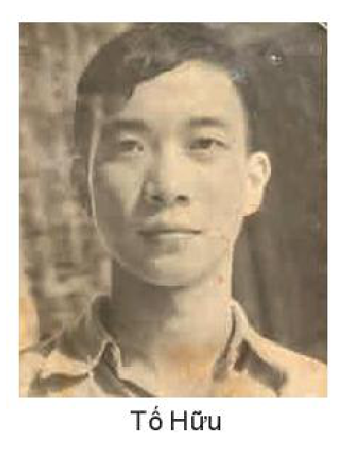
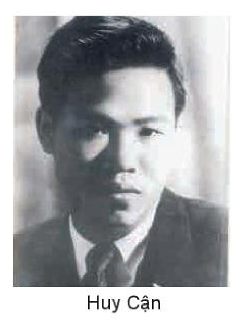
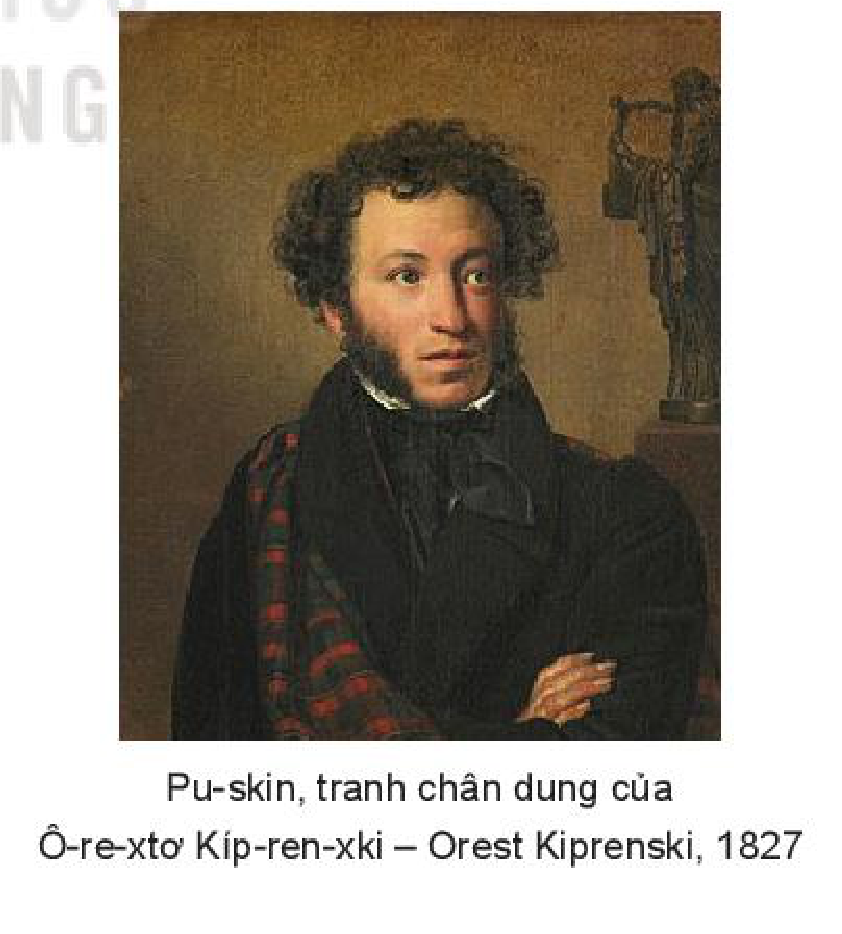

<!-- pdf:55 -->

# BÀI 2: CẤU TỨ VÀ HÌNH ẢNH TRONG THƠ TRỮ TÌNH

## 🎯 Yêu cầu cần đạt

- Đánh giá được giá trị thẩm mĩ của một số yếu tố trong thơ như ngôn từ, cấu tứ, hình thức bài thơ thể hiện trong văn bản; nhận biết và phân tích được vai trò của yếu tố tượng trưng trong thơ.
- Phân tích và đánh giá được tình cảm, cảm xúc và cảm hứng chủ đạo của người viết thể hiện qua văn bản thơ; phát hiện được các giá trị văn hoá, triết lí nhân sinh từ văn bản thơ.
- Nhận biết và phân tích được một số đặc điểm cơ bản của ngôn ngữ văn học. Phân tích được tính đa nghĩa của ngôn từ trong tác phẩm văn học.
- Nhận biết được đặc điểm và tác dụng của một số hiện tượng phá vỡ những quy tắc ngôn ngữ thông thường.
- Viết được văn bản nghị luận về một bài thơ: tìm hiểu cấu tứ và hình ảnh của tác phẩm.
- Biết giới thiệu (dưới hình thức nói) về một tác phẩm nghệ thuật (văn học, điện ảnh, âm nhạc, hội hoạ) theo lựa chọn cá nhân.
- Biết sống hoà đồng với con người, thiên nhiên; biết trân trọng những nỗi buồn trong sáng vốn thể hiện tình cảm gắn bó sâu nặng với cuộc đời.

## ĐỌC

### TRI THỨC NGỮ VĂN

**Cấu tứ trong thơ**

**Cấu tứ** là một khâu then chốt, mang tính chất khởi đầu của hoạt động sáng tạo nghệ thuật nói chung và sáng tạo thơ nói riêng. Trong lĩnh vực thơ, cấu tứ gắn liền với việc xác định, hình dung hướng phát triển của hình tượng thơ, cách triển khai bài thơ, sao cho toàn bộ nhận thức, cảm xúc, cảm giác của nhà thơ về một vấn đề, đối tượng, sự việc nào đó có thể được bộc lộ chân thực, tự nhiên, sinh động và trọn vẹn nhất.

Sản phẩm của hoạt động cấu tứ trong thơ là **tứ thơ** (thường được gọi đơn giản là **tứ**). Tứ đưa bài thơ thoát khỏi sơ đồ ý khô khan, trừu tượng để hiện diện như một cơ thể sống. Nhờ có tứ, tổ chức của bài thơ trở nên chặt chẽ, mọi yếu tố cấu tạo đều liên hệ mật thiết với nhau và đều hướng về một ý tưởng – hình ảnh trung tâm. Mỗi bài thơ

<!-- pdf:56 -->

thường có một cách cấu tứ và một cái tứ riêng. Chú ý tìm hiểu vấn đề này là điều có ý nghĩa quan trọng trong việc đọc hiểu thơ, nhìn ra những phát hiện độc đáo của nhà thơ về con người, cuộc sống và đánh giá đúng phẩm chất nghệ thuật của bài thơ.

Vì mối liên hệ nhân quả tất yếu giữa cấu tứ và tứ mà trong nhiều trường hợp, người ta đã đồng nhất hai khái niệm này. Lúc đó, có thể xem “tìm hiểu cấu tứ của bài thơ” và “tìm hiểu tứ thơ của bài thơ” là hai hình thức diễn đạt khác nhau về cùng một ý (nội dung).

**Yếu tố tượng trưng trong thơ**

Trong lĩnh vực sáng tác văn học – nghệ thuật nói chung, sáng tác thơ ca nói riêng, thuật ngữ **tượng trưng** trước hết được dùng để chỉ một loại hình ảnh, hình tượng mang tính đặc thù. Ở đó, người nghệ sĩ thường sử dụng các hình ảnh, sự vật có thể tri giác được hay các câu chuyện cụ thể để diễn tả hoặc gợi lên cảm nhận sâu xa về những vấn đề có ý nghĩa bao trùm và mang tính bản chất. Thuật ngữ này thường xuất hiện trong các kết hợp từ: *hình ảnh, hình tượng tượng trưng; yếu tố tượng trưng; tính chất tượng trưng; chủ nghĩa tượng trưng;*...

Trước một hình ảnh, hình tượng chứa đựng nhiều tầng nghĩa và gợi lên những cảm nhận đa chiều, người ta có căn cứ để nói đến sự hiện diện của **yếu tố tượng trưng**. Yếu tố tượng trưng đóng vai trò quan trọng trong việc tạo nên tính chất tượng trưng của bài thơ.

Mọi hình ảnh, hình tượng thơ, xét từ bản chất, đã có tính chất tượng trưng. Nhưng với những sáng tác thuộc trường phái thơ tượng trưng hoặc thuộc loại hình thơ tượng trưng, tính chất này đã đạt một chất lượng mới. Điều này liên quan đến sự tự ý thức sâu sắc của nhà thơ về các mối tương giao bí ẩn trong đời sống, nổi bật là tương giao giữa con người với tạo vật, vũ trụ.

Ở những bài thơ có yếu tố tượng trưng, các tác giả rất chú ý tô đậm tính biểu tượng của các hình ảnh, chi tiết, sự việc,... Bên cạnh đó, việc phối hợp các âm tiết, thanh điệu, nhịp điệu nhằm khơi dậy những cảm giác bất định, mơ hồ cũng hết sức được quan tâm. Với nhiều nhà thơ tượng trưng, trong số nhiều thủ pháp nghệ thuật được sử dụng, không thể không nói đến việc hoà trộn cảm nhận của nhiều giác quan, việc diễn tả chi tiết những sắc thái chuyển động tinh vi của sự vật, hiện tượng,...

**Ngôn ngữ văn học**

**Ngôn ngữ văn học** là ngôn ngữ biểu đạt đặc thù của sáng tác văn học. Trên cơ sở ngôn ngữ chung của đời sống do nhân dân sáng tạo nên, ngôn ngữ văn học hình thành và phát triển phong phú nhờ lao động tinh thần đặc biệt và đầy cảm hứng của nhà văn. Bởi vậy, ngôn ngữ văn học thể hiện rõ cá tính sáng tạo, phong cách, tài năng của người viết. Tính hình tượng và tính thẩm mĩ là hai tính chất quan trọng nhất của ngôn ngữ văn học, chi phối các tính chất khác như tính chính xác, tính đa nghĩa, tính tạo hình, tính biểu cảm, tính cá thể hoá,...

<!-- term: Tính đa nghĩa -->
Đa nghĩa là một trong những tính chất rất nổi bật của ngôn từ trong tác phẩm văn học. Ở đây, từ ngữ không chỉ có nghĩa đen, nghĩa gốc, nghĩa ban đầu mà còn có nghĩa mới, nghĩa phát sinh, do chúng thường được đặt trong những cấu trúc hay ngữ cảnh đặc biệt.

<!-- pdf:57 -->

### VĂN BẢN 1: Nhớ đồng
<!-- ocr-ok: nhãn VĂN BẢN 1 trên nền màu cam bị OCR đọc nhầm thành VĂN BẰN, đã đối chiếu ảnh trang PDF 57 -->

**Tố Hữu**

- Theo trải nghiệm của bạn, một nỗi nhớ thường được khởi đầu và phát triển như thế nào?
- Hãy tưởng tượng về cách bạn mở đầu một sáng tác ngôn từ có nội dung thể hiện nỗi nhớ của bản thân. Điều gì sẽ được nói đến trước hết? Vì sao?

*Tặng Vịnh*(1)

Gì sâu bằng những trưa thương nhớ
Hiu quạnh bên trong một tiếng hò!

> Tiếng hò có mối quan hệ như thế nào với nỗi nhớ?

Đâu gió cồn thơm đất nhả mùi
Đâu ruồng tre(2) mát thở yên vui
Đâu từng ô mạ xanh mơn mởn
Đâu những nương khoai ngọt sắn bùi?

> Các hình ảnh hiện lên ở đây có đặc điểm gì?

Đâu những đường con bước vạn đời
Xóm nhà tranh thấp ngủ im hơi
Giữa dòng ngày tháng âm u đó
Không đổi, nhưng mà trôi cứ trôi...

Gì sâu bằng những trưa hiu quạnh
Ôi ruộng đồng quê thương nhớ ơi!

> So với khổ thơ thứ nhất, khổ thơ này có điểm gì giống và khác?

Đâu những lưng cong xuống luống cày
Mà bùn hi vọng nức hương ngây
Và đâu hết những bàn tay ấy
Vãi giống tung trời những sớm mai(3)?

> Hãy tưởng tượng về hình ảnh “bàn tay... vãi giống tung trời”.

Đâu những chiều sương phủ bãi đồng
Lúa mềm xao xác ở ven sông

> (1) *Vịnh*: người bạn cùng hoạt động cách mạng với tác giả trước năm 1945 (tên đầy đủ là Nguyễn Vịnh), sau này trở thành Đại tướng quân đội nhân dân Việt Nam Nguyễn Chí Thanh (1914 – 1967).
> (2) *Ruồng tre*: rặng tre, luỹ tre.
> (3) *“Vãi giống tung trời những sớm mai”*: hình ảnh người gieo hạt thóc trên ruộng vào lúc sáng sớm.

<!-- pdf:58 -->

Vẳng lên trong tiếng xe lùa nước(1)
Một giọng hò đưa *hố*(2) não nùng
<!-- ocr-ok: OCR đọc nhầm "Vẳng lên trong tiếng" thành "Văng lên trong tếng" và "hố(2)" thành "7ốf?", đã đối chiếu ảnh trang PDF 58 -->

Gì sâu bằng những trưa thương nhớ
Hiu quạnh bên trong một tiếng hò!

Đâu dáng hình quen, đâu cả rồi
Sao mà cách biệt, quá xa xôi
Chao ôi thương nhớ, chao thương nhớ
Ôi mẹ già xa đơn chiếc ơi!

Đâu những hồn thân tự thuở xưa
Những hồn quen dãi gió dầm mưa
Những hồn chất phác hiền như đất
Khoai sắn tình quê rất thiệt thà!

> Đối tượng được gọi là “hồn thân” ở đây gồm những ai?

Đâu những ngày xưa, tôi nhớ tôi
Băn khoăn đi kiếm lẽ yêu đời
Vẩn vơ theo mãi vòng quanh quẩn
Muốn thoát, than ôi, bước chẳng rời

Rồi một hôm nào, tôi thấy tôi
Nhẹ nhàng như con chim cà lơi(3)
Say đồng hương nắng vui ca hát
Trên chín tầng cao bát ngát trời...

> “Tôi” ở khổ thơ này có sự phát triển như thế nào so với “tôi” ở khổ thơ trên?

Cho tới chừ(4) đây, tới chừ đây
Tôi mơ qua cửa khám(5) bao ngày
Tôi thu tất cả trong thầm lặng
Như cánh chim buồn nhớ gió mây.

> Hình ảnh “cánh chim buồn nhớ gió mây” biểu đạt cảm xúc gì của nhân vật trữ tình?

Gì sâu bằng những trưa hiu quạnh
Ôi ruộng đồng quê thương nhớ ơi!

Tháng 7/1939
(Nguyễn Minh Hồng – Nguyễn Thanh Hoa (tuyển chọn), *Tố Hữu – Thơ gửi bạn đường*, NXB Giáo dục Việt Nam, Hà Nội, 2020, tr. 39 – 41)

> (1) *Xe lùa nước*: guồng (có hình dạng như cái bánh xe lớn) dẫn nước từ sông, suối vào ruộng hoặc về nhà để phục vụ cho nhu cầu sinh hoạt.
> (2) *Hố*: tiếng đệm thường dùng trong một số điệu hò.
> (3) *Chim cà lơi*: chim chiền chiện, còn gọi là chà chiện hoặc sơn ca.
> (4) *Chừ*: bây giờ.
> (5) *Khám*: nhà giam, nhà tù.

<!-- pdf:59 -->

**Tố Hữu** (1920 – 2002) tên khai sinh là Nguyễn Kim Thành, quê gốc ở làng Phù Lai, nay thuộc xã Quảng Thọ, huyện Quảng Điền, tỉnh Thừa Thiên Huế. Ông từng được tôn vinh là “lá cờ đầu” của nền thơ cách mạng Việt Nam nửa sau thế kỉ XX.

Thơ Tố Hữu là tiếng nói trữ tình nhiệt huyết về những vấn đề lớn của đất nước và cách mạng, mang đậm tính sử thi, tràn đầy niềm tin ở tương lai, tất cả được thể hiện bằng một hình thức thơ giàu tính dân tộc, gần gũi với đại chúng.

Các chặng đường sáng tác của Tố Hữu được đánh dấu bằng 7 tập thơ chính, gắn với quá trình phát triển của cách mạng Việt Nam nửa sau thế kỉ XX: *Thơ* (1946, từ lần in thứ hai trở đi vào năm 1959, tập thơ mang nhan đề mới là *Từ ấy*), *Việt Bắc* (1954), *Gió lộng* (1961), *Ra trận* (1972), *Máu và hoa* (1977), *Một tiếng đờn* (1992), *Ta với ta* (2000).

***Nhớ đồng*** được viết trong thời gian tác giả bị thực dân Pháp bắt giam ở nhà lao Thừa Phủ (thuộc Thừa Thiên Huế). Sau ngày Cách mạng tháng Tám thành công, bài thơ được đưa vào tập *Thơ*. Cũng như nhiều bài thơ khác được tác giả sáng tác trong hoàn cảnh tù đày, *Nhớ đồng* thể hiện rõ tâm sự của một người thanh niên yêu nước giàu nhiệt huyết, khao khát tự do, nôn nóng muốn trở về sát cánh với đồng chí, đồng bào lúc phong trào đấu tranh giải phóng dân tộc đang phát triển mạnh mẽ.

**Trả lời câu hỏi**

1. Theo bạn, nhan đề *Nhớ đồng* đã bao quát được toàn bộ nội dung cảm xúc của bài thơ hay chưa? Vì sao? Nên hiểu như thế nào về nghĩa của từ “đồng” trong nhan đề?
2. Bạn có nhận xét gì về đặc điểm hình thức và nội dung của các khổ thơ 1, 4, 7, 13 trong văn bản? Các khổ thơ này được phân bố theo “quy luật” nào?
3. Hệ thống hình ảnh trong bài thơ đã biểu đạt được những nội dung gì? Bạn hiểu và đánh giá như thế nào về cách tác giả đan cài, phối hợp, sắp xếp các cụm hình ảnh?
4. Từ “đâu” xuất hiện bao nhiêu lần và đóng vai trò gì trong cấu tứ của bài thơ?
5. Phân tích tác dụng nghệ thuật của việc sử dụng luân phiên câu hỏi, câu kể và câu cảm trong văn bản.
6. Theo bạn, hình ảnh nào trong bài thơ mang tính tượng trưng rõ nét hơn cả? Hãy làm rõ tính tượng trưng ở hình ảnh ấy.
7. Bài thơ cho thấy điều gì về tâm trạng, phẩm chất, lí tưởng của nhân vật trữ tình? Nêu cảm nhận của bạn về những cảm xúc, tâm tình được tác giả bộc lộ trong bài thơ.

#### Kết nối đọc – viết

Viết đoạn văn (khoảng 150 chữ) làm sáng tỏ mối liên hệ giữa các chi tiết, hình ảnh đã làm nên thế giới cảm xúc “nhớ đồng” trong bài thơ.

<!-- pdf:60 -->

### VĂN BẢN 2: Tràng giang
<!-- ocr-ok: nhãn VĂN BẢN 2 trên nền màu cam bị OCR bỏ sót, đã đối chiếu ảnh trang PDF 60 -->

**Huy Cận**

- Theo bạn, vì sao người đọc lại có thể rung động trước bài thơ được viết bởi một người xa lạ, có những trải nghiệm khác biệt với mình?
- Bạn có cho rằng cảnh trời đất mênh mông trong buổi chiều tà thường có một ý nghĩa đặc biệt đối với tâm hồn của mỗi người? Hãy đọc một số câu thơ mà bạn biết nói về cảnh ấy, thời điểm ấy.

*Bâng khuâng trời rộng nhớ sông dài.*
*H.C.*
<!-- ocr-ok: câu thơ đề từ in nghiêng bị OCR đọc nhầm thành "Bông khuẩng trời rộng nhớ sông dùi. He.", đã đối chiếu ảnh trang PDF 60 -->

> Chú ý điều được gợi mở từ câu thơ đề từ.

Sóng gợn tràng giang buồn điệp điệp,
Con thuyền xuôi mái nước song song.
Thuyền về nước lại, sầu trăm ngả;
Củi một cành khô lạc mấy dòng.

> Hình ảnh xuất hiện ở câu cuối khổ thơ có thể gợi lên những cảm nhận gì?

Lơ thơ cồn nhỏ gió đìu hiu,
Đâu tiếng làng xa vãn chợ chiều.
Nắng xuống, trời lên sâu chót vót;
Sông dài, trời rộng, bến cô liêu.

> Thế nào là “sâu chót vót”?
<!-- ocr-ok: thẻ chỉ dẫn đọc cột phải bị OCR đọc nhầm thành "Thếnòo lờ sâu chót vớt?", đã đối chiếu ảnh trang PDF 60 -->

Bèo dạt về đâu, hàng nối hàng;
Mênh mông không một chuyến đò ngang.
Không cầu gợi chút niềm thân mật,
Lặng lẽ bờ xanh tiếp bãi vàng.

Lớp lớp mây cao đùn núi bạc,
Chim nghiêng cánh nhỏ: bóng chiều sa.
Lòng quê dợn dợn vời con nước,
Không khói hoàng hôn cũng nhớ nhà(1).

> Chú ý đặc điểm chính tả và ngữ âm của từ láy “dợn dợn”.

(Huy Cận, *Lửa thiêng*, NXB Đời nay, Hà Nội, 1940, tr. 52 – 53)

> (1) *“Không khói hoàng hôn cũng nhớ nhà”*: ý thơ nảy sinh khi tác giả liên hệ đến câu thơ *Yên ba giang thượng sử nhân sầu* (Khói sóng trên sông khiến người buồn) trong bài *Hoàng Hạc lâu* (Lầu Hoàng Hạc) của Thôi Hiệu thời Đường (Trung Quốc).

<!-- pdf:61 -->

**Huy Cận** (1919 – 2005) tên khai sinh là Cù Huy Cận, quê ở xã Ân Phú, huyện Vũ Quang, tỉnh Hà Tĩnh. Ông là một trong những nhà thơ tiêu biểu nhất của phong trào Thơ mới và cũng là cây bút có nhiều đóng góp xuất sắc cho nền thơ cách mạng Việt Nam từ sau năm 1945.

Thơ Huy Cận giàu chất suy tưởng, tràn đầy cảm xúc về vũ trụ, luôn thể hiện khát khao hoà điệu với cuộc đời và tạo vật. Tiếp thu đồng thời tinh hoa của nền thơ truyền thống phương Đông và nền thơ Pháp, thơ Huy Cận đã tạo được sự cân bằng hiếm có giữa vẻ đẹp cổ điển và vẻ đẹp hiện đại, giữa chất lãng mạn và chất tượng trưng.

Các tập thơ tiêu biểu của Huy Cận: *Lửa thiêng* (1940), *Trời mỗi ngày lại sáng* (1958), *Đất nở hoa* (1960), *Bài thơ cuộc đời* (1963), *Hai bàn tay em* (1967), *Ngôi nhà giữa nắng* (1978), *Hạt lại gieo* (1984), *Nước triều đông* (tập thơ song ngữ Việt – Pháp, 1994),...

Bài thơ ***Tràng giang*** in trong tập *Lửa thiêng*, rất tiêu biểu cho phong cách nghệ thuật thơ Huy Cận trên nhiều phương diện. Cảm hứng sáng tác bài thơ được khơi dậy từ những buổi chiều tác giả tới ngắm cảnh mênh mang của sông Hồng ở vùng Chèm – Vẽ vào mùa thu năm 1939. Trong *Suy nghĩ về nghệ thuật* (1982), Huy Cận cho biết *Tràng giang* “lúc sơ khai lại muốn là một bài lục bát và tên nguyên thuỷ của nó là *Chiều trên sông*”(1).

**Trả lời câu hỏi**

1. Bạn cảm nhận gì về nhan đề *Tràng giang*? Nhan đề và lời đề từ liên quan thế nào với nội dung cảm xúc của bài thơ?
2. Có thể dùng những từ ngữ nào để chỉ tính chất của khung cảnh được “vẽ” ra trong bài thơ?
3. Bài thơ đã được cấu tứ như thế nào? Bạn dựa vào đâu để xác định như vậy?
4. Chỉ ra sự tương phản giữa các hình ảnh trong khổ thơ thứ hai. Sự tương phản đó có ý nghĩa gì và tiếp tục được triển khai ở các khổ thơ kế tiếp như thế nào?
5. Bài thơ có những điểm khác lạ nào trong cách sử dụng ngôn ngữ? Hãy làm rõ hiện tượng này qua phân tích một ví dụ bạn cho là tiêu biểu.
6. Nêu một số thi liệu truyền thống xuất hiện trong văn bản. Việc tác giả sử dụng những thi liệu ấy cho biết thêm điều gì về cấu tứ của bài thơ?
7. *Tràng giang* thường được nhìn nhận là bài thơ giàu yếu tố tượng trưng. Bạn suy nghĩ về vấn đề đó như thế nào?
8. Bài thơ đã giúp bạn có thêm được cảm nhận gì về đời sống, về mối quan hệ giữa con người cá nhân với vũ trụ vô biên?

#### Kết nối đọc – viết

Viết đoạn văn (khoảng 150 chữ) bày tỏ sự tâm đắc của bạn về một phương diện nổi bật của bài thơ *Tràng giang*.

> (1) Nguyễn Đăng Điệp (giới thiệu và tuyển chọn), *Huy Cận – Tác phẩm chọn lọc*, NXB Giáo dục Việt Nam, Hà Nội, 2009, tr. 251.

<!-- pdf:62 -->

### VĂN BẢN 3: Con đường mùa đông
<!-- ocr-ok: nhãn VĂN BẢN 3 trên nền màu cam bị OCR đọc nhầm thành NANO, đã đối chiếu ảnh trang PDF 62 -->

**A-lếch-xan-đrơ Xéc-ghê-ê-vích Pu-skin (Aleksandr Sergeyevich Pushkin)**

Hãy hình dung những trở ngại tinh thần mà một người độc hành trên đường lạnh vắng có thể phải đối diện. Theo bạn, để vượt qua những trở ngại đó, người ta có thể làm gì?

**Dịch nghĩa**

Xuyên qua những lớp sương mù gợn sóng
Mặt trăng nhô ra,
Nó buồn bã dội ánh sáng
Lên những khoảng trống u buồn.

Trên con đường mùa đông, buồn tẻ
Xe tam mã(1) lao nhanh,
Lục lạc đơn điệu
Mệt mỏi rung lên.

Nghe có gì thân thuộc
Trong những khúc ca ngân dài của người xà ích(2):
Lúc là trẩy hội tưng bừng,
Lúc là nỗi buồn tâm tình...

Không một ánh lửa, không một mái lều thẫm đen...
Rừng sâu và tuyết... Ngược chiều tôi
Chỉ những cột sọc chỉ đường
Đơn độc rơi vào tầm mắt.

> (1) *Xe tam mã*: xe ba ngựa kéo. Kiểu xe này có thiết kế chỗ ngồi phía sau gọn nhẹ; khi chạy nhanh, người ngồi trên xe có cảm giác như được bay lên. Trong văn hoá Nga, xe tam mã được nhìn nhận là biểu tượng cho nước Nga.
> (2) *Xà ích*: người đánh xe ngựa.

<!-- pdf:63 -->

Buồn tẻ, sầu đau... Ngày mai, Nhi-na (Nhina),
Ngày mai, về với em yêu thương,
Tôi sẽ được quên mình nơi lò sưởi,
Được ngắm nhìn em không chán mắt.

Kim đồng hồ vang tiếng
Sẽ hoàn tất vòng quay đều đặn của mình,
Và, xua đi xa lũ người phát ngấy,
Nửa đêm không rẽ chia đôi ta.

Sầu lắm, Nhi-na: con đường của tôi tẻ ngắt,
Bác xà ích của tôi lặng yên thiu thiu ngủ,
Lục lạc đơn điệu,
Khuôn trăng mờ sương.

**Dịch thơ**

*Xuyên những làn sương gợn sóng*
*Mảnh trăng mờ ảo chiếu qua,*
*Buồn rải ánh vàng lai láng*
*Lên cánh đồng buồn giăng xa.*
<!-- ocr-ok: khổ dịch thơ in nghiêng đặt cạnh hộp chỉ dẫn đọc bị OCR đọc nhầm nhiều từ, đã đối chiếu ảnh trang PDF 63 -->

> Lưu ý: Mỗi hình ảnh, âm thanh trong bài thơ vừa nhấn mạnh nỗi buồn, vừa thể hiện hoạt động không ngừng cố gắng vượt qua trở ngại.

*Trên đường mùa đông vắng vẻ*
*Cỗ xe tam mã băng đi*
*Nhạc ngựa đều đều buồn tẻ*
*Đều đều khắc khoải lòng quê.*
<!-- ocr-ok: khổ dịch thơ in nghiêng bị OCR đọc nhầm nhiều từ, đã đối chiếu ảnh trang PDF 63 -->

*Bài ca của người xà ích*
*Có gì phảng phất thân yêu:*
*Như niềm vui mừng khôn xiết,*
*Như nỗi buồn nặng đìu hiu.*
<!-- ocr-ok: khổ dịch thơ in nghiêng bị OCR đọc nhầm nhiều từ, đã đối chiếu ảnh trang PDF 63 -->

*Không một mái lều, ánh lửa...*
*Tuyết trắng và rừng bao la...*
*Chỉ những cột dài cây số*
*Bên đường sừng sững chào ta.*
<!-- ocr-ok: khổ dịch thơ in nghiêng đặt cạnh hộp chỉ dẫn đọc bị OCR đọc nhầm nhiều từ, đã đối chiếu ảnh trang PDF 63 -->

> Giữa ngoại cảnh và những hình ảnh xuất hiện trong tâm tưởng có sự tương phản như thế nào?

<!-- pdf:64 -->

*Ôi buồn đau, ôi cô lẻ...*
*Trở về với em ngày mai*
*Nhi-na, bên lò lửa đỏ*
*Ngắm em, ngắm mãi không thôi.*
<!-- ocr-ok: khổ dịch thơ in nghiêng đặt cạnh hộp chỉ dẫn đọc bị OCR đọc nhầm nhiều từ, đã đối chiếu ảnh trang PDF 64 -->

> Lời than “Ôi buồn đau, ôi cô lẻ...” kết nối tâm tưởng nhân vật trữ tình với ai? Ở đâu?

*Kim đồng hồ kêu tích tắc*
*Xoay đủ những vòng nhịp nhàng,*
*Và xua lũ người tẻ ngắt*
*Để ta bên nhau trong đêm.*
<!-- ocr-ok: khổ dịch thơ in nghiêng bị OCR đọc nhầm nhiều từ, đã đối chiếu ảnh trang PDF 64 -->

*Sầu lắm, Nhi-na: đường xa vắng,*
*Ngủ quên bác xà ích lặng im*
*Nhạc ngựa đều đều buông xa thẳm,*
*Sương mờ che lấp ánh trăng nghiêng.*
<!-- ocr-ok: khổ dịch thơ in nghiêng đặt cạnh hộp chỉ dẫn đọc bị OCR đọc nhầm nhiều từ, đã đối chiếu ảnh trang PDF 64 -->

> Những hình tượng thơ đã xuất hiện trong bài được điểm lại như thế nào?

1826
(Thuý Toàn dịch, A-lếch-xan-đrơ Pu-skin, *Tuyển tập tác phẩm – Thơ, Trường ca*, NXB Văn học – Trung tâm Văn hoá và ngôn ngữ Đông Tây, Hà Nội, 1999, tr. 64 – 65)

Pu-skin, tranh chân dung của Ô-re-xtơ Kíp-ren-xki – Orest Kiprenski, 1827

**A-lếch-xan-đrơ Xéc-ghê-ê-vích Pu-skin** (1799 – 1837) là người đặt nền móng cho văn học hiện thực Nga thế kỉ XIX. Sinh ra trong một gia đình trí thức quý tộc lâu đời, Pu-skin sớm bộc lộ thiên hướng văn chương, bắt đầu sáng tác thơ văn từ khi lên bảy, tám tuổi. Pu-skin đã tổng hoà được những gì tinh tuý nhất của văn hoá dân tộc, nhân loại và thời đại để trở thành “người duy nhất nói tiếng nói mới” – tiếng nói “toàn nhân loại” trong văn học Nga thế kỉ XIX (Phê-đo Đốt-xtôi-ép-xki – Fedor Dostoievsky). Vì những vần thơ ca ngợi tự do, chống lại chế độ nông nô chuyên chế(1) của chính quyền Nga hoàng, Pu-skin bị đày xuống Phương Nam (1820 – 1823), rồi lại bị đày ngược lên một trang trại hẻo lánh ở Phương Bắc (1824 – 1826). Đến giữa năm 1826, Pu-skin mới được mãn hạn đi đày. Ông qua đời năm 1837, sau một cuộc đấu súng.

> (1) *Chế độ nông nô chuyên chế*: chế độ chuyên chế được thiết lập trên nền tảng quyền sở hữu của địa chủ đối với nông dân (nông dân được xem như tài sản).

<!-- pdf:65 -->

Pu-skin đã để lại một di sản vô giá ở nhiều thể loại văn học, song trước hết ông được xem là “mặt trời của thi ca Nga”, có cống hiến lớn nhất trong thơ trữ tình với hơn 800 bài thơ đặc sắc. Ngôn từ trong thơ trữ tình của Pu-skin bao giờ cũng chính xác, giản dị, trong sáng, hàm súc. Những sắc màu, hình ảnh, âm thanh trong thơ của ông không chỉ thể hiện tâm trạng mà còn chuyên chở những vận động ý thức của nhân vật trữ tình, hướng tới hoá giải những khúc mắc trong lòng người để cuối cùng đạt tới một xúc cảm cân bằng, hài hoà đến kì lạ. Thơ Pu-skin tràn ngập tinh thần nhân văn, vừa cao cả, vừa trần thế, vì vậy mà có sức lay động tâm hồn mãnh liệt đối với người đọc mọi dân tộc, mọi thời đại.

Tháng 12 năm 1825, một cuộc khởi nghĩa do đông đảo những người trí thức quý tộc tiến bộ lãnh đạo chống lại chế độ nông nô chuyên chế đã nổ ra rộng khắp trên nước Nga. Đầu năm 1826, cuộc khởi nghĩa bị Nga hoàng dập tắt. Vào mùa đông năm ấy, nỗi buồn riêng của nhà thơ ở nơi đày ải, nỗi buồn chung của nhân dân sau thất bại của cuộc khởi nghĩa, cùng ý chí và khát vọng vượt qua những giây phút tủi buồn trong hành trình cuộc sống riêng tư, cũng như của dân tộc, đã trở thành nguồn cảm hứng để Pu-skin sáng tác nên bài thơ ***Con đường mùa đông***.

**Trả lời câu hỏi**

1. Nhan đề bài thơ *Con đường mùa đông* gợi cho bạn những liên tưởng gì?
2. Những hình ảnh (“trăng”, “cột sọc chỉ đường”) và âm thanh (“tiếng lục lạc”, “kim đồng hồ kêu tích tắc”) trong bài thơ đã diễn tả mâu thuẫn giữa nỗi buồn với ý thức vận động vượt qua trở ngại của nhân vật trữ tình trên con đường mùa đông như thế nào?
3. Xác định những hình ảnh, hoạt động tương phản trong khổ thơ 4. Nhân vật trữ tình xuất hiện ở khổ thơ này có còn chìm trong cảnh vật u buồn nữa không? Vì sao?
4. Xác định không gian, thời gian tâm tưởng của nhân vật trữ tình trong hai khổ thơ 5 – 6. Hãy hình dung nhân vật trữ tình được tận hưởng những gì và tiếp tục đấu tranh với nỗi buồn ra sao.
5. Những hình tượng “xe tam mã”, “bài ca của người xà ích”, “mái lều, ánh lửa”, “Nhi-na” có ý nghĩa thế nào đối với hành trình tâm tưởng của nhân vật trữ tình trên “con đường mùa đông”?
6. Nêu nhận xét về những hình tượng thơ được điểm lại trong khổ thơ cuối. Hãy chia sẻ suy nghĩ của bạn về cách lấy lại cảm giác bình yên trên những “con đường mùa đông” trong cuộc đời.
7. Bạn có nhận xét gì về cấu tứ của bài thơ? Hãy liên hệ với một bài thơ khác có cùng kiểu cấu tứ này mà bạn biết.

#### Kết nối đọc – viết

Viết đoạn văn (khoảng 150 chữ) về một hình ảnh mang ý nghĩa tượng trưng mà bạn cho là đặc sắc nhất trong bài thơ *Con đường mùa đông*.

<!-- pdf:66 -->

### Thực hành tiếng Việt: Một số hiện tượng phá vỡ những quy tắc ngôn ngữ thông thường: đặc điểm và tác dụng

**1.** Chỉ ra nét độc đáo, khác lạ trong kết hợp từ “buồn điệp điệp” ở dòng mở đầu bài thơ *Tràng giang* (Gợi ý: Tìm những kết hợp từ khác có “điệp điệp” nhưng mang tính phổ biến hơn để so sánh với trường hợp đã nêu).

**2.** Phân tích lí do khiến cụm từ “sâu chót vót” trong bài thơ *Tràng giang* gây được ấn tượng đặc biệt với người đọc.

**3.** Hãy nhận diện và phân tích ý nghĩa của hiện tượng phá vỡ quy tắc ngôn ngữ thông thường được thể hiện trong hai dòng thơ sau (trích *Tràng giang*):

*Lơ thơ cồn nhỏ gió đìu hiu,*
*Đâu tiếng làng xa vãn chợ chiều.*

**4.** Phân tích giá trị biểu đạt của dấu hai chấm ở dòng thơ “Chim nghiêng cánh nhỏ: bóng chiều sa” trên cơ sở liên hệ đến chức năng thông thường của dấu hai chấm trong văn bản.

**5.** Trong bài *Tì bà* của Bích Khê, hai dòng thơ cuối được tác giả viết như sau:

*Ô! Hay buồn vương cây ngô đồng*
*Vàng rơi! Vàng rơi: Thu mênh mông.*

(Bích Khê, *Tinh huyết*, Trọng Miên xuất bản, 1939)

Ở một số bản in về sau, hai dòng thơ trên đã có một biến đổi:

*Ô hay buồn vương cây ngô đồng*
*Vàng rơi! Vàng rơi: Thu mênh mông.*

(*Thơ Bích Khê*, Sở Văn hoá và Thông tin Nghĩa Bình, 1988)

<!-- term: Hiện tượng phá vỡ quy tắc ngôn ngữ thông thường -->
> **Nhận biết những hiện tượng phá vỡ quy tắc ngôn ngữ thông thường**
>
> - Để nhận ra những hiện tượng phá vỡ quy tắc ngôn ngữ thông thường trong sáng tác văn học, phải nắm vững những quy ước ngôn ngữ có tính chuẩn mực của tiếng Việt, đồng thời biết thực hiện việc đối chiếu, so sánh các phương án sử dụng ngôn ngữ khác nhau.
> - Một số hiện tượng phá vỡ quy tắc ngôn ngữ thông thường trong sáng tác văn học:
>   - Tạo ra những kết hợp từ trái logic nhằm “lạ hoá” đối tượng được nói tới. Ví dụ:
>     + *Ta muốn thâu trong một cái hôn nhiều*
>       (Xuân Diệu, *Vội vàng*)
>     + *Thêm yêu Hà Nội vắng đầy cả em.*
>       (Tế Hạnh, *Hà Nội vắng em*)
>   - Sử dụng hình thức đảo ngữ để nhấn mạnh một đặc điểm nào đó của đối tượng miêu tả, thể hiện. Ví dụ:
>     + *Lắt lẻo cành thông cơn gió thốc*
>       (Hồ Xuân Hương, *Đèo Ba Dội*)
>     + *Mấy chùm trước giậu hoa năm ngoái*
>       (Nguyễn Khuyến, *Thu vịnh*)
>   - Cung cấp nét nghĩa mới cho từ ngữ nhằm đưa đến phát hiện bất ngờ về đối tượng được đề cập. Ví dụ:
>     + *Vừa thoáng tiếng còi tàu*
>       *Lòng đã Nam đã Bắc*
>       (Xuân Quỳnh, *Sân ga chiều em đi*)
>     + *Cột đèn rớm điện*
>       *Là chiều Bích Câu*
>       (Lê Đạt, *Chiều Bích Câu*)

<!-- pdf:67 -->

Xét theo định hướng thực hành tiếng Việt của bài học, theo bạn, nguyên nhân của sự biến đổi trên có thể là gì? Dựa vào bản in bài thơ năm 1939, hãy làm rõ sự sáng tạo trong cách sử dụng từ ngữ của nhà thơ ở điểm này.

>   - Bổ sung chức năng mới cho dấu câu (khi trình bày văn bản trên giấy). Ví dụ:
>     + *Ngẩng đầu ngắm mãi chưa xong nhớ,*
>       *Hoa bưởi thơm rồi: đêm đã khuya*
>       (Xuân Diệu, *Buồn trăng*)
>     + *Non xanh ngây cả buồn chiều,*
>       *– Nhân gian e cũng tiêu điều dưới kia.*
>       (Huy Cận, *Thu rừng*)

## VIẾT

**Viết văn bản nghị luận về một tác phẩm thơ (Tìm hiểu cấu tứ và hình ảnh trong tác phẩm)**

Từng nhiều lần thực hành viết văn bản nghị luận về một tác phẩm thơ, bạn hẳn đã quen với một số thao tác viết cơ bản do kiểu bài đòi hỏi. Lần này, với việc xác định trọng tâm là tìm hiểu cấu tứ và hình ảnh trong bài thơ, bạn sẽ phải tìm hiểu sâu hơn về các khái niệm liên quan đã được giới thiệu ở phần *Tri thức ngữ văn*. Khi nói về cấu tứ, nhất thiết phải lí giải được những điều tạo nên tính chỉnh thể của tác phẩm. Khi nói về hình ảnh, cần phải làm nổi bật được tính chất của hệ thống hình ảnh cũng như cách tổ chức chúng theo sự chi phối của tứ thơ. Dĩ nhiên, những yếu tố đặc sắc khác của tác phẩm cũng cần được đề cập, tuỳ vào mạch viết của bài nghị luận.

**Yêu cầu**

- Giới thiệu ngắn gọn về bài thơ (tác giả, vị trí của bài thơ; lí do lựa chọn bài thơ,...).
- Xác định rõ trọng tâm vấn đề được bàn luận trong bài viết (cấu tứ độc đáo của bài thơ và sự chi phối của nó đến hệ thống hình ảnh).
- Xem xét vấn đề một cách toàn diện theo từng khía cạnh cụ thể với những lí lẽ, bằng chứng xác đáng.
- Đánh giá được nét đặc sắc về cấu tứ và hình ảnh của bài thơ cũng như giá trị của chúng trong việc thể hiện những khám phá mới về con người và cuộc sống.

<!-- pdf:68 -->

### Bài viết tham khảo

**Bài thơ “Tĩnh dạ tứ” của Lý Bạch**

**Nguyễn Thị Bích Hải**(1)

**Tĩnh dạ tứ**
(Cảm nghĩ trong đêm thanh tĩnh)

**Phiên âm**

*Sàng tiền minh nguyệt quang,*
*Nghi thị địa thượng sương.*
*Cử đầu vọng minh nguyệt,*
*Đê đầu tư cố hương.*

**Dịch nghĩa**

Ánh trăng sáng đầu giường,
Ngỡ là sương mặt đất.
Ngẩng đầu ngắm trăng sáng,
Cúi đầu nhớ cố hương.

**Dịch thơ**

*Đầu giường ánh trăng rọi,*
*Ngỡ mặt đất phủ sương.*
*Ngẩng đầu nhìn trăng sáng,*
*Cúi đầu nhớ cố hương.*

(Tương Như dịch)

Đề bài thơ này có hai cách đọc “Tĩnh dạ tư” (Nỗi nhớ trong đêm thanh tĩnh) và “Tĩnh dạ tứ” (Cảm nghĩ trong đêm thanh tĩnh), vì “tư” và “tứ” đều viết bằng một chữ. Nhưng dù đọc là “tư” hay “tứ” thì bài thơ cũng thuộc đề tài “nguyệt dạ tư hương” mà ta gặp trong thơ Đường.

> Giới thiệu về bài thơ.

> (1) *Nguyễn Thị Bích Hải* (sinh năm 1950): quê ở tỉnh Quảng Trị, là nhà giáo, nhà nghiên cứu văn học, dịch giả, chuyên gia về văn học Trung Quốc.

<!-- pdf:69 -->

Đêm yên tĩnh trên đường lữ khách, tình quê hương ngổn ngang muôn lối; nhà thơ chớp lấy một cảm giác sai lạc (thố giác), tức cảnh sinh tình, viết nên một bài thơ tuyệt diệu. Toàn bài chữ nào cũng rõ ràng dễ hiểu, mà chữ nào cũng hàm ý sâu xa.

> Nêu khái quát cấu tứ của bài thơ và định hướng phân tích, đánh giá.

Ánh trăng vào tận phòng cho biết đêm sâu. Nhận thấy ánh trăng rọi sáng đầu giường rõ ràng là người không ngủ. Ngay câu đầu tiên vừa xuống bút đã ngụ tâm tình thao thức. Ngỡ ánh sáng là sương cho thấy ánh sáng trắng và lạnh. Trắng là vì ánh trăng rất sáng, lạnh bởi đêm thu. Chữ “nghi” (*ngỡ là*) vẽ thần thái của nhà thơ đang mơ màng, chập chờn muốn ngủ mà không ngủ được, đã tỉnh mà chưa tỉnh hẳn.

> Phân tích, đánh giá từng phần của bài thơ.

Cái sáng, cái lạnh đã lay tỉnh nhà thơ, khiến nhà thơ “cử đầu vọng minh nguyệt” nghĩa là nhà thơ đã tỉnh, đã hết ngỡ ngàng nên mới “ngẩng đầu ngắm trăng sáng”. Nhưng động tác “ngẩng đầu” chỉ trong khoảnh khắc, vì thấy trăng như thấy “cố tri”. Trong thơ cổ, trăng luôn là bạn của người viễn khách. Bởi vì trên đường lữ thứ, mọi cảnh vật, con người đều lạ, chỉ có vầng trăng là luôn quen thuộc, ở quê nhà hay đêm tha hương cũng chỉ một vầng trăng ấy. Thế cho nên thấy trăng như gặp lại người quen, thấy trăng mà sinh ra nỗi nhớ. Đó là tâm tình hết sức tự nhiên và cũng đủ biết nỗi nhớ luôn luôn tiềm ẩn trong tâm thức, chỉ cần một ánh trăng đủ gọi dậy vô vàn kỉ niệm.

> Chú ý làm rõ tính khái quát của hình ảnh, chi tiết.

Trăng, đã nói là sáng, tất phải trăng tròn. Trăng viên mãn mà người xa cách, xúc cảnh sinh tình, nỗi nhớ quê nhà từ đó mà dấy lên. Thế tất câu kết phải là “tư cố hương”. Ánh trăng làm xót xa lòng người, không nỡ lòng nào ngắm nữa. Ta cảm giác như nỗi nhớ quê nhà trĩu nặng đã khiến mái đầu cúi xuống.

Chủ đề của bài thơ là “tư hương” (*nhớ quê*) nhưng lại dành ba câu tả trăng: tuy tả trăng mà nỗi nhớ đã ẩn ở bên trong (thao thức, chập chờn). Đến khi nói được cái điều tâm niệm “tư cố hương” thì thơ liền dừng lại. Còn nhớ thế nào, nhớ những gì thì không cần nói nữa. Đó là chỗ nhà thơ dành cho độc giả tự tưởng tượng và chiêm nghiệm, vì ai mà chẳng từng nhớ quê.

Trong cuốn *Hồ lâu bút đàm*, Du Việt nói: “Dĩ vô tình ngôn tình tắc tình xuất, dĩ vô ý tả tắc ý chân” (Lấy cái vô tình nói tình thì tất tình hiện ra, lấy cái vô ý tả ý thì ý

> Đánh giá chung.

<!-- pdf:70 -->

chân thật)(1). Ở đây “lấy cái vô tình” là dùng đến ba câu (trong khi cả bài thơ chỉ có bốn câu) để tả trăng. “Lấy cái vô ý” tức là động tác “cử đầu” và “đê đầu” đều như phản xạ tự nhiên, “vô ý”, do sự “điều khiển” tự nhiên gần như vô thức.

Đó chính là tính chất tự nhiên, chân thực, đầy hàm ý của *Tĩnh dạ tứ*.

> Kết luận.

(Nguyễn Thị Bích Hải, *Văn học châu Á trong trường phổ thông*, NXB Giáo dục, Hà Nội, 2002, tr. 32 – 33)

1. Bài thơ đã được giới thiệu như thế nào?
2. Xác định trình tự, logic triển khai hệ thống ý trong bài viết.
3. Cấu tứ và tính chất khái quát của hình ảnh trong bài thơ đã được người viết đề cập ở đoạn nào, câu nào?

### Thực hành viết

**Chuẩn bị viết**

- Cần chọn viết về những tác phẩm thơ có cấu tứ độc đáo và có hệ thống hình ảnh phong phú được xây dựng theo sự chi phối của tứ thơ, ngoài giá trị tạo hình còn gợi mở những tầng nghĩa sâu xa khác.
- Có thể viết về những bài thơ đã được tìm hiểu trong chính bài học này hoặc thuộc danh mục gợi ý tham khảo của thầy, cô.

**Tìm ý, lập dàn ý**

*Tìm ý*

Có thể tự đặt ra các câu hỏi xếp theo nhóm như sau để tìm ý:

*Yêu cầu chung đối với việc bàn luận về tác phẩm thơ*

- Bài thơ của ai, được sáng tác trong hoàn cảnh nào, xuất bản ở đâu, từng được đón nhận ra sao?
- Vấn đề chính sẽ bàn trong bài viết là gì? Những phương diện nào của bài thơ sẽ được đề cập?
- Ở từng phương diện nói trên, giá trị của bài thơ đã được thể hiện ra sao? Câu thơ, chi tiết, hình ảnh nào chứng tỏ điều đó? Có những kết quả nghiên cứu, phê bình nào đáng chú ý về vấn đề sẽ được triển khai ở bài viết?

> (1) Chuyển dẫn từ sách *Cổ thi hải*, tr. 611 (chú thích của tác giả bài viết).

<!-- pdf:71 -->

- Bài thơ đã tác động đến bạn như thế nào? Qua khám phá tác phẩm cụ thể này, bạn tích luỹ được kinh nghiệm gì về việc đọc một văn bản thơ nói chung?

*Tìm hiểu, đánh giá cấu tứ của bài thơ*

- Bài thơ đã hình thành và hoàn thiện dựa trên ý tưởng cơ bản nào? Điều gì đã làm cho ý tưởng ấy được thể hiện một cách sinh động?
- Có thể nêu nhận định khái quát gì về cấu tứ của bài thơ? Nhận định này có gì khác biệt so với những nhận định từng có và đã bao quát hết mọi yếu tố cấu thành của bài thơ chưa?
- Với cách cấu tứ đã nêu, bài thơ thể hiện được phát hiện riêng gì của nhà thơ về thế giới và con người?

*Tìm hiểu, phân tích hệ thống hình ảnh trong bài thơ*

- Bài thơ có những hình ảnh nào? Những hình ảnh đó có thể gợi cho người đọc ấn tượng, liên tưởng gì?
- Có thể nhìn nhận như thế nào về logic kết nối các hình ảnh trong bài thơ với nhau? Cái tứ của bài thơ đã chi phối điều này ra sao?
- Theo mạch triển khai của bài thơ, giữa các hình ảnh có sự vận động phát triển nào đáng chú ý?
- Có thể nói gì về những hàm nghĩa của các hình ảnh trong bài thơ? Sự chuyển hoá về ý nghĩa của các hình ảnh đã được thể hiện ra sao?

*Lập dàn ý*

*Mở bài*: Giới thiệu chung về bài thơ và xác định vấn đề sẽ được tập trung bàn luận trong bài viết.

*Thân bài*: Cần triển khai các ý:

- Cảm giác chung mà cấu tứ cùng những hình ảnh và cách diễn tả khác lạ trong bài thơ đã gợi cho người đọc.
- Sự khác biệt của bài thơ này so với các bài thơ khác trên phương diện xây dựng hệ thống hình ảnh và tạo sự kết nối giữa các bộ phận cấu tạo trong bài thơ (thực hiện những so sánh cần thiết để chỉ ra được sự khác biệt).
- Những khả năng hiểu (cắt nghĩa) khác nhau đối với một số yếu tố, hình ảnh trong bài thơ (cần nêu cụ thể).
- Điều được làm sáng tỏ qua việc đọc thăm dò và thử nghiệm các cách đọc khác nhau đối với bài thơ.
- Sự gợi mở về cách nhìn mới đối với thế giới và con người được đề xuất từ mạch ngầm văn bản bài thơ.

*Kết bài*: Khẳng định lại sự độc đáo của bài thơ và ý nghĩa của nó đối với việc đem lại cách nhìn, cách đọc mới cho độc giả.

<!-- pdf:72 -->

**Viết**

- Dựa vào dàn ý đã lập để thực hiện bài viết. Khi cần, có thể đảo trật tự ý đã có hoặc bổ sung ý mới nảy sinh trong quá trình viết.
- Chú ý nêu những cách nhìn nhận khác nhau (nếu có) về cấu tứ của bài thơ trước khi trình bày ý kiến riêng. Có thể vẽ sơ đồ cấu tứ của bài thơ để người đọc dễ nhận biết.
- Khi nêu hàm nghĩa của các hình ảnh, chi tiết trong bài thơ, cần tránh cách diễn đạt mang tính khẳng định một chiều (vì hình ảnh thơ vốn đa nghĩa, có thể gợi những cách cảm nhận, lí giải khác nhau), nên dùng những từ thể hiện thái độ thận trọng khi nhận xét, bày tỏ cảm nhận riêng như *phải chăng, có thể hiểu (nghĩ) là*,...

**Chỉnh sửa, hoàn thiện**

- Đối chiếu với yêu cầu của kiểu bài và dàn ý đã lập để thực hiện những sửa chữa, bổ sung cần thiết.
- Đặc biệt, cần xem lại những đoạn viết về cấu tứ của bài thơ, đảm bảo đã diễn đạt đúng cách hiểu của mình đối với vấn đề này.
- Soát lại các đoạn văn bản được trích dẫn nhằm xác nhận đã ghi đúng theo bản gốc.
- Khắc phục các lỗi về chính tả, từ ngữ, ngữ pháp (nếu có). Chú ý viết tách khối các câu, khổ, đoạn thơ được trích dẫn để tạo hiệu quả tích cực về mặt thị giác.

## NÓI VÀ NGHE

**Giới thiệu một tác phẩm nghệ thuật**

**Yêu cầu**

- Cung cấp được thông tin chung về tác phẩm nghệ thuật một cách sáng rõ, chính xác (tên tác phẩm, tác giả, thể loại, thời điểm sáng tác, đánh giá của công chúng và các nhà chuyên môn,...).
- Nêu được lí do chọn giới thiệu tác phẩm.
- Trình bày được cảm nhận, quan điểm cá nhân của người nói về giá trị tác phẩm với các lí lẽ và bằng chứng thuyết phục; chủ động đặt câu hỏi để người nghe cùng tương tác và đối thoại.
- Thể hiện sự tôn trọng những cách cảm nhận, đánh giá đa dạng đối với một tác phẩm nghệ thuật.

<!-- pdf:73 -->

**Chuẩn bị nói**

*Lựa chọn đề tài*

- Đề tài của bài nói có thể được khai thác từ kết quả của hoạt động viết trước đó, nghĩa là có thể giới thiệu về chính bài thơ mà bạn đã chọn để viết bài phân tích, đánh giá. Cũng có thể giới thiệu về một tác phẩm thuộc loại hình nghệ thuật khác như bài hát (hay bản nhạc), bộ phim, bức tranh, bức tượng,...
- Để việc giới thiệu đạt hiệu quả tương tác tốt với người nghe, nên chọn tác phẩm nào từng được nhiều bạn trong lớp quan tâm; đặc biệt, về tác phẩm đó, người giới thiệu có thể tạo cho người nghe cơ hội được thấy, xem, nghe trực tiếp, dù chỉ qua các phiên bản, ảnh chụp hay qua các video clip sưu tầm được.

*Tìm ý và sắp xếp ý*

- Nếu chọn giới thiệu về bài thơ đã được bàn tới trong bài viết trước đó, cần rút gọn bài viết thành một dàn ý cho bài nói, đánh dấu những ý quan trọng sẽ trình bày, những bằng chứng minh hoạ sẽ nêu lên và phân tích (có thể điều chỉnh trình tự các ý đã được trình bày trong bài viết, sao cho mạch triển khai của bài nói được thông suốt).
- Nếu chọn giới thiệu về một tác phẩm thuộc loại hình nghệ thuật khác, cần hình thành hệ thống ý dựa trên việc trả lời các câu hỏi như: Tên của tác phẩm là gì? Tác giả là ai? Có thể thấy, xem, nghe tác phẩm ở đâu? Tác phẩm có đặc điểm gì về nội dung và hình thức? Câu chuyện, vấn đề, thông điệp được nêu hoặc toát ra từ tác phẩm là gì, từng được đón nhận như thế nào và có ý nghĩa ra sao? Tác phẩm đã đóng góp được điều gì cho đời sống nghệ thuật và đời sống tinh thần của cộng đồng?
- Toàn bộ những ý có được nhờ trả lời các câu hỏi trên nên được tổ chức theo bố cục: Nhận diện → Tìm hiểu → Đánh giá → Đề xuất thái độ, cách thức tiếp nhận phù hợp.

**Thực hành nói**

Bài nói phải đảm bảo kết cấu gồm ba phần với các yêu cầu chính về nội dung như sau:

- *Mở đầu*: Nêu tên tác phẩm được giới thiệu và lí do chọn giới thiệu tác phẩm đó.
- *Triển khai*: Miêu tả đặc điểm của tác phẩm (thể loại, tính chất, quy mô, dung lượng,...) và nêu nhận xét, đánh giá về tác phẩm theo các góc độ tiếp cận khác nhau.
- *Kết luận*: Khẳng định giá trị chung và ý nghĩa của tác phẩm.

<!-- pdf:74 -->

**Trao đổi**

| Người nói | Người nghe |
| --- | --- |
| - Làm rõ những điều người nghe muốn tìm hiểu thêm. - Trao đổi lại những điểm chưa thống nhất về ý kiến. - Thể hiện thái độ tiếp thu tích cực, cầu thị. | - Nêu những vấn đề muốn làm rõ hơn về tác phẩm. - Nêu quan điểm đánh giá khác về tác phẩm (trên tinh thần tranh luận). - Bổ sung thông tin về tác phẩm. - Góp ý với người nói về cách thể hiện bài nói. |

Tham khảo các nội dung được gợi ý trong bảng sau để tự đánh giá và đánh giá về bài nói:

| STT | Nội dung đánh giá | Kết quả: Đạt | Kết quả: Chưa đạt |
| --- | --- | --- | --- |
| 1 | Lựa chọn được tác phẩm nghệ thuật phù hợp để giới thiệu. | | |
| 2 | Cung cấp được thông tin toàn diện về tác phẩm. | | |
| 3 | Trình bày được ý nghĩa của việc giới thiệu tác phẩm. | | |
| 4 | Thể hiện được những đánh giá xác đáng, có căn cứ về tác phẩm. | | |
| 5 | Lựa chọn được cách giới thiệu hấp dẫn, phù hợp với tính chất, đặc điểm của tác phẩm. | | |
| 6 | Thực hiện được sự tương tác tích cực với người nghe. | | |

## CỦNG CỐ, MỞ RỘNG

1. Bài học đã đưa lại cho bạn những hiểu biết mới gì về thơ?
2. Khi đọc một bài thơ, việc tìm hiểu cấu tứ của nó có ý nghĩa như thế nào?
3. Có thể nhận diện yếu tố tượng trưng trong thơ căn cứ vào những biểu hiện cụ thể gì? Hãy kể tên một số bài thơ có yếu tố tượng trưng mà bạn đã tìm đọc thêm.
4. Chọn phân tích một bài thơ hoặc một số câu thơ có yếu tố tượng trưng đã tạo cho bạn những ấn tượng sâu đậm.
5. Xây dựng dàn ý cho bài thuyết trình về một tác phẩm nghệ thuật tự chọn.

<!-- pdf:75 -->

## THỰC HÀNH ĐỌC

**Một số điều cần lưu ý khi đọc văn bản:**

- Đặc điểm thể loại và cấu tứ của bài thơ.
- Tính chất tượng trưng của các hình ảnh thơ.
- Suy ngẫm của tác giả về bản chất của thời gian, nghệ thuật, tình yêu và mối tương quan giữa chúng.

**Thời gian**

**Văn Cao**(1)

Thời gian qua kẽ tay
Làm khô những chiếc lá
Kỉ niệm trong tôi
Rơi
    như tiếng sỏi
        trong lòng giếng cạn

Riêng những câu thơ
                    còn xanh
Riêng những bài hát
                    còn xanh
Và đôi mắt em
                    như hai giếng nước.

Xuân Đinh Mão, 2/1987
(*Tuyển tập Văn Cao – Thơ*, NXB Văn học, Hà Nội, 1994, tr. 106)

> (1) *Văn Cao* (1923 – 1995): tên khai sinh là Nguyễn Văn Cao, quê ở tỉnh Nam Định nhưng sinh ra, lớn lên tại thành phố Hải Phòng và khởi đầu sự nghiệp sáng tác ở đây. Ông là nhạc sĩ, hoạ sĩ, nhà thơ; có những đóng góp quan trọng cho sự phát triển của nền tân nhạc Việt Nam. Tác phẩm *Tiến quân ca* do ông sáng tác được chọn làm Quốc ca của nước Việt Nam Dân chủ Cộng hoà (trước đây) và nước Cộng hoà xã hội chủ nghĩa Việt Nam (hiện nay). Thơ của ông tuy số lượng không nhiều nhưng luôn thể hiện một phong cách nghệ thuật độc đáo, phần lớn được in trong các tập: *Lá* (1988), *Tuyển tập Văn Cao – Thơ* (1994).

## 📷 Danh sách hình trong bài

| Mã hình | Trang PDF | Vị trí trong bài | Chú thích gốc |
| --- | --- | --- | --- |
| H11-ngu_van-b02-01 | 59 | Văn bản 1 – Tiểu sử tác giả Tố Hữu | Tố Hữu |
| H11-ngu_van-b02-02 | 61 | Văn bản 2 – Tiểu sử tác giả Huy Cận | Huy Cận |
| H11-ngu_van-b02-03 | 64 | Văn bản 3 – Tiểu sử tác giả Pu-skin | Pu-skin, tranh chân dung của Ô-re-xtơ Kíp-ren-xki – Orest Kiprenski, 1827 |
