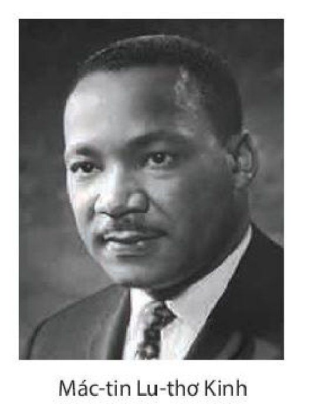
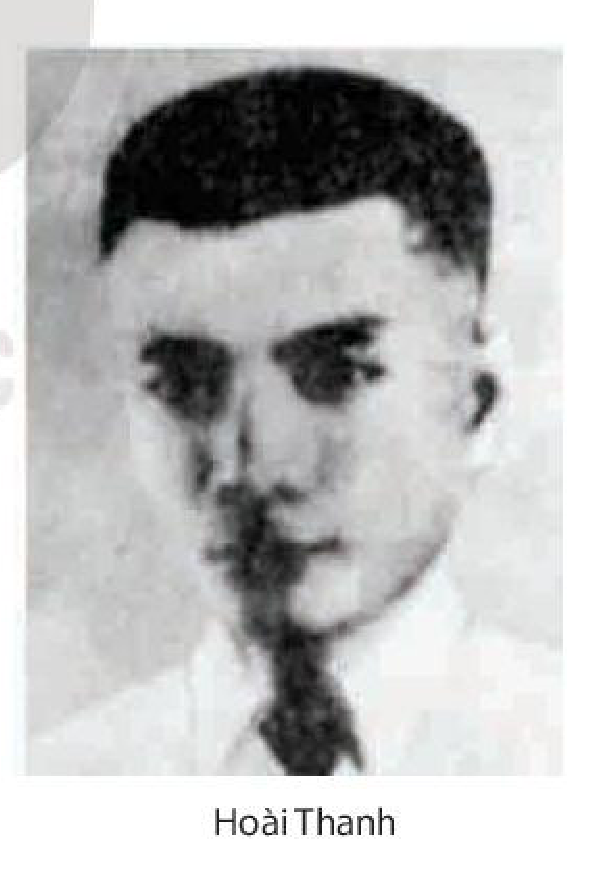
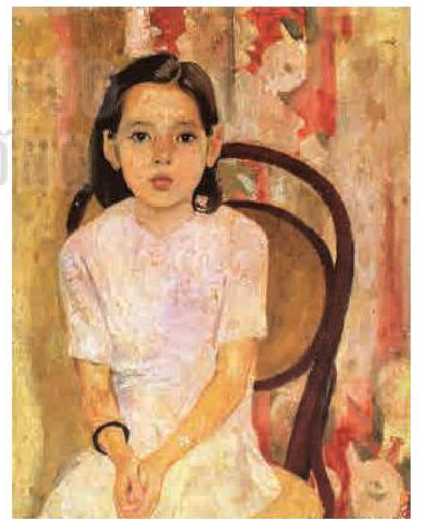

<!-- pdf:76 -->

# BÀI 3: CẤU TRÚC CỦA VĂN BẢN NGHỊ LUẬN

## 🎯 Yêu cầu cần đạt

- Phân tích được nội dung và ý nghĩa của văn bản, mối quan hệ giữa các luận điểm, lí lẽ và bằng chứng, quan hệ giữa chúng với luận đề; nhận biết và giải thích được sự phù hợp giữa nội dung nghị luận với nhan đề văn bản.
- Nhận biết và phân tích được mục đích, thái độ và tình cảm của người viết; vai trò của các yếu tố thuyết minh, miêu tả, tự sự, biểu cảm trong văn bản nghị luận.
- Liên hệ được nội dung văn bản với một tư tưởng, quan niệm, xu thế (kinh tế, chính trị, văn hoá, xã hội, khoa học) của giai đoạn mà văn bản ra đời để hiểu sâu hơn.
- Nhận biết được các đặc điểm cơ bản của ngôn ngữ viết và ngôn ngữ nói để có hướng vận dụng phù hợp, hiệu quả.
- Viết được văn bản nghị luận về một vấn đề xã hội (Con người với cuộc sống xung quanh): trình bày rõ quan điểm và hệ thống luận điểm; cấu trúc văn bản chặt chẽ, mở đầu và kết thúc gây ấn tượng, lí lẽ và bằng chứng thuyết phục.
- Biết trình bày ý kiến đánh giá, bình luận một vấn đề xã hội (kết cấu bài có ba phần; có nêu và phân tích, đánh giá các ý kiến trái ngược; có sử dụng kết hợp phương tiện ngôn ngữ với các phương tiện phi ngôn ngữ).
- Có thái độ trung thực, có ý thức trách nhiệm với cộng đồng, đất nước.

## ĐỌC

### TRI THỨC NGỮ VĂN

**Cấu trúc của văn bản nghị luận**

Một văn bản nghị luận bao gồm nhiều thành tố: luận đề, luận điểm, lí lẽ, bằng chứng,... Các thành tố đó được tổ chức thành một chỉnh thể, có quan hệ chặt chẽ với nhau, nhằm đạt hiệu quả thuyết phục cao nhất.

Là thành tố có tính chất bao trùm, **luận đề** có chức năng định hướng việc triển khai các luận điểm. Các **luận điểm** trong văn bản nghị luận, với sự thống nhất của lí lẽ và bằng chứng, có nhiệm vụ làm rõ từng khía cạnh và thể hiện tính nhất quán của luận đề. Mối quan hệ có tính bản chất giữa các thành tố như vậy tạo nên cấu trúc đặc thù của **văn bản nghị luận**.

<!-- pdf:77 -->

**Yếu tố bổ trợ trong văn bản nghị luận**

Để tăng sức thuyết phục cho văn bản nghị luận, ngoài lí lẽ và bằng chứng, người viết còn có thể sử dụng một số **yếu tố bổ trợ** như: thuyết minh, miêu tả, tự sự, biểu cảm,... **Thuyết minh** trong văn bản nghị luận có tác dụng giải thích, cung cấp những thông tin cơ bản xung quanh một vấn đề, khái niệm, đối tượng nào đó, làm cho việc luận bàn trở nên xác thực. **Miêu tả** được dùng để tái hiện rõ nét, sinh động hơn những đối tượng có liên quan. **Tự sự** đảm nhiệm việc kể câu chuyện làm bằng chứng cho luận điểm mà người viết nêu lên. **Biểu cảm** giúp người viết bộc lộ cảm xúc, tình cảm làm cho văn bản có thêm sức lôi cuốn, thuyết phục.

### VĂN BẢN 1: Cầu hiền chiếu
<!-- ocr-ok: nhãn VĂN BẢN 1 trên nền màu cam bị OCR bỏ sót và chữ hiền bị OCR đọc thiếu dấu, đã đối chiếu ảnh trang PDF 77 -->

*(Chiếu cầu hiền(\*))*

**Ngô Thì Nhậm**

- Có không ít câu chuyện thú vị về việc vua chúa hay lãnh đạo đất nước muốn chiêu mộ hiền tài ra gánh vác trọng trách quốc gia. Hãy chia sẻ một câu chuyện mà bạn biết.
- Trong công cuộc xây dựng đất nước, việc trọng dụng người tài có ý nghĩa như thế nào?

**1.** Từng nghe nói rằng: Người hiền xuất hiện ở đời thì như ngôi sao sáng trên trời cao. Sao sáng ắt chầu về ngôi Bắc Thần(1), người hiền ắt làm sứ giả cho thiên tử. Nếu như che mất ánh sáng, giấu đi vẻ đẹp, có tài mà không được đời dùng, thì đó không phải là ý trời sinh ra người hiền vậy.

> Phần 1 nêu vấn đề gì?

> (\*) *Hiền*: ở đây chỉ người có đức, có tài.
> (1) *Bắc Thần*: sao Bắc Đẩu, tượng trưng cho ngôi vua.

<!-- pdf:78 -->

**2.** Trước đây thời thế suy vi, trung châu(1) gặp nhiều biến cố, kẻ sĩ phải ở ẩn trong ngòi khe(2), trốn tránh việc đời, những bậc tinh anh trong triều đường phải kiêng dè không dám lên tiếng(3). Cũng có kẻ gõ mõ canh cửa(4), cũng có kẻ ra biển vào sông(5), chết đuối trên cạn(6) mà không biết, dường như muốn lẩn tránh(7) suốt đời.

> Dự đoán: Việc nêu thực trạng “trốn tránh việc đời” của kẻ sĩ dẫn đến ý gì sẽ được trình bày ở phần 3?

Nay trẫm đang ghé chiếu(8) lắng nghe, ngày đêm mong mỏi, nhưng những người học rộng tài cao chưa thấy có ai tìm đến. Hay trẫm ít đức không đáng để phò tá chăng? Hay đang thời đổ nát(9) chưa thể ra phụng sự vương hầu chăng?

**3.** Kìa như, trời còn tăm tối, thì đấng quân tử phải trổ tài. Nay đương ở buổi đầu của nền đại định, công việc vừa mới mở ra. Kỉ cương nơi triều chính còn nhiều khiếm khuyết, công việc ngoài biên đương phải lo toan. Dân còn nhọc mệt chưa lại sức, mà đức hoá của trẫm chưa kịp nhuần thấm khắp nơi. Trẫm nơm nớp lo lắng, ngày một ngày hai vạn việc nảy sinh. Nghĩ cho kĩ thì thấy rằng: Một cái cột không thể đỡ nổi một căn nhà lớn, mưu lược một người không thể dựng nghiệp trị bình. Suy đi tính lại trong vòm trời này, cứ cái ấp mười nhà ắt phải có người trung thành tín nghĩa. Huống nay trên dải đất văn hiến rộng lớn như thế này, há trong đó lại không có lấy một người tài danh nào ra phò giúp cho chính quyền buổi ban đầu của trẫm hay sao?

> Nhận xét về lí lẽ được sử dụng.

**4.** Chiếu này ban xuống, các bậc quan viên lớn nhỏ, cùng với thứ dân trăm họ, người nào có tài năng học thuật, mưu hay hơn đời, cho phép được dâng sớ tâu bày sự việc. Lời nói nào có thể chọn dùng được, thì cất nhắc không kể thứ bậc; chỗ nào không dùng được thì gác lại, không

> Giữa lí lẽ trình bày ở các phần trước với kế hoạch thực thi được nêu ở phần 4 có mối liên hệ như thế nào?

> (1) *Trung châu*: vùng đất trung tâm, thường được dùng với nghĩa chuyển, chỉ đất nước hoặc triều đình.
> (2) *Ở ẩn trong ngòi khe*: nói về những người ở ẩn nơi hẻo lánh.
> (3) *Kiêng dè không dám lên tiếng*: ở đây ý nói các quan trong triều đều giữ mình không dám nói thẳng.
> (4) *Gõ mõ canh cửa*: chỉ người có chức vụ thấp.
> (5) *Ra biển vào sông*: chỉ các ẩn sĩ mỗi người đi một phương.
> (6) *Chết đuối trên cạn*: ý nói kẻ đi ở ẩn như người chết đuối trên cạn.
> (7) *Lẩn tránh*: ý nói kẻ đi ở ẩn.
> (8) *Ghé chiếu*: cách nói thể hiện sự khiêm tốn.
> (9) *Thời đổ nát*: thời kì còn lộn xộn của một triều đại mới gây dựng.

<!-- pdf:79 -->

vì lời nói sơ suất vu khoát(1) mà bắt tội. Còn người có nghề hay nghiệp giỏi, có thể cống hiến cho đời, thì cho phép các quan văn, quan võ được tiến cử, nhưng vẫn dẫn vào đợi ra mắt, tuỳ tài lục dụng(2). Hoặc người nào từ trước đến nay tài năng còn bị che kín, chưa được người đời biết đến, thì cũng cho phép dâng sớ tự tiến cử, chớ hiềm vì mưu lợi mà phải bán rao.

Này! Trong khoảng trời đất, hiền tài còn ẩn náu, trước đây thì nên như thế. Nay trời trong sáng, đất thanh bình, chính là lúc người hiền gặp hội gió mây, những ai có tài có đức hãy cùng cố gắng lên, ghi tên tại triều đình, cùng nhau cung kính, cùng nhau hưởng phúc lành tôn vinh.

> Ý nghĩa của lời khuyến dụ.

Vậy bố cáo gần xa để mọi người đều biết.

(*Ngô Thì Nhậm toàn tập*, tập II, NXB Khoa học xã hội, Hà Nội, 2004, in trong *Ngữ văn 11*, tập một, NXB Giáo dục Việt Nam, Hà Nội, 2010, tr. 68 – 70)

**Ngô Thì Nhậm** (1746 – 1803) hiệu là Hy Doãn, người làng Tả Thanh Oai (làng Tó), huyện Thanh Oai, trấn Sơn Nam (nay thuộc huyện Thanh Trì, thành phố Hà Nội). Năm 1775, ông đỗ tiến sĩ, từng được chúa Trịnh giao cho giữ chức Đốc đồng trấn Kinh Bắc. Năm 1788, khi chế độ Lê – Trịnh sụp đổ, Ngô Thì Nhậm theo phong trào Tây Sơn, được vua Quang Trung phong làm Lại bộ Tả thị lang, sau thăng chức Binh bộ Thượng thư. Ông là người có công lớn đối với triều đại Tây Sơn: thu phục nhiều cựu thần nhà Lê ra cộng tác với nhà Tây Sơn; hỗ trợ đắc lực cho cuộc tiến quân của vua Quang Trung ra Bắc đánh bại quân Thanh xâm lược; phụ trách việc bang giao với nhà Thanh; soạn thảo nhiều văn kiện quan trọng cho triều đại Tây Sơn;...

Sau khi vua Quang Trung thiết lập triều đại mới, các sĩ phu Bắc Hà – những người vốn gắn bó với triều đại cũ (Lê – Trịnh) – chưa thực sự đồng lòng ủng hộ. Có nhiều người còn tỏ thái độ bất hợp tác. Trước tình hình đó, Quang Trung đã đưa ra chính sách thu phục nhân tâm, chiêu mộ hiền tài ra giúp vua xây dựng đất nước. Vua Quang Trung đã giao cho Ngô Thì Nhậm thay mình viết ***Chiếu cầu hiền*** (vào khoảng năm 1788 – 1789) nhằm thuyết phục sĩ phu Bắc Hà, tức là các trí thức của triều đại cũ, ra làm việc cho triều đại Tây Sơn.

> (1) *Vu khoát*: viển vông, không thiết thực.
> (2) *Lục dụng*: ghi lại (tên tuổi) để sử dụng.
<!-- ocr-ok: cước chú chân trang bị OCR đọc nhầm "Vu khoát: viển vông" thành "Vụ khoát: viền võng", đã đối chiếu ảnh trang PDF 79 -->

<!-- pdf:80 -->

**Trả lời câu hỏi**

1. *Chiếu cầu hiền* được ban bố với lí do và mục đích gì?
2. Văn bản hướng tới đối tượng nào trong xã hội lúc bấy giờ? Khi vâng mệnh vua Quang Trung soạn chiếu này, Ngô Thì Nhậm đối diện với những khó khăn gì trong việc thuyết phục các đối tượng đó ra gánh vác việc nước?
3. Văn bản có mấy phần? Phân tích mối quan hệ giữa nội dung các phần.
4. Nghệ thuật lập luận thể hiện như thế nào qua việc dùng lí lẽ và bằng chứng, phối hợp với các yếu tố biểu cảm, thuyết minh?
5. Theo bạn, điều gì tạo nên sức thuyết phục của *Chiếu cầu hiền*?
6. Viết *Chiếu cầu hiền* trong một hoàn cảnh hết sức đặc biệt, tác giả đã gửi gắm khát vọng lớn lao nào đối với đất nước?

#### Kết nối đọc – viết

Viết đoạn văn (khoảng 150 chữ) nêu suy nghĩ của bạn về quan điểm: *Người có tài cần phát huy tài năng của mình để đóng góp cho sự nghiệp chung*.

### VĂN BẢN 2: Tôi có một ước mơ

*(Trích Bước đến tự do, Câu chuyện Mon-ga-mơ-ri – Montgomery)*

**Mác-tin Lu-thơ Kinh (Martin Luther King)**

- Trong lịch sử của dân tộc, có những trường hợp một văn kiện chính trị lại trở thành một áng văn chương có sức lay động lớn. Bạn hãy kể tên một vài tác phẩm như vậy.
- Nhiều nhân vật lịch sử đã thể hiện niềm ước mơ về hạnh phúc cho nhân dân, bình yên cho đất nước trong những câu thơ, câu văn hoặc những lời phát biểu đầy tâm huyết. Bạn hãy nêu một ví dụ cụ thể để chứng minh ý kiến trên.

<!-- pdf:81 -->

Tôi rất vui được tham gia cùng các bạn ngày hôm nay vào cuộc biểu tình cho tự do như là một sự kiện tuyệt vời nhất sẽ đi vào lịch sử đất nước của chúng ta.

> Xác định mục đích hướng tới của tác giả ở bài diễn văn này.
<!-- ocr-ok: thẻ chỉ dẫn đọc cột phải bị OCR trộn vào cột trái và đọc nhầm nhiều từ, đã đối chiếu ảnh trang PDF 81 -->

Cách đây một thế kỉ, có một người Mỹ vĩ đại, người mà chúng ta đang đứng dưới bóng tượng của ông hôm nay đã kí *Tuyên ngôn Giải phóng Nô lệ*(1). Sắc lệnh quan trọng ấy đã trở thành ngọn hải đăng của hi vọng đối với hàng triệu người nô lệ da đen vốn đang bị thiêu rụi bởi ngọn lửa bất công đáng khinh miệt. Nó đến như một ánh bình minh hạnh phúc xoá tan màn đêm đoạ đày.

> Ý nghĩa của việc dẫn ra văn kiện lịch sử nổi tiếng của nước Mỹ là gì?

Nhưng một trăm năm sau, người da đen vẫn chưa được tự do. Một trăm năm sau, cuộc sống của người da đen vẫn bị trói trong gông cùm xiềng xích của sự phân biệt chủng tộc và kì thị một cách đáng buồn. Một trăm năm sau, người da đen vẫn phải sống cô đơn trên hòn đảo nghèo đói giữa một đại dương mênh mông thịnh vượng về vật chất. Một trăm năm sau, người da đen vẫn gầy mòn trong những ngóc ngách của xã hội Mỹ và phải tìm cách tị nạn ngay trên chính quê hương của mình. Để rồi chúng ta đã phải đến đây ngày hôm nay để thể hiện bức xúc về tình trạng đáng xấu hổ này.

[...] Chúng ta cũng đến nơi thiêng liêng này để nhắc nhở nước Mỹ về tính cấp bách của thời khắc Ngay Bây Giờ. Đây không còn là lúc để lẩn tránh trong sự xoa dịu xa xỉ hay trong những liều thuốc an thần rằng mọi việc sẽ từ từ thay đổi. Đây là lúc chân thật hoá những lời hứa dân chủ. Đây là lúc chúng ta giải thoát khỏi bóng đêm và cái thung lũng hoang tàn của sự phân biệt chủng tộc để bước lên con đường chan hoà ánh nắng của sự bình đẳng về chủng tộc. Giờ đây đã là lúc cần mang đất nước ra khỏi vùng cát lún của sự bất công phân biệt chủng tộc đến tảng đá vững chắc của tình anh em. Đây là lúc hiện thực hoá công lí cho tất cả những người con của Tạo Hoá. Sẽ rất tai hại cho đất nước nếu phớt lờ vấn đề cấp bách ở thời điểm này. Mùa hè ngột ngạt của người da đen với sự bất mãn chính đáng sẽ không đi qua cho đến khi có làn gió thu của tự do và

> Theo dõi cách tác giả nói về thời điểm cần thiết để đòi công lí.

> (1) *Tuyên ngôn Giải phóng Nô lệ*: văn bản hành pháp do Tổng thống A-bra-ham Lin-côn (Abraham Lincoln) ban hành lần đầu ngày 22/9/1862, chính thức được kí và có hiệu lực ngày 01/01/1863, tuyên bố trả tự do cho tất cả nô lệ da đen thuộc các bang của nước Mỹ.

<!-- pdf:82 -->

bình đẳng mát mẻ thổi đến. Năm 1963 chưa phải là năm kết thúc, mà là năm khởi đầu. Với những ai đang hi vọng rằng người da đen chỉ cần xả bớt sự bức xúc đến lúc này đã thấy thoả mãn thì sẽ phải bàng hoàng tỉnh giấc nếu như đất nước quay lại như cũ, mọi việc đâu lại vào đấy cả. Và sẽ không có sự bình yên hay ngơi nghỉ ở nước Mỹ cho đến khi người da đen được công nhận quyền công dân của mình. Những cuộc nổi dậy như những cơn lốc sẽ tiếp tục rung lắc nền móng của đất nước chúng ta cho đến ngày tươi sáng khi công lí chiếu rọi.

Và có một điều tôi phải nhắc với chiến hữu của tôi, những người đang đứng trước ngưỡng cửa gần đến lâu đài công lí, rằng trong quá trình lấy lại cương vị đúng đắn của mình, chúng ta đừng phạm lỗi bởi hành động sai trái. Đừng tìm cách thoả mãn cơn khát tự do bằng những chén hận thù và cay đắng. Chúng ta phải luôn luôn tranh đấu với nguyên tắc và lòng tự trọng cao. Chúng ta không được phép để cuộc phản kháng sáng tạo của chúng ta nhuốm màu bạo lực. Lúc nào cũng vậy, chúng ta phải tiến lên uy nghi với cả sức mạnh vật chất và tâm hồn.

> Chú ý quan điểm đấu tranh của tác giả.

Đừng để tinh thần chiến đấu kì diệu vừa phôi thai đã sục sôi trong cộng đồng người da đen làm chúng ta ngờ vực tất cả người da trắng, bởi rất nhiều người anh em da trắng minh chứng bằng sự hiện diện ở đây ngày hôm nay rằng họ đã nhận thức rõ vận mệnh của họ và của ta gắn liền với nhau, rằng tự do của họ liên quan đến tự do của ta.

Chúng ta không thể bước đi đơn độc, và trong khi bước đi, chúng ra phải thề rằng sẽ luôn tiến về phía trước. Chúng ta không thể quay lại. Có người hỏi những người hoạt động dân quyền rằng: “Bao giờ bạn hài lòng?”. Chúng ta không bao giờ hài lòng khi người da đen vẫn còn là nạn nhân của sự tàn bạo ghê rợn không tả xiết của cảnh sát.

Chúng ta làm sao có thể hài lòng khi tấm thân nặng quằn mệt mỏi vì hành trình xa xôi vẫn không thuê được phòng nghỉ ngơi trên xa lộ cao tốc hay khách sạn trong thành phố. Chúng ta không thể hài lòng khi người da đen chưa được tự do di chuyển mà chỉ từ biệt khu nhỏ đến biệt khu lớn dành riêng. Chúng ta sẽ không hài lòng khi con cháu của chúng ta bị tước đi nhân phẩm và đoạt mất chân giá trị của mình bởi tấm bảng ghi: “Chỉ dành cho người da trắng”. Chúng ta sẽ không hài lòng khi một người da đen ở Mi-xi-xi-pi (Mississippi) không được quyền bầu cử, và khi người da đen ở Niu Oóc (New York) không cảm thấy có lí do gì để bầu.

> Qua cách diễn đạt và đưa bằng chứng, tác giả đã thể hiện thái độ và tình cảm của mình như thế nào?
<!-- ocr-ok: thẻ chỉ dẫn đọc cột phải bị OCR trộn vào văn bản cột trái và đọc nhầm từ, đã đối chiếu ảnh trang PDF 82 -->

<!-- pdf:83 -->

Không, không, chúng ta không thể hài lòng, và chúng ta sẽ không thể hài lòng khi công lí chưa như mưa giăng khắp nơi và chính nghĩa chưa như dòng sông chảy mạnh. Tôi không phải vô tri không hiểu rằng có những bạn phải vượt qua nhiều gian nan và thử thách để đến được đây. Có những người chỉ vừa mới bước ra khỏi cửa xà lim chật hẹp. Có những người đến từ những nơi mà trên con đường tìm tự do đã phải lao đao vì các cuộc tấn công đàn áp hung bạo từ cảnh sát. Từ khổ đau các bạn đã trở thành những người tranh đấu kì cựu và sáng tạo. Bạn vẫn tiếp tục với niềm tin rằng khổ đau sẽ có ngày được đền đáp. Hãy về lại Mi-xi-xi-pi, về lại A-la-ba-ma (Alabama), về lại Nam Ca-rô-lai-na (Carolina), Gioóc-gia (Georgia), Lu-ít-xi-a-na (Louisiana) và về lại khu ổ chuột, biệt khu của người da đen ở thành phố phương bắc và tin rằng bằng cách nào đó tình hình có thể và sẽ thay đổi. Đừng đắm chìm sâu trong tuyệt vọng. Ngày hôm nay, tôi xin chia sẻ với các bạn của tôi rằng dù hiện tại hay tương lai phải đối diện với nhiều chướng ngại, tôi vẫn có một ước mơ. Đó là ước mơ bền chặt tha thiết lẫn trong ước mơ của nước Mỹ. Tôi mơ rằng một ngày kia đất nước của chúng ta sẽ vươn lên và sống đúng ý nghĩa với niềm tin rằng: “Con người sinh ra vốn bình đẳng, điều chúng ta tin là sự thật hiển nhiên”(1).

> Chú ý ngôn ngữ và giọng điệu của tác giả khi thể hiện niềm tin và ước mơ.

Tôi mơ rằng một ngày kia trên những ngọn đồi đỏ rực ở Gioóc-gia, con cháu của những người nô lệ năm xưa cùng con cháu của các chủ nô ngày trước sẽ có thể ngồi bên nhau quanh chiếc bàn của tình huynh đệ.

Tôi mơ rằng một ngày kia, dù bang Mi-xi-xi-pi ngột ngạt bởi cái nóng của sự bất công và đàn áp cũng sẽ biến thành ốc đảo của tự do và công lí.

Tôi mơ rằng sẽ có một ngày bốn đứa con nhỏ của mình được sống trong một quốc gia, nơi chúng không bị đánh giá bởi màu da mà bởi phẩm cách của chúng.

> Biện pháp tu từ nào được tác giả sử dụng nhằm tác động mạnh đến người đọc, người nghe?

Vâng, hôm nay tôi có một ước mơ!

[...] Đó là hi vọng của chúng ta và cũng là niềm tin tôi sẽ mang theo khi hướng về Nam. Với niềm tin ấy, chúng ta sẽ đập nát núi tuyệt vọng thành từng viên đá hi vọng. Với niềm tin ấy, chúng ta sẽ biến những nốt nhạc bất hoà của đất nước thành bản

> (1) Trích *Tuyên ngôn Độc lập*, được Quốc hội Mỹ ban hành ngày 04/7/1776.

<!-- pdf:84 -->

hoà âm tuyệt đẹp của tình anh em. Với niềm tin ấy, chúng ta cùng lao khổ, cùng cầu nguyện, cùng đấu tranh, cùng đi tù, cùng đứng lên vì tự do, biết chắc rằng một ngày chúng ta sẽ thành công. Và đó sẽ là ngày khi tất cả người con của Tạo Hoá có thể cùng hoà chung bài ca với hàm nghĩa mới: “Tổ quốc tôi, xin hát về Người, miền đất thân thương tự do, xin hát về Người, mảnh đất nơi cha ông đã nằm xuống, hành hương đến với niềm tự hào, từ mọi triền núi, ngân vang lời ca tự do.”. Và để nước Mỹ trở thành một quốc gia vĩ đại, thì điều này phải trở thành sự thật. Thế nên hãy để tự do ngân vang từ những đỉnh đồi của Niu Hem-sơ (New Hampshire) uy nghi. Hãy để tự do ngân vang từ những ngọn núi hùng vĩ của Niu Oóc. Hãy để tự do ngân vang trên dãy A-lơ-ghe-ny (Allegheny) của Pen-xô-vây-ni-a (Pennsylvania). Hãy để tự do ngân vang trên đỉnh núi dãy Róc-ki (Rockies) phủ tuyết của Cô-lô-ra-đô (Colorado). Hãy để tự do ngân vang trên những triền dốc mượt mà của Ca-li-pho-ni-a (California). Và không chỉ thế, hãy để tự do ngân vang từ Stôn Mao-thờn (Stone Mountain) của Gioóc-gia. Hãy để tự do ngân vang từ Lúc-ao Mao-thờn (Lookout Mountain) của Ten-nơ-xi (Tennessee).

Hãy để tự do ngân vang trên từng triền đồi lớn nhỏ ở Mi-xi-xi-pi. Từ bất cứ triền núi nào, hãy để tự do ngân vang! Và khi điều đó xảy ra, khi chúng ta chịu để cho tự do ngân vang, từ mọi ngôi làng và thôn xóm, từ mỗi bang và mỗi thành phố là chúng ta đã tiến gần đến ngày tất cả mọi người con của Tạo Hoá dù da đen hay da trắng, tín đồ đạo Do Thái hay không, Công giáo hay Tin Lành, cùng nắm tay hát lời ca cũ thiêng liêng của người da đen:

> Bạn có ấn tượng, cảm xúc gì về đoạn kết?
<!-- ocr-ok: thẻ chỉ dẫn đọc cột phải bị OCR đọc dính chữ "gìvếđoạn", đã đối chiếu ảnh trang PDF 84 -->

“Tự do cuối cùng đã đến! Tự do cuối cùng đã đến! Tạ ơn Đức Chúa Đấng Tạo Hoá Toàn Năng, cuối cùng chúng ta đã được tự do!”.

(Mác-tin Lu-thơ Kinh, *Bước đến tự do, Câu chuyện Mon-ga-mơ-ri*, Phạm Hải Quỳ – Lâm Võ Minh Quân – Ngọc Quỳnh – Phương Thuỳ – Nguyễn Hoàng Nhật Minh dịch, NXB Đà Nẵng – Công ti TNHH Domino Books, 2020, tr. 295 – 301)

<!-- pdf:85 -->

**Mác-tin Lu-thơ Kinh** (1929 – 1968) là mục sư, nhà hoạt động nhân quyền người Mỹ gốc Phi. Ông là một trong những nhà lãnh đạo có ảnh hưởng lớn nhất trong lịch sử nước Mỹ cũng như lịch sử đương đại của phong trào đấu tranh bất bạo động. Mác-tin Lu-thơ Kinh được nhiều người trên khắp thế giới ngưỡng mộ như anh hùng, nhà kiến tạo hoà bình và hi sinh cho một lí tưởng cao cả.

Năm 1964, Mác-tin Lu-thơ Kinh là nhân vật trẻ tuổi nhất được chọn để trao giải Nô-ben (Nobel) Hoà bình cho những nỗ lực chấm dứt nạn kì thị chủng tộc với quan điểm và các biện pháp đấu tranh vì hoà bình và bình đẳng.

***Tôi có một ước mơ*** là nhan đề bài diễn văn nổi tiếng nhất của Mác-tin Lu-thơ Kinh, được ông phát biểu trên bậc thềm của đài tưởng niệm Tổng thống Lin-côn trong cuộc tuần hành ủng hộ phong trào đòi quyền công dân diễn ra vào ngày 28/8/1963. Với tài hùng biện, ông nói về ước mơ cho tương lai của nước Mỹ, khi người da trắng và người da đen có thể chung sống bình đẳng.

*Tôi có một ước mơ* của Mác-tin Lu-thơ Kinh cho đến nay vẫn được xem là một trong những bài diễn văn xuất sắc nhất trong lịch sử nước Mỹ. Những lời lẽ lay động lòng người của ông đã góp phần gây áp lực, buộc Quốc hội Mỹ thông qua Đạo luật Dân quyền năm 1964 dưới thời Tổng thống Lin-đơn Bai-nơ Giôn-xơn (Lyndon Baines Johnson), quy định cấm phân biệt chủng tộc trên khắp nước Mỹ.

**Trả lời câu hỏi**

1. Vấn đề trọng tâm được đề cập ở văn bản *Tôi có một ước mơ* là gì?
2. Chỉ ra các luận điểm được tác giả triển khai trong văn bản.
3. Phân tích cách tác giả dùng lí lẽ và bằng chứng để thuyết phục người nghe, người đọc về quan điểm của mình.
4. Trong đoạn cuối của văn bản, tác giả đã ước mơ điều gì? Hình ảnh “tự do ngân vang từ những đỉnh đồi, [...] ngọn núi” thể hiện như thế nào về ý tưởng và cảm xúc của tác giả?
5. Hãy chỉ ra và phân tích hiệu quả của các biện pháp tu từ (điệp ngữ, ẩn dụ,...) đã được tác giả sử dụng.
6. Nhận xét về thái độ, tình cảm của tác giả đối với nước Mỹ qua văn bản.
7. Theo bạn, quan điểm và ước mơ của tác giả được thể hiện trong văn bản đến nay còn có ý nghĩa không? Hãy lí giải ý kiến của bạn.
8. Từ bài diễn văn *Tôi có một ước mơ*, bạn rút ra được bài học gì trong việc tạo lập một văn bản nghị luận giàu sức thuyết phục?

#### Kết nối đọc – viết

Viết đoạn văn (khoảng 150 chữ) trình bày điều bạn thấy tâm đắc khi đọc văn bản *Tôi có một ước mơ*.

<!-- pdf:86 -->

### VĂN BẢN 3: Một thời đại trong thi ca
<!-- ocr-ok: nhãn VĂN BẢN 3 trên nền màu cam bị OCR bỏ sót, đã đối chiếu ảnh trang PDF 86 -->

*(Trích Thi nhân Việt Nam)*

**Hoài Thanh**

- Có bao giờ bạn băn khoăn khi phải phân biệt cái mới với cái cũ? Hãy chia sẻ trải nghiệm của mình.
- Bạn hãy lựa chọn và so sánh một bài thơ thuộc phong trào Thơ mới với một bài thơ thuộc thời kì trung đại để tìm ra những điểm khác biệt.

[...] Bây giờ hãy đi tìm cái điều ta cho là quan trọng hơn: tinh thần thơ mới.

> Chú ý vấn đề được nêu để bàn luận.

Giá các nhà thơ mới cứ viết những câu như hai câu vừa trích trên này(1) thì tiện cho ta biết mấy. Nhưng chính Xuân Diệu còn viết:

*Người giai nhân: bến đợi dưới cây già;*
*Tình du khách: thuyền qua không buộc chặt.*

Và một nhà thơ cũ(2) tả cảnh thu lại có những câu nhí nhảnh và lả lơi:

*Ô hay! Cảnh cũng ưa người nhỉ!*
*Ai thấy ai mà chẳng ngẩn ngơ?*
<!-- ocr-ok: hai dòng thơ in nghiêng bị OCR đọc nhầm thành "Ai thấu ai mì chữn g non) ngơ ?", đã đối chiếu ảnh trang PDF 86 -->

Giá trong thơ cũ chỉ có những trần ngôn sáo ngữ, những bài thơ chúc tụng, những bài thơ vịnh hết cái này đến cái nọ, mà các nhà thơ mới lại chỉ làm những bài kiệt tác thì cũng tiện cho ta biết mấy. Khốn nỗi, cái tầm thường, cái lố lăng chẳng phải của riêng một thời nào, và muốn hiểu tinh thần thơ cho đúng đắn, phải sánh bài hay với bài hay vậy.

> Cái khó khi phân biệt rạch ròi thơ mới – thơ cũ là gì?

> (1) Tức là hai câu thơ của Xuân Diệu:
> *Hôm nay tôi đã chết trong người*
> *Xưa hẹn nghìn năm yêu mến tôi.*
> (2) Có sách nói là của Bà Huyện Thanh Quan, có sách nói là của Hồ Xuân Hương (chú thích của Hoài Thanh).

<!-- pdf:87 -->

Âu là ta đành phải nhận rằng trời đất không phải dựng lên cùng một lần với thế hệ chúng ta. Hôm nay đã phôi thai từ hôm qua và trong cái mới vẫn còn rớt lại ít nhiều cái cũ. Các thời đại vẫn liên tiếp cùng nhau và muốn rõ đặc sắc mỗi thời phải nhìn vào đại thể.

Cứ đại thể thì tất cả tinh thần thời xưa – hay thơ cũ – và thời nay – hay thơ mới – có thể gồm lại trong hai chữ *tôi* và *ta*. Ngày trước là thời chữ *ta*, bây giờ là thời chữ *tôi*. Nói giống nhau thì vẫn có chỗ giống nhau như chữ *tôi* vẫn giống chữ *ta*. Nhưng chúng ta hãy tìm những chỗ khác nhau.

> Tiêu chí nào được nêu để phân biệt thơ mới – thơ cũ?

> Chú ý cách lập luận của tác giả.

Ngày thứ nhất – ai biết đích ngày nào – chữ *tôi* xuất hiện trên thi đàn Việt Nam, nó thực bỡ ngỡ. Nó như lạc loài nơi đất khách. Bởi nó mang theo một quan niệm chưa từng thấy ở xứ này: quan niệm cá nhân. Xã hội Việt Nam từ xưa không có cá nhân. Chỉ có đoàn thể: lớn thì quốc gia, nhỏ thì gia đình. Còn cá nhân, cái bản sắc của cá nhân chìm đắm trong gia đình, trong quốc gia như giọt nước trong biển cả. Cũng có những bậc kì tài xuất đầu lộ diện. Thảng hoặc họ cũng ghi hình ảnh họ trong văn thơ. Và thảng hoặc trong văn thơ họ cũng dùng đến chữ *tôi* để nói chuyện với người khác. Song dầu táo bạo đến đâu họ cũng không một lần nào dám dùng chữ *tôi* để nói chuyện với mình, hay – thì cũng thế – với tất cả mọi người. Mỗi khi nhìn vào tâm hồn họ hay đứng trước loài người mênh mông, hoặc họ không tự xưng(1), hoặc họ ẩn mình sau chữ *ta*, một chữ có thể chỉ chung nhiều người. Họ phải cầu cứu đoàn thể để trốn cô đơn. Chẳng trách gì tác phẩm họ vừa ra đời, đoàn thể đã dành làm của chung, lắm khi cũng chẳng thèm ghi tên của họ. Ở phương Tây, nhất là từ khi có đạo Thiên Chúa, không bao giờ cá nhân lại bị rẻ rúng đến thế.

> Tình trạng cái “tôi” khi mới xuất hiện trong văn học Việt Nam.

Bởi vậy cho nên, khi chữ *tôi*, với cái nghĩa tuyệt đối của nó, xuất hiện giữa thi đàn Việt Nam, bao nhiêu con mắt nhìn nó một cách khó chịu. Nó cứ luôn luôn đi theo những chữ *anh*, chữ *bác*, chữ *ông* đã thấy chướng. Huống bây giờ nó đến một mình!

Nhưng, ngày một ngày hai, nó mất dần cái vẻ bỡ ngỡ. Nó được vô số người quen. Người ta lại còn thấy nó đáng thương. Mà thật nó tội nghiệp quá!

> (1) Suốt trong “khúc tự tình” của Cao Bá Nhạ dài 538 câu, chữ *tôi* không có đã đành, mà cũng không có lấy một chữ *ta* (chú thích của Hoài Thanh).

<!-- pdf:88 -->

Thi nhân ta cơ hồ đã mất hết cái cốt cách hiên ngang ngày trước. Chữ *ta* với họ to rộng quá. Tâm hồn của họ chỉ vừa thu trong khuôn khổ chữ *tôi*. Đừng có tìm ở họ cái khí phách ngang tàng của một thi hào đời xưa như Lý Thái Bạch, trong trời đất chỉ biết có thơ. Đến chút lòng tự trọng cần để khinh cảnh cơ hàn, họ cũng không có nữa:

*Nỗi đời cay cực đang giơ vuốt,*
*Cơm áo không đùa với khách thơ.*
<!-- ocr-ok: hai dòng thơ in nghiêng bị OCR đọc nhầm thành "Nôi đời duy cực đang giơ nuối, / Cơm áo không đùa uới khách thơ.", đã đối chiếu ảnh trang PDF 88 -->

Không biết trong khi rên rỉ như thế Xuân Diệu có nghĩ đến Nguyễn Công Trứ, một người đồng quận, chẳng những đã đùa cảnh nghèo mà còn lấy cảnh nghèo làm vui(1).

Nhưng ta trách gì Xuân Diệu! Xuân Diệu, nhà thơ đại biểu đầy đủ nhất cho thời đại, chỉ nói cái khổ sở, cái thảm hại của hết thảy chúng ta.

Đời chúng ta đã nằm trong vòng chữ *tôi*. Mất bề rộng ta đi tìm bề sâu. Nhưng càng đi sâu càng lạnh. Ta thoát lên tiên cùng Thế Lữ, ta phiêu lưu trong trường tình cùng Lưu Trọng Lư, ta điên cuồng với Hàn Mặc Tử, Chế Lan Viên, ta đắm say cùng Xuân Diệu. Nhưng động tiên đã khép, tình yêu không bền, điên cuồng rồi tỉnh, say đắm vẫn bơ vơ. Ta ngơ ngẩn buồn trở về hồn ta cùng Huy Cận.

> Những biểu hiện khác nhau của cái “tôi” trong Thơ mới.

Cả trời thực, trời mộng vẫn nao nao theo hồn ta.

Thực chưa bao giờ thơ Việt Nam buồn và nhất là xôn xao như thế. Cùng lòng tự tôn, ta mất luôn cả cái bình yên thời trước.

Thời trước, dầu bị oan khuất như Cao Bá Nhạ, dầu bị khinh bỏ như cô phụ(2) trên bến Tầm Dương, vẫn còn có thể nương tựa vào một cái gì không di dịch. Ngày nay lớp thành kiến phủ trên linh hồn đã tiêu tan cùng lớp hoa hoè phủ trên thi tứ. Phương Tây đã giao trả hồn ta lại cho ta. Nhưng ta bàng hoàng vì nhìn vào đó ta thấy thiếu một điều, một điều cần hơn trăm nghìn điều khác: một lòng tin đầy đủ.

Đó, tất cả cái bi kịch đương diễn ngấm ngầm, dưới những phù hiệu dễ dãi, trong hồn người thanh niên.

Bi kịch ấy họ gửi cả vào tiếng Việt. Họ yêu vô cùng thứ tiếng trong mấy mươi thế kỉ đã chia sẻ vui buồn với cha ông. Họ dồn tình yêu quê hương trong tình yêu tiếng Việt.

> (1) Nguyễn Công Trứ viết trong *Nhà nho vui cảnh nghèo (Hàn nho phong vị phú)*: “Ngày ba bữa vỗ bụng rau bình bịch, người quân tử ăn chẳng cầu no – Đêm năm canh an giấc ngáy kho kho, đời thái bình cửa thường bỏ ngỏ”.
> (2) Ý nói người ca nữ trong *Tì bà hành* của Bạch Cư Dị.

<!-- pdf:89 -->

Tiếng Việt, họ nghĩ, là tấm lụa đã hứng vong hồn những thế hệ qua. Đến lượt họ, họ cũng muốn mượn tấm hồn bạch(1) chung để gửi nỗi băn khoăn riêng.

Nhưng do đó trong thất vọng sẽ nảy mầm hi vọng.

Chưa bao giờ như bây giờ họ hiểu câu nói can đảm của ông chủ báo *Nam Phong*: “*Truyện Kiều* còn, tiếng ta còn; tiếng ta còn, nước ta còn”.

> Chú ý cách sử dụng các biện pháp tu từ trong lời văn nghị luận.

Chưa bao giờ như bây giờ họ cảm thấy tinh thần nòi giống cũng như các thể thơ xưa chỉ biến thiên chứ không sao tiêu diệt.

Chưa bao giờ như bây giờ họ thấy cần phải tìm về dĩ vãng để vin vào những gì bất diệt đủ bảo đảm cho ngày mai.

Novembre(2) 1941

(*Thi nhân Việt Nam*, Nguyễn Đức Phiên xuất bản, Hà Nội, 1943, in trong *Ngữ văn 11 Nâng cao*, tập hai, NXB Giáo dục Việt Nam, Hà Nội, 2018, tr. 104 – 107)

**Hoài Thanh** (1909 – 1982), tên khai sinh là Nguyễn Đức Nguyên, quê ở xã Nghi Trung, huyện Nghi Lộc, tỉnh Nghệ An.

Hoài Thanh là nhà phê bình văn học xuất sắc của văn học Việt Nam hiện đại, là tác giả của nhiều tác phẩm có giá trị như: *Văn chương và hành động* (viết chung với Lê Tràng Kiều và Lưu Trọng Lư, 1936), *Thi nhân Việt Nam* (viết chung với Hoài Chân, 1942), *Có một nền văn hoá Việt Nam* (1946), *Quyền sống của con người trong “Truyện Kiều” của Nguyễn Du* (1949), *Phê bình và tiểu luận* (3 tập – 1960, 1965, 1971), *Chuyện thơ* (1978),... Năm 2000, Hoài Thanh được truy tặng Giải thưởng Hồ Chí Minh về Văn học nghệ thuật.

***Một thời đại trong thi ca*** là tiểu luận mở đầu cuốn *Thi nhân Việt Nam 1932 – 1941*. Công trình này mang tính chất của một bản “tổng kết” về phong trào Thơ mới ngay trong thời kì phát triển đỉnh cao của nó. Từ việc xác định các hiện tượng cột mốc, mô tả quá trình phát triển, Hoài Thanh đã nhận diện một chặng đường mới của thi ca Việt Nam, lí giải những nguyên nhân, chỉ ra các khuynh hướng, gọi tên các phong cách và chỉ rõ cái “tôi” cá nhân chính là “tinh thần Thơ mới”, sự thức tỉnh của cái “tôi” cá nhân trong Thơ mới đã làm nên một thời đại mới của thơ ca Việt Nam.

> (1) *Hồn bạch*: tấm lụa hay vải được kết lại thành hình người có đầu, có chân tay đắp vào người sắp chết. Trong nghi thức dân gian, hồn bạch được coi như linh hồn người chết, đưa lên bàn thờ và rước theo quan tài khi đưa tang.
> (2) *Novembre* (tiếng Pháp): tháng Mười Một.

<!-- pdf:90 -->

**Trả lời câu hỏi**

1. Để làm sáng tỏ luận đề “tinh thần Thơ mới”, Hoài Thanh đã nêu lên những luận điểm nào? Chỉ ra mối quan hệ giữa các luận điểm đó.
2. Ở phần đầu văn bản, tác giả đưa ra các tiêu chí so sánh thơ cũ – thơ mới nhằm mục đích gì?
3. Hãy nhận xét cách diễn giải về cái “tôi” của Hoài Thanh trong văn bản (đặc biệt chú ý đoạn: “Đời chúng ta... cùng Huy Cận”).
4. Phân tích cách sử dụng bằng chứng trong nghệ thuật lập luận của Hoài Thanh được thể hiện qua văn bản.
5. Hãy chỉ ra và phân tích giá trị đặc sắc của những biện pháp tu từ được tác giả sử dụng ở cuối văn bản.
6. Qua văn bản, bạn hiểu được những gì về phong trào Thơ mới và lối văn phê bình của Hoài Thanh?

#### Kết nối đọc – viết

Hoài Thanh cho rằng: Các nhà thơ của phong trào Thơ mới đã “dồn tình yêu quê hương trong tình yêu tiếng Việt”. Viết đoạn văn (khoảng 150 chữ) trình bày suy nghĩ của bạn về ý kiến này.

### Thực hành tiếng Việt: Đặc điểm cơ bản của ngôn ngữ nói và ngôn ngữ viết (tiếp theo)

**1.** Hãy tìm trong các bài viết của mình hoặc bạn bè một số trường hợp diễn đạt “giống văn nói” và đề xuất cách chỉnh sửa.

**2.** Tìm trong văn bản *Chí Phèo* những đoạn có sự cộng hưởng giữa ngôn ngữ nói và ngôn ngữ viết.

<!-- term: Tình trạng lạc phong cách -->
> **Những lưu ý trong việc sử dụng ngôn ngữ nói và ngôn ngữ viết**
>
> Tuỳ hoàn cảnh và mục đích giao tiếp, chúng ta có thể sử dụng ngôn ngữ nói hoặc ngôn ngữ viết. Nhưng nếu đã sử dụng ngôn ngữ ở dạng nào thì cần đảm bảo sự nhất quán trong cách dùng từ ngữ, đặt câu phù hợp với dạng đó. Tình trạng lạc phong cách (dùng các phương tiện đặc trưng của ngôn ngữ nói cho văn bản viết và ngược lại) là điều cần tránh, ví dụ như trường hợp dưới đây:
>
> *Chí Phèo là truyện ngắn đỉnh nhất của Nam Cao. Tác phẩm đã miêu tả quá ư chân thực tâm lí của người nông dân trong xã hội cũ.*
>
> Trong ví dụ trên, người viết đã mắc lỗi phong cách khi sử dụng những từ ngữ mang đậm tính khẩu ngữ: “đỉnh”, “quá ư”.

<!-- pdf:91 -->

**3.** Chọn một cảnh có hội thoại trong một bộ phim hoặc một chương trình trên truyền hình và nhận xét đặc điểm của ngôn ngữ nói được thể hiện trong cảnh này. Từ đó, hãy đánh giá hiệu quả trình bày, truyền đạt thông tin bằng lời nói ở ví dụ mà bạn đã chọn.

**4.** Thể hiện nội dung của hội thoại được chọn ở bài tập 3 bằng ngôn ngữ viết và nhận xét sự khác biệt về phương tiện ngôn ngữ biểu đạt trong hai trường hợp.

**5.** Phân tích những ưu thế và hạn chế của việc sử dụng ngôn ngữ nói và ngôn ngữ viết.

> Trong tác phẩm truyện, sự mô phỏng, tái tạo ngôn ngữ nói bằng ngôn ngữ viết là một đối tượng khảo sát, nghiên cứu thú vị. Sự cộng hưởng giữa ngôn ngữ nói và ngôn ngữ viết trong văn bản nghệ thuật tạo ra một số hiện tượng đặc biệt về lời văn như lời nửa trực tiếp (lời của người kể chuyện nhưng tái hiện ý thức, giọng điệu của nhân vật), lời độc thoại nội tâm (tái hiện tiếng nói bên trong các nhân vật), lời nhại (lời trần thuật mô phỏng quan điểm, ý thức của nhân vật với chủ ý mỉa mai hay bông đùa),... Ví dụ:
>
> *Bà lão phấp phỏng bước theo con vào trong nhà. Đến giữa sân bà lão đứng sững lại, bà lão càng ngạc nhiên hơn. Quái, sao lại có người đàn bà nào ở trong ấy nhỉ? Người đàn bà nào lại đứng ngay đầu giường thằng con mình thế kia? Sao lại chào mình bằng u? Không phải con cái Đục mà? Ai thế nhỉ?*
>
> (Kim Lân, *Vợ nhặt*)
>
> Đoạn văn miêu tả tâm lí bà cụ Tứ trên đây có sự xuất hiện của nhiều câu văn mang hình thức lời nửa trực tiếp. Lời của người kể chuyện nương theo ý thức của nhân vật, tái hiện những “tiếng nói” đang vang lên trong nhân vật. Một số cách diễn đạt mang dấu ấn của khẩu ngữ được bảo lưu trong lời kể: *Quái, sao lại có người đàn bà nào ở trong ấy nhỉ?; Sao lại chào mình bằng u? Không phải con cái Đục mà?*,...
>
> Khả năng miêu tả ngôn ngữ gắn liền với những đặc điểm cá thể của nhân vật (xuất thân, địa phương, môi trường sống, tầng lớp xã hội,...) là một bước tiến của tự sự hiện đại.

## VIẾT

**Viết bài văn nghị luận về một vấn đề xã hội (Con người với cuộc sống xung quanh)**

*Với kiểu bài nghị luận về một vấn đề của đời sống, bạn cần rèn luyện kĩ năng quan sát để phát hiện những vấn đề có ý nghĩa từ cuộc sống hằng ngày và trình bày được quan điểm, ý kiến của cá nhân. Khi viết bài văn nghị luận, bạn sẽ tiếp tục được luyện tập theo định hướng: biết tổ chức bài nghị luận một cách chặt chẽ để thể hiện rõ ràng quan điểm của mình; trình bày có hệ thống các luận điểm, từng luận điểm đều có lí lẽ chắc chắn và bằng chứng xác thực, đáng tin cậy.*

<!-- pdf:92 -->

**Yêu cầu**

- Nêu được vấn đề giàu ý nghĩa, gợi mở cách nhìn nhận sâu hơn về mối quan hệ giữa con người với cuộc sống xung quanh.
- Thể hiện được quan điểm rõ ràng của người viết về vấn đề, thông qua hệ thống luận điểm chặt chẽ, các lí lẽ sắc bén và những bằng chứng phù hợp, sinh động.
- Dẫn được những ý kiến trái chiều có thể có về vấn đề được bàn luận để phản bác nhằm củng cố lập luận của bài viết.
- Rút ra được ý nghĩa của việc nhận thức đúng về vấn đề.

### Bài viết tham khảo

**Lắng nghe những tiếng thì thầm của cuộc sống**

Có phải vì quá quen với những âm thanh náo nhiệt của đời sống hiện đại mà đôi khi ta đã vô tình quên mất tiếng nói của những “khoảng lặng” và bỏ phí những giây phút sống chậm lại để có thể lắng nghe được *những tiếng thì thầm* trong cuộc sống?

> Nêu vấn đề bàn luận theo lối trực tiếp.

Lắng nghe trước hết thể hiện sự tập trung tiếp nhận âm thanh từ bên ngoài. Chỉ khi lắng nghe, chúng ta mới nhận ra được những tiếng thì thầm, khẽ khàng hay những âm thanh không lời. Nhưng lắng nghe còn có nghĩa là thấu hiểu, đồng cảm. Biết lắng nghe nghĩa là có khả năng sẻ chia với những nghĩ suy, tâm tư, ước vọng của người khác hoặc biết hoà điệu với thế giới xung quanh.

> Luận điểm 1: Bàn về nghĩa của từ “lắng nghe”.

Khi lắng nghe tiếng nói từ cuộc sống hằng ngày của con người, ta sẽ nhận thấy có những tiếng nói chỉ “thầm thì” thôi mà ẩn chứa bao nỗi niềm, bao cung bậc tình cảm. Đó là lời tâm sự của một cô bé đang nằm trên giường bệnh về ước mơ được tiếp tục đến trường. Đó là tiếng thở dài của những người nông dân khi “được mùa rớt giá”. Đó là nỗi mong mỏi được về quê sum họp dâng lên trong ánh mắt những người lao động nghèo mỗi khi cái Tết gần kề,... Biết lắng nghe, ta sẽ biết xúc động, cùng vui cùng buồn với từng cảnh ngộ. Ta vui mừng khi nghe tin em bé mười tám tháng tuổi được cứu sống trên biển Thổ Nhĩ Kỳ trong hành trình di cư gian khổ. Ta đau buồn khi nghe những lời nói trong tiếng nấc nghẹn ngào của thân nhân những hành khách trên chuyến bay định mệnh từ Nga đến Ai Cập... Lắng nghe những tiếng thì thầm, ta thấy con người và cuộc sống phong phú, đa dạng biết nhường nào! Hẳn bạn sẽ đồng ý với tôi: Trong hợp âm muôn điệu của cung đàn cuộc sống, ngay cả những tiếng thầm thì cũng có ý nghĩa và sức lay động không nhỏ.

> Luận điểm 2: Bàn về việc lắng nghe nỗi buồn vui của con người với những bằng chứng thực tế.

<!-- pdf:93 -->

Sẽ là hơi đơn giản nếu nghĩ rằng trong cuộc sống này, chỉ con người mới cất lên tiếng nói. Thiên nhiên quanh ta cũng có tiếng nói riêng của nó. Lắng nghe, ta sẽ nhận ra những tiếng thì thầm của lá rơi khẽ khàng trước ngõ, của giọt sương long lanh lăn nhẹ trên tàu tiêu, của những tiếng chim lẩn rúc trong khóm cây, của gió núi ngàn năm vọng sâu vào từng thớ đá,... Lắng nghe, ta sẽ thấy có cả tiếng thở dài đầy bất lực của rừng cây, tiếng lá xạc xào run rẩy khi những thân cây bị đốn hạ, tiếng kêu khe khẽ đầy sợ hãi của những loài thú đang cố ẩn mình trốn tránh con người,... Đó là giây phút mỗi người cần lắng lòng lại để suy nghĩ khi đối diện với Mẹ thiên nhiên vĩ đại. Đó là khi ta thấy trái tim mình rung ngân biết bao tiếng thì thầm, thổn thức mà không cất nổi thành lời. Những âm thanh ấy giúp con người giao hoà cùng thiên nhiên, biết nhói đau khi thiên nhiên bị tổn thương.

> Luận điểm 3: Bàn về việc lắng nghe tiếng nói của thiên nhiên qua trải nghiệm.

Nhưng có phải vì sự “bé mọn” của những tiếng thì thầm ấy mà ta có thể bỏ qua chúng, bởi cuộc sống này còn biết bao điều đang khiến ta quan tâm, lo lắng? Dĩ nhiên, bạn có quyền chọn cách sống như vậy vì nó giúp bạn tránh khỏi mọi phiền toái, không phải lo nghĩ về những việc không liên quan trực tiếp đến mình. Tuy nhiên, nếu không biết lắng nghe tiếng nói nhỏ bé của cuộc sống thì cuộc đời này có thể trở nên nhạt nhẽo hoặc chỉ toàn những âm thanh ồn ã, chát chúa. Và sẽ chẳng còn những ánh mắt sẻ chia, những bàn tay đan kết, những cử chỉ dịu dàng gửi chút tấm lòng “để gió cuốn đi”. Khi ấy, suối nguồn yêu thương cũng sẽ dần cạn kiệt. Khi ấy, mỗi con người sẽ trở nên tẻ nhạt, cô đơn giữa cuộc sống đông đúc, náo nhiệt này.

> Luận điểm 4: Phản bác ý kiến trái chiều.

Lắng nghe là để hiểu, để hành động và hướng tới những điều tốt đẹp. Việc lắng nghe sẽ giúp cho mỗi chúng ta biết cảm nhận chân thực và biết trân quý hơn những giá trị sống quanh mình. Học cách lắng nghe từng tiếng tích tắc của đồng hồ trên vách, ta sẽ hiểu thời gian đang thì thầm nhắc mình về tuổi trẻ đang qua, về những khát vọng còn dang dở, để ta biết sống có ý nghĩa hơn. Nếu biết lắng nghe bằng cả tâm hồn, ta sẽ nhận được những gửi trao đầy ắp yêu thương. Đó chính là sợi dây vô hình kết nối con người với nhau và con người với thế giới xung quanh.

> Luận điểm 5: Bàn về ý nghĩa của việc lắng nghe.

Vậy đó, chỉ một khoảnh khắc sống chậm lại và lắng nghe, ta có thể nhận ra bao thông điệp của cuộc sống. Và một khi lắng nghe đã trở thành nhu cầu, tâm hồn mỗi người sẽ trở nên nhạy cảm, tinh tế hơn, biết trân trọng từng giây, từng phút của mỗi ngày và cuộc sống bớt đi sự tẻ nhạt,... Phải chăng, con người sẽ trưởng thành hơn trong cuộc sống nhờ học cách biết lắng nghe, thấu hiểu và đồng cảm?

> Kết luận về vấn đề bàn luận.

(Bài làm của học sinh, có chỉnh sửa)

<!-- pdf:94 -->

1. Bài viết đã tập trung bàn luận về vấn đề gì trong đời sống?
2. Các luận điểm nào đã được tác giả triển khai? Các luận điểm có mối quan hệ với nhau như thế nào?
3. Hãy cho biết những lí lẽ và bằng chứng mà người viết đã sử dụng khi triển khai từng luận điểm.
4. Bạn muốn bổ sung điều gì cho bài viết?

### Thực hành viết

**Chuẩn bị viết**

Bạn cần tìm kiếm vấn đề từ những nguồn khác nhau: từ trải nghiệm, suy nghĩ của bản thân về cuộc sống; từ sách báo, các phương tiện truyền thông;... từ đó, chọn một vấn đề mà bạn tâm đắc để làm đề tài cho bài viết.

Gợi ý:

- Vì sao học sinh cần tham gia các hoạt động sinh hoạt cộng đồng ở địa phương?
- Cách tổ chức cuộc sống cá nhân có vai trò như thế nào trong việc hoàn thiện nhân cách?
- Việc tiếp thu ý kiến của người khác có mâu thuẫn với việc khẳng định tính tự chủ của bản thân?
- Ý nghĩa của phát ngôn có trách nhiệm trong giao tiếp xã hội là gì?

**Tìm ý, lập dàn ý**

*Tìm ý*

Đọc lại bài viết tham khảo, tự đặt một số câu hỏi theo gợi ý sau để tìm ý:

- Bài viết bàn luận về vấn đề gì?

Vấn đề nghị luận bao giờ cũng phải được xác định từ đầu, nếu không bài viết sẽ không có định hướng. Ví dụ, ở bài viết tham khảo, người viết đã nêu vấn đề bằng một câu hỏi nhằm đề cập những tiếng thì thầm nhưng rất có ý nghĩa, cần được quan tâm.

- Những khía cạnh nào của vấn đề được bàn luận? Những khía cạnh đó tác động tích cực hay tiêu cực đến đời sống con người?

Câu hỏi này giúp người viết tìm ra các luận điểm cho bài viết. Chẳng hạn, về vấn đề “Lắng nghe những tiếng thì thầm của cuộc sống”, người viết đã bàn sâu về từng khía cạnh, từ đó, hình thành 5 ý. Ý thứ nhất: bàn về nghĩa của từ “lắng nghe”; ý thứ hai: bàn về việc lắng nghe nỗi buồn vui của con người với những bằng chứng thực tế; ý thứ ba: bàn về việc lắng nghe tiếng nói của thiên nhiên qua trải nghiệm; ý thứ tư: phản bác ý kiến trái chiều; ý thứ năm: bàn về ý nghĩa của việc lắng nghe.

- Những lí lẽ và bằng chứng nào cần huy động?

Câu hỏi này mang tính chất “ghi nhớ” để người viết không bỏ qua việc nêu lí lẽ và huy động bằng chứng giúp quan điểm, ý kiến được nêu có sức thuyết phục.

<!-- pdf:95 -->

Ví dụ, trong bài viết tham khảo, người viết nêu lí lẽ làm rõ biểu hiện và tác động của việc lắng nghe giữa con người với con người trong cuộc sống (có những tiếng nói chỉ “thầm thì” thôi mà ẩn chứa bao nỗi niềm, bao cung bậc tình cảm). Một số bằng chứng đã được sử dụng, chẳng hạn: lắng nghe những lời tâm sự, ước mơ của những cuộc đời, cảnh ngộ,... Những bằng chứng gần gũi được dẫn ra từ thực tế mà người viết quan sát, trải nghiệm hoặc thu thập qua sách báo và các phương tiện truyền thông sẽ phù hợp với một bài nghị luận về con người với cuộc sống xung quanh.

- Ý kiến trái chiều có thể có về vấn đề được bàn luận là gì? Có thể phản bác ý kiến đó như thế nào?

Chẳng hạn, bài viết tham khảo đã phản bác quan niệm sống không cần quan tâm đến xung quanh để tránh khỏi lo nghĩ, phiền toái. Sự phản bác đó dựa trên lí lẽ rằng lối sống đó làm cho cuộc đời trở nên nhạt nhẽo, thiếu tình yêu thương, mỗi con người sẽ cảm thấy cô đơn, lạc lõng. Việc hình dung ý kiến trái chiều như vậy cho thấy người viết có cái nhìn toàn diện và đa chiều về vấn đề đang bàn. Vì vậy, bài viết sẽ có sức thuyết phục cao hơn.

- Ý nghĩa của việc bàn luận về vấn đề là gì?

Bài viết cần rút ra được ý nghĩa của việc bàn luận về vấn đề đối với đời sống. Chẳng hạn: Lắng nghe những tiếng thì thầm của cuộc sống sẽ giúp tâm hồn mỗi người trở nên nhạy cảm, tinh tế hơn, từ đó, biết cảm thông và chia sẻ với con người và cuộc sống xung quanh.

*Lập dàn ý*

Sau khi tìm được các ý, cần soát lại để sắp xếp một cách có hệ thống, logic, tương ứng với các phần trong bố cục của một bài văn nghị luận. Kết quả của sự sắp xếp đó sẽ là một dàn ý, có tác dụng định hướng cho quá trình viết bài.

*Mở bài*: Giới thiệu vấn đề trong cuộc sống cần bàn luận. Có thể nêu vấn đề thông qua một câu chuyện, một tình huống đời sống, một câu hỏi nhận thức,...

*Thân bài*:

- Trình bày bản chất của vấn đề đời sống được bàn luận và nêu quan điểm của người viết (lí lẽ và bằng chứng).
- Xem xét vấn đề dưới nhiều góc nhìn khác nhau, bàn về các khía cạnh của vấn đề (lí lẽ và bằng chứng).
- Bàn luận vấn đề từ góc nhìn trái chiều (lí lẽ và bằng chứng).
- Phân tích tác động của việc nhận thức đúng đắn về vấn đề đối với cá nhân hoặc cộng đồng (lí lẽ và bằng chứng).

*Kết bài*: Rút ra ý nghĩa của việc bàn luận vấn đề (gợi mở suy nghĩ, định hướng hành động,...).

**Viết**

- *Mở bài* và *Kết bài* viết thành đoạn văn hoàn chỉnh. *Mở bài* giới thiệu hấp dẫn vấn đề của cuộc sống để bàn luận; *Kết bài* khép lại việc bàn luận một cách có ấn tượng.
- Mỗi luận điểm ở phần *Thân bài* cần rõ ràng, thể hiện được ý thức của người viết về mối quan hệ giữa con người với cuộc sống xung quanh. Bằng chứng cần lấy từ những trải nghiệm thực tế của bản thân và các thông tin thu thập được từ sách báo, các phương tiện truyền thông.

<!-- pdf:96 -->

- Có thể soi chiếu vấn đề từ các góc nhìn khác nhau; nêu ý kiến phản biện đối với những quan điểm chưa thoả đáng; mở rộng, đối chiếu, liên hệ với những vấn đề có liên quan.
- Văn phong cần sáng rõ, phù hợp với đối tượng tiếp nhận và nội dung vấn đề.

**Chỉnh sửa, hoàn thiện**

Đối chiếu bài viết với yêu cầu của kiểu bài và dàn ý đã lập để phát hiện những nội dung cần bổ sung, các lỗi cần chỉnh sửa nhằm hoàn thiện bài viết. Cụ thể:

- Chỉnh sửa *Mở bài* nếu vấn đề của cuộc sống chưa được nêu rõ ràng.
- Kiểm tra lí lẽ, bằng chứng đã sử dụng nếu thấy chưa đầy đủ, chưa gắn với vấn đề đời sống được bàn luận, cần chỉnh sửa, bổ sung.
- Xem xét sự khái quát ý nghĩa của việc bàn luận vấn đề ở phần *Kết bài* để bổ sung ý hoặc chỉnh sửa nếu thấy chưa đạt.
- Hoàn chỉnh những ý còn sơ sài, kiểm tra sự liên kết trong từng đoạn và trong bài để bổ sung phương tiện liên kết phù hợp.
- Rà soát để sửa lỗi chính tả, lỗi diễn đạt (từ ngữ, câu văn, đoạn văn) nếu phát hiện được.

## NÓI VÀ NGHE

**Trình bày ý kiến đánh giá, bình luận một vấn đề xã hội**

**Yêu cầu**

- Nêu được vấn đề xã hội cần đánh giá, bình luận.
- Làm rõ được bản chất và vai trò của vấn đề trong đời sống xã hội.
- Trình bày được ý kiến đánh giá, bình luận của cá nhân về vấn đề; biết phân tích, đánh giá ý kiến của người khác.
- Rút ra được ý nghĩa của việc đánh giá, bình luận về vấn đề.
- Thể hiện sự tôn trọng ý kiến, quan điểm của người khác đối với vấn đề bàn luận.

**Chuẩn bị nói**

*Lựa chọn đề tài*

Khi lựa chọn đề tài cho bài nói, bạn có thể tham khảo những vấn đề đã được gợi ý ở phần *Viết* hoặc các vấn đề sau:

- Phải chăng việc thể hiện trách nhiệm đối với cộng đồng sẽ mâu thuẫn với quyền của cá nhân?
- Lớp trẻ với vấn đề hiến máu nhân đạo.
- Quan niệm về du học thế nào cho đúng?
- Học đại học có phải là con đường duy nhất để kiến tạo tương lai?

<!-- pdf:97 -->

*Tìm ý và sắp xếp ý*

Nếu chọn vấn đề đã giải quyết ở phần *Viết*, cần xem lại dàn ý đã lập, đối chiếu với nội dung bài nói để xác định hệ thống ý. Ghi lại theo kiểu gạch đầu dòng hoặc đánh số thứ tự các ý để xây dựng dàn ý cho bài nói.

Nếu chọn vấn đề khác, cần nghiên cứu kĩ đề tài, nhận thức đúng bản chất của vấn đề, các nội dung cụ thể cần đánh giá, bình luận. Có thể nêu một số câu hỏi, suy nghĩ tự trả lời để tìm ý:

- Vấn đề xã hội này có đáng quan tâm không? Vì sao?
- Bản chất của vấn đề là gì? Vấn đề có những khía cạnh nào? Liên quan đến những mặt nào của đời sống xã hội?
- Vấn đề có tính chất tích cực hay tiêu cực? Đáng cổ vũ hay đáng phê phán? Có những ý kiến trái chiều nào về vấn đề này?
- Việc quan tâm đánh giá, bình luận về vấn đề có ý nghĩa gì đối với đời sống của cá nhân và cộng đồng?

Sau khi tìm được các ý, cần sắp xếp lại theo trật tự hợp lí, gắn với các phần *Mở đầu, Triển khai, Kết luận* của bài nói.

**Thực hành nói**

Bám sát dàn ý đã chuẩn bị để thực hiện bài nói một cách bình tĩnh, tự tin, chủ động tăng cường tương tác với người nghe, đảm bảo đúng thời gian quy định.

- *Mở đầu*: Nêu vấn đề xã hội cần đánh giá, bình luận.
- *Triển khai*:
  + Phân tích, diễn giải để làm rõ bản chất vấn đề.
  + Nêu rõ ràng, cụ thể ý kiến đánh giá của bản thân về vấn đề (có lí lẽ và bằng chứng cụ thể).
  + Đối thoại với những ý kiến khác biệt để củng cố quan điểm của mình về vấn đề.
- *Kết luận*: Nêu ý nghĩa của việc đánh giá, bình luận về vấn đề.

*Lưu ý*: Điều chỉnh giọng nói phù hợp, kết hợp giữa lời nói và các phương tiện phi ngôn ngữ; sử dụng PowerPoint (nếu có) và các phương tiện kĩ thuật hỗ trợ khác.

**Trao đổi**

| Người nói | Người nghe |
| --- | --- |
| – Nắm bắt được những thắc mắc của người nghe để giải đáp thoả đáng; tiếp thu ý kiến của người nghe để có những điều chỉnh cần thiết. – Khẳng định lại những quan điểm mà bản thân cho là có đầy đủ cơ sở. | – Chủ động nêu ý kiến thảo luận (thắc mắc cần được giải đáp; cách hiểu khác về bản chất vấn đề; quan điểm khác với người nói trong đánh giá, bình luận về vấn đề;...). – Ý kiến thảo luận của người nghe cần hướng vào cả hai khía cạnh: nội dung và cách thức trình bày của người nói. |

<!-- pdf:98 -->

Việc tự đánh giá và đánh giá về bài nói có thể được thực hiện theo nội dung gợi ý ở bảng sau:

| STT | Nội dung đánh giá | Kết quả: Đạt | Kết quả: Chưa đạt |
| --- | --- | --- | --- |
| 1 | Chọn được vấn đề thu hút được sự quan tâm của xã hội để nêu ý kiến. | | |
| 2 | Ý kiến đánh giá, bình luận về vấn đề được trình bày mạch lạc, rõ ràng. | | |
| 3 | Trình bày đúng bản chất của vấn đề. | | |
| 4 | Kết hợp được phương tiện ngôn ngữ và phương tiện phi ngôn ngữ khi trình bày, sử dụng có hiệu quả các phương tiện công nghệ hỗ trợ (nếu có). | | |
| 5 | Thể hiện bài nói một cách chủ động, tự tin, tạo hứng thú cho người nghe; làm chủ thời gian; duy trì tương tác với người nghe. | | |

## CỦNG CỐ, MỞ RỘNG

1. Hãy so sánh luận đề, luận điểm, các yếu tố bổ trợ của ba văn bản: *Cầu hiền chiếu, Tôi có một ước mơ, Một thời đại trong thi ca*.
2. Qua việc đọc ba văn bản trong bài học, theo bạn, sự chặt chẽ trong cấu trúc của văn bản nghị luận phụ thuộc vào những điều gì?
3. Yếu tố thuyết minh, miêu tả, tự sự, biểu cảm được sử dụng trong văn bản nghị luận có tác dụng gì?
4. Bạn hãy chọn một đề tài trong mục *Chuẩn bị viết* của phần *Viết* và thực hiện các nhiệm vụ sau:
   a. Tìm ý và lập dàn ý cho bài viết về đề tài đã chọn. Viết hai đoạn triển khai hai ý kề nhau.
   b. Chuyển từ dàn ý bài viết sang dàn ý bài nói, dựa vào đó để tập luyện cách trình bày bài nói.
5. Tìm đọc thêm một số văn bản nghị luận và ghi chép các thông tin cơ bản sau:
   - Vấn đề được bàn luận, ý nghĩa của vấn đề;
   - Quan điểm của người viết;
   - Đối tượng tác động;
   - Nghệ thuật lập luận;
   - Mức độ thuyết phục.

<!-- pdf:99 -->

## THỰC HÀNH ĐỌC

**Một số điều cần lưu ý khi đọc văn bản:**

- Nội dung các khái niệm đời sống *vật thể* và đời sống *hình tượng* được tác giả sử dụng trong văn bản.
- Vấn đề giá trị chủ quan của tác phẩm.
- Vai trò của người xem, người đọc trong việc giúp hình tượng nghệ thuật trường tồn.
- Cách triển khai các luận điểm trong văn bản.

**Tiếp xúc với tác phẩm(\*)**

*(Trích Tiếp xúc với nghệ thuật)*

**Thái Bá Vân(1)**

**1.** Đời sống *vật thể* và đời sống *hình tượng* của tác phẩm

Vô tình tôi có một tác phẩm: *Em Thuý*(2) của Trần Văn Cẩn chẳng hạn. Tác phẩm đó là một, không thay đổi. Tuy nhiên tôi nói rằng nó có hai đời sống, hai tồn tại. Một, là sự tồn tại *vật thể*, như một đời sống đồ vật. Mặt khác, là sự tồn tại tinh thần như một *hình tượng nghệ thuật*, của giá trị thẩm mĩ.

Nếu tỉ dụ của tôi không quá khập khiễng, thì tôi coi nó giống như con người, có đời sống thể xác và đời sống tâm hồn. Đành rằng không bao giờ tôi có thể tách thể xác và tâm hồn một con người thành hai phần rời rạc. Nhưng nó vẫn là hai.

Và đời sống phong phú, nhân bản và trường tồn của con người cũng như của nghệ thuật, là hướng về giá trị tinh thần. Nguyễn Trãi và Hồ Chí Minh sống mãi, rung động từng trái tim, chắc chắn là Nguyễn Trãi và Hồ Chí Minh như một giá trị tinh thần.

Trần Văn Cẩn, *Em Thuý*, 1943, tranh sơn dầu

> (\*) Bài viết có 5 phần, ở đây chỉ trích 3 phần đầu (2 phần sau là *Sự tương đồng nội tâm với tác phẩm; Để phê bình, nghiên cứu tác phẩm*).
> (1) *Thái Bá Vân* (1934 – 1999): quê ở tỉnh Nghệ An, là nhà nghiên cứu và phê bình mĩ thuật Việt Nam.
> (2) *Em Thuý*: bức tranh sơn dầu sáng tác năm 1943 của danh hoạ Trần Văn Cẩn (1910 – 1994), được công nhận là Bảo vật quốc gia năm 2013.

<!-- pdf:100 -->

Bà Mô-na Li-da (Mona Lisa)(1) vật thể là của nước Pháp, bảo tàng Lơ Lu-vrơ (Le Louvre)(2) canh giữ, nhưng bà Mô-na Li-da hình tượng thì là tài sản của mỗi tâm hồn chúng ta.

Mục đích bao la của tác phẩm nghệ thuật cũng thế. Xưa nay vẫn là ở chỗ vượt lên trên đời sống cơ bắp có thật của mình để đạt tới cái đẹp của hình tượng, như một giá trị tinh thần, nhiều khi còn mơ màng, xa xôi cũng được.

Trở lại bức tranh *Em Thuý*. Chừng nào tôi chỉ bận tâm đo đếm, rằng đó là một tấm vải, khổ 45 x 60 cm, rằng nó được vẽ bằng màu dầu, kiểu hội hoạ bác học châu Âu, rằng nó có khung bằng gỗ,... thì chừng đó *Em Thuý* vẫn còn là đồ vật. Nhích lên, dù cho tôi thấy rằng *Em Thuý* rất giống thật, rằng hai tay em chắp lại trên đùi, mắt mở to, rồi tôi còn nhớ cả vài chỗ đã nứt trên mặt sơn, vài vệt sơn đã bong,... thì cũng vậy. *Em Thuý* gửi đi bằng bưu điện hay chở bằng xích lô đó, mới chỉ là *Em Thuý nguyên vật liệu*.

Là tác phẩm nghệ thuật, *Em Thuý* còn, và buộc phải còn một đời sống khác, bản chất hơn. Đó là *Em Thuý hình tượng*.

Hiện tượng phân hoá này không xảy ra trên bức tranh. Bức tranh vẫn là một. Hiện tượng này xảy ra trong ý thức tôi, ở cái khả năng trừu tượng hoá của đầu óc con người.

Tôi muốn nói rằng, *Em Thuý hình tượng* là *Em Thuý phi vật thể*. Và chính đây mới là em Thuý tác phẩm, em Thuý nội dung.

Nội dung của một tác phẩm không phải là ở cái kết cấu vật thể của nó, mà chính là ở cái hình tượng nghệ thuật mà nó chuyên chở.

**2.** Giá trị chủ quan của tác phẩm

Tôi không biết em Thuý thật là ai cả. Tôi chưa bao giờ gặp người đó. Tôi không hề thấy mặt mũi em ra sao, tính tình em thế nào, để kết luận như thường tình rằng bức tranh giống hay không giống, hiện thực hay không hiện thực. Và tôi tự hỏi, cái tiêu chuẩn “phản ánh đúng hiện thực”, cái tầm quan trọng của đề tài và khách thể, đối với mĩ thuật, tôi nên hiểu như thế nào? Có nhất thiết tôi phải biết em Thuý là ai, như thế nào, nghĩa là nhất thiết tôi phải hiểu thấu đề tài và khách thể là cái gì, rồi tôi mới hiểu được bức tranh không? Tôi xin thưa rằng, không.

Tôi không biết em Thuý là ai cả. Tôi chỉ biết có tác giả Trần Văn Cẩn. Dù đứng trước tranh, tôi cũng không thấy một em Thuý nào cả, cho rằng em được vẽ giống như ảnh chụp, ngon lành, hay kì quái thế nào đi nữa, mà tôi *chỉ thấy* có hoạ sĩ Trần Văn Cẩn.

> (1) *Mô-na Li-da*: còn được gọi là *La Giô-công (La Gioconda)*, kiệt tác sơn dầu của hoạ sĩ vĩ đại Lê-ô-na đờ Vanh-xi (Leonardo da Vinci, 1452 – 1519).
> (2) *Lơ Lu-vrơ*: viện bảo tàng nghệ thuật và lịch sử nổi tiếng bậc nhất thế giới ở Pa-ri (Paris), Pháp.

<!-- pdf:101 -->

Rồi tôi sẵn sàng đổi chủ đề và tên gọi bức tranh, là “Tuổi thơ”, hay “Học sinh tiên tiến”,... thì tưởng rằng giá trị thẩm mĩ, hay ý nghĩa nội dung cũng không hề thay đổi, vì bản chất hiện thực vẫn vậy, vẫn là một.

Dấn lên, tôi hiểu rằng, bản chất hiện thực ở một tác phẩm không hề là cái *kết cấu vật thể* của đề tài, hình thù, màu sắc nằm trên mặt tranh, như thế này hay như thế khác, gọi là tên này hay tên khác, mà chính là cái *hiện thực hình tượng*.

Hiện thực hình tượng ở *Em Thuý* là cái thế giới nội tâm của Trần Văn Cẩn, là con mắt nhìn đời của Trần Văn Cẩn vào những năm 40 thế kỉ này. Sự ứng xử thẩm mĩ của ông là hiện thực, ở chỗ đã nói lên nỗi niềm riêng của ông trước cuộc văn minh Âu hoá nước nhà, phần nhập cuộc, và do dự của ông, một người làm chứng, trước thế sự. Ít ra là vậy.

**3.** Nội dung của tác phẩm được người xem mở rộng

Đời sống vật thể của một tác phẩm dĩ nhiên phải đẹp nhưng không thay đổi, bao giờ cũng là một. *Em Thuý vật thể* vẫn vậy 45 năm nay. Sự đo đếm của mọi thời, mọi người đối với bức tranh *vật thể* thì ai cũng giống ai. Trong khi đó, đời sống tinh thần, thẩm mĩ của hình tượng lại không bao giờ đứng yên. Nó di chuyển, sinh động, phong phú ở từng thời, từng buổi, từng nơi chốn, trước từng con người, tuỳ thuộc vào tư chất và trình độ. Đời sống của *Em Thuý hình tượng, Em Thuý nội dung* dẫn dắt về những miền rung động khác nhau, trước từng khán giả.

Vậy, cái mà Trần Văn Cẩn đặt vào tranh, không phải là cái cố định.

Hiểu rằng hiện thực, nội dung của tác phẩm chính là ở cái kết cấu vật thể hữu hạn (của đề tài, màu và hình) mà người hoạ sĩ đặt lên tấm vải thì chưa đủ. Hiện thực và nội dung của tác phẩm còn sinh nở vô hạn trong đầu óc và con mắt người xem nữa. Tất cả chúng ta đây, đều mỗi người một khía cạnh, một cấp độ khác nhau, đóng góp thêm vào hiện thực và nội dung trên từng Hà Nội phố của Bùi Xuân Phái(1). Một tác phẩm hàm súc bao giờ cũng dành cho trí tưởng tượng của người xem một cánh cửa tự do hé mở, chờ đợi ở người xem sự bù đắp chủ quan.

Tôi có cảm tưởng rằng một bức tranh, khi không có người xem giống như chiếc bật lửa có đủ ga và đá nằm nguội lạnh trên bàn. Phải có một ngón tay bật vào bánh xe để ngọn lửa bùng lên, là giống như giây phút một cái nhìn chạm vào bức tranh, để hình tượng nghệ thuật trên đó được thức tỉnh, sống lại, và sống thêm một mặt đời mới.

(Theo Thái Bá Vân, *Tiếp xúc với nghệ thuật*, Viện Mỹ thuật Việt Nam ấn hành, Hà Nội, 1998, tr. 8 – 10)

> (1) *Bùi Xuân Phái* (1920 – 1988): quê ở Hà Nội, là danh hoạ Việt Nam, đặc biệt nổi tiếng với những bức tranh vẽ phố cổ Hà Nội.

## 📷 Danh sách hình trong bài

| Mã hình | Trang PDF | Vị trí trong bài | Chú thích gốc |
| --- | --- | --- | --- |
| H11-ngu_van-b03-01 | 85 | Văn bản 2 – Tiểu sử tác giả Mác-tin Lu-thơ Kinh | Mác-tin Lu-thơ Kinh |
| H11-ngu_van-b03-02 | 89 | Văn bản 3 – Tiểu sử tác giả Hoài Thanh | Hoài Thanh |
| H11-ngu_van-b03-03 | 99 | Thực hành đọc – Tiếp xúc với tác phẩm | Trần Văn Cẩn, Em Thuý, 1943, tranh sơn dầu |
