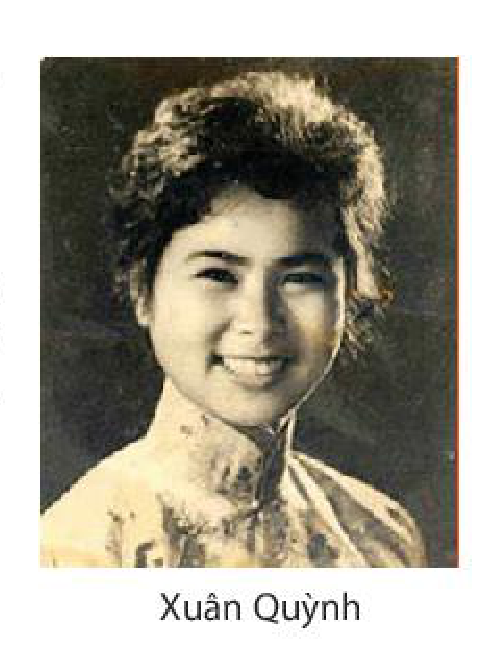

<!-- pdf:102 -->

# BÀI 4: TỰ SỰ TRONG TRUYỆN THƠ DÂN GIAN VÀ TRONG THƠ TRỮ TÌNH

## 🎯 Yêu cầu cần đạt

- Nhận biết và phân tích được một số yếu tố của truyện thơ dân gian như: cốt truyện, nhân vật, người kể chuyện, bút pháp miêu tả.
- Nhận biết và phân tích được ý nghĩa, tác dụng của yếu tố tự sự trong thơ trữ tình.
- Phân tích được ý nghĩa hay tác động của văn bản văn học trong việc làm thay đổi suy nghĩ, tình cảm, cách nhìn và cách thưởng thức, đánh giá của cá nhân đối với văn học và cuộc sống.
- Nắm bắt được các kiểu lỗi về thành phần câu, biết cách sửa lỗi và vận dụng vào việc sử dụng tiếng Việt của bản thân.
- Viết được văn bản nghị luận về một vấn đề xã hội (Hình thành lối sống tích cực trong xã hội hiện đại).
- Biết thảo luận về một vấn đề trong đời sống phù hợp với lứa tuổi; tranh luận một cách hiệu quả và có văn hoá.
- Biết đồng cảm, yêu thương con người; biết trân trọng vẻ đẹp thuỷ chung trong tình yêu.

## ĐỌC

### TRI THỨC NGỮ VĂN

**Truyện thơ và truyện thơ dân gian**

**Truyện thơ** thuộc loại hình tự sự, có cốt truyện, câu chuyện, nhân vật, lời kể,... nhưng lại được thể hiện dưới hình thức thơ. Với dung lượng tương đối lớn, truyện thơ có thể bao quát được nhiều sự kiện, con người, chi tiết cụ thể, sinh động của đời sống thường nhật. Cũng có một số truyện thơ còn lưu lại dấu ấn của sử thi nhưng ở đó cảm hứng thế sự vẫn nổi trội so với cảm hứng lịch sử hướng về những diễn biến lớn trong đời sống cộng đồng. Truyện thơ hiện diện trong nhiều nền văn học, có lịch sử lâu đời, phát triển thành một số dòng riêng theo sự chi phối của các điều kiện văn hoá, xã hội cụ thể.

**Truyện thơ dân gian** do tầng lớp bình dân hoặc các trí thức sống gần gũi với tầng lớp bình dân sáng tác; lưu hành chủ yếu bằng con đường truyền miệng nhưng cũng có khi thông qua các văn bản viết. Truyện thơ dân gian khai thác đề tài từ nhiều nguồn khác nhau như truyền thuyết, cổ tích, sự tích tôn giáo hay những câu chuyện đời thường.

<!-- pdf:103 -->

Kế thừa truyền thống của dân ca với sự kết hợp hài hoà yếu tố tự sự và yếu tố trữ tình, các truyện thơ dân gian đã thể hiện được một cách sinh động đời sống hiện thực và những tình cảm, ước mơ, khát vọng của nhiều lớp người trong xã hội, nhất là những người lao động nghèo. Ngôn ngữ trong truyện thơ dân gian giản dị, chất phác, giàu hình ảnh, gắn liền với cách tư duy hình ảnh rất đặc trưng của những người sống hoà đồng, gắn bó với đất đai, muông thú, cỏ cây,...

Do những điều kiện văn hoá, xã hội đặc thù, truyện thơ dân gian đặc biệt phát triển trong sinh hoạt văn hoá, văn học của nhiều cộng đồng dân tộc thiểu số ở Việt Nam. Ngoài một số truyện thơ có nội dung gần nhau bởi sự kế thừa, mô phỏng trong bối cảnh giao lưu văn hoá, mỗi dân tộc lại có riêng những truyện thơ tinh tuý, thể hiện được bản sắc của cộng đồng mình. Dân tộc Tày, Nùng có: *Nam Kim – Thị Đan; Trần Châu; Quảng Tân – Ngọc Lương; Kim Quế; Chuyện chim sáo; Vượt biển*;... Dân tộc Thái có: *Tiễn dặn người yêu; Chàng Lú – nàng Ủa; Khăm Panh*;... Dân tộc Mường có: *Út Lót – Hồ Liêu; Nàng Nga – Hai Mối; Nàng Ờm – chàng Bồng Hương*;... Dân tộc Mông có: *Tiếng hát làm dâu; Nhàng Dợ – Chà Tăng*;... Dân tộc Chăm có: *Hoàng tử Um Rup và cô gái chăn dê; Têva Mưnô*;... Dân tộc Khơ-me có: *Si Thạch; Tum Tiêu*;...

**Yếu tố tự sự trong thơ trữ tình**

<!-- term: Câu chuyện trong thơ trữ tình -->
Thơ trữ tình không đặt trọng tâm vào việc kể một câu chuyện, có nhân vật, có tính cách, có bối cảnh không gian và thời gian với rất nhiều chi tiết cụ thể như truyện thơ, mà ưu tiên hàng đầu cho việc thể hiện cảm xúc, tâm trạng của nhân vật trữ tình. Tuy nhiên, từ xưa đến nay, thơ trữ tình không hề chối bỏ yếu tố tự sự, thậm chí, ở sáng tác của một số nhà thơ, yếu tố này khá đậm nét. Đọc một bài thơ trữ tình có yếu tố tự sự, độc giả dễ nhận ra bóng dáng của một câu chuyện, một sự kiện với những đường nét cốt yếu của nó. Câu chuyện lúc này có tác dụng làm nền cho tiếng nói trữ tình và luôn chịu sự chi phối của mạch cảm xúc mà tác giả triển khai. Do vậy, các câu chuyện thường chỉ được “kể” ở mức độ vừa đủ để cảm xúc của nhà thơ được bộc lộ trọn vẹn.

### VĂN BẢN 1: Lời tiễn dặn
<!-- ocr-ok: OCR bỏ sót chữ VĂN BẢN 1 trong khung màu, đã đối chiếu ảnh trang PDF 103 -->

*(Trích Tiễn dặn người yêu – truyện thơ dân tộc Thái)*

- Hãy chia sẻ đôi điều về một truyện thơ bạn từng biết hay từng đọc (nhan đề, tác giả, nội dung tác phẩm,...).
- Hãy nhớ lại một tác phẩm (thuộc bất kì thể loại nào) có kể một câu chuyện tình yêu đã thực sự gây ấn tượng với bạn. Theo bạn, điều gì khiến tình yêu trở thành đề tài bất tận của văn học?

<!-- pdf:104 -->

Chàng trai và cô gái yêu nhau tha thiết nhưng hoàn cảnh ngăn trở không cho họ được chung sống dưới một mái ấm hạnh phúc. Ngày cô gái phải về làm dâu nhà khác, chàng trai quyết đi theo trong vai người đưa tiễn để có cơ hội nói lời nguyện ước sắt son.

**1.** Quẩy gánh qua đồng rộng,
Người đẹp anh yêu cất bước theo chồng.
Vừa đi vừa ngoảnh lại,
Vừa đi vừa ngoái trông,
Chân bước xa lòng càng đau nhớ.
Em tới rừng ớt ngắt lá ớt(1) ngồi chờ,
Tới rừng cà ngắt lá cà(2) ngồi đợi,
Tới rừng lá ngón(3) ngóng trông.
Anh tới nơi, em bẻ lá xanh em ngồi;
Được nhủ(4) đôi câu, anh mới đành lòng quay lại,
Được dặn đôi lời, anh yêu em(5) mới chịu quay đi,
[...]

> Hình dung về bối cảnh câu chuyện.

> Chú ý cách diễn tả đầy hình ảnh về tâm trạng của cô gái.

Xin hãy cho anh kề vóc mảnh(6),
Quấn quanh vai ủ lấy hương người,
Cho mai sau lửa xác đượm hơi(7),
Một lát bên em thay lời tiễn dặn!
Con nhỏ hãy đưa anh ẵm,
Bé xinh hãy đưa anh bồng,

> Chú ý cách cư xử khác thường nhưng hoàn toàn hợp lí của chàng trai.

> (1), (2), (3) *Lá ớt, lá cà, lá ngón*: những lá độc hoặc được cho là độc, không đem lại điều may mắn. Cả ba dòng thơ diễn tả cảm xúc đau đớn của cô gái trên đường về nhà chồng, mong ngóng mãi mà chưa thấy người yêu.
> (4) *Nhủ*: nhắn nhủ, tâm sự.
> (5) *Anh yêu em*: tức là *anh* – người yêu của em.
> (6) *Vóc mảnh*: dáng vóc mảnh mai.
> (7) *Lửa xác đượm hơi*: ý nói sau này lửa thiêu xác anh (theo phong tục hoả táng của người Thái) sẽ cháy đượm vì thân anh luôn quyện hơi, quyện hương người yêu.

<!-- pdf:105 -->

Cho anh bế con dòng(1) đừng ngượng,
Nựng con rồng, con phượng(2) đừng buồn.
[...]

“Đôi ta yêu nhau đợi tới tháng Năm lau nở,
Đợi mùa nước đỏ(3) cá về,
Đợi chim tăng ló(4) hót gọi hè,
Không lấy được nhau mùa hạ, ta sẽ lấy nhau mùa đông,
Không lấy được nhau thời trẻ, ta sẽ lấy nhau khi goá bụa về già.”
[...]

**2.** – “Dậy đi em, dậy đi em ơi!
Dậy rũ áo kẻo bọ(5),
Dậy phủi áo kẻo lấm!
Đầu bù anh chải cho,
Tóc rối đưa anh búi hộ!”
Anh chặt tre về đốt gióng(6) đầu,
Chặt tre dày, anh hun gióng giữa,
Lam(7) ống thuốc này em uống khỏi đau.
Tơ rối đôi ta cùng gỡ,
Tơ vò ta vuốt lại quay guồng(8);
Quay lại guồng gỗ tốt cán thuôn(9),

> Cảm nhận niềm thương xót của chàng trai khi chứng kiến tình cảnh của người yêu ở nhà chồng.

> (1), (2) *Con dòng, con rồng, con phượng*: đứa con thuộc dòng dõi quý báu, đẹp như rồng, như phượng. Trong con mắt của chàng trai, cái gì thuộc về người yêu cũng đẹp đẽ, đáng nâng niu; kể cả đứa con mà nàng sinh với người chồng của mình.
> (3) *Mùa nước đỏ*: mùa nước lũ.
> (4) *Chim tăng ló*: một loài chim hót nhiều vào đầu mùa hè, giọng hót thường được cảm nhận là não nùng, buồn bã.
> (5) *Bọ*: chỉ chung sâu bọ, côn trùng.
> (6) *Gióng*: đoạn thân nằm giữa hai mắt của các loại cây như tre, nứa, mía,...
> (7) *Lam*: nấu cơm, nấu thức ăn hay sắc thuốc với vật đựng là ống tre, ống nứa tươi (dùng thay cho nồi).
> (8) *Guồng*: dụng cụ để cuốn sợi dệt vải, thường làm bằng tre, mây, có cán quay bằng gỗ.
> (9) *Thuôn*: thon. Ở đây nói về cán của guồng quay sợi, có dáng thon, chuốt nhỏ dần về hai đầu.

<!-- pdf:106 -->

Về với người ta thương thuở cũ.
Chết ba năm hình còn treo đó;
Chết thành sông, vục nước uống mát lòng,
Chết thành đất, mọc dây trầu xanh thắm,
Chết thành bèo, ta trôi nổi ao chung,
Chết thành muôi(1), ta múc xuống cùng bát,
Chết thành hồn, chung một mái, song song.
Hỡi gốc dưa yêu mọc ngoài cồn cát,
Nước ngập gốc đáng lụi(2), đừng lụi,
Nước ngập rễ đáng bềnh(3), đừng bềnh.
Đôi ta yêu nhau, tình Lú – Ủa(4) mặn nồng,
Lời đã trao thương không lạc mất;
Như bán trâu ngoài chợ(5),
Như thu lúa muôn bông(6).
Lòng ta thương nhau trăm lớp nghìn trùng,
Bền chắc như vàng, như đá.
Yêu nhau, yêu trọn đời gỗ cứng,
Yêu nhau, yêu trọn kiếp đến già,
Ta yêu nhau tàn đời gió(7), không rung không chuyển,
Người xiểm xui(8) không ngoảnh, không nghe.

> Lời thề nguyền thuỷ chung được diễn tả như thế nào?

(Mạc Phi dịch, *Tiễn dặn người yêu – Xống chụ xon xao*, NXB Văn học, Hà Nội, 1973, tr. 122 – 124, 126, 138 – 140)

> (1) *Muôi*: dụng cụ múc canh giống như chiếc thìa (muỗng) nhưng có kích thước lớn hơn, có địa phương gọi là *môi*.
> (2) *Lụi*: tàn (ở đây nói về tình trạng cây bị úng, chết).
> (3) *Bềnh*: nổi hẳn trên mặt nước (ở đây nói về việc cây bị nổi lên do nước ngập làm long rễ).
> (4) *Lú – Ủa*: hai nhân vật chính trong truyện thơ *Chàng Lú, nàng Ủa* của người Thái (có nguồn gốc từ truyện cổ tích), có tình yêu son sắt, thuỷ chung.
> (5), (6) *Bán trâu ngoài chợ, thu lúa muôn bông*: nói về tình trạng một vật khi đã bị bán đi (như trâu) hay đã thu hoạch (như lúa) thì không còn xác định được nó đã về đâu hay vốn tồn tại ở nơi nào. Điều này khác với lời yêu, dù đã trao nhưng không bao giờ mất.
> (7) *Tàn đời gió*: hết trận gió, hết gió. Ý nói dù các hiện tượng thiên nhiên (như gió) không tồn tại nữa thì tình yêu vẫn còn mãi.
> (8) *Xiểm xui*: nói lời không tốt với dụng ý xấu.

<!-- pdf:107 -->

***Tiễn dặn người yêu*** là truyện thơ thuộc loại nổi tiếng và phổ biến nhất của dân tộc Thái sống ở vùng Tây Bắc, Việt Nam.

*Tiễn dặn người yêu* kể về chuyện tình éo le, đẫm nước mắt của đôi nam nữ dân tộc Thái. Ngay từ thời thơ ấu, hai nhân vật chính đã gắn bó với nhau. Đến tuổi trưởng thành, tình cảm giữa hai người càng mặn nồng và họ mong ước được kết đôi chồng vợ. Nhưng khi chàng trai đến xin ở rể(1), cha mẹ cô gái không chấp thuận vì chê anh nghèo và quyết định chọn một chàng rể khác con nhà giàu có. Chàng trai đau khổ quyết đi xa để làm giàu với hi vọng sẽ về giành lại người yêu khi chưa quá muộn. Nhưng ngày anh trở lại bản làng quê hương với nhiều tiền bạc cũng là ngày cô gái phải về nhà chồng, vì thời hạn ở rể của người được cha mẹ cô chọn đã kết thúc. Không thể làm gì khác, chàng trai chỉ còn biết làm người đưa chân để nói những lời tiễn dặn tha thiết. Cô gái ở nhà chồng ít lâu thì bị đuổi về, sau khi phải chịu cảnh bị đối xử tàn tệ. Lần này, cô gái bị cha mẹ bán vào nhà quan. Quá tuyệt vọng và đau khổ, cô trở nên ương ngạnh, khiến nhà quan đem cô ra chợ bán. Người đẹp ngày xưa giờ đây “nghìn lần không đắt”, cuối cùng bị đánh đổi ngang giá với một cuộn lá dong. Không ngờ người đổi được cô lại là chàng người yêu năm nào, nhưng lúc này anh đã lập gia đình riêng, có nhà cao cửa rộng. Đặc biệt, chàng trai không còn nhận ra cô trong dáng hình tiều tuỵ của một kẻ tôi đòi. Một ngày, đang lúc tủi phận, cô đem đàn môi(2) – kỉ vật tình yêu năm xưa – ra thổi. Nghe tiếng đàn ấy, chàng trai bàng hoàng nhận ra người yêu cũ. Anh quyết định chia tay với người vợ hiện tại và cưới người yêu năm xưa để hai người được chung sống hạnh phúc.

Trong tổng số 1 846 câu của *Tiễn dặn người yêu* có khoảng gần 400 câu là lời chàng trai tiễn dặn cô gái. Do tính đặc sắc, tiêu biểu của những câu này mà truyện thơ được đặt tên như vậy. Đoạn trích ở trên được ghép thành từ hai lời tiễn dặn trong tác phẩm: lời 1 thể hiện tâm sự của chàng trai khi tiễn cô gái về nhà chồng; lời 2 bộc lộ niềm thương xót của anh khi chứng kiến cảnh cô gái bị nhà chồng đánh đập, hành hạ. Cả hai lời đều tha thiết, cảm động, cho thấy tình yêu sắt son, bền chặt, mãi không nhạt phai giữa hai nhân vật chính.

**Trả lời câu hỏi**

1. Qua hai lời tiễn dặn trong đoạn trích, người đọc có thể nắm bắt được điều gì về bối cảnh của câu chuyện?
2. Lời kể trong đoạn trích là của ai? So với một số tác phẩm viết bằng văn xuôi đã học, lời kể ở đây có điểm gì đặc biệt?
3. Nêu nhận xét về tâm trạng của cô gái trên đường về nhà chồng và cách thể hiện tâm trạng ấy trong lời tiễn dặn 1.
4. Qua toàn bộ đoạn trích, hình ảnh chàng trai hiện lên với những đặc điểm gì? Bạn thấy xúc động nhất với những biểu hiện nào của nhân vật này?
5. So sánh nội dung lời thề nguyền thuỷ chung và cách thể hiện lời thề nguyền ấy trong hai lời tiễn dặn.

> (1) *Ở rể*: một tục lệ hôn nhân cũ của người Thái, quy định người con trai khi muốn cưới vợ phải đến ở nhà người con gái một thời gian, trải qua hai giai đoạn là rể ngoài (đi làm cho nhà người con gái, ở như khách) và rể trong (sống cùng người con gái tại nhà cô ấy). Sau đó, cả hai người mới chính thức trở thành vợ chồng và người chồng được đưa vợ về nhà cha mẹ mình hay ra ở riêng.
> (2) *Đàn môi*: một loại nhạc cụ nhỏ làm bằng miếng đồng mỏng, dài như lá tre.

<!-- pdf:108 -->

6. Qua tìm hiểu đoạn trích và phần giới thiệu chung về tác phẩm *Tiễn dặn người yêu*, hãy nêu nhận xét về sự khác nhau giữa một bài thơ trữ tình và một truyện thơ.
7. Đoạn trích cho biết điều gì về không gian tồn tại và đời sống văn hoá tinh thần của đồng bào dân tộc Thái – chủ nhân truyện thơ *Tiễn dặn người yêu*?

#### Kết nối đọc – viết

Viết đoạn văn (khoảng 150 chữ) phân tích một đoạn thơ trong văn bản *Lời tiễn dặn* đã để lại cho bạn những ấn tượng thật sự sâu sắc.

### VĂN BẢN 2: Dương phụ hành
<!-- ocr-ok: OCR bỏ sót chữ VĂN BẢN 2 trong khung màu, đã đối chiếu ảnh trang PDF 108 -->

*(Bài hành về người thiếu phụ phương Tây)*

**Cao Bá Quát**

- Theo bạn, khi đi đến một xứ sở khác, tiếp xúc với một nền văn hoá khác, người ta thường có những phản ứng hay cảm xúc như thế nào trước những gì được gặp, được thấy?
- Bạn đã biết câu chuyện thú vị nào về cuộc tiếp xúc văn hoá giữa những người đến từ hai thế giới: phương Đông và phương Tây? Hãy chia sẻ câu chuyện đó.

**Phiên âm**

*Tây dương thiếu phụ y như tuyết,*
*Độc bằng lang kiên toạ minh nguyệt.*
*Khước vọng Nam thuyền đăng hoả minh,*
*Bả duệ nâm nâm hướng lang thuyết.*
<!-- ocr-ok: OCR đọc sai dấu tiếng Việt trong khổ thơ in nghiêng, đã đối chiếu ảnh trang PDF 108 -->

*Nhất uyển đề hồ thủ lãn trì,*
*Dạ hàn vô ná hải phong xuy.*
*Phiên thân cánh sảnh lang phù khởi,*
*Khởi thức Nam nhân hữu biệt li.*

<!-- pdf:109 -->

**Dịch nghĩa**

Người thiếu phụ Tây dương(1) áo trắng như tuyết,
Tựa vai chồng ngồi dưới bóng trăng thanh.
Nhìn thuyền người Nam thấy đèn lửa sáng,
Kéo áo nói rì rầm với chồng.

Một cốc sữa hững hờ trên tay,
Gió bể thổi hơi lạnh ban đêm không chịu nổi.
Vươn mình đòi chồng nâng đỡ dậy,
Há biết người Nam có cảnh biệt li.

**Dịch thơ**

*Thiếu phụ Tây dương áo trắng phau,*
*Tựa vai chồng dưới bóng trăng thâu.*
*Ngó thuyền Nam thấy đèn le lói,*
*Kéo áo, rì rầm nói với nhau.*
<!-- ocr-ok: OCR đọc sai dấu tiếng Việt trong khổ thơ in nghiêng, đã đối chiếu ảnh trang PDF 109 -->

> Chú ý các chi tiết miêu tả hình ảnh người thiếu phụ phương Tây.

*Hững hờ cốc sữa biếng cầm tay,*
*Gió bể, đêm sương, thổi lạnh thay!*
*Uốn éo đòi chồng nâng đỡ dậy,*
*Biết đâu nỗi khách biệt li này.*

> Hình dung về nhân vật trữ tình.

(Lê Tư Thực dịch, *Hợp tuyển thơ văn Việt Nam thế kỉ XVIII – nửa đầu thế kỉ XIX*, NXB Văn học, Hà Nội, 1978, tr. 748 – 749)

**Cao Bá Quát** (1808 – 1855) quê ở huyện Gia Lâm, nay thuộc thành phố Hà Nội. Ông nổi tiếng học rộng, tài cao, đỗ cử nhân sớm (1831) nhưng lận đận trên con đường làm quan. Năm 1841, khi làm Sơ khảo trường thi Thừa Thiên, vì vi phạm quy định nghiêm ngặt của việc chấm bài, Cao Bá Quát bị khép tội chết, sau đó được giảm án, cho theo phục dịch phái bộ đi công cán một số nước vùng Hạ Châu (In-đô-nê-xi-a – Indonesia, Ma-lai-xi-a – Malaysia,...) để chuộc tội. Chuyến đi này đã tác động lớn đến nhận thức, tư tưởng của ông khi được tiếp xúc với nền văn minh khác, với những màu sắc mới của cuộc sống nơi xứ lạ, phương xa.

> (1) *Tây dương*: từ dùng để chỉ người phương Tây.

<!-- pdf:110 -->

Năm 1852, Cao Bá Quát phải rời kinh đô, nhận chức Giáo thụ phủ Quốc Oai, Sơn Tây. Năm 1854, ông tham gia lãnh đạo phong trào nông dân khởi nghĩa ở Mỹ Lương và bị tử trận. Triều đình nhà Nguyễn đã ra lệnh “tru di tam tộc” với dòng họ Cao.

Cao Bá Quát sáng tác bằng cả chữ Hán và chữ Nôm. Sau bản án thảm khốc với dòng họ Cao, tác phẩm của ông bị tiêu huỷ, cấm đoán nhưng vẫn còn lại 1 327 bài thơ chữ Hán(1), hơn 20 tác phẩm viết bằng chữ Nôm (phú, hát nói, truyện,...). Thơ văn Cao Bá Quát rất phong phú về đề tài, thể hiện tình cảm thiết tha gắn bó với gia đình, quê hương; đồng cảm với những thân phận cùng khổ. Ông mang đến cái nhìn nhân văn, tinh thần dân chủ của một nghệ sĩ có tâm hồn rộng mở, phóng khoáng, sẵn sàng đón nhận và trân trọng những nét đẹp mới mẻ, xa lạ với truyền thống.

***Dương phụ hành*** được Cao Bá Quát sáng tác trong chuyến xuất dương hiệu lực(2) năm 1844. Bài thơ được viết theo thể hành, một thể của thơ cổ phong(3).

**Trả lời câu hỏi**

1. So sánh và chỉ ra những chỗ khác biệt giữa bản dịch thơ với nguyên tác.
2. Xác định thời gian, không gian, sự việc của câu chuyện được kể trong bài thơ.
3. Chỉ ra những chi tiết miêu tả người thiếu phụ phương Tây, qua đó, nêu các đặc điểm nổi bật của hình tượng này.
4. Hình tượng người thiếu phụ phương Tây trong bài thơ được tái hiện qua cái nhìn của một nhà Nho đồng thời cũng là một nhà thơ phương Đông. Hãy phân tích những cảm xúc, thái độ được tác giả bộc lộ từ các điểm nhìn đó.
5. Phân tích tâm trạng nhân vật trữ tình trong câu thơ kết và những ý tứ được mở ra từ câu thơ này.
6. Đọc bài thơ, bạn cảm nhận được những gì về tư tưởng, tâm hồn tác giả?

#### Kết nối đọc – viết

Viết đoạn văn (khoảng 150 chữ) trình bày điều bạn thấy tâm đắc nhất ở bài thơ *Dương phụ hành*.

> (1) Theo *Cao Bá Quát toàn tập*, tập một, NXB Văn học, Hà Nội, 2004. Đây là số liệu thống kê sau khi đã lược một số văn bản trùng lặp, tồn nghi.
> (2) *Xuất dương hiệu lực*: đi phục dịch để lấy công chuộc tội.
> (3) *Thơ cổ phong*: là thể thơ ra đời ở Trung Quốc trước thơ Đường luật, với câu thơ phổ biến là ngũ ngôn hoặc thất ngôn, mỗi bài thơ từ bốn câu trở lên, không hạn định về độ dài, chỉ cần có vần điệu mà không cần đối nhau, cũng không cần tuân theo niêm luật.

<!-- pdf:111 -->

### VĂN BẢN 3: Thuyền và biển
<!-- ocr-ok: OCR đọc nhầm VĂN BẢN 3 trong khung màu thành WANEAN B, đã đối chiếu ảnh trang PDF 111 -->

**Xuân Quỳnh**

- Bạn đã biết những so sánh thú vị nào về tình yêu và về sự gắn bó giữa những người yêu nhau?
- Bạn đã từng nghe những ca khúc nào phổ thơ Xuân Quỳnh? Nếu đã từng nghe, hãy chia sẻ ấn tượng của bạn về một trong số ca khúc ấy.

Em sẽ kể anh nghe
Chuyện con thuyền và biển:

“Từ ngày nào chẳng biết
Thuyền nghe lời biển khơi
Cánh hải âu, sóng biếc
Đưa thuyền đi muôn nơi

> Những dấu hiệu hình thức nào chứng tỏ có một câu chuyện được kể trong bài thơ?

Lòng thuyền nhiều khát vọng
Và tình biển bao la
Thuyền đi hoài không mỏi
Biển vẫn xa... còn xa

> Theo dõi diễn biến câu chuyện.

Những đêm trăng hiền từ
Biển như cô gái nhỏ
Thầm thì gửi tâm tư
Quanh mạn thuyền sóng vỗ

<!-- pdf:112 -->

Cũng có khi vô cớ
Biển ào ạt xô thuyền
(Vì tình yêu muôn thuở
Có bao giờ đứng yên?)

> Chú ý dấu ngoặc đơn ở hai dòng thơ này.

Chỉ có thuyền mới hiểu
Biển mênh mông nhường nào
Chỉ có biển mới biết
Thuyền đi đâu, về đâu

> Nhân vật trữ tình rút ra nhận thức gì từ câu chuyện?

Những ngày không gặp nhau
Biển bạc đầu thương nhớ
Những ngày không gặp nhau
Lòng thuyền đau – rạn vỡ

> Nhân vật trữ tình – người kể chuyện đã đồng nhất mình với nhân vật trong câu chuyện như thế nào?

Nếu từ giã thuyền rồi
Biển chỉ còn sóng gió”

Nếu phải cách xa anh
Em chỉ còn bão tố.

4 – 1963

(Xuân Quỳnh, *Không bao giờ là cuối (Tuyển thơ)*, NXB Hội Nhà văn – Công ti Văn hoá và Truyền thông Nhã Nam, Hà Nội, 2011, tr. 15 – 16)

**Xuân Quỳnh** (1942 – 1988) tên khai sinh là Nguyễn Thị Xuân Quỳnh, quê ở quận Hà Đông, thành phố Hà Nội. Sáng tác của bà bao gồm cả thơ và văn xuôi, viết về nhiều đề tài khác nhau, trong đó tình yêu, hạnh phúc gia đình và trẻ em là các đề tài chiếm vị trí nổi bật. Thơ Xuân Quỳnh giàu yếu tố tự thuật. Bên cạnh việc bộc lộ niềm khát khao được yêu thương, chia sẻ và ý thức chắt chiu, gìn giữ hạnh phúc đang có, thơ bà còn chứa đựng những dự cảm đầy lo âu về cái mong manh của đời sống, của tình yêu. Xuân Quỳnh được nhìn nhận là một trong những nhà thơ tiêu biểu của nền thơ Việt Nam hiện đại nửa sau thế kỉ XX. Tác phẩm chính của bà: *Gió Lào, cát trắng* (thơ, 1974), *Lời ru trên mặt đất* (thơ, 1978), *Sân ga chiều em đi* (thơ, 1984), *Tự hát* (thơ, 1984), *Hoa cỏ may* (thơ, 1989), *Bầu trời trong quả trứng* (thơ văn viết cho thiếu nhi, 1982), *Bến tàu trong thành phố* (truyện viết cho thiếu nhi, 1984),...

<!-- pdf:113 -->

**Trả lời câu hỏi**

1. Bạn cảm nhận như thế nào về câu chuyện được nhân vật trữ tình kể lại trong bài thơ?
2. Trong câu chuyện về thuyền và biển, hai đối tượng này được đặt trong tương quan nào? Những cung bậc tình cảm gì đã được “người kể” soi rọi, khám phá?
3. Từ câu chuyện giữa thuyền và biển, bạn suy nghĩ như thế nào về vấn đề “hiểu”, “biết” và “gặp” trong tình yêu đôi lứa?
4. Nêu nhận xét về sự lồng ghép hai câu chuyện trong bài thơ. Số dòng thơ được dành cho từng câu chuyện được phân bố theo tỉ lệ nào? Bạn suy nghĩ gì về điều này?
5. Bài thơ giúp bạn hiểu như thế nào về tâm sự và khát vọng của nhân vật trữ tình?
6. Đánh giá chung về vai trò, ý nghĩa của yếu tố tự sự được sử dụng trong bài thơ.

#### Kết nối đọc – viết

Tìm đọc thêm một bài thơ trữ tình chứa đựng câu chuyện ẩn dụ về tình yêu gần gũi với *Thuyền và biển*. Từ đó, viết đoạn văn (khoảng 150 chữ) so sánh hai tác phẩm.

### Thực hành tiếng Việt: Lỗi về thành phần câu và cách sửa

**1.** Trong những trường hợp sau, trường hợp nào mắc lỗi về thành phần câu? Phát hiện và đề xuất phương án sửa lỗi cho những trường hợp đó.

a. *Bằng những khảo sát đáng tin cậy đã chỉ ra rằng, các con sông lớn đang dần dần khô cạn.*

> **Nhận biết lỗi về thành phần câu và cách sửa**
>
> - **Thiếu thành phần nòng cốt**
>   - ***Câu thiếu chủ ngữ***
>     Ví dụ:
>     *Với tác phẩm này đã thể hiện tài năng của một cây bút truyện ngắn bậc thầy.*
>     “Với tác phẩm này” là thành phần trạng ngữ. Có thể người viết nhầm đó là chủ ngữ.
>     Cách sửa thứ nhất: Dựa vào ngữ cảnh để bổ sung chủ ngữ phù hợp. Chẳng hạn: *Với tác phẩm này, nhà văn đã thể hiện tài năng của một cây bút truyện ngắn bậc thầy.*

<!-- pdf:114 -->

b. *Rất thú vị truyện ngắn sử dụng các yếu tố kì ảo, lạ lùng.*

c. *Những con người vị tha giàu đức hi sinh ấy.*

d. *Theo báo Tuổi trẻ cho biết, tình trạng ùn ứ nông sản của nông dân miền Tây đã bước đầu được giải quyết.*

e. *Chữ người tử tù, một tác phẩm được sáng tác bằng bút pháp lãng mạn của Nguyễn Tuân.*

g. *Với những tin tức lan truyền trên mạng xã hội không phải bao giờ cũng chính xác.*

h. *Khổ thơ chỉ có một câu, rất đặc biệt.*

**2.** Phát hiện lỗi về thành phần câu ở các trường hợp sau và sửa lại:

a. *Truyện ngắn, thể loại linh hoạt ấy.*

b. *Đã vẽ bức tranh tường hoành tráng này một nhóm hoạ sĩ đến từ thành phố.*

c. *Số đỏ không chỉ là một tác phẩm trào phúng đặc sắc vào bậc nhất trong văn học Việt Nam trước 1945.*

d. *Văn bản nghị luận, loại văn bản được viết ra với mục đích thuyết phục người đọc.*

>     Cách sửa thứ hai: Lược bỏ quan hệ từ ở đầu câu để bộ phận đứng sau đó trở thành chủ ngữ: *Tác phẩm này đã thể hiện tài năng của một cây bút truyện ngắn bậc thầy.*
>   - ***Câu thiếu vị ngữ***
>     Ví dụ:
>     *Lục bát, một thể thơ “đặc sản” có từ lâu của người Việt.*
>     Trong câu trên, có thể coi “lục bát” là chủ ngữ, “một thể thơ “đặc sản” có từ lâu của người Việt” là thành phần chêm xen, giải thích cho đối tượng được nói đến ở chủ ngữ chứ không phải là vị ngữ. Kiểu lỗi này có thể do người viết nhầm thành phần chêm xen là vị ngữ.
>     Cách sửa thứ nhất: Thêm từ “là” để biến thành phần chêm xen thành vị ngữ: *Lục bát là một thể thơ “đặc sản” có từ lâu của người Việt.*
>     Cách sửa thứ hai: Giữ nguyên thành phần chêm xen, dựa vào ngữ cảnh để bổ sung vị ngữ phù hợp: *Lục bát – một thể thơ “đặc sản” có từ lâu của người Việt – đã được tác giả sử dụng hết sức nhuần nhuyễn.*
>   - ***Câu thiếu cả chủ ngữ và vị ngữ***
>     Ví dụ:
>     *Trong hoàn cảnh nước sôi lửa bỏng như thế.*
>     Đây mới chỉ là một cụm từ, chưa hề có nội dung thông tin, vì thế, chưa phải là câu.
>     Cách sửa: Dựa vào ngữ cảnh, bổ sung thành phần nòng cốt để hoàn thành câu. Ví dụ: *Trong hoàn cảnh nước sôi lửa bỏng như thế, tôi không thể chần chừ.*
> - **Sắp xếp sai vị trí thành phần câu**
>   Trong câu tiếng Việt, chủ ngữ thường đứng trước vị ngữ (trừ trường hợp người viết đảo trật tự với mục đích tu từ). Việc sắp xếp sai các thành phần nòng cốt là một kiểu lỗi về ngữ pháp. Ví dụ:
>   *Đang hành quân trong rừng một đơn vị bộ đội.*
>   “Một đơn vị bộ đội” là chủ ngữ, lẽ ra phải được đặt trước “đang hành quân trong rừng” (vị ngữ). Kiểu lỗi này cần được

<!-- pdf:115 -->

**3.** Vì sao những câu sau đây trong các văn bản văn học mặc dù không đầy đủ thành phần câu nhưng vẫn không bị xem là câu sai?

a. *Huân cảm tưởng như mình đã bị thuổng văn. Bị đạo ý.*

(Nguyễn Trương Quý, *Câu chuyện bắt đầu từ tầng 10*)

b. *Mắt mèo hoang. Em thích mẹ nói em có con mắt mèo hoang và dã thú.*

(Nguyễn Ngọc Thuần, *Một thiên nằm mộng*)

c. *Đó là người câm của quán rượu. Anh Ba Hoành!*

(Nguyễn Quang Sáng, *Quán rượu của người câm*)

>   khắc phục bằng cách trả lại đúng trật tự của chủ ngữ và vị ngữ:
>   *Một đơn vị bộ đội đang hành quân trong rừng.*
> - **Thiếu vế câu**
>   Trong tiếng Việt, một số cặp quan hệ từ như: *vì... nên...; chẳng những... mà còn...; tuy... nhưng...; càng... càng...*;... phải luôn đi với nhau. Nếu thiếu một vế, câu bị lỗi về thành phần. Ví dụ:
>   *Trái Đất nóng lên chẳng những khiến băng ở Bắc Cực và Nam Cực tan nhanh, nhấn chìm nhiều vùng đất màu mỡ.*
>   Cách sửa: Bổ sung quan hệ từ phù hợp với một vế câu, chẳng hạn: *Trái Đất nóng lên chẳng những khiến băng ở Bắc Cực và Nam Cực tan nhanh, nhấn chìm nhiều vùng đất màu mỡ mà còn đe doạ sự sống của muôn loài.*
>   *Lưu ý*: Có những câu nếu tách ra, có vẻ như bị lỗi thành phần câu, nhưng đặt trong ngữ cảnh, đó không phải là câu sai. Ví dụ: *Rừng Hoành Bồ nhiều nương dó. Rộng và sâu lắm.* (Nguyễn Tuân). Tách ra, *Rộng và sâu lắm* không thể là một câu, nhưng nhờ câu trước đó mà ta hiểu rằng “rộng” và “sâu” ở đây là những đặc điểm của rừng dó Hoành Bồ. Loại câu đặc biệt như thế thường được dùng trong văn bản văn học.

## VIẾT

**Viết bài văn nghị luận về một vấn đề xã hội (Hình thành lối sống tích cực trong xã hội hiện đại)**

*Xã hội hiện đại đang đặt ra trước mỗi chúng ta nhiều thử thách mới. Để hoà nhịp một cách tích cực với cuộc sống hiện nay, bạn cần biết suy tư về một số vấn đề có khả năng tác động mạnh mẽ đến cách lựa chọn thái độ ứng xử của chúng ta trong cuộc vận động mang tính chất toàn cầu, hướng đến sự chung sống hài hoà giữa các quốc gia, dân tộc; giữa con người với toàn bộ môi trường sống. Viết văn bản nghị luận bàn về những vấn đề như vậy quả thực là một cơ hội khám phá, nhận thức đầy ý nghĩa.*

<!-- pdf:116 -->

**Yêu cầu**

- Nêu được vấn đề thực sự có ý nghĩa, hướng đến việc hình thành lối sống tích cực trong xã hội hiện đại.
- Triển khai hệ thống luận điểm chặt chẽ, phù hợp với logic của vấn đề bàn luận; sử dụng các lí lẽ thuyết phục và bằng chứng chính xác, thích hợp, đầy đủ.
- Nêu được ý kiến về vấn đề bàn luận từ một góc nhìn khác.
- Rút ra được ý nghĩa của việc bàn luận về vấn đề.

### Bài viết tham khảo

**Cư dân của hành tinh**

Chúng ta đang sống trong thời đại thường được định danh bằng thuật ngữ toàn cầu hoá. Mặc dù nội hàm của thuật ngữ này hiện vẫn còn gây nhiều tranh cãi, nhưng chúng ta vẫn cảm nhận được ngày càng rõ rệt rằng thế giới này chỉ có thể tồn tại được trong và bằng sự giao lưu, kết nối mọi người, mọi quốc gia, dân tộc với nhau. Tuy nhiên, từ cảm nhận được điều này tới việc thể hiện một thái độ tích cực đối với nó có một khoảng cách khá xa. Đây không chỉ là vấn đề của từng cá nhân, nhưng trước hết mỗi người phải chứng tỏ được bằng hành động cụ thể rằng mình đã có một “căn cước” mới: cư dân của hành tinh.

> Nêu vấn đề cần bàn luận theo lối gián tiếp.

Theo nhiều kết quả nghiên cứu khoa học được thừa nhận rộng rãi, loài người trên thế giới hiện nay vốn cùng chung một nguồn gốc, là loài được định danh bằng cái tên Hô-mô Xa-piên (Homo Sapiens)(1). Hiện tại, dù có nhiều màu da khác nhau và thuộc nhiều chủng tộc khác nhau, nhưng truy nguyên, con người trên toàn thế giới cùng chung một tổ tiên, không có sự tách biệt về gene. Đây chính là cơ sở đầu tiên, thuộc phương diện sinh học chứng tỏ sự thống nhất của loài người.

> Luận điểm 1: Xem xét vấn đề từ nguồn gốc chung của loài người.

Sau khi toả đi khắp mọi nơi trên thế giới và suốt một thời kì dài sống trong sự chia rẽ, từ thế kỉ XVI, xét theo quy mô rộng, con người của các dân tộc bắt đầu tìm cách liên hệ, liên kết với nhau. Quá trình toàn cầu hoá bắt

> Luận điểm 2: Xem xét vấn đề từ thực tiễn lịch sử cận – hiện đại của thế giới.

> (1) *Hô-mô Xa-piên*: từ La-tinh (Latin), có nghĩa là người tinh khôn. Xem thêm: I-u-vô Nô-a Ha-ra-ri (Yuval Noah Harari), *Sapiens: Lược sử loài người*, Nguyễn Thuỷ Chung dịch, Võ Minh Tuấn hiệu đính, NXB Tri thức – Công ti cổ phần Sách Omega Việt Nam, Hà Nội, 2019.

<!-- pdf:117 -->

đầu từ đó và đến nay đã được nhìn nhận là một xu thế phát triển có tính tất yếu. Thế giới đang trở thành một thể thống nhất gồm nhiều bộ phận có quan hệ với nhau chặt chẽ. Những dấu ấn chung mang tính toàn cầu được thể hiện ở mọi bộ phận cấu thành của nó, từ bộ phận lớn như quốc gia, dân tộc đến những bộ phận nhỏ hơn như từng con người cá nhân. Chúng ta có thể thấy thế giới hiện hữu một cách sống động quanh mình. Tất cả các tiện nghi sinh hoạt mà ta dùng hằng ngày, từ quần áo, giày dép, đồ ăn thức uống, phương tiện đi lại đến những phương tiện liên lạc hiện đại như điện thoại thông minh, máy vi tính, rô-bốt,... là những minh chứng rõ ràng. Chúng đến từ những nơi sản xuất khác nhau trên địa cầu, tạo sự gắn kết giữa ta với thế giới. Thành quả văn minh mà nhân loại tạo ra đã được mỗi người đón nhận một cách tự nhiên. Sự giao lưu mở rộng tạo cơ hội cho ta tìm được việc làm không phải chỉ trên xứ sở của mình. Khái niệm “công dân toàn cầu” trước hết phản ánh điều đó nhưng không chỉ điều đó.

> Nêu bằng chứng xác nhận sự kết nối với nhau của con người trên Trái Đất hiện nay.

Nhìn ở phạm vi quốc gia, dân tộc, chúng ta cũng có thể thấy rõ: không một quốc gia nào muốn phát triển, không một dân tộc nào muốn “ngẩng mặt” mà lại quay lưng với thế giới. Chúng ta phải chấp nhận những luật chơi chung và phải tôn trọng những giá trị phổ quát toàn cầu. Hợp tác cùng phát triển đã trở thành một nhu cầu tất yếu để mọi bên đều được hưởng lợi. Tất nhiên, trong cuộc chơi chung mà tất cả đều tham gia này, mỗi người, mỗi quốc gia, dân tộc, từ vị thế, điều kiện và sở trường của mình, phải có đóng góp xứng đáng. Những tiến bộ mà con người đạt được trong mọi lĩnh vực, từ kinh tế, chính trị đến văn hoá đều đem lại niềm vui cho cả loài người và thu hút sự chú ý của mỗi chúng ta. Một mẫu điện thoại di động đời mới nhất vừa xuất hiện có thể đem đến niềm khấp khởi cho bao nhiêu triệu con người trên nhiều quốc gia, lãnh thổ. Một cú sút thần sầu của Crít-xti-a-nô Rô-nan-đô (Cristiano Ronaldo)(1) hay của Li-ô-nen Mét-xi (Lionel Messi)(2) vào khung thành cũng có thể làm hàng triệu người hâm mộ phấn khích... Đó là mới chỉ nói tới những sự kiện mang nhiều tính đại chúng nhất.

> Luận điểm 3: Xem xét vấn đề từ mối quan hệ giữa các quốc gia, dân tộc.

> Nêu bằng chứng từ những sự kiện mang tính đại chúng.

Tuy nhiên, ta cũng không khó nhận ra rằng thế giới chúng ta sống đang gặp nhiều bất ổn và sức khoẻ của mẹ Trái Đất vẫn thường xuyên bị đe doạ. Xu thế toàn cầu hoá kéo theo nhiều hệ luỵ. Sự hướng về những giá trị chung có nguy cơ làm phai nhạt những bản sắc riêng. Phản ứng

> Luận điểm 4: Xem xét vấn đề từ góc nhìn khác.

> (1) *Crít-xti-a-nô Rô-nan-đô*: sinh năm 1985, cầu thủ bóng đá nổi tiếng người Bồ Đào Nha.
> (2) *Li-ô-nen Mét-xi*: sinh năm 1987, cầu thủ bóng đá nổi tiếng người Ác-hen-ti-na (Argentina).

<!-- pdf:118 -->

co cụm, chối bỏ đã xảy ra mà ví dụ rõ nhất là các xung đột tôn giáo, xung đột sắc tộc đang có những diễn biến nguy hiểm khó lường. Nạn khủng bố, trào lưu di dân, những lời đe doạ sử dụng vũ khí hạt nhân,... đang làm đau đầu các nhà chính trị, các nhà hoạt động xã hội và khiến tất cả chúng ta phải lo âu, thậm chí sợ hãi. Những dịch bệnh cũng lan tràn khắp mọi nơi khiến cả loài người phải tìm cách chống đỡ một cách vất vả. Hết đại dịch AIDS đến đại dịch COVID-19, không biết lúc nào con người mới có được cảm giác sống an toàn. Tai hoạ đến từ thiên nhiên cũng ngày một nhiều hơn, thảm khốc hơn. Thiên nhiên dường như đang nổi giận về sự vô ý thức của con người, về tính kiêu ngạo vô lối của con người. Chưa bao giờ những thảm hoạ lại mang tính toàn cầu rõ nét đến vậy... Rõ ràng, không còn ai có thể quay lưng với những mối lo lớn như thế, nếu không phải là người hoàn toàn vô trách nhiệm và trơ lì, vô cảm.

> Nêu bằng chứng cho ý kiến từ góc nhìn khác: toàn cầu hoá gặp nhiều thách thức.

Là một cư dân của hành tinh, chúng ta cần phải biết chia sẻ những niềm vui và nỗi lo mang tính toàn cầu. Trách nhiệm với cá nhân, gia đình, quốc gia, dân tộc chưa phải là tất cả. Trách nhiệm với toàn bộ sự sống trên Trái Đất, với tương lai của loài người nhất định phải trở thành mối bận tâm của mỗi người có đạo đức và lí trí. Sự lên tiếng phản đối một cuộc chiến tranh xâm lược, sự hưởng ứng lời kêu gọi giảm thiểu hiệu ứng nhà kính, sự tham gia tích cực vào hoạt động quảng bá lối sống xanh,... đó đều là những việc làm thể hiện trách nhiệm nói trên.

> Luận điểm 5: Ứng xử thực tế cần có của mỗi người khi nhận thức được tầm quan trọng của vấn đề bàn luận.

Gioóc-giơ Vơ-nát-xki (George Vernadsky)(1) từng phát biểu: “Lần đầu tiên, con người đã thực sự hiểu rằng nó là một cư dân của hành tinh này, và có lẽ nó phải nghĩ hoặc hành động dưới một vẻ mặt mới, không chỉ mặt cá thể, gia đình hoặc giống loài, nhà nước hay nhiều nhà nước mà cả mặt toàn cầu nữa”(2). Đó quả là một nhận định sâu sắc mang tính chất khai mở nhận thức, cần được mỗi người chúng ta suy ngẫm để xác định được cho mình một thái độ sống tích cực, có trách nhiệm với cuộc đời và với sự sống nói chung.

> Thay lời kết luận bằng một trích dẫn phù hợp.

(Nhóm biên soạn)

> (1) *Gioóc-giơ Vơ-nát-xki* (1887 – 1973): nhà sử học Mỹ gốc Nga.
> (2) Trích dẫn theo Ét-ga Mô-ranh (Edgar Morin), *Bảy tri thức tất yếu cho nền giáo dục tương lai*, NXB Tri thức, Hà Nội, 2008, tr. 81.

<!-- pdf:119 -->

1. Nêu vấn đề chính được bàn luận trong bài viết và ý nghĩa của nó.
2. Xác định hệ thống luận điểm được triển khai trong bài viết.
3. Nhận xét về mức độ thuyết phục của các bằng chứng được người viết đưa ra.

### Thực hành viết

**Chuẩn bị viết**

Đề tài bạn sẽ chọn, như được định hướng từ nhan đề chung của phần *Viết*, nên là đề tài có thể khơi dậy được thái độ sống tích cực trong hoàn cảnh sống có nhiều thách thức mới hiện nay. Cần bình tâm ngẫm nghĩ về những câu hỏi nảy sinh từ chính cuộc sống của mình, với những điều được gợi mở từ những thông tin mà các phương tiện truyền thông phổ biến vẫn truyền tải hằng ngày.

- Gợi ý một số đề tài có thể chọn: *Tự bảo vệ mình trước các tệ nạn; Thực hành lối sống xanh; Đấu tranh cho bình đẳng giới; Tôn trọng sự khác biệt; Sự cần thiết của việc học ngoại ngữ; Trách nhiệm với lớp người yếu thế trong xã hội; Ý nghĩa của các diễn đàn, câu lạc bộ khởi nghiệp*;...
- Khi đã xác định được đề tài, nên tìm cho bài viết một nhan đề phù hợp. Tên bài viết có thể là tên của đề tài và việc diễn đạt tường minh về đề tài sẽ tạo tiền đề thuận lợi cho bạn triển khai thông suốt hệ thống luận điểm, lí lẽ, bằng chứng trong bài.

**Tìm ý, lập dàn ý**

*Tìm ý*

Gợi ý một số câu hỏi có thể dùng để tìm ý, huy động các bằng chứng:

- Có thể nhìn nhận vấn đề từ những góc độ và theo các cấp độ nào? Tác giả bài viết tham khảo đã triển khai vấn đề từ các góc nhìn: lịch sử, xã hội, đạo đức; đã chứng minh vấn đề theo từng cấp độ: cá nhân, quốc gia – dân tộc, nhân loại. Cách triển khai này khác với cách triển khai của bài viết tham khảo ở Bài 3. Như vậy, việc xác định hệ thống luận điểm trong một bài văn nghị luận tuỳ thuộc vào vấn đề được bàn có thể nhìn nhận từ những góc độ hay theo cấp độ nào.
- Nên chọn những bằng chứng gì để làm sáng tỏ các luận điểm? (Trong bài viết tham khảo, các bằng chứng được nêu rất sinh động, phong phú, vừa gắn với sinh hoạt thường ngày, vừa gắn với những sự kiện gây ảnh hưởng lớn đến đời sống chung của nhân loại.)
- Những ý kiến sáng giá nào có thể trích dẫn? (Bài viết tham khảo đã trích một nhận định có tầm khái quát rất cao của Gioóc-giơ Vơ-nát-xki.)
- Có thể bàn về vấn đề từ góc nhìn trái chiều như thế nào?
- Việc nhận thức sâu sắc về vấn đề có ý nghĩa như thế nào đối với mỗi người, trước hết là với chính người viết?

*Lập dàn ý*

*Mở bài*: Nêu vấn đề cần bàn luận, hướng bàn luận và ý nghĩa chung của việc bàn luận về vấn đề. Bạn có thể giới thiệu vấn đề theo cách trực tiếp như bài viết tham khảo ở Bài 3 hoặc

<!-- pdf:120 -->

theo cách gián tiếp như bài viết tham khảo ở Bài 4 này. Dù theo cách giới thiệu nào thì phần *Mở bài* không được dài dòng và cần giúp người đọc nắm rõ ngay từ đầu bài viết sẽ bàn luận về vấn đề gì.

*Thân bài*:

- Miêu tả khái quát hoàn cảnh đời sống làm nảy sinh vấn đề. Ví dụ: Với vấn đề khởi nghiệp, cần cho thấy được sự nở rộ của nhiều ngành nghề mới, nhu cầu tìm kiếm việc làm của người lao động, sự xuất hiện của các diễn đàn về khởi nghiệp,...
- Phân tích lần lượt từng khía cạnh vấn đề theo trình tự từ hẹp đến rộng hoặc từ rộng đến hẹp với những lí lẽ và bằng chứng phù hợp. Ví dụ: Với vấn đề thực hành lối sống xanh, cần phân tích, đánh giá được ý nghĩa của những hoạt động ở cấp độ toàn cầu, quốc gia và những hoạt động ở cấp độ từng cá nhân trong cộng đồng.
- Làm rõ sự cần thiết phải nhận thức đầy đủ về vấn đề. Ví dụ: Với vấn đề tự bảo vệ mình trước các tệ nạn xã hội, phải cho thấy việc hiểu được sự cám dỗ của những tệ nạn và khả năng, điều kiện tự bảo vệ mình của mỗi người có ý nghĩa như thế nào.
- Nêu trải nghiệm của bản thân với vấn đề được bàn luận. Ví dụ: Với vấn đề sự cần thiết của việc học ngoại ngữ, cần cho biết bản thân đã từng gặp khó khăn hay thuận lợi gì khi muốn giao tiếp với người nước ngoài hay khi muốn tra cứu tài liệu được viết bằng các ngôn ngữ khác.
- Bàn luận vấn đề từ góc nhìn trái chiều. Ví dụ: Với vấn đề sự cần thiết của việc học ngoại ngữ, có ý kiến cho rằng, hiện nay đã có nhiều công cụ dịch tự động rất chính xác và hiệu quả. Vì vậy, việc học ngoại ngữ không còn được đặt ra một cách cấp thiết như trước đây. Bạn cần nêu các lí lẽ và bằng chứng để phản bác lại ý kiến đó.

*Kết bài*: Tóm tắt những luận điểm chính đã trình bày và khẳng định ý nghĩa của vấn đề trên cơ sở thu thập nhiều tư liệu và bằng chứng mới.

**Viết**

- Bám sát dàn ý đã lập để viết, có thể điều chỉnh các nhận xét, đánh giá cho phù hợp với những bằng chứng được đưa ra.
- Mỗi luận điểm cần được triển khai thành một đoạn văn, có câu chủ đề với các ý nhỏ triển khai chủ đề.
- Thường xuyên chú ý mạch lạc và liên kết của bài viết, sử dụng chính xác và đúng chỗ các phương tiện liên kết.
- Việc trích dẫn các ý kiến bàn về vấn đề (nếu có) cần đảm bảo tính trung thực, không cắt xén, có ghi nguồn đầy đủ, chính xác (phần trích dẫn trực tiếp phải được đặt trong ngoặc kép).
- Chú ý sử dụng hình thức đối thoại (với các quan điểm khác) nhằm làm cho vấn đề trở nên nổi bật và sắc nét.
- Có thể vận dụng linh hoạt các yếu tố tự sự và biểu cảm, nhất là khi đề cập những trải nghiệm của bản thân để làm tăng tính thuyết phục của lập luận.

<!-- pdf:121 -->

**Chỉnh sửa, hoàn thiện**

Đối chiếu với yêu cầu của kiểu bài và dàn ý đã lập để:

- Bổ sung những ý cần thiết hay lược bỏ những ý đi xa vấn đề chính cần bàn luận.
- Kiểm tra tính chặt chẽ, hợp lí của bố cục; có thể đảo vị trí các đoạn, các câu nếu thấy cần thiết nhằm đảm bảo sự liền mạch, logic của lập luận.
- Triển khai hoàn chỉnh những ý còn sơ sài.
- Thay thế phương tiện liên kết chưa được dùng chính xác và bổ sung phương tiện liên kết cần thiết, phù hợp.
- Sửa các lỗi chính tả, diễn đạt và trình bày (nếu có).

## NÓI VÀ NGHE

**Thảo luận về một vấn đề trong đời sống (Hình thành lối sống tích cực trong xã hội hiện đại)**

**Yêu cầu**

- Chọn được vấn đề thảo luận có ý nghĩa, gần gũi với trải nghiệm của tuổi trẻ học đường.
- Nêu được các khía cạnh cụ thể của vấn đề và những cách tiếp cận khác nhau đối với vấn đề.
- Thể hiện được quan điểm rõ ràng về vấn đề với lí lẽ thuyết phục và bằng chứng phù hợp, sinh động trong từng ý kiến phát biểu.
- Thể hiện được thái độ tôn trọng lẫn nhau trong thảo luận.

**Chuẩn bị thảo luận**

- Ở phạm vi tập thể, trước khi thực hành nói và nghe, cần trao đổi ý kiến để chọn đề tài thảo luận phù hợp, có khả năng lôi cuốn được nhiều người tham gia phát biểu ý kiến. Có thể chọn một trong số những đề tài đã được gợi ý ở phần *Viết*, nhất là đề tài còn hứa hẹn những cách tiếp cận, đánh giá mới đối với các vấn đề của nó.
- Ở phạm vi cá nhân, nếu bạn đã viết bài về đề tài được chọn thảo luận, hãy rút ra từ bài viết đoạn mà bạn tâm đắc nhất, thể hiện được cách nhìn nhận, phân tích, đánh giá độc đáo để làm nòng cốt cho ý kiến sẽ phát biểu. Nếu đề tài thảo luận hoàn toàn mới, bạn hãy tìm hiểu trước, thu thập, tra cứu các tài liệu liên quan để hình thành ý kiến của mình. Bạn có thể tổ chức ý kiến dự định phát biểu thành một dàn ý mạch lạc, có gạch chân các từ ngữ quan trọng, có lưu ý về những chỗ cần được minh hoạ bằng các phương tiện phi ngôn ngữ,...
- Người điều hành buổi thảo luận và thư kí ghi chép lại các nội dung thảo luận; lập danh sách những người đăng kí phát biểu;... đảm bảo cho buổi thảo luận đạt kết quả mong muốn.

<!-- pdf:122 -->

**Thảo luận**

- Người điều hành nêu đề tài và vấn đề trung tâm cần thảo luận, nói rõ các nguyên tắc thảo luận.
- Những người được mời phát biểu lần lượt nêu ý kiến của mình, chú ý điều chỉnh linh hoạt nội dung phát biểu để tránh nói lại những gì đã được nêu trước đó, trừ khi muốn đối thoại và bác bỏ, đảm bảo cho cuộc thảo luận có bước tiến triển tích cực.
- Một số yêu cầu đối với người nói và người nghe (trong cuộc thảo luận, vai trò người nói và người nghe chỉ có tính chất lâm thời và thường được hoán đổi một cách linh hoạt):

| Người nói | Người nghe |
| --- | --- |
| – Bày tỏ thái độ hưởng ứng tích cực đối với đề tài, vấn đề thảo luận. – Nắm bắt được tốt nội dung các ý kiến đã phát biểu và chiều hướng phát triển của cuộc thảo luận. – Nêu được ý kiến làm sáng tỏ đề tài, vấn đề thảo luận với lí lẽ sắc bén và bằng chứng sinh động, tạo được sự kết nối liền mạch với các ý kiến đã phát biểu trước đó. – Thể hiện được văn hoá tranh luận khi nêu ý kiến phản bác. – Biết thu hút sự chú ý của người nghe bằng việc kết hợp linh hoạt phương tiện ngôn ngữ và phi ngôn ngữ. – Làm chủ được thời gian phát biểu ý kiến (không vượt quá khung quy định). | – Theo dõi sát tiến trình thảo luận. – Ghi chép những ý kiến phát biểu độc đáo hoặc những ý kiến cần được trao đổi thêm. – Thể hiện sự tôn trọng người nói, tạo điều kiện cho người nói thể hiện tốt nhất ý kiến của mình. – Chuẩn bị ý kiến để sẵn sàng tham gia thảo luận. |

**Đánh giá, rút kinh nghiệm**

- Người điều hành tổng kết thảo luận, nêu những điều đã đạt được đồng thuận và những điều còn có ý kiến khác nhau, đặc biệt, nhấn mạnh ý nghĩa của đề tài, vấn đề thảo luận trong việc giúp mỗi người xác định được thái độ sống tích cực trong xã hội hiện đại.
- Người điều hành biểu dương sự đóng góp của tập thể và từng cá nhân cho sự thành công (theo những mức độ khác nhau) của cuộc thảo luận.
- Tập thể cùng rút kinh nghiệm về khâu tổ chức thảo luận, từ bước chuẩn bị đến bước triển khai.
- Từng cá nhân tự rút ra những bài học bổ ích cho bản thân về kĩ năng phát biểu ý kiến và kĩ năng tương tác nói – nghe trong thảo luận.

<!-- pdf:123 -->

## CỦNG CỐ, MỞ RỘNG

1. Chỉ ra các điểm tương đồng, khác biệt giữa truyện thơ và thơ trữ tình. Kể tên các bài thơ trữ tình giàu yếu tố tự sự mà bạn biết, ngoài các bài có trong sách giáo khoa Ngữ văn lớp 11.
2. Tìm đọc thêm các truyện thơ dân gian nổi tiếng được in trong một số sách thuộc loại hợp tuyển, tổng tập (ví dụ: *Tổng tập văn học Việt Nam*, tập 40 và tập 41, NXB Khoa học xã hội, Hà Nội, 2000). Ghi lại phần tóm tắt nội dung các truyện thơ dân gian đã đọc cùng một số câu, đoạn thơ bạn cho là đặc sắc.
3. Lập dàn ý chi tiết cho bài văn nghị luận về một vấn đề xã hội (tự chọn) theo những gợi ý ở phần *Viết*.
4. Nếu được giao nhiệm vụ điều hành cuộc thảo luận trên lớp về một vấn đề đời sống, bạn sẽ nêu yêu cầu gì đối với những người tham gia để đảm bảo cho cuộc thảo luận đạt kết quả mong muốn?

## THỰC HÀNH ĐỌC

**Một số điều cần lưu ý khi đọc văn bản:**

- Tóm tắt nội dung văn bản.
- Xác định người kể chuyện trong văn bản và ý nghĩa của việc triển khai câu chuyện theo lời kể của nhân vật này.
- Tìm hiểu khát vọng tình yêu tự do, ước mong hạnh phúc và cách ứng xử nhân văn của người từng chịu cuộc đời đau khổ được thể hiện qua văn bản.
- Liên hệ với văn bản *Lời tiễn dặn* để rút ra những nhận định phù hợp, cần thiết về hướng tiếp nhận các truyện thơ của một số cộng đồng dân tộc thiểu số ở Việt Nam.

**Nàng Ờm nhắn nhủ(\*)**

*(Trích Nàng Ờm – chàng Bồng Hương – truyện thơ dân tộc Mường)*

Nàng Ờm và chàng Bồng Hương quê ở đất Cành Nành(1), làng Ca Da(2), mường Kỳ Ống(3), là bạn bè từ thuở nhỏ, lớn lên, yêu nhau và mong được kết đôi vợ chồng. Nhưng do cha mẹ nàng Ờm ngăn trở, cấm đoán nghiệt ngã, họ đã tự kết liễu đời mình. Trở thành vợ chồng ở thế giới bên kia, linh hồn họ vẫn quẩn quanh trên núi Làn Ai(4) để kể lại câu chuyện của mình cho những người còn sống rút ra bài học; mong các đôi lứa khác được sum vầy, hạnh phúc, không phải chịu số phận bất hạnh như họ.

> (\*) Nhan đề văn bản do người biên soạn sách giáo khoa đặt.
> (1), (2), (3), (4) *Cành Nành, Ca Da, Kỳ Ống, Làn Ai*: các địa danh ở miền núi phía Tây tỉnh Thanh Hoá, nơi cư trú của đồng bào dân tộc Mường – chủ nhân của truyện thơ *Nàng Ờm, chàng Bồng Hương*.

<!-- pdf:124 -->

Các cố(1), các mẹ ơi!
Hôm nay trăng sáng đẹp trời
Em kể lại kiếp khốn(2) cho các mẹ biết
Em kể lại kiếp khổ cho các mẹ hay
Cái chuyện con Ờm
Trên núi Làn Ai
Quê nhà Ờm ở đất Cành Nành
Làng Ca Da, mường Kỳ Ống
Để các mẹ suy đi nghĩ lại
Mà thương cho cái kiếp con người
Các mẹ sống trên đời
Đừng chê người ăn ngón
Các cố, các mẹ ơi!
Cửa nhà em bận lắm
Chàng Bồng Hương lắm việc nhiều công
Buổi sớm, đi đánh lưới sông cái
Buổi chiều, đi đánh chài sông con
Tối tăm săn hổ trên non một mình
Còn em, buổi sáng chăn con lợn, con gà
Buổi chiều, em đi cấy, đi hái
Giữa đêm, anh đan chài vóng cái(3)
Về sáng, anh đan lưới vóng ngoài(4)
Em thì vào ra cửi canh may vá
Giờ nhà em lắm cá
Giờ nhà em nhiều cơm

> (1) *Cố*: từ dùng để gọi người già cả với hàm ý tôn kính, nghĩa như từ *cụ*.
> (2) *Kiếp khốn*: cuộc đời cơ cực, đau khổ.
> (3), (4) *Vóng cái, vóng ngoài*: các dụng cụ đánh bắt cá ở suối, khe của một số đồng bào miền núi Thanh Hoá.

<!-- pdf:125 -->

Tình chồng thắm thiết hơn
Nghĩa vợ như đêm trăng sáng
Đêm đã khuya, ngày đã rạng
Các mẹ ở lại sống lâu trăm năm
Các mẹ ở lại thêm trăm ngàn tuổi
Nên bố nên mẹ, trong bản trong làng
Mừng các mẹ giàu sang
Để em quay chân trở lại
Quay mặt về núi Làn Ai
Em muốn ăn chơi ở chơi
Nói cái kiếp khốn cho các mẹ đỡ thương
Nói cái kiếp khổ cho các mẹ đỡ tủi
Nhưng em không về, con gà nó đợi
Nếu em không về, con lợn nó mong
Gà nó bới rẫy bông
Lợn ăn rông phá ha(1)
Ngày nào trăng rằm sáng tỏ
Mời các mẹ lên thăm cửa thăm nhà
Để biết lối vào đường ra
Cho đỡ thương đỡ nhớ
Núi Làn Ai nghèo tiền nghèo của
Nhưng Làn Ai giàu nghĩa giàu tình.

(Hoàng Anh Nhân sưu tầm, biên dịch, Trung tâm Khoa học và Nhân văn quốc gia, *Tổng tập văn học Việt Nam*, tập 41, NXB Khoa học xã hội, Hà Nội, 2000, tr. 396 – 397)

> (1) *Ha*: vườn.

## 📷 Danh sách hình trong bài

| Mã hình | Trang PDF | Vị trí trong bài | Chú thích gốc |
| --- | --- | --- | --- |
| H11-ngu_van-b04-01 | 112 | Văn bản 3 – Tiểu sử tác giả Xuân Quỳnh | Xuân Quỳnh |
