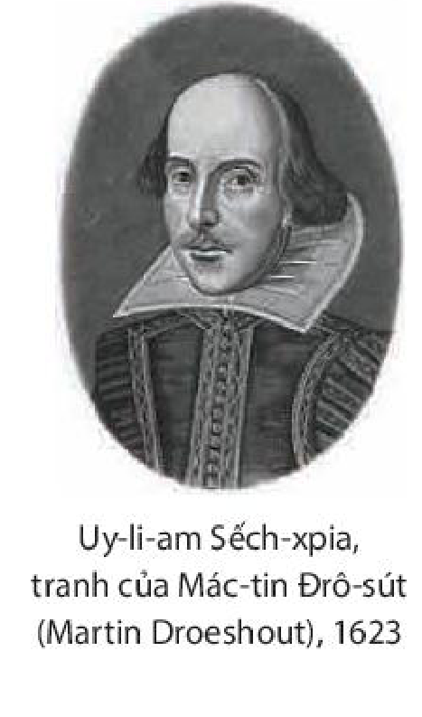
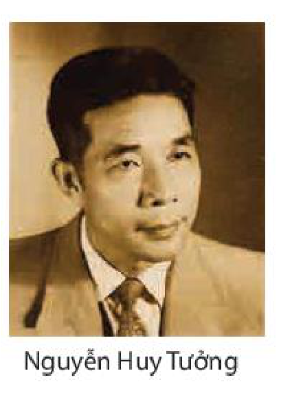
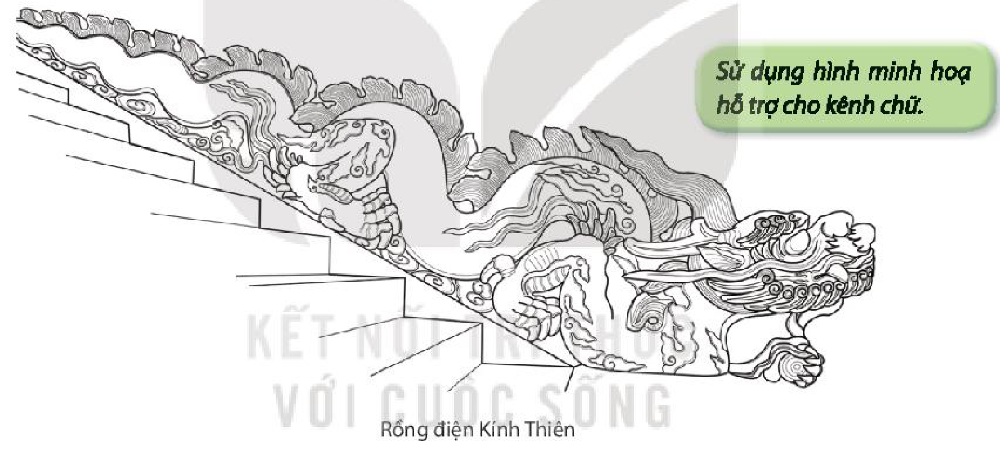
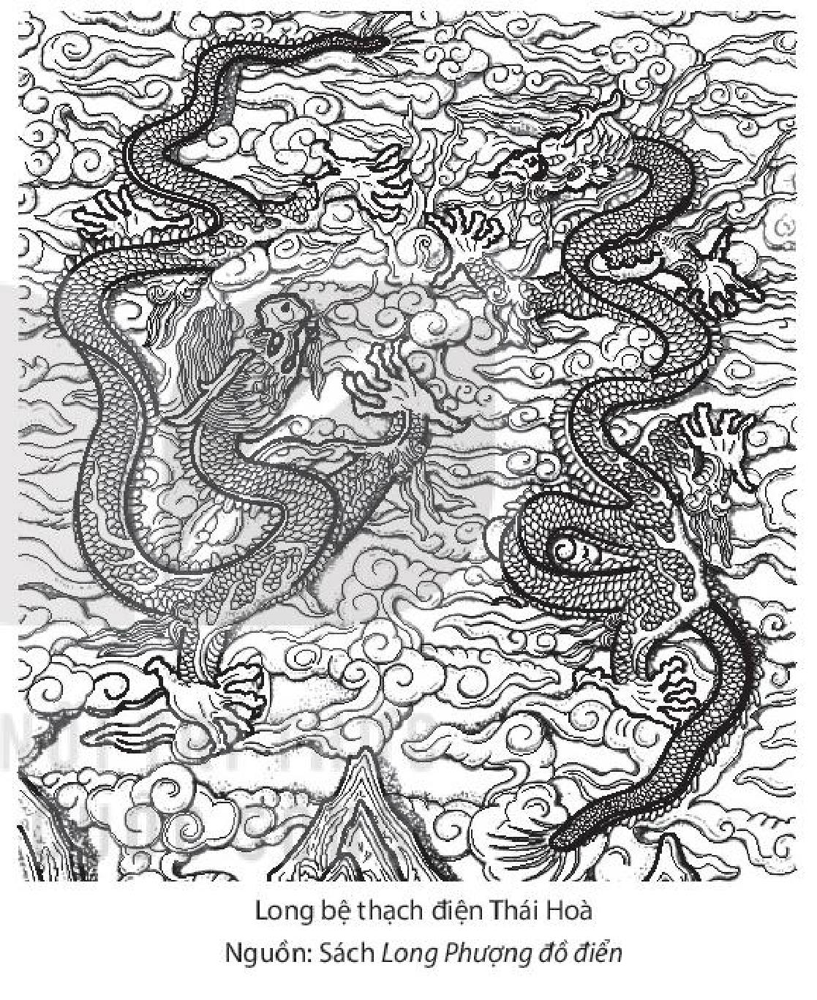
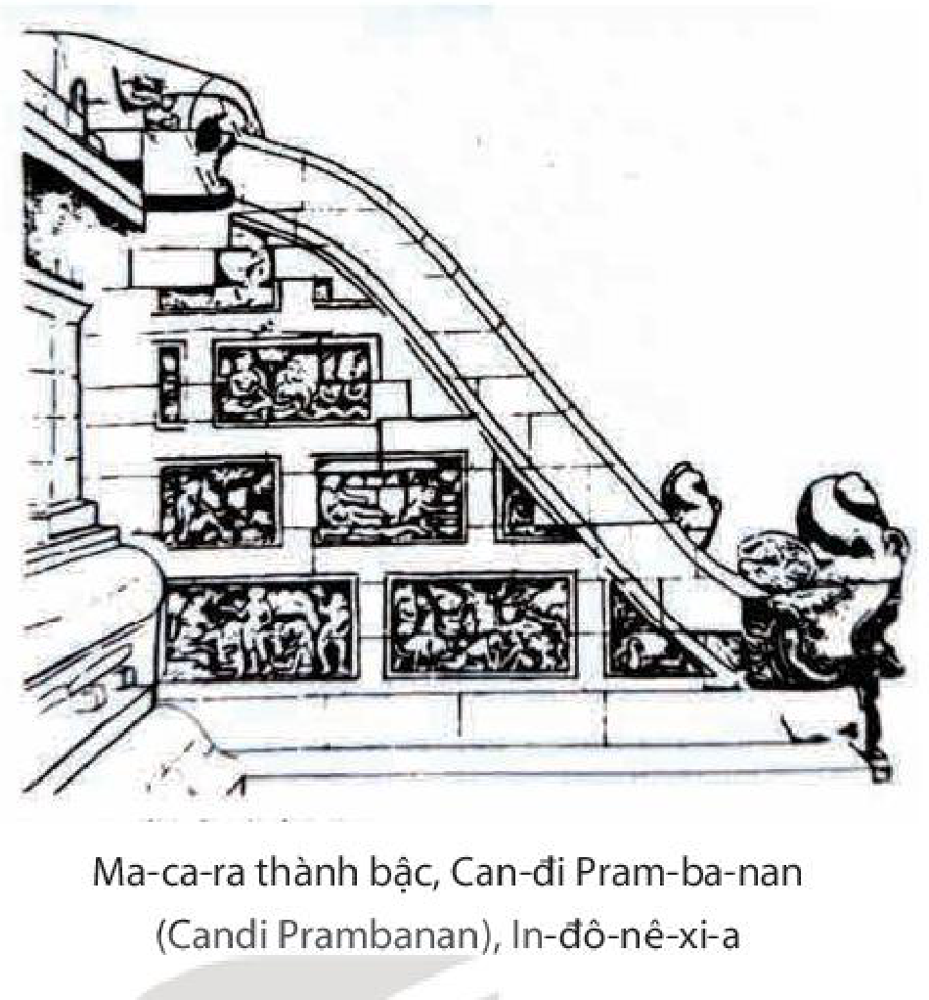
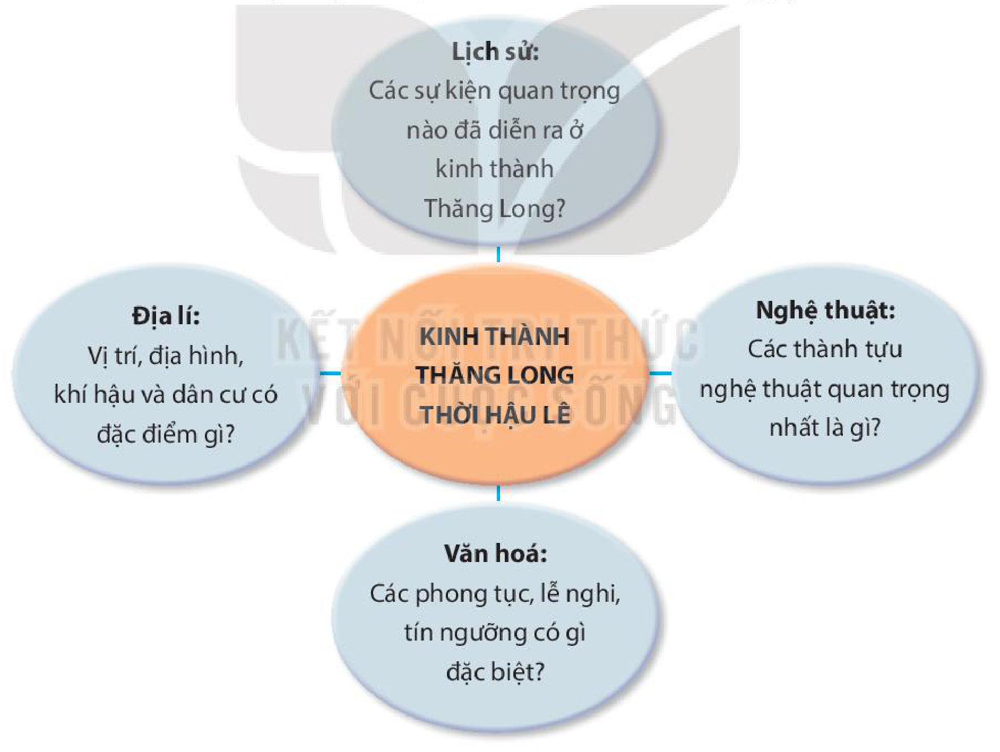

<!-- pdf:126 -->

# BÀI 5: NHÂN VẬT VÀ XUNG ĐỘT TRONG BI KỊCH

## 🎯 Yêu cầu cần đạt

- Nhận biết và phân tích được một số yếu tố của bi kịch như: xung đột, hành động, lời thoại, nhân vật, cốt truyện, hiệu ứng thanh lọc.
- Viết được báo cáo nghiên cứu về một vấn đề tự nhiên hoặc xã hội; biết sử dụng các thao tác cơ bản của việc nghiên cứu; biết trích dẫn, cước chú, lập danh mục tài liệu tham khảo và sử dụng các phương tiện hỗ trợ phù hợp.
- Trình bày được báo cáo kết quả nghiên cứu về một vấn đề đáng quan tâm; biết sử dụng kết hợp phương tiện ngôn ngữ với phương tiện phi ngôn ngữ để nội dung trình bày được rõ ràng, hấp dẫn.
- Biết sống có mục đích, có khát vọng cống hiến, làm chủ được bản thân và biết vượt lên mọi trở ngại.

## ĐỌC

### TRI THỨC NGỮ VĂN

**Bi kịch**

<!-- term: Cốt truyện bi kịch -->
**Bi kịch** là một thể loại kịch. Thông qua sự dàn cảnh, luân chuyển lời đối thoại, độc thoại, hành động của nhân vật trên sân khấu, bi kịch tập trung diễn tả những xung đột hệ trọng, đạt tới mức căng thẳng tột độ giữa những mong muốn, hành động cao đẹp, hào hùng của con người với những tình thế bi đát không thể đảo ngược của thực tại hay với những trở ngại tồn tại ngay trong bản tính con người. Việc thắt nút, triển khai và giải quyết những xung đột như vậy làm nên cốt truyện bi kịch. Bi kịch thường kết thúc bằng thảm cảnh hay bằng cái chết của một loạt nhân vật. Trong bi kịch, việc cái đẹp, cái hùng bị thất bại đã đưa đến nỗi đau khổ cùng cực. Song chính từ đó, bi kịch trở thành tiếng nói khẳng định sự bất tử của ý chí, khát vọng và chiến thắng tinh thần của con người trong cuộc đấu tranh chống lại những tình thế bi đát của thực tại và những yếu hèn của cá nhân con người.

**Nhân vật và xung đột trong bi kịch**

**Nhân vật chính trong bi kịch** mang khát vọng cao đẹp, có tính cách mạnh mẽ, có khả năng lựa chọn hành động tự do xuất phát từ chính kiến, đức tin của mình, song lựa chọn này xung đột với hoàn cảnh thực tế hoặc gặp phải những trở ngại ngay trong bản tính cố hữu. Do vậy, nhân vật chính trong bi kịch thường phải trải qua những

<!-- pdf:127 -->

<!-- term: Lời thoại -->
trạng thái giằng xé, bế tắc, rơi vào những tình huống hết sức nặng nề và có kết thúc bi thảm. Tương ứng với sự phức tạp của nhân vật, lời thoại trong bi kịch thường căng thẳng, chất chứa biện luận, thể hiện suy tư trăn trở và ý chí của những nhân cách mạnh mẽ, không khuất phục.

**Xung đột trong bi kịch** là những mâu thuẫn gay gắt giữa lựa chọn hành động tự do của nhân vật như một nhân cách mạnh mẽ với cái tất yếu vốn được thể hiện qua những thế lực như định mệnh, bản tính tự nhiên, định kiến thời đại, thực tại xã hội,...

**Hiệu ứng thanh lọc của bi kịch**

Khi theo dõi hành động kịch căng thẳng, gay gắt, kết cục bi thảm, người tiếp nhận bi kịch có thể sợ hãi, kinh hoàng, thương cảm, xót xa như chính mình đang trải nghiệm những bế tắc trong cuộc sống cùng nhân vật, để rồi sau đó thấy căm ghét cái đê tiện, giả dối; ngưỡng mộ, cảm phục cái cao cả; tâm hồn như được thanh lọc, trở nên hài hoà, thăng bằng hơn. Nhà triết học Hy Lạp cổ đại A-rít-xtốt (Aristotle) gọi đó là **hiệu ứng thanh lọc của bi kịch**.

### VĂN BẢN 1: Sống, hay không sống – đó là vấn đề(*)

*(Trích Hăm-lét – Hamlet)*

**Uy-li-am Sếch-xpia (William Shakespeare)**

Theo bạn, việc ý thức về tình trạng bi đát của hoàn cảnh có khi nào ngăn trở con người hành động quyết đoán trong cuộc đời?

**Tóm tắt bi kịch *Hăm-lét*:**

**Hồi I – II:** Được tin thân phụ là quốc vương Đan Mạch đột ngột băng hà, thái tử Hăm-lét đang học ở Đức vội vã về nước để chịu tang. Về đến triều đình, chàng được biết mẹ là hoàng hậu Giéc-trút (Gertrude) đã tái giá cùng Clô-đi-út (Claudius) – chú ruột của chàng, hiện là nhà vua mới. Hồn ma vua cha hiện lên báo cho Hăm-lét biết chính chú của chàng đã mưu sát anh trai để chiếm đoạt ngai vàng. Lúc này, Đan Mạch còn đứng trước nguy cơ bị hoàng tử xứ Na Uy là Pho-tin-brát (Fortinbrat) dấy binh tiến đánh (nhằm trả thù cho vua cha vốn bị quốc vương Đan Mạch giết chết trong một trận đấu thượng võ). Mang trong mình lí tưởng về con người cao quý – “vẻ đẹp của thế gian, kiểu mẫu của muôn loài”, Hăm-lét thực sự đau đớn khi nhận ra những sự trái ngang trong hoàng tộc, những sự “đảo điên” của cả thời đại. Chàng ý thức sứ mệnh của mình không chỉ là trả mối thù cha, mà còn vạch mặt chỉ tên cái ác, “dẹp yên mọi sự bất bằng”. Bước đầu, chàng giả điên để nói lên sự thật và đánh lạc hướng kẻ thù. Những lời nói, cử chỉ tưởng như điên dại của Hăm-lét khiến

> (\*) Nhan đề văn bản lấy theo sách giáo khoa *Văn học 10*, tập hai, NXB Giáo dục, Hà Nội, 2000.

<!-- pdf:128 -->

vua Clô-đi-út lo ngại. Để biết thực hư về bệnh điên của Hăm-lét, vua sai hai người bạn cùng học với chàng là Rô-den-cran (Rosencrantz), Ghin-đơn-xtơn (Guildenstern), cùng với viên cận thần Pô-lô-ni-út (Polonius) dò la.

**Hồi III:** Vua trực tiếp cùng Pô-lô-ni-út rình nghe trộm cuộc trò chuyện của Hăm-lét với Ô-phê-li-a (Ophélia) – con gái của Pô-lô-ni-út, cũng là người yêu của chàng. Ô-phê-lia trả lại những kỉ vật tình yêu và Hăm-lét nói với nàng những lời tàn nhẫn, cốt để nàng rời xa mình. Hăm-lét bố trí cho một gánh hát vào trong cung diễn vở kịch *Cái bẫy chuột* có nội dung ám chỉ vụ mưu sát, khiến nhà vua hoảng hốt bỏ ngang buổi diễn, vội vã vào hậu cung. Hăm-lét theo sau định hạ sát hắn nhưng buộc phải dừng tay vì thấy hắn đang cầu nguyện. Hăm-lét tìm đến phòng hoàng hậu để trách cứ mẹ. Thấy động sau rèm, tưởng nhà vua rình nấp ở đó, Hăm-lét bèn rút gươm đâm, hoá ra lại giết chết Pô-lô-ni-út.

**Hồi IV – V:** Vua cho Hăm-lét sang nước Anh nhưng ngầm gửi mật thư nhờ vua Anh giết chàng. Lên đường sang Anh, Hăm-lét tự nhủ: “Từ giờ phút này, ý nghĩ ta phải đẫm máu, nếu không chẳng có giá trị gì!”. Dọc đường, gặp cướp biển, Hăm-lét tình cờ phát hiện ra bức mật thư mượn tay vua Anh giết chàng trong bọc đồ của hai kẻ đồng hành. Chàng tráo vào đó một bức thư khác để vua Anh giết chính những kẻ đưa thư. Sau tai hoạ, chàng một mình trở về Đan Mạch. Đúng thời điểm đó, chàng chạm trán con trai của Pô-lô-ni-út là La-ớc-tơ (Laertes) – người đang tìm chàng để quyết đấu nhằm trả thù cho cha và em gái (Ô-phê-li-a hoá điên vì những đau khổ trong tình yêu và vì cái chết của cha mình, đã bị ngã xuống suối chết đuối). Trong cuộc giao đấu, Hăm-lét bị trúng một nhát kiếm có tẩm thuốc độc của La-ớc-tơ (do Clô-đi-út bố trí), rồi sau đó La-ớc-tơ cũng bị chàng đâm bằng chính thanh kiếm có tẩm thuốc độc này. Khi theo dõi cuộc đấu, Hoàng hậu đã uống nhầm li rượu độc mà Clô-đi-út dành sẵn cho Hăm-lét và nhận cái chết tức tưởi. Trong giây phút đợi tử thần mang đi, La-ớc-tơ đã giảng hoà với Hăm-lét và vạch tội nhà vua. Hăm-lét giết Clô-đi-út khi toàn bộ âm mưu ác độc bị phanh phui. Trước lúc nhắm mắt, Hăm-lét dặn bạn mình là Hô-ra-xi-ô (Horatio) kể cho người đời biết rõ ngọn ngành câu chuyện và trăng trối việc bàn giao ngai vàng cho Pho-tin-brát. Thi hài Hăm-lét được Pho-tin-brát cho an táng theo nghi thức dành cho một chiến sĩ.

***Sống, hay không sống – đó là vấn đề*** là đoạn trích là từ cảnh 1, hồi III của bi kịch *Hăm-lét*.

**HỒI III**
CẢNH 1

*Một gian phòng trong lâu đài.*
<!-- ocr-ok: OCR đọc nhầm "Một gian" thành "Mặt gian", đã đối chiếu ảnh trang PDF 128 -->

*(Vua, hoàng hậu, Pô-lô-ni-út, Ô-phê-li-a, Rô-den-cran(1) và Ghin-đơn-xtơn(2) ra.)*

**VUA** – Thế trong khi chuyện trò cùng thái tử, các khanh lại không lựa được cơ hội nào để tìm hiểu tại sao người rối loạn tâm thần, để cho chuỗi ngày xanh êm đẹp bị tan nát vì những cơn điên dữ dội, hiểm nghèo hay sao?

> Lời thoại của các nhân vật trước khi Hăm-lét xuất hiện cho thấy điều gì về bầu không khí xã hội bao quanh chàng?

> (1), (2) *Rô-den-cran, Ghin-đơn-xtơn*: hai người bạn học cũ của Hăm-lét được vua sai dò xét xem Hăm-lét điên thật hay điên giả.
<!-- ocr-ok: OCR đọc nhầm tên riêng và chữ in nghiêng ở cước chú, đã đối chiếu ảnh trang PDF 128 -->

<!-- pdf:129 -->

**RÔ-DEN-CRAN** – Tâu bệ hạ, thái tử cũng biết mình bị mất trí, nhưng duyên do tại đâu thì nhất định người không nói.

**GHIN-ĐƠN-XTƠN** – Thực ra thì thái tử cũng không để cho tìm hiểu sâu hơn. Người cứ đánh trống lảng bằng những cơn điên khôn khéo, mỗi khi chúng thần tìm cách gợi người tỏ bày thực trạng tâm hồn mình.

**HOÀNG HẬU** – Thái tử tiếp các khanh có tử tế không?

**RÔ-DEN-CRAN** – Thưa, thật đúng như một người lịch thiệp.

**GHIN-ĐƠN-XTƠN** – Nhưng bên trong vẫn có vẻ gì gượng gạo.

**RÔ-DEN-CRAN** – Người hỏi rất ít, nhưng trả lời những câu hỏi của chúng thần thì huyên thuyên dài dòng.

**HOÀNG HẬU** – Thế các khanh có kiếm cách gì cho thái tử tiêu khiển không?

**RÔ-DEN-CRAN** – Tâu lệnh bà, trên đường đi tình cờ chúng thần gặp một bọn đào kép. Chúng thần có thưa bày và thái tử tỏ vẻ vui thích lắm. Bọn họ hiện ở quanh quẩn trong cung này và hình như đã nhận được lệnh trình diễn đêm nay hầu thái tử.

**PÔ-LÔ-NI-ÚT** – Thưa, đúng như vậy. Chính thái tử có khẩn khoản nhờ thần mời bệ hạ và lệnh bà tới ngự lãm đêm nay.

**VUA** – Trẫm rất vui lòng. Trẫm hài lòng khi biết thái tử tìm được nguồn thích thú như vậy. Các khanh ạ, nên khuyến khích thêm thái tử nữa vào những trò giải trí ấy.

**RÔ-DEN-CRAN** – Tâu bệ hạ, chúng thần xin tuân thượng lệnh.

*(Rô-den-cran và Ghin-đơn-xtơn vào.)*
<!-- ocr-ok: OCR đọc nhầm tên nhân vật trong chỉ dẫn sân khấu in nghiêng, đã đối chiếu ảnh trang PDF 129 -->

**VUA** – Ái khanh nữa, xin mời ái khanh cũng tạm lui. Trẫm đã ra mật lệnh cho tìm Hăm-lét tới đây, làm như thể tình cờ y bắt gặp Ô-phê-li-a ở nơi này. Trẫm sẽ đích thân cùng tướng công Pô-lô-ni-út, như hai thám tử hợp pháp, ngồi vào một nơi kín, nhìn thấy hết mà không ai nhìn thấy mình, để tận mắt quan sát mọi cử chỉ của y qua cuộc gặp gỡ, xem có phải chính bệnh tương tư là nguyên nhân làm y quẫn trí chăng.

**HOÀNG HẬU** – Xin vâng lệnh bệ hạ, còn Ô-phê-li-a con, ta mong rằng chính nhan sắc yêu kiều của con là nguyên nhân tốt lành của bệnh hoạn của Hăm-lét và ta hi vọng đức hạnh của con sẽ làm cho nó trở lại bình thường; vì danh dự của cả hai con đấy!

**Ô-PHÊ-LI-A** – Tâu lệnh bà, con cũng mong như thế.

*(Hoàng hậu vào.)*

**PÔ-LÔ-NI-ÚT** – Ô-phê-li-a, con cứ đi đi lại lại ở chỗ này – Xin Bệ hạ cùng thần lánh vào đây. *(nói với Ô-phê-li-a)* Con hãy cầm cuốn sách này và đọc đi. Như thế mới thêm vẻ tự nhiên trong lúc cô đơn. Đời vẫn thường chê trách rằng ta khoác cái vẻ trầm mặc thành kính và bộ điệu chân tu nhiều khi cũng đường mật đánh lừa được cả ma quỷ. Điều đó đã được chứng tỏ quá nhiều rồi.

<!-- pdf:130 -->

**VUA** – Ôi, đúng quá thật! Lời nói như roi quất vào lương tâm ta. Đôi má của gái hồng lâu(1), rực rỡ vì son tô phấn điểm, cũng không thể xấu xa hơn hành động của ta được điểm phấn tô son bằng những lời hoa gấm mĩ miều. Ôi, gánh nặng của tội ác!

*(Vua và Pô-lô-ni-út vào. Hăm-lét ra.)*
<!-- ocr-ok: OCR đọc nhầm chữ in nghiêng trong chỉ dẫn sân khấu, đã đối chiếu ảnh trang PDF 130 -->

**HĂM-LÉT** – Sống, hay không sống(2) – đó là vấn đề. Chịu đựng tất cả những viên đá, những mũi tên của số mệnh phũ phàng, hay là cầm vũ khí vùng lên mà chống lại với sóng gió của biển khổ, chống lại để mà diệt chúng đi, đằng nào cao quý hơn? Chết, là ngủ. Không hơn. Và tự nhủ rằng ngủ đi tức là chấm dứt mọi đau khổ của cõi lòng và muôn vàn vết tử thương mà hình hài phải chịu đựng, kết liễu cuộc đời như thế, chẳng đáng mong muốn sao? Chết, ngủ. Ngủ, có thể chỉ là mơ. Hừ! Đây mới là điều khó khăn. Vì, trong giấc ngủ của cõi chết ấy, khi ta đã thoát khỏi cái thể xác trần tục này, những giấc mơ nào sẽ tới, điều đó làm cho ta phải ngừng lại mà suy nghĩ. Chính điều đó gây ra bao tai hoạ cho cuộc sống dằng dặc này! Bởi vì, ai là người có thể chịu đựng những roi vọt và khinh khi của thời đại, sự áp bức của kẻ bạo ngược, hống hách của kẻ kiêu căng, những nỗi giày vò của tình yêu tuyệt vọng, sự trì chậm của công lí, hỗn xược của cường quyền, sự miệt thị của kẻ bất tài đối với đức tài nhẫn nhục, khi chỉ cần với một mũi dùi là có thể đủ đưa mình đến chỗ yên nghỉ. Có ai đành cam chịu, than vãn rên rỉ, đổ mồ hôi dưới gánh nặng của cuộc đời mệt mỏi, nếu không phải chỉ vì sợ một cái gì mênh mang sau khi chết, cả một thế giới huyền bí mà đã vượt biên cương thì không một du khách nào còn quay trở lại, nỗi sợ làm cho tâm trí rối bời và bắt ta phải cam chịu mọi khổ nhục trên cõi thế này còn hơn là bay tới những nỗi khổ nhục khác mà ta chưa hề biết tới? Đấy, chính nỗi vướng mắc của tâm tư ấy làm cho chúng ta trở thành hèn mạt tất cả, và ngọn lửa của quyết tâm vừa bùng lên đã mờ nhạt ốm yếu đi trước ánh leo lắt của ý nghĩ đó, bao dự kiến lớn lao, cao quý cũng phải xoay chiều đổi hướng, chẳng thể biến thành hành động. – Thôi khẽ chứ! Kìa Ô-phê-li-a yêu kiều! Nữ thần của ta ơi, khi nàng cầu nguyện, xin nàng đừng quên những tội lỗi của ta.

> Sự xung đột với cả thời đại đã để lại dấu ấn như thế nào trong nội tâm Hăm-lét?

**Ô-PHÊ-LI-A** – Kính thưa Điện hạ, chẳng hay sức khoẻ của người bấy lâu nay ra sao?

**HĂM-LÉT** – Xin đa tạ cô em, tôi vẫn được như thường, như thường, như thường.

> Chú ý sự khác biệt giữa lời Hăm-lét nói với Ô-phê-li-a trong độc thoại và đối thoại.

**Ô-PHÊ-LI-A** – Thưa Điện hạ, thiếp còn giữ những kỉ vật người trao tặng, đã từ lâu thiếp vẫn mong được gửi lại, mong người nhận cho.

**HĂM-LÉT** – Không, không, tôi nào có hề tặng cô em cái gì bao giờ.

> (1) *Gái hồng lâu*: ca kĩ, gái điếm (*hồng lâu*: lầu hồng – hình ảnh ước lệ chỉ chốn sang trọng quý phái, có khi chỉ chốn chơi bời phóng đãng).
> (2) Câu này dịch giả dịch là “Sống, hay không nên sống”. Người biên soạn sách giáo khoa lược bỏ chữ “nên” cho sát hơn với nguyên tác.

<!-- pdf:131 -->

**Ô-PHÊ-LI-A** – Thưa Điện hạ tôn kính, Điện hạ cũng thừa biết là có và Người đã gửi gắm theo những kỉ vật ấy những lời xiết bao tình tứ làm cho chúng càng tôn thêm giá. Nhưng bây giờ hương đã tàn phai, xin chàng giữ lấy; bởi vì đối với một tâm hồn cao quý, quà tặng quý giá đến đâu chăng nữa, nào còn có ý nghĩa gì một khi người trao đã thờ ơ lạnh nhạt. Thưa đây, Điện hạ.

**HĂM-LÉT** – A ha! Cô em có phải là người đức hạnh không?

**Ô-PHÊ-LIA** – Thưa Điện hạ!...

**HĂM-LÉT** – Cô em có phải là người nhan sắc không?

**Ô-PHÊ-LI-A** – Điện hạ định nói gì?

**HĂM-LÉT** – Nếu cô vừa là người đức hạnh lại vừa nhan sắc, thì đức hạnh làm sao có thể nói chuyện được với nhan sắc của cô?

**Ô-PHÊ-LI-A** – Sao, thưa Điện hạ, nhan sắc còn có thể hoà hợp với cái gì hơn là đức hạnh?

**HĂM-LÉT** – Chứ sao! Vì nhan sắc có mãnh lực biến đức hạnh thành phóng đãng, nhưng đức hạnh không thể nào khép nhan sắc vào khuôn khổ nết na. Ngày xưa, đó là điều nghịch lí, nhưng ngày nay thì đã được chứng thực rồi. Có một thời, tôi đã yêu cô em.

> Chú ý việc thể hiện ý thức của Hăm-lét về mối quan hệ giữa nhan sắc và đức hạnh trong thời đại đảo điên.

**Ô-PHÊ-LI-A** – Thực thế, thưa Điện hạ, chính Người đã làm cho thiếp tưởng như vậy.

(Theo Uy-li-am Sếch-xpia, *Hăm-lét*, Bùi Anh Kha – Bùi Ý – Bùi Phụng dịch, NXB Văn học, Hà Nội, 1986, tr. 89 – 94)

**Uy-li-am Sếch-xpia** (1564 – 1616) là nhà soạn kịch, nhà thơ nổi tiếng nhất của nước Anh thời Phục hưng. Ông sinh ra và lớn lên tại thị trấn Xtơ-rét-phớt (Stratford) ở tây nam nước Anh, trong một gia đình buôn bán len, dạ. Khi mới mười bốn tuổi, do gia đình sa sút, Sếch-xpia phải thôi học. Từ khoảng năm 1585, ông lên thủ đô Luân Đôn kiếm sống, tham gia giúp việc cho một đoàn kịch, trở thành diễn viên, nhà soạn kịch kiêm đạo diễn, rồi người đồng sở hữu đoàn kịch. Năm 1599, Sếch-xpia tham gia dựng nên Nhà hát Địa Cầu. Năm 1608, đoàn kịch của ông sở hữu thêm nhà hát có mái che đầu tiên ở Luân Đôn. Tên tuổi của Sếch-xpia bắt đầu được nhắc đến trong giới nghệ thuật từ năm 1592. Sáng tác của ông gồm 37 vở kịch, 4 bản trường ca và 154 bài thơ xon-nê (sonnet), cho đến nay vẫn được coi là những kiệt tác hàng đầu của văn học thế giới.

Uy-li-am Sếch-xpia, tranh của Mác-tin Đrô-sút (Martin Droeshout), 1623

Kịch của Sếch-xpia bao gồm nhiều thể loại (kịch lịch sử, hài kịch, bi kịch, bi hài kịch), trong đó nổi bật là bi kịch với nhiều kiệt tác như: *Rô-mê-ô (Romeo) và Giu-li-ét (Juliet)*, *Vua Lia (Lear)*, *Ô-ten-lô (Othello)*, *Mắc-bét (Macbeth)* và đặc biệt là *Hăm-lét*. Bi kịch của ông chứa đựng những suy ngẫm mang tính nhân văn sâu sắc, được thể hiện qua các hình tượng nhân vật phóng khoáng, tự do, có tính cách

<!-- pdf:132 -->

mạnh mẽ; qua lời thoại sắc sảo, tinh tế; qua nghệ thuật triển khai, đan xen các tuyến xung đột, các tuyến hành động kịch mang tính chất dồn nén, tập trung. Sếch-xpia thường xây dựng các vở bi kịch của mình dựa trên một số cốt truyện, truyền thuyết có sẵn, nhưng ông đã mở rộng, khơi sâu chủ đề để dựng nên những hình tượng bất tử.

Bi kịch năm hồi ***Hăm-lét*** là sáng tác đỉnh cao của Sếch-xpia, được viết trong khoảng thời gian 1599 – 1601. Câu chuyện hoàng tử xứ Đan Mạch thời Trung cổ là Ăm-lét (Amleth) trả thù cho cha từng được ghi lại trong biên niên sử từ cuối thế kỉ XII của Xắc-xơ Gram-ma-ti-cút (Saxo Grammaticus), được Phơ-răng-xoa đơ Ben-phóc (François de Belleforest) kể lại vào năm 1576. Sếch-xpia có lẽ đã dựa vào bản kể này để xây dựng vở bi kịch của mình với nhiều sáng tạo: Ông đặt nhân vật vào bối cảnh hậu kì Phục hưng, khi lí tưởng nhân văn chủ nghĩa lâm vào tình trạng khủng hoảng sâu sắc bởi xung đột với thực tại lịch sử nghiệt ngã. Cảm quan u tối về thực tại và ý chí đấu tranh khẳng định lí tưởng nhân văn chủ nghĩa của nhân vật trong vở kịch bắt nguồn từ đó.

***Sống, hay không sống – đó là vấn đề*** là màn kịch nổi tiếng nhất trong *Hăm-lét*. Nó không chỉ góp phần khơi sâu tư tưởng chủ đề của vở kịch, mà còn gợi nhiều suy ngẫm về bản tính con người, về những “nỗi vướng mắc tâm tư” và trăn trở muôn đời của con người trong cuộc sống. Đoạn độc thoại của Hăm-lét trong màn kịch này đã khơi nguồn cảm hứng cho nhiều tác phẩm văn học, nghệ thuật đời sau.

**Trả lời câu hỏi**

1. Xác định ý nghĩa lời thoại của các nhân vật trước khi Hăm-lét xuất hiện.
2. Nêu nhận xét chung về tâm trạng của Hăm-lét thể hiện qua lời độc thoại. Theo mạch suy tưởng của Hăm-lét, lời độc thoại có thể chia làm mấy phần, nội dung từng phần là gì?
3. Có thể xác định cách hiểu của Hăm-lét về “sống” và “không sống” như thế nào?
4. Nêu lí do khiến Hăm-lét cho rằng “chết” đáng “mong muốn” mà cũng là “điều khó khăn” buộc người ta phải “ngừng lại mà suy nghĩ”.
5. Phân tích ý thức của Hăm-lét về những “khổ nhục trên cõi thế” mà con người phải gánh chịu. Theo bạn, Hăm-lét sợ “nỗi khổ nhục” gì ở cõi “mênh mang sau khi chết”?
6. Hăm-lét đã nhận thức như thế nào về nguyên nhân tình trạng do dự, không thể hành động quyết đoán của chính mình? Dựa vào phần tóm tắt vở kịch, hãy cho biết Hăm-lét đã làm gì sau khi nhận thức được bản chất vấn đề.
7. Chỉ ra tính chất bi kịch của xung đột được thể hiện qua lời độc thoại của Hăm-lét. Theo bạn, trong xã hội hiện đại, xung đột đó có còn tồn tại hay không? Căn cứ để bạn nêu ý kiến về vấn đề này là gì?

#### Kết nối đọc – viết

Viết đoạn văn (khoảng 150 chữ) nêu cảm nhận của bạn về con người Hăm-lét được thể hiện qua lời độc thoại trong *Sống, hay không sống – đó là vấn đề*.

<!-- pdf:133 -->

### VĂN BẢN 2: Vĩnh biệt Cửu Trùng Đài
<!-- ocr-ok: OCR đọc nhầm tiêu đề cỡ chữ lớn, đã đối chiếu ảnh trang PDF 133 -->

*(Trích Vũ Như Tô)*

**Nguyễn Huy Tưởng**

Phải chăng giá trị của nghệ thuật là ở chỗ nó có ích cho đời sống?

**HỒI THỨ NĂM**
**Một cung cấm**
**LỚP I**
*Vũ Như Tô – Đan Thiềm*

**VŨ NHƯ TÔ** – Có việc gì mà bà chạy hớt hơ hớt hải? Mặt bà cắt không còn hột máu.

**ĐAN THIỀM** *(thở hổn hển)* – Nguy đến nơi rồi... Ông Cả!

**VŨ NHƯ TÔ** – Lạ chưa, nguy làm sao? Đài Cửu Trùng chia năm đã được một phần.

> Lời thoại và hành động thể hiện thái độ gì của các nhân vật?
<!-- ocr-ok: OCR tách dòng và đọc nhầm thẻ chỉ dẫn đọc, đã đối chiếu ảnh trang PDF 133 -->

**ĐAN THIỀM** – Ông trốn đi, mau lên không thì không kịp.

**VŨ NHƯ TÔ** – Sao bà nói lạ? Đài Cửu Trùng chưa xong, tôi trốn đi đâu. Làm gì phải trốn?

**ĐAN THIỀM** – Ông nghe tôi! Ông trốn đi! Ông nghe tôi! Ông phải trốn đi mới được!

**VŨ NHƯ TÔ** – Làm sao tôi cần phải trốn? Bà nói rõ cho là vì sao? Khi trước tôi nhờ bà mách đường chạy trốn, bà khuyên không nên, bây giờ bà bảo tôi đi trốn, thế là nghĩa gì?

**ĐAN THIỀM** – Có nghĩa lắm. Tôi không làm một việc gì vô lí cả. Khi trước trốn đi thì ông nguy, bây giờ trốn đi thì ông thoát chết.

**VŨ NHƯ TÔ** – Sao thế?

**ĐAN THIỀM** – Loạn đến nơi rồi. Dân gian đói kém nổi lên tứ tung. Giặc Trần Cao trước đã bị quan quân đuổi đánh, nay lại về đóng ở Bồ Đề, thanh thế rất mạnh. Trong triều, Nguyên Quận công Trịnh Duy Sản vì can vua mà bị đánh, nay mưu với mấy tên đồng chí, giả mượn tiếng đi dẹp giặc rồi quay binh về làm loạn.

> Tình huống kịch được miêu tả trong lớp I là gì?

<!-- pdf:134 -->

**VŨ NHƯ TÔ** – Tôi làm gì nên tội?

**ĐAN THIỀM** – Vậy mà ai ai cũng cho ông là thủ phạm. Vua xa xỉ là vì ông, công khố hao hụt là vì ông, dân gian lầm than là vì ông, man di oán giận là vì ông, thần nhân trách móc là vì ông. Cửu Trùng Đài, họ có cần đâu? Họ dấy nghĩa cốt giết ông, phá Cửu Trùng Đài.

**VŨ NHƯ TÔ** – Phá Cửu Trùng Đài? Không đời nào? Mà tôi thì không làm gì nên tội. Họ hiểu nhầm.

**ĐAN THIỀM** – Ông phải trốn đi. *(có tiếng quân ầm ầm, tiếng trống, tiếng chiêng, tiếng tù và, tiếng ngựa hí)* Ông phải trốn đi. *(lời có vẻ van lơn)* Trong lúc biến cố này, ông hãy tạm lánh đi. Khi dân nổi lên, họ nông nổi vô cùng. Họ không phân biệt phải trái. Ông trốn đi. Tài kia không nên để uổng. Ông mà có mệnh hệ nào thì nước ta không còn ai tô điểm nữa.

> Bối cảnh nào được tái hiện thông qua các chỉ dẫn sân khấu?

**VŨ NHƯ TÔ** – Bà không nên lo cho tôi. Tôi không trốn đâu. Người quân tử không bao giờ sợ chết. Mà vạn nhất có chết, thì cũng phải để cho mọi người biết rằng công việc mình làm chính đại quang minh. Tôi sống với Cửu Trùng Đài, chết cũng với Cửu Trùng Đài. Tôi không thể xa Cửu Trùng Đài một bước. Hồn tôi để cả đây, thì tôi chạy đi đâu?

**ĐAN THIỀM** – Ông Cả! Ông nghe tôi. Trốn đi để chờ cơ hội khác. Đại sự hỏng rồi.

**VŨ NHƯ TÔ** – Đa tạ bà. Tấm lòng của bà, chỉ có lòng cha mẹ tôi mới sánh kịp. Nhưng tôi đã quyết, không chịu rời Cửu Trùng Đài một bước. Tôi quyết ở đây.

**ĐAN THIỀM** *(thất vọng)* – Ông Cả ơi!

**LỚP II**
*Những người trên, thêm Nguyễn Vũ*

**NGUYỄN VŨ** *(lật đật và xộc xệch)* – Kìa, thầy Cả.

**VŨ NHƯ TÔ** – Lạy Cụ lớn.

**NGUYỄN VŨ** – Thầy có biết việc gì không?

**VŨ NHƯ TÔ** – Bẩm Cụ lớn, không. Duy có bà Đan Thiềm đây vừa mới bảo với chúng tôi rằng Nguyên Quận công làm phản.

**NGUYỄN VŨ** *(hất hàm hỏi Đan Thiềm)* – Thế nào?
<!-- ocr-ok: OCR đọc nhầm chữ in nghiêng trong ngoặc đơn, đã đối chiếu ảnh trang PDF 134 -->

**ĐAN THIỀM** – Chúng tôi cũng không rõ. Nghe như Quận công làm phản. Cụ lớn có biết tin gì thêm không?

<!-- pdf:135 -->

**NGUYỄN VŨ** – Đúng thế đấy. Ta vừa chạy đến đây. Thiên tử đâu? Chiều hôm kia ta còn uống rượu trong nội điện với Hoàng thượng.

**ĐAN THIỀM** *(rú lên)* – Cái gì đó? *(có tiếng động ầm ầm ở xa)* Họ tiến lại đây chăng? *(quay bảo Vũ Như Tô)* Ông trốn đi, mau lên, khổ lắm. *(lắng tai)* Có tiếng quân reo... *(líu lưỡi)*

**NGUYỄN VŨ** – Ta lo cho Hoàng thượng lắm. Duy Sản là một đứa tiểu nhân. Nó vẫn căm giận Hoàng thượng và ta. Ta hối không can Hoàng thượng, lại để cho ngài sai đánh nó quá đau, mà lại ở ngay giữa chợ. Thẹn quá hoá giận, đứa tiểu nhân thì nghĩ chi đến nghĩa vua tôi!

> Chú ý thái độ của Vũ Như Tô, Đan Thiềm khi Nguyễn Vũ xuất hiện.
<!-- ocr-ok: OCR đọc nhầm chữ trong hộp chỉ dẫn đọc, đã đối chiếu ảnh trang PDF 135 -->

**ĐAN THIỀM** *(quay bảo Vũ Như Tô)* – Ông định chết ở đây sao? Ông gàn quá. Quận công có ưa gì ông đâu?

**VŨ NHƯ TÔ** *(xẵng)* – Bà để mặc tôi. Tôi tự có cách khu xử.

**ĐAN THIỀM** – Đấy, tiếng reo mỗi lúc một gần. Kìa, thái giám, chắc có tin gì?

*Nội giám(1) hoảng hốt vào.*
<!-- ocr-ok: OCR đọc nhầm chữ in nghiêng "Nội giám(1) hoảng hốt vào.", đã đối chiếu ảnh trang PDF 135 -->

**LỚP III**
*Những người trên, thêm Lê Trung Mại*

**LÊ TRUNG MẠI** – Bẩm Cụ lớn, nguy đến nơi rồi. Kìa mụ Đan Thiềm sao lại ở đây? Mụ ra là giống quái,...

**NGUYỄN VŨ** – Có việc chi, Trung Mại?

**LÊ TRUNG MẠI** – Bẩm Cụ lớn, Trịnh Duy Sản mưu với lũ Lê Quảng Đô, Trịnh Tri Sâm lập vua khác, đêm qua đã kéo quân vào cửa Bắc Thần...

**NGUYỄN VŨ** – Thiên tử đâu?

**LÊ TRUNG MẠI** – Bẩm, nguyên Trịnh Duy Sản sắm sửa thuyền bè khí giới, họp ở bến đò Thái Cực, nói reo lên là đi đánh Trần Cao, rồi đương đêm đem ba nghìn quân Kim Ngô hộ vệ vào cửa Bắc Thần đốt lửa cho sáng,...

> Sự kiện nào được miêu tả trong lớp III?

**NGUYỄN VŨ** *(nóng ruột, giậm chân gắt)* – Thiên tử đâu? Nói mau lên.

**LÊ TRUNG MẠI** – Hoàng thượng trông thấy lửa sáng, hốt hoảng tưởng là giặc ập đến vội lên ngựa lẻn ra cửa Bảo Khánh, trời thì tối mà cứ lao mình đi không đèn đuốc gì cả. Khi ngài qua cửa Thái Học đến ao Chu Tước ở phường Bích Câu thì vừa gặp Duy Sản...

> (1) *Nội giám* (hay *thái giám, hoạn quan*): một chức quan hầu cận trong cung vua.

<!-- pdf:136 -->

**NGUYỄN VŨ** – Gặp Duy Sản? Trời! Thế thì còn gì? Nói mau lên.

**LÊ TRUNG MẠI** – Ngài hỏi nó: Giặc ở đâu? Nó không đáp, ngoảnh mặt đi cười nhạt. Ngài quất ngựa về phía tây, nó sai võ sĩ là tên Hạch đuổi theo, đâm vua ngã ngựa rồi giết chết. *(khóc)*

**NGUYỄN VŨ** *(khóc)* – Hoàng thượng ơi! Hạ thần mới nghe câu chuyện đã đoán ngay có sự này. *(cảm động quá, ngã xuống)*

**LÊ TRUNG MẠI** *(nức nở)* – Khốn nạn, Khâm Đức Hoàng hậu thương vua cũng nhảy vào lửa chết... *(không nói được nữa)*

**VŨ NHƯ TÔ** – Xin Cụ lớn hãy để nghe xem có thực không đã. Không có lẽ... *(vực Nguyễn Vũ dậy)* Bẩm Cụ lớn.

**NGUYỄN VŨ** *(vẫn khóc)* – Thực đấy rồi. Thôi để mặc ta. Duy Sản ta đã biết, nó tàn nhẫn vô cùng. Hoàng thượng ơi! Ơn tri ngộ mới được tám năm... Hoàng thượng băng hà lão thần cũng không yên được với chúng. Ăn lộc của vua, xin chết vì nạn của vua. Lão thần không muốn kéo dài kiếp sống tàn làm gì nữa. *(rút dao đâm cổ tự tử và ngã lăn ra)*

**LÊ TRUNG MẠI** – Trời ơi! Cụ lớn Đông các! *(vực dậy, máu me đầm đìa)*
<!-- ocr-ok: OCR đọc nhầm chữ in nghiêng trong ngoặc đơn, đã đối chiếu ảnh trang PDF 136 -->

**NGUYỄN VŨ** – Thôi mặc ta cho ta chết. Sống chỉ thêm nhục nhã. *(ngất đi)*

**VŨ NHƯ TÔ** *(nhìn Đan Thiềm, nhìn thây Nguyễn Vũ)* – Thảm não chưa?
<!-- ocr-ok: OCR đọc nhầm chữ in nghiêng trong chỉ dẫn sân khấu, đã đối chiếu ảnh trang PDF 136 -->

**LÊ TRUNG MẠI** *(sờ người Nguyễn Vũ)* – Có lẽ Cụ lớn chết rồi. Sao chóng thế được? Chết thực rồi!

**ĐAN THIỀM** *(thở dài)* – Biến đến thế là cùng!

*Một bọn nội giám nữa vào.*

**LỚP IV**
*Những người trên, thêm một bọn nội giám khác*

**MỘT TÊN NỘI GIÁM** – Cụ lớn làm sao? Tình thế nguy ngập! Đứng ở đây để chết cả lũ ư?

> Sự kiện nào được miêu tả trong lớp IV?
<!-- ocr-ok: OCR đọc nhầm chữ trong hộp chỉ dẫn đọc, đã đối chiếu ảnh trang PDF 136 -->

**LÊ TRUNG MẠI** – Việc chi nữa?
<!-- ocr-ok: OCR đọc nhầm tên nhân vật, đã đối chiếu ảnh trang PDF 136 -->

**TÊN NỘI GIÁM** – Trịnh Duy Sản giết Thiên tử, hội triều đình lập con Mục Y Vương là Quang Trí lên ngôi. Có Võ Tả Hầu là Phùng Mai đứng lên mắng quân phản nghịch. Đảng ác bắt Phùng Mai chém ngay ở nhà Nghị sự. Trong triều còn đang rối loạn thì An Hoà Hầu Nguyễn Hoằng Dụ ở bên Bồ Đề được tin vua bị giết,

<!-- pdf:137 -->

kéo quân về đốt phá kinh thành. Thợ xây Cửu Trùng Đài quá nửa theo về quân phản nghịch. Tình hình nguy ngập lắm rồi.

**VŨ NHƯ TÔ** – Thợ theo quân phản nghịch? Thế còn Cửu Trùng Đài?

> Chú ý sự khác biệt trong hành động, thái độ của các nhân vật trong tình thế nguy ngập.

**TÊN NỘI GIÁM** – Kẻ phá, người đốt...

**VŨ NHƯ TÔ** – Vô lí.

**BỌN NỘI GIÁM** – Vô lí? Vô lí? Để Cửu Trùng Đài làm gì? Vì đâu mà có quân phản nghịch? An Hoà Hầu đang cho tìm mấy lũ cung nữ để phanh thây làm trăm mảnh. Mày không biết tội hay sao?

**VŨ NHƯ TÔ** – Vô lí. *(Có tiếng kêu mỗi lúc một gần: “Bạo chúa đã chết. Còn thằng Vũ Như Tô, đem phanh thây trăm mảnh”. Có tiếng đổ ầm ầm. Họ chạy cả.)*

**LÊ TRUNG MẠI** *(nháy bọn nội giám)* – Tam thập lục kế, tẩu vi thượng sách. Tham quyền cố vị(1) gì, anh em nghĩ sao?

**BỌN NỘI GIÁM** – Chạy đi anh em ơi! *(họ chạy nốt)*

**LỚP V**
*Vũ Như Tô – Đan Thiềm*

**ĐAN THIỀM** – Ông Cả! Ông chạy đi! Ông có nghe tiếng gì không? Quân giặc đang tìm ông đấy: trốn đi!

**VŨ NHƯ TÔ** – Họ tìm tôi, nhưng có lí gì họ giết tôi. Tôi có gây oán gây thù gì với ai?

**ĐAN THIỀM** – Ông đừng mơ mộng nữa. Dân chúng nông nổi, dễ sinh tàn ác. Họ không hiểu công việc của ông. Tránh đi! Trốn đi! Đợi thời là thượng sách. Đừng để phí tài trời. Trốn đi!

**VŨ NHƯ TÔ** – Còn bà?

**ĐAN THIỀM** – Tôi ở đây. *(Có tiếng quân reo dữ dội: “Giết chết Vũ Như Tô, giết chết lũ cung nữ”.)*

> Chú ý thái độ của Vũ Như Tô và Đan Thiềm.

**VŨ NHƯ TÔ** *(thản nhiên)* – Bà ở đây. Vậy tôi cũng ở đây, nguy biến ta cùng chịu.

> (1) *Tham quyền cố vị*: cố giữ lấy quyền hành, địa vị, không chịu rời bỏ (cho dù đã không còn đủ năng lực hoặc điều kiện để làm việc).

<!-- pdf:138 -->

**ĐAN THIỀM** – Không được! Tôi chết đi không thiệt hại cho đời. Còn ông, ông phải đi đi mới được. *(có tiếng nhà đổ, tiếng cửa đổ)* Ông đi đi không thì không kịp. *(nàng chắp tay lạy)* Tôi xin ông, ông nghe tôi trốn đi.

*Có tiếng giày dép nhốn nháo. Bọn cung nữ hốt hoảng đi vào.*
<!-- ocr-ok: OCR đọc nhầm dòng chỉ dẫn sân khấu in nghiêng, đã đối chiếu ảnh trang PDF 138 -->

**LỚP VI**
*Những người trên – Kim Phượng – Cung nữ*

**KIM PHƯỢNG** *(khóc lóc)* – Làm thế nào bây giờ? Cửa điện bị chúng phá rồi! Chúng đứng đầy ngoài sân. *(hỏi Đan Thiềm)* Đây có cửa ra đằng sau không?

**ĐAN THIỀM** – Đến đây là đường cùng rồi! Đây là tử địa!

**CUNG NỮ** – Trời ơi!

**ĐAN THIỀM** *(bảo Vũ Như Tô)* – Ông Cả ơi! Có trốn cũng không được nữa. Ông nguy mất. *(nàng khóc)*

*Quân khởi loạn kéo vào, gươm giáo sáng loè.*
<!-- ocr-ok: OCR đọc nhầm chữ in nghiêng trong chỉ dẫn sân khấu, đã đối chiếu ảnh trang PDF 138 -->

**LỚP VII**
*Những người trên, thêm Ngô Hạch và quân khởi loạn*

**QUÂN KHỞI LOẠN** – Đây rồi! Vũ Như Tô! Lũ cung nữ!

**NGÔ HẠCH** – Quân bay, vào bắt lũ cung nữ trước.

**CUNG NỮ** *(quỳ xuống)* – Trăm lạy tướng quân, trăm lạy tướng quân.

**NGÔ HẠCH** – Ta vâng tướng lệnh vào bắt các ngươi.

**KIM PHƯỢNG** *(quỳ xuống)* – Chị em chúng tôi không có tội gì. Xin tướng quân sinh phúc. *(Đan Thiềm bĩu môi thở dài)* Kẻ hay xúc xiểm vua là ả kia. *(chỉ Đan Thiềm)* Chính nó mê hoặc vua. Chính nó dan díu với Vũ Như Tô, làm uế tạp nơi cung cấm, chính nó là thủ phạm.

> Chú ý hành động của đám cung nữ và quân khởi loạn.

**CUNG NỮ** – Chính nó là thủ phạm.

**ĐAN THIỀM** – Lũ yêu quái không được đặt để nên nhời, tướng quân nên thấu cho. Tôi không sợ chết, nguyện xin được chết. Nhưng tôi không phải là con người bất chính. Tôi nói thế không hổ với quỷ thần hai vai, không hổ với thanh thiên bạch nhật.

<!-- pdf:139 -->

**CUNG NỮ** – Chính con Đan Thiềm là thủ phạm. *(nhìn lẳng lơ, bọn quân sĩ như bị quyến rũ)*

**NGÔ HẠCH** – Ta đã biết! Quân bay, vào bắt lấy gian phu dâm phụ.

**ĐAN THIỀM** – Tướng quân không nên nói thế.

**VŨ NHƯ TÔ** – Giết thì cứ giết, nhưng đừng nghi oan.

**ĐAN THIỀM** – Tướng quân nghe tôi. Bao nhiêu tội tôi xin chịu hết. Nhưng xin tướng quân tha cho ông Cả. Ông ấy là một người tài...

**QUÂN KHỞI LOẠN** *(cười ầm)* – Thế mà còn mở mồm cãi. Mày chết để chồng mày sống à?

**ĐAN THIỀM** – Các người chỉ nghĩ những điều quá quắt.

**QUÂN KHỞI LOẠN** – Chúng ông chỉ có thế, con đĩ già câm miệng.

**NGÔ HẠCH** – Trói cổ nó lại.

**ĐAN THIỀM** *(quỳ xuống)* – Tướng quân tha cho ông Cả. Nước ta còn cần nhiều thợ tài để tô điểm.

**NGÔ HẠCH** *(cười ha hả)* – Cần thợ tài để tô điểm. Để hao hụt công khố, để dân gian lầm than.

**VŨ NHƯ TÔ** – Đan Thiềm, bà đứng dậy. Sao bà lẩn thẩn thế, lạy cả một đứa tiểu nhân?

**ĐAN THIỀM** *(đứng dậy)* – Tướng quân hãy nghe tôi, đừng phạm vào tội ác. Đừng giết ông Cả. Kẻo tướng quân mang hận về muôn đời! Tha cho ông Cả. Tôi xin chịu chết.

> Hành động, lời thoại của Vũ Như Tô và Đan Thiềm thể hiện thái độ gì của nhân vật?

**NGÔ HẠCH** *(truyền)* – Trói cổ con đĩ già lại.

**ĐAN THIỀM** – Tướng quân tha...

**QUÂN KHỞI LOẠN** *(xúm vào trói nàng)* – Đừng nói nữa vô ích, con dâm phụ.

**ĐAN THIỀM** – ... Tha cho ông Cả.

**NGÔ HẠCH** *(thấy Như Tô chạy lại)* – Trói thằng Vũ Như Tô lại. *(quân sĩ xông vào trói chàng có vẻ đắc ý)*
<!-- ocr-ok: OCR đọc nhầm chữ in nghiêng trong ngoặc đơn, đã đối chiếu ảnh trang PDF 139 -->

**ĐAN THIỀM** *(thất vọng)* – Chỉ tại ông không nghe tôi, dùng dằng mãi. Bây giờ... *(nói với Ngô Hạch)* Xin tướng quân...

**NGÔ HẠCH** – Dẫn nó đi, không cho nó nói nhảm nữa, rờm tai. *(quân sĩ dẫn nàng ra)*

**ĐAN THIỀM** – Ông Cả! Đài lớn tan tành! Ông Cả ơi! Xin cùng ông vĩnh biệt! *(họ kéo nàng ra tàn nhẫn)*

<!-- pdf:140 -->

**LỚP VIII**
*Những người trên, trừ Đan Thiềm*

**VŨ NHƯ TÔ** – Xin đa tạ tấm lòng tri kỉ. Đan Thiềm, xin cùng bà vĩnh biệt! *(buồn rầu, trấn tĩnh ngay)* Đời ta chưa tận, mệnh ta chưa cùng. Ta sẽ xây một đài vĩ đại để tạ lòng tri kỉ.

**NGÔ HẠCH** *(chỉ bọn cung nữ bảo mấy tên quân)* – Dẫn họ về dinh ta đợi lệnh.

**MẤY TÊN QUÂN** – Xin vâng lệnh. *(dẫn cung nữ ra)*

**VŨ NHƯ TÔ** *(khinh bỉ)* – Mi thực là một tên bỉ ổi. Sao trời lại để cho mi sống làm nhục cương thường!

**NGÔ HẠCH** – Dẫn thằng này về trình chủ tướng.

**VŨ NHƯ TÔ** *(đầy hi vọng)* – Dẫn ta ra mắt An Hoà Hầu, để ta phân trần, để ta giảng giải, cho người đời biết rõ nguyện vọng của ta. Ta tội gì. Không, ta chỉ có một hoài bão là tô điểm đất nước, đem hết tài ra xây cho nòi giống một toà đài hoa lệ, thách cả những công trình sau trước, tranh tinh xảo với Hoá công. Vậy thì ta có tội gì? Ta xây Cửu Trùng Đài có phải đâu để hại nước? Không, không! Nguyễn Hoằng Dụ sẽ biết cho ta, ta không có tội và chủ tướng các người sẽ cởi trói cho ta để ta xây nốt Cửu Trùng Đài, dựng một kì công muôn thuở...

> Chú ý sự đối lập trong lời thoại, hành động của Vũ Như Tô và đám quân sĩ.

**QUÂN SĨ** *(cười ầm)* – Câm ngay đi. Quân điên rồ, câm ngay đi không chúng ông vả vỡ miệng bây giờ. Mày không biết mấy nghìn người chết vì Cửu Trùng Đài, mẹ mất con, vợ mất chồng vì mày đó ư? Người ta oán mày hơn oán quỷ. Câm ngay đi!

**VŨ NHƯ TÔ** – ...Vài năm nữa, đài Cửu Trùng hoàn thành, cao cả, huy hoàng, giữa cõi trần lao lực, có một cảnh Bồng Lai...

**QUÂN SĨ** – Câm mồm!

**VŨ NHƯ TÔ** – ... Xuất hiện...

**QUÂN SĨ** – Câm mồm! *(họ xúm vào vả miệng Vũ Như Tô)*
<!-- ocr-ok: OCR đọc nhầm chữ in nghiêng trong ngoặc đơn, đã đối chiếu ảnh trang PDF 140 -->

**VŨ NHƯ TÔ** – Ta có thù oán gì với các người?

**NGÔ HẠCH** – Dẫn nó ra pháp trường. Không để nó nói nhảm trước mặt chủ tướng mất thì giờ.

**QUÂN SĨ** – Ra pháp trường!

**VŨ NHƯ TÔ** – Không, dẫn ta ra mắt chủ tướng. Ta muốn nói chuyện với An Hoà Hầu. Các người không hiểu được ta. *(có tiếng ầm ầm như long trời lở đất)*

<!-- pdf:141 -->

**MỌI NGƯỜI** – Cái chi nghe kinh người?

*Một lũ quân vào.*

**LỚP IX**
*Những người trên, thêm một lũ quân*

**NGÔ HẠCH** – Chúng bay đi đâu?

**LŨ QUÂN** – Bẩm tướng quân! Kinh thành phát hoả!

**NGÔ HẠCH** – Ai ra lệnh ấy?

**MỘT TÊN QUÂN** – Chính An Hoà Hầu!

**VŨ NHƯ TÔ** – Chính An Hoà Hầu! Thế Cửu Trùng Đài?

**LŨ QUÂN** – Cửu Trùng Đài ư? Dã tràng xe cát! Cửu Trùng Đài sắp là một đống tro tàn!

**VŨ NHƯ TÔ** – Vô lí! Vô lí!

**NGÔ HẠCH** – Rõ quân ngu muội! Đến đầu mày chả chắc, nói chi đến Cửu Trùng Đài mà còn tin tưởng.

**VŨ NHƯ TÔ** – Đời ta không quý bằng Cửu Trùng Đài.

**QUÂN SĨ** – Giống vật không biết nhục.

**NGÔ HẠCH** – Dẫn nó đi. *(chợt có ánh lửa sáng rực, cả tàn than, bụi khói bay vào)*

**VŨ NHƯ TÔ** *(nhìn ra, rú lên)* – Đốt thực rồi! Đốt thực rồi! Ôi đảng ác! Ôi muôn phần căm giận! Trời ơi! Phú cho ta cái tài làm gì? Ôi mộng lớn! Ôi Đan Thiềm! Ôi Cửu Trùng Đài! *(Có tiếng hô vui vẻ: “Cửu Trùng Đài đã cháy!”)*

> Chú ý thái độ của Vũ Như Tô khi biết Cửu Trùng Đài bị đốt cháy.

**QUÂN SĨ** – Thực đáng ăn mừng.

**VŨ NHƯ TÔ** *(chua chát)* – Thôi thế là hết. Dẫn ta đến pháp trường!

*Màn hạ nhanh.*

Mùa hạ năm 1941

(*Tuyển tập Nguyễn Huy Tưởng*, tập I, NXB Văn học, Hà Nội, 1984, in trong *Ngữ văn 11 Nâng cao*, tập một, NXB Giáo dục Việt Nam, Hà Nội, 2018, tr. 217 – 227)

<!-- pdf:142 -->

**Nguyễn Huy Tưởng** (1912 – 1960) quê ở làng Dục Tú, huyện Từ Sơn, tỉnh Bắc Ninh (nay là xã Dục Tú, huyện Đông Anh, thành phố Hà Nội). Ông là nhà văn, nhà viết kịch chuyên khai thác đề tài lịch sử. Các tác phẩm tiêu biểu của ông: *Đêm hội Long Trì* (tiểu thuyết lịch sử, 1942), *Vũ Như Tô* (kịch lịch sử, 1943), *An Tư* (tiểu thuyết lịch sử, 1944), *Cột đồng Mã Viện* (kịch lịch sử, 1944), *Bắc Sơn* (kịch lịch sử, 1946),...

***Vũ Như Tô*** là vở bi kịch lịch sử gồm 5 hồi, được xây dựng dựa trên những sự kiện có thật ở thành Thăng Long vào đầu thế kỉ XVI. Nhân vật chính trong vở kịch là Vũ Như Tô, kiến trúc sư có chí lớn, tài cao, cương trực và không màng danh lợi. Ông bị vua Lê Tương Dực bắt về kinh thành, ép xây dựng Cửu Trùng Đài để làm nơi thoả mãn thú ăn chơi của y nhưng ông đã kiên quyết từ chối, thẳng thắn vạch tội nhà vua. Tuy nhiên, khi nghe lời khuyên của Đan Thiềm, rằng hãy nhân cơ hội này, mượn tay bạo chúa để mang tài năng cống hiến cho non sông, thực hành mộng lớn, lưu danh muôn thuở, Vũ Như Tô đã bắt tay vào xây dựng Cửu Trùng Đài. Nhưng việc xây dựng công trình kì vĩ đó vô cùng tốn kém, khiến sưu thuế tăng cao, bao nhiêu người phải bỏ mạng trong khi làm việc, dân chúng vì thế mà oán thán, căm ghét Vũ Như Tô. Cuối cùng, Trịnh Duy Sản, một viên quan trong triều đình nhà Lê, đã kêu gọi dân chúng, quân lính, thợ thuyền dấy binh làm phản, giết Lê Tương Dực, đốt Cửu Trùng Đài, bắt và giết Vũ Như Tô.

Đoạn trích trên nằm trong hồi cuối cùng của vở bi kịch.

**Trả lời câu hỏi**

1. Tóm tắt các sự kiện chính trong đoạn trích. Bạn có nhận xét gì về diễn biến của các sự kiện?
2. Tình huống kịch được miêu tả trong đoạn trích là gì? Trước tình huống đó, mỗi nhân vật đã có những phản ứng, hành động như thế nào? Những phản ứng, hành động đó thể hiện đặc điểm tính cách gì của nhân vật?
3. Xung đột chính trong đoạn trích là gì? Xung đột đó được triển khai như thế nào qua các lớp kịch?
4. Phân tích diễn biến tâm trạng của Vũ Như Tô được thể hiện trong đoạn trích (dựa vào các lời thoại và hành động của nhân vật).
5. Hình tượng Cửu Trùng Đài trong vở kịch có ý nghĩa gì? Bạn có suy nghĩ gì về những phản ứng khác nhau của các nhân vật khi Cửu Trùng Đài bị đốt cháy?
6. Vở kịch gợi cho bạn suy nghĩ gì về mối quan hệ giữa nghệ thuật và cuộc sống, giữa lí tưởng và thực tế, giữa cá nhân và lịch sử?
7. Trong lời đề tựa kịch *Vũ Như Tô*, Nguyễn Huy Tưởng viết:

   “Than ôi! Như Tô phải hay những kẻ giết Như Tô phải? Ta chẳng biết.
   Cầm bút chẳng qua cùng một bệnh với Đan Thiềm.”

   Lời đề tựa này cho thấy thái độ gì của tác giả đối với các nhân vật? Thái độ đó được biểu hiện như thế nào qua văn bản *Vĩnh biệt Cửu Trùng Đài*?

#### Kết nối đọc – viết

Theo bạn, vấn đề xã hội nào được đề cập trong đoạn trích? Viết một đoạn văn (khoảng 150 chữ) trình bày suy nghĩ của bạn về vấn đề đó.

<!-- pdf:143 -->

## VIẾT

**Viết báo cáo nghiên cứu về một vấn đề tự nhiên, xã hội**

Ở lớp 10, bạn đã được thực hành viết báo cáo nghiên cứu, bước đầu rèn luyện kĩ năng trình bày kết quả nghiên cứu về một vấn đề mà bạn quan tâm. Trong phần thực hành viết của Bài 5 này, bạn sẽ lựa chọn một vấn đề tự nhiên hoặc xã hội để viết báo cáo nghiên cứu nhằm phát triển kĩ năng sử dụng các thao tác cơ bản của việc nghiên cứu; kĩ năng trích dẫn, ghi cước chú, lập danh mục tài liệu tham khảo và sử dụng các phương tiện hỗ trợ phù hợp.

**Yêu cầu**

- Nêu được đề tài nghiên cứu và câu hỏi nghiên cứu được đặt ra trong báo cáo.
- Trình bày được kết quả nghiên cứu thông qua hệ thống các luận điểm sáng rõ, thông tin xác thực.
- Biết thực hiện các thao tác cơ bản của việc nghiên cứu, khai thác được các nguồn tham khảo đáng tin cậy.
- Biết sử dụng các trích dẫn, cước chú, tài liệu tham khảo và các phương tiện hỗ trợ phù hợp, thể hiện sự minh bạch trong việc kế thừa các kết quả nghiên cứu đã có.

### Bài viết tham khảo

**Rồng thành bậc điện Kính Thiên(*) và kiểu thức phương Nam**

**Trần Hậu Yên Thế**(1)

**1. Đặt vấn đề**

Kiểu thức rồng chầu lan can thành bậc rất phổ biến trong trang trí kiến trúc Đại Việt. Rồng được chạm khắc uốn lượn nhịp nhàng tạo thành lan can thành bậc đã làm nên vẻ uy nghi, hùng vĩ cho các cung điện, lăng tẩm của nước Nam. Đôi rồng đá thành bậc ở điện Kính Thiên là đôi rồng đá hùng vĩ nhất

> Giới thiệu vấn đề nghiên cứu.

> (\*) *Điện Kính Thiên*: công trình kiến trúc lớn được xây dựng năm 1428 (thời Hậu Lê), nơi cử hành những nghi lễ quan trọng của triều đình.
> (1) Trần Hậu Yên Thế sinh năm 1970, quê ở Hà Tĩnh, là hoạ sĩ, nhà nghiên cứu lịch sử mĩ thuật.

<!-- pdf:144 -->

hiện nay, một báu vật Hoàng thành, xứng đáng là Bảo vật quốc gia. Đây là kiểu thức đặc trưng của trang trí kiến trúc người Việt, không hề xuất hiện ở Trung Hoa. Vậy nó thực sự đến từ đâu?

**2. Giải quyết vấn đề**

Rồng chầu thành bậc ở điện Kính Thiên là một hạng mục trang trí kiến trúc. Nó có công năng cụ thể là làm lan can thành bậc. Điện Kính Thiên vốn có chín bậc, do phải tôn nền lên, nên hiện chỉ còn tám bậc. Từ sân Long Trì(1), bước lên chín bậc là tới điện Kính Thiên. Đây là không gian thiêng liêng và quyền lực bậc nhất của kinh thành. Thời Lê, trong Hoàng thành Thăng Long(2), ngoài điện Kính Thiên có khoảng 30 toà điện lớn nhỏ như điện Cần Chánh, Càn Đức, Phụng Tiên, Hội Anh, Văn Minh, Giảng Võ, Bảo Quang, Hoàng Cực, Quỳnh Văn, Thuỵ Quang,... [...]

> Trình bày các kết quả nghiên cứu.

> Sử dụng hình minh hoạ hỗ trợ cho kênh chữ.

Rồng điện Kính Thiên

Nghiên cứu kiến trúc cung điện Đại Việt, chúng ta luôn gặp một tình huống khó xử: tên gọi các công trình kiến trúc, các chi tiết kiến trúc, thậm chí là công cụ xây dựng đều có nguồn gốc Trung Hoa. Bản thân chữ *lan can* cũng là chữ Hán, cũng có khi còn gọi là *câu lan*. Đây là hạng mục kiến trúc có từ rất sớm trong kiến trúc Trung Hoa, với tác dụng dẫn hướng, đảm bảo an toàn cho lối đi, vịn tay khi di chuyển. Nhưng cũng như nhiều hạng mục kiến trúc Việt mang tên gọi Trung Hoa mà không thể tìm thấy bóng dáng của nó ở bất cứ nơi đâu trên đất nước Trung Hoa. Lan can thành bậc điện Kính Thiên là một ví dụ tiêu biểu.

> (1) *Sân Long Trì*: khoảng sân lớn nối từ Đoan Môn tới điện Kính Thiên.
> (2) *Hoàng thành Thăng Long*: trung tâm quyền lực của các triều đại phong kiến Việt Nam, gồm một quần thể công trình kiến trúc đồ sộ được khởi công xây dựng từ thời nhà Lý và tiếp tục được xây dựng, cải tạo ở các triều đại sau.

<!-- pdf:145 -->

Khi ngắm đôi rồng ở điện Kính Thiên, ta sẽ bắt gặp những đường nét phương Bắc với mắt tròn to, mũi cao, sừng dài và có chạc(1) như sừng hươu. Đó là con rồng với bàn chân năm ngón, móng sắc nhọn, thân hình lực lưỡng, khí tượng đế vương, gần giống với con rồng thời Minh (Trung Hoa) hơn là thời Lý, Trần (Đại Việt). Ta cũng cảm nhận như thế khi ngắm nhìn con rồng ở Lam Kinh, Thanh Hoá thời Lê sơ. Lạ thay, nếu soi vào từng chi tiết thì thấy rất giống những con rồng thời Nguyên, thời Minh; nhưng hễ đứng từ xa mà ngắm bậc thềm điện Kính Thiên, thì thấy cái tinh thần Lý, Trần của đôi rồng đá này. Không gì khác đó chính là kiểu thức rồng thành bậc mà ta đã từng thấy ở chùa Phổ Minh(2) (thời Trần), ở thành nhà Hồ(3) (thời Hồ). Gần đây, trong khu vực Hoàng thành Thăng Long, các nhà khảo cổ cũng khai quật được một phần của hạng mục rồng chầu thành bậc thời Trần. Dù đến nay, chưa tìm thấy rồng thành bậc thời Lý, nhưng có thể phỏng đoán kiểu kiến trúc này đã có từ thời Lý, thậm chí có thể đã manh nha từ thời nhà Đinh và Tiền Lê.

> Thu thập thông tin từ nhiều nguồn.

Long bệ thạch điện Thái Hoà (Nguồn: Sách *Long Phượng đồ điển*)

Mĩ thuật Trung Hoa có thể tự hào với những bức tranh hay phù điêu rồng cực lớn. Nhưng ở hình thức tượng tròn thì những con rồng Trung Hoa có phần khiêm tốn về kích thước, nhỏ bé hơn nhiều so với những con rồng mà ta thường thấy trên thành bậc ở Việt Nam. Khi tham quan các cung điện Trung Hoa, chúng ta thường bắt gặp

> Phân tích, đánh giá thông tin.

> (1) *Chạc*: nhánh của sừng hươu, nai.
> (2) *Chùa Phổ Minh*: còn gọi là chùa Tháp, ở thôn Tức Mạc, tỉnh Nam Định, xây dựng từ thời nhà Lý và được tu bổ ở các triều đại sau, nay còn lưu nhiều dấu ấn của nghệ thuật điêu khắc thời nhà Trần.
> (3) *Thành nhà Hồ*: còn gọi là thành Tây Đô, thành Tây Kinh, là kinh đô nước Đại Ngu (quốc hiệu nước Việt Nam thời nhà Hồ), nay nằm trên địa phận huyện Vĩnh Lộc, tỉnh Thanh Hoá.

<!-- pdf:146 -->

kiểu thức long bệ thạch(1), bắt nguồn từ văn hoá Trung Hoa. Việc các cung điện Trung Hoa khắc những đồ án bệ rồng như *lưỡng long tranh châu* hay *long vân* là có liên hệ với danh xưng “bệ hạ”. Ngày xưa, bá quan văn võ khi cần tấu bẩm với hoàng thượng thì phải đứng quỳ phía dưới mà nói vọng lên, do đó mà có từ *bệ kiến*. Bệ đá trên lối lên vào cung điện – ngự đạo – nơi hoàng thượng thiết triều được khắc rồng, tượng trưng cho sự hiện diện của nhà vua. Ở đây, đồ án rồng thể hiện đầy đủ uy thế oai phong của hoàng đế. Cùng với ngai vàng, ngọc tỉ(2), bệ rồng là biểu tượng cho hoàng gia nói chung và cho hoàng đế nói riêng. Trong đó, bệ rồng là biểu tượng hoành tráng nhất. Bệ rồng ở Cố cung Bắc Kinh có chín con rồng được chạm khắc với khí thế phi phàm, được đục nguyên từ một phiến đá dài hơn 17 mét, rộng hơn 3 mét, nặng hơn 200 tấn. Long bệ thạch thường được chạm khắc hình ảnh hai con rồng đang trong tư thế tranh giành ngọc báu nên gọi là *lưỡng long tranh châu* hoặc *nhị long hí châu*.

Kiểu thức long bệ thạch này xuất hiện ở hầu hết các di tích cổ Trung Hoa, từ cung điện, đền miếu đến lăng tẩm. Với dạng thức phù điêu này, rồng luôn được phô diễn với kích thước lớn nhất trong các đồ án rồng trong không gian kiến trúc cung điện, đền miếu, lăng tẩm. Nhưng do chỉ được tạo khối ở dạng phù điêu nên mặc dù kích thước có lớn, chạm khắc có tinh xảo nhưng rồng ở các long bệ thạch Trung Hoa không thực sự tạo được ấn tượng trong không gian. Hạn chế về tầm nhìn do góc hút đã giảm đáng kể hiệu quả thị giác của kiểu thức đồ án này. So sánh về mặt hiệu quả, kiểu thức rồng chầu thành bậc của Việt Nam hiển nhiên gây ấn tượng trong không gian hơn. Nhà Nguyễn tuy vẫn tiếp tục kiểu thức rồng phương Bắc bắt đầu từ thời Lê sơ, nhưng lại trung thành với kiểu thức rồng chầu lan can thành bậc ở Huế. Có điều, khác với các triều đại trước, lan can rồng thành bậc ở các cung điện Huế lại nhỏ bé và khiêm nhường hơn rất nhiều so với lan can rồng thành bậc ở các lăng mộ, như ở lăng vua Minh Mạng, Thuận Thiên Cao Hoàng hậu, lăng Thiệu Trị.

**3. Kết luận**

Nếu như kiểu thức rồng thành bậc không thể thấy ở trong kiến trúc của Trung Hoa thì lại luôn xuất hiện ở các nước Đông Nam Á như In-đô-nê-xi-a, Thái Lan, Lào, Cam-pu-chia (Campuchia). Chỉ có khác một chút là thay vào hình rồng thì đó là

> Khẳng định quan điểm của người viết.

> (1) *Long bệ thạch*: bệ đá tạc hình rồng, tượng trưng cho quyền lực của nhà vua.
> (2) *Ngọc tỉ*: một loại ấn triện làm bằng ngọc, tượng trưng cho quyền lực tối cao của nhà vua, được dùng trong những nghi thức và văn bản quan trọng nhất của quốc gia.

<!-- pdf:147 -->

thuỷ quái Ma-ca-ra (Makara). Có thể nói, chính kiểu thức kiến trúc này đã lan từ Nam ra Bắc. Về đặc điểm tạo hình đầu rồng thời Lý, Trần, tôi đồng tình với ý kiến của nhiều nhà nghiên cứu rằng đó là kiểu thức phương Nam, kết quả ảnh hưởng của hình tượng thuỷ quái Ma-ca-ra. Nhưng, dù rất say mê và yêu mến nghệ thuật Chăm-pa, dù biết rằng kiểu thức rồng thành bậc có nguồn gốc phương Nam, nhưng tôi cho rằng nó không đến từ đất Chăm, mà có lẽ nó đến từ đất nước vạn đảo In-đô-nê-xi-a (vương quốc Xri-vi-giay-a – Srivijaya).

Ma-ca-ra thành bậc, Can-đi Pram-ba-nan (Candi Prambanan), In-đô-nê-xi-a

(Trần Hậu Yên Thế, *Mỹ thuật Việt soi từ phía khác*, NXB Mỹ thuật – Công ti TNHH Sách và Truyền thông Việt Nam, Hà Nội, 2021, tr. 107 – 115)

**Tài liệu tham khảo**

1. Nguyễn Quang Hà (2019), *Các nguồn sử liệu về quy mô và cấu trúc Hoàng thành Thăng Long thời Lý – Trần – Lê*, Luận án tiến sĩ, Khoa Lịch sử, Trường Đại học Khoa học Xã hội và Nhân văn, Đại học Quốc gia Hà Nội.
2. Kiều Thu Hoạch (2014), *Từ góc nhìn tứ linh khám phá tâm thức văn hoá rồng của người Việt và người Hán*, tạp chí *Văn hoá học*, số 1, tr. 15 – 26.
3. Tống Trung Tín (2016), *Hoàng thành Thăng Long*, NXB Văn hoá – Thông tin, Hà Nội.

1. Đề tài của báo cáo nghiên cứu ở trên là gì? Tác giả đã tiếp cận đề tài từ góc độ nào?
2. Để triển khai báo cáo, những luận điểm chính nào đã được tác giả sử dụng?
3. Các thông tin tác giả cung cấp trong bài viết đến từ nguồn nào? Bạn có nhận xét gì về độ chính xác, tin cậy, khách quan của các thông tin?
4. Tài liệu tham khảo có những thông tin gì và được sắp xếp theo trật tự nào?

<!-- pdf:148 -->

### Thực hành viết

**Chuẩn bị viết**

*Lựa chọn đề tài*

Đề tài của báo cáo kết quả nghiên cứu có thể là một vấn đề xã hội như một sự kiện văn hoá – lịch sử, một vấn đề thời sự, một hiện tượng tâm lí, cũng có thể là một vấn đề tự nhiên như môi trường, khí hậu, tài nguyên,... Để lựa chọn được đề tài nghiên cứu, trước tiên bạn cần xác định phạm vi vấn đề mà mình thực sự quan tâm, hứng thú, sau đó, lựa chọn một góc độ tiếp cận phù hợp với vấn đề, có thể là từ góc độ lịch sử, địa lí, khoa học hay nghệ thuật, hoặc liên ngành – kết hợp nhiều góc độ tiếp cận khác nhau. Từ mỗi góc độ tiếp cận, hãy đặt ra những câu hỏi nghiên cứu và chọn một câu hỏi mà bạn hứng thú nhất và viết một nhận định về mục tiêu nghiên cứu của mình. Ví dụ, khi đọc văn bản *Vĩnh biệt Cửu Trùng Đài*, bạn muốn tìm hiểu thêm về kinh thành Thăng Long thời Hậu Lê, có thể tham khảo sơ đồ gợi ý sau:

> **Sơ đồ: KINH THÀNH THĂNG LONG THỜI HẬU LÊ**
> - **Lịch sử**: Các sự kiện quan trọng nào đã diễn ra ở kinh thành Thăng Long?
> - **Nghệ thuật**: Các thành tựu nghệ thuật quan trọng nhất là gì?
> - **Văn hoá**: Các phong tục, lễ nghi, tín ngưỡng có gì đặc biệt?
> - **Địa lí**: Vị trí, địa hình, khí hậu và dân cư có đặc điểm gì?
<!-- ocr-ok: chữ trong các ô của sơ đồ gợi ý bị OCR đọc rời rạc và lỗi dấu, đã đối chiếu ảnh trang PDF 148 -->

*Thu thập, phân tích và đánh giá thông tin*

Mỗi nguồn tài liệu có thể cung cấp những loại thông tin khác nhau, phù hợp với những chủ đề khác nhau. Các từ điển bách khoa có thể cung cấp một cái nhìn tổng quan về vấn đề. Các tài liệu tham khảo chuyên môn cho biết những thông tin chi tiết, cụ thể. Các bản ghi chép như bài phỏng vấn, diễn văn giúp hiểu hơn về các chủ đề lịch sử, văn chương, khoa học. Báo và tạp chí cung cấp những tin tức, sự kiện,... mới nhất về vấn đề mà bạn quan tâm.

<!-- pdf:149 -->

Các văn bản quảng cáo cho biết thêm thông tin về các chủ đề liên quan đến kinh tế, văn hoá đại chúng. Các ảnh chụp, video clip, bản ghi âm, tư liệu về hiện vật được trưng bày trong bảo tàng; các hình ảnh minh hoạ, bản đồ, bảng biểu, số liệu;... cho biết những tri thức cụ thể, chi tiết về vấn đề,... Trước khi tìm kiếm thông tin, hãy cân nhắc nguồn tư liệu nào có ý nghĩa nhất đối với nghiên cứu của bạn.

Xét về nguồn gốc, có thể chia các tài liệu thành hai loại: tài liệu gốc và tài liệu phái sinh. Tài liệu gốc là nguồn tài liệu được tạo ra bởi những người trực tiếp chứng kiến, tham gia các sự kiện, ví dụ: thư từ, nhật kí, diễn văn, ảnh chụp, tự thuật, email, bản tường thuật từ ngôi thứ nhất,... Nguồn tài liệu gốc có thể giúp bạn hình dung ra được không khí và các chi tiết cụ thể về sự kiện, song thường chứa đựng cái nhìn có tính chất thiên kiến của tác giả. Nguồn tài liệu phái sinh là những bản ghi được tạo ra sau các sự kiện, bởi những người không trực tiếp chứng kiến, tham gia, ví dụ: tiểu sử, từ điển bách khoa, bản ghi lời kể của người được chứng kiến,... Tài liệu phái sinh có thể đưa lại cái nhìn tổng quan, đa chiều về vấn đề, nhưng độ tin cậy lại phụ thuộc vào nguồn tài liệu mà chúng dựa vào.

Sau khi đã thu thập được những thông tin đáng tin cậy, bạn cần lưu trữ chúng một cách hệ thống, khoa học. Có một số cách phổ biến để lưu trữ thông tin như: tóm tắt, trích dẫn. Tóm tắt là nắm bắt các nội dung cốt lõi của tài liệu và diễn đạt chúng một cách ngắn gọn dựa vào các từ khoá. Trích dẫn là ghi chép nguyên văn các thông tin và sử dụng dấu ngoặc kép để đánh dấu những phần trích dẫn (trích dẫn trực tiếp) hoặc diễn giải lại các thông tin bằng ngôn ngữ của mình (trích dẫn gián tiếp).

**Xây dựng đề cương**

Sau khi đã có được những thông tin bao quát về vấn đề, bạn có thể tìm thấy một cách triển khai vấn đề riêng của mình. Hãy tham khảo phần hướng dẫn xây dựng đề cương nghiên cứu đã được học ở sách giáo khoa *Ngữ văn 10*, tập một, tr. 117 – 118 để phác thảo đề cương chi tiết cho đề tài của bạn.

**Viết**

– Khi viết báo cáo nghiên cứu, bạn cần tuân thủ các quy định về hình thức trình bày của một báo cáo nghiên cứu (tham khảo phần hướng dẫn viết báo cáo nghiên cứu trong sách giáo khoa *Ngữ văn 10*, tập một, tr. 118).

– Lưu ý, bài viết cần thể hiện rõ các thao tác cơ bản của việc nghiên cứu; có trích dẫn, cước chú, tài liệu tham khảo và các phương tiện hỗ trợ phù hợp.

**Chỉnh sửa, hoàn thiện**

Tự rà soát lại bài nghiên cứu của mình theo các tiêu chí sau:

– Bố cục phù hợp với một báo cáo nghiên cứu, gồm các phần: đặt vấn đề, giải quyết vấn đề, kết luận, tài liệu tham khảo.
– Các thông tin tham khảo có nguồn gốc rõ ràng, đáng tin cậy.
– Các luận điểm, bằng chứng rõ ràng, chặt chẽ.
– Bài viết đảm bảo tuân thủ các quy định về chính tả; không mắc lỗi dùng từ, đặt câu (ngữ pháp).

<!-- pdf:150 -->

## NÓI VÀ NGHE

**Trình bày báo cáo kết quả nghiên cứu (Kết hợp phương tiện ngôn ngữ và phi ngôn ngữ)**

**Yêu cầu**

- Giới thiệu được vấn đề nghiên cứu, lí do chọn vấn đề.
- Trình bày khái quát những kết quả nghiên cứu chính.
- Sử dụng kết hợp phương tiện ngôn ngữ và phi ngôn ngữ để nội dung trình bày được rõ ràng và hấp dẫn.

**Chuẩn bị nói**

Mục đích của việc trình bày báo cáo kết quả nghiên cứu là “tô đậm” những thông tin chính trong báo cáo nghiên cứu, thu thập thông tin phản hồi từ người nghe. Để thực hiện được mục đích này, ngoài việc chuẩn bị về nội dung (như hướng dẫn trong sách giáo khoa *Ngữ văn 10*, tập một, tr. 119), người nói cần đặc biệt chú ý đến việc sử dụng các hình thức, phương tiện trình bày sao cho hiệu quả, phù hợp. Có thể tham khảo một số gợi ý sau đây:

– *Tìm hiểu về người nghe và bối cảnh giao tiếp*: Báo cáo kết quả nghiên cứu có thể được trình bày trong một hội thảo dành cho đối tượng học sinh, một diễn đàn chuyên môn, hoặc một buổi thuyết trình về một dự án,... Người nghe báo cáo có thể là học sinh, là nhà tài trợ hoặc một hội đồng chuyên môn. Trước khi trình bày báo cáo, cần tự đặt câu hỏi: Người nghe đã biết những thông tin gì, đang quan tâm tới điều gì, chưa hiểu điều gì, từ đó lựa chọn nội dung và hình thức trình bày phù hợp.

– *Xác định mục đích giao tiếp*: Việc trình bày báo cáo kết quả nghiên cứu có thể hướng tới nhiều mục đích: chia sẻ một ý tưởng sáng tạo, thu hút và kêu gọi tham gia một dự án mới, thông báo về những kết quả đạt được trong quá trình thực hiện một đề tài nghiên cứu. Tuỳ từng mục đích giao tiếp cụ thể mà người nói lựa chọn và sử dụng các chiến lược giao tiếp khác nhau.

– *Xác định những nội dung chính cần trình bày*: Đề tài nghiên cứu của bạn là gì? Tại sao bạn chọn vấn đề đó? Những kết luận chính của bạn là gì? Đâu là vấn đề mới mẻ mà bạn đã phát hiện ra trong quá trình nghiên cứu? Hãy tập trung vào những nội dung thực sự mới mẻ, gây hứng thú với người nghe.

<!-- pdf:151 -->

– *Xác định các hình thức, phương tiện trình bày phù hợp*: Để gia tăng sức hấp dẫn và thuyết phục của bài trình bày, ngoài việc sử dụng phương tiện ngôn ngữ, bạn có thể sử dụng các phương tiện phi ngôn ngữ như ngôn ngữ cơ thể, các hình ảnh, sơ đồ, biểu đồ, đồ hoạ, bảng biểu,... Việc sử dụng các phương tiện phi ngôn ngữ cần đảm bảo một số nguyên tắc sau:

+ *Tối giản*: Cần tập trung vào một vài phương tiện chính để làm nổi bật những thông tin quan trọng nhất trong bài trình bày, đồng thời khai thác một cách tối đa giá trị biểu đạt của những phương tiện này. Cần hạn chế tối đa các hình ảnh, kí hiệu chỉ mang tính hình thức, không thực sự cung cấp thông tin.

+ *Trực quan hoá*: Cần xác định những thông tin trừu tượng, phức tạp, khiến người nghe khó có thể lĩnh hội chỉ bằng phương tiện ngôn ngữ, từ đó lựa chọn các hình ảnh, sơ đồ, bảng biểu,... góp phần cụ thể hoá thông tin, phù hợp với nhận thức của người nghe.

+ *Ấn tượng*: Các phương tiện phi ngôn ngữ cần tác động mạnh đến giác quan, cảm xúc và thu hút sự chú ý của người nghe. Màu sắc nổi bật, các hình ảnh mới mẻ, ngôn ngữ cơ thể sống động, sự thay đổi ngữ điệu,... là những yếu tố có thể tạo nên sự hấp dẫn, lôi cuốn cho bài trình bày.

**Thực hành nói**

Bài thuyết trình báo cáo kết quả nghiên cứu thường có những nội dung chính sau:

– *Mở bài*: Nêu tên, lí do chọn vấn đề nghiên cứu, các kết luận chính của báo cáo kết quả nghiên cứu.

– *Triển khai*: Tóm tắt các luận điểm chính, lựa chọn một hoặc một vài phương tiện phi ngôn ngữ để minh hoạ, nhấn mạnh thông tin chính cũng như thu hút sự chú ý của khán giả.

– *Kết luận*: Khái quát những kết quả nghiên cứu chính, gợi mở các hướng đi mới của đề tài, thể hiện một thái độ sẵn sàng đối thoại một cách chân thành, cởi mở.

**Trao đổi**

| Người nói | Người nghe |
| --- | --- |
| – Lắng nghe, trả lời câu hỏi và phản hồi về những phản biện của người nghe. – Tự đánh giá, sửa chữa, hoàn thiện báo cáo kết quả nghiên cứu. | – Đặt ra các câu hỏi để tìm hiểu sâu thêm về đề tài. – Phản biện lại những nội dung vừa trình bày hoặc đưa ra một cách kiến giải khác, một nguồn thông tin khác về vấn đề. |

<!-- pdf:152 -->

Để đánh giá được một bài trình bày báo cáo kết quả nghiên cứu, có thể tham khảo các gợi ý trong bảng sau:

| STT | Nội dung đánh giá | Kết quả: Đạt | Kết quả: Chưa đạt |
| --- | --- | --- | --- |
| 1 | Nêu được các vấn đề nghiên cứu, lí do chọn đề tài, những kết luận và phát hiện chính. | | |
| 2 | Trình bày một cách rõ ràng, mạch lạc những luận điểm chính, các thông tin chi tiết để làm sáng tỏ luận điểm. | | |
| 3 | Lựa chọn các hình ảnh, sơ đồ, biểu đồ,... phù hợp để trực quan hoá, cụ thể hoá thông tin. | | |
| 4 | Sử dụng ngôn ngữ cơ thể và ngữ điệu một cách hiệu quả. | | |
| 5 | Lắng nghe và phản hồi tích cực với những câu hỏi, phản biện của người nghe. | | |

## CỦNG CỐ, MỞ RỘNG

1. Tổng hợp những thông tin cơ bản về hai văn bản kịch đã học trong bài (*Sống hay không sống – đó là vấn đề*, *Vĩnh biệt Cửu Trùng Đài*) theo gợi ý sau: tình huống, nhân vật, xung đột, thông điệp.
2. Tìm đọc các vở bi kịch khác; chỉ ra tình huống, nhân vật, xung đột và thông điệp chính trong các tác phẩm mà bạn đã đọc.
3. Tìm hiểu thêm về các nhân vật, sự kiện lịch sử được nhắc tới trong đoạn trích *Vĩnh biệt Cửu Trùng Đài*. Yếu tố lịch sử đã được Nguyễn Huy Tưởng sử dụng như thế nào và có vai trò gì trong tác phẩm?
4. Thu thập, phân tích và đánh giá các thông tin về một trong số các vấn đề gợi ý sau:
   – Nghệ thuật thời Phục hưng;
   – Kiến trúc thành Thăng Long;
   – Lịch sử Việt Nam thế kỉ XVI – XVII.
5. Xác định một đề tài nghiên cứu, xây dựng đề cương cho đề tài đó (dựa trên các thông tin đã tìm được) và trình bày đề cương nghiên cứu của bạn.

<!-- pdf:153 -->

## THỰC HÀNH ĐỌC

**Một số điều cần lưu ý khi đọc văn bản:**

- Tìm hiểu thêm truyện kể về thần Prô-mê-tê (Prométhée) trong thần thoại Hy Lạp.
- Chỉ ra đặc điểm tính cách của nhân vật Prô-mê-tê được bộc lộ qua lời thoại của chính nhân vật này.
- Nêu thông điệp chính của văn bản.

**Prô-mê-tê bị xiềng**(*)

*(Trích)*

**Ét-sin (Eschyle)**(1)

**NHẠC TRƯỞNG**

Hãy tiết lộ cho chúng em được rõ
Vì lí do nào bị Thần Vương(2) giam giữ
Và đối xử khắt khe tàn ác, đê hèn.
Hãy cho chúng em được biết hết căn nguyên
Nếu Người thấy nói ra mà chẳng ngại.

**PRÔ-MÊ-TÊ**

Quả thực với ta, chỉ nhắc tới đã là chua xót!
Mà lặng đi càng nặng nỗi đau thương.
Cả hai bên đều xao xuyến bàng hoàng,
Từ các thần linh buông mình trong oán hận

> (\*) *Prô-mê-tê bị xiềng*: vở bi kịch nổi tiếng nhất trong số những vở bi kịch còn lại của Ét-sin, khai thác đề tài từ thần thoại Hy Lạp về Prô-mê-tê – vị thần đã cả gan đánh cắp lửa trời về cho loài người và bị thần Dớt (Zeus) trừng phạt nặng nề (bị đóng đinh trên đỉnh núi Cô-ca-dơ (Caucase), bị một con diều hâu ngày đêm moi gan móc ruột).
> (1) *Ét-sin* (525 – 456 trước Công nguyên): người Hy Lạp, đóng vai trò lớn trong lịch sử phát triển của nền bi kịch cổ đại, đã sáng tác 70 vở bi kịch và 20 vở kịch xa-tia (satire), nhưng đến nay chỉ còn lại 7 tác phẩm: *Những thiếu nữ cầu xin*, *Quân Ba Tư*, *Bảy tướng đánh thành Te-bơ (Thèbes)*, *Prô-mê-tê bị xiềng*, *A-ga-mem-nông (Agamemnon)*, *Những thiếu nữ viếng mộ*, *Những nữ thần ân đức*.
> (2) *Thần Vương*: tức thần Dớt.

<!-- pdf:154 -->

Và giữa họ sự bất hoà xảy đến
Kẻ muốn đẩy Crô-nốt (Cronos)(1) đi rời khỏi ngôi trời
Hòng chuyển cả quyền hành cho Dớt nắm trong tay.
Kẻ ngược lại thì đấu tranh kiên quyết
Hòng ngăn cản không bao giờ để Dớt
Chiếm được quyền thống trị các thần linh.
Ta đã lựa những câu khuyên khôn khéo chân tình
Góp với các Khổng Lồ con U-ra-nốt (Uranos)(2) và Trái Đất
Nhưng họ không nghe, họ khinh dùng mưu chước,
Tin ở sức mình họ tưởng đâu có thể dễ như không
Dùng bạo lực giản đơn chiếm đoạt ngai vàng!
Nhưng ta, thì mẹ ta – Tê-mít (Thémis)(3) hoặc Gai-a (Gaia)(4) cũng vậy
Tên gọi khác nhau mà cùng chung hình thái
Đã bao lần nói cho ta biết trước tương lai
Sẽ diễn biến ra sao những lúc sau này,
Rằng nhờ mưu mẹo chứ không phải bạo quyền và sức mạnh
Mà ngôi thống trị vào tay người chiến thắng
Ta giãi bày thông tỏ mọi điều trên,
Nhưng họ không thèm ban cho ta đến cả một cái nhìn!
Trong tình huống ấy, ta nghĩ bụng: với ta, tốt nhất
Là kéo cả mẹ ta đứng về phía Dớt
Hắn sẽ vui lòng theo nhã ý mẹ con ta
Chính nhờ những câu khuyên nhủ thực thà
Của ta đó, mà cái địa ngục Tác-ta (Tartare)(5) đen ngòm thăm thẳm
Đang giam giữ Crô-nốt cổ xưa cùng toàn phe cánh.

> (1) *Crô-nốt*: cha của thần Dớt, người bị chính thần Dớt truất ngôi.
> (2) *U-ra-nốt*: thần nguyên thuỷ của bầu trời.
> (3) *Tê-mít*: mẹ của thần Prô-mê-tê, được xem là vị thần có trách nhiệm dàn xếp những vấn đề xã hội của con người.
> (4) *Gai-a*: vị thần được xem là tổ tiên của vạn vật hay là Đất Mẹ.
> (5) *Tác-ta*: chốn địa ngục, cũng là tên của vị thần sơ khai cai quản địa ngục.

<!-- pdf:155 -->

Đó, những việc ta đã từng làm cho ông chủ của muôn thần
Và đây, các nàng trông những hình phạt đau thương
Hắn sử dụng để đền ơn ta thuở trước!
Đây cái tệ hại vốn đi đôi cùng bạo ngược
Là thiếu lòng tin ở cả bạn bè
Còn cái điều các nàng hỏi han ta:
Vì sao hắn đoạ đày ta như vậy,
Ta sẽ nói cho các nàng hay mọi nỗi:
Ngay sau khi đoạt cho mình ngôi báu của cha xong,
Hắn ban đặc ân cho tất cả các thần
Và định ngôi thứ trong triều đình của hắn
Nhưng không đếm xỉa tới khách trần khốn nạn
Hắn còn toan huỷ diệt giống người
Để sinh ra một giống mới lên thay.
Không ai ngoài ta dám cưỡng lại điều hắn ta dự định.
Một mình ta dám đứng lên can đảm
Ngăn không để người trần nát thịt tan xương
Bước xuống âm ti, nơi Ha-đét (Hadès)(1) suối vàng.
Đấy, duyên cớ vì sao ta phải
Gập mình dưới sức nặng đè oan trái
Của những đau thương thê thảm xót xa.
Vì thương xót trần gian như thể ruột rà
Mà ta bị khinh rẻ, không đáng người thương xót.
Thế là họ đoạ đày ta khắc nghiệt
Cảnh tượng này nhục cho Dớt biết bao nhiêu!

(Hoàng Hữu Đản giới thiệu, biên dịch và chú thích, *Bi kịch Hy Lạp*, NXB Giáo dục, Hà Nội, 2007, tr. 44 – 46)

> (1) *Ha-đét*: âm phủ, cũng là tên vị thần sơ khai cai quản âm phủ.

## 📷 Danh sách hình trong bài

| Mã hình | Trang PDF | Vị trí trong bài | Chú thích gốc |
| --- | --- | --- | --- |
| H11-ngu_van-b05-01 | 131 | Văn bản 1 – Tiểu sử tác giả Uy-li-am Sếch-xpia (trang 130) | Uy-li-am Sếch-xpia, tranh của Mác-tin Đrô-sút (Martin Droeshout), 1623 |
| H11-ngu_van-b05-02 | 142 | Văn bản 2 – Tiểu sử tác giả Nguyễn Huy Tưởng (trang 141) | Nguyễn Huy Tưởng |
| H11-ngu_van-b05-03 | 144 | Viết – Bài viết tham khảo (trang 143) | Rồng điện Kính Thiên |
| H11-ngu_van-b05-04 | 145 | Viết – Bài viết tham khảo (trang 144) | Long bệ thạch điện Thái Hoà (Nguồn: Sách Long Phượng đồ điển) |
| H11-ngu_van-b05-05 | 147 | Viết – Bài viết tham khảo (trang 146) | Ma-ca-ra thành bậc, Can-đi Pram-ba-nan (Candi Prambanan), In-đô-nê-xi-a |
| H11-ngu_van-b05-06 | 148 | Viết – Thực hành viết: Chuẩn bị viết (trang 147) | Sơ đồ gợi ý tìm hiểu về kinh thành Thăng Long thời Hậu Lê |

