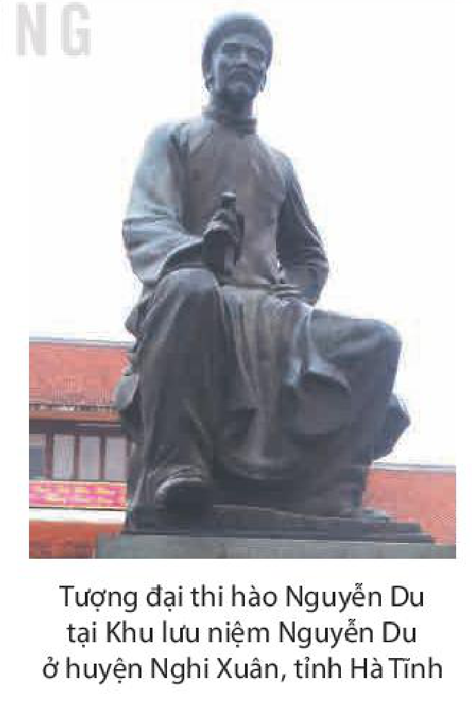

<!-- pdf:5 -->

# BÀI 6: NGUYỄN DU – “NHỮNG ĐIỀU TRÔNG THẤY MÀ ĐAU ĐỚN LÒNG”
<!-- ocr-ok: nhãn Bài 6 và tiêu đề chữ trắng trên băng màu cam bị OCR đọc sót dấu, đã đối chiếu ảnh trang PDF 5 -->

## 🎯 Yêu cầu cần đạt

- Vận dụng được những hiểu biết về Nguyễn Du để đọc hiểu một số tác phẩm của đại thi hào.
- Nhận biết và phân tích được một số yếu tố của truyện thơ Nôm như: cốt truyện, nhân vật, người kể chuyện, độc thoại nội tâm, bút pháp miêu tả, ngôn ngữ.
- So sánh được hai văn bản văn học ở các giai đoạn khác nhau viết cùng đề tài; liên tưởng, mở rộng vấn đề để hiểu sâu hơn văn bản được đọc.
- Hiểu được đặc điểm và tác dụng của biện pháp tu từ lặp cấu trúc và biện pháp tu từ đối trong sáng tác văn học.
- Viết được bài văn thuyết minh về tác phẩm văn học, có lồng ghép một hay nhiều yếu tố như miêu tả, tự sự, biểu cảm, nghị luận.
- Giới thiệu được (dưới hình thức nói) một tác phẩm văn học theo lựa chọn cá nhân.
- Trân trọng những di sản văn học; đồng cảm, chia sẻ với tinh thần nhân đạo thấm đượm trong nền văn học truyền thống của dân tộc.

## ĐỌC
<!-- ocr-ok: tiêu đề chữ trắng trên băng màu cam bị OCR bỏ sót, đã đối chiếu ảnh trang PDF 5 -->

### TRI THỨC NGỮ VĂN

**Giao lưu và sáng tạo trong văn học trung đại Việt Nam**
Trong thời trung đại, Việt Nam nằm trong khu vực chịu ảnh hưởng giao thoa của hai nền văn hoá lớn là Trung Hoa và Ấn Độ. Sự phát triển của văn học Việt Nam gắn liền với việc tiếp biến nhiều thành tựu văn hoá, văn học của hai nền văn hoá này để chủ động tạo nên những giá trị có tính đặc thù, thể hiện được bản sắc văn hoá, ý thức độc lập, tự cường của dân tộc. Có thể nói đến một số phương diện chính yếu của sự **giao lưu và sáng tạo** trên lĩnh vực văn học như: tư tưởng, ngôn ngữ – văn tự, thể loại, chất liệu thơ văn (thể tài, cốt truyện, điển cố,...). Việc giao lưu và sáng tạo trong văn học trung đại Việt Nam luôn diễn ra trên nguyên tắc lựa chọn tinh hoa, chủ động “Việt hoá” các yếu tố ngoại lai để phù hợp với bản sắc và tinh thần văn hoá dân tộc.

> (\*) Câu thơ trích trong *Truyện Kiều* của Nguyễn Du.

<!-- pdf:6 -->

**Truyện thơ Nôm**

**Truyện thơ Nôm** là loại hình tác phẩm tự sự độc đáo của văn học trung đại Việt Nam, kết hợp phương thức tự sự và trữ tình, được viết bằng chữ Nôm, chủ yếu sử dụng thể thơ lục bát hoặc song thất lục bát. Có nhiều tiêu chí phân loại truyện thơ Nôm, trong đó, tiêu chí đặc điểm nội dung và nghệ thuật được sử dụng rộng rãi. Theo tiêu chí này, có thể chia truyện thơ Nôm thành hai nhóm: truyện thơ Nôm bình dân và truyện thơ Nôm bác học. Truyện thơ Nôm bình dân phần lớn khuyết danh, tác giả là các Nho sĩ, trí thức bình dân; cốt truyện thường được lấy từ văn học dân gian hoặc từ đời sống thực tế; hình thức nghệ thuật còn thô mộc, nhưng lại có sức cuốn hút bằng vẻ đẹp bình dị, hồn nhiên. Truyện thơ Nôm bác học hầu hết có tên tác giả, là những Nho sĩ thuộc tầng lớp phong kiến quý tộc, có học vấn uyên bác; cốt truyện thường lấy từ văn học Trung Quốc hoặc mang tính tự thuật; hình thức nghệ thuật được trau chuốt, điêu luyện. Tuy nhiên, vẫn có một số tác phẩm sử dụng chưa nhuần nhuyễn chất liệu vay mượn từ văn học Trung Quốc, có lúc rơi vào tình trạng cầu kì, khó hiểu.

Đề tài, chủ đề của truyện thơ Nôm rất rộng mở, từ tôn giáo, lịch sử, xã hội đến cuộc sống đời thường; đặt ra nhiều vấn đề bức thiết của thời đại. Trong đó, nổi bật là cảm hứng khẳng định tình yêu tự do và cuộc đấu tranh bảo vệ hạnh phúc gia đình; tôn vinh vẻ đẹp của người phụ nữ; tố cáo, phê phán xã hội đương thời; thể hiện khát vọng công lí, công bằng,...

Trong truyện thơ Nôm, các câu chuyện thường được kể theo trình tự thời gian với nhiều yếu tố ngẫu nhiên, kì ảo và thường được tổ chức theo mô hình: Gặp gỡ – Chia li – Đoàn tụ. Song mức độ đậm, nhạt và nội dung của từng phần có sự thay đổi tuỳ theo chủ đề tác phẩm.

Nhân vật của truyện thơ Nôm khá phong phú, đa dạng: vua chúa, quan lại, công chúa, tiểu thư, người hầu, người lao động, Nho sĩ, nhà sư, nhà buôn,... Nhìn chung, nhân vật ở đây vẫn mang tính loại hình, được dựng lên nhằm khái quát các đặc điểm cố định của một số tầng lớp, loại người trong xã hội hoặc một loại phẩm chất nào đó. Các tác giả truyện thơ Nôm đã có ý thức khắc hoạ nhân vật ở cả hai phương diện: con người bên ngoài (ngoại hình, lời nói, cử chỉ, hành động,...) và con người bên trong (cảm xúc, suy nghĩ, diễn biến tâm lí,...). Bút pháp tả cảnh ngụ tình, ngôn ngữ đối thoại, độc thoại và phần nào ngôn ngữ nửa trực tiếp đã được sử dụng thành công trong việc khám phá thế giới nội tâm và khắc hoạ tính cách nhân vật.

Truyện thơ Nôm cũng là thể loại có đóng góp to lớn vào việc phát triển ngôn ngữ văn học dân tộc. Sáng tác bằng chữ Nôm, các tác giả đã nêu cao tinh thần tự hào dân tộc, phủ định quan niệm coi thường tiếng mẹ đẻ. Họ đã chứng minh rằng thứ ngôn ngữ bị xem là “quê mùa” ấy thực sự giàu có, sống động, linh hoạt, có thể miêu tả từ cuộc sống dân dã, bần hàn đến cuộc sống sang trọng, xa hoa; từ nghĩa tình mộc mạc, chân chất đến những cảm xúc tinh tế, lãng mạn; từ những hình ảnh cụ thể, trần trụi của hiện thực đời sống đến những tư tưởng có tầm cao, chiều sâu;... Nhiều tác giả truyện thơ Nôm đã sử dụng một cách điêu luyện thể thơ lục bát, kết hợp nhuần nhuyễn tinh hoa của ngôn ngữ bác học và ngôn ngữ bình dân.

<!-- pdf:7 -->

**Biện pháp tu từ lặp cấu trúc và biện pháp tu từ đối**

**Lặp cấu trúc** là biện pháp tu từ sử dụng những cụm từ hoặc câu có cùng kiểu cấu trúc nhằm nhấn mạnh nội dung cần biểu đạt, tạo nhịp điệu và tăng tính nhạc cho lời văn.

**Đối** là biện pháp tu từ sử dụng những từ ngữ (cùng từ loại) hoặc câu (cùng cấu trúc) sóng đôi với nhau nhằm nhấn mạnh sự tương đồng hoặc tương phản giữa các nội dung cần biểu đạt, tạo nhịp điệu và tăng vẻ đẹp cân xứng cho lời văn. Biện pháp tu từ đối có thể được thực hiện trong một câu thơ, câu văn hay trong hai câu thơ, câu văn liền kề nhau.

### VĂN BẢN 1: Tác gia Nguyễn Du
<!-- ocr-ok: nhãn VĂN BẢN 1 chữ trắng trên băng màu cam bị OCR đọc nhầm thành VĂN BẰNH, đã đối chiếu ảnh trang PDF 7 -->

*Truyện Kiều* của Nguyễn Du đã hoà nhập vào đời sống, sinh hoạt văn hoá của dân tộc Việt Nam. Bạn hãy nêu một trường hợp có sử dụng hình thức đố Kiều, lẩy Kiều hoặc vịnh Kiều.

## I. TIỂU SỬ

Tượng đại thi hào Nguyễn Du tại Khu lưu niệm Nguyễn Du ở huyện Nghi Xuân, tỉnh Hà Tĩnh

Nguyễn Du (1765 – 1820), tên chữ (tự) là Tố Như, hiệu là Thanh Hiên; quê gốc ở làng Tiên Điền, huyện Nghi Xuân, tỉnh Hà Tĩnh.

Thân phụ Nguyễn Du là Nguyễn Nghiễm, đỗ tiến sĩ khoa Tân Hợi (1731), từng giữ chức Tham tụng(1) trong triều Lê. Thân mẫu Nguyễn Du là Trần Thị Tần, người làng Hoa Thiều, Đông Ngàn, xứ Kinh Bắc, nay thuộc huyện Từ Sơn, tỉnh Bắc Ninh. Khi cha mẹ qua đời,

> (1) *Tham tụng*: chức quan trong phủ chúa Trịnh, kiêm nhiệm công việc giống như Tể tướng.

<!-- pdf:8 -->

Nguyễn Du được người anh cùng cha khác mẹ là Nguyễn Khản (từng giữ chức Bồi tụng(1) trong phủ chúa Trịnh) nuôi nấng.

> Truyền thống gia đình, dòng họ và bối cảnh thời đại Nguyễn Du.
<!-- ocr-ok: hộp chỉ dẫn đọc cột phải bị OCR trộn vào văn bản chính, đã đối chiếu ảnh trang PDF 8 -->

Nguyễn Du sinh trưởng trong một dòng họ có nhiều người đỗ đạt và làm quan; có truyền thống văn chương. Cuộc đời ông gắn liền với bối cảnh lịch sử đầy biến động dữ dội nên trải nhiều thăng trầm:

– Thời thơ ấu, Nguyễn Du sống êm đềm trong vàng son, nhung lụa của một gia đình quý tộc phong kiến nhưng sau đó cuộc sống bị xáo trộn vì những biến cố lớn. Năm 1784, kiêu binh nổi loạn và phá nát dinh cơ của Nguyễn Khản ở kinh thành; năm 1788, Nguyễn Huệ chính thức lên ngôi hoàng đế; triều Lê – Trịnh hoàn toàn sụp đổ. Từ đây, gia đình Nguyễn Du li tán, bản thân ông rơi vào cảnh tha hương, bế tắc.

– Khi triều Tây Sơn bị diệt vong và Nguyễn Ánh lập ra triều đại mới, lấy niên hiệu là Gia Long (1802), Nguyễn Du ra làm quan cho nhà Nguyễn. Ông được tân triều trọng dụng. Năm 1813, ông đảm nhận sứ mệnh dẫn đầu sứ bộ đi Trung Quốc. Năm 1820, Gia Long qua đời, Minh Mạng nối ngôi, lại cử Nguyễn Du làm Chánh sứ nhưng chưa kịp khởi hành thì ông lâm bệnh nặng và qua đời.

> Những điểm mốc quan trọng trong cuộc đời Nguyễn Du.

## II. SỰ NGHIỆP SÁNG TÁC

Nguyễn Du để lại một sự nghiệp văn chương quý giá, gồm các tác phẩm được viết bằng chữ Hán và chữ Nôm.

### 1. Sáng tác chữ Hán

Nguyễn Du có ba tập thơ chữ Hán: *Thanh Hiên thi tập* (*Tập thơ (của) Thanh Hiên*), *Nam trung tạp ngâm* (*Thơ ngâm vịnh khi ở miền Nam*) và *Bắc hành tạp lục* (*Ghi chép trên đường đi sứ phương Bắc*). Các thi tập của Nguyễn Du có ý nghĩa đặc biệt quan trọng trong việc thể hiện trực tiếp chân dung tâm hồn và tư tưởng của tác giả.

**a. Thanh Hiên thi tập**

*Thanh Hiên thi tập* gồm 78 bài thơ, được sáng tác trong những năm tháng bi thương nhất của cuộc đời Nguyễn Du nên chất chứa những bi kịch cá nhân.

> Chú ý hoàn cảnh sáng tác, nội dung cơ bản và đặc sắc về nghệ thuật của từng tập thơ.
<!-- ocr-ok: hộp chỉ dẫn đọc cột phải bị OCR bỏ sót dòng, đã đối chiếu ảnh trang PDF 8 -->

> (1) *Bồi tụng*: chức quan đứng kế sau Tham tụng, được chúa Trịnh đặt ra từ thời Lê trung hưng, sau bị bãi bỏ khi Lê Chiêu Thống lên ngôi (1786).

<!-- pdf:9 -->

Gia đình lớn tan tác, anh em chia lìa; cuộc sống riêng cùng quẫn, bế tắc:

*Tráng sĩ bạch đầu bi hướng thiên,*
*Hùng tâm sinh kế lưỡng mang nhiên.*
(Người tráng sĩ đầu bạc buồn trông trời,
Hùng tâm và sinh kế cả hai đều mờ mịt.)
(*Tạp thi* 1)

Từ niềm thương thân, Nguyễn Du thấu hiểu, đồng cảm với những đau thương, bất hạnh của con người và quê hương, xứ sở: “Bốn bể gió bụi, lệ rơi vì tình nhà, nợ nước” (*My trung mạn hứng*); “Giọt lệ nơi nghìn dặm khóc cho cuộc binh đao ở quê hương” (*Bát muộn*). Qua nỗi đau riêng của một tâm hồn lớn, có thể thấy nỗi đau chung của một thời đổ vỡ, tan hoang.

**b. Nam trung tạp ngâm**

*Nam trung tạp ngâm* gồm 40 bài thơ, chủ yếu được sáng tác trong thời kì Nguyễn Du làm quan cho triều Nguyễn. Nhà thơ luôn bày tỏ nỗi chán nản, thất vọng về chốn quan trường và niềm khao khát được từ quan, về sống ẩn dật nơi quê nhà.

Khi nhìn lại những biến động của thời đại, Nguyễn Du đau cho thân phận con người trong cảnh loạn li: “Xương tàn trăm trận đánh vẫn nằm trong bãi cỏ xanh” (*Độ Linh giang*); “Trên đồng ruộng khắp nơi vùi thân vô chủ” (*Ngẫu đắc* 1). Nhìn chung, qua mạch tâm sự trong *Nam trung tạp ngâm*, có thể thấy rõ cách nhìn nhận, đánh giá hết sức sâu sắc của Nguyễn Du về bản chất một thể chế xã hội đang chiều đi xuống.

**c. Bắc hành tạp lục**

*Bắc hành tạp lục* gồm 132 bài thơ, được Nguyễn Du sáng tác trong thời gian đi sứ Trung Quốc. Tập thơ có vị trí đặc biệt trong dòng thơ đi sứ và trong nền thơ trung đại Việt Nam.

Bao trùm *Bắc hành tạp lục* là niềm cảm thương, trăn trở, day dứt trước số phận con người, đặc biệt là thân phận của những kiếp tài hoa. Trên con đường đi sứ, Nguyễn Du đã “bỏ qua” những lâu đài, đền các xa hoa, tráng lệ để chia sẻ và xót thương cho những phận người bé nhỏ, khốn cùng (mẹ con người ăn mày, người hát rong mù, những người dân đói nổi loạn,...). Nhà thơ đã vượt qua mọi khoảng cách thời gian, không gian để bày tỏ lòng trân trọng, ngưỡng mộ và niềm cảm thương, bi phẫn trước thân phận của những “đấng người” bị chà đạp, vùi dập như Khuất Nguyên, Đỗ Phủ, Nhạc Phi,... Viết về họ, Nguyễn Du đã thể hiện chiều sâu tâm hồn và bản lĩnh, tầm vóc của một nhân cách văn hoá lớn.

Đối diện với quá khứ, hiện tại của đất nước Trung Quốc, Nguyễn Du luôn thể hiện cái nhìn mang tính đối thoại và tinh thần phản biện. Tác giả *Bắc hành tạp lục* đã đưa ra những nhận xét sắc sảo, khác biệt về nhiều sự kiện, nhân vật lịch sử;

<!-- pdf:10 -->

chỉ ra sự tương phản giữa những điều “nghe nói” và “trông thấy”: “Mọi người đều nói đường trên đất Trung Hoa bằng phẳng/ Hoá ra đường Trung Hoa lại thế này/ Sâu hiểm quanh co giống lòng người” (*Ninh Minh giang chu hành*); “Thường chỉ nghe ở Trung Nguyên ai cũng no ấm/ Ngờ đâu Trung Nguyên cũng có người như thế này” (*Thái Bình mại ca giả*); “Ai cũng bảo nước Trung Hoa trọng tiết nghĩa/ Sao ở đây hương khói lạnh lẽo thế này?” (*Quế Lâm Cù các bộ*);...

Từ “những điều trông thấy” trên hành trình đi sứ, Nguyễn Du cất lên những câu hỏi nhức nhối, những tiếng khóc đau thương và tiếng thét căm phẫn đã tích tụ, chồng chất bấy lâu. Với tầm nhìn và cõi lòng rộng mở, thi nhân đã gửi vào *Bắc hành tạp lục* những thông điệp đậm tính thời sự và có ý nghĩa muôn đời.

Thơ chữ Hán Nguyễn Du vừa lưu giữ thế giới tâm hồn phong phú, phức tạp của một nghệ sĩ lớn, vừa có khả năng khái quát hiện thực rất cao và mang giá trị nhân văn sâu sắc. Đặc biệt, ba tập thơ còn phản chiếu chân dung con người và quá trình vận động trong tư tưởng nghệ thuật của tác giả. Đó là hành trình đi từ hiểu mình, thương mình đến thấu hiểu con người và thương đời. Từ ý thức sâu sắc về nỗi đau riêng của một người, một thời, Nguyễn Du đã mở rộng tầm nhìn, mở rộng cõi lòng để đón nhận, chia sẻ, suy ngẫm, lí giải những vấn đề thiết yếu của cõi nhân sinh – quyền sống cho con người, số phận của tài hoa, cái đẹp,... Nhịp đập trái tim Tố Như đã hoà cùng mạch sống của một nhân loại khổ đau, bất hạnh trên suốt dòng thời gian kim cổ.

> Giá trị chung của thơ chữ Hán Nguyễn Du.

### 2. Sáng tác chữ Nôm

**a. Giới thiệu chung về sáng tác chữ Nôm**
<!-- ocr-ok: tiểu mục a. bị OCR đọc nhầm thành 4., đã đối chiếu ảnh trang PDF 10 -->

Sáng tác chữ Nôm của Nguyễn Du hiện còn lưu giữ được gồm: *Văn tế sống hai cô gái Trường Lưu*, *Thác lời trai phường nón*, *Văn tế thập loại chúng sinh* (*Văn chiêu hồn*), *Truyện Kiều*.

*Văn tế sống hai cô gái Trường Lưu* được viết theo thể văn tế, *Thác lời trai phường nón* được viết bằng thể lục bát. Hai tác phẩm lưu giữ những cảm xúc tình tứ, lãng mạn; giọng điệu trẻ trung, hài hước, ngôn ngữ mang đậm dấu ấn của ca dao, tục ngữ.

*Văn tế thập loại chúng sinh* được viết bằng thể thơ song thất lục bát; là tiếng khóc thương cho kiếp nhân sinh mong manh, bất hạnh; phản chiếu thực trạng xã hội đương thời và đặt ra nhiều vấn đề có ý nghĩa lâu dài.

*Truyện Kiều* (nguyên tên là *Đoạn trường tân thanh*(1)) là kiệt tác của Nguyễn Du và của nền văn học dân tộc.

> (1) *Đoạn trường tân thanh*: Tiếng kêu mới về nỗi đau đứt ruột.

<!-- pdf:11 -->

**b. Truyện Kiều**

**Nguồn gốc đề tài, cốt truyện và vị trí của *Truyện Kiều***

*Truyện Kiều* được viết theo hình thức truyện thơ Nôm, thể lục bát, gồm 3 254 câu, kể về cuộc đời mười lăm năm chìm nổi của Thuý Kiều. Sáng tác *Truyện Kiều*, Nguyễn Du đã tiếp thu đề tài, cốt truyện từ *Kim Vân Kiều truyện* của Thanh Tâm Tài Nhân (Trung Quốc). Việc kế thừa cốt truyện của người đi trước là một biểu hiện của hiện tượng giao lưu văn hoá, xuất hiện ở nhiều nền văn học trung đại trên thế giới.

> Lưu ý mối liên hệ của hai văn bản: *Truyện Kiều* (Nguyễn Du) và *Kim Vân Kiều truyện* (Thanh Tâm Tài Nhân).

*Truyện Kiều* là một sáng tạo thiên tài, được Nguyễn Du viết với cảm hứng mãnh liệt về chính thời đại mình đang sống và bằng những rung động sâu xa của người nghệ sĩ “có con mắt trông thấu cả sáu cõi, có tấm lòng nghĩ suốt cả ngàn đời” (Mộng Liên Đường chủ nhân):

*Trải qua một cuộc bể dâu,*
*Những điều trông thấy mà đau đớn lòng.*

Ngay từ khi ra đời, *Truyện Kiều* đã có sức cuốn hút mãnh liệt không chỉ với giới trí thức mà cả với độc giả bình dân. *Truyện Kiều* còn hoà nhập vào đời sống, hình thành những hình thức sinh hoạt văn hoá, văn học độc đáo của người Việt như vịnh Kiều, lẩy Kiều, đố Kiều, bói Kiều,... Hơn hai trăm năm qua, *Truyện Kiều* là nguồn đề tài, nguồn cảm hứng lớn cho nhiều loại hình nghệ thuật; là đối tượng khám phá của nhiều nhà nghiên cứu trong và ngoài nước. Đến nay, tác phẩm đã được dịch ra nhiều thứ tiếng trên thế giới (hơn 70 bản dịch).

**Giá trị tư tưởng**

*Truyện Kiều* chứa đựng tư tưởng nhân đạo lớn lao, sâu sắc, độc đáo. Tư tưởng đó trước hết được thể hiện qua cảm hứng tôn vinh vẻ đẹp của con người, đặc biệt là người phụ nữ. Nguyễn Du thuộc số ít tác giả thời trung đại quan tâm, trân trọng con người một cách toàn diện – cả tâm hồn và thể xác. Ông xây dựng nhân vật Thuý Kiều với nhan sắc “nghiêng nước nghiêng thành”, lại có trí tuệ, tài năng, đức hạnh. Khi gia đình gặp đại hoạ, Thuý Kiều hi sinh bản thân để cứu cha và em. Trong tình yêu, nàng mạnh mẽ, táo bạo mà dịu dàng, đằm thắm, thuỷ chung. Trong cách ứng xử với người đời, Thuý Kiều nhân hậu, bao dung, vị tha, trọng lẽ phải. Dù rơi vào hoàn cảnh nào, nhân vật Thuý Kiều của Nguyễn Du cũng không để mất ý thức về phẩm giá, tinh thần phản kháng và không chấp nhận tha hoá.

> Chú ý nội dung cơ bản của tư tưởng nhân đạo trong *Truyện Kiều*.
<!-- ocr-ok: hộp chỉ dẫn đọc cột phải bị OCR đọc lỗi chữ, đã đối chiếu ảnh trang PDF 11 -->

Vậy mà người phụ nữ tài sắc, đức hạnh vẹn toàn đó đã phải gánh chịu một số phận chồng chất khổ đau, bất hạnh: thân xác bị hành hạ, giày vò, nhân phẩm

<!-- pdf:12 -->

bị chà đạp, tình yêu và hạnh phúc bị tước đoạt: “Người sao hiếu nghĩa đủ đường/ Kiếp sao rặt những đoạn trường thế thôi!”. Từ câu chuyện về một kiếp hồng nhan bạc mệnh, Nguyễn Du đã bày tỏ nỗi *đau đớn lòng* trước thân phận con người: “Đau đớn thay phận đàn bà/ Lời rằng bạc mệnh cũng là lời chung”. Nhấn mạnh sự đối lập gay gắt giữa tài năng, phẩm hạnh với số phận “đoạn trường” của Thuý Kiều, cũng là cách Nguyễn Du phủ định, lên án một thực trạng bất công, phi lí và cất lên tiếng kêu đòi quyền sống cho con người.

Yêu thương, trân trọng con người nên Nguyễn Du đồng cảm, đồng tình với những khát vọng chính đáng, táo bạo, đối lập với một số “khuôn phép bất nhân” của tư tưởng phong kiến. Đó là khát vọng tình yêu tự do được khẳng định qua mối tình Kim – Kiều trong sáng, thuỷ chung, cao thượng. Ngòi bút đậm chất trữ tình của Nguyễn Du đã mở ra cả một thế giới phong phú, bí ẩn của trái tim đang yêu với đủ mọi cung bậc cảm xúc; mang đến cái nhìn mới mẻ, sâu sắc về tình yêu. Nhà thơ “dám” để cho người thiếu nữ “Xăm xăm băng lối vườn khuya một mình” đi theo tiếng gọi con tim. Ngay giữa thời đại bị chi phối bởi quan niệm khắt khe, nghiệt ngã về “chữ trinh”, Nguyễn Du vẫn hết mực trân trọng tình yêu của Thuý Kiều dành cho Kim Trọng, Thúc Sinh, Từ Hải.

> Khát vọng tình yêu và khát vọng sống tự do.

Nguyễn Du còn thể hiện khát vọng sống tự do qua nhân vật Từ Hải: “Dọc ngang nào biết trên đầu có ai”. Giấc mơ công lí cũng được chuyển tải qua phiên toà báo ân báo oán. Ở đó, nhân vật Thuý Kiều, con người bị chà đạp, vùi dập đã được trao cho cơ hội để đền đáp những ân tình và trừng phạt những kẻ gây tội ác,...

**Giá trị nghệ thuật**

*Truyện Kiều* của Nguyễn Du kết tinh những thành tựu lớn trên nhiều bình diện nghệ thuật: cách tổ chức cốt truyện, xây dựng nhân vật, nghệ thuật tự sự và trữ tình, ngôn ngữ và thể thơ,...

Nguyễn Du tiếp thu cốt truyện của *Kim Vân Kiều truyện* nhưng đã lựa chọn cho *Truyện Kiều* một thể loại hoàn toàn khác và tổ chức lại cốt truyện, lược bỏ hoặc thay đổi trình tự của nhiều chi tiết, sự kiện; sáng tạo nhiều đoạn độc thoại nội tâm và miêu tả thiên nhiên rất đặc sắc. Cốt truyện của *Truyện Kiều* được xây dựng theo mô hình chung của truyện thơ Nôm với ba phần: *Gặp gỡ – Chia li – Đoàn tụ*. Trong mỗi phần, Nguyễn Du đều có những sáng tạo độc đáo. Chẳng hạn, đoạn kết *Truyện Kiều* không viên mãn như các truyện thơ Nôm khác vì sau cuộc đoàn tụ, các nhân vật chính đều không có hạnh phúc trọn vẹn. Tạo dựng một kết thúc như thế, Nguyễn Du đã tôn trọng logic của hiện thực, của tính cách nhân vật. Nhân vật Thuý Kiều với sức sống nội tại mãnh liệt,

> Mô hình cốt truyện *Truyện Kiều*.

<!-- pdf:13 -->

đã “nổi loạn” phá vỡ màn đoàn viên truyền thống của truyện thơ Nôm; khơi lên ở người đọc nhiều trăn trở, day dứt.

Sáng tác *Truyện Kiều*, Nguyễn Du gần như giữ nguyên hệ thống nhân vật trong *Kim Vân Kiều truyện*. Song tính cách của hầu hết các nhân vật đều được thay đổi, phù hợp với chủ đề mới, với bản sắc văn hoá và tâm hồn dân tộc. Trong rất nhiều sự kiện, biến cố (bán mình, trao duyên, báo ân báo oán, đoàn viên,...), nhân vật Thuý Kiều của Nguyễn Du luôn có cách suy nghĩ, ứng xử khác hẳn nhân vật Thuý Kiều của Thanh Tâm Tài Nhân.

> Những thành công trong nghệ thuật xây dựng nhân vật.

Sự biến đổi của nhân vật trung tâm tất nhiên dẫn đến sự đổi thay của nhiều nhân vật khác: Kim Trọng, Thuý Vân, Thúc Sinh, Hoạn Thư,... Họ đều hiện lên trong tác phẩm của Nguyễn Du với những diện mạo mới, tính cách mới. Trong *Kim Vân Kiều truyện*, các nhân vật này ít có đời sống nội tâm và gần như không có bi kịch nhưng ở *Truyện Kiều*, mỗi người đều có nỗi đau riêng.

Các nhân vật trong *Truyện Kiều* được khắc hoạ một cách chân thực, sinh động từ ngoại hình, lời nói, cử chỉ, hành động,... đến diễn biến nội tâm. Nguyễn Du đã cá thể hoá ngoại hình của nhiều nhân vật; sử dụng rất thành công các chi tiết bề ngoài để khắc hoạ tính cách (Thuý Kiều, Thuý Vân, Tú Bà, Mã Giám Sinh,...). Nhiều nhân vật trong *Truyện Kiều* có giọng điệu và vốn ngôn ngữ riêng, phản ánh chân thực nguồn gốc, lai lịch, tính cách và diễn biến tâm trạng. Nhiều đoạn ngôn ngữ đối thoại có khả năng bộc lộ những biến động tinh tế, phức tạp trong tâm hồn nhân vật.

Một trong những đóng góp nghệ thuật lớn nhất của Nguyễn Du cho thể loại truyện thơ Nôm nói riêng và cho nền văn học dân tộc nói chung, là tài nghệ khắc hoạ “con người bên trong” nhân vật. Ông chú trọng khám phá thế giới nội tâm phong phú, bí ẩn và lí giải sự vận động của các quá trình tâm lí phức tạp một cách hợp lí, sâu sắc.

Thế giới nội tâm nhân vật được Nguyễn Du khám phá, thể hiện bằng nhiều phương tiện: cử chỉ, hành động, ngôn ngữ đối thoại và độc thoại, lời nửa trực tiếp, “ngôn ngữ” thiên nhiên; trong đó, hình tượng thiên nhiên chiếm giữ vị trí quan trọng. Ngòi bút Nguyễn Du không chỉ tạo nên những bức tranh thiên nhiên tuyệt đẹp mà còn biến hình tượng thiên nhiên thành tấm gương phản chiếu những rung động tinh tế, phức tạp của lòng người. Những đoạn tả thiên nhiên ngày Kim Trọng trở về vườn Thuý, Thúc Sinh từ biệt Thuý Kiều, Kiều ở lầu Ngưng Bích,... đã trở thành mẫu mực cổ điển của nghệ thuật tả cảnh ngụ tình. Đặc biệt, Nguyễn Du xây dựng thành công nhiều nhân vật có tính cách đa diện, tình cảm đối nghịch: “Đó là những con người không thể vo tròn vào trong một khuôn khổ chuẩn mực”(1).

> Khám phá thế giới nội tâm nhân vật.

> (1) Trần Đình Sử, *Thi pháp “Truyện Kiều”*, NXB Giáo dục, Hà Nội, 2011, tr. 125.

<!-- pdf:14 -->

Nguyễn Du đã vượt xa thời đại của mình khi hướng đến sự kiếm tìm, khám phá con người ở bên trong con người.

*Truyện Kiều* khẳng định vị trí vững chắc và đánh dấu bước phát triển vượt bậc của tiếng Việt trong lịch sử văn học dân tộc. Nguyễn Du đã phát huy vẻ đẹp phong phú, kì diệu của tiếng Việt; sử dụng một cách sáng tạo các yếu tố ngôn ngữ vay mượn để làm giàu cho tiếng mẹ đẻ. Hệ thống điển cố trong *Truyện Kiều* hoà nhập vào câu thơ Nguyễn Du một cách nhuần nhuyễn. Tác giả *Truyện Kiều* cũng là bậc thầy trong nghệ thuật đưa ngôn ngữ đời thường vào thơ ca. Các thành ngữ, tục ngữ vốn chặt chẽ cũng trở nên uyển chuyển qua ngòi bút Nguyễn Du. Thế mạnh của các từ láy, từ đồng nghĩa được tận dụng làm tăng sức biểu đạt cho ngôn ngữ thơ. *Truyện Kiều* là “bằng chứng” về công lao vĩ đại của Nguyễn Du với sự phát triển ngôn ngữ dân tộc và hoàn thiện thể thơ lục bát truyền thống.

> Ngôn ngữ và thể thơ lục bát.
<!-- ocr-ok: hộp chỉ dẫn đọc cột phải bị OCR đọc lỗi chữ lục bát, đã đối chiếu ảnh trang PDF 14 -->

Với tư tưởng nhân đạo sâu sắc và những đóng góp to lớn ở cả hai bộ phận sáng tác chữ Hán và chữ Nôm, Nguyễn Du được suy tôn là đại thi hào của dân tộc Việt Nam. Vào tháng 10 năm 2013, Tổ chức Giáo dục, Khoa học và Văn hoá Liên hợp quốc (UNESCO) vinh danh Nguyễn Du là Danh nhân văn hoá của nhân loại.

1. Lập niên biểu Nguyễn Du và nêu nhận xét về cuộc đời, con người ông.
2. *Bắc hành tạp lục* được sáng tác trong hoàn cảnh nào? Nội dung chính của tập thơ là gì?
3. Nêu các giá trị cơ bản của thơ chữ Hán Nguyễn Du.
4. Tóm tắt cốt truyện *Truyện Kiều* (khoảng 1 – 1,5 trang).
5. Văn bản đã phân tích những nội dung cơ bản nào của tư tưởng nhân đạo trong *Truyện Kiều*?
6. Nguyễn Du đã có những sáng tạo gì trên bình diện tổ chức cốt truyện và xây dựng nhân vật trong *Truyện Kiều*?
7. Dựa vào văn bản, hãy chỉ ra những đóng góp quan trọng của Nguyễn Du đối với nền văn học dân tộc.

#### Kết nối đọc – viết

Viết đoạn văn (khoảng 150 chữ) phân tích một biểu hiện của tư tưởng nhân đạo trong *Truyện Kiều*.

<!-- pdf:15 -->

### VĂN BẢN 2: Trao duyên(\*)
<!-- ocr-ok: nhãn VĂN BẢN 2 chữ trắng trên băng màu cam bị OCR bỏ sót, đã đối chiếu ảnh trang PDF 15 -->

*(Trích Truyện Kiều)*

**Nguyễn Du**

Mối tình Kim – Kiều được Nguyễn Du miêu tả như một “thiên tình sử” tuyệt đẹp. Bạn hãy đọc một đoạn thơ trong *Truyện Kiều* hoặc một bài thơ của tác giả khác nói về tình yêu của họ.

711. *Nỗi riêng riêng những bàn hoàn(1),*
*Dầu chong trắng đĩa(2) lệ tràn thấm khăn.*
*Thuý Vân chợt tỉnh giấc xuân(3),*
*Dưới đèn ghé đến ân cần hỏi han:*

> Hình dung bối cảnh của cuộc trao duyên (thời gian, không gian, hoàn cảnh của nhân vật).
<!-- ocr-ok: hộp chỉ dẫn đọc cột phải bị OCR trộn với thơ cột trái, đã đối chiếu ảnh trang PDF 15 -->

715. *“Cơ trời dâu bể đa đoan(4),*
*Một nhà để chị riêng oan một mình.*
*Cớ chi ngồi nhẫn(5) tàn canh,*
*Nỗi riêng còn mắc mối tình chi đây?”*
<!-- ocr-ok: khổ thơ câu 715..718 bị OCR đọc sai dấu và trộn với hộp chỉ dẫn cột phải, đã đối chiếu ảnh trang PDF 15 -->

> Chú ý nội dung lời “hỏi han” của Thuý Vân.

*Rằng: “Lòng đương thổn thức đầy,*
720. *Tơ duyên còn vướng mối này chưa xong.*
*Hở môi ra cũng thẹn thùng,*
*Để lòng thì phụ tấm lòng với ai!*
*Cậy em em có chịu lời,*
*Ngồi lên cho chị lạy rồi sẽ thưa.*
<!-- ocr-ok: các dòng thơ lục bát kèm số thứ tự câu 711, 715, 720 và số cước chú bị OCR đọc lỗi chữ và trộn với hộp chỉ dẫn cột phải, đã đối chiếu ảnh trang PDF 15 -->

> Theo dõi cảm xúc, suy nghĩ của Thuý Kiều:
> – Khi nói lời nhờ cậy Thuý Vân;
> – Khi trao kỉ vật cho Thuý Vân.

> (\*) *Trao duyên*: nhan đề văn bản lấy theo sách giáo khoa *Ngữ văn 10*, tập hai, NXB Giáo dục Việt Nam, Hà Nội, 2018.
>
> Đoạn trích nằm ở phần *Chia li*: Gặp nhau lần đầu trong tiết Thanh minh, Kim Trọng và Thuý Kiều đều “tình trong như đã mặt ngoài còn e”. Trong trạng thái “nỗi nàng canh cánh bên lòng biếng khuây”, Kim Trọng tìm cơ hội để đến với Thuý Kiều. Hai người bày tỏ nỗi lòng và nguyện suốt đời đồng tâm gắn bó. Nhưng khi “thề hoa chưa ráo chén vàng”, tai ương đã bất ngờ ập đến: Kim Trọng phải về Liêu Dương để hộ tang chú. Trong thời gian ấy, gia đình Thuý Kiều mắc phải án oan. Để có tiền cứu cha và em thoát khỏi tù tội, Thuý Kiều phải quyết định bán mình. Trước ngày theo Mã Giám Sinh về quê người, nàng thao thức trong tâm trạng day dứt, đau khổ với nỗi mặc cảm đã phụ bạc lời thề nguyền cùng Kim Trọng,...
>
> (1) *Bàn hoàn*: nghĩ quanh quẩn không dứt.
>
> (2) *Dầu chong trắng đĩa*: chong đèn cả đêm, dầu trong đĩa cạn sạch.
>
> (3) *Giấc xuân*: giấc ngủ, cách nói ước lệ, hoa mĩ của văn chương thời trung đại.
>
> (4) *Đa đoan*: nhiều mối, lắm chuyện rối bời.
>
> (5) *Nhẫn*: mãi đến.

<!-- pdf:16 -->

725. *Giữa đường đứt gánh tương tư,*
*Keo loan(1) chắp mối tơ thừa(2) mặc em.*
*Kể từ khi gặp chàng Kim,*
*Khi ngày quạt ước(3) khi đêm chén thề(4).*
*Sự đâu sóng gió bất kì,*
730. *Hiếu tình khôn lẽ hai bề vẹn hai.*
*Ngày xuân em hãy còn dài,*
*Xót tình máu mủ thay lời nước non.*
*Chị dù thịt nát xương mòn,*
*Ngậm cười chín suối hãy còn thơm lây.*
735. *Chiếc vành(5) với bức tờ mây(6),*
*Duyên này thì giữ vật này của chung.*
*Dù em nên vợ nên chồng,*
*Xót người bạc mệnh ắt lòng chẳng quên.*
*Mất người còn chút của tin,*
740. *Phím đàn(7) với mảnh hương nguyền(8) ngày xưa.*
*Mai sau dù có bao giờ,*
*Đốt lò hương ấy so tơ phím này.*
*Trông ra ngọn cỏ lá cây,*
*Thấy hiu hiu gió thì hay chị về.*
745. *Hồn còn mang nặng lời thề,*
*Nát thân bồ liễu(9) đền nghì trúc mai.*
*Dạ đài(10) cách mặt khuất lời,*
*Tưới xin giọt lệ cho người thác oan.*
<!-- ocr-ok: các câu thơ lục bát kèm số thứ tự 725..745 và số cước chú (1)..(10) bị OCR đọc sai chữ và dấu, đã đối chiếu ảnh trang PDF 16 -->

> Chú ý lời Thuý Kiều dặn dò Thuý Vân khi trao kỉ vật.

> (1) *Keo loan*: một thứ keo được chế từ máu chim loan, dùng nối dây đàn rất bền.
>
> (2) *Thừa*: nối tiếp.
>
> (3) *Quạt ước*: chiếc quạt Thuý Kiều trao cho Kim Trọng làm vật đính ước.
>
> (4) *Chén thề*: chén rượu Kim Trọng và Thuý Kiều uống trong đêm thề nguyền.
>
> (5) *Chiếc vành* (còn gọi là *xuyến*): vòng trang sức bằng vàng hay ngọc, thường được phụ nữ đeo ở cổ tay, đây chỉ chiếc xuyến vàng mà Kim Trọng đã trao cho Thuý Kiều làm vật đính ước (“Xuyến vàng đôi chiếc khăn là một vuông”).
>
> (6) *Tờ mây*: tờ giấy ghi lời thề nguyền của Thuý Kiều và Kim Trọng (“Tiên thề cùng thảo một chương”).
>
> (7) *Phím đàn*: chỉ cây đàn Kiều đã chơi trong buổi đính ước cùng Kim Trọng.
>
> (8) *Mảnh hương nguyền*: mảnh trầm hương đốt dở còn lại sau đêm thề nguyền.
>
> (9) *Bồ liễu*: loài cây có cành mềm rủ xuống, là hình tượng thường dùng để chỉ người phụ nữ.
>
> (10) *Dạ đài*: chỉ âm phủ.

<!-- pdf:17 -->

*Bây giờ trâm gãy hương tan(1),*
750. *Kể làm sao xiết muôn vàn ái ân!*
*Trăm nghìn gửi lạy tình quân(2),*
*Tơ duyên(3) ngắn ngủi có ngần ấy thôi.*
*Phận sao phận bạc như vôi,*
*Đã đành nước chảy hoa trôi lỡ làng.*
755. *Ôi Kim lang! Hỡi Kim lang!*
*Thôi thôi thiếp đã phụ chàng từ đây!”*
*Cạn lời hồn dứt máu say,*
*Một hơi lặng ngắt đôi tay giá đồng.*
<!-- ocr-ok: các câu thơ lục bát 750..755 kèm số cước chú bị OCR đọc nhầm dấu và chữ, đã đối chiếu ảnh trang PDF 17 -->

(Đào Duy Anh, *Từ điển “Truyện Kiều”*, NXB Văn hoá – Thông tin, Hà Nội, 2000, tr. 658 – 660)

> Mười dòng thơ cuối là lời Thuý Kiều nói với ai?

1. Nêu bố cục của đoạn trích và chỉ ra đâu là lời người kể chuyện, đâu là lời đối thoại, lời độc thoại của các nhân vật.
2. Thuý Kiều nảy sinh ý định trao duyên cho Thuý Vân trong thời điểm nào?
3. Đọc đoạn thơ (từ câu 719 đến 748) và trả lời các câu hỏi sau:
   a. Lời nhờ cậy Thuý Vân được Thuý Kiều bày tỏ với thái độ như thế nào? Tìm hiểu giá trị của những từ ngữ được dùng để thể hiện thái độ đó.
   b. Thuý Kiều đã dựa vào điều gì để thuyết phục Thuý Vân nhận lời trao duyên?
   c. Khi trao kỉ vật cho Thuý Vân, Thuý Kiều đã dặn dò những gì? Lời dặn dò ấy có nhất quán với lời nàng nhờ cậy và thuyết phục Thuý Vân trước đó hay không? Chỉ ra những từ ngữ, chi tiết thể hiện sự nhất quán hoặc không nhất quán ấy.
   d. Nêu diễn biến tâm lí của Thuý Kiều khi nói lời trao duyên và khi trao kỉ vật cho Thuý Vân. Hãy phân tích, lí giải quá trình diễn biến tâm lí đó.
4. Phân tích diễn biến tâm trạng của Thuý Kiều trong mười dòng thơ cuối (chú ý sự thay đổi đối tượng tâm tình và giọng điệu).
5. Nhận xét về nghệ thuật sử dụng từ ngữ của Nguyễn Du trong đoạn trích. Hãy minh hoạ bằng một ví dụ mà bạn thấy tâm đắc.

#### Kết nối đọc – viết

*Truyện Kiều* là tiếng nói hiểu đời, thương đời của Nguyễn Du. Viết đoạn văn (khoảng 150 chữ) chỉ ra biểu hiện của sự “hiểu” và “thương” ấy trong đoạn trích *Trao duyên*.

> (1) *Trâm gãy hương tan*: có bản chép là “trâm gãy bình tan” hoặc “trâm gãy gương tan”, ý nói tình duyên tan vỡ.
>
> (2) *Tình quân*: người yêu, người tình, gọi theo cách trân trọng.
>
> (3) Có bản chép là *mối tơ*.

<!-- pdf:18 -->

### VĂN BẢN 3: Độc Tiểu Thanh kí(\*)
<!-- ocr-ok: nhãn VĂN BẢN 3 chữ trắng trên băng màu cam bị OCR bỏ sót, đã đối chiếu ảnh trang PDF 18 -->

*(Đọc truyện về nàng Tiểu Thanh)*

**Nguyễn Du**

- Kể tên một vài tác phẩm văn chương Việt Nam viết về thân phận bất hạnh của người phụ nữ mà bạn biết.
- Qua nhân vật Thuý Kiều, hãy chia sẻ cảm nghĩ của bạn về số phận người phụ nữ trong xã hội phong kiến.

**Phiên âm**

*Tây Hồ hoa uyển tận thành khư,*
*Độc điếu song tiền nhất chỉ thư.*
*Chi phấn hữu thần liên tử hậu,*
*Văn chương vô mệnh luỵ phần dư.*
*Cổ kim hận sự thiên nan vấn,*
*Phong vận kì oan ngã tự cư.*
*Bất tri tam bách dư niên hậu,*
*Thiên hạ hà nhân khấp Tố Như?*
<!-- ocr-ok: bài thơ chữ Hán phiên âm in nghiêng bị OCR đọc sai chữ và dấu, đã đối chiếu ảnh trang PDF 18 -->

**Dịch nghĩa**

Cảnh đẹp(1) Tây Hồ(2) nay đã thành bãi hoang cả rồi,
Riêng ta viếng nàng(3) qua một tờ giấy(4) trước cửa sổ.

> (\*) Theo một số tư liệu, Tiểu Thanh là một cô gái trẻ có nhan sắc và đa tài, sống vào khoảng đầu triều Minh (Trung Quốc). Năm mười sáu tuổi, Tiểu Thanh bị gả làm vợ lẽ cho một nhà giàu có, nhưng gặp phải người vợ cả rất khắc nghiệt nên nàng thường xuyên bị ngược đãi, chịu ép buộc phải ra sống một mình ở Cô Sơn, bên cạnh Tây Hồ. Vì đau buồn, Tiểu Thanh lâm bệnh rồi chết. Nàng có để lại một tập thơ và một bức tranh chân dung truyền thần, nhưng bị người vợ cả đốt, chỉ còn sót lại một số bài thơ. Phần thơ sót lại đó được tập hợp và đặt tên là *Phần dư tập* (hay *Phần dư cảo* – Bản thảo còn sót lại sau khi bị đốt).
>
> *Tiểu Thanh kí* là truyện về Tiểu Thanh.
>
> (1) Nguyên văn là *hoa uyển*: vườn hoa, ở đây nên hiểu theo nghĩa khái quát là cảnh đẹp.
>
> (2) *Tây Hồ*: một hồ đẹp, là thắng cảnh ở phía tây thành phố Hàng Châu, tỉnh Chiết Giang (Trung Quốc). Tây Hồ gắn với tên tuổi và sự tích của nhiều nhân vật nổi tiếng trong lịch sử Trung Quốc.
>
> (3) Nguyên văn là *độc điếu*: một mình viếng, điếu viếng trong cô đơn.
>
> (4) Nguyên văn là *nhất chỉ thư*: một tờ giấy, một trang sách. *Chỉ* là loại từ, với nghĩa *trang, tờ, mảnh*, khác với *tập sách, quyển sách*.

<!-- pdf:19 -->

Son phấn(1) vì có thần(2) nên vẫn phải xót xa về những việc sau khi chết,
Văn chương không có số mệnh, phải chịu luỵ bị đốt dở.
Nỗi oán hận(3) xưa nay khó mà hỏi trời cho rõ được,
Nỗi oan khiên lạ lùng của kẻ phong nhã(4), ta tự cũng đặt mình vào(5).
Chẳng biết hơn ba trăm năm(6) sau,
Trong thiên hạ, người nào sẽ khóc Tố Như?
<!-- ocr-ok: phần dịch nghĩa kèm các số cước chú (1)..(6) bị OCR đọc sai ký tự số, đã đối chiếu ảnh trang PDF 19 -->

**Dịch thơ**

**Bản dịch 1**

*Tây Hồ cảnh đẹp hoá gò hoang,*
*Thổn thức bên song mảnh giấy tàn.*
*Son phấn có thần chôn vẫn hận,*
*Văn chương không mệnh đốt còn vương.*
*Nỗi hờn kim cổ trời khôn hỏi,*
*Cái án phong lưu khách tự mang.*
*Chẳng biết ba trăm năm lẻ nữa,*
*Người đời ai khóc Tố Như chăng?*
<!-- ocr-ok: bản dịch thơ 1 in nghiêng bị OCR đọc sai chữ và dấu, đã đối chiếu ảnh trang PDF 19 -->

(Vũ Tam Tập dịch, theo *Thơ chữ Hán Nguyễn Du*, NXB Văn học, Hà Nội, 1978, tr. 174)

> Theo dõi mạch cảm xúc của tác giả trong bài thơ.

> Chú ý sự đồng cảm với bi kịch của người phụ nữ và cảm thán về thân phận của chính mình.

**Bản dịch 2**

*Tây Hồ hoa kiểng: dải gò hoang,*
*Cửa hé trang thơ chạnh điếu nàng.*
*Hận luống vương thêm hồn phấn đại,*
*Tro chưa tàn hết luỵ văn chương.*
*Thanh thương khó hỏi oan chồng chất,*
*Phong nhã đành chung nợ vấn vương.*
*Rồi Tố Như, sau ba kỉ nữa,*
*Trần gian ai kẻ sụt sùi thương?*
<!-- ocr-ok: bản dịch thơ 2 in nghiêng bị OCR đọc sai chữ và dấu, đã đối chiếu ảnh trang PDF 19 -->

(Quách Tấn dịch, tạp chí *Văn*, số đặc biệt *Tưởng niệm Nguyễn Du*, Sài Gòn, 1967, dẫn theo *Ngữ văn 10*, tập một, NXB Giáo dục Việt Nam, Hà Nội, 2018, tr. 133)

> (1) *Son phấn*: son và phấn, thường dùng như một hoán dụ chỉ nhan sắc người phụ nữ, đây chỉ nhan sắc nói chung và số mệnh của Tiểu Thanh nói riêng.
>
> (2) *Thần*: thần thái, tinh thần.
>
> (3) Nguyên văn là *hận sự*: việc hận, mối hận. Ở đây chỉ bi kịch “tài mệnh tương đố” (tài và mệnh ghét nhau), “hồng nhan đa truân” (người con gái đẹp thường gặp số phận truân chuyên),... mà Tiểu Thanh phải gánh chịu.
>
> (4) Nguyên văn là *phong vận*: hình dung đẹp đẽ, thanh nhã (thường chỉ phụ nữ); cũng để chỉ phong cách của thơ văn, thư hoạ. Ở đây chỉ những người vừa thanh tú, văn nhã vừa có tài thơ văn.
>
> (5) Nguyên văn là *ngã tự cư*: ta tự ở vào (hoàn cảnh, thân phận ấy); *cư*: gánh vác, mang chịu.
>
> (6) *Hơn ba trăm năm*: khoảng thời gian có tính ước lệ. Theo một số tư liệu ở Trung Quốc, Tiểu Thanh sống vào đầu triều Minh (1368 – 1644), cụ thể là khoảng cuối thế kỉ XIV đầu thế kỉ XV. Tính đến thời điểm Nguyễn Du viết bài thơ (được đoán định là cuối thế kỉ XVIII) là hơn ba trăm năm.

<!-- pdf:20 -->

***Độc Tiểu Thanh kí*** là một trong những bài thơ chữ Hán đặc sắc nhất của Nguyễn Du. Về thời điểm sáng tác bài thơ, hiện có nhiều ý kiến khác nhau. Quan điểm được đa số tán thành cho rằng bài thơ được làm khi tác giả ở trong nước và đọc được câu chuyện về Tiểu Thanh. Nếu đúng vậy thì đây là một bài thơ điếu đặc biệt, điếu từ xa, dựa trên việc đọc truyện và cảm thương về số phận con người thông qua trang sách.

Bài thơ viết theo thể thơ Đường luật thất ngôn bát cú. Bản gốc chữ Hán của bài thơ hiện chưa truy khảo được. Văn bản được sưu tầm từ nguồn tư liệu của dòng họ Nguyễn Tiên Điền, sau đó được các nhà biên soạn sách xếp vào *Thanh Hiên thi tập*.

1. Theo bạn, nội dung câu 1 và câu 2 của bài thơ có mối quan hệ logic với nhau như thế nào?
2. Chỉ ra và nhận xét mối quan hệ đối về ý trong hai câu thực.
3. Phân tích những cảm xúc và suy ngẫm của tác giả được thể hiện qua hai câu luận.
4. Chia sẻ suy nghĩ của bạn về tâm sự của Nguyễn Du ở hai câu kết.
5. Qua bài thơ, tác giả đã khái quát về bi kịch chung của những người tài hoa, phong nhã trong xã hội phong kiến như thế nào?
6. Hãy tìm đọc và giới thiệu một vài tác phẩm viết về đề tài người phụ nữ của Nguyễn Du.

#### Kết nối đọc – viết

Viết đoạn văn (khoảng 150 chữ) so sánh nội dung hai câu luận của *Độc Tiểu Thanh kí* với nội dung hai câu thơ trong *Truyện Kiều*:

*Đau đớn thay phận đàn bà*
*Lời rằng bạc mệnh cũng là lời chung.*

<!-- pdf:21 -->

### Thực hành tiếng Việt: Biện pháp tu từ lặp cấu trúc, biện pháp tu từ đối

1. Xác định và phân tích tác dụng của biện pháp tu từ lặp cấu trúc trong các đoạn thơ dưới đây (trích tác phẩm *Truyện Kiều*):

   a. *Buồn trông cửa bể chiều hôm,*
   *Thuyền ai thấp thoáng cánh buồm xa xa.*
   *Buồn trông ngọn nước mới sa,*
   *Hoa trôi man mác biết là về đâu?*
   *Buồn trông nội cỏ dàu dàu,*
   *Chân mây mặt đất một màu xanh xanh.*
   *Buồn trông gió cuốn mặt duềnh,*
   *Ầm ầm tiếng sóng reo quanh ghế ngồi.*

   b. *Khi tỉnh rượu lúc tàn canh,*
   *Nghĩ mình mình lại thương mình xót xa.*
   *Khi sao phong gấm rủ là,*
   *Giờ sao tan tác như hoa giữa đường.*
   *Mặt sao dày gió dạn sương,*
   *Thân sao bướm chán ong chường bấy thân?*

   c. *Đã cho lấy chữ hồng nhan,*
   *Làm cho cho hại cho tàn cho cân!*
   *Đã đày vào kiếp phong trần,*
   *Sao cho sỉ nhục một lần mới thôi!*

2. Xác định và phân tích tác dụng của biện pháp tu từ đối trong các đoạn thơ dưới đây (trích tác phẩm *Truyện Kiều*):

   a. *Bóng hồng nhác thấy nẻo xa,*
   *Xuân lan thu cúc mặn mà cả hai.*
   *Người quốc sắc kẻ thiên tài,*
   *Tình trong như đã mặt ngoài còn e.*

> **Nhận biết tác dụng của biện pháp tu từ lặp cấu trúc**
>
> Biện pháp tu từ lặp cấu trúc được sử dụng phổ biến trong văn bản văn học, nhất là trong thơ. Biện pháp tu từ này tạo nên ấn tượng đặc biệt về nhịp điệu của đoạn thơ, đoạn văn và làm nổi bật nội dung mà tác giả muốn nhấn mạnh. Ví dụ:
>
> – *Trời xanh đây là của chúng ta*
> *Núi rừng đây là của chúng ta*
> *Những cánh đồng thơm mát*
> *Những ngả đường bát ngát*
> *Những dòng sông đỏ nặng phù sa*
> (Nguyễn Đình Thi, *Đất nước*)
>
> – *Tôi muốn tắt nắng đi*
> *Cho màu đừng nhạt mất*
> *Tôi muốn buộc gió lại*
> *Cho hương đừng bay đi*
> (Xuân Diệu, *Vội vàng*)
>
> **Nhận biết tác dụng của biện pháp tu từ đối**
>
> Biện pháp tu từ đối được sử dụng phổ biến trong văn bản văn học, có tác dụng tạo nên vẻ đẹp cân xứng, hài hoà cho lời thơ, câu văn.

<!-- pdf:22 -->

   *Chập chờn cơn tỉnh cơn mê,*
   *Rốn ngồi chẳng tiện dứt về chỉn khôn.*
   *Bóng tà như giục cơn buồn,*
   *Khách đà lên ngựa người còn ghé theo.*
   *Dưới dòng nước chảy trong veo,*
   *Bên cầu tơ liễu bóng chiều thiết tha.*

   b. *Một mình nương ngọn đèn khuya,*
   *Áo dầm giọt lệ tóc se mái sầu:*
   *“Phận dầu dầu vậy cũng dầu,*
   *Xót lòng đeo đẳng bấy lâu một lời!*
   *Công trình kể biết mấy mươi,*
   *Vì ta khăng khít cho người dở dang.”*

   c. *Người về chiếc bóng năm canh,*
   *Kẻ đi muôn dặm một mình xa xôi.*
   *Vầng trăng ai xẻ làm đôi*
   *Nửa in gối chiếc nửa soi dặm trường!*
<!-- ocr-ok: các khổ thơ câu 2 cột trái bị OCR trộn với hộp khung kiến thức cột phải, đã đối chiếu ảnh trang PDF 22 -->

> Ví dụ:
>
> • Đối trong một cụm từ hoặc đối giữa hai vế câu:
>
> *Cùng trông lại mà cùng chẳng thấy*
> *Thấy xanh xanh những mấy ngàn dâu.*
> *Ngàn dâu xanh ngắt một màu,*
> *Lòng chàng ý thiếp ai sâu hơn ai?*
> (Đặng Trần Côn, *Chinh phụ ngâm khúc*, Đoàn Thị Điểm (?) dịch)
>
> • Đối trong một cặp câu:
>
> – *Lom khom dưới núi, tiều vài chú,*
> *Lác đác bên sông, chợ mấy nhà.*
> (Bà Huyện Thanh Quan, *Qua Đèo Ngang*)
>
> – *Sóng biếc theo làn hơi gợn tí,*
> *Lá vàng trước gió khẽ đưa vèo.*
> (Nguyễn Khuyến, *Thu điếu*)
<!-- ocr-ok: hộp kiến thức cột phải bị OCR đọc lỗi chữ và trộn với cột trái, đã đối chiếu ảnh trang PDF 22 -->

## VIẾT

**Viết văn bản thuyết minh về một tác phẩm văn học**
Văn bản thuyết minh là kiểu văn bản được sử dụng rộng rãi, đáp ứng nhu cầu hiểu biết trong mọi lĩnh vực đời sống. Kiểu văn bản này gắn liền với tư duy khoa học, với mục đích giúp người đọc hiểu rõ về đối tượng cần thuyết minh. Viết kiểu bài thuyết minh, bạn sẽ được rèn luyện những thao tác, kĩ năng tìm hiểu thông tin, nghiên cứu và trình bày các tri thức một cách chính xác, khách quan. Trong bài học này, bạn tập trung tìm hiểu cách viết bài văn thuyết minh về một tác phẩm văn học.
**Yêu cầu**
- Giới thiệu được tác phẩm cần thuyết minh (nhan đề, tên tác giả, đánh giá chung).
- Giới thiệu khái quát về tác giả.
- Nêu được hoàn cảnh sáng tác, đặc điểm thể loại; tóm tắt được nội dung tác phẩm.
- Nêu thông tin cơ bản về giá trị nội dung và nghệ thuật của tác phẩm.
- Khẳng định vị trí, đóng góp của tác phẩm đối với đời sống văn học.
- Có lồng ghép các yếu tố miêu tả, tự sự, biểu cảm, nghị luận.

<!-- pdf:23 -->

### Bài viết tham khảo

***Truyện Kiều* – kiệt tác của đại thi hào dân tộc Nguyễn Du**
<!-- ocr-ok: tiêu đề bài viết tham khảo màu cam bị OCR đọc sót, đã đối chiếu ảnh trang PDF 23 -->

*Truyện Kiều* là kiệt tác của đại thi hào Nguyễn Du và của nền văn học Việt Nam. Tác phẩm có vị trí đặc biệt trong đời sống tinh thần của người Việt.

> Giới thiệu chung về tác phẩm.

Nguyễn Du (1765 – 1820) tự là Tố Như, hiệu là Thanh Hiên; quê ở làng Tiên Điền, huyện Nghi Xuân, tỉnh Hà Tĩnh. Ông sinh ra trong một gia đình quyền quý, có nhiều người đỗ đạt cao và đạt nhiều thành tựu về sáng tác văn chương. Sống trong một thời đại đầy biến động dữ dội nên cuộc đời Nguyễn Du nếm trải nhiều thăng trầm. Ông có kiến thức uyên bác, trái tim nhân hậu và tài năng văn học bẩm sinh. Nguyễn Du để lại 250 bài thơ chữ Hán và một số tác phẩm viết bằng chữ Nôm, trong đó nổi bật nhất là *Truyện Kiều*.

> Giới thiệu khái quát về tác giả.

*Truyện Kiều* được viết bằng chữ Nôm, theo thể thơ lục bát. Thời điểm sáng tác *Truyện Kiều* đến nay vẫn còn gây nhiều tranh luận, chưa có sự thống nhất. Tác phẩm gồm 3 254 câu thơ lục bát, dựa trên cốt truyện của cuốn tiểu thuyết chương hồi: *Kim Vân Kiều truyện* (Thanh Tâm Tài Nhân). Cốt truyện *Truyện Kiều* được tổ chức theo mô hình cơ bản của truyện thơ Nôm với ba phần: *Gặp gỡ, đính ước – Tai biến, chia li – Đoàn tụ*. Nội dung cốt truyện kể về cuộc đời mười lăm năm chìm nổi của Vương Thuý Kiều, người con gái tài sắc, đức hạnh vẹn toàn. Nhân buổi du xuân trong tiết Thanh minh, Thuý Kiều gặp gỡ Kim Trọng, một Nho sinh hào hoa, phong nhã và cả hai đều ôm mối tương tư. Kim Trọng đã tìm cách gặp mặt, bày tỏ tình yêu với Thuý Kiều, được nàng đón nhận và hai người trao nhau vật đính ước. Thuý Kiều đã tìm sang nhà Kim Trọng tình tự và họ cùng nhau thề nguyền kết duyên đôi lứa. Ngay sau đó, Kim Trọng phải từ biệt Thuý Kiều để về quê chịu tang chú. Cùng lúc, nhà họ Vương mắc án oan, Thuý Kiều phải bán mình chuộc cha, trao duyên cho Thuý Vân. Nàng bị Mã Giám Sinh và Tú Bà lừa đưa vào lầu xanh, rồi được Thúc Sinh chuộc ra làm lẽ nhưng bị vợ cả là Hoạn Thư ghen tuông, đày đoạ. Thuý Kiều phải bỏ trốn

> Nêu hoàn cảnh sáng tác, đặc điểm thể loại.
<!-- ocr-ok: hộp chỉ dẫn đọc cột phải bị OCR đọc lỗi chữ, đã đối chiếu ảnh trang PDF 23 -->

> Tóm tắt nội dung tác phẩm.

> Chú ý sự kết hợp của các yếu tố tự sự, miêu tả.

<!-- pdf:24 -->

và bị Bạc Bà, Bạc Hạnh lừa bán vào lầu xanh lần nữa. Nàng may mắn gặp Từ Hải, được cứu ra khỏi lầu xanh, có cơ hội báo ân báo oán. Nhưng Kiều lại mắc mưu quan Tổng đốc Hồ Tôn Hiến, khuyên Từ Hải hàng quân triều đình. Điều này dẫn tới việc Từ Hải bị chết đứng, còn nàng bị ép gả cho một viên thổ quan. Nàng nhảy xuống sông Tiền Đường, nhưng được sư Giác Duyên cứu sống. Còn Kim Trọng, khi trở lại vườn Thuý, hay tin Thuý Kiều phải bán mình thì vô cùng đau đớn. Chàng cưới Thuý Vân (theo nguyện vọng của Thuý Kiều) nhưng vẫn kiên trì, thiết tha tìm kiếm nàng suốt mười lăm năm. Sau cùng, họ được đoàn tụ nhưng “duyên đôi lứa” đã thành “duyên bạn bầy”.

*Truyện Kiều* là tác phẩm có giá trị tư tưởng và nghệ thuật đặc sắc. Về tư tưởng, *Truyện Kiều* có giá trị hiện thực và giá trị nhân văn sâu sắc. Tác phẩm ngợi ca, trân trọng những giá trị của con người, đặc biệt là người phụ nữ với những phẩm chất như thông minh, thuỷ chung, hiếu thuận, nhân hậu, tự trọng,... Cùng với thái độ ngưỡng mộ, trân trọng ấy là niềm cảm thương, đau đớn trước những số phận bi kịch; là tiếng nói đồng tình với khát vọng tự do sống, tự do yêu đương cũng như khát vọng công lí. Những khát vọng nhân bản ấy được đặt lên hàng đầu, nhiều khi vượt lên trên kiềm toả của lễ giáo, thậm chí có khi đối nghịch với quy chuẩn đạo đức phong kiến, có được sự đồng cảm của người đọc hiện đại.

> Làm rõ giá trị tư tưởng của tác phẩm.

Về nghệ thuật, *Truyện Kiều* đã kết tinh được nhiều thành tựu của nền văn học dân tộc. Cốt truyện được tổ chức lại và có nhiều sáng tạo so với cốt truyện được mượn từ tiểu thuyết *Kim Vân Kiều truyện* của Thanh Tâm Tài Nhân, biến một tiểu thuyết về tình ái đơn thuần thành một truyện thơ Nôm về thân phận con người mang giá trị phổ quát. Ở *Truyện Kiều*, ngôn ngữ văn học dân tộc được sử dụng tài tình và đã đạt tới đỉnh cao, hài hoà giữa ngôn ngữ bác học và ngôn ngữ bình dân. Nhiều từ ngữ, cách diễn đạt trong *Truyện Kiều* được sử dụng lại một cách sinh động trong đời sống và trở thành điển phạm cho các tác phẩm văn học đời sau. Nghệ thuật xây dựng nhân vật trong *Truyện Kiều*, đặc biệt là bút pháp miêu tả ngoại hình thông qua thủ pháp ước lệ, miêu tả tâm lí qua “tả cảnh ngụ tình” được sử dụng ấn tượng, hiệu quả. Các nhân vật, cả tốt và xấu, ở tuyến chính hay tuyến phụ đều được cá thể hoá ngoại hình và ngôn ngữ với mức độ cao; nhiều nhân vật có thế giới nội tâm phong phú. Đặc biệt, một số nhân vật như

> Nêu giá trị nghệ thuật của tác phẩm.

<!-- pdf:25 -->

Thúc Sinh, Hoạn Thư, Từ Hải, Thuý Kiều chủ yếu được khắc hoạ bằng bút pháp hiện thực, chứa cả ưu điểm và hạn chế, nhờ đó mang tính đa chiều, phức tạp, trở thành những nhân vật rất thực, rất đời, thể hiện cái nhìn sâu sắc của Nguyễn Du về con người.

*Truyện Kiều* của Nguyễn Du là một kiệt tác của nền văn học Việt Nam, có những đóng góp to lớn đã được ghi nhận và còn tiếp tục được khám phá. Từ lâu, tác phẩm đã hiện diện sinh động trong đời sống văn hoá dân tộc qua những hoạt động truyền thống như ngâm Kiều, lẩy Kiều, bói Kiều,...; hay trong những sản phẩm nghệ thuật hiện đại như kịch nói, điện ảnh;... Đó là các minh chứng cho sức sống lâu bền của tác phẩm.

> Khẳng định vị trí của tác phẩm trong nền văn học dân tộc.

(Bài làm của học sinh, có chỉnh sửa)

1. Bài thuyết minh *Truyện Kiều – kiệt tác của đại thi hào dân tộc Nguyễn Du* gồm những nội dung gì? Nội dung nào được tác giả xác định là trọng tâm?
2. Chỉ ra sự kết hợp của một số yếu tố như tự sự, miêu tả, biểu cảm hoặc nghị luận được sử dụng trong bài thuyết minh.

### Thực hành viết

**Chuẩn bị viết**

Đề tài cho bài thuyết minh rất phong phú song cần ưu tiên những tác phẩm có giá trị.

*Gợi ý*: Bạn có thể chọn thuyết minh về một số tác phẩm trong sách giáo khoa *Ngữ văn* lớp 10 như: *Mùa xuân chín* (Hàn Mặc Tử), *Bình Ngô đại cáo* (*Đại cáo bình Ngô*, Nguyễn Trãi), *Một chuyện đùa nho nhỏ* (An-tôn Sê-khốp – Anton Chekhov), *Dưới bóng hoàng lan* (Thạch Lam), *Con đường không chọn* (Rô-bớt Phờ-rót – Robert Frost),... hoặc một tác phẩm tự chọn khác.

<!-- pdf:26 -->

**Tìm ý, lập dàn ý**

*Tìm ý*

Để tìm ý cho bài thuyết minh về một tác phẩm văn học, bạn có thể dựa vào một số câu hỏi gợi ý sau:

– Vì sao chọn thuyết minh về tác phẩm này?

– Tác giả và tác phẩm được thuyết minh có vị trí như thế nào?

– Tác phẩm được sáng tác trong hoàn cảnh nào, bằng thể loại gì?

– Nội dung cơ bản và đặc sắc nghệ thuật của tác phẩm là gì?

– Tác phẩm đã được đánh giá như thế nào trên các phương tiện giá trị tư tưởng và giá trị nghệ thuật?

– Tác phẩm có đóng góp gì cho đời sống văn học?

*Lập dàn ý*

Để lập dàn ý, bạn sử dụng kết quả của phần *Tìm ý* và tổ chức, sắp xếp các ý theo trật tự hợp lí. Dàn ý cần triển khai được các nội dung cơ bản của bài viết:

*Mở bài*: Giới thiệu khái quát về tác giả, tác phẩm.

*Thân bài*:

– Giới thiệu ngắn gọn về quê quán, gia đình, con người và sự nghiệp văn chương của tác giả. Ví dụ, khi thuyết minh về *Bình Ngô đại cáo*, cần nêu thông tin cơ bản về tiểu sử và vị trí của Nguyễn Trãi trong nền văn học dân tộc.

– Giới thiệu hoàn cảnh sáng tác và thể loại của tác phẩm. Ví dụ, *Bình Ngô đại cáo* được Nguyễn Trãi viết thay Lê Lợi khi cuộc kháng chiến chống giặc Minh kết thúc thắng lợi và được viết bằng thể cáo với bố cục mang tính quy phạm chặt chẽ. Nếu là tác phẩm thơ, cần nêu đề tài, cảm hứng chủ đạo và bố cục; nếu là tác phẩm truyện cần tóm tắt được nội dung truyện.

– Trình bày giá trị tư tưởng và nghệ thuật của tác phẩm. Với tác phẩm thơ, cần chú ý nghệ thuật trữ tình, ngôn ngữ và giọng điệu; với tác phẩm truyện, chú ý cách tạo dựng tình huống, tổ chức cốt truyện, nghệ thuật xây dựng nhân vật, nghệ thuật trần thuật,... Ví dụ, bài viết tham khảo đã tập trung thuyết minh về giá trị nhân văn độc đáo, sâu sắc và những thành tựu nghệ thuật nổi bật của *Truyện Kiều* (tổ chức cốt truyện, xây dựng nhân vật, sử dụng ngôn ngữ và thể thơ lục bát,...). Có thể sử dụng một số yếu tố miêu tả, tự sự, biểu cảm, nghị luận ở nội dung này.

*Kết bài*: Khẳng định đóng góp của tác phẩm cho nền văn học hoặc cho đời sống văn hoá của đất nước và thế giới. Ví dụ: *Bình Ngô đại cáo* là bản tuyên ngôn độc lập hào hùng của nước Đại Việt; *Truyện Kiều* là kiệt tác của nền văn học dân tộc,...

<!-- pdf:27 -->

**Viết**

– Khi viết bài, cần chú ý trọng tâm của bài thuyết minh: cung cấp thông tin hữu ích về tác phẩm.

– Nên kết hợp thuyết minh với một số yếu tố khác (miêu tả, tự sự, biểu cảm, nghị luận,...) để tăng sức hấp dẫn cho bài thuyết minh.

– Văn phong của bài viết cần ngắn gọn, chính xác, khoa học và phù hợp với đối tượng thuyết minh; không để các yếu tố bổ trợ (miêu tả, tự sự, biểu cảm, nghị luận) làm chệch mục đích chính của bài viết là cung cấp thông tin.

**Chỉnh sửa, hoàn thiện**

Đọc lại bài viết, đối chiếu với các yêu cầu của kiểu bài và dàn ý đã lập để chỉnh sửa, hoàn thiện. Chú ý các tiêu chí sau:

– Bài viết cung cấp cho người đọc thông tin cơ bản về tác phẩm: tác giả, nội dung chính, giá trị tư tưởng và nghệ thuật,...

– Các nội dung thuyết minh được sắp xếp hợp lí, cân đối, có trọng tâm.

– Bài viết có sự lồng ghép phù hợp giữa thuyết minh với một hoặc nhiều yếu tố bổ trợ như miêu tả, tự sự, biểu cảm, nghị luận,...

## NÓI VÀ NGHE
<!-- ocr-ok: tiêu đề chữ trắng trên băng màu cam bị OCR bỏ sót, đã đối chiếu ảnh trang PDF 27 -->

**Giới thiệu một tác phẩm văn học**
**Yêu cầu**
- Nêu rõ lí do lựa chọn giới thiệu tác phẩm văn học.
- Cung cấp thông tin cơ bản về tác phẩm văn học: tác giả, thể loại, giá trị nội dung và nghệ thuật.
- Giới thiệu kĩ một vài khía cạnh đặc sắc của tác phẩm từ góc nhìn cá nhân.
- Thể hiện được ý kiến, quan điểm đánh giá của cá nhân về tác phẩm.

**Chuẩn bị nói**

*Lựa chọn đề tài*

– Đề tài bài nói có thể được khai thác từ kết quả của bài viết, cũng có thể là một đề tài mới.

<!-- pdf:28 -->

– Bài nói giới thiệu về một tác phẩm được lựa chọn theo quan điểm, sở thích cá nhân song bạn nên lựa chọn tác phẩm văn học có giá trị.

*Tìm ý và sắp xếp ý*

– Nếu chọn giới thiệu tác phẩm trong bài thuyết minh ở phần *Viết*, bạn cần dựa vào các yêu cầu của bài nói để tổ chức lại cho phù hợp. Ví dụ, từ bài thuyết minh về *Truyện Kiều* ở phần *Viết*, bạn cần rút gọn phần giới thiệu chung, chỉ giữ lại thông tin quan trọng nhất về tác giả, tác phẩm và tập trung trình bày một vài bình diện đặc sắc như: nguồn gốc cốt truyện, giá trị nhân văn, nghệ thuật tổ chức cốt truyện, xây dựng nhân vật và sử dụng ngôn ngữ,...

– Nếu chọn đề tài mới, bạn có thể tham khảo một số câu hỏi gợi ý để hình thành dàn ý cho bài nói: Vì sao bạn lựa chọn tác phẩm văn học này để giới thiệu? Bạn đánh giá như thế nào về giá trị và sức cuốn hút của tác phẩm? Trong đó, điều gì khiến bạn tâm đắc nhất?

**Thực hành nói**

– *Mở đầu*: Giới thiệu tên tác phẩm, tác giả và lí do lựa chọn.

– *Triển khai*: Giới thiệu đề tài, tóm tắt nội dung chính, nêu ý kiến đánh giá về giá trị tư tưởng và nghệ thuật của tác phẩm. Có thể chọn phân tích kĩ một khía cạnh mà mình tâm đắc.

– *Kết luận*: Khẳng định giá trị và ảnh hưởng của tác phẩm.

*Lưu ý*: Trong khi nói, cần kết hợp sử dụng các phương tiện phi ngôn ngữ phù hợp và có ý thức tương tác với người nghe.

**Trao đổi**

| Người nói | Người nghe |
| --- | --- |
| – Giải thích thêm về những điều người nghe còn chưa rõ hoặc chưa đồng tình. – Thể hiện thái độ tiếp thu đối với những góp ý hữu ích và xác đáng về tác phẩm được giới thiệu; bổ sung thông tin; chuẩn bị lí lẽ để phản biện những ý kiến, quan điểm của người nghe mà người nói chưa nhất trí. – Thể hiện tinh thần tôn trọng, cầu thị khi trao đổi với người nghe, đặc biệt về các ý kiến phản biện. – Tự đánh giá phần trình bày bài nói và nêu những kinh nghiệm bổ ích rút ra được qua trao đổi. | – Chia sẻ về những nội dung mà bạn tâm đắc trong bài nói (thông tin thú vị về tác giả, tác phẩm; cách nhìn mới mẻ, độc đáo của người nói;...). – Trao đổi với người nói về những vấn đề chưa rõ hoặc chưa đồng tình. – Có thể bổ sung thông tin về tác phẩm được giới thiệu hoặc đưa ra ý kiến, quan điểm đánh giá riêng để giúp người nói có cái nhìn toàn diện hơn về tác phẩm được giới thiệu. – Nêu nhận xét về nội dung và cách trình bày bài nói. |
<!-- ocr-ok: bảng 2 cột Người nói / Người nghe, đã đối chiếu ảnh trang PDF 28 -->

<!-- pdf:29 -->

Để nâng cao hiệu quả trao đổi trong những bài học sau, cần tự đánh giá và đánh giá về bài giới thiệu theo các nội dung trong bảng dưới đây:
<!-- ocr-ok: dòng dẫn trước bảng bị OCR đọc lỗi thành Am Ca đun, đã đối chiếu ảnh trang PDF 29 -->

| STT | Nội dung đánh giá | Kết quả: Đạt | Kết quả: Chưa đạt |
| --- | --- | --- | --- |
| 1 | Bài nói chọn được tác phẩm người nói yêu thích và có sức hấp dẫn với người nghe. | | |
| 2 | Các thông tin cơ bản về tác phẩm được nêu chính xác, đầy đủ và mạch lạc. | | |
| 3 | Các phương tiện phi ngôn ngữ được sử dụng phù hợp, có hiệu quả. | | |
| 4 | Phong cách trình bày tự tin, có sức thuyết phục. | | |
| 5 | Nhận ý kiến phản hồi của người nghe với tinh thần cầu thị, tôn trọng các ý kiến khác biệt. | | |
<!-- ocr-ok: bảng đánh giá 4 cột bị OCR đọc rời rạc, đã đối chiếu ảnh trang PDF 29 -->

## CỦNG CỐ, MỞ RỘNG

1. Hãy giới thiệu vị trí, nội dung và đặc điểm nghệ thuật của một đoạn trích trong *Truyện Kiều* do bạn tự chọn.
2. Trong *Kim Vân Kiều truyện*, sự kiện Thuý Kiều trao duyên cho Thuý Vân được Thanh Tâm Tài Nhân miêu tả ở Hồi thứ tư(1). Hãy tìm đọc hồi truyện này và chỉ ra một số điểm khác biệt giữa Nguyễn Du với Thanh Tâm Tài Nhân trong cách miêu tả sự kiện trao duyên.
3. Các văn bản đọc ở Bài 6 (*Tác gia Nguyễn Du*, *Trao duyên* – trích *Truyện Kiều*, *Độc Tiểu Thanh kí*) đã giúp bạn hiểu gì về những giá trị đặc sắc trong sáng tác của Nguyễn Du?
4. *Truyện Kiều* đã nhiều lần miêu tả cảnh Thuý Kiều đánh đàn. Hãy viết một đoạn văn (khoảng 150 chữ) bình luận về tiếng đàn của Thuý Kiều trong một lần được Nguyễn Du miêu tả.
5. Viết bài văn ngắn giới thiệu một bài thơ chữ Hán của Nguyễn Du. Sử dụng bài viết để lập dàn ý cho bài nói (Giới thiệu một bài thơ chữ Hán của Nguyễn Du theo lựa chọn cá nhân).

## THỰC HÀNH ĐỌC

**Một số điều cần lưu ý khi đọc văn bản:**

- Vị trí đoạn trích trong tác phẩm.
- Phẩm chất anh hùng của nhân vật Từ Hải.
- Nghệ thuật thể hiện tính cách nhân vật (lời thoại, cử chỉ, hành động,...).
- Nghệ thuật tạo dựng bối cảnh không gian, thời gian và nghệ thuật sử dụng ngôn ngữ.

> (1) Hồi thứ tư: “Vì hiếu phải quên mình, không nỡ dòng nhà tuyệt tự/ Dứt tình còn nhớ nghĩa, đành nhờ em ruột nối duyên” (Thanh Tâm Tài Nhân, *Kim Vân Kiều truyện*, Nguyễn Khắc Hạnh – Nguyễn Đức Vân dịch, Nguyễn Đăng Na giới thiệu và hiệu đính, NXB Đại học Sư phạm, Hà Nội, 2007, tr. 45 – 59).

<!-- pdf:30 -->

**Chí khí anh hùng(\*)**

*(Trích Truyện Kiều)*

**Nguyễn Du**

2213. *Nửa năm hương lửa đương nồng(1),*
*Trượng phu(2) thoắt đã động lòng bốn phương.*
2215. *Trông vời trời bể mênh mang,*
*Thanh gươm yên ngựa lên đường thẳng rong(3).*
*Nàng rằng: “Phận gái chữ tòng(4),*
*Chàng đi thiếp cũng một lòng xin đi”.*
*Từ rằng: “Tâm phúc tương tri(5),*
2220. *Sao chưa thoát khỏi nữ nhi thường tình(6)?*
*Bao giờ mười vạn tinh binh(7),*
*Tiếng chiêng dậy đất bóng tinh(8) rợp đường.*
*Làm cho rõ mặt phi thường,*
*Bấy giờ ta hãy rước nàng nghi gia(9).*
2225. *Bằng nay bốn bể không nhà,*
*Theo càng thêm bận biết là đi đâu?*
*Đành lòng chờ đó ít lâu,*
*Chầy chăng là một năm sau vội gì!”.*
*Quyết lời dứt áo ra đi,*
2230. *Gió mây bằng(10) đã đến kì dặm khơi.*
<!-- ocr-ok: các câu thơ lục bát 2213..2230 kèm số cước chú (1)..(10) bị OCR đọc sai chữ và số cước chú, đã đối chiếu ảnh trang PDF 30 -->

(Đào Duy Anh, *Từ điển “Truyện Kiều”*, Sđd, tr. 716 – 717)

> (\*) Nhan đề do nhóm biên soạn lấy theo sách giáo khoa *Ngữ văn 10*, tập hai, Sđd.
>
> (1) *Hương lửa đương nồng*: tình cảm vợ chồng hoà thuận, nồng thắm.
>
> (2) *Trượng phu*: người đàn ông có khí phách.
>
> (3) *Thẳng rong*: đi một cách dứt khoát, nhanh.
>
> (4) *Tòng*: theo, ý nói phận làm vợ phải đi theo chồng.
>
> (5) *Tâm phúc tương tri*: biết rõ, hiểu thấu tấm lòng của nhau.
>
> (6) *Nữ nhi thường tình*: tình cảm thông thường của người phụ nữ.
>
> (7) *Tinh binh*: binh lính tinh nhuệ.
>
> (8) *Bóng tinh*: bóng cờ.
>
> (9) *Nghi gia*: ý nói đón về nhà chồng.
>
> (10) *Bằng*: chim bằng (trong *Nam Hoa kinh* của Trang Tử có điển: chim bằng bay về cõi Nam, lựa gió bay xa một mạch chín vạn dặm), ý nói Từ Hải như cánh chim bằng cưỡi gió bay cao, bay xa.
<!-- ocr-ok: các cước chú (1)..(10) bị OCR đọc sai ký tự số và dấu, đã đối chiếu ảnh trang PDF 30 -->

<!-- pdf:31 -->

**Một số điều cần lưu ý khi đọc văn bản:**

- Đề tài, cảm hứng sáng tác.
- Thể thơ ngũ ngôn và thi liệu được sử dụng.
- Chất trữ tình và các yếu tố nghệ thuật độc đáo.
- Tâm hồn nhạy cảm, lãng mạn và tinh tế của nhà thơ.

**Mộng đắc thái liên**

*(Mơ đi hái sen)*

**Nguyễn Du**

**Phiên âm**

1. *Khẩn thúc giáp điệp quần,*
   *Thái liên trạo tiểu đĩnh.*
   *Hồ thuỷ hà xung dung,*
   *Thuỷ trung hữu nhân ảnh.*
<!-- ocr-ok: khổ 1 phiên âm in nghiêng bị OCR đọc sai từ Hán Việt, đã đối chiếu ảnh trang PDF 31 -->

2. *Thái thái Tây Hồ liên,*
   *Hoa thực câu thướng thuyền.*
   *Hoa dĩ tặng sở uý,*
   *Thực dĩ tặng sở liên.*
<!-- ocr-ok: khổ 2 phiên âm in nghiêng bị OCR đọc sai từ Hán Việt, đã đối chiếu ảnh trang PDF 31 -->

3. *Kim thần khứ thái liên,*
   *Nãi ước đông lân nữ.*
   *Bất tri lai bất lai.*
   *Cách hoa văn tiếu ngữ.*
<!-- ocr-ok: khổ 3 phiên âm in nghiêng bị OCR đọc sai từ Hán Việt, đã đối chiếu ảnh trang PDF 31 -->

4. *Cộng tri liên liên hoa,*
   *Thuỳ giả liên liên cán.*
   *Kì trung hữu chân ti,*
   *Khiên liên bất khả đoạn.*
<!-- ocr-ok: khổ 4 phiên âm in nghiêng bị OCR đọc sai từ Hán Việt, đã đối chiếu ảnh trang PDF 31 -->

5. *Liên diệp hà thanh thanh,*
   *Liên hoa kiều doanh doanh.*
   *Thái chi vật thương ngẫu,*
   *Minh niên bất phục sinh.*
<!-- ocr-ok: khổ 5 phiên âm in nghiêng bị OCR đọc sai từ Hán Việt, đã đối chiếu ảnh trang PDF 31 -->

<!-- pdf:32 -->

**Dịch nghĩa**

1. Xắn váy cánh bướm(1) gọn gàng,
   Chèo chiếc thuyền con đi hái sen.
   Mặt hồ sóng nước gợn lăn tăn(2),
   Dưới nước in bóng người.

2. Hái, hái sen Hồ Tây(3),
   Hoa sen, gương sen cùng bỏ lên thuyền.
   Hoa để tặng người mình giận(4),
   Gương để tặng kẻ mình thương.

3. Sáng nay đi hái sen,
   Đã hẹn cô hàng xóm(5) cùng đi.
   Chẳng biết có đến hay không nữa(6),
   Chợt nghe tiếng cười nói bên khóm hoa.

4. Ai cũng chỉ thích hoa sen,
   Còn cọng hoa mấy ai thích.
   Thân sen ẩn tơ bền,
   Vấn vương không đứt được.

5. Lá sen thì xanh xanh,
   Hoa sen đẹp nõn nà.
   Hái sen chớ làm thương ngó(7),
   Kẻo năm sau hoa không mọc.
<!-- ocr-ok: phần dịch nghĩa kèm các số cước chú (1)..(7) bị OCR đọc sai ký tự số, đã đối chiếu ảnh trang PDF 32 -->

> (1) *Váy cánh bướm*: váy thêu cánh bướm, váy bay phấp phới. Nguyên văn, chữ *quần* xưa chỉ chung quần và váy. Váy là trang phục phổ biến của phụ nữ miền Bắc thời trước.
>
> (2) Nguyên văn là *xung dung*: nước lai láng, sóng gợn lăn tăn.
>
> (3) *Hồ Tây*: thắng cảnh nổi tiếng ở Thăng Long (Hà Nội). Theo nhiều giai thoại, Hồ Tây gắn với mối tình thơ giữa Nguyễn Du và nữ sĩ Hồ Xuân Hương. Có người cho rằng, nhân vật người con gái trong bài thơ này là hình bóng của Xuân Hương.
>
> (4) Nguyên văn là *uý*: sợ; giận, ghét. Nhiều bản dịch chọn nghĩa thứ nhất là sợ, nhưng trong văn cảnh này, từ *uý* đối với *liên* (thương, mến) ở câu dưới, thể hiện rõ cách nói tình ý giận – thương/ ghét – yêu,... trong văn hoá người Việt.
>
> (5) *Cô hàng xóm*: dẫn điển xưa, chỉ nhà hàng xóm ở phía Đông, nơi có người con gái đẹp ở (“Tường Đông ong bướm đi về mặc ai” – *Truyện Kiều*).
>
> (6) Nguyên văn là câu hỏi tu từ, thể hiện ý băn khoăn “không biết là có đến hay không đến”.
>
> (7) *Ngó*: phần thân dưới của cây sen, nằm trong bùn, ruột trắng, vị ngọt. Thành ngữ có câu: “Ngẫu đoạn nhi ti liên” (ngó sen tuy đứt nhưng tơ nó vẫn còn liền với nhau). Mạnh Giao (Trung Quốc) có câu: “Thiếp tâm ngẫu trung mịch, tuy đoạn do khiên liên” (Lòng thiếp như tơ ngó sen, dù đứt còn vương hoa). *Truyện Kiều*: “Dẫu lìa ngó ý còn vương tơ lòng”.
<!-- ocr-ok: các cước chú (1)..(7) bị OCR đọc sai ký tự số thứ tự, đã đối chiếu ảnh trang PDF 32 -->

<!-- pdf:33 -->

**Dịch thơ**

1. *Xắn gọn quần cánh bướm,*
   *Chèo thuyền con hái sen.*
   *Nước hồ đầy lai láng,*
   *Dưới nước bóng người in.*
<!-- ocr-ok: khổ 1 dịch thơ in nghiêng bị OCR đọc sai từ tiếng Việt, đã đối chiếu ảnh trang PDF 33 -->

2. *Tây Hồ hái hái sen,*
   *Hoa gương bỏ lên thuyền.*
   *Hoa tặng người mình sợ,*
   *Gương tặng người mình quen.*
<!-- ocr-ok: khổ 2 dịch thơ in nghiêng bị OCR đọc sai từ tiếng Việt, đã đối chiếu ảnh trang PDF 33 -->

3. *Sáng nay đi hái sen,*
   *Hẹn cô kia đi với.*
   *Chẳng biết có đến không?*
   *Cách hoa nghe cười nói.*
<!-- ocr-ok: khổ 3 dịch thơ in nghiêng bị OCR đọc sai từ tiếng Việt, đã đối chiếu ảnh trang PDF 33 -->

4. *Hoa sen ai cũng ưa,*
   *Cuống sen chẳng ai thích.*
   *Trong cuống có tơ mành,*
   *Vấn vương không thể đứt.*
<!-- ocr-ok: khổ 4 dịch thơ in nghiêng bị OCR đọc sai từ tiếng Việt, đã đối chiếu ảnh trang PDF 33 -->

5. *Lá sen màu xanh xanh,*
   *Hoa sen dáng xinh xinh.*
   *Hái sen chớ đụng ngó,*
   *Năm sau hoa chẳng sinh.*
<!-- ocr-ok: khổ 5 dịch thơ in nghiêng bị OCR đọc sai từ tiếng Việt, đã đối chiếu ảnh trang PDF 33 -->

(Phạm Khắc Hoan và Lê Thước dịch, *Thơ chữ Hán Nguyễn Du*, NXB Văn học, Hà Nội, 1978, tr. 178 – 182)

## 📷 Danh sách hình trong bài

| Mã hình | Trang PDF | Vị trí | Chú thích gốc |
| --- | --- | --- | --- |
| H11-ngu_van-b06-01 | 7 | Văn bản 1: Tác gia Nguyễn Du (Mục I. Tiểu sử) | Tượng đại thi hào Nguyễn Du tại Khu lưu niệm Nguyễn Du ở huyện Nghi Xuân, tỉnh Hà Tĩnh (trang 6) |
