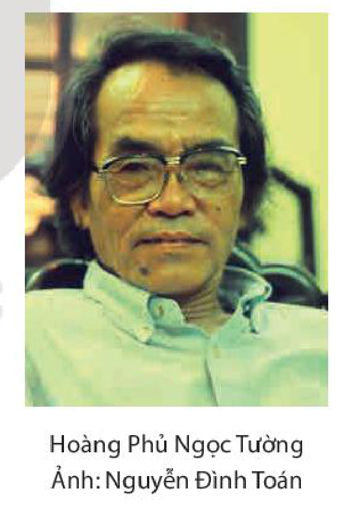

<!-- pdf:34 -->

# BÀI 7: GHI CHÉP VÀ TƯỞNG TƯỢNG TRONG KÍ
<!-- ocr-ok: nhãn Bài 7 và tiêu đề chữ trắng trên băng màu cam bị OCR đọc thiếu chữ G và nhầm dấu, đã đối chiếu ảnh trang PDF 34 -->

## 🎯 Yêu cầu cần đạt

- Nhận biết và phân tích được sự kết hợp giữa tự sự và trữ tình trong tuỳ bút, tản văn; giữa hư cấu và phi hư cấu trong truyện kí.
- Vận dụng được kinh nghiệm đọc, trải nghiệm về cuộc sống và hiểu biết về lịch sử văn học Việt Nam để nhận xét, đánh giá văn bản văn học.
- Hiểu được hiện tượng phá vỡ những quy tắc ngôn ngữ thông thường, vận dụng vào việc tìm hiểu ngôn ngữ trong văn bản nghệ thuật.
- Viết được bài thuyết minh về một hiện tượng xã hội đáng quan tâm, có lồng ghép một hay nhiều yếu tố như: miêu tả, tự sự, biểu cảm, nghị luận.
- Biết thảo luận, tranh luận về một vấn đề trong đời sống phù hợp với lứa tuổi.
- Biết yêu mến cảnh quan thiên nhiên, các sắc màu văn hoá của đất nước; thấu hiểu và cảm thông với con người ở những cảnh ngộ khác nhau.

## ĐỌC
<!-- ocr-ok: tiêu đề chữ trắng trên băng màu cam bị OCR bỏ sót, đã đối chiếu ảnh trang PDF 34 -->

### TRI THỨC NGỮ VĂN

**Kí**
<!-- ocr-ok: tiêu đề tiểu mục Kí màu cam bị OCR đọc nhầm thành K1, đã đối chiếu ảnh trang PDF 34 -->

**Kí** là tên gọi một nhóm các thể/ tiểu loại tác phẩm văn xuôi phi hư cấu có khả năng dung hợp các phương thức tự sự, miêu tả, biểu cảm, nghị luận, thông tin,... nhằm tái hiện những trạng thái đời sống đang được xã hội quan tâm và bộc lộ trực tiếp những cảm nghĩ của tác giả.

Tuỳ vào mục đích, sự bộc lộ cái tôi tác giả và cách thức tổ chức các phương tiện biểu đạt mà tác phẩm kí được gọi là tuỳ bút, tản văn, phóng sự hay là kí sự, truyện kí, hồi kí, nhật kí, du kí,...

**Tự sự và trữ tình trong tuỳ bút, tản văn**
Trong **tuỳ bút**, **tản văn**, yếu tố **tự sự** và yếu tố **trữ tình** luôn có sự kết hợp linh hoạt, tuỳ vào ý tưởng trung tâm được triển khai, đối tượng của sự quan sát, chiêm nghiệm và đặc điểm phong cách nghệ thuật của người viết.

<!-- pdf:35 -->

**Tuỳ bút** là tiểu loại kí có tính tự do cao, có bố cục linh hoạt, thường nghiêng hẳn về tính trữ tình với điểm tựa là cái tôi của tác giả. Người viết sẽ tuỳ cảnh, tuỳ việc, tuỳ theo cảm hứng mà trình bày, nhận xét, đánh giá, suy tưởng,... Nếu có miêu tả, kể chuyện thì đó cũng chỉ là cái cớ để giãi bày cảm xúc, suy tư trữ tình.

**Tản văn** là một tiểu loại kí thường sử dụng đồng thời cả yếu tố tự sự và trữ tình, có thể còn kết hợp nghị luận, miêu tả,... nhằm gợi lên những bức tranh đời sống đưa lại nhiều rung cảm thẩm mĩ. Cái tôi của tác giả luôn hiện diện rõ nét, nhưng việc triển khai những liên hệ, suy tưởng phần nào được tiết chế so với tuỳ bút.

**Phi hư cấu và hư cấu trong truyện kí**

**Truyện kí** là một dạng truyện kể về người thật, việc thật. Tôn trọng sự thật đời sống, đảm bảo tính xác thực của toàn bộ sự việc được kể là đòi hỏi quan trọng hàng đầu đối với các sáng tác thuộc thể loại này. Vì điều đó, truyện kí được xếp vào loại văn học **phi hư cấu**.

Tuy nhiên, yếu tố **hư cấu** vẫn luôn hiện diện trong truyện kí (dù được sử dụng một cách tiết chế), thể hiện ở sự sáng tạo riêng của người viết khi xử lí, tổ chức tư liệu và lựa chọn giọng điệu, ngôn ngữ trần thuật thích hợp. Yếu tố hư cấu còn được thể hiện qua cách người viết hình dung, miêu tả tâm trạng, cảm xúc của nhân vật.

<!-- pdf:36 -->

### VĂN BẢN 1: Ai đã đặt tên cho dòng sông?
<!-- ocr-ok: nhãn VĂN BẢN 1 chữ trắng trên băng màu cam bị OCR bỏ sót, đã đối chiếu ảnh trang PDF 36 -->

*(Trích)*

**Hoàng Phủ Ngọc Tường**

- Bạn có kỉ niệm gì với dòng sông mà bạn từng biết?
- Hãy chia sẻ ấn tượng của bạn về hình ảnh một dòng sông được tái hiện trong tác phẩm văn học hoặc các loại hình nghệ thuật khác (âm nhạc, hội hoạ, điện ảnh,...).

[...] Trong những dòng sông đẹp ở các nước mà tôi thường nghe nói đến, hình như chỉ sông Hương là thuộc về một thành phố duy nhất. Trước khi về đến vùng châu thổ êm đềm, nó đã là một bản trường ca của rừng già, rầm rộ giữa bóng cây đại ngàn, mãnh liệt qua những ghềnh thác, cuộn xoáy như cơn lốc vào những đáy vực bí ẩn, và cũng có lúc nó trở nên dịu dàng và say đắm giữa những dặm dài chói lọi màu đỏ của hoa đỗ quyên rừng. Giữa lòng Trường Sơn, sông Hương đã sống một nửa cuộc đời của mình như một cô gái Di-gan(1) phóng khoáng và man dại. Rừng già đã hun đúc cho nó một bản lĩnh gan dạ, một tâm hồn tự do và trong sáng. Nhưng chính rừng già nơi đây, với cấu trúc đặc biệt có thể lí giải được về mặt khoa học, đã chế ngự sức mạnh bản năng ở người con gái của mình để khi ra khỏi rừng, sông Hương nhanh chóng mang một sắc đẹp dịu dàng và trí tuệ, trở thành người mẹ phù sa của một vùng văn hoá xứ sở. Nếu chỉ mải mê nhìn ngắm khuôn mặt kinh thành của nó, tôi nghĩ rằng người ta sẽ không hiểu một cách đầy đủ bản chất của sông Hương với cuộc hành trình gian truân mà nó đã vượt qua, không hiểu thấu phần tâm hồn sâu thẳm của nó mà dòng sông hình như không muốn bộc lộ, đã đóng kín lại ở cửa rừng và ném chìa khoá trong những hang đá dưới chân núi Kim Phụng(2).

> Hình ảnh sông Hương ở thượng nguồn.

> Nét độc đáo trong cách ví von, so sánh.
<!-- ocr-ok: hộp chỉ dẫn đọc cột phải bị OCR đọc dính từ vívon, đã đối chiếu ảnh trang PDF 36 -->

> (1) *Di-gan*: một tộc người thiểu số gốc ở phía bắc Ấn Độ ngày nay, vốn quen sống du cư trên địa bàn của nhiều nước (chủ yếu thuộc Đông Âu, Nam Âu và một số ít thuộc Trung Đông và châu Mỹ).
>
> (2) *Kim Phụng*: ngọn núi cao nhất ở phía tây nam thành phố Huế, còn có tên là Thương Sơn.

<!-- pdf:37 -->

Phải nhiều thế kỉ qua đi, người tình mong đợi mới đến đánh thức người gái đẹp nằm ngủ mơ màng giữa cánh đồng Châu Hoá(1) đầy hoa dại. Nhưng ngay từ đầu vừa ra khỏi vùng núi, sông Hương đã chuyển dòng một cách liên tục, vòng những khúc quanh đột ngột, uốn mình theo những đường cong thật mềm, như một cuộc tìm kiếm có ý thức để đi tới nơi gặp thành phố tương lai của nó. Từ ngã ba Tuần(2), sông Hương theo hướng nam bắc qua điện Hòn Chén; vấp Ngọc Trản(3), nó chuyển hướng sang tây bắc, vòng qua thềm đất bãi Nguyệt Biều, Lương Quán(4) rồi đột ngột vẽ một hình cung thật tròn về phía đông bắc, ôm lấy chân đồi Thiên Mụ(5), xuôi dần về Huế. Từ Tuần về đây, sông Hương vẫn đi trong dư vang của Trường Sơn, vượt qua một lòng vực sâu dưới chân núi Ngọc Trản, để sắc nước trở nên xanh thẳm, và từ đó nó trôi đi giữa hai dãy đồi sừng sững như thành quách, với những điểm cao đột khởi như Vọng Cảnh(6), Tam Thai(7), Lựu Bảo(8) mà từ đó, người ta luôn luôn nhìn thấy dòng sông mềm như tấm lụa, với những chiếc thuyền xuôi ngược chỉ bé vừa bằng con thoi. Những ngọn đồi này tạo nên những mảng phản quang nhiều màu sắc trên nền trời tây nam thành phố, “sớm xanh, trưa vàng, chiều tím” như người Huế thường miêu tả. Giữa đám quần sơn lô xô ấy, là giấc ngủ nghìn năm của những vua chúa được phong kín trong lòng những rừng thông u tịch và niềm kiêu hãnh âm u của những lăng tẩm đồ sộ toả lan khắp cả một vùng thượng lưu “Bốn bề núi phủ mây phong/ Mảnh trăng thiên cổ bóng tùng vạn niên”. Đó là vẻ đẹp trầm mặc nhất của sông Hương, như triết lí, như cổ thi, kéo dài mãi đến lúc mặt nước phẳng lặng của nó gặp tiếng chuông chùa Thiên Mụ ngân nga tận bờ bên kia, giữa những xóm làng trung du bát ngát tiếng gà...

> Hình ảnh sông Hương khi ra giữa đồng bằng và ở ngoại vi thành phố Huế.
<!-- ocr-ok: hộp chỉ dẫn đọc cột phải bị OCR trộn với văn bản cột trái, đã đối chiếu ảnh trang PDF 37 -->

Từ đây, như đã tìm đúng đường về, sông Hương vui tươi hẳn lên giữa những biền bãi xanh biếc của vùng ngoại ô Kim Long(9), kéo một nét thẳng thực yên tâm theo hướng tây nam – đông bắc, phía đó, nơi cuối đường, nó đã nhìn thấy chiếc cầu trắng của thành phố in ngần trên nền trời, nhỏ nhắn

> Hình ảnh sông Hương trong lòng thành phố Huế.

> (1) *Châu Hoá*: địa danh có từ đầu thế kỉ XIV (thời vua Trần Anh Tông), là một châu gồm tỉnh Thừa Thiên Huế, thành phố Đà Nẵng và một phần phía bắc tỉnh Quảng Trị ngày nay.
>
> (2) *Ngã ba Tuần*: chỗ hai nhánh sông Hương gặp nhau ở thượng nguồn.
>
> (3) *Ngọc Trản* (chữ Hán có nghĩa là chén ngọc): tên chữ của Hòn Chén – một ngọn núi nằm ở tả ngạn sông Hương.
>
> (4) *Nguyệt Biều, Lương Quán*: tên hai làng bên bờ sông Hương, nổi tiếng với đặc sản trái thanh trà.
>
> (5) *Thiên Mụ*: chùa đẹp nổi tiếng ở Huế, do chúa Nguyễn Hoàng dựng năm 1601.
>
> (6), (7), (8) *Vọng Cảnh, Tam Thai, Lựu Bảo*: tên những quả đồi phía tây nam thành phố Huế.
>
> (9) *Kim Long*: một phường của thành phố Huế, nằm ở bờ bắc sông Hương.

<!-- pdf:38 -->

như những vành trăng non. Giáp mặt thành phố ở Cồn Giã Viên(1), sông Hương uốn một cánh cung rất nhẹ sang đến Cồn Hến(2); đường cong ấy làm cho dòng sông mềm hẳn đi, như một tiếng “vâng” không nói ra của tình yêu. Và như vậy, giống như sông Xen (Seine) của Pa-ri (Paris), sông Đa-nuýp (Danube) của Bu-đa-pét (Budapest); sông Hương nằm ngay giữa lòng thành phố yêu quý của mình; Huế trong tổng thể vẫn giữ nguyên dạng một đô thị cổ, trải dọc hai bờ sông. Đầu và cuối ngõ thành phố, những nhánh sông đào mang nước sông Hương toả đi khắp phố thị, với những cây đa, cây cừa(3) cổ thụ toả vầng lá u sầm xuống những xóm thuyền xúm xít; từ những nơi ấy, vẫn lập loè trong đêm sương những ánh lửa thuyền chài của một linh hồn mô tê(4) xưa cũ mà không một thành phố hiện đại nào còn nhìn thấy được. Những chi lưu ấy, cùng với hai hòn đảo nhỏ trên sông đã làm giảm hẳn lưu tốc(5) của dòng nước, khiến cho sông Hương khi qua thành phố đã trôi đi chậm, thực chậm, cơ hồ chỉ còn là một mặt hồ yên tĩnh. Tôi đã đến Lê-nin-grát (Leningrad), có lúc đứng nhìn dòng sông Nê-va (Neva) cuốn trôi những đám băng lô xô, nhấp nháy trăm màu dưới ánh sáng của mặt trời mùa xuân; mỗi phiến băng chở một con hải âu nghịch ngợm đứng co lên một chân, thích thú với chiếc thuyền xinh đẹp của chúng; và đoàn tàu tốc hành lạ lùng ấy với những hành khách tí hon của nó băng băng lướt qua trước cung điện Pê-téc-bua (Petersburg) cũ để ra bể Ban-tích (Baltic). Tôi vừa từ trong khói lửa miền Nam đến đây, lâu năm xa Huế, và chính Lê-nin-grát đã đánh thức trong tâm hồn tôi giấc mơ lộng lẫy của tuổi dại; ôi, tôi muốn hoá làm một con chim nhỏ đứng co một chân trên con tàu thuỷ tinh để đi ra biển. Tôi cuống quýt vẫy tay, nhưng sông Nê-va đã chảy nhanh quá, không kịp cho lũ hải âu nói một điều gì với người bạn của chúng đang ngẩn ngơ trông theo. Hai nghìn năm trước, có một người Hy Lạp tên là Hê-ra-clít (Heraclitus), đã khóc suốt đời vì những dòng sông trôi đi quá nhanh(6), thế vậy! Lúc ấy, tôi nhớ lại con sông Hương của tôi; chợt thấy quý điệu chảy lặng lờ của nó khi ngang qua thành phố... Đấy là điệu *slow* tình cảm dành riêng cho Huế, có thể cảm nhận được bằng thị giác qua trăm nghìn ánh hoa đăng bồng bềnh vào những đêm hội rằm tháng Bảy từ điện Hòn Chén trôi về, qua Huế bỗng ngập ngừng như muốn đi muốn ở, chao nhẹ trên mặt nước như những vấn vương của một nỗi lòng.
<!-- ocr-ok: đoạn văn dài chứa nhiều tên riêng phiên âm bị OCR đọc lỗi chữ và trộn với hộp chỉ dẫn cột phải, đã đối chiếu ảnh trang PDF 38 -->

> Cách đối sánh để làm nổi bật nhịp chảy đặc biệt của sông Hương.
<!-- ocr-ok: hộp chỉ dẫn đọc cột phải bị OCR trộn với văn bản cột trái, đã đối chiếu ảnh trang PDF 38 -->

> (1), (2) *Cồn Giã Viên, Cồn Hến*: địa danh chỉ hai bãi đất nổi trên sông Hương ở phía bắc kinh thành Huế.
>
> (3) *Cây cừa*: một loại cây thuộc họ đa, thân gỗ, lá tròn, dày; có từng chùm rễ buông từ thân xuống đất.
>
> (4) *Mô tê*: đâu đó.
>
> (5) *Lưu tốc*: tốc độ của dòng chảy.
>
> (6) Gợi nhắc câu nói nổi tiếng của Hê-ra-clít – nhà triết học Hy Lạp cổ đại: “Không ai có thể tắm hai lần trên một dòng sông”, hàm ý chỉ sự thay đổi không ngừng của vạn vật.

<!-- pdf:39 -->

Hình như trong khoảnh khắc chùng lại của sông nước ấy, sông Hương đã trở thành một người tài nữ đánh đàn lúc đêm khuya. Đã nhiều lần tôi thất vọng khi nghe nhạc Huế giữa ban ngày, hoặc trên sân khấu nhà hát. Quả đúng như vậy, toàn bộ nền âm nhạc cổ điển Huế đã được sinh thành trên mặt nước của dòng sông này, trong một khoang thuyền nào đó, giữa tiếng nước rơi bán âm(1) của những mái chèo khuya. Nguyễn Du đã bao năm lênh đênh trên quãng sông này, với một phiến trăng sầu. Và từ đó, những bản đàn đã đi suốt đời *Kiều*. Tôi đã chứng kiến một người nghệ nhân già, chơi đàn hết nửa thế kỉ, một buổi tối ngồi nghe con gái đọc *Kiều*: “Trong như tiếng hạc bay qua/ Đục như tiếng suối mới sa nửa vời”... Đến câu ấy, người nghệ nhân chợt nhổm dậy vỗ đùi, chỉ vào trang sách Nguyễn Du mà thốt lên: “Đó chính là *Tứ đại cảnh*(2)!”.

> Sự gắn bó của sông Hương với âm nhạc cổ điển Huế.

Rời khỏi kinh thành, sông Hương chếch về hướng chính bắc, ôm lấy đảo Cồn Hến quanh năm mơ màng trong sương khói, đang xa dần thành phố để lưu luyến ra đi giữa màu xanh của tre trúc và của những vườn cau vùng ngoại ô Vĩ Dạ. Và rồi, như sực nhớ lại một điều gì chưa kịp nói, nó đột ngột đổi dòng, rẽ ngoặt sang hướng đông tây để gặp lại thành phố lần cuối ở góc thị trấn Bao Vinh(3) xưa cổ. Đối với Huế, nơi đây chính là chỗ chia tay dõi xa ngoài mười dặm trường đình(4). Riêng với sông Hương, vốn đang xuôi chảy giữa cánh đồng phù sa êm ái của nó, khúc quanh này thực bất ngờ biết bao. Có một cái gì rất lạ với tự nhiên và rất giống con người ở đây; và để nhân cách hoá nó lên, tôi gọi đấy là nỗi vương vấn, cả một chút lẳng lơ kín đáo của tình yêu. Và giống như nàng Kiều trong đêm tình tự, ở ngã rẽ này, sông Hương đã chí tình trở lại tìm Kim Trọng của nó, để nói một lời thề trước khi về biển cả: “Còn non, còn nước, còn dài, còn về, còn nhớ...”. Lời thề ấy vang vọng khắp lưu vực sông Hương thành giọng hò dân gian; ấy là tấm lòng người dân nơi Châu Hoá xưa mãi mãi chung tình với quê hương xứ sở. [...]

\*
\* \*
<!-- ocr-ok: dấu sao ngắt đoạn bị OCR bỏ sót, đã đối chiếu ảnh trang PDF 39 -->

> (1) *Tiếng nước rơi bán âm*: dùng khái niệm, cách cảm nhận âm nhạc để nói về tiếng nước rơi trầm đục.
>
> (2) *Tứ đại cảnh*: tên một bản nhạc cổ của xứ Huế, tương truyền do vua Tự Đức sáng tác.
>
> (3) *Bao Vinh*: một thị trấn cổ, nay thuộc phường Hương Vinh, thành phố Huế.
>
> (4) *Trường đình*: trạm (quán) nghỉ chân trên đường thiên lí ở Trung Quốc, đặt cách quãng mười dặm một trạm (theo lệ có từ thời nhà Tần).

<!-- pdf:40 -->

Hiển nhiên là sông Hương đã sống những thế kỉ quang vinh với nhiệm vụ lịch sử của nó, từ thuở nó còn là một dòng sông biên thuỳ xa xôi của đất nước các vua Hùng. Trong sách địa dư của Nguyễn Trãi, nó mang tên là Linh Giang, dòng sông viễn châu(1) đã chiến đấu oanh liệt bảo vệ biên giới phía nam của Tổ quốc Đại Việt qua những thế kỉ trung đại. Thế kỉ mười tám, nó vẻ vang soi bóng kinh thành Phú Xuân(2) của người anh hùng Nguyễn Huệ; nó sống hết lịch sử bi tráng của thế kỉ mười chín với máu của những cuộc khởi nghĩa, và từ đấy sông Hương đã đi vào thời đại Cách mạng tháng Tám bằng những chiến công rung chuyển.

> Sông Hương trong dòng chảy lịch sử.

[...] Sông Hương là vậy, là dòng sông của thời gian ngân vang, của sử thi viết giữa màu cỏ lá xanh biếc. Khi nghe lời gọi, nó biết cách tự biến đời mình làm một chiến công, để rồi nó trở về với cuộc sống bình thường, làm một người con gái dịu dàng của đất nước. Thỉnh thoảng, tôi vẫn còn gặp trong những ngày nắng đem áo ra phơi, một sắc áo cưới của Huế ngày xưa, rất xưa: màu áo lục điều với loại vải vân thưa màu xanh chàm lồng lên một màu đỏ ở bên trong, tạo thành một màu tím ẩn hiện, thấp thoáng theo bóng người, thuở ấy các cô dâu trẻ vẫn mặc sau tiết sương giáng. Đấy cũng chính là màu của sương khói trên sông Hương, giống như tấm voan huyền ảo của tự nhiên, sau đó ẩn giấu khuôn mặt thực của dòng sông...

Có một dòng thi ca về sông Hương, và tôi hi vọng đã nhận xét một cách công bằng về nó khi nói rằng dòng sông ấy không bao giờ tự lặp lại mình trong cảm hứng của các nghệ sĩ. Mỗi nhà thơ đều có một khám phá riêng về nó: từ xanh biếc thường ngày, nó bỗng thay màu thực bất ngờ, “Dòng sông trắng – lá cây xanh” trong cái nhìn tinh tế của Tản Đà, từ tha thướt mơ màng nó chợt nhiên hùng tráng lên “như kiếm dựng trời xanh” trong khí phách của Cao Bá Quát; từ nỗi quan hoài vạn cổ với bóng chiều bảng lảng trong hồn thơ Bà Huyện Thanh Quan, nó đột khởi thành sức mạnh phục sinh của tâm hồn, trong thơ Tố Hữu. Và ở đây, một lần nữa, sông Hương quả thực là *Kiều*, rất *Kiều*, trong cái nhìn thắm thiết tình người của tác giả *Từ ấy*.

> Sông Hương trong cảm hứng của các nhà thơ.

Có một nhà thơ từ Hà Nội đã đến đây, tóc bạc trắng, [...] lặng ngắm dòng sông, hỏi với trời, với đất, một câu thật bâng khuâng:

*– Ai đã đặt tên cho dòng sông?*

> (1) *Viễn châu*: vùng đất xa xôi của Tổ quốc.
>
> (2) *Phú Xuân*: tên cũ của kinh thành Huế thời chúa Nguyễn và thời Tây Sơn.

<!-- pdf:41 -->

(**Tóm tắt phần thứ hai**: *Với những thành tựu khảo cổ học, người ta biết rằng, bên dưới lòng đất làng Thành Trung ngày nay (nơi ngã ba Sình, phía tả ngạn sông Hương) là những di tích của thành cổ Hoá Châu được xây dựng từ thời xa xưa. Đây cũng là một vị trí hiểm yếu ở biên giới phía Nam nước Việt cổ – nơi từng chứng kiến nhiều chiến công hiển hách chống xâm lược của nhân dân ta qua nhiều triều đại phong kiến. Vậy là, sông Hương và thành phố Huế gắn với lịch sử dựng nước và giữ nước oai hùng của nước Việt.*

**Tóm tắt phần thứ ba**: *Có một huyền thoại kể rằng, bên bờ sông Hương có làng Thành Trung chuyên nghề trồng rau thơm. Hẳn vì yêu quý con sông mà dân làng đã nấu nước của trăm loài hoa đổ xuống cho nước sông thơm mãi.*

*Câu chuyện mang màu sắc huyền thoại ấy phải chăng là một cách trả lời cho câu hỏi: Ai đã đặt tên cho dòng sông?*)
<!-- ocr-ok: phần tóm tắt in nghiêng bị OCR đọc sai nhiều từ tiếng Việt, đã đối chiếu ảnh trang PDF 41 -->

(Hoàng Phủ Ngọc Tường, *Huế – Di tích & con người*, NXB Thuận Hoá, Huế, 1995, tr. 20 – 33)

Hoàng Phủ Ngọc Tường
Ảnh: Nguyễn Đình Toán

**Hoàng Phủ Ngọc Tường** sinh năm 1937 tại thành phố Huế, quê gốc ở huyện Triệu Phong, tỉnh Quảng Trị. Ông từng tham gia cuộc kháng chiến chống Mỹ chủ yếu bằng hoạt động văn nghệ.

Hoàng Phủ Ngọc Tường là nhà văn có sở trường về kí, trong đó, tuỳ bút là thể loại in đậm dấu ấn sáng tạo của ông. Kí của Hoàng Phủ Ngọc Tường nổi bật ở chất tài hoa, lịch lãm; ở những suy tư sâu sắc về văn hoá, lịch sử; ở ngôn ngữ mềm mại, tinh tế, đầy những liên tưởng bất ngờ, tạo được sự kết nối đa chiều với nhiều văn bản khác.

Các tác phẩm chính: *Ngôi sao trên đỉnh Phu Văn Lâu* (tập bút kí, 1971), *Rất nhiều ánh lửa* (tập bút kí, 1979), *Ai đã đặt tên cho dòng sông?* (tập bút kí, 1984), *Hoa trái quanh tôi* (tập bút kí, 1995), *Ngọn núi ảo ảnh* (tập bút kí, 1999), *Tuyển tập Hoàng Phủ Ngọc Tường* (4 tập, 2002),...

Văn bản *Ai đã đặt tên cho dòng sông?* được trích từ tập sách cùng tên xuất bản lần đầu năm 1984. Thể loại của tập sách được ghi là bút kí, vì vậy, tất cả các tác phẩm trong đó đều có thể được gọi là bút kí. Tuy nhiên, xét theo đặc điểm nội dung và hình thức của văn bản *Ai đã đặt tên cho dòng sông?*, có đủ cơ sở để xếp nó vào thể loại tuỳ bút.

Văn bản *Ai đã đặt tên cho dòng sông?* gồm 3 phần. Đoạn trích trên đây thuộc phần đầu.

1. Những đặc tính tự nhiên nào của sông Hương đã được tác giả chú ý làm nổi bật trong văn bản? Hãy chỉ ra các đoạn tiêu biểu nói về từng đặc tính của sông Hương.
2. Với *Ai đã đặt tên cho dòng sông?*, tác giả đã nhìn sông Hương như con người có tính cách, tình cảm riêng. Hãy tìm trong đoạn trích một số chi tiết thể hiện điều đó và phân tích nét độc đáo của nghệ thuật so sánh, nhân hoá đã được nhà văn sử dụng.

<!-- pdf:42 -->

3. Trong cảm nhận của tác giả, sông Hương có sự gắn bó như thế nào với thành phố Huế? Phân tích một số hình ảnh, chi tiết làm rõ mối quan hệ đặc biệt này.
4. Trong văn bản, có hai phương diện đáng chú ý: những thông tin khách quan về sông Hương và cảm xúc của tác giả về con sông này. Theo bạn, nội dung nào nổi trội hơn? Cơ sở nào giúp bạn xác định như vậy?
5. Kiến thức văn hoá tổng hợp đã được tác giả huy động như thế nào khi viết bài tuỳ bút về sông Hương? Theo bạn, mục đích của việc huy động kiến thức đó là gì?
6. Nêu cảm nhận của bạn về ý nghĩa nhan đề bài tuỳ bút. Theo bạn, cách đặt nhan đề của tác giả có gì đáng chú ý?
7. Phân tích một số yếu tố nghệ thuật mà bạn cho là đặc sắc trong đoạn trích *Ai đã đặt tên cho dòng sông?*.

#### Kết nối đọc – viết

Viết đoạn văn (khoảng 150 chữ) phân tích một hình ảnh độc đáo được tác giả sử dụng để làm nổi bật nét riêng của sông Hương.

### VĂN BẢN 2: “Và tôi vẫn muốn mẹ...”
<!-- ocr-ok: nhãn VĂN BẢN 2 chữ trắng trên băng màu cam bị OCR đọc thiếu chữ VĂ, đã đối chiếu ảnh trang PDF 42 -->

*(Trích Những nhân chứng cuối cùng – Solo cho giọng trẻ em)*

**Xvét-la-na A-lếch-xi-ê-vích (Svetlana Alexievich)**

- Hãy chia sẻ câu chuyện cảm động nói về tình cảm mẹ con mà bạn từng biết qua các tác phẩm nghệ thuật (văn học, sân khấu, điện ảnh,...).
- Qua thực tế cuộc sống xung quanh, bạn biết được gì về những hậu quả mà chiến tranh gây ra đối với đời sống con người?

*Din-na Cô-si-ắc (Zina Kosyak)(1) – tám tuổi*
*Hiện là thợ tóc*

Lớp Một.

Tôi học xong lớp Một vào tháng Năm năm bốn mốt, và ba mẹ tiễn tôi đi trại hè đội viên ở Gô-rô-đi-sa (Gorodisha) gần Min-xcơ (Minsk). Tôi mới bơi được một lần ở đây, hai ngày sau đã là chiến tranh. Người ta đưa chúng tôi

> Thời điểm và những sự kiện ban đầu xảy ra được lưu giữ trong kí ức của nhân vật.
<!-- ocr-ok: hộp chỉ dẫn đọc cột phải bị OCR đọc lỗi chữ, đã đối chiếu ảnh trang PDF 42 -->

> (1) *Din-na Cô-si-ắc*: một trong những nhân vật đã kể cho tác giả nghe kí ức của mình về chiến tranh.

<!-- pdf:43 -->

lên tàu và chở đi. Máy bay Đức bay trên đầu, còn chúng tôi hò reo: “Ura(1)!”. Chúng là máy bay lạ, chúng tôi nào hiểu. Cho đến khi máy bay đánh bom. Khi đó tất cả màu sắc đều biến mất... Tất cả sắc màu. Lần đầu tiên từ “chết chóc” xuất hiện, mọi người đều nói cái từ khó hiểu đó. Còn ba mẹ thì không bên cạnh...

> Những hình ảnh mà nhân vật chứng kiến trên đường đi trại hè đội viên.
<!-- ocr-ok: hộp chỉ dẫn đọc cột phải bị OCR trộn với văn bản cột trái, đã đối chiếu ảnh trang PDF 43 -->

Khi chúng tôi rời khỏi trại, người ta bỏ đầy áo gối mỗi đứa thứ gì đó – đứa thì ngũ cốc, đứa thì đường. Cả những đứa bé nhất cũng không được chừa, tất cả đều phải mang gì đó theo mình. Chúng tôi phải mang càng nhiều thực phẩm càng tốt trên đường đi, và dùng rất dè sẻn. Nhưng trên tàu chúng tôi thấy những người lính bị thương. Họ rên la, đau đớn đến độ chúng tôi chỉ muốn trao hết tất cả cho. Chúng tôi gọi đó là: “Cho các ba ăn”. Chúng tôi gọi tất cả những người đàn ông mặc đồ lính là ba.

Người ta kể với chúng tôi là Min-xcơ đã cháy, cháy rụi, quân Đức đã chiếm mất rồi, nên chúng tôi sẽ đi về hậu phương. Chúng tôi đi về nơi không có chiến tranh.

Họ chở chúng tôi đi cả tháng. Đưa chúng tôi về thành phố nào đó, nhưng cứ gần tới nơi, họ lại không để chúng tôi ở đó, vì quân Đức đã gần kề. Và cứ thế chúng tôi đến tận Mô-đô-vi-a (Mordovia).

> Hoàn cảnh của chuyến đi có gì khác thường?

Chỗ ấy rất đẹp, xung quanh là nhà thờ. Những ngôi nhà thấp, còn nhà thờ thì cao. Không có chỗ nằm ngủ, chúng tôi đành chợp mắt trên rơm rạ. Khi mùa đông đến, bốn đứa chung một đôi ủng. Rồi nạn đói bắt đầu. Không chỉ trại mồ côi đói, mà những người xung quanh chúng tôi cũng đói, bởi mọi thứ đều chuyển ra tiền tuyến. Trong trại có hai trăm năm mươi đứa trẻ, và có lần người ta gọi đi ăn trưa, nhưng chẳng có gì để ăn. Những cô bảo mẫu và giám đốc ngồi trong nhà ăn nhìn chúng tôi, mắt họ đầy lệ. Chúng tôi có con ngựa Mai-ca (Maika). Nó già và rất dịu dàng, chúng tôi dùng nó để chở nước. Ngày hôm sau, người ta giết Mai-ca. Và cho chúng tôi nước cùng một mẩu rất nhỏ thịt Mai-ca. Người ta giấu chúng tôi chuyện đó rất lâu. Không thì chúng tôi đã không thể nào ăn nổi. Không cách nào! Đó là con ngựa duy nhất trong trại trẻ chúng tôi. Và hai con mèo đói nữa. Những bộ xương! Thật tốt, sau này chúng tôi nghĩ, phúc đức làm sao, nhờ lũ mèo gầy trơ xương nên chúng tôi không phải ăn chúng. Chúng chẳng có gì để ăn cả.

> Ấn tượng về nạn đói và chuyện ăn uống của con người trong đói khát.

> (1) *Ura*: hoan hô.

<!-- pdf:44 -->

Chúng tôi đi với những cái bụng ỏng, như tôi chẳng hạn, có thể ăn cả xô xúp, bởi trong xúp chẳng có gì. Họ đổ cho tôi bao nhiêu, tôi sẽ ăn và ăn bấy nhiêu. Thiên nhiên đã cứu chúng tôi, những con vật nhai lại. Mùa xuân, trong bán kính vài cây số không một cái cây nào đâm chồi nẩy lộc. Bởi chúng tôi đã ăn hết tất cả chồi mầm, chúng tôi tước cả lớp vỏ non. Chúng tôi ăn cỏ, ăn sạch. Người ta cho chúng tôi mặc những chiếc áo khoác ngắn, chúng tôi khoét túi áo để mang cỏ theo người, mang theo và nhai đi nhai lại. Mùa hè cứu độ chúng tôi, còn mùa đông trôi qua rất nặng nề. Những đứa trẻ nhỏ, chúng tôi có khoảng bốn mươi đứa, được cho ở riêng. Ban đêm chúng tôi khóc rền. Gọi ba gọi mẹ. Các cô bảo mẫu và giáo viên cố không nhắc đến từ “mẹ” khi có mặt chúng tôi. Họ kể cho chúng tôi chuyện cổ tích và chọn những quyển sách không có từ này. Nhưng nếu ai đó bất ngờ nhắc đến “mẹ”, lập tức tất cả khóc oà. Gào khóc không nguôi.

> Trạng thái tinh thần của những đứa trẻ khi thiếu vắng mẹ.
<!-- ocr-ok: hộp chỉ dẫn đọc cột phải bị OCR đọc dính từ và trộn dòng, đã đối chiếu ảnh trang PDF 44 -->

Tôi học lại lớp Một, bởi cơ sự thế này: Tôi đã kết thúc lớp Một với bằng khen, nhưng khi tới trại mồ côi và người ta hỏi em nào bị thi lại, tôi đáp là em, vì tôi nghĩ: Thi lại tức là bằng khen. Đến lớp Ba, tôi trốn khỏi trại. Tôi đi tìm mẹ. Đói lả và kiệt sức, tôi được ông già Bôn-sa-cốp (Bolshakov) tìm thấy trong rừng. Biết tôi từ trại mồ côi, ông mang tôi về gia đình mình. Cùng với bà, ba người chúng tôi sống đắp đổi qua ngày. Khi dần khoẻ lên, tôi bắt đầu giúp họ việc nhà: dọn cỏ, thu hoạch khoai tây – làm hết mọi việc. Chúng tôi ăn thứ bánh mì có rất ít bột mì. Nó đắng – đắng làm sao. Chúng tôi cho vào bột tất tần tật những gì xay ra được: rau muối, hoa hồ đào, khoai tây. Đến giờ tôi vẫn không thể thản nhiên nhìn cỏ mọng và ăn rất nhiều bánh mì. Tôi không cảm thấy no. Sau hàng chục năm trôi qua.

Dẫu sao tôi vẫn nhớ bao nhiêu chuyện. Tôi còn nhớ nhiều...

Tôi nhớ một bé gái điên, lẻn vào vườn ai đó, tìm thấy một cái hang và đứng đó canh chuột. Em muốn ăn. Tôi nhớ gương mặt em, thậm chí cả cái áo không tay mà em mặc. Có lần tôi lại gần em, em kể tôi nghe về con chuột. Rồi chúng tôi cùng ngồi canh con chuột đó.

Suốt cuộc chiến tôi đã đợi, đợi khi nào chiến tranh chấm dứt, sẽ thắng con ngựa của ông đi tìm mẹ. Khi những người tản cư ghé qua nhà, tôi luôn hỏi họ: “Mọi người có gặp mẹ cháu không?”. Người sơ tán đông lắm, đông đến nỗi mỗi nhà đều có một nồi nước tầm ma(1). Để người tị nạn có chút gì đó ấm áp mà hớp khi họ ghé qua. Ngoài ra chẳng có gì cho họ cả. Những cái nồi tầm ma ở mỗi nhà... Tôi nhớ rất rõ. Tôi là người đi hái tầm ma mà.

> (1) *Tầm ma*: cây cao không quá 1 mét, thân cây có lông nhỏ bao phủ, lá hình trám có răng cưa viền quanh, được dùng làm thuốc.

<!-- pdf:45 -->

Chiến tranh kết thúc. Tôi đợi một, rồi hai ngày, nhưng không ai đến đón tôi. Mẹ không đến, và ba thì tôi biết, đang ở trong quân ngũ. Tôi đợi như thế suốt hai tuần, đến khi không còn sức để đợi nữa. Tôi lẻn trốn dưới gầm ghế một con tàu và ra đi... Đi đâu? Tôi không biết. Tôi ngỡ (đó vẫn còn là nhận thức tuổi thơ) rằng tất cả các chuyến tàu đều đến Min-xcơ. Và ở Min-xcơ mẹ đang chờ tôi! Sau đó ba tôi sẽ về. Như một anh hùng! Với các huân chương, mề đay,...

Nhưng họ đã mất tích đâu đó trong một trận bom. Sau này những người láng giềng kể lại, cả hai đã lao đi tìm tôi. Họ chạy ra ga...

> Kết quả chờ đợi ba mẹ và niềm khát khao dai dẳng của nhân vật.
<!-- ocr-ok: hộp chỉ dẫn đọc cột phải bị OCR đọc lỗi chữ, đã đối chiếu ảnh trang PDF 45 -->

Tôi đã năm mươi mốt tuổi, tôi có hai con. Và tôi vẫn còn muốn mẹ.

(Xvét-la-na A-lếch-xi-ê-vích, *Những nhân chứng cuối cùng – Solo cho giọng trẻ em*, Phan Xuân Loan dịch, NXB Phụ nữ, Hà Nội, 2017, tr. 21 – 24)

**Xvét-la-na A-lếch-xi-ê-vích** sinh năm 1948, là nhà báo, nhà văn Bê-la-rút (Belarus), được trao giải Nô-ben Văn học năm 2015. Một số tác phẩm tiêu biểu của bà: *Chiến tranh không có một khuôn mặt phụ nữ* (1983), *Những nhân chứng cuối cùng* (1985), *Lời nguyện cầu từ Chéc-nô-bưn – Chernobyl* (1997),... Các tác phẩm phi hư cấu của Xvét-la-na A-lếch-xi-ê-vích đã dựng lên “một tượng đài tưởng niệm sự thống khổ và lòng can đảm trong thời đại chúng ta” (nhận định của Uỷ ban chấm giải Nô-ben).

Văn bản ***“Và tôi vẫn muốn mẹ...”*** rút từ cuốn *Những nhân chứng cuối cùng – Solo cho giọng trẻ em* của Xvét-la-na A-lếch-xi-ê-vích. Cuốn truyện kí này sử dụng hình thức phỏng vấn những người có tên tuổi, nghề nghiệp cụ thể, từng trải qua thực tế tàn khốc của cuộc chiến tranh thế giới lần thứ hai từ khi còn thơ bé. Với hình thức này, tác giả đã chọn lọc, sắp xếp lại sự kiện để đem đến cho người đọc những câu chuyện sinh động, hãi hùng trong kí ức của các nhân vật.

1. Hãy tóm lược nội dung được kể lại trong văn bản và cho biết những điểm nhấn quan trọng của câu chuyện.
2. Chỉ ra những yếu tố tạo nên tính xác thực của các sự kiện được nhân vật kể lại cũng như trạng thái tâm lí của nhân vật trước các sự kiện đó.
3. Phân tích một số chi tiết, hình ảnh tạo nên bức tranh cuộc sống đặc biệt được tái hiện trong văn bản. Chi tiết, hình ảnh nào đã thực sự gây ấn tượng mạnh với bạn? Vì sao?

<!-- pdf:46 -->

4. Toàn bộ câu chuyện được kể bởi một người vì chiến tranh mà đã phải nếm trải những ngày tháng đau thương ở tuổi ấu thơ, tác giả chỉ là người ghi lại. Vậy trong việc tạo lập văn bản này, tác giả đóng vai trò gì? Phân tích thái độ của tác giả khi ghi lại các sự kiện mà nhân chứng kể lại.
5. Theo bạn, những yếu tố nào có tác dụng tạo nên sức lay động của văn bản đối với người đọc? Thông điệp mà bạn nhận được từ văn bản *“Và tôi vẫn muốn mẹ...”* là gì?

#### Kết nối đọc – viết

Qua những gì được văn bản cung cấp, hãy viết đoạn văn (khoảng 150 chữ) phân tích ý nghĩa hai câu cuối: “Tôi đã năm mươi mốt tuổi, tôi có hai con. Và tôi vẫn còn muốn mẹ.”.

### VĂN BẢN 3: Cà Mau quê xứ
<!-- ocr-ok: nhãn VĂN BẢN 3 chữ trắng trên băng màu cam bị OCR bỏ sót, đã đối chiếu ảnh trang PDF 46 -->

*(Trích Uống cà phê trên đường của Vũ)*

**Trần Tuấn**

- Ba tiếng “Mũi Cà Mau” gợi lên trong bạn những suy nghĩ, cảm xúc gì?
- Bạn đã biết được gì về vùng đất Mũi Cà Mau (qua sách báo, phim ảnh và các phương tiện truyền thông,...)?

*Ra Mũi Cà Mau, nhiều người hỏi “Đi làm gì?”. Trời đất, còn câu hỏi nào lối(1) hơn thế không? Tôi đều trả lời một câu “Đi chơi.”.*
<!-- ocr-ok: đoạn mở đầu in nghiêng bị OCR bỏ sót dòng đầu, đã đối chiếu ảnh trang PDF 46 -->

> Tác giả đến Mũi Cà Mau với mục đích gì?
<!-- ocr-ok: hộp chỉ dẫn đọc cột phải bị OCR bỏ sót dòng đầu, đã đối chiếu ảnh trang PDF 46 -->

Đi chơi, thế thôi! Làm gì là làm gì, khi bạn đặt chân tới Mũi? Có lẽ trừ những anh bạn đồng nghiệp và không đồng nghiệp hộ khẩu đặt ngay xứ này thì mới dám nói “Nào, hôm nay, ta ra Mũi làm cái này, cái nọ”. Đi chơi, thực ra nói vậy cũng là để đánh lừa cái ổ cứng xúc cảm(2) đã ấp ứ tự bao giờ, đánh lừa bộ *xi đi*(3) võng mạc,

> (1) *Lối*: khiêu khích, gây sự (nghĩa trong văn bản).
>
> (2) *Ổ cứng xúc cảm*: chỉ những cảm xúc lưu giữ trong kí ức.
>
> (3) *Xi đi*: dùng theo nghĩa chuyển, chỉ toàn bộ những gì tri giác đã ghi nhận và lưu giữ.

<!-- pdf:47 -->

đánh lừa bộ khứu giác, vị giác đã nghẽn bụi đời quá lâu đang khát thèm hạt phù sa ròng ròng tươi mới trong trí tưởng tượng thuở xa lắc. Để khi khoác ba lô lần đầu về Đất Mũi, rằng, thôi thì, ta cứ lỏng tay thơ thẩn với Cà Mau.

Trong ổ cứng cũ mèm của tôi từ thuở nào còn lưu những cái *phai*(1) Nguyễn Tuân(2), Anh Đức(3), Xuân Diệu(4) từ hơn bốn mươi năm trước. Những trang kí, trang thư, trang thơ gieo mầm dưới mỗi câu mỗi chữ là hạt hi vọng ứ nghẹn khát khao bung nở cây trái hoà bình. Và trong những cái *phai* ấy là ngổn ngang xác giặc, hầm chông loang máu sình lầy, là những đoàn người tranh đấu, máu và nước mắt của bà má Năm Căn, là vệt than đước đen nhức nhối trên má em bé Cà Mau mà nụ hôn cuối cùng của người cha lưu dấu lại... Những cái *phai* ấy, bây giờ mở ra xem lại, thấy thật khó và chậm. Bởi nó quá nặng. Tới bây giờ tôi ưa những dòng này của cô Tư (nhà văn Nguyễn Ngọc Tư) hơn: “Trẻ con chạy rượt, u hơi(5) ở trên sàn nhà, nhảy lò cò bên những bụi hẹ, bụi ớt lơ thơ trồng trong thúng. Cá thòi lòi(6) dạn dĩ theo con nước chạy rột rẹt dưới sàn nhà, có lúc ngóc đầu lên, nhìn thom lom(7), ý hỏi ai đây ta, ai mà lặn lộn tới xứ bùn sình rừng rú này, ai mà ngó tui thiếu điều lòi con mắt ra, lạ lắm sao?”. Và tôi cũng ưa nhớ tới câu chuyện này hơn, của lão làng Sơn Nam kể về chúa đảng Cánh Buồm Đen và ngọn roi kì hiểm(8) chuyên trị ác độ nhơn(9) của Tư Hiền dọc ngang vùng đất Mũi thời mạt pháp(10), nhớ “Đạo phát cỏ” dóc tổ(11) đến lạ lùng của ông thầy Quýt,...

> Chú ý những liên tưởng của tác giả về văn học.

Mà cũng thiệt lạ! Bàn chân tôi từng đặt lên núi non hùng vĩ địa đầu đất nước, từng đi xa Tổ quốc hàng vạn dặm, vậy mà một doi đất con con bằng phẳng hao hao một góc Gò Nổi(12) miền Trung này lại khiến tôi và anh bạn

> Trạng thái tình cảm của tác giả và mọi người khi đến với Mũi Cà Mau.

> (1) *Phai*: dùng theo nghĩa chuyển, chỉ kí ức hay hiểu biết cố định về một đối tượng nào đó.
>
> (2) *Nguyễn Tuân*: tác giả của bút kí *Khi nào Bắc Nam đã được thống nhất, anh sẽ vô thăm đâu trước hết?* (1963) viết về Cà Mau trong những năm kháng chiến chống Mỹ. Sau này, ông lại có bút kí *Vẫn cái tiếng dội Cà Mau ấy*.
>
> (3) *Anh Đức*: tác giả của bút kí *Bức thư Cà Mau*, viết ngay sau khi được đọc bài kí của Nguyễn Tuân, in lại trong tập sách *Bức thư Cà Mau* (1975).
>
> (4) *Xuân Diệu*: tác giả của bài thơ *Mũi Cà Mau* (1960).
>
> (5) *U hơi*: trò chơi dân gian, người chơi chia thành hai đội, lấy hơi “u... u... u...” chạy qua phần sân bên kia để tấn công đối phương hoặc cứu đồng đội, nếu hết hơi hoặc bị bắt giữ đến hết hơi thì sẽ trở thành tù binh của đối phương.
>
> (6) *Cá thòi lòi*: loài cá thân tròn, dài, đầu to, mắt lồi, nhảy giỏi, làm hang trong bùn.
>
> (7) *Nhìn thom lom*: nhìn trân trân không chớp mắt.
>
> (8) *Ngọn roi kì hiểm*: cách sử dụng roi (một vũ khí) đầy lạ lùng và hiệu quả để tấn công đối phương.
>
> (9) *Trị ác độ nhơn*: trị ác giúp người.
>
> (10) *Thời mạt pháp*: thời suy tàn của đạo (đạo ở đây được hiểu là tôn giáo hoặc đạo lí xã hội nói chung).
>
> (11) *Dóc tổ*: nói phịa, nói phét có tiếng (cũng như *dóc tía, dóc chúa*).
>
> (12) *Gò Nổi*: vùng đất được hai nhánh của sông Thu Bồn bao bọc, là địa bàn ba xã Điện Trung, Điện Phong, Điện Quang thuộc huyện Điện Bàn, tỉnh Quảng Nam.

<!-- pdf:48 -->

thi sĩ đồng hành mau chóng trở thành những kẻ nông nổi kì quặc. Giữa buổi trưa nắng tưng bừng muốn khô quăn mấy đọt(1) phù sa bên mỏm non sông, chúng tôi hì hục lôi tập thơ còn thơm mùi mực của anh bạn ra để... đốt và thả xuống biển! Chỉ vì trong tập ấy có bài thơ về đất phương Nam, anh bạn hứng khởi viết trong tưởng tượng từ khi nào. Từng nghe anh bạn nhà văn Đất Mũi kể đã chứng kiến đủ kiểu xúc động của các vị khách khi ngược ngàn cây số về đây. Người ôm cây cột mốc, kẻ ôm cây đước, kẻ lại nằm lăn xuống bùn lầy để... khóc vì sướng! Còn vô khối người vốc nắm đất, mang chai nước biển về đặt trên giá sách hoặc tặng người thân ở nhà. Giờ tới lượt bạn tôi gửi lại nơi này mấy đọt phù sa thơ kèm chút gió Lào cố quận(2). Trương Lệ Duyên, cô bé ở ban quản lí Khu du lịch văn hoá Mũi Cà Mau bật cười “Các anh ngộ thiệt, em chưa từng thấy!”. Áo trắng của Duyên hắt vào tôi một mảng mây ngàn tuổi.

– Hay là chỗ này Nguyễn Bính dằn chén hắt rượu qua đầu buổi *Hành phương Nam* ấy, Thảo ơi! “Quê nhà xa lắc xa lơ đó/ Ngoảnh lại tha hồ mây trắng bay”.

– Nhớ nhà rồi à, mới đi có sáu ngày – chàng thi sĩ thầm thì – “Giang hồ như... ngươi giang hồ vặt/ Nghe tiếng cơm sôi đã nhớ nhà”(3). Như Nguyễn Bính mới là thứ thiệt, sáu tháng ngang dọc miền Tây không buồn... đánh răng!

> Hình ảnh nhà thơ Nguyễn Bính xuất hiện trong liên tưởng góp phần tô đậm thêm tâm trạng gì của người viết?
<!-- ocr-ok: hộp chỉ dẫn đọc cột phải bị OCR đọc lỗi chữ và trộn với văn bản cột trái, đã đối chiếu ảnh trang PDF 48 -->

Thế là cãi nhau, hai thằng miền Trung giữa cái nắng miệt mài bên những hạt phù sa sinh nở khởi từ hai chữ “quê nhà” ấy của thi sĩ đất Bắc. Chúng tôi bắt gặp ở chốn tận cùng này hai chữ thiệt hay, đó là “quê xứ”. Cả tuần nay, lang thang từ Tiền Giang, Cần Thơ, Hậu Giang, xuống Sóc Trăng, Bạc Liêu,... rồi xuống miệt biển Kiên Giang, ra Phú Quốc vòng lên Long Xuyên, Cao Lãnh..., dọc đường chúng tôi đều nghe từ chợ tới thuyền, từ xe lam(4), xe lôi(5) tới thổ mộ(6) một con chữ thật du dương mà xa lăng lắc: “Xứ”. “Nhà em ở Ngã Năm Sóc Trăng, *xứ* ấy qua đây mất gần một buổi đò” – cô hàng trái cây trên chợ nổi Phụng Hiệp kẹp hai đứa nhỏ, chao chao cái rổ rau sầu đâu(7) xanh mướt. “Tui từ *xứ* Bạc Liêu qua” – ông lão xe lôi nằm ghếch chân hút thuốc gặp ở Long Xuyên. “Em đi lấy chồng, về nơi *xứ* xa” – lảnh lót câu hát buồn vẫn thường nghe đây đó. “Cà Mau là *xứ* quê mùa/

> (1) *Đọt*: ngọn; *đọt phù sa*: cách nói hình tượng chỉ dải phù sa vừa lắng đọng.
>
> (2) *Cố quận*: quê cũ (cách nói cổ).
>
> (3) Phỏng hai câu thơ trong bài *Giang hồ* của Phạm Hữu Quang: “Giang hồ ta chỉ giang hồ vặt/ Nghe tiếng cơm sôi cũng nhớ nhà”.
>
> (4) *Xe lam*: xe có ba bánh, chạy bằng động cơ, dùng để chở người, chở hàng.
>
> (5) *Xe lôi*: xe đạp hoặc xe gắn máy có thiết kế thêm bộ phận để chở người, chở hàng ở phía sau.
>
> (6) *Thổ mộ*: xe một ngựa kéo, có mui vuông, dùng chở người hoặc chở hàng.
>
> (7) *Rau sầu đâu*: lá và hoa cây sầu đâu (còn gọi là xoan sầu đâu, xoan Ấn Độ, sầu đông, nêm,...), được dùng làm nguyên liệu cho một số món ăn quen thuộc (đặc biệt là gỏi) ở miền Tây Nam Bộ.

<!-- pdf:49 -->

Muỗi bằng gà mái cọp tùa(1) bằng trâu”. Không biết nhà văn xứ Quảng Nguyễn Thành Long – tác giả *Lặng lẽ Sa Pa* đã về thấu miệt này chưa mà dịch *Te-rơ đê hom-mơ* (*Terre des hommes*) của Xanh-tơ Ê-xu-pe-ri (Saint Exupéry) thành *Quê xứ con người* hay đến vậy?

> Từ “xứ” được nói ở đây có kết nối như thế nào với nhan đề?

... Giờ thì mấy anh em tôi ngồi cởi trần lai rai với gió trong ngôi nhà số 1. Cảm giác về xứ thật chon von, khi được ngồi trong chính ngôi nhà cuối cùng của dải đất hình chữ S, ngôi nhà được đánh số 1 trong hộ khẩu mà như thừa nhận của chủ nhà, anh Nguyễn Hoàng Phúc, nó là nhà đầu tiên tính từ Mũi trở vào của ấp Mũi, xã Đất Mũi, huyện Ngọc Hiển, Cà Mau này. Ngôi nhà sàn thưng(2) lá dừa nước nằm cheo leo giữa biển, tách bạch hẳn với xóm nhà bên kia, được dẫn ra bởi cây cầu lắt lẻo kết từ thân cây đước. Trên nhà sàn có đôi chục đàn bà con gái đang ngồi lột ghẹ lấy thịt, nói cười chọc ghẹo rổn rảng. Nhà anh Phúc chị Tuyết là cơ sở gia công mặt hàng này, dân nơi này vẫn gọi là vựa. Ghẹ anh chị mua về phân loại, loại nhất, nhì và thấp nhất là loại ghẹ vạt. Một kí ghẹ loại nhất giá 43 000 đồng, loại nhì 23 000 đồng, loại vạt chỉ 6 000 đồng. Hấp lên, mỗi kí ngót xuống còn tám lạng, lột ra thịt cứ mười kí tươi mới được một kí thịt. Cùng đám chị em, chị Tuyết thoăn thoắt xếp từng lát thịt ghẹ chắc nịch vào từng hộp nhựa, rồi xếp vào thùng xốp. Thịt ghẹ được ướp đông rồi bán qua Hà Tiên, và cả xuất khẩu sang Cam-pu-chia (Campuchia). Vào vụ, vựa ghẹ nhà anh chị mướn 20 đến 30 nhân công, chủ yếu là chị em, có cả các em gái nhỏ quanh ấp Mũi, ngày làm giỏi mỗi người được năm, sáu chục ngàn đồng, bình thường cũng ba chục ngàn...

> Chú ý cái nhìn của người viết đối với những chi tiết thực của đời sống được ghi lại.
<!-- ocr-ok: hộp chỉ dẫn đọc cột phải bị OCR trộn với văn bản cột trái, đã đối chiếu ảnh trang PDF 49 -->

– Ngưng tay làm với anh em một li, anh Ba! – Anh bạn đồng nghiệp của tôi thường trú ở Cà Mau cất tiếng mời.

Ba Phúc vốc thêm mấy con ghẹ mới hấp thiệt ngon bỏ vào đĩa, xề lại “xây chừng”(3) một li rồi đứng dậy:

– Mấy anh cứ lai gai(4) đi, em mấy hôm ể mình(5), phải nghỉ ít hôm.

[...] Nhìn xuống biển dưới sàn, thấy cả bầy cá bơi lượn lờ giương mắt nhìn lên, lại nhớ tới câu văn của cô Tư. Hôm tôi về Cà Mau, cô Tư rục rịch soạn đồ ra phố cổ Hội An dự hội với các nhà văn trẻ. Nghe nói là lần đầu tiên cô được đi xa đến vậy.

> (1) *Tùa*: giống như *tựa*.
>
> (2) *Thưng*: dựng vách ngăn bằng những vật liệu đơn giản.
>
> (3) *Xây chừng*: một loại li thuỷ tinh nhỏ dùng để uống rượu hoặc trà, cà phê; thành ngoài có ngấn ngang làm cữ, đánh dấu hai phần trên dưới bằng nhau; ở đây tác giả dùng theo nghĩa *áng chừng, khoảng*.
>
> (4) *Lai gai*: cách nói biến âm của *lai rai*, nghĩa là chậm rãi, kéo dài thời gian.
>
> (5) *Ể mình*: ê ẩm, đau nhức mình, có triệu chứng chớm bệnh.

<!-- pdf:50 -->

Có một lần cô Tư trả lời trên báo *Tiền phong Chủ nhật*, giọng tưng tửng mà tôi cứ nhớ mãi, đại ý: Nếu sinh ra ở thành phố, chắc gì tui đã... viết văn. Ở đó cuộc sống sôi động lắm, làm sao tui cô độc đến nỗi phải viết để khỏi phải nói chuyện một mình!

Bên cạnh tôi, những cây đước đóng mình xuống phù sa vóc dáng trầm ngâm, bình minh và hoàng hôn của một ngày treo trên cùng một cây đước. Lúc nãy ngồi ở nhà “Phó Mũi” Lê Hoàng Liêm (chúng tôi gọi đùa về chức danh Phó Chủ tịch xã Đất Mũi của anh Liêm như vậy), chợt nghe câu chuyện bề bộn về con tôm và cây đước. Một dạo khi con tôm Cà Mau còn “ôm gốc đước”, cơ man những vạt rừng đước cường tráng xanh rậm rì đã phải dời chỗ nhường cho tôm. Nhưng rồi đến lúc con tôm ngạt thở vì sình lầy, người ta lại kéo nhau đốn hạ đước để cho ra những vuông tôm sạch sẽ trong lành. Những vạt đước lui dần, cứ thế lui dần như mang theo những bình minh, hoàng hôn lùi xa con người. [...] “Phó Mũi” Lê Hoàng Liêm vốn xuất thân từ lính biên phòng, vặn tấm lưng gầy gò trên ghế, gương mặt đen sạm cứ quặn lại: “Khó lắm các anh à. Là cả một cuộc đấu tranh lớn của chúng tôi đấy! Cà Mau mà không còn đước thì còn gì nữa đâu”. Tôi ngồi đó, chợt hình dung về những trái đước bắt gặp khi ngồi trên thuyền xuyên qua những vàm(1) những lạch. Những trái đước đeo trên cây như những hạt phù sa, đến một ngày cắm thẳng xuống phù sa, mọc lên những thân đước mới.

> Những khó khăn, bộn bề mà con người ở đất Mũi Cà Mau đã trải qua.

Về Sài Gòn, tôi lẩn mẩn với câu hỏi, không biết sau khi nước non liền dải cụ Nguyễn có về thăm Cà Mau chưa, sau cái kí *Vẫn cái tiếng dội Cà Mau ấy*, trong đó ví đất Mũi này như “ngón chân cái chưa khô bùn vạn dặm”. Anh bạn thi sĩ Phan Hoàng mách: “Hỏi già Sáng! Nguyễn Tuân xuống miền Tây thì chỉ có Nguyễn Quang Sáng tháp tùng”. Bên đầu kia điện thoại, giọng già Sáng khề khà rặt chất *Cánh đồng hoang*: “Năm 1976, tui có đưa Nguyễn Tuân xuống miền Tây, nhưng lần ấy ổng(2) chỉ dừng ở Châu Đốc (An Giang), không dìa(3) Cà Mau. Những lần sau ổng vào Nam, nhưng tui nhớ cũng chỉ ở lại Sài Gòn, hình như cũng hổng xuống xứ đó”.

Nguyễn Tuân chưa về tới Cà Mau? Hay là Nguyễn đi theo cách của mình, một mình thơ thẩn dò đường ra Mũi không để ai biết ai hay, như kiểu ông từng vào miền Trung tha thẩn với Cửa Đại(4)? Riêng chi tiết Nguyễn Tuân về núi Sam (Châu Đốc) cũng rặt một kiểu của Nguyễn. Nơi ấy thờ Bà Chúa Xứ và có lăng Thoại Ngọc Hầu – Nguyễn Văn Thoại, người có công khai khẩn vùng đất mới

> (1) *Vàm*: ngã ba sông rạch, nơi rạch chảy ra sông hoặc sông con chảy ra sông lớn.
>
> (2) *Ổng*: ông ấy.
>
> (3) *Dìa*: cách nói biến âm từ *về* của người Nam Bộ.
>
> (4) *Cửa Đại*: đây chỉ Cửa Đại thuộc thành phố Hội An, tỉnh Quảng Nam, nơi khơi nguồn cảm hứng cho Nguyễn Tuân viết du kí *Cửa Đại*.

<!-- pdf:51 -->

này với công trình kì vĩ là con kênh Vĩnh Tế dài 90 cây số đào suốt năm năm trời. Nguyễn đã tìm về đây, để tạ ơn người khai sinh ra quê xứ.

Tôi về, mang theo cái nhìn lánh đen như than đước của cô gái không tên gặp ở bến Năm Căn. Than hầm từ thân cây đước xứ này nghe nói tốt hơn mọi thứ than củi trên đời, đượm bền hơi lửa và không hề có khói. Không có khói, mà sao bước chân lên tàu rời Mũi, mắt tôi chợt cay nhoè.

> Cách thể hiện cảm xúc của tác giả ở phần kết.

*Đất Mũi, tháng 5/2006*

(Trần Tuấn, *Uống cà phê trên đường của Vũ*, NXB Hội Nhà văn – Công ti cổ phần Sách Thái Hà, Hà Nội, 2017, tr. 162 – 169)

**Trần Tuấn** sinh năm 1967, tên khai sinh là Trần Ngọc Tuấn, quê ở Hà Nội. Một số tác phẩm của ông: *Ma thuật ngón* (tập thơ, 2008); *Đừng gọi tôi là Lại Phiền Hà* (tập kí sự nhân vật, 2008); *Chậm hơn sự dừng lại* (tập thơ, 2017); *Uống cà phê trên đường của Vũ* (tập kí, 2017);...

1. Tác giả có tâm thế như thế nào khi đến với Mũi Cà Mau? Tâm thế đó có ý nghĩa gì đối với người viết tản văn?
2. Tính chất tươi mới, sống động của thực tế đời sống con người vùng Đất Mũi được thể hiện qua những khung cảnh, nhân vật nào?
3. Đến với Mũi Cà Mau, tác giả liên tưởng đến những nhà thơ, nhà văn nào đã có duyên nợ với vùng đất này? Những liên tưởng đó có ý nghĩa gì?
4. Chất trữ tình được thể hiện như thế nào trong bài tản văn?
5. Dưới ngòi bút tác giả, sắc màu riêng của vùng Đất Mũi hiện lên như thế nào?
6. Theo bạn, trong hai phương diện sau, phương diện nào thực sự nổi trội ở bài tản văn này? Vì sao bạn xác định như vậy?
   a. Những thông tin xác thực, hình ảnh khách quan của thiên nhiên và con người ở Đất Mũi.
   b. Tình cảm, cảm xúc chủ quan của “tôi” (người viết) khi tiếp xúc với thiên nhiên và con người ở Đất Mũi.
7. Nêu nhận xét của bạn về cách sử dụng ngôn ngữ và các biện pháp tu từ trong tác phẩm.

#### Kết nối đọc – viết

Từ ý của câu “Không có khói, mà sao bước chân lên tàu rời Mũi, mắt tôi chợt cay nhoè.”, hãy viết đoạn văn (khoảng 150 chữ) nói về cảm xúc của tác giả đối với Mũi Cà Mau.

<!-- pdf:52 -->

### Thực hành tiếng Việt: Một số hiện tượng phá vỡ những quy tắc ngôn ngữ thông thường: đặc điểm và tác dụng (tiếp theo)

1. Câu thơ nào dưới đây cho thấy tác giả đã thể hiện sự sáng tạo bằng cách phá vỡ những quy tắc ngôn ngữ thông thường? Dựa vào đâu bạn kết luận như vậy?

   a. *Xanh om cổ thụ tròn xoe tán,*
   *Trắng xoá tràng giang phẳng lặng tờ.*
   (Hồ Xuân Hương, *Cảnh thu*)

   b. *Trong vườn đêm ấy nhiều trăng quá,*
   *Ánh sáng tuôn đầy các lối đi.*
   (Xuân Diệu, *Trăng*)

2. Chỉ ra cụm từ có cách kết hợp từ không bình thường và phân tích hiệu quả của cách kết hợp đó ở hai câu sau:

   a. *Đó là vẻ đẹp trầm mặc nhất của sông Hương, như triết lí, như cổ thi, kéo dài mãi đến lúc mặt nước phẳng lặng của nó gặp tiếng chuông chùa Thiên Mụ ngân nga tận bờ bên kia, giữa những xóm làng trung du bát ngát tiếng gà...*
   (Hoàng Phủ Ngọc Tường, *Ai đã đặt tên cho dòng sông?*)

   b. *Để khi khoác ba lô lần đầu về Đất Mũi, rằng, thôi thì, ta cứ lỏng tay thơ thẩn với Cà Mau.*
   (Trần Tuấn, *Cà Mau quê xứ*)

> **Nhận biết tác dụng của hiện tượng phá vỡ những quy tắc ngôn ngữ thông thường**
>
> Ở Bài 2, chúng ta đã biết đến hiện tượng phá vỡ quy tắc ngôn ngữ thông thường trong sáng tạo văn học (đề cập chủ yếu ở thể loại thơ). Tuy nhiên, việc phá vỡ những quy tắc thông thường của ngôn ngữ để phục vụ cho một dụng ý nghệ thuật nào đó không chỉ thể hiện ở thơ – một thể loại có cách tổ chức ngôn ngữ đặc biệt – mà còn cả ở văn xuôi, một thể loại sử dụng ngôn ngữ gần với ngôn ngữ đời sống. Dù ở thể loại nào, việc phá vỡ quy tắc ngôn ngữ thông thường một cách sáng tạo của tác giả có thể đạt tới một số hiệu quả tích cực: thể hiện cái nhìn độc đáo của người viết về đối tượng; gợi những liên tưởng lạ lùng, mới mẻ cho người đọc; làm mới cách biểu đạt, tránh sự sáo mòn trong sử dụng từ ngữ,...

3. *Thế là cãi nhau, hai thằng miền Trung giữa **cái nắng miệt mài** bên những hạt phù sa sinh nở khởi từ hai chữ “quê nhà” ấy của thi sĩ đất Bắc.*
   (Trần Tuấn, *Cà Mau quê xứ*)

   Tìm các từ ngữ có thể kết hợp hợp lí với cụm từ ***cái nắng*** trong câu trên, so sánh những cụm từ mà bạn tạo ra với cụm từ ***cái nắng miệt mài*** để thấy tác dụng của phương án kết hợp mà tác giả lựa chọn.

4. Nhận xét đặc điểm các cụm từ in đậm trong hai câu sau và phân tích giá trị biểu đạt của từng trường hợp:

   a. *Giờ tới lượt bạn tôi gửi lại nơi này mấy **đọt phù sa** thơ kèm chút gió Lào cố quận.*
   (Trần Tuấn, *Cà Mau quê xứ*)

   b. *Con Sông Đà tuôn dài tuôn dài như một **áng tóc trữ tình**, đầu tóc chân tóc ẩn hiện trong mây trời Tây Bắc bung nở hoa ban hoa gạo tháng Hai và **cuồn cuộn mù khói núi Mèo đốt nương xuân**.*
   (Nguyễn Tuân, *Người lái đò Sông Đà*)

<!-- pdf:53 -->

## VIẾT

**Viết văn bản thuyết minh về một hiện tượng xã hội**
Các hiện tượng xã hội luôn tồn tại như nó vốn có. Hiểu biết một hiện tượng xã hội đến mức nào là tuỳ năng lực nhận thức của từng người. Năng lực đó không phải ai cũng giống ai. Vì vậy, việc thuyết minh một cách rõ ràng, cụ thể về một hiện tượng xã hội giúp người khác hiểu biết thấu đáo, sâu sắc hơn, từ đó tìm ra hướng giải quyết đúng đắn là điều cần thiết.
**Yêu cầu**
- Nêu rõ hiện tượng xã hội được thuyết minh và cung cấp một số thông tin cơ bản giúp người đọc hình dung bước đầu về hiện tượng.
- Làm sáng tỏ nguyên nhân của hiện tượng, tác động tích cực hoặc tiêu cực của hiện tượng đối với đời sống, nêu được giải pháp phát huy hiện tượng tích cực hoặc khắc phục hiện tượng tiêu cực.
- Rút ra ý nghĩa của việc thuyết minh hiện tượng hoặc tác dụng của các giải pháp được đề xuất.
- Sử dụng kết hợp trong văn bản thuyết minh một hay nhiều yếu tố như miêu tả, tự sự, biểu cảm hoặc nghị luận.

### Bài viết tham khảo

**Hiện tượng miệt thị ngoại hình**

Trong đời sống, không ít người bị đặt biệt danh gắn với đặc điểm bên ngoài của mình như A “nấm lùn”, B “sếu”, C “cò hương”, D “gỗ mun”,... Không phải lúc nào kiểu gọi như thế cũng khiến người được nói đến cảm thấy thoải mái, dễ chịu, nhất là khi đi kèm với điều đó là những lời lẽ thiếu thiện chí được dùng để bình phẩm về ngoại hình, từ đó, hình thành, củng cố định kiến tiêu cực về đối tượng. Hiện tượng ấy được gọi là “miệt thị ngoại hình”.

> Nêu hiện tượng xã hội cần thuyết minh.

<!-- pdf:54 -->

“Miệt thị ngoại hình”, trước hết, có thể xem như một hình thức bạo lực bằng ngôn từ. Những lời lẽ thô thiển, ác ý nhằm vào dung mạo, thân hình, màu da,... của ai đó có thể gây tổn thương tâm lí cho chính người ấy. Hình thức bạo lực bằng ngôn từ này cũng có nguy cơ dẫn đến bạo lực về thể chất, hay làm dấy lên những định kiến, bất công xã hội. Không phải ngẫu nhiên mà giữa miệt thị ngoại hình và tình trạng phân biệt chủng tộc, kì thị giới tính,... có mối liên hệ khá mật thiết. Điều này được mô tả rõ nét trong cuốn tiểu thuyết *Mắt nào xanh nhất* (1970) của Tô-ni Mô-ri-xơn (Toni Morrison), nhà văn nữ da màu người Mỹ đầu tiên được trao giải Nô-ben Văn học vào năm 1993. Tác phẩm gây chấn động khi nó xoáy sâu vào bi kịch của một cô bé da đen bị xem là “xấu xí”, bị căm ghét bởi màu da và ngoại hình. Trong văn học Việt Nam, nhiều truyện ngắn của Nam Cao cũng đã phê phán những định kiến xã hội về đặc điểm nhân dạng của con người, điển hình nhất là *Chí Phèo* (1941), trong đó, những nhân vật như Chí Phèo, thị Nở phải hứng chịu thái độ ác cảm và sự khinh miệt của cộng đồng bởi ngoại hình của họ bị xem là dị dạng và khuôn mặt của họ bị chế nhạo “không phải mặt người”.

> Thuyết minh về thực chất của hiện tượng miệt thị ngoại hình.

Hiện tượng miệt thị ngoại hình có thể có nguồn gốc tâm lí: muốn phán xét người khác. Người ta thường dựa vào những đặc điểm được xem như một thứ tiêu chuẩn về ngoại hình để chế giễu, mỉa mai, khinh thị người không vừa “khuôn”. Trên thực tế, tiêu chuẩn này thường là biểu hiện của quan niệm mang tính áp đặt, liên quan đến đặc quyền của một số bộ phận trong xã hội, nhưng lại làm tổn thương những cá nhân, những nhóm xã hội khác.

> Thuyết minh về nguyên nhân của hiện tượng miệt thị ngoại hình.

Miệt thị ngoại hình là một hiện tượng mang tính lịch sử. Vào thời Phục hưng ở châu Âu, cơ thể đẫy đà của một người là dấu hiệu cho biết người đó thuộc tầng lớp cao trong xã hội, bởi thời kì ấy, chỉ giới quý tộc và những người giàu có mới đủ ăn, đủ dinh dưỡng. Nhưng đến thế kỉ XX, khi bài toán lương thực, thực phẩm được giải quyết về cơ bản, sự đẫy đà, mập mạp của cơ thể không còn là điều lí tưởng. Thậm chí, tầng lớp nghèo ở nhiều nước phương Tây mới là những người phải ăn thực phẩm có hàm lượng mỡ cao, và do đó, đối diện với nguy cơ bị béo phì. Sự miệt thị người có cơ thể béo phì trong trường hợp này liên quan mật thiết đến những vấn đề bất công tồn tại trong xã hội.

Ngày nay, những định kiến về ngoại hình có thể còn gắn kết một cách tinh vi với tham vọng về lợi ích thương mại. Ngành công nghiệp thời trang và mĩ phẩm đã từng hứng chịu những làn sóng phê bình khi góp phần không nhỏ vào việc thiết lập và duy trì các tiêu chuẩn về vóc dáng, màu da, khuôn mặt, trấn áp sự đa dạng

<!-- pdf:55 -->

của quan niệm về vẻ đẹp thể chất, gây ra áp lực đối với những người có ngoại hình bình thường.

Hành vi miệt thị ngoại hình có thể gây ra cho nạn nhân những tổn thương như thế nào? Đầu tiên, nó có thể khiến người bị miệt thị ngoại hình rơi vào trạng thái tâm lí tự ti, mặc cảm. Dần dần, người ta có cảm giác căm ghét chính cơ thể của mình. Việc bị ám ảnh thường xuyên bởi những lời miệt thị làm nảy sinh nhu cầu chỉnh sửa các khiếm khuyết của bản thân. Họ áp dụng những hình thức như nhịn ăn, tập luyện khắc nghiệt, uống thuốc và phẫu thuật thẩm mĩ liên tục để thay đổi. Những điều này có thể gây ảnh hưởng nghiêm trọng đến sức khoẻ: biếng ăn, thể trạng suy kiệt, suy nhược tinh thần, trầm uất, không còn muốn hoạt động,...

> Thuyết minh về hệ quả của hiện tượng miệt thị ngoại hình.

Miệt thị ngoại hình rõ ràng là tình trạng rất nghiêm trọng, nhưng đó không phải là vấn đề không thể giải quyết. Để đẩy lùi hiện tượng này, trước hết cần nỗ lực của mỗi cá nhân. Chẳng hạn, chúng ta có thể đa dạng hoá quan điểm về vẻ đẹp ngoại hình, phá vỡ tính độc đoán của các tiêu chuẩn về sự hoàn hảo. Mỗi người cần học hỏi để biết yêu quý bản thân mình hơn, biết lắng nghe để hiểu nhu cầu của cơ thể mình thay vì chịu sự chi phối của dư luận bên ngoài. Khi hiểu được rằng, có nhiều điều làm nên giá trị của bản thân hơn là ngoại hình, thì ta sẽ biết ứng xử tinh tế hơn, đặt mình vào tâm thế, hoàn cảnh của người khác để cảm thông, chia sẻ. Mặt khác, như đã phân tích ở trên, xã hội cũng phải có những thay đổi để hạn chế hiện tượng miệt thị ngoại hình. Chẳng hạn, các hoạt động quảng cáo, truyền thông, phim ảnh,... cần phải nhân văn hơn trong việc sử dụng, khai thác hình ảnh con người để tránh tiếp tay cho những định kiến về ngoại hình.

> Nêu giải pháp xoá bỏ hiện tượng miệt thị ngoại hình (có sử dụng yếu tố biểu cảm, nghị luận).
<!-- ocr-ok: hộp chỉ dẫn đọc cột phải bị OCR trộn với văn bản cột trái, đã đối chiếu ảnh trang PDF 55 -->

Tóm lại, miệt thị ngoại hình là một hiện tượng tiêu cực, thiếu văn minh. Hiểu đúng thực chất, chỉ ra nguyên nhân, nhận thấy tác hại của hiện tượng này để tìm cách đẩy lùi, tiến tới xoá bỏ nó là câu chuyện liên quan đến ý thức và thái độ của mọi người. Đó không phải là việc đơn giản, có thể giải quyết triệt để trong ngày một ngày hai, nhưng cố gắng để tạo ra những thay đổi theo hướng tích cực là điều chúng ta có thể làm được.

> Rút ra ý nghĩa của việc thuyết minh.

(Nhóm biên soạn)

<!-- pdf:56 -->

1. Hiện tượng xã hội nào được nêu để thuyết minh? Thực chất của hiện tượng xã hội ấy là gì?
2. Các thẻ ở bên phải văn bản cho thấy người viết đã triển khai bài thuyết minh theo trình tự nào?
3. Bạn thấy việc nhận thức đúng về hiện tượng được thuyết minh có ý nghĩa như thế nào?

### Thực hành viết

**Chuẩn bị viết**

– Để viết bài thuyết minh, trước hết phải chọn được một hiện tượng xã hội đáng quan tâm. Bạn hãy quan sát thực tế đời sống hoặc nhớ lại những gì đã nhận biết qua tiếp xúc với sách báo và các phương tiện truyền thông để nắm bắt các hiện tượng từng gây chú ý trong xã hội. Ví dụ: việc xuất hiện quá nhiều các cuộc thi sắc đẹp; tình trạng tôn thờ thần tượng một cách thái quá; hiện tượng nhiều người thích đi phượt; hiện tượng muốn trải nghiệm cuộc sống trước khi quyết định lựa chọn con đường cho tương lai của giới trẻ;... Cần chọn hiện tượng xã hội phù hợp để triển khai bài viết theo cấu trúc “nguyên nhân – hệ quả – giải pháp”.

– Sau khi đã chọn được hiện tượng xã hội để thuyết minh, bạn cần tập trung suy nghĩ, tham khảo các tài liệu có liên quan, ghi chép các ví dụ, số liệu cần thiết,...

**Tìm ý, lập dàn ý**

*Tìm ý*

Để tiến hành tìm ý cho bài thuyết minh về một hiện tượng xã hội, cần nêu một số câu hỏi để trả lời:

– Thực chất của hiện tượng là gì?

– Hiện tượng có nguyên nhân từ đâu?

– Hiện tượng đó có tác động tích cực hay tiêu cực đối với đời sống? Biểu hiện của những tác động ấy là gì?

– Cần làm gì để phát huy tác động tích cực hoặc xoá bỏ tác động tiêu cực của hiện tượng đối với đời sống con người?

– Việc thuyết minh hiện tượng xã hội có ý nghĩa gì? Cần có những giải pháp nào để phát huy hoặc khắc phục hiện tượng?

*Lập dàn ý*

Sắp xếp các ý đã tìm được vào các phần theo bố cục của một bài thuyết minh.

– *Mở bài*: Giới thiệu hiện tượng cần thuyết minh, nêu rõ sự tồn tại của hiện tượng trong thực tế đời sống xã hội.

<!-- pdf:57 -->

– *Thân bài*:

+ Thuyết minh về thực chất của hiện tượng xã hội.

+ Lí giải rõ ràng nguyên nhân của hiện tượng.

+ Trình bày tác động tích cực hoặc tiêu cực của hiện tượng đối với đời sống con người, có sử dụng các cứ liệu cụ thể.

+ Nêu giải pháp phát huy hiện tượng tích cực hoặc hạn chế hiện tượng tiêu cực.

– *Kết bài*: Nêu ý nghĩa của việc ủng hộ hay bày tỏ sự phản đối hiện tượng đó.

**Viết**

– Phần *Mở bài*, *Kết bài* và mỗi ý được nêu trong *Thân bài* cần được triển khai thành các đoạn văn.

– Cần bám sát cấu trúc: *nguyên nhân – hệ quả – giải pháp* để triển khai bài thuyết minh. Riêng hai phần *nguyên nhân* và *hệ quả* có thể thay đổi vị trí linh hoạt nhằm gây được ấn tượng cho người đọc.

– Lời văn thuyết minh cần sáng sủa, mạch lạc, các cứ liệu phải chính xác, trung thực, có tác dụng làm rõ hiện tượng.

– Sử dụng linh hoạt, phù hợp các yếu tố miêu tả, tự sự, biểu cảm, nghị luận,... nhằm tăng thêm hiệu quả thuyết minh.

– Từ ngữ cần trong sáng, đơn nghĩa, tránh lạm dụng các hình thức tu từ dễ khiến người đọc hiểu sai về hiện tượng.

**Chỉnh sửa, hoàn thiện**

Đọc lại bài viết, đối chiếu với yêu cầu của kiểu bài thuyết minh một hiện tượng xã hội và dàn ý đã lập để chỉnh sửa, hoàn thiện:

– Bổ sung những diễn giải cụ thể, các cứ liệu liên quan đến hiện tượng cần thuyết minh nếu thấy chưa đầy đủ.

– Kiểm tra trật tự các ý, nếu thấy chưa thật hợp lí thì có thể thay đổi, sắp xếp lại.

– Rà soát, phát hiện các lỗi về hình thức diễn đạt (chính tả, từ ngữ, ngữ pháp,...).

<!-- pdf:58 -->

## NÓI VÀ NGHE
<!-- ocr-ok: tiêu đề chữ trắng trên băng màu cam bị OCR bỏ sót, đã đối chiếu ảnh trang PDF 58 -->

**Thảo luận, tranh luận về một vấn đề trong đời sống**
**Yêu cầu**
- Xác định được vấn đề cần thảo luận, tranh luận.
- Đưa ra được ý kiến, quan điểm của cá nhân khi tham gia thảo luận về vấn đề.
- Biết tranh luận với các ý kiến, quan điểm khác để bảo vệ ý kiến, quan điểm của mình.
- Tôn trọng người đối thoại, có tinh thần cầu thị, lắng nghe; biết chấp nhận những ý kiến, quan điểm hợp lí, xác đáng.

**Chuẩn bị thảo luận, tranh luận**

*Lựa chọn đề tài*

Mỗi cá nhân đề xuất một vấn đề trong đời sống mà mình quan tâm, nhóm hoặc lớp trao đổi để thống nhất việc chọn vấn đề cần thảo luận, tranh luận.

Có thể tham khảo một số vấn đề được gợi ý sau đây:

– Nữ sinh Trung học phổ thông trang điểm khi đến trường: Nên hay không nên?

– Với học sinh Trung học phổ thông, giữa tích luỹ kiến thức và rèn luyện kĩ năng sống, điều gì quan trọng hơn?

– Sở thích của bản thân và yêu cầu của cha mẹ, đâu là yếu tố quan trọng trong việc định hướng nghề nghiệp tương lai của mỗi học sinh?

– Giải pháp nào để xử lí mối quan hệ giữa việc phát triển du lịch và giữ gìn, bảo vệ di sản văn hoá?

*Tìm ý và sắp xếp ý*

Cần nêu một số câu hỏi và tự trả lời để từ đó tiến hành tìm ý, sắp xếp ý. Gợi ý:

– Bản chất của vấn đề là gì? Vấn đề có những khía cạnh quan trọng nào?

– Cần có quan điểm như thế nào về vấn đề? Quan điểm đó dựa trên lí lẽ và cơ sở thực tế nào?

– Có thể xuất hiện ý kiến trái ngược nào về vấn đề? Ý kiến đó có thoả đáng không? Cần trao đổi lại như thế nào?

Chẳng hạn, với vấn đề *Sở thích của bản thân và yêu cầu của cha mẹ, đâu là yếu tố quan trọng trong việc định hướng nghề nghiệp tương lai của mỗi học sinh?*, dựa vào những câu hỏi đã nêu trên, bạn có thể phác thảo các ý như:

+ Những biểu hiện của sở thích cá nhân và mối quan hệ giữa sở thích cá nhân với tính tự chủ của mỗi người.

<!-- pdf:59 -->

+ Xác định tính chính đáng của sở thích cá nhân và vai trò của nó trong việc định hướng nghề nghiệp tương lai cho bản thân.

+ Những tấm gương thành công nhờ chọn nghề nghiệp theo sở thích cá nhân.

+ Những cơ sở mà cha mẹ thường dựa vào khi yêu cầu con cái chọn nghề theo ý thích của họ. Mức độ hợp lí của yêu cầu đó.

+ Những mâu thuẫn có thể nảy sinh giữa sở thích cá nhân với yêu cầu của cha mẹ đối với việc chọn nghề nghiệp của con cái. Hướng giải quyết mâu thuẫn này.

+ Cách tranh luận với những ý kiến khác biệt hoặc trái ngược có thể xuất hiện. (Dự kiến hai xu hướng: Tuyệt đối hoá vai trò của sở thích cá nhân, phủ nhận yêu cầu của cha mẹ hoặc phủ nhận vai trò của sở thích cá nhân, đề cao yêu cầu của cha mẹ trong việc định hướng nghề nghiệp tương lai của bản thân.)

**Thảo luận, tranh luận**

Để thảo luận, tranh luận, nhóm hoặc lớp cần cử một người chủ trì. Cuộc thảo luận, tranh luận được tiến hành theo các bước sau:

– Người chủ trì nêu lại vấn đề đời sống đã được thống nhất trước để làm đề tài cho cuộc thảo luận, tranh luận.

– Căn cứ vào tín hiệu đăng kí phát biểu của các thành viên, người chủ trì lần lượt chỉ định từng người trình bày ý kiến.

– Người phát biểu đầu tiên phải thể hiện rõ quan điểm về vấn đề hoặc một khía cạnh nào đó của vấn đề.

– Những ý kiến tiếp sau có thể đi theo các hướng:

+ Tán thành ý kiến vừa phát biểu;

+ Bổ sung cách hiểu của mình về vấn đề;

+ Tranh luận với ý kiến của người vừa phát biểu trước đó.

Các ý kiến thảo luận, tranh luận cần tập trung vào trọng tâm của vấn đề, tránh lạc hướng; huy động lí lẽ và bằng chứng cụ thể, xác thực để củng cố quan điểm của mình.

Khác với việc thảo luận, tranh luận về một vấn đề của văn học, nghệ thuật, việc thảo luận, tranh luận về một vấn đề trong đời sống có những đòi hỏi riêng đối với các đối tượng tham gia:

+ Cần hình thành ý kiến trên cơ sở khai thác thông tin từ sự quan sát, trải nghiệm thực tế.

+ Cần cho thấy được những bộ phận xã hội nào có cách nhìn nhận về vấn đề tương tự cách nhìn nhận của mình (qua đó, người nói thể hiện rõ tư cách phát ngôn của mình, có thể là đại diện cho một bộ phận xã hội nhất định).

+ Cần sử dụng các phương tiện phi ngôn ngữ (tranh, ảnh, video clip,...) để minh hoạ khi trình bày về vấn đề thảo luận, tranh luận.

<!-- pdf:60 -->

– Người chủ trì căn cứ vào nội dung các ý kiến để tổng kết cuộc thảo luận, tranh luận, có thể khẳng định sự đồng thuận hoặc nêu ra sự tồn tại một số quan điểm khác nhau về vấn đề.

Để đánh giá chất lượng và hiệu quả của việc tổ chức thảo luận, tranh luận, cần dựa trên các khía cạnh cụ thể theo gợi ý ở bảng sau:

| STT | Nội dung đánh giá | Kết quả: Đạt | Kết quả: Chưa đạt |
| --- | --- | --- | --- |
| 1 | Ý nghĩa của vấn đề đời sống được thảo luận, tranh luận. | | |
| 2 | Chất lượng của các ý kiến được trình bày (làm rõ được bản chất vấn đề, quan điểm riêng của người phát biểu ý kiến, việc huy động lí lẽ và bằng chứng,...). | | |
| 3 | Kết quả của thảo luận, tranh luận (đi đến sự đồng thuận hoặc khẳng định quan điểm khác nhau về vấn đề; mức độ thuyết phục của quan điểm riêng hoặc tranh luận với ý kiến trái ngược,...). | | |
| 4 | Khả năng tương tác trong thảo luận, tranh luận. | | |
| 5 | Khả năng sử dụng ngôn ngữ và các phương tiện phi ngôn ngữ khi thảo luận, tranh luận. | | |
| 6 | Việc điều hành của người chủ trì và tinh thần tham gia thảo luận, tranh luận của các thành viên. | | |
<!-- ocr-ok: bảng đánh giá 4 cột bị OCR đọc rời rạc, đã đối chiếu ảnh trang PDF 60 -->

## CỦNG CỐ, MỞ RỘNG

1. Nêu những dấu hiệu để có thể nhận biết các yếu tố trữ tình trong ba văn bản *Ai đã đặt tên cho dòng sông?*, *“Và tôi vẫn muốn mẹ...”*, *Cà Mau quê xứ*.
2. Cho đề bài:
   Nhà văn Hoàng Phủ Ngọc Tường nhận thấy dòng sông Hương “không bao giờ tự lặp mình trong cảm hứng của các nghệ sĩ”. Hãy phân tích sự độc đáo trong cảm hứng của chính tác giả về sông Hương qua đoạn trích *Ai đã đặt tên cho dòng sông?*.
   a. Lập dàn ý cho bài viết.
   b. Chọn hai ý và triển khai thành hai đoạn văn có liên kết với nhau.
3. Cho đề tài:
   Để thành công, dứt khoát phải dựa vào nội lực, không cần sự hỗ trợ từ bên ngoài.
   a. Chuẩn bị nội dung thảo luận, tranh luận về đề tài trên.
   b. Tổ chức tập thảo luận, tranh luận trên cơ sở nội dung đã chuẩn bị.
4. Chọn ba văn bản thuộc các thể loại tuỳ bút, tản văn, truyện kí,... mà bạn yêu thích; đọc, chỉ ra và phân tích những nét đặc sắc về nghệ thuật của từng văn bản.

<!-- pdf:61 -->

## THỰC HÀNH ĐỌC

**Một số điều cần lưu ý khi đọc văn bản:**

- Cách kết hợp yếu tố tự sự và yếu tố trữ tình trong bài tản văn.
- Tính chất lạ lùng có màu sắc hư cấu của câu chuyện và cách thể hiện cảm xúc, suy tư của tác giả.

**Cây diêm cuối cùng**

*(Trích Chuyện trò)*

**Cao Huy Thuần(1)**

Câu chuyện chiến tranh mà tôi sắp kể ra đây xảy ra trên một đỉnh núi cao của dãy Hy Mã Lạp Sơn cách đây gần nửa thế kỉ. Phe tôi và phe địch chạm trán nhau trên một dãy núi non mà biên giới cũng vô định như mây trên trời.

Chúng tôi năm người đi tuần lúc mờ sáng, chạm phải địch, hai bên nổ súng, địch đông hơn, chúng tôi tháo lui. Ý định của chúng tôi là đánh cầm chừng, dụ địch vào sâu phía bên này biên giới.

Chúng tôi vờn nhau như vậy trong lúc trời vần vũ, gió thổi mạnh. Một lúc sau, bão tuyết cuồng nộ nổi lên, tuyết mù mịt, không còn biết đâu là phương hướng. Chúng tôi lạc nhau, mỗi người gió thổi cuốn đi một ngả. Tôi bám vào núi mà đi, một hồi đầu óc xoay vù, không còn biết mình đi đâu. Bão càng lúc càng dữ dội, tôi mệt ngất, bước không nổi nữa, ôm núi, trốn gió, tuyết quất như roi vào mặt. Gió thổi như muốn bật núi. Lạnh xuống dữ dội. Lạnh tưởng chừng như cả người tôi hoá đá. Tôi ôm núi như vậy suốt ngày và suốt ngày cứ nghĩ là mình sẽ buông rã tay ra, bay như bông tuyết giữa hư không.

Đến chiều, tuyết hơi ngớt, gió bớt mạnh. Tôi lần mò bò quanh núi tìm một hốc đá khuất gió để nương thân. Bò mãi, đến khi kiệt sức, bỗng cái gì như một mái nhà hiện ra trước mắt, lờ mờ trong tuyết. Không! Một mái chùa! Một vách chùa đá dựng lưng vào núi! Mệt lả người, tôi lăn ra nằm trên nền chùa, đầu như quay trong gió lốc,

> (1) *Cao Huy Thuần*: sinh tại Thừa Thiên Huế, giáo sư ngành Chính trị học, nhà nghiên cứu Phật học, hiện định cư tại Pháp. Ông là tác giả của nhiều tác phẩm nghiên cứu về chính trị và tôn giáo. Riêng về tản văn, ông có các cuốn tiêu biểu: *Nắng và hoa* (2008), *Thấy Phật* (2008), *Khi tựa gối khi cúi đầu* (2011), *Chuyện trò* (2012), *Nhật kí sen trắng* (2014), *Sợi tơ nhện* (2015),...

<!-- pdf:62 -->

thân thể cứng đờ như đã ướp lạnh, giác quan tê liệt, mắt chẳng thấy gì ngoài một màn trắng mênh mông. Tôi nằm mê man như vậy không biết đến bao lâu, khi tỉnh dậy thì trời đã chợt tối.

Lúc đó tôi mới bắt đầu run, run vì lạnh, vì đói, vì mệt và chắc cũng vì sốt, vì tôi có cảm tưởng rằng tôi đang sốt. Tôi nhìn chung quanh. Chùa nhỏ như chỉ một người tu, trống trơn, không một bức tượng. Không bàn thờ, không chuông mõ, không chỗ ngả lưng. Chỉ thấy lù mù trong góc vách một bóng ai đang ngồi. Tôi giật mình nhìn kĩ, và ớn lạnh xương sống khi thấy người kia đang chĩa súng vào tôi. Cùng lúc mắt đã quen với bóng tối, tôi nhận ra binh phục của anh ta, và biết rằng mình đang đối mặt với kẻ thù. Tôi ngồi đờ ra như vậy nhìn người trước mặt. Anh ta vẫn hờm(1) súng trong thế đe doạ, nhìn tôi. Qua giây phút kinh hãi lúc đầu, tôi dần dần bình tĩnh, nhận xét tình thế. Có thể là tôi lạc biên giới, rơi vào một vị trí do địch canh gác. Cũng có thể là chính anh ta lạc biên giới, rơi vào đất của tôi. Mà cũng có thể chẳng ai lạc vào biên giới của ai, cả hai đều bị bão tuyết thổi tốc vào ngôi chùa hoang này. Tôi thì chắc chắn đang ở trong thế yếu vì đang ngồi trước họng súng của người kia. Nhưng chắc gì anh ta đã ở trong thế mạnh hoàn toàn, biết đâu anh ta chẳng hoang mang, ngỡ mình rơi vào đất hiểm! Trong tư thế hờm súng của anh ta, tôi nhận thấy một cử chỉ phòng thủ, không phải tấn công, và ý nghĩ đó làm tôi vững dạ. Dẫu sao, anh ta và tôi vẫn đang có một kẻ thù chung: đêm lạnh băng, và nếu không đuổi được kẻ thù đó, cả hai có thể chết cóng trong đêm. Sống khác nhau, cả hai có thể chết giống nhau.

Tôi lấy lại được niềm tin. Cẩn thận, canh chừng, tỉnh táo, tôi đứng dậy, đi từng bước, tìm những thứ gì có thể đốt lên một bếp lửa. May quá, tôi tìm được một tấm ván mục, một cái gáo dừa, một đôi dép nát, một gốc cây to và cả một con dao để bửa củi. Trong lúc tôi lần mò tìm kiếm, họng súng vẫn không rời tôi.

Tôi chẻ ván, chất củi, loay hoay dựng một bếp lửa. Dựng xong, tôi mới sực nhớ rằng tôi đã để cái bật lửa trong hành trang của tôi, và tất cả hành trang, kể cả súng, tôi đã đánh rơi trong bão tuyết. Sự thất vọng mang cơn sốt trả về cho tôi. Hai tay tôi run, đầu óc choáng váng. Bất ngờ, người kia móc túi, ném cho tôi bao diêm nhỏ, trong lúc tay kia vẫn hờm súng. Tôi lượm bao diêm, liếc nhìn anh ta, chờ đợi một động tĩnh, nhưng tuyệt nhiên không có gì khác, họng súng vẫn đe doạ.

Tôi tìm cách mồi lửa, nhưng không có một mảnh giấy, một cọng rơm. Tôi chẻ củi ra từng cọng nhỏ, bật diêm, nhưng tay tôi run quá, củi không đủ khô, diêm tắt.

> (1) *Hờm*: giữ trong tay với tư thế sẵn sàng.

<!-- pdf:63 -->

Tôi thử lần thứ hai, củi vẫn không bén lửa. Lần thứ ba, tay tôi run hơn, lại thất bại. Nghe tiếng người kia cựa mình, tôi nhìn qua, thấy anh ta loay hoay móc túi, rút ra một mảnh giấy ném cho tôi. Giấy không bay đến gần, tôi phải mon men đến phía anh ta để lượm. Họng súng theo dõi tôi, tôi cầm mảnh giấy, mở ra, chữ viết lạ, nhưng chắc chắn là một bài thơ, tôi còn biết là một bài thơ chưa làm xong, bởi vì đoạn cuối còn thiếu một câu. Tôi liếc nhìn người kia như để nói với anh ta rằng tôi biết đó là bài thơ, và biết anh ta là thi sĩ. Tôi tưởng cái nhìn của tôi sẽ làm dịu bớt căng thẳng, nhưng không, trước mắt tôi họng súng vẫn không rời. Tôi châm lửa, và lần này cây diêm không cháy! Tôi moi bao diêm: chỉ còn độc một cây! Tính mạng của tôi tuỳ thuộc vào cây diêm độc nhất còn lại. Lạnh xuống càng lúc càng khủng khiếp, và cơn sốt làm tôi run toàn thân.

Với hai bàn tay run, tôi toan bật cây diêm cuối cùng, thì vụt như chớp người kia nhảy đến bên cạnh tôi, nắm tay tôi, giật bao diêm. Bị phản ứng bất ngờ, tôi hoảng hốt, không kịp suy tính gì, vớ lấy cây dao, hoa lên. Vừa lúc đó, mắt tôi bỗng thấy cả một vầng trăng sáng hiện ra từ bao giờ ngoài khung cửa. Bão lặng lúc nào tôi không hay. Tuyết hết rơi, trăng sáng vằng vặc. Trăng trên núi cao gần như chỉ cần đưa tay là vớ được, gần như mọc ngay trên mái chùa, gần như một khuôn mặt nhân hậu, gần như một nụ cười bao dung. Tự nhiên tôi ngừng tay, đứng sững. Người kia bẻ quặt tay tôi, giật con dao ném xuống đất. Tôi đứng sững. Và tôi đứng sững nhìn anh ta bật que diêm, châm lửa vào bài thơ, lửa cháy!

Tôi có thể chấm dứt câu chuyện ở đây vì lửa cháy và tôi đã sống. Nhưng lửa đã cháy từ lúc nào? Dĩ nhiên từ lúc diêm bén lửa. Nhưng tôi vẫn thường suy nghĩ hoài về một ngọn lửa khác đã cháy lên trước đó và đó chính là cây diêm đầu tiên. Tại sao người kia không thí cho tôi một phát súng ngay khi tôi đột nhập vào chùa? Cái gì đã làm cho anh ta không bắn tôi trong suốt thời gian tôi ngất lịm trên nền đá? Cái gì đã khiến cho tôi chùn tay lại khi con dao đã vung lên? Phải chăng đó là ánh trăng loé hào quang trên con dao? Nhưng tại sao trong cái giây phút bức bách đó, mắt tôi còn nhận ra được vầng trăng tròn nhân hậu trên mái chùa, vầng trăng quen thuộc như khuôn mặt của mẹ tôi? Tôi cứ suy nghĩ hoài về những câu hỏi đó, vì phải chăng lửa đã có sẵn từ lâu, từ muôn thuở trong tim tôi, trong tim của mọi người? Tôi muốn chấm dứt câu chuyện ở đây là vì thế: là vì tôi không muốn động đến những vấn đề siêu hình làm tôi suy nghĩ suốt đời. Tôi muốn chấm dứt câu chuyện với sự thật đơn giản trước mắt: lửa đã cháy và sự sống đã đến với tôi từ trong lòng bàn tay của người mà tôi gọi là kẻ thù.

<!-- pdf:64 -->

Thế nhưng... tôi sẽ kể tiếp để câu chuyện khỏi dang dở. Lửa cháy, lửa bùng lên, và hình như tôi có reo lên một tiếng sung sướng. Nhưng tiếng reo sung sướng chưa dứt thì tôi đã thét lên kinh ngạc: người kia bỗng nằm quỵ bên bếp lửa. Tôi trố mắt nhận ra máu loang đỏ một vùng. Tôi bước tới, ôm anh ta trong tay, cởi áo, áo đẫm máu. Anh ta chết trong tay tôi. Tôi ôm anh ta trong tay như vậy, bất động, cho đến khi bếp lửa bắt đầu tàn. Và tôi suy nghĩ miên man. Như vậy là anh ta đã bị thương, đã may mắn tìm được chỗ trú ẩn trong chùa, đã xé áo tự băng vết thương cho đỡ rướm máu... Nếu anh ta ngồi yên một chỗ, nếu anh ta không nhảy vụt đến cứu cây diêm cuối cùng đang run rẩy trong tay tôi, có thể vết thương đã thôi chảy máu chăng? Đã đành anh ta cũng cần bếp lửa để sống qua đêm, nhưng dù sao đi nữa thì cũng có một người đã chết để một người được sống, và có bếp lửa không biết phân biệt kẻ thù. Tôi tần ngần moi túi áo anh ta ra, không thấy có gì khác, chỉ có một bài thơ, chắc là bài thơ ban nãy, nhưng đã hoàn chỉnh vì không thiếu câu nào.

Sáng sớm hôm sau, tôi tìm về đơn vị và tiếp tục chiến đấu như một chiến sĩ. Tôi là chiến sĩ có huy chương cao nhất, trong các trận đánh sau đó. Nhưng ngay khi hết chiến tranh, tôi cởi áo giáp, một mình leo lên núi trong hai năm liền để xây lại ngôi chùa hoang. Tôi xây chùa không cốt để thờ Phật vì tôi biết Phật đã ở đâu trong tôi ngay từ đêm tôi sống trong chùa hoang. Tôi xây chùa để biết đâu, mười, hai mươi, một trăm năm nữa, sau một trận đánh nhau, hai kẻ thù bị thương, kiệt sức, có chỗ trốn bão tuyết trong giây lát, cứu nhau và cứu chất người trong nhau. Trong chùa tôi vẫn không đặt tượng và chuông mõ. Chỉ thờ có một bài vị: đó là bài thơ của anh bạn đã chết trong tay tôi. Bài thơ mà tôi không cần dịch ra để hiểu. Bởi vì, với một con người thi sĩ như vậy, bài thơ nào của anh chắc chắn cũng có ánh lửa của cây diêm cuối cùng.

(Cao Huy Thuần, *Chuyện trò*, NXB Trẻ, Thành phố Hồ Chí Minh, 2012, tr. 129 – 135)

## 📷 Danh sách hình trong bài

| Mã hình | Trang PDF | Vị trí | Chú thích gốc |
| --- | --- | --- | --- |
| H11-ngu_van-b07-01 | 41 | Văn bản 1: Ai đã đặt tên cho dòng sông? (Phần giới thiệu tác giả sau văn bản) | Hoàng Phủ Ngọc Tường / Ảnh: Nguyễn Đình Toán (trang 40) |
