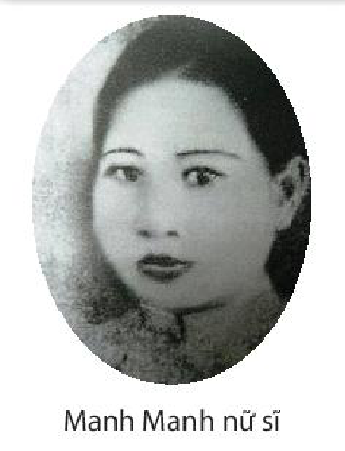
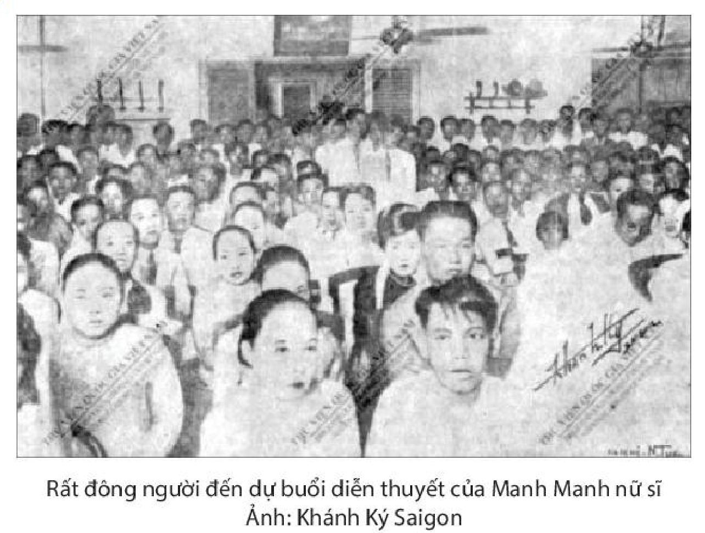
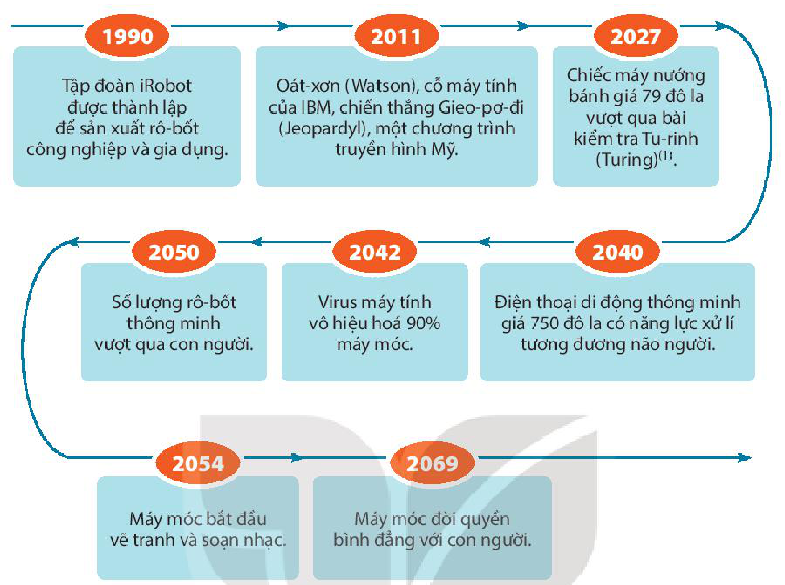
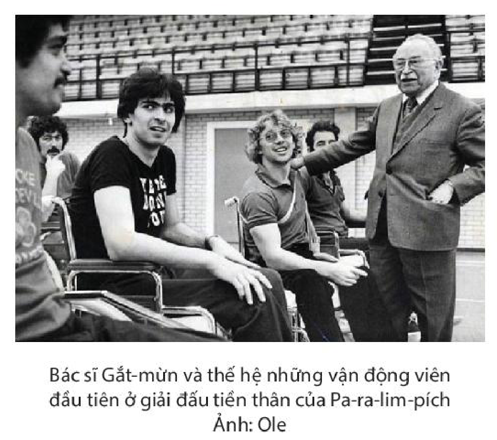
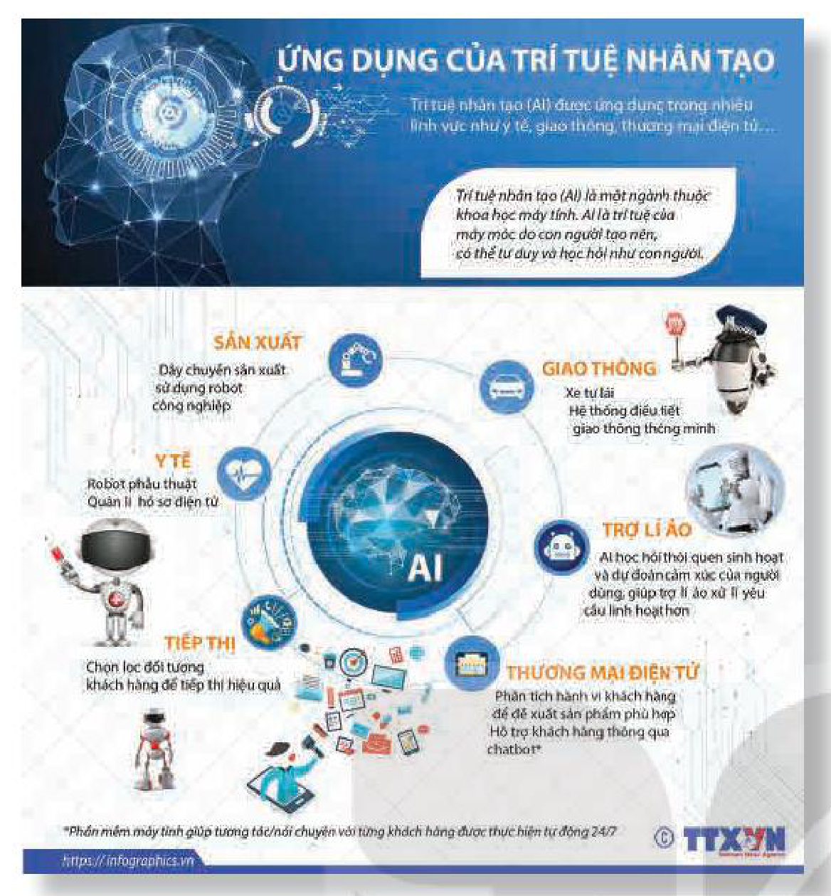
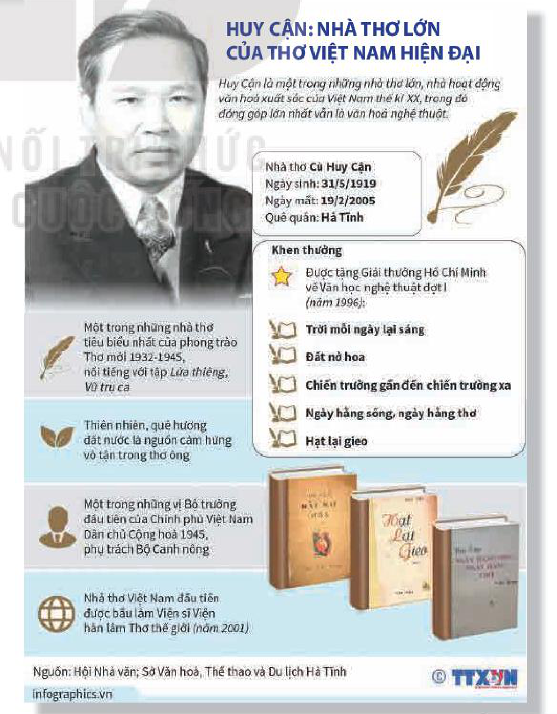

<!-- pdf:65 -->
# BÀI 8: CẤU TRÚC CỦA VĂN BẢN THÔNG TIN

## 🎯 Yêu cầu cần đạt

- Nhận biết được bố cục, mạch lạc của văn bản, cách trình bày dữ liệu, thông tin của người viết và đánh giá hiệu quả đạt được; biết suy luận và phân tích mối liên hệ giữa các chi tiết và vai trò của chúng trong việc thể hiện thông tin chính của văn bản.
- Phân tích và đánh giá được đề tài, thông tin cơ bản của văn bản, cách đặt nhan đề của tác giả; nhận biết được thái độ, quan điểm của người viết; thể hiện được thái độ, đánh giá đối với nội dung của văn bản hay quan điểm của người viết và giải thích lí do.
- Phân tích và đánh giá được tác dụng của các yếu tố hình thức (bao gồm phương tiện phi ngôn ngữ) trong việc làm tăng hiệu quả biểu đạt của văn bản thông tin.
- Viết được bài thuyết minh về một vấn đề của xã hội đương đại có lồng ghép một hay nhiều yếu tố như miêu tả, tự sự, biểu cảm, nghị luận.
- Biết tranh biện có hiệu quả và có văn hoá về một vấn đề trong đời sống phù hợp với lứa tuổi.
- Biết tiếp nhận thông tin đa chiều để xây dựng được tâm thế sống vững vàng, chủ động; coi trọng những giá trị văn hoá được xây đắp bền vững qua thời gian.

## ĐỌC

### TRI THỨC NGỮ VĂN

**Các yếu tố hình thức của văn bản thông tin**
Văn bản thông tin thường có những dấu hiệu nổi bật về **hình thức** trình bày như nhan đề, đề mục, sơ đồ, bảng biểu, chữ in nghiêng, chữ in đậm,... Những dấu hiệu này giúp cho người đọc có thể nắm bắt thông tin chính của văn bản một cách nhanh chóng. Nhan đề thường giới thiệu chủ đề của văn bản. Các đề mục tô đậm nội dung chính hoặc chỉ ra điểm bắt đầu của một chủ đề hoặc một mục mới. Các chữ in nghiêng, in đậm thường được sử dụng để nhấn mạnh những từ ngữ quan trọng. Các phương tiện phi ngôn ngữ như hình ảnh, bảng biểu, sơ đồ,... thường trực quan hoá những thông tin quan trọng trong văn bản. Bằng cách đọc lướt hình thức trình bày của văn bản, người đọc có thể dễ dàng nhận ra chủ đề, các nội dung chính và cấu trúc của văn bản thông tin.

<!-- pdf:66 -->
**Bố cục, mạch lạc của văn bản thông tin**
Văn bản thông tin được tạo thành bởi các yếu tố chính: chủ đề, các ý chính và ý phụ. Chủ đề là vấn đề chủ yếu được đề cập tới trong văn bản thông tin, thường được diễn đạt bằng một từ hoặc một cụm từ. Ý chính là ý quan trọng nhất mà tác giả muốn chia sẻ về chủ đề. Thông thường, ý chính của một đoạn văn hoặc một mục sẽ được trình bày trực tiếp trong câu chủ đề, thường ở đầu hoặc cuối đoạn văn. Đôi khi ý chính ẩn chìm trong văn bản và người đọc cần phải suy luận dựa vào những thông tin mà tác giả cung cấp. Ý phụ là các thông tin chi tiết nhằm bổ sung, làm rõ cho ý chính. Việc nhận ra chủ đề, ý chính và ý phụ của văn bản giúp người đọc nắm được **bố cục, mạch lạc** của văn bản, hiểu được bản chất của vấn đề được đề cập, nhờ vậy dễ dàng tiếp nhận và ghi nhớ thông tin.

**Cách trình bày dữ liệu trong văn bản thông tin**
Văn bản thông tin thường được trình bày theo những cách phù hợp với tiến trình nhận thức tự nhiên của người đọc. Có một số mô hình tổ chức thông tin chính: tổ chức thông tin theo trật tự thời gian, theo trật tự nhân quả, theo tầm quan trọng của vấn đề, theo quan hệ so sánh hoặc tương phản.

**Tổ chức thông tin theo trật tự thời gian** là trình bày các sự kiện theo tiến trình trước sau mà chúng diễn ra. Mô hình tổ chức này thường được sử dụng trong các văn bản lịch sử, tự thuật, tiểu sử, hướng dẫn quy trình tiến hành một hoạt động,... Có thể dễ dàng nhận ra mô hình tổ chức này dựa vào các từ ngữ chỉ thời gian như *ngày, tháng, năm*; các từ ngữ chỉ trình tự như *trước hết, sau đó, tiếp theo*;...

**Tổ chức thông tin theo trật tự nhân quả** là dựa vào mối liên hệ giữa một sự kiện với nguyên nhân và kết quả của sự kiện đó. Mô hình tổ chức này thường được sử dụng trong các văn bản lịch sử, văn bản khoa học mô tả các hiện tượng tự nhiên,... Có thể nhận ra mô hình tổ chức này dựa trên các từ ngữ chỉ quan hệ nhân quả như *bởi vì, cho nên, vì thế, do đó, nguyên nhân là, kết quả là*,...

**Tổ chức thông tin theo tầm quan trọng của vấn đề** là sắp xếp các thông tin theo cách từ những thông tin quan trọng nhất đến những thông tin ít quan trọng hơn hoặc ngược lại. Mô hình tổ chức này thường được sử dụng trong các văn bản mô tả cấu trúc của một đối tượng hoặc phân tích một vấn đề, thực trạng,... Có thể nhận ra mô hình tổ chức này dựa trên các từ ngữ chỉ thứ tự ưu tiên như *thứ nhất, thứ hai, thứ ba*,...

**Tổ chức thông tin theo quan hệ so sánh hoặc tương phản** là trình bày thông tin theo những đặc điểm tương đồng, khác biệt hoặc đối lập của hai hay nhiều đối tượng. Mô hình tổ chức này thường được sử dụng trong các văn bản khoa học. Các từ ngữ thể hiện mối quan hệ so sánh, tương phản thường là *giống với, khác với, ngược lại, tương tự như vậy, điểm chung, điểm khác biệt*,...

<!-- pdf:67 -->
**Mục đích, quan điểm của người viết trong văn bản thông tin**
Văn bản thông tin có nội dung khách quan, hạn chế tối đa việc thể hiện quan điểm, thái độ của tác giả. Tuy nhiên, mỗi tác giả khi viết văn bản thông tin thường hướng tới một mục đích nhất định. Mục đích giao tiếp chủ yếu của văn bản thông tin là cung cấp thông tin, nhưng bên cạnh đó, nó còn có thể nhắm đến mục đích khác như: thuyết phục, giải trí,... Mặt khác, kinh nghiệm, niềm tin của người viết cũng chi phối việc bày tỏ quan điểm, thái độ đối với vấn đề được đề cập, mặc dù điều này thường không được thể hiện một cách trực tiếp trong văn bản. Có thể nhận ra toàn bộ **mục đích, quan điểm**, thái độ nói trên dựa vào cách tiếp cận, lí giải chủ đề, dựa vào giọng điệu hoặc cách sử dụng ngôn từ của tác giả.

### VĂN BẢN 1: Nữ phóng viên đầu tiên
<!-- ocr-ok: nhãn VĂN BẢN 1 trên băng màu cam bị OCR bỏ sót, đã đối chiếu ảnh trang PDF 67 -->

**Trần Nhật Vy**

> Hãy chia sẻ những điều bạn đã biết về đời sống của người phụ nữ Việt Nam thời phong kiến và những năm đầu thế kỉ XX.

**Khoảng giữa năm 1931, làng báo Sài Gòn xuất hiện một nữ phóng viên chính hiệu ở tuần báo *Phụ nữ Tân văn*. Nữ phóng viên này là ai vậy?**

> Nhận xét cách mở đầu văn bản của tác giả.

Nói “nữ phóng viên chính hiệu” là bởi “trước đó ở Hà Nội cũng như Sài Gòn người giữ mục phụ nữ hay viết bài về phụ nữ, mặc dù kí tên là “Thị nọ Thị kia” nhưng đều là kí giả có râu”. (Ngoạ Long, *10 năm làng báo Sài Gòn*, báo *Đuốc Nhà Nam*, số ra ngày 17/10/1969).

Đó là Manh Manh nữ sĩ.

<!-- pdf:68 -->
Manh Manh nữ sĩ tên thật là Nguyễn Thị Kiêm (1914 – 2005), con ông tri huyện Nguyễn Đình Trị, quê quán ở Gò Công(1). Ông Trị từng là chủ huyện Lái Thiêu, Thủ Dầu Một(2), nghị viên hội đồng thành phố chung “sổ” (liên danh tranh cử) với giáo sư Nguyễn Văn Bá, chủ bút báo *Công Luận* thời Diệp Văn Kỳ(3) làm chủ nhiệm báo *Thần Chung*. Ông Trị cũng là “bầu” của đội bóng đá Ngôi Sao Xanh và sau đó đội Ngôi Sao Gia Định lừng lẫy một thời.

> Tóm tắt các hoạt động chính của nhân vật.

Bà học Trường Trung học Nữ sinh bản xứ(4) đến tú tài rồi bước vào nghề báo. Ban đầu bà chỉ là phóng viên thường, viết các mục nhỏ với bút hiệu YM, Nguyễn Văn MYM. Sau khi Phan Khôi đăng bài thơ *Tình già* (*Phụ nữ Tân văn*, số 122, ngày 10/3/1932) thì tên tuổi bà sáng lên qua bút danh Nguyễn Thị Manh Manh hoặc tên thật khi ủng hộ Thơ mới và cổ vũ cho nữ quyền.

[...] Bà Kiêm xuất hiện trong thời kì này khi mới mười bảy tuổi. Có lẽ vì còn quá trẻ nên bà chỉ làm phóng viên bình thường, thỉnh thoảng viết một bài về nữ quyền. Sau đó, khi mạnh mẽ ủng hộ Thơ mới, bà bắt đầu nổi tiếng với những cuộc diễn thuyết, những bài viết về bình đẳng giới và Thơ mới. Không chỉ ở Sài Gòn, bà còn đi diễn thuyết ở Huế, Hà Nội, Hải Phòng, Nam Định,... Thậm chí báo *Phụ nữ Tân văn* còn mở hẳn mục *Thơ mới* bên cạnh mục *Văn uyển* đăng các loại thơ cũ.

Trong số báo 228 ra ngày 14/12/1933, bà viết bài trả lời ông Hoàng Tâm báo *Đuốc Nhà Nam*: “Vì có nhiều vấn đề đáng quan tâm hơn là thơ nên chúng tôi hoãn lại việc đăng lên báo. Nay ông có nhắc đến sửa soạn ăn mừng thắng trận của ông, tôi xin soạn một bài Thơ mới của tôi viết cách nay hai tháng nay đăng lên báo. Nếu ông có dư thời giờ và báo *Đuốc Nhà Nam* có thiếu bài, ông cứ cho tôi hay, tôi sẽ đưa mấy bài Thơ mới cho ông đăng lên báo *Đuốc Nhà Nam* và phê bình luôn thể”.

> Chú ý các trích dẫn trực tiếp.

Còn cuộc diễn thuyết của bà ở Hội Khuyến học Sài Gòn (SAMIPIC, tức Hội Nam Kỳ Trí Đức Thể dục, nay ở số 606 đường Trần Hưng Đạo, quận 5), Hoài Thanh – Hoài Chân ghi nhận trong *Thi nhân Việt Nam*: “Từ hai tháng trước, hôm 26 Juillet(5) 1933, một nữ sĩ có tài và có gan, cô Nguyễn Thị Kiêm, đã lên diễn đàn Hội Khuyến học Sài Gòn hết sức tán dương Thơ mới. Hội Khuyến học Sài Gòn thành lập đến bấy giờ đã 25 năm. Lần thứ nhất một bạn gái lên diễn đàn và cũng lần thứ nhất có một cuộc diễn thuyết được đông người nghe như thế”(6).

> (1), (2) *Gò Công, Thủ Dầu Một*: hai tỉnh của Nam Bộ thời Pháp thuộc.
>
> (3) *Diệp Văn Kỳ* (1895 – 1945): nhà báo, người tham gia nhiều hoạt động yêu nước trước Cách mạng tháng Tám, chủ nhiệm nhật báo *Thần Chung* (1929 – 1930).
>
> (4) *Trường Trung học Nữ sinh bản xứ* (tiếng Pháp là Collège des Jeunes Filles Annamites de Saigon): tiền thân của Trường THPT Nguyễn Thị Minh Khai ở Thành phố Hồ Chí Minh.
>
> (5) *Juillet* (tiếng Pháp): tháng Bảy.
>
> (6) Hoài Thanh – Hoài Chân, *Thi nhân Việt Nam*, NXB Văn học, Hà Nội, 1988, tr. 25.

<!-- pdf:69 -->

> Hình ảnh được sử dụng có thể gợi ấn tượng gì cho người đọc?

Trong buổi diễn thuyết ấy, bà nói: “Muốn cho tình tứ không vì khuôn khổ mà bị đẹt mất (không lớn lên nổi) thì rất cần phải có một lối thơ khác, do lề lối nguyên tắc rộng rãi hơn. Thơ này khác hơn lối thơ xưa nên gọi là Thơ mới”. Và “chỉ mong lối Thơ mới được nhiều người để ý đến và nó có thể trở nên một lối thơ thông dụng để tả một cách thiết thực, rõ ràng những thi cảm của các nhà thi sĩ”. Thơ mới với sự cổ vũ của Nguyễn Thị Kiêm đã tạo ra một cuộc tranh luận dài trên báo chí cả trong Nam lẫn ngoài Bắc. Không chỉ nói, bà còn sáng tác Thơ mới, những bài *Hai cô thiếu nữ, Viếng phòng vắng*,... để lại ấn tượng mạnh mãi về sau.

Về nữ quyền, trong buổi nói chuyện ở Hội chợ Phụ nữ ngày 26/5/1932 tổ chức tại vườn Tao Đàn, bà nói: “Đối với những người như chúng tôi đây, ngu mà muốn học cho khôn, dốt mà muốn học cho giỏi, không biết mĩ thuật mà biết yêu mến mĩ thuật, không biết văn chương mà muốn cảm mến văn chương thì Nữ lưu học hội(1) thiệt là cần ích cho chúng tôi lắm”.

Tại Huế, đêm 03/5/1934, trong bài nói chuyện “Dư luận nam giới với phụ nữ tân tiến”, bà nói: “Chủ nghĩa phụ nữ là làm thế nào để giải phóng phụ nữ khỏi những lễ giáo hủ bại, binh vực(2) quyền lợi cho phụ nữ, kiếm những cách sinh hoạt cho chị em để sự sống của mình được hoàn toàn(3) hơn, và nâng cao trình độ trí thức của mình”.

> (1) *Nữ lưu học hội*: một tổ chức giáo dục do phụ nữ thành lập ở Sài Gòn vào đầu thế kỉ XX, nhằm truyền bá các tri thức phổ thông cho phụ nữ.
>
> (2) *Binh vực*: bênh vực.
>
> (3) *Hoàn toàn* (từ cũ): hoàn hảo, toàn vẹn.

<!-- pdf:70 -->
Làm vậy là bởi khi ấy vẫn còn quan niệm: “Đến thế kỉ thứ XX, đàn bà An Nam lại có nảy sanh(1) một số người quái gở! Họ vượt ra khỏi buồng the, chẳng theo lễ giáo cũ: Họ cũng đi học đi làm như đàn ông. Họ tự do đi, đứng, nói cười, ra giữa công chúng vợt banh(2), đá cầu, lập hội hè, đến chỗ đông mà tranh cãi”. Tại hội quán Khai Trí Tiến Đức Hà Nội tối ngày 08/9/1934, bà nói: “Đàn bà tân tiến là đàn bà mới, biết đi theo trào lưu xã hội, theo thời đại văn minh hiện chừ(3)” và người đàn bà ấy chỉ “xin ngang hàng với đàn ông, xin được đồng một phẩm giá làm người(4) trong xã hội”.

> Lời nói và hành động của nhân vật thể hiện tư tưởng gì? Những tư tưởng đó có ảnh hưởng gì đến xã hội?

Buổi nói chuyện tại Hà Nội của bà được báo chí Hà Nội ghi nhận: “Tối hôm thứ Bảy vừa rồi, cái lối cô Kiêm lên diễn đàn, công chúng đã ồ ạt kéo đến hội quán phố Hàng Trống như nước chảy, lũ lượt bọn năm bọn ba, ông có, bà có, trai có, gái có, đến nỗi mấy bác nhà quê đi đường ngơ ngác hỏi nhau: Họ đi xem hội gì đông thế?” (báo *Đông Pháp*). Tờ *Ngọ Báo* viết: “Trong nơi diễn đàn, ngày thường lỏng chỏng mấy bàn tổ tôm điếm, coi rộng thênh thang, hôm nay đã gấp đôi thế cũng chẳng đủ chỗ cho công chúng đứng, ngồi. Trên gác, dưới nhà, không một chỗ hở...” (*Phụ nữ Tân văn*, số 259, ngày 20/9/1934).

Sự thành công của bà Nguyễn Thị Kiêm đã tạo ra một phong trào phụ nữ mới hết sức sôi nổi, thúc đẩy các bà tham gia nhiều hoạt động xã hội ở Sài Gòn, Hà Nội.

Đáng tiếc, cuối năm 1934, tờ *Phụ nữ Tân văn* đình bản, bà Kiêm mất chỗ dựa, phong trào cổ vũ Thơ mới và đấu tranh cho nữ quyền của bà bị xẹp xuống. Và bà trở thành một nhà báo bình thường, cộng tác với một số báo đương thời. Sở trường của bà là phỏng vấn. Tuy vậy, bà cũng viết nhiều bài phê bình, ghi chép,...

Người thấp lùn, bộ tướng(5) núc ních, mặt má miếng bầu, môi nhọn như mỏ chim,... đôi mắt sáng ngời, thông minh, ăn nói mau lẹ, gọn gàng, duyên dáng. Đó là nhận xét của nhà báo Ngoạ Long. Với bộ tướng ấy, có thể nói bà Kiêm là “phụ nữ trời bắt xấu”. Tại buổi nói chuyện ở Hội Khuyến học Sài Gòn, để cử toạ trong phòng nhìn thấy diễn giả,

> Ngoại hình nhân vật được khắc hoạ như thế nào, nhằm mục đích gì?

> (1) *Nảy sanh*: nảy sinh.
>
> (2) *Vợt banh*: vợt ten-nít (tennis) hoặc vợt bóng bàn, đây chỉ việc chơi ten-nít hoặc bóng bàn.
>
> (3) *Hiện chừ*: hiện giờ.
>
> (4) *Xin được đồng một phẩm giá làm người*: đòi hỏi được xã hội tôn trọng phẩm giá như những người khác.
>
> (5) *Bộ tướng*: dáng vẻ.

<!-- pdf:71 -->
bà phải... đứng trên bàn để nói! Vì vậy, trong làng báo Sài Gòn thập niên 1930, ai cũng coi bà như một đồng nghiệp nam.

Chỉ có một người nhìn bà là “phụ nữ” đó là nhà báo Lư Khê Trương Văn Em, người sau này gá nghĩa(1) với bà năm 1937. Nhưng họ sống với nhau không lâu. Sau khi đứa con đầu lòng mất và bà không thể có con được nữa, hai người thoả thuận chia tay. Năm 1950, bà lấy chồng người Pháp và qua Pháp ở cho đến ngày mất.

> Những thông tin này gợi cho bạn suy nghĩ gì?

Đối với văn học Việt Nam, bà cũng có những đóng góp đáng kể, ít ra trong thể Thơ mới ở thập niên 1930. Thế nhưng hầu hết những ghi nhận về văn thơ giai đoạn 1930 – 1945 đều lãng quên bà!

(Báo *Tuổi Trẻ*, ngày 18/6/2015)

> (1) *Gá nghĩa*: kết thành vợ chồng.

**Trần Nhật Vy** tên thật là Nguyễn Hữu Vang, sinh năm 1956 tại Đồng Tháp. Ông là nhà báo, tác giả của nhiều tác phẩm biên khảo về lịch sử báo chí và văn hoá Sài Gòn. Các tác phẩm chính: *Báo quốc ngữ ở Sài Gòn cuối thế kỉ 19 – Lịch sử 150 năm báo chí quốc ngữ 1865 – 2015* (2015), *Sài Gòn chốn chốn rong chơi* (2016), *Văn chương Sài Gòn 1881 – 1924* (bộ 5 tập, 2017 – 2020),...

1. Văn bản được triển khai theo trình tự nào? Đánh giá hiệu quả của việc triển khai văn bản theo trình tự đó.

2. Phong trào xã hội nào đã được nói đến trong văn bản? Theo bạn, cách tác giả viết về phong trào ấy có điểm gì đặc biệt?

3. Hãy nhận xét về cách giới thiệu chân dung nhân vật trong văn bản. Theo bạn, chân dung ấy có được tái hiện một cách khách quan hay không? Vì sao?

4. Bạn hình dung như thế nào về không khí thời đại được tái hiện trong văn bản?

5. Qua văn bản, bạn biết thêm điều gì về phong trào Thơ mới?

6. Bài viết gợi cho bạn suy nghĩ gì về vị thế của phụ nữ trong các cuộc vận động xã hội?

#### Kết nối đọc – viết

Từ những thông tin tìm hiểu được trước và sau khi đọc văn bản, hãy viết một đoạn văn (khoảng 150 chữ) trình bày những hiểu biết của bạn về phong trào nữ quyền ở Việt Nam đầu thế kỉ XX.

<!-- pdf:72 -->
### VĂN BẢN 2: Trí thông minh nhân tạo
<!-- ocr-ok: nhãn VĂN BẢN 2 trên băng màu cam bị OCR đọc nhầm thành "K BÀN 2", đã đối chiếu ảnh trang PDF 72 -->

(Trích *50 ý tưởng về tương lai*)

**Ri-sát Oát-xơn (Richard Watson)**

> Chia sẻ những điều bạn đã biết và muốn biết về trí thông minh nhân tạo.

Năm 1956, nhà khoa học máy tính người Mỹ Giôn Mác Cát-thi (John Mc Carthy) đã đặt ra thuật ngữ “trí thông minh nhân tạo” (AI). Ông dự đoán rằng kỉ nguyên của các cỗ máy thông minh sẽ trở thành sự thực trong vòng một thập kỉ. [...]

> Đọc nhan đề và đoạn mở đầu, xác định chủ đề của văn bản.

**AI sắp trở thành hiện thực**

Năm 2008, một máy tính cá nhân có khả năng xử lí khoảng 10 tỉ lệnh mỗi giây. Nhiều quá. Nhưng chừng ấy chỉ bằng tốc độ xử lí của não một con cá nhỏ. Cho đến năm 2040, theo lí thuyết, các bộ não máy có thể xử lí gần 100 nghìn tỉ lệnh mỗi giây. Con số này tương đương với bộ não người. Vậy điều gì sẽ xảy đến khi trí thông minh nhân tạo bắt đầu đấu lại chính các nhà thiết kế ra nó?

> Chú ý các mốc thời gian và số liệu trong đoạn văn.
<!-- ocr-ok: thẻ chỉ dẫn đọc bên lề phải bị OCR tách dòng và đọc nhầm, đã đối chiếu ảnh trang PDF 72 -->

Trước khi tìm hiểu kĩ hơn về việc này, đầu tiên chúng ta nên chia AI thành hai nhóm. “AI mạnh” là thuật ngữ thường được sử dụng để mô tả những cỗ máy có khả năng suy nghĩ thực sự. “AI yếu” (đôi khi còn được biết đến là “AI hẹp”) là trí thông minh được dùng để bổ sung thay vì vượt lên trí tuệ loài người. Từ trước cho tới nay, phần lớn máy móc đều được lập trình trước hoặc dạy các chuỗi hành động logic. Nhưng trong tương lai, những cỗ máy có AI mạnh sẽ có khả năng học hỏi khi chúng vận hành và phản ứng lại với các sự kiện bất ngờ. Hệ quả của việc này ư? Bạn hãy nghĩ về khả năng những việc như chẩn đoán bệnh và phẫu thuật, lập kế hoạch quân sự và ra lệnh chiến đấu, chăm sóc khách hàng được tự động hoá, những chú rô-bốt với óc sáng tạo và tính tự động nhân tạo có thể dự đoán và đối phó với tội phạm.

> Tóm tắt nội dung chính trong đoạn văn.

<!-- pdf:73 -->

| Mốc thời gian | Sự kiện / Dự báo |
| --- | --- |
| **1990** | Tập đoàn iRobot được thành lập để sản xuất rô-bốt công nghiệp và gia dụng. |
| **2011** | Oát-xơn (Watson), cỗ máy tính của IBM, chiến thắng Gieo-pơ-đi (Jeopardy!), một chương trình truyền hình Mỹ. |
| **2027** | Chiếc máy nướng bánh giá 79 đô la vượt qua bài kiểm tra Tu-rinh (Turing)(1). |
| **2040** | Điện thoại di động thông minh giá 750 đô la có năng lực xử lí tương đương não người. |
| **2042** | Virus máy tính vô hiệu hoá 90% máy móc. |
| **2050** | Số lượng rô-bốt thông minh vượt qua con người. |
| **2054** | Máy móc bắt đầu vẽ tranh và soạn nhạc. |
| **2069** | Máy móc đòi quyền bình đẳng với con người. |
<!-- ocr-ok: bảng chuyển thể từ sơ đồ đồ hoạ H11-ngu_van-b08-03 bị OCR bỏ sót các mốc năm trong hình, đã đối chiếu ảnh trang PDF 73 -->

Liệu tất cả những ví dụ trên có thực tế không? Một số chuyên gia sẽ nói là có. Ray Cơ-dơ-uên (Rray Kurzweil), nhà tương lai học và nhà phát minh người Mỹ, đã công khai đánh cược với Mít-sen Cây-pơ (Mitchell Kapor), người sáng lập công ti phần mềm Lô-tút (Lotus), rằng máy tính sẽ vượt qua bài kiểm tra Tu-rinh vào năm 2029. Nhưng các chuyên gia khác nói không. Bin Can-vin (Bill Calvin), nhà thần kinh học lí thuyết người Mỹ, cho rằng não người phức tạp đến mức máy tính sẽ không bao giờ mô phỏng được, hoặc, nếu có, chúng sẽ thừa hưởng cả những điểm yếu và không toàn vẹn về mặt cảm xúc bên cạnh trí thông minh của con người. [...]

> Những quan niệm khác nhau về khả năng của trí thông minh nhân tạo.

Nhưng có lẽ tất cả chúng ta đều đang nhìn sai hướng. Internet đã và đang ngẫu nhiên nuôi dưỡng một dạng thức hỗn loạn tự tổ chức: một thị trường đặc biệt hiệu quả cho những ý tưởng, danh tiếng và thông tin vẫn được gọi là trí thông minh tổng hợp, và từ đây, AI có thể hình thành. A-đam Xmít (Adam Smith) cho rằng

> (1) *Bài kiểm tra Tu-rinh*: bài kiểm tra khả năng trí tuệ của máy tính, được đưa ra bởi A-lanh Tu-rinh (Alan Turing) vào năm 1950.

<!-- pdf:74 -->
người mua và người bán, mỗi bên theo đuổi lợi ích riêng của mình, sẽ cùng nhau tạo ra nhiều hàng hoá hơn, hiệu quả hơn bất cứ sự sắp xếp nào khác. Điều tương tự đang diễn ra với những nhà cung cấp trực tuyến và có thể với cả khách hàng. Chẳng hạn, Wikipedia(1) có thể tạo ra nhiều tri thức với ít thiên lệch và theo một dải các quy định rộng hơn bất cứ nhóm chuyên gia nào.

**Điều gì xảy ra tiếp theo?**

Rất ít người nghi ngờ việc AI sẽ tiến bộ hết sức nhanh chóng trong những năm tới. Một số nhà bình luận nói rằng AI hiện nay đang ở vị trí giống với máy tính cá nhân trong khoảng năm 2004, vậy nên sự tiến bộ ấy có thể sẽ vô cùng lớn. Trước kia, sự tiếp cận AI của chúng ta vẫn mang tính thủ công, nhưng một khi các kĩ thuật vi tính phát triển song song trở nên hoàn thiện, ta có thể rất nhanh chóng đạt được AI đích thực.

Tuy nhiên, vẫn còn đó hai câu hỏi lớn. Thứ nhất, liệu não người về cơ bản chỉ là một cỗ máy với đống dây dợ và vài chất hoá học cũng như điện năng được thêm vào, hay còn chứa đựng nhiều thứ hơn thế? Nếu não người chỉ đơn giản là bộ sưu tập của những nguyên tử, vậy thì chắc chắn rằng trước sau gì chúng ta cũng thiết kế ra những cỗ máy có thể bắt kịp và thậm chí là vượt qua những năng lực của con người. Nếu điều này xảy đến, có lẽ loài người sẽ bước vào một kỉ nguyên tiến hoá mới, thời điểm chúng ta bắt đầu hợp nhất với máy móc và đạt được sự bất tử ở một mức nào đó. Thực vậy, có lẽ việc này đã xảy ra rồi nếu cho rằng bản thể “thực sự” của chúng ta là DNA và cơ thể con người chỉ là “phần xác” tạm thời chứa đựng chúng. Thứ hai, ngay cả nếu máy móc không đạt được mức độ tinh tế như trên, nhiều khả năng là chúng vẫn sẽ trở nên rất thông minh; vậy thì điều gì sẽ xảy đến với những người trước kia làm những việc mà máy móc sẽ đảm nhiệm trong tương lai?

> Cách đặt câu hỏi và suy luận của tác giả về những điều có thể xảy ra trong tương lai.
>
> Các từ ngữ liên kết thể hiện mối quan hệ giữa các ý chính, ý phụ trong đoạn văn.

Chào mừng đến với thế giới tương lai. Một thế giới chỉ toàn kim loại và sử dụng rất nhiều pin. Hi vọng rằng máy móc sẽ không giận dữ và không tìm ra cách nô dịch loài người.

(Theo Ri-sát Oát-xơn, *50 ý tưởng về tương lai*, Trọng Tuấn – Ngọc Thạch dịch, NXB Thế giới – Công ti Văn hoá và Truyền thông Nhã Nam, Hà Nội, 2019, tr. 120 – 125)

> (1) *Wikipedia*: bách khoa toàn thư mở trực tuyến.

<!-- pdf:75 -->
**Ri-sát Oát-xơn** sinh năm 1961, là nhà tương lai học và giảng viên đại học người Anh. Ông cũng là cây bút nổi tiếng về các phát minh, sáng chế và là người phân tích, dự đoán các xu hướng toàn cầu trong tương lai. Các cuốn sách đã xuất bản của ông gồm có: *Hồ sơ tương lai: lược sử 50 năm tới* (2007); *Trí tuệ tương lai: kỉ nguyên thông tin đã thay đổi đầu óc chúng ta như thế nào, tại sao và chúng ta có thể làm gì* (2010); *Kĩ thuật số và con người: chúng ta sẽ sống, yêu và suy nghĩ ra sao trong tương lai* (2016);...

Văn bản ***Trí thông minh nhân tạo*** được trích trong *50 ý tưởng về tương lai* (2012) của Ri-sát Oát-xơn. Cuốn sách đã đưa ra những dự báo nhiều mặt về tương lai nhân loại như sự phát triển của kĩ thuật số, sự cạn kiệt tài nguyên, công nghệ nano, trí tuệ ngoài hành tinh, hiểm hoạ sinh học và dịch bệnh, khủng bố hạt nhân,... Những viễn cảnh tương lai này buộc người đọc phải suy tư về những lựa chọn và hành động của mình trong hiện tại.

1. Hãy sử dụng phương tiện phi ngôn ngữ để tóm tắt các mốc thời gian và các thành tựu chính trong quá trình phát triển của trí thông minh nhân tạo. Các thông tin đó gợi cho bạn suy nghĩ gì?

2. Đánh giá hiệu quả thông tin của sơ đồ được tác giả sử dụng.

3. Xác định chủ đề, các ý chính, ý phụ và cách trình bày dữ liệu trong văn bản.

4. Theo bạn, những ý kiến trái chiều về sự phát triển của trí thông minh nhân tạo và những câu hỏi ở phần cuối văn bản cho thấy quan điểm, thái độ gì của tác giả?

5. Tác giả đưa ra những dự đoán gì về tương lai của trí tuệ nhân tạo? Bạn có đồng tình với những dự đoán đó không? Vì sao?

6. Tìm hiểu thêm các tác phẩm nghệ thuật về trí thông minh nhân tạo. Bạn suy nghĩ gì khi liên hệ các thông tin trong văn bản với những tác phẩm nghệ thuật mình đã biết?

#### Kết nối đọc – viết

Viết đoạn văn (khoảng 150 chữ) tóm tắt những thông tin thú vị mà bạn thu thập được về trí thông minh nhân tạo.

<!-- pdf:76 -->
### VĂN BẢN 3: Pa-ra-lim-pích (Paralympic): Một lịch sử chữa lành những vết thương
<!-- ocr-ok: nhãn VĂN BẢN 3 trên băng màu cam bị OCR đọc nhầm thành "K*S", đã đối chiếu ảnh trang PDF 76 -->

**Huy Đăng**

> Tìm hiểu thông tin về một vận động viên hoặc một môn thể thao mà bạn yêu thích. Theo bạn, thể thao có ý nghĩa gì với đời sống con người?

***Mười hai năm trước, một quả tên lửa RPG trên chiến trường Áp-ga-ni-xtan (Afghanistan) đã thổi bay phân nửa mạng sống của lính nhảy dù người Anh Gia-co Van Gát (Jaco Van Gass). Nhưng với ba phần tư cơ thể còn sót lại, Van Gát vẫn trở thành một biểu tượng người hùng với hàng triệu người.***

> Dựa vào nhan đề và phần sa-pô, dự đoán về nội dung chính của văn bản.
<!-- ocr-ok: thẻ chỉ dẫn đọc bên lề phải bị OCR tách dòng và đọc nhầm, đã đối chiếu ảnh trang PDF 76 -->

Những cựu chiến binh, những nạn nhân của chiến tranh như Van Gát trở thành tâm điểm ở Pa-ra-lim-pích Tô-ky-ô (Tokyo) 2020.

**Mục tiêu ban đầu**

Pa-ra-lim-pích ra đời vào năm 1960. Trải qua sáu thập niên, phong trào thể thao dành cho người khuyết tật trở thành điều hết sức gần gũi với cuộc sống con người.

> Dựa vào đề mục, dự đoán về thông tin chính sẽ được trình bày.

Hầu hết các bậc cha mẹ có con em bị khuyết tật ngày nay đều biết tìm đến những lớp học thể thao, và thể thao trở thành thứ không thể thiếu giúp những người khiếm khuyết cơ thể phát triển năng lực như một người bình thường. Nhưng có lẽ không nhiều người biết – hơn nửa thế kỉ trước, cội nguồn của Pa-ra-lim-pích chính là dành cho các nạn nhân của chiến tranh, với mục tiêu giúp họ hoà nhập cùng cuộc sống bình thường.

Sự kiện đánh dấu sự ra đời của Pa-ra-lim-pích diễn ra vào năm 1948 – trùng với kì Ô-lim-pích (Olympic) diễn ra tại Luân Đôn. Bác sĩ người Đức gốc Do Thái Lút-vích Gắt-mừn (Ludwig Guttmann), người từng được hỗ trợ trốn thoát khỏi Đức quốc xã năm 1939, đứng ra tổ chức một cuộc thi đấu thể thao

> Chú ý các từ ngữ chỉ thời gian và các sự kiện chính.

<!-- pdf:77 -->
dành cho các cựu chiến binh Thế chiến II người Anh. Đa số họ là các bệnh nhân chấn thương tuỷ sống. Giải đấu thể thao đó mang tên Thế vận hội Xe lăn Quốc tế.

Ngay từ lần tổ chức đầu tiên, bác sĩ Gắt-mừn đã đặt mục tiêu sẽ đưa giải đấu thể thao này lên sánh ngang tầm Ô-lim-pích, trở thành một kì Thế vận hội dành riêng cho những người khuyết tật. Tuy nhỏ lẻ, hạn hẹp kinh phí, nhưng sự kiện thực sự mang tầm quốc tế khi có sự tham dự của các cựu binh người Hà Lan và Anh, tổng cộng 16 vận động viên. Địa điểm diễn ra không đâu khác mà chính là bệnh viện Xtốc Men-đơ-vin (Stoke Mandeville) ở Bấc-kinh-ham-sơ (Buckinghamshire), nơi bác sĩ Gắt-mừn làm việc. Cái tên Xtốc Men-đơ-vin sau này được xem như cánh đồng Ma-ra-ton (Marathon) của Hy Lạp – nơi khởi phát phong trào Ô-lim-pích.

Thế vận hội Xtốc Men-đơ-vin tiếp tục được tổ chức những năm sau đó, đến mức thường niên từ năm 1952. Đến năm 1960, nó trở thành kì Pa-ra-lim-pích đầu tiên. Cuộc thi không còn chỉ dành cho các cựu chiến binh, nhưng tiêu chí vận động viên khuyết tật dự giải đơn giản vẫn phải là “xe lăn”. Kì Pa-ra-lim-pích đầu tiên diễn ra ở Rôm (Rome) có 400 vận động viên đến từ 23 quốc gia tham dự. Bác sĩ Gắt-mừn cùng những cộng sự ở bệnh viện Xtốc Men-đơ-vin cũng là thành viên sáng lập đầu tiên của Uỷ ban Thế vận hội Xtốc Men-đơ-vin.

> Xác định thông tin chính được trình bày.

Hai năm sau kì Pa-ra-lim-pích đầu tiên mới xuất hiện một tổ chức thể thao dành cho người khuyết tật, nhằm mục đích hỗ trợ những người khuyết tật không đủ điều kiện tham dự Pa-ra-lim-pích. Đó có thể xem là bước đi đầu tiên của phong trào thể thao khuyết tật thế giới. Pa-ra-lim-pích không còn là một sự kiện thể thao dành cho “những người khuyết tật ưu tú” nữa, thay vào đó, nó trở thành phong trào tập luyện cho tất cả mọi người khuyết tật. Dần dà, phạm vi Pa-ra-lim-pích được mở rộng với nhiều hạng mục khác nhau, các tiêu chuẩn tập luyện, thi đấu được phát triển, ngày càng đồng nhất với Ô-lim-pích.

Năm 1988 tại Xơ-un (Seoul), Pa-ra-lim-pích và Ô-lim-pích thống nhất được tổ chức cùng nhau tại một thành phố, sử dụng cùng cơ sở vật chất và liền mạch về thời gian.

<!-- pdf:78 -->
**Vượt qua những nỗi đau**

> Tên đề mục gợi cho bạn suy nghĩ gì?

Sau sáu thập niên, những nạn nhân của chiến tranh một lần nữa trở thành tâm điểm của Pa-ra-lim-pích. Gần 10% các vận động viên của Mỹ dự Pa-ra-lim-pích Tô-ky-ô 2020 là những cựu chiến binh. Đoàn thể thao người tị nạn cũng tham dự giải với sáu thành viên, và mỗi ngày chúng ta lại thấy những vận động viên xuất sắc như Van Gát toả sáng. Cựu lính nhảy dù người Anh gặp nạn vào năm 2009, và được Help for Heroes (tổ chức Hỗ trợ các Cựu chiến binh) của Anh giúp đỡ.

“Tôi đã học cách thích nghi, giống như cách mà tôi đã thích nghi để trở thành một lính nhảy dù. Chúng tôi có thể lên kế hoạch để hạ cánh trên một toà nhà có cửa thoát, nhưng nếu phải hạ cánh ở một nơi khác thì chúng tôi vẫn phải chấp nhận. Thông qua Help for Heroes, tôi biết cuộc sống của mình vẫn còn nhiều mục tiêu”, Van Gát nói.

> Xác định thông tin chính được trình bày.

Với năng lực và ý chí của một quân nhân, Van Gát nhanh chóng thích nghi với đời sống thể thao chuyên nghiệp. Trượt tuyết và leo núi là những môn thể thao đầu tiên anh lựa chọn. Năm 2011, anh trở thành người gốc Nam Phi đầu tiên chinh phục được ngọn Man-na-xlu (Manaslu) ở dãy Hi-ma-lay-a (Himalaya – ngọn núi cao thứ tám thế giới, 8 164 mét). Hai năm sau, Van Gát, cùng hoàng tử Anh Ha-ry (Harry) tham gia chuyến thám hiểm hành trình 335 ki-lô-mét ở Nam Cực nhằm gây quỹ cho các thương binh. Sau đó, anh bắt đầu hướng đến những môn thể thao cạnh tranh. Ngay trong lần đầu tham dự Pa-ra-lim-pích, cựu quân nhân người Anh đã giành được hai huy chương Vàng và một huy chương Đồng ở môn xe đạp.

> Chú ý đến các nhân vật và các câu chuyện được giới thiệu.

Trong số các cựu quân nhân tham dự Pa-ra-lim-pích, Brét-ly Xnai-đơ (Bradley Snyder) có lẽ là người nổi tiếng nhất. Vận động viên bơi lội khiếm thị này từng phục vụ trong hải quân Mỹ khi tham chiến ở Áp-ga-ni-xtan. Khi giúp đỡ các nạn nhân trong một vụ đánh bom năm 2011, mắt của anh đã bị hỏng và từ đó anh phải làm quen với cuộc sống mù loà.

“Khi không còn ánh sáng đôi mắt, mọi việc bạn làm đều trở nên khó khăn. Điều duy nhất tôi không bị cản trở là bơi lội”, Xnai-đơ nói.

Anh vốn là đội trưởng đội bơi ở Học viện Hải quân nên dễ dàng thích nghi với đời sống thi đấu thể thao. Chỉ một năm sau đó, Xnai-đơ đến Pa-ra-lim-pích Luân Đôn 2012 và giành hai huy chương Vàng. Ở Ri-ô đờ Gian-nê-rô (Rio de Janeiro) 2016, anh lại có ba huy chương Vàng. Đến với Tô-ky-ô 2020, Xnai-đơ chuyển sang thi đấu ba môn phối hợp (bơi, đạp, chạy) và lập tức giành huy chương Vàng Pa-ra-lim-pích thứ sáu trong sự nghiệp.

<!-- pdf:79 -->
Có rất nhiều những câu chuyện xúc động như của Van Gát và Xnai-đơ ở Pa-ra-lim-pích Tô-ky-ô 2020. Từ những cựu chiến binh cho đến các nạn nhân chiến tranh, họ là cội nguồn cho sự ra đời của phong trào thể thao người khuyết tật, và câu chuyện chữa lành vết thương của họ càng đáng được kể hơn bao giờ hết khi nhân loại đang oằn mình trong một đại dịch đã kéo dài hai năm và chưa biết bao giờ mới kết thúc.

(Theo báo *Tuổi Trẻ Cuối Tuần*, ngày 05/9/2021)

1. Hãy nêu khái quát chủ đề của văn bản. Cách tiếp cận vấn đề của tác giả có gì đặc biệt?

2. Phân tích tác dụng của các phương tiện phi ngôn ngữ trong văn bản.

3. Xác định các ý chính, ý phụ trong văn bản. Sử dụng phương tiện phi ngôn ngữ để tóm tắt các thông tin.

4. Yếu tố tự sự có vai trò gì trong văn bản?

5. Quan điểm của tác giả là gì? Quan điểm đó được thể hiện bằng cách nào?

6. Phát biểu suy nghĩ của bạn về khả năng kì lạ của con người sau khi đọc các thông tin về một số vận động viên thể thao trong văn bản.

7. Văn bản giúp bạn hiểu thêm gì về nỗi đau? Ta có thể ứng xử như thế nào với nỗi đau và những khiếm khuyết trên cơ thể của mình và của người khác?

#### Kết nối đọc – viết

Viết đoạn văn (khoảng 150 chữ) về khả năng chữa lành của thể thao.

### Thực hành tiếng Việt: Sử dụng phương tiện phi ngôn ngữ

1. Trong những văn bản đọc của Bài 8 – *Cấu trúc của văn bản thông tin*, ngoài việc biểu đạt bằng ngôn ngữ, còn có các phương tiện biểu đạt nào khác? Nêu ví dụ và cho biết mỗi phương tiện đó có tác dụng gì trong việc thể hiện nội dung của văn bản.

<!-- pdf:80 -->
2. Quan sát hai văn bản sau và thực hiện các yêu cầu:

> **ỨNG DỤNG CỦA TRÍ TUỆ NHÂN TẠO**
>
> *Trí tuệ nhân tạo (AI) được ứng dụng trong nhiều lĩnh vực như y tế, giao thông, thương mại điện tử,...*
>
> *Trí tuệ nhân tạo (AI) là một ngành thuộc khoa học máy tính. AI là trí tuệ của máy móc do con người tạo nên, có thể tư duy và học hỏi như con người.*
>
> - **SẢN XUẤT**: Dây chuyền sản xuất sử dụng robot công nghiệp
> - **Y TẾ**: Robot phẫu thuật; Quản lí hồ sơ điện tử
> - **TIẾP THỊ**: Chọn lọc đối tượng khách hàng để tiếp thị hiệu quả
> - **GIAO THÔNG**: Xe tự lái; Hệ thống điều tiết giao thông thông minh
> - **TRỢ LÍ ẢO**: AI học hỏi thói quen sinh hoạt và dự đoán cảm xúc của người dùng, giúp trợ lí ảo xử lí yêu cầu linh hoạt hơn
> - **THƯƠNG MẠI ĐIỆN TỬ**: Phân tích hành vi khách hàng để đề xuất sản phẩm phù hợp; Hỗ trợ khách hàng thông qua chatbot\*
>
> *\*Phần mềm máy tính giúp tương tác/nói chuyện với từng khách hàng được thực hiện tự động 24/7*
>
> Nguồn: *https://infographics.vn* – TTXVN
<!-- ocr-ok: nội dung chữ cỡ nhỏ trong infographic Ứng dụng của trí tuệ nhân tạo bị OCR đọc sai dấu, đã đối chiếu ảnh trang PDF 80 -->

> **HUY CẬN: NHÀ THƠ LỚN CỦA THƠ VIỆT NAM HIỆN ĐẠI**
>
> *Huy Cận là một trong những nhà thơ lớn, nhà hoạt động văn hoá xuất sắc của Việt Nam thế kỉ XX, trong đó đóng góp lớn nhất vẫn là văn hoá nghệ thuật.*
>
> - Nhà thơ **Cù Huy Cận** | Ngày sinh: **31/5/1919** | Ngày mất: **19/2/2005** | Quê quán: **Hà Tĩnh**
> - **Khen thưởng**: Được tặng Giải thưởng Hồ Chí Minh về Văn học nghệ thuật đợt I *(năm 1996)*:
>   - **Trời mỗi ngày lại sáng**
>   - **Đất nở hoa**
>   - **Chiến trường gần đến chiến trường xa**
>   - **Ngày hằng sống, ngày hằng thơ**
>   - **Hạt lại gieo**
> - Một trong những nhà thơ tiêu biểu nhất của phong trào Thơ mới 1932–1945, nổi tiếng với tập *Lửa thiêng*, *Vũ trụ ca*
> - Thiên nhiên, quê hương đất nước là nguồn cảm hứng vô tận trong thơ ông
> - Một trong những vị Bộ trưởng đầu tiên của Chính phủ Việt Nam Dân chủ Cộng hoà 1945, phụ trách Bộ Canh nông
> - Nhà thơ Việt Nam đầu tiên được bầu làm Viện sĩ Viện hàn lâm Thơ thế giới *(năm 2001)*
>
> Nguồn: Hội Nhà văn; Sở Văn hoá, Thể thao và Du lịch Hà Tĩnh – *infographics.vn* – TTXVN
<!-- ocr-ok: nội dung chữ cỡ nhỏ trong infographic Huy Cận bị OCR đọc sai nhiều từ, đã đối chiếu ảnh trang PDF 80 -->

a. Những thông tin chính nào được trình bày trong văn bản *Ứng dụng của trí tuệ nhân tạo*? Các thông tin được sắp xếp theo trình tự và bố cục như thế nào? Phân tích hiệu quả sử dụng phối hợp giữa phương tiện ngôn ngữ và phi ngôn ngữ trong văn bản (đối chiếu với cách thể hiện thông tin của văn bản *Trí thông minh nhân tạo*).

b. Văn bản *Huy Cận: Nhà thơ lớn của thơ Việt Nam hiện đại* trình bày những thông tin chính nào về tác giả Huy Cận? So với nội dung trình bày về Huy Cận ở Bài 2 – *Cấu tứ và hình ảnh trong thơ trữ tình* (sách giáo khoa *Ngữ văn 11*, tập một), cách thể hiện thông tin của văn bản trên có điểm gì khác biệt?

c. Hai văn bản trên được gọi là infographic (đồ hoạ thông tin). Theo bạn, có thể sử dụng hình thức trình bày này vào những hoạt động nào trong học tập?

<!-- pdf:81 -->
3. Chọn một trong hai yêu cầu sau để thiết kế một infographic:

– Tóm tắt những thông tin chính về một tác giả văn học có tác phẩm được học trong sách giáo khoa *Ngữ văn* lớp 11.

– Tóm tắt những thông tin chính của một văn bản được học ở Bài 8 – *Cấu trúc của văn bản thông tin*.

> **Infographic** (đồ hoạ thông tin) là văn bản đa phương thức được thiết kế dưới dạng một bức đồ hoạ có sự kết hợp giữa ngôn ngữ với hình ảnh, biểu đồ, số liệu,... nhằm truyền đạt thông tin một cách ngắn gọn, trực quan, sinh động.
>
> Ngoài việc truyền đạt thông tin, infographic còn chú ý tạo sự hấp dẫn đối với người tiếp nhận bằng hiệu quả thẩm mĩ của hình thức trình bày như màu sắc, đường nét,...

## VIẾT

**Viết văn bản thuyết minh về một vấn đề của xã hội đương đại**
*Một bài văn thuyết minh có thể có những cấu trúc khác nhau. Ở Bài 7, các bạn đã thực hành viết một bài văn thuyết minh triển khai theo cấu trúc “nguyên nhân – hệ quả – giải pháp”. Ở bài học này, bạn có cơ hội thực hành viết bài văn thuyết minh theo một cấu trúc khác, chẳng hạn theo các biểu hiện hay phạm vi ảnh hưởng của một hiện tượng, theo diễn biến thời gian của hiện tượng đó,... Tuỳ vào vấn đề thuyết minh mà bạn cần lựa chọn cấu trúc phù hợp. Ngoài ra, bạn cũng được tiếp tục thực hành kĩ năng kết hợp vào bài thuyết minh một hay nhiều yếu tố như miêu tả, tự sự, biểu cảm, nghị luận để cung cấp các thông tin xác thực, hấp dẫn, tác động tích cực đến nhận thức và cảm xúc của người đọc.*
> **Yêu cầu**
> - Nêu rõ vấn đề xã hội được thuyết minh và cung cấp một số thông tin cơ bản, nổi bật về vấn đề đó.
> - Làm sáng tỏ các biểu hiện hay phạm vi ảnh hưởng của vấn đề đối với đời sống xã hội hoặc cung cấp thông tin theo trình tự khác phù hợp với vấn đề được thuyết minh.
> - Rút ra được ý nghĩa của việc nhận thức đúng vấn đề thuyết minh.
> - Sử dụng kết hợp trong văn bản thuyết minh một hay nhiều yếu tố như miêu tả, tự sự, biểu cảm, nghị luận.

<!-- pdf:82 -->
### Bài viết tham khảo

**Tiếc thương sinh thái**
<!-- ocr-ok: nhan đề màu cam Tiếc thương sinh thái bị OCR bỏ sót, đã đối chiếu ảnh trang PDF 82 -->

*(Trích)*

**Nguyễn Bình**

***Bước sang năm 2022, chúng ta nghe thấy và nhìn thấy biến đổi khí hậu ở mọi nơi, cả ở ngoài đời thực, cả trong ngôn ngữ và trong nghệ thuật. Giữa một thế giới nơi tất cả các giọng nói – hay thậm chí là giọng hát – đều gợi nhắc về một thảm kịch toàn cầu đang cận kề, biến đổi khí hậu đã đi vào tâm thức của mọi người và tác động sâu sắc đến đời sống tinh thần. Một hậu quả đáng chú ý là sự xuất hiện của hiện tượng tâm lí “tiếc thương sinh thái” (ecological grief).***

> Giới thiệu thông tin khái quát về hiện tượng.

Cụm từ “tiếc thương sinh thái” xuất hiện lần đầu trong một bài viết vào năm 2018 của hai nhà khoa học xã hội A-sli Kun-xô-lơ (Ashlee Cunsolo) và Ne-vi-lơ R. E-li (Neville R. Ellis), trong đó họ định nghĩa tiếc thương sinh thái là nỗi đau khổ trước những mất mát về sinh thái mà con người hoặc là đã trải qua, hoặc là tin rằng đang ở phía trước. Những mất mát này có thể đa dạng, ví dụ như sự biến mất của các loài sinh vật hay sự thay đổi ở các cảnh quan quan trọng đối với đời sống tinh thần, song điểm chung là chúng đều do biến đổi khí hậu gây ra và đều khiến tâm trí con người phản ứng tương tự như khi mất người thân. Theo Kun-xô-lơ và E-li, tiếc thương sinh thái là một phản ứng có thể đoán trước được, nhất là ở những cộng đồng vẫn còn sinh sống, làm việc và giữ các mối quan hệ văn hoá mật thiết với môi trường tự nhiên. Hai tác giả này đưa ra hai trường hợp cụ thể: những người I-nu-it (Inuit) ở miền Bắc Ca-na-đa (Canada) và những người làm nghề trồng trọt ở Ốt-xtrây-li-a (Australia). Lúc được hỏi về sự thay đổi môi trường chóng vánh ở nơi mình sống, cả hai cộng đồng này đều có chung những cảm xúc như nỗi thất vọng, u sầu, hay thậm chí là ý nghĩ muốn tự sát, mặc dù họ sinh sống ở hai nơi hoàn toàn khác nhau về mặt địa lí, phong tục tập quán, và còn bị ảnh hưởng bởi các loại thiên tai hoàn toàn khác nhau.

> Giải thích bản chất và nguyên nhân của hiện tượng “tiếc thương sinh thái”.

<!-- pdf:83 -->
[...] Như bất kì vấn đề sức khoẻ tâm thần nào khác, nỗi tiếc thương sinh thái ăn sâu vào tâm trí một người và thường xuyên đẩy họ vào trạng thái khủng hoảng hiện sinh(1). Kun-xô-lơ và E-li ghi nhận câu trả lời của một người I-nu-it như sau: “I-nu-it là dân tộc băng biển. Băng biển không còn, làm sao chúng tôi còn là dân tộc băng biển được nữa?”. Và những cảm xúc như vậy thực sự cũng chẳng còn xa lạ gì nữa: khi rừng A-ma-dôn (Amazon) bốc cháy năm 2019, các tộc người bản địa ở Bra-xin (Brazil) như người Ten-ha-rim (Tenharim), người Gu-a-tô (Guató) và người Gu-a-ra-ni (Guaraní) đều đã nói rằng họ đang mất hết tất cả và khó có thể gìn giữ được truyền thống văn hoá của mình khi mà cánh rừng quê hương đang bốc cháy ngùn ngụt. [...] Có thể thấy, đối với người ở nơi “tiền tuyến” của biến đổi khí hậu – cho dù là cộng đồng địa phương hay là các nhà nghiên cứu thực địa, việc chứng kiến và cảm nhận trực tiếp hậu quả của biến đổi khí hậu đã để lại tác động tâm lí nghiêm trọng, bởi những người này đã lâu ngày gần gũi và gắn bó với môi trường đang bị huỷ hoại. [...]

> Hiện tượng “tiếc thương sinh thái” ở những nơi được coi là “tiền tuyến” của biến đổi khí hậu.

Tiếc thay, sau hàng thập kỉ biết đến mối nguy hại của biến đổi khí hậu, nỗi tiếc thương sinh thái đã bắt đầu ảnh hưởng tới cả người ở hậu phương. Tháng 12/2021, Ca-ro-lai Hích-mơn (Caroline Hickman) và cộng sự công bố một cuộc thăm dò về cảm xúc trước biến đổi khí hậu của 1 000 trẻ em và thanh thiếu niên từ mỗi quốc gia trong tổng số mười nước: Anh, Ốt-xtrây-li-a, Ấn Độ, Bồ Đào Nha, Bra-xin, Hoa Kỳ, Ni-giê-ri-a (Nigeria), Pháp, Phần Lan và Phi-líp-pin (Philippines). Trong số những người được hỏi, 59% thấy “rất hoặc cực kì lo” về biến đổi khí hậu, và 45% thừa nhận rằng cảm xúc của họ về biến đổi khí hậu có ảnh hưởng tiêu cực đến cuộc sống thường ngày. Ngoài ra, giới trẻ cũng bị ảnh hưởng ở cả các nước ít hoặc chưa chịu ảnh hưởng trực tiếp của biến đổi khí hậu như Pháp (58% “rất hoặc cực kì lo”, 35% bị ảnh hưởng trong cuộc sống thường ngày), Anh (49% “rất hoặc cực kì lo”, 28% bị ảnh hưởng trong cuộc sống thường ngày) và Phần Lan (44% “rất hoặc cực kì lo”, 31% bị ảnh hưởng trong cuộc sống thường ngày). [...] Nỗi lo về biến đổi khí hậu và sự

> Hiện tượng “tiếc thương sinh thái” ảnh hưởng đến cả những nơi được coi là “hậu phương” của biến đổi khí hậu.

> (1) *Khủng hoảng hiện sinh*: khủng hoảng khi một người trải qua những thay đổi lớn khiến họ mất niềm tin vào cuộc sống và chính bản thân mình.

<!-- pdf:84 -->
chấp nhận tận thế đang cận kề đều là các cảm xúc không hiếm gặp ở những người trẻ ngày nay, nhất là kể từ khi đại dịch COVID-19 bắt đầu. [...]

Tiếc thương sinh thái và các cảm xúc khác do biến đổi khí hậu quả thật đều là các hiện tượng hoàn toàn mới của thế kỉ XXI, song chúng vẫn để lại tác động muôn hình vạn trạng. Như đã thảo luận ở phần trên, những người chịu ảnh hưởng nặng nề nhất của những cảm xúc mới này bao gồm các cộng đồng người bản địa, các nhà khoa học thực địa nghiên cứu ảnh hưởng của biến đổi khí hậu, cùng với các thế hệ trẻ sinh ra và lớn lên trong một thế giới nơi sự nhận thức về biến đổi khí hậu đã thẩm thấu vào lời ăn tiếng nói hằng ngày. Ngoài ra, trong một thế giới nơi những cộng đồng bên lề xã hội thường phải sống ở những địa điểm có nguy cơ bị biến đổi khí hậu huỷ diệt cao hơn, chúng ta cũng phải đề cập tới cả những người nghèo, những người da màu,... Có thể thấy, ảnh hưởng về sức khoẻ tâm thần của biến đổi khí hậu đã lan rộng ra cả nhân loại, chứ không còn là một vấn đề của một vài cá nhân nhất định nữa.

> Hiện tượng “tiếc thương sinh thái” lan rộng ra toàn cầu, ảnh hưởng đến mọi tầng lớp xã hội.

[...] Tình trạng biến đổi khí hậu do con người đang để lại hậu quả ở cả cấp vi mô và vĩ mô, trên cả phương diện vật chất lẫn tinh thần. Nếu ở loài thằn lằn ơ-nô (anole) nâu, màng chân của chúng đang tiến hoá với tốc độ chóng mặt để thích ứng với những mùa bão ngày càng khắc nghiệt, thì ở con người, tâm lí của chúng ta cũng đang biến thiên nhanh không kém, dẫn đến những vấn đề sức khoẻ tâm thần mà người ở các thế kỉ trước sẽ chẳng thể nào đồng cảm được.

> Khẳng định lại hiện tượng nổi bật cần quan tâm do hậu quả của biến đổi khí hậu.

(Theo tạp chí *Tia sáng*, ngày 25/01/2022)

1. Bài viết đã đề cập đến vấn đề gì trong cuộc sống hiện nay? Những thông tin cơ bản nào được trình bày trong văn bản?

2. Xác định hệ thống ý của văn bản. Tác giả đã cung cấp các thông tin theo trình tự như thế nào?

3. Tác giả đã lồng ghép yếu tố nào trong số những yếu tố miêu tả, tự sự, biểu cảm, nghị luận để chuyển tải các thông tin đến người đọc? Nêu tác dụng của yếu tố đó trong văn bản.

<!-- pdf:85 -->
### Thực hành viết

**Chuẩn bị viết**

Với mục đích cung cấp thông tin về những vấn đề của xã hội đương đại, đề tài của bài văn thuyết minh rất đa dạng. Bạn có thể chọn những vấn đề thời sự đang được quan tâm hiện nay thuộc các lĩnh vực như văn hoá, xã hội, môi trường,... Chẳng hạn: cách tổ chức lễ hội văn hoá của địa phương; các loại hoạt động vì cộng đồng; những trào lưu thịnh hành trong giới trẻ hiện nay (chọn thần tượng, chọn phong cách thời trang, sử dụng mạng xã hội,...);...

Để triển khai bài viết, bạn cần tập hợp được các thông tin về đề tài bạn lựa chọn. Các thông tin có thể được tìm hiểu và tổng hợp từ việc quan sát đời sống, thu thập được qua sách báo, các phương tiện truyền thông. Khi quan sát, tập hợp và ghi chép, chú ý những thông tin cụ thể về đặc điểm, biểu hiện, diễn biến, ảnh hưởng, tác động,... của đối tượng để có cơ hội lồng ghép một cách phù hợp các yếu tố miêu tả, tự sự, biểu cảm, nghị luận khi trình bày bài viết.

**Tìm ý và lập dàn ý**

***Tìm ý***

Một số câu hỏi có thể được đặt ra để xác định hệ thống ý cho bài viết:

– Vấn đề nảy sinh trong hoàn cảnh nào và từng được nhìn nhận ra sao?

Ở bài viết tham khảo, tác giả đã nêu vấn đề: Biến đổi khí hậu không chỉ gây ra những ảnh hưởng đến môi trường mà “đã đi vào tâm thức của mọi người và tác động sâu sắc đến đời sống tinh thần” của con người, làm xuất hiện hiện tượng “tiếc thương sinh thái”.

– Có thể đề cập, cung cấp thông tin về vấn đề được thuyết minh theo trình tự nào?

Bài viết có thể triển khai thông tin theo trình tự phù hợp với vấn đề được thuyết minh. Chẳng hạn, bài viết tham khảo nói về phạm vi tác động của hiện tượng “tiếc thương sinh thái” mở rộng dần qua các đoạn khác nhau của phần *Thân bài*, từ những nơi được coi là “tiền tuyến” của biến đổi khí hậu đến cả những nơi được coi là “hậu phương” của biến đổi khí hậu, và cuối cùng là lan rộng ra toàn cầu, ảnh hưởng đến mọi tầng lớp xã hội. Bạn có thể cung cấp thông tin về vấn đề được thuyết minh theo cách như bài viết tham khảo đã triển khai; tuy nhiên, bạn cũng có thể lựa chọn một cách khác, ví dụ thuyết minh theo các biểu hiện cụ thể của hiện tượng, theo diễn biến trong thời gian của hiện tượng,...

– Việc nhận thức đầy đủ về vấn đề được đề cập có ý nghĩa như thế nào đối với mỗi chúng ta?

Trong bài viết trên, tác giả đã đưa ra cảnh báo về hệ luỵ của hiện tượng “tiếc thương sinh thái” đối với sức khoẻ tâm thần của con người hiện nay.

<!-- pdf:86 -->
***Lập dàn ý***

Dàn ý của bài thuyết minh cũng cần tuân thủ cấu trúc của một bài viết thông thường đã được giới thiệu và rèn luyện ở các lớp dưới và đặc biệt là ở Bài 7 của *Ngữ văn 11*, tập hai.

*Mở bài:*

– Giới thiệu vấn đề xã hội được thuyết minh trong bài viết.

– Nêu thông tin khái quát về vấn đề đó.

*Thân bài:*

– Chọn lọc, sắp xếp và triển khai các ý đã tìm được theo một trình tự hợp lí, tuỳ thuộc vào định hướng cung cấp thông tin của người viết.

– Cần xác định yếu tố tự sự, miêu tả, biểu cảm, nghị luận nào có thể đưa vào vị trí thích hợp để làm tăng hiệu quả biểu đạt và sức hấp dẫn của bài viết. Chẳng hạn, yếu tố miêu tả, tự sự, biểu cảm có thể lồng ghép khi trình bày bản chất của vấn đề; yếu tố nghị luận có thể lồng ghép khi trình bày về ý nghĩa của việc thuyết minh về vấn đề.

*Lưu ý:* Việc lồng ghép yếu tố miêu tả, tự sự, biểu cảm, nghị luận cần đảm bảo tính khách quan của thông tin được đề cập trong bài viết.

– Cần dự kiến việc sử dụng một số phương tiện phi ngôn ngữ trong văn bản (hình ảnh, số liệu, sơ đồ,...), giúp cho các nội dung thuyết minh được sinh động, hấp dẫn.

*Kết bài:* Khái quát ý nghĩa của vấn đề được đề cập; gợi mở những ý tưởng có thể tiếp nối;...

**Viết**

– Triển khai dàn ý thành các đoạn văn, sắp xếp các đoạn văn theo trình tự hợp lí tương ứng với kiểu cấu trúc bài văn thuyết minh mà bạn đã lựa chọn và liên kết các đoạn thành bài văn hoàn chỉnh.

– Kết hợp yếu tố tự sự, miêu tả, biểu cảm, nghị luận một cách phù hợp.

– Chú ý sử dụng kết hợp một số bảng biểu, tranh ảnh phù hợp với nội dung thông tin.

– Sử dụng ngôn ngữ diễn đạt mạch lạc, sáng rõ; tuỳ vào cách tổ chức thông tin để có cách dùng các từ ngữ liên kết phù hợp.

**Chỉnh sửa, hoàn thiện**

– Đọc lại bài viết, đối chiếu với yêu cầu của kiểu bài và dàn ý đã lập để đảm bảo các ý được triển khai đầy đủ và theo trình tự phù hợp.

– Xem lại những đoạn, nội dung có yếu tố miêu tả, tự sự, biểu cảm, nghị luận trong bài viết để đảm bảo việc sử dụng các yếu tố đó là phù hợp, có hiệu quả trong việc thể hiện nội dung thông tin của bài viết.

– Rà soát để đảm bảo bài viết không mắc lỗi chính tả, dùng từ, đặt câu và tổ chức văn bản.

<!-- pdf:87 -->
## NÓI VÀ NGHE

**Tranh biện về một vấn đề trong đời sống**
> **Yêu cầu**
> - Nêu được rõ ràng quan điểm (tán thành hay phản đối) về vấn đề tranh biện.
> - Đưa ra được các lí lẽ, bằng chứng thuyết phục để khẳng định quan điểm của mình và phản bác lại quan điểm của phía đối lập.
> - Thể hiện được sự tương tác tích cực trong nhóm để phát triển ý tưởng và luận điểm; biết lắng nghe và tôn trọng người tranh biện với mình.
> - Sử dụng giọng nói, ngữ điệu và ngôn ngữ cơ thể phù hợp.

**Chuẩn bị tranh biện**

***Lựa chọn đề tài***

Để cuộc tranh biện có ý nghĩa, gây được hứng thú, cần chọn vấn đề mang tính thời sự, thiết thực với đời sống và có những quan điểm tiếp cận trái chiều, đáp ứng được sự quan tâm, chờ đợi của người tham gia. Vấn đề tranh biện thường được phát biểu dưới hình thức một ý kiến, một nhận định; những người tham gia sẽ thể hiện quan điểm tán thành hay phản đối. Ví dụ:

– Trí thông minh nhân tạo có thể quyết định tương lai của thế giới.

– Du học sẽ mang lại cho học sinh cơ hội tiếp cận nền giáo dục tốt hơn.

– Mạng xã hội là kênh giao tiếp tự do cho tất cả mọi người.

– Cần phát triển hệ thống siêu thị để thay thế chợ truyền thống ở các thành phố lớn.

***Lập đội tham gia tranh biện***

Mỗi cuộc tranh biện thường có sự tham gia của hai đội, thể hiện quan điểm trái ngược nhau: một đội tán thành ý kiến, nhận định được nêu ra và một đội phản đối; mỗi đội có thể có 2 – 3 thành viên. Ngoài ra, cần có người điều hành và khán giả theo dõi, đánh giá, bình chọn.

***Nghiên cứu vấn đề đã lựa chọn và chuẩn bị ý kiến tranh biện***

Mục đích của tranh biện là bảo vệ quan điểm của mình và bác bỏ quan điểm của phía đối lập. Để làm được điều đó, người tham gia tranh biện cần chú ý:

– Tìm hiểu kĩ vấn đề để nhận ra nguyên nhân xuất hiện những quan điểm khác biệt, đối lập.

– Dự kiến những lí lẽ có thể bị phản bác, suy đoán những lí lẽ mà phía đối lập có thể sử dụng để bảo vệ quan điểm của họ.

– Hình dung được rõ ràng nhiệm vụ của các đội trong tranh biện: trình bày thuyết phục các lí lẽ, bằng chứng của đội mình và trả lời những câu hỏi chất vấn; phản biện một cách sắc bén các lí lẽ, bằng chứng của phía đối lập, chú ý chất vấn xoay quanh những điểm cốt lõi.

<!-- pdf:88 -->
***Tìm hiểu quy tắc tranh biện***

Việc tranh biện phải được thực hiện trên tinh thần bình đẳng, tôn trọng lẫn nhau. Một số quy tắc cần tuân thủ:

– Bám sát vấn đề tranh biện;

– Thực hiện yêu cầu của người điều hành;

– Đảm bảo thời gian quy định cho mỗi lượt phát biểu;

– Không ngắt lời phía đối lập; không chỉ trích cá nhân, không sử dụng ngôn ngữ thiếu chuẩn mực, không nguỵ tạo bằng chứng,...

**Thực hành tranh biện**

– Người điều hành nêu vấn đề, giới thiệu thành phần tham gia, nêu rõ mục đích, quy tắc tranh biện.

– Các đội tham gia tranh biện theo tiến trình như sau:

| Phiên tranh biện | Phía tán thành | Phía phản đối |
| --- | --- | --- |
| Phiên thứ nhất | Bám sát vấn đề đã chọn để tranh biện, khẳng định quan điểm đồng tình, giải thích những khái niệm cơ bản, trình bày các luận điểm chính, dùng lí lẽ và bằng chứng để củng cố quan điểm ủng hộ. | Nhắc lại vấn đề đã chọn để tranh biện, khẳng định sự không đồng tình, định nghĩa lại những khái niệm chưa hợp lí, trình bày các luận điểm, dùng lí lẽ và bằng chứng để khẳng định quan điểm đối lập. |
| Phiên thứ nhất (Hỏi – đáp) | Có thể có lượt hỏi – đáp từ hai phía để chất vấn và phản hồi các ý kiến. | Có thể có lượt hỏi – đáp từ hai phía để chất vấn và phản hồi các ý kiến. |
| Phiên thứ hai | Phản bác lại từng luận điểm của phía phản đối, phân tích sâu hơn quan điểm của đội mình, bổ sung lí lẽ và bằng chứng để tăng sức thuyết phục. | Bác bỏ lại từng luận điểm mà phía tán thành vừa nêu ra; khẳng định lại quan điểm phản đối của đội mình, củng cố quan điểm đó bằng lí lẽ sắc bén và bằng chứng thuyết phục. |
| Phiên thứ hai (Hỏi – đáp) | Có thể có lượt hỏi – đáp từ hai phía để chất vấn và phản hồi các ý kiến. | Có thể có lượt hỏi – đáp từ hai phía để chất vấn và phản hồi các ý kiến. |
| Phiên thứ ba | Tiếp tục phản bác ý kiến của phía phản đối; khẳng định tính đúng đắn của những luận điểm quan trọng đã bị bác bỏ; kết luận về vấn đề và khẳng định lại quan điểm của đội mình. | Tiếp tục phản bác lại ý kiến của phía tán thành; bảo vệ những luận điểm quan trọng đã bị bác bỏ; kết luận về vấn đề và khẳng định lại quan điểm của đội mình. |

– Người điều hành tóm tắt các luận điểm chính về vấn đề tranh biện của phía tán thành và phía phản đối; tổ chức lấy ý kiến đánh giá, bình chọn của khán giả về các nhóm tranh biện; nêu ý nghĩa của cuộc tranh biện; cảm ơn các nhóm tham gia tranh biện và khán giả theo dõi, đánh giá, bình chọn.

<!-- pdf:89 -->
*Lưu ý:* Khi trình bày ý kiến của mình, các bên tham gia tranh biện cần kết hợp ngôn ngữ với cử chỉ, điệu bộ để cuộc tranh biện thực sự sinh động, hấp dẫn.

**Trao đổi, đánh giá**

Có thể dựa vào các nội dung chính được gợi ý ở bảng sau để trao đổi, đánh giá về chất lượng của cuộc tranh biện và rút ra những kinh nghiệm cần thiết:

| STT | Nội dung đánh giá | Kết quả: Đạt | Kết quả: Chưa đạt |
| --- | --- | --- | --- |
| 1 | Khẳng định rõ ràng quan điểm tán thành hay phản đối. | | |
| 2 | Trình bày được các luận điểm chính; nêu được lí lẽ, bằng chứng để bảo vệ quan điểm của mình. | | |
| 3 | Có khả năng phối hợp nhóm để duy trì tiến trình tranh biện và phát triển ý tưởng. | | |
| 4 | Có khả năng xử lí tình huống, ứng phó với các ý kiến phản biện của phía đối lập. | | |
| 5 | Lắng nghe người khác với thái độ tôn trọng. | | |
| 6 | Sử dụng ngôn ngữ chính xác, rõ ràng; thay đổi ngữ điệu, sử dụng ngôn ngữ cơ thể một cách linh hoạt, phù hợp. | | |
| 7 | Tuân thủ thời gian quy định đối với từng lượt phát biểu. | | |

## CỦNG CỐ, MỞ RỘNG

1. Tổng hợp thông tin về các văn bản đã học trong bài theo bảng gợi ý sau:

| Tên văn bản | Tên tác giả | Chủ đề | Các ý chính | Cách trình bày dữ liệu |
| --- | --- | --- | --- | --- |
| | | | | |
<!-- ocr-ok: dòng tiêu đề bảng gợi ý bị OCR tách chữ do nền màu cam, đã đối chiếu ảnh trang PDF 89 -->

2. Tìm đọc thêm một số văn bản thông tin về một trong các chủ đề văn hoá, thể thao, môi trường, khoa học. Sử dụng các phương tiện phi ngôn ngữ để tóm tắt những thông tin mà bạn đã đọc.

3. Thuyết minh về một môn thể thao hoặc một vận động viên thể thao mà bạn yêu thích.

4. Tranh biện với các bạn trong lớp về một trong những vấn đề sau:

– Khi cô rô-bốt Sô-phi-a (Sophia) lần đầu tiên được chính phủ Ả Rập Xê Út cấp quyền công dân, người ta đã lo ngại rằng một ngày nào đó rô-bốt sẽ thống trị thế giới. Liệu điều này có thể xảy ra? Trí thông minh nhân tạo liệu có phải là một mối đe doạ đối với con người?

– Thể thao có phải chỉ là nơi phô diễn sức mạnh và biểu dương các chiến công?

– Học hỏi có phải chỉ là năng lực riêng của con người? Liệu loài vật có khả năng nhận thức, tích luỹ và truyền tải tri thức hay không?

<!-- pdf:90 -->
## THỰC HÀNH ĐỌC

**Một số điều cần lưu ý khi đọc văn bản:**

- Xác định chủ đề, các ý chính, ý phụ và cách trình bày dữ liệu trong văn bản.
- Hiểu được mục đích viết và quan điểm, thái độ của tác giả.
- Rút ra được thông điệp trong văn bản.

**Ca nhạc ở Miệt Vườn(*)**

(Trích *Văn minh Miệt Vườn*)

**Sơn Nam(1)**

Ca nhạc là bộ môn phát triển mạnh và được người miền Nam hâm mộ nhất. Đờn đi đôi với thi phú (Cầm, Thi). Nhờ phương tiện chữ quốc ngữ, nhiều tập bài ca tài tử được ấn hành, từ năm 1909 đến 1915, tại Sài Gòn. Nhan đề một tập sách nhạc ấy như sau:

“Bản đờn tranh và bài ca
Chủ bút: Phụng Hoàng Sang
Edité par Đinh Thái Sơn dit Phát Toán(2)”

Một ông chủ tiệm bán và sửa xe đạp đứng ra in tập bài ca. Thuở ấy, bán và sửa xe đạp là ngành kinh doanh quan trọng, ông chủ tiệm này khai thác luôn một nhà in, chiếm hai căn phố mặt tiền đường d’Ormay (nay là Nguyễn Văn Thinh)(3).

Nhà xuất bản nầy có vẻ quê mùa với lối xưng danh như một tiệm tạp hoá, dưới mắt của chúng ta ngày nay. Nhưng xét kĩ lại, chúng ta thấy nhà xuất bản biết bắt mạch nhu cầu dân chúng lúc bấy giờ, khi chữ quốc ngữ bắt đầu phổ biến rộng,

> (\*) Nhan đề văn bản do người biên soạn sách giáo khoa đặt. *Miệt Vườn*: chỉ chung vùng đất phù sa rộng lớn, trù phú, trồng nhiều cây ăn quả dọc hai bờ sông Tiền Giang và Hậu Giang (*miệt*: phía, hướng; vùng, miền).
>
> (1) *Sơn Nam* (1926 – 2008): tên khai sinh là Phạm Minh Tài, quê ở tỉnh Rạch Giá (nay là tỉnh Kiên Giang), là một nhà văn, nhà báo, nhà nghiên cứu văn hoá Việt Nam. Ngoài các tác phẩm truyện ngắn, truyện dài, tiểu thuyết, ông còn có nhiều biên khảo về văn hoá Nam Bộ như: *Nói về miền Nam* (1967), *Văn minh Miệt Vườn* (1970), *Cá tính của miền Nam* (1974), *Giới thiệu Sài Gòn xưa* (1995), *Tiếp cận đồng bằng sông Cửu Long* (2000),...
>
> (2) *Edité par Đinh Thái Sơn dit Phát Toán* (tiếng Pháp): do Đinh Thái Sơn tức Phát Toán xuất bản.
>
> (3) Trước năm 1975 là đường Nguyễn Văn Thinh, sau năm 1975 là đường Mạc Thị Bưởi, quận 1, Thành phố Hồ Chí Minh.

<!-- pdf:91 -->
khi dân chúng ở Lục tỉnh(1) đòi hỏi món ăn tinh thần. Sách in đến lần thứ tư, vào năm 1910, chứng tỏ rằng sách bán chạy từ trước. Trong tập sách mỏng vừa nói trên có những bản đờn và bài ca chắc là lúc bấy giờ được ưa thích: *Lưu thuỷ trường, Phú lục, Nam xuân, Nam ai*, nhứt là bản *Tứ đại*(2). Bài ca nhằm vào đề tài Chiêu Quân cống Hồ, Tô Huệ chức cẩm hồi văn(3), mối tình Kim Trọng – Thuý Kiều, chống tứ đổ tường(4), nhớ tình nhân,... Lời văn rất sáo, dùng nhiều chữ Nho, phảng phất lối văn biền ngẫu, những câu nói lối của tuồng hát bội(5).

Theo ông Vương Hồng Sển (*Hồi kí 50 năm mê hát*, cơ sở xuất bản Phạm Quang Khai, 1969, Sài Gòn) thì vào khoảng năm 1915, phong trào ca nhạc phát triển mạnh với những tập bài ca: *Lục tài tử, Thập tài tử, Tứ tài tử, Bát tài tử*.

Lúc bấy giờ không dùng danh từ cổ nhạc hoặc nhạc cổ điển. Người chơi nhạc mặc nhiên là “tài tử” theo nghĩa rộng. Tài tử là người phong lưu, không đặt vấn đề danh lợi trong lúc làm văn nghệ. Đờn ca là để “di dưỡng tính tình”, giao cảm với bạn tri âm. Tuyệt nhiên không dùng nghệ thuật để khai thác thương mãi(6).

[...] Đờn ca tài tử là bộ môn văn nghệ thịnh hành. Nếu chúng tôi không lầm thì trước kia đờn ca tài tử chỉ phổ biến hẹp hòi, trong giới quan lại, phú hào từ Huế đô. Với hoàn cảnh mới, đờn ca tài tử được người dân thuộc thành phần trung lưu đón nhận, nhờ phương tiện chữ quốc ngữ (sách in bài ca), nhờ mức sống dư dả ở Miệt Vườn. Trong hoàn cảnh ngoại bang đô hộ, các chức vụ quan trọng về chánh quyền đều do người Pháp nắm giữ, việc kinh doanh, thương mãi nằm trong tay người Hoa kiều hoặc Ấn Độ thì kẻ sĩ, các ông điền chủ bổn xứ dù muốn hay không cũng phải bám vào giới trung lưu và giới bình dân mà nương tựa.

Đờn ca tài tử là dịp bạn bè gặp nhau, tiếng đờn và lời ca thay cho lời tâm sự. Tụ họp lại để đờn ca là sinh hoạt thường lệ, không cần xin phép, khỏi bị nhà cầm quyền thực dân lưu ý – người đờn ca, người chủ nhà thường là thân hào, nhân sĩ

> (1) *Lục tỉnh*: sáu tỉnh; thời Nguyễn gọi khu vực Nam Bộ ngày nay là *Nam Kỳ*, cũng gọi là *Lục tỉnh* hay *Lục tỉnh Nam Kỳ*, gồm Biên Hoà, Gia Định, Định Tường, Vĩnh Long, An Giang, Hà Tiên.
>
> (2) Tên các điệu hát trong đàn (đờn) ca tài tử, mỗi bản đàn có âm điệu khác nhau: *Lưu thuỷ trường* khoan thai, gợi cảnh trí thanh nhàn; *Phú lục* sôi nổi, rộn rã; *Nam xuân* trang nghiêm, thư thái; *Nam ai, Tứ đại* thiết tha, sầu thảm.
>
> (3) *Tô Huệ chức cẩm hồi văn*: Tô Huệ là vợ của Đậu Thao, một vị tướng Trung Quốc đời Hán. Đậu Thao vì phạm trọng tội nên bị đi đày biệt xứ. Tô Huệ ở nhà mong ngóng tin chồng nhưng vẫn bặt vô âm tín. Nàng đã viết bài thơ *Chức cẩm hồi văn* và dệt bài thơ lên tấm lụa, gửi cho chồng nơi biên ải, gửi gắm nỗi nhớ nhung tha thiết của mình. Bài hát *Tô Huệ chức cẩm hồi văn* theo điệu *Nam ai* của đàn ca tài tử được sáng tác dựa theo bài thơ này.
>
> (4) *Chống tứ đổ tường*: *tứ đổ tường* là những thú vui trên trần gian mà nếu chìm đắm trong đó sẽ dẫn đến tan cửa nát nhà. *Chống tứ đổ tường* là tên một bài hát theo điệu *Tây Thi* của đàn ca tài tử.
>
> (5) *Hát bội*: tức hát tuồng (trong cụm từ *tuồng hát bội*, từ *tuồng* chỉ kịch hát dân tộc nói chung).
>
> (6) *Thương mãi*: tương đương về nghĩa với từ *thương mại* được dùng phổ biến hiện nay.

<!-- pdf:92 -->
hoặc hương chức hội tề. Bài ca dùng những lời trừu tượng, kích thích lòng yêu nước qua điển tích xưa. Phải chăng “đờn ca tài tử” có vai trò hơi giống với việc hát cô đầu(1) ở Bắc phần? Sau buổi đờn ca, thường tổ chức ăn uống [...]. Chủ nhà lắm khi không biết đờn ca nhưng được xem là tài tử vì ông ta dám xuất tiền ra xài vô điều kiện để tìm những phút thoải mái cho tâm hồn!

Đờn ca tài tử liên quan đến việc hình thành ngành cải lương mà Miệt Vườn là lò đào tạo. Đây không phải là thiên vị về tình cảm địa phương nhưng là sự khảo sát thực tế. Các tỉnh miền Đông Nam phần nói chung đều nghèo nàn về tiền bạc lúa gạo tuy giàu sĩ khí. Các tỉnh mới thành lập ở miền Tây thì còn quá mới, dân chúng sống chưa ổn định, tiền bạc dư, lúa gạo thừa thãi nhưng thiếu một số trí thức, danh sĩ hướng dẫn thành thử ra tiền bạc chỉ đổ dồn vào sòng cờ bạc. [...]

Người đi khẩn hoang có thể là kẻ trốn xâu(2) lậu thuế(3), nhưng việc làm của họ có tính cách xây dựng, không thể phủ nhận được. Nhờ họ mà biên giới của Tổ quốc chúng ta mở rộng. Người đến cất chòi ở vàm rạch hoang vu lần đầu tiên có thể bị thúc đẩy vì động cơ ích kỉ, muốn trở thành đại điền chủ. Người tổ chức đờn ca tài tử có thể háo danh, háo sắc nhưng việc làm ấy nhứt định là bảo vệ nghệ thuật, nếu không là phát huy. Ngoài ra, thưởng thức văn nghệ là vấn đề tế nhị, phức tạp. Nhiều người rất cách mạng, chống thực dân nhưng lại ghét hội hoạ, thi phú. Có người lạc hậu nhưng thích những quyển sách, những bài ca tiến bộ. Ngược lại, nhiều người hô hào làm chuyện “quốc sự” nhưng chỉ thích những văn nghệ phẩm truỵ lạc...

Trong buổi đầu tiên từ đờn ca tài tử, ca ra bộ(4), đến việc tổ chức bạn hát cải lương, việc soạn tuồng tích, việc đào tạo kép,... đều khởi nguồn từ Miệt Vườn. Xin kể sau đây vài nhân vật, theo sách đã dẫn:

– Ông Tống Hữu Định, một người vừa giàu vừa sang ở Vĩnh Long, tục danh là thầy phó Mười Hai (phó tổng, thứ mười hai trong gia đình). Tại nhà ông lần đầu tiên tổ chức đờn ca tài tử ra bộ, sau này gọi là ca ra bộ, người ca đứng trên bộ ván.

> (1) *Hát cô đầu* (hay còn gọi là *ca trù, hát ả đào*): loại hình diễn xướng âm nhạc phát triển chủ yếu tại khu vực Bắc Bộ và Bắc Trung Bộ từ khoảng thế kỉ XV đến nửa đầu thế kỉ XX, có sự phối hợp nhuần nhuyễn giữa thi ca và âm nhạc, thường được biểu diễn trong cung đình, nơi cửa đình, tại gia hoặc trong các ca quán.
>
> (2) *Xâu*: một loại thuế thân mà người đàn ông thường dân từ 18 đến 60 tuổi phải nộp hằng năm cho nhà nước phong kiến thực dân; thường quen gọi là sưu.
>
> (3) *Thuế*: khoản tiền hay hiện vật mà người dân hoặc các tổ chức kinh doanh, tuỳ theo tài sản, thu nhập, nghề nghiệp,... buộc phải nộp cho nhà nước theo mức quy định.
>
> (4) *Ca ra bộ*: một loại hình âm nhạc là hình thức sơ khai của sân khấu Nam Bộ, được hát theo lối kể chuyện, lấy tích trong các truyện hoặc truyện thơ phổ biến trong dân gian, kết hợp lời hát, kể với các điệu bộ, cử chỉ minh hoạ.

<!-- pdf:93 -->
– Ông kinh lịch Hườn hay Quờn, kinh lịch là chức vụ xưa, ông Hườn làm ở toà án Vĩnh Long, thường đặt bài ca, có sáng kiến cải cách nhạc cụ. [...]

Một vùng đất khác làm rạng danh cho Miệt Vườn là vùng Vĩnh Kim Đông (chợ Giữa) thuộc tỉnh Mỹ Tho. Vĩnh Kim Đông là nơi chôn nhau cắt rún của ông Phan Hiển Đạo, đậu tấn sĩ hồi cựu trào, vùng Vĩnh Kim là đất xưa, quan chưởng cơ Nguyễn Hữu Cảnh năm 1700 đã đình binh(1) và mất tại đây. Theo ông Nguyễn Liên Phong (*Điếu cổ Hạ kim thi tập*, xuất bản tại Sài Gòn năm 1915) thì Phan Hiển Đạo ra học ở Huế, ngoài việc học kinh sách thánh hiền, còn học nhiều điệu đờn Huế.

Vùng chợ Giữa (Vĩnh Kim Đông) còn một lò tài tử, đáng kể nhứt là ông Bảy Triều, bà Trần Ngọc Viện, ông Nguyễn Tri Khương.

Miệt Vườn trải qua một thời kì sôi nổi với nhạc tài tử, ca ra bộ, gây tiếng vang đến Sài Gòn, trong khi ở vùng Hậu Giang ông Hai Khị (người Minh Hương) nổi danh là bực kì tài về âm nhạc, một mình biểu diễn một lượt ba bốn nhạc khí (ở Bạc Liêu). Sáng chế ra điệu *Dạ cổ hoài lang* (vọng cổ) là ông Sáu Lầu. Ông Hai Khị thuộc môn phái nhạc Triều Châu.

Năm 1917 đánh dấu một sự chuyển mình quan trọng của ca nhạc. Ông Ăng-đờ-rê (André) Thận ở Sa Đéc lập gánh hát xiệc(2), thêm ít màn ca ra bộ để thu hút khán giả.

Việc xây dựng ngành sân khấu cải lương là do nhiều người, nhiều yếu tố, nhiều địa phương nhưng gốc cội đầu tiên vẫn là Mỹ Tho, Vĩnh Long, Sa Đéc. Đây là việc làm mang tính chất sáng tạo, phát huy văn hoá truyền thống trong hoàn cảnh mới, đón nhận cái hay, cái đẹp của văn hoá nước ngoài, không bài ngoại, không thủ cựu, biết thâu nhận và sắp xếp của sân khấu Tây phương (tranh cảnh, sơn thuỷ thay đổi; màn, cảnh mạch lạc), phối hợp với nét đẹp cũ (tuồng phải có hậu, dùng lời ca, nói lối), đón nhận những bài bản Quảng Đông, thiên về quảng đại dân chúng, gần với thực tế.

(Sơn Nam, *Văn minh Miệt Vườn*, NXB Văn hoá, Thành phố Hồ Chí Minh, 1992, tr. 95 – 103)

> (1) *Đình binh*: dừng quân, đóng quân.
>
> (2) *Gánh hát xiệc*: nhóm những người biểu diễn tạp kĩ, bao gồm: ca kịch, xiếc (xiệc), ảo thuật,... tập hợp thành đoàn, chuyên đi biểu diễn lưu động, rất phổ biến trong xã hội cũ.

## 📷 Danh sách hình trong bài

| Mã hình | Trang PDF | Vị trí trong bài | Chú thích gốc |
| --- | --- | --- | --- |
| H11-ngu_van-b08-01 | 67 | Văn bản 1: Nữ phóng viên đầu tiên | Manh Manh nữ sĩ (trang 66) |
| H11-ngu_van-b08-02 | 69 | Văn bản 1: Nữ phóng viên đầu tiên | Rất đông người đến dự buổi diễn thuyết của Manh Manh nữ sĩ (Ảnh: Khánh Ký Saigon) (trang 68) |
| H11-ngu_van-b08-03 | 73 | Văn bản 2: Trí thông minh nhân tạo | Sơ đồ các mốc thời gian và dự báo về sự phát triển của trí thông minh nhân tạo (1990 – 2069) (trang 72) |
| H11-ngu_van-b08-04 | 77 | Văn bản 3: Pa-ra-lim-pích (Paralympic): Một lịch sử chữa lành những vết thương | Bác sĩ Gắt-mừn và thế hệ những vận động viên đầu tiên ở giải đấu tiền thân của Pa-ra-lim-pích (Ảnh: Ole) (trang 76) |
| H11-ngu_van-b08-05 | 80 | Thực hành tiếng Việt: Sử dụng phương tiện phi ngôn ngữ, Bài tập 2 | Ứng dụng của trí tuệ nhân tạo (Nguồn: https://infographics.vn – TTXVN) (trang 79) |
| H11-ngu_van-b08-06 | 80 | Thực hành tiếng Việt: Sử dụng phương tiện phi ngôn ngữ, Bài tập 2 | Huy Cận: Nhà thơ lớn của thơ Việt Nam hiện đại (Nguồn: Hội Nhà văn; Sở Văn hoá, Thể thao và Du lịch Hà Tĩnh – infographics.vn – TTXVN) (trang 79) |
