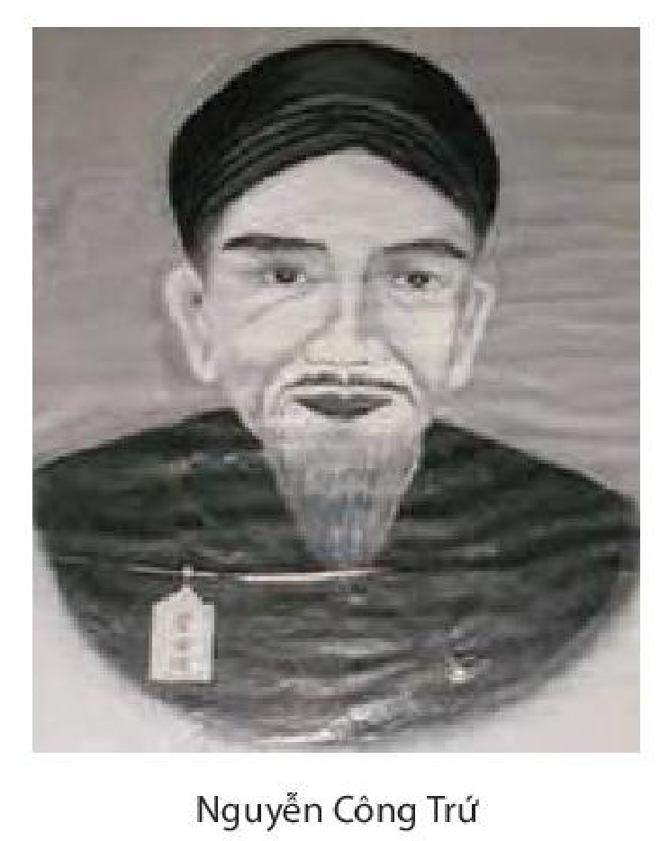
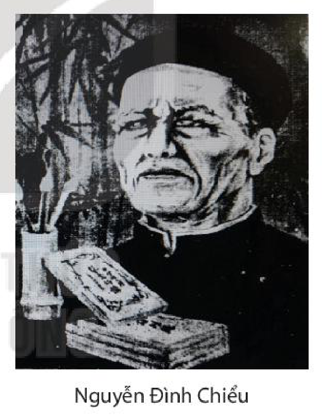
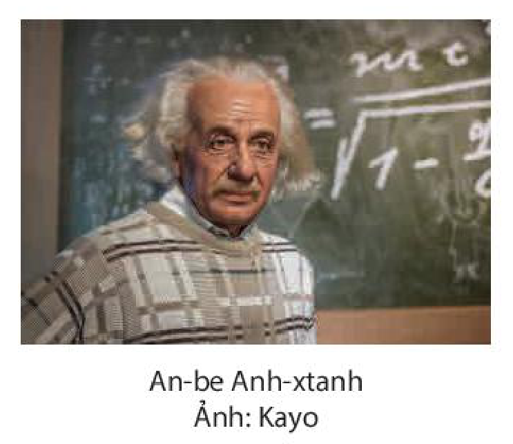
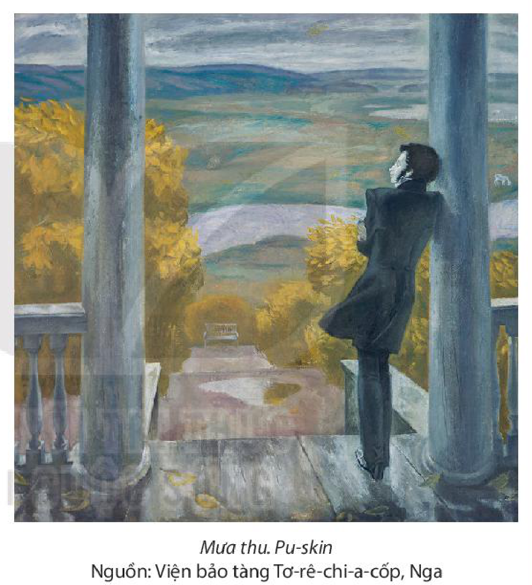

<!-- pdf:94 -->
# BÀI 9: LỰA CHỌN VÀ HÀNH ĐỘNG
<!-- ocr-ok: tên bài thiết kế đồ hoạ chữ nghệ thuật trên banner bị OCR bỏ sót, đã đối chiếu ảnh trang PDF 94 -->

## 🎯 Yêu cầu cần đạt

- Phân tích và đánh giá được chủ đề, tư tưởng, thông điệp mà tác giả muốn gửi đến người đọc thông qua hình thức nghệ thuật của văn bản; phân biệt chủ đề chính, chủ đề phụ trong một văn bản có nhiều chủ đề.
- Nhận biết và phân tích được nội dung của luận đề, các luận điểm, lí lẽ và bằng chứng tiêu biểu, độc đáo trong văn bản nghị luận; đánh giá được các lí lẽ và bằng chứng mà người viết sử dụng để bảo vệ quan điểm trong bài viết; thể hiện được quan điểm đồng ý hay không đồng ý với nội dung chính của văn bản và giải thích lí do.
- Biết được một số cách giải thích nghĩa của từ, qua đó, chủ động bồi đắp vốn từ và sử dụng từ ngữ chính xác, có hiệu quả.
- Viết được văn bản nghị luận về một tác phẩm nghệ thuật (điện ảnh, âm nhạc, hội hoạ, điêu khắc,...), nêu và nhận xét về nội dung, một số nét nghệ thuật đặc sắc.
- Biết giới thiệu (dưới hình thức nói) một tác phẩm nghệ thuật theo lựa chọn cá nhân (tác phẩm điện ảnh, âm nhạc, hội hoạ,...).
- Biết tôn trọng con người cá nhân đồng thời luôn nuôi dưỡng ý thức đóng góp cho cộng đồng, biết thể hiện sự can đảm và sáng suốt ở những lựa chọn có tính bước ngoặt trong cuộc đời.

## ĐỌC

### TRI THỨC NGỮ VĂN

**Văn bản văn học có nhiều chủ đề**
Thực tế văn học cho thấy, không hiếm văn bản cùng lúc thể hiện nhiều chủ đề và các chủ đề này được phân loại theo những tiêu chí khác nhau. Xét mức độ biểu hiện đậm hay nhạt, mạnh hay yếu của chủ đề thông qua toàn bộ thế giới nghệ thuật được miêu tả, có thể nói đến chủ đề chính và chủ đề phụ (việc xác định đâu là chủ đề chính, đâu là chủ đề phụ nhiều khi phụ thuộc vào sự tiếp nhận khác nhau của người đọc chứ không hoàn toàn phụ thuộc vào chủ ý của tác giả). Xét tính chất của những điều được biểu hiện, có thể nói đến chủ đề đặc thù dân tộc hay chủ đề phổ quát nhân loại.

<!-- pdf:95 -->
Chính sự đa dạng về chủ đề khiến văn bản trở nên đa nghĩa, đáp ứng được sự đón đợi của nhiều loại độc giả khác nhau và mỗi người có thể tìm thấy ở văn bản một điều tâm đắc riêng. Mặc dù thể hiện nhiều chủ đề, tính thống nhất, trọn vẹn của văn bản vẫn luôn được nhà văn xem là đích cần hướng tới và điều này không có gì mâu thuẫn, bởi tự các chủ đề soi sáng, bổ sung cho nhau để cùng tạo nên một tác động mạnh mẽ, mang tính tổng hợp đối với người tiếp nhận.

**Một số cách giải thích nghĩa của từ**
Có nhiều cách giải thích nghĩa của từ tuỳ vào ngữ cảnh cụ thể và vào đặc điểm, tính chất của từ được giải thích (từ vay mượn, từ địa phương, từ cổ,...). Sau đây là một số cách cơ bản và thông dụng:
- Giải thích bằng hình thức trực quan: chỉ vào sự vật hay hiện tượng tồn tại trong thực tế vốn được gọi tên bằng từ đó (cũng có thể chỉ vào hình ảnh đại diện của sự vật được ghi nhận bằng các phương tiện phi ngôn ngữ như tranh, ảnh,...).
- Giải thích bằng cách trình bày khái niệm mà từ biểu thị. Theo cách này, không chỉ nghĩa của các từ chỉ sự vật, hiện tượng quan sát được mà cả nghĩa của những từ biểu thị trạng thái tinh thần hay kết quả hoạt động tư duy của con người đều có thể được làm sáng tỏ.
- Giải thích bằng cách nêu lên từ đồng nghĩa hoặc trái nghĩa với từ cần giải thích, theo quy ước ngầm rằng từ đồng nghĩa hoặc trái nghĩa đó đã được người tiếp nhận biết đến.
- Giải thích bằng cách làm rõ nghĩa từng yếu tố trong từ được giải thích (đối với từ ghép), sau đó nêu nghĩa chung của từ; nghĩa của từ phụ thuộc vào phương thức kết hợp cụ thể của các yếu tố (đẳng lập hay chính – phụ) và ngữ cảnh.

<!-- pdf:96 -->
### VĂN BẢN 1: Bài ca ngất ngưởng
<!-- ocr-ok: nhãn VĂN BẢN 1 trên băng màu cam bị OCR đọc nhầm thành "ĂN BẰNG", đã đối chiếu ảnh trang PDF 96 -->

**Nguyễn Công Trứ**

> - Theo quan sát của bạn, hiện nay vấn đề “cá tính” được giới trẻ nhìn nhận như thế nào?
> - Nêu ý nghĩ của bạn khi nghe nhận xét về một người nào đó có “vị trí cao ngất ngưởng” và khi nghe đánh giá về một ai đó có “thái độ ngất ngưởng”. Từ “ngất ngưởng” trong hai trường hợp trên có giống nhau hay không?

Vũ trụ nội mạc phi phận sự(1),
Ông Hy Văn tài bộ(2) đã vào lồng(3).
Khi Thủ khoa, khi Tham tán, khi Tổng đốc Đông(4),
Gồm thao lược đã nên tay ngất ngưởng.
Lúc bình Tây, cờ đại tướng(5),
Có khi về Phủ doãn Thừa Thiên(6).
Đô môn giải tổ chi niên(7),

> Tự thuật của tác giả về hành trạng cuộc đời mình:
> – “Ngất ngưởng” trên đường công danh;
> – “Ngất ngưởng” khi rời chốn quan trường.

> (1) Nghĩa của cả câu: mọi sự, mọi việc trong vũ trụ không có gì không thuộc phận sự của ta.
> (2) *Tài bộ*: tài chí, tài năng được bộc lộ thành phong cách.
> (3) *Vào lồng*: vào guồng máy quan trường, gánh vác phận sự trong bộ máy chính quyền của nhà nước phong kiến; cũng có thể hiểu là mắc vào vòng trói buộc của công danh, bị nhốt trong lồng trời đất.
> (4) Câu thơ điểm một số dấu mốc trên đường công danh của Nguyễn Công Trứ: đỗ Giải nguyên (thủ khoa) kì thi Hương năm 1819; làm các chức quan võ như Tham tán quân vụ (1826), Tổng đốc Hải An (1832), Tả Đô Ngự sử kiêm Tham tri bộ Binh, Tán lí cơ vụ (1840). Tổng đốc Hải An (Yên) là chức vụ kiêm cai quản tỉnh Hải Dương và tỉnh Quảng Yên (tỉnh Quảng Ninh ngày nay); vùng này xưa thường gọi là xứ Đông (ở phía Đông kinh thành Thăng Long).
> (5) Câu thơ này, có bản Nôm chép là “Lúc bình Tây cầm cờ đại tướng” (đối với câu sau, cùng là câu 7 chữ). *Bình Tây*: năm 1840, Nguyễn Công Trứ giữ chức Tả Đô Ngự sử viện đô sát, kiêm Tham tri bộ Binh, Tán lí cơ vụ Trấn Tây (vùng lãnh thổ ở phía Tây Nam nước ta).
> (6) *Phủ doãn Thừa Thiên*: năm 1847, Nguyễn Công Trứ làm Thự Phủ doãn (quyền Phủ doãn, Phủ doãn là chức quan đứng đầu tỉnh có kinh đô) phủ Thừa Thiên. Năm 1848, khi xin về hưu, ông chính thức được vua Tự Đức gia ân chức Phủ doãn.
> (7) Ý cả câu: năm 1848, tại kinh đô, cởi dây đeo ấn (trả lại chức quan cho triều đình) để về quê. Vi Ứng Vật (Trung Quốc) có câu: “Giải tổ ngạo viên lâm” (Treo ấn từ quan, về vui cảnh vườn rừng).

<!-- pdf:97 -->
Đạc ngựa bò vàng(1) đeo ngất ngưởng.
Kìa núi nọ phau phau mây trắng,
Tay kiếm cung mà nên dạng từ bi(2).
Gót tiên theo đủng đỉnh một đôi dì(3),
Bụt cũng nực cười ông ngất ngưởng.
Được mất dương dương người tái thượng(4),
Khen chê phơi phới ngọn đông phong(5).
Khi ca, khi tửu, khi cắc, khi tùng(6),
Không Phật, không tiên, không vướng tục.
Chẳng Trái, Nhạc cũng vào phường Hàn, Phú(7),
Nghĩa vua tôi cho vẹn đạo sơ chung(8).
Trong triều ai ngất ngưởng như ông(9)!

(Thơ văn *Nguyễn Công Trứ*, NXB Văn hoá, Hà Nội, 1958, tr. 156)

> Thái độ, cảm xúc của tác giả khi “tổng kết” về cuộc đời mình.

> (1) *Đạc ngựa bò vàng*: lúc về hưu, Nguyễn Công Trứ thường cưỡi con bò vàng nhưng vẫn đeo đạc (nhạc) ngựa. Một số tài liệu ghi nhận: Ngay sau khi được triều đình cho nghỉ hưu, Nguyễn Công Trứ đã cưỡi bò rời kinh thành.
> (2) Ý cả hai câu: vốn là kẻ làm quan lớn, từng phụ trách việc binh nhưng nay thung dung tự tại tựa người tu hành ở nơi non xanh mây trắng. Sau khi cáo quan về quê, Nguyễn Công Trứ dựng nhà ở chân núi Đại Nại, cạnh chùa Cảm Sơn (thuộc huyện Thạch Hà, tỉnh Hà Tĩnh ngày nay).
> (3) Ý cả câu: đi chơi chùa, dạo cảnh tiên nhưng Nguyễn Công Trứ vẫn đem theo các cô hầu; điều này khiến Bụt (Phật) cũng nực cười.
> (4) *Người tái thượng*: ông già ở biên ải. Dẫn điển *Tái ông thất mã* (ông già ở biên ải mất ngựa), ý nói: ở đời, việc may rủi, được mất là lẽ bình thường, không nên vui buồn về những chuyện ấy. *Thơ văn Nguyễn Công Trứ*, Sđd chép: *người thái thượng*; “thái thượng” có nhiều cách lí giải, nhưng nhìn chung đều quy về ý nghĩa: *người đời thượng cổ, người có địa vị tôn quý nhất*; như vậy sẽ không hợp với triết lí “được mất dương dương...” mà tác phẩm đang nói tới. Ngờ rằng, có sự sai khác này là do từ gần âm (*tái* / *thái*). Người biên soạn sách giáo khoa chỉnh lí theo một số bản khác.
> (5) *Đông phong*: gió mùa xuân, từ phương Đông thổi tới. Ý cả câu: Ta luôn phơi phới thảnh thơi như gió mùa xuân, mặc cho người đời khen chê. Trong thế đối xứng với câu thơ trên, cũng có thể hiểu tác giả đã dẫn điển “Gió xuân thổi tai ngựa” (“Đông phong xuy mã nhĩ”), dùng để ví sự thản nhiên, không bận tâm đến thế sự. Lý Bạch (đời Đường, Trung Quốc) có câu: “Người đời nghe việc này đều lắc đầu/ Cũng tựa như gió xuân thổi qua tai ngựa” (“Thế gian văn thử giai điệu đầu/ Hữu như đông phong xuy mã nhĩ”). Theo điển này, từ “phơi phới” có thể phiên thành “phẩy phẩy”, “phảy phảy” để rõ nghĩa hơn.
> (6) *Cắc, tùng*: các âm thanh phát ra khi gõ dùi vào tang trống và mặt trống. Câu thơ gợi thú vui trong thưởng thức ca trù.
> (7) *Trái, Nhạc, Hàn, Phú*: những danh tướng Trung Hoa thời xưa, có sự nghiệp hiển hách (Trái Tuân người đời Hán; Nhạc Phi, Hàn Kỳ, Phú Bật người đời Tống).
> (8) *Đạo sơ chung*: đạo nghĩa có đầu (*sơ*) có cuối (*chung*), ý nói giữ lòng trung.
> (9) Câu thơ này, có bản chép là “Đời ai ngất ngưởng như ông”. Theo cách ghi này, tính hợp lí có thể cao hơn, vì: câu kết bài hát nói thường là sáu chữ; một khi đã về quê rồi thì cần gì nói chuyện “ngất ngưởng” “trong triều”; “đời” là đời thế, ý nghĩa phóng túng hơn;...

<!-- pdf:98 -->
**Nguyễn Công Trứ** (1778 – 1858) tự Tồn Chất, hiệu Ngộ Trai, biệt hiệu Hy Văn, quê ở huyện Nghi Xuân, tỉnh Hà Tĩnh. Năm 42 tuổi, ông mới đỗ Giải nguyên (đỗ đầu kì thi Hương tổ chức ở trường thi Nghệ An), sau đó ra làm quan với nhà Nguyễn. Cuộc đời quan trường của Nguyễn Công Trứ trải nhiều lần thăng giáng, có khi làm đến chức Thượng thư, Tổng đốc nhưng cũng có lúc bị cách hết chức vụ, phải làm lính thú ở biên thuỷ. Tuy nhiên, ở vị trí nào, ông cũng giữ bản lĩnh cứng cỏi, nhiệt huyết với trọng trách, công việc được giao.

Nguyễn Công Trứ là một tài năng lỗi lạc trong lịch sử Việt Nam thế kỉ XIX. Xuất thân là quan văn, nhưng ông đạt được nhiều thành tựu trong các lĩnh vực khác như quân sự, kinh tế, kiến trúc,... Ông có công lớn trong việc củng cố, phát triển vương triều Nguyễn, từng phụ trách việc đưa lưu dân đi quai đê lấn biển, mở rộng và lập ra một số huyện ở Ninh Bình, Nam Định, Thái Bình. Nguyễn Công Trứ có tâm hồn và tầm nhìn rộng lớn, ông nổi tiếng là nhà Nho thanh liêm, thương dân, yêu nước. Năm 1858, trước khi mất vì tuổi già sức yếu, biết tin thực dân Pháp nổ súng xâm lược nước ta, ông còn dâng sớ xin được cầm quân đánh giặc nhưng không được chấp thuận.

Nguyễn Công Trứ sáng tác chủ yếu bằng chữ Nôm, hiện còn biết được trên 150 tác phẩm ở nhiều thể loại như phú, thơ Đường luật, câu đối, hát nói. Ông có đóng góp đặc biệt quan trọng cho sự định hình và phát triển của thể thơ hát nói. Cuộc đời và thơ văn Nguyễn Công Trứ thể hiện rõ tài năng và nhân cách lớn: phong cách sống độc đáo, cốt cách tài tử, tâm hồn thanh cao, cá tính mạnh mẽ.

Nguyên văn chữ Nôm ***Bài ca ngất ngưởng*** được chép ở *Gia phả tập biên*, giữa nguyên văn chữ Nôm theo bản này và các bản phiên âm về sau có ít nhiều khác biệt. Bản phiên âm sang chữ quốc ngữ được Lê Thước công bố lần đầu tiên trong sách *Sự nghiệp và thi văn của Uy Viễn tướng công Nguyễn Công Trứ*, xuất bản năm 1928 với nhan đề là *Bài ca ngất ngưởng*, sau đó tác phẩm được phổ biến rộng rãi với nhiều dị bản khác nhau. Bài thơ được đánh giá là một tác phẩm thuộc loại xuất sắc nhất, đạt đến trình độ cổ điển, mẫu mực của thể thơ hát nói. *Bài ca ngất ngưởng* được viết khi Nguyễn Công Trứ đã cáo quan về quê, có thể coi là bài thơ tự thuật về cuộc đời phong phú và tự hoạ chân dung tinh thần độc đáo của ông.

**Thơ hát nói** là thể thơ do các nhà thơ Việt Nam sáng tạo, phát triển từ khoảng thế kỉ XVII, đạt đến đỉnh cao trong thế kỉ XVIII – XIX. *Thơ hát nói* là phần lời của *bài hát nói*, mà lối *hát nói* là một điệu thức chủ đạo của lối hát *ca trù* (còn gọi là hát *ả đào*, *cô đầu*,...). Thơ hát nói là một thể thơ kết hợp các thể song thất lục bát, lục bát với kiểu nói lối trong một số làn điệu dân ca. Hình thức (số câu, số chữ của các câu, gieo vần,...) của thơ hát nói tương đối đa dạng, tự do; vì thế nó thường được các nhà thơ có phong cách tài hoa, tài tử ưa dùng để biểu đạt tư tưởng, tâm hồn phóng túng của mình.

<!-- pdf:99 -->
1. Liệt kê những từ ngữ mang tính chất tự xưng của tác giả trong bài hát nói. Những từ ngữ ấy thể hiện phong cách, tư tưởng của nhân vật trữ tình khi tự nhìn nhận về mình như thế nào?

2. Căn cứ vào mạch ý của bài thơ, có thể chia bố cục tác phẩm thành mấy phần? Nêu ý chính của mỗi phần.

3. Tra từ điển và chỉ ra những nét nghĩa khác nhau của từ “ngất ngưởng”. Căn cứ vào mạch ý của văn bản để xác định ý nghĩa của từ này ở từng trường hợp xuất hiện.

4. Thái độ sống, phong cách sống “ngất ngưởng” đã được tác giả thể hiện ở những phương diện, khía cạnh cụ thể nào? Suy nghĩ của bạn về cách lựa chọn lối sống, cách ứng xử cũng như cá tính của tác giả.

5. Nêu nhận xét về phong cách ngôn ngữ của tác giả thể hiện trong bài hát nói (chú ý các phương diện: cách sử dụng từ ngữ, hình ảnh; các biện pháp tu từ; vần và nhịp điệu).

6. Trình bày suy nghĩ của bạn về sự hội tụ những yếu tố đối lập trong phong cách hành xử của Nguyễn Công Trứ được thể hiện ở bài hát nói. Ngoài chủ đề chính, *Bài ca ngất ngưởng* còn có chủ đề nào khác?

7. Theo bạn, hình ảnh con người nhà Nho nhập thế – hành đạo và hình ảnh con người phóng túng – tài tử trong bài thơ có tạo nên sự đối lập về nhân cách không? Vì sao?

#### Kết nối đọc – viết

Viết đoạn văn (khoảng 150 chữ) bàn về cách ứng xử trước sự được mất, khen chê, may rủi,... mà tác giả đã thể hiện trong *Bài ca ngất ngưởng*.

<!-- pdf:100 -->
### VĂN BẢN 2: Văn tế nghĩa sĩ Cần Giuộc
<!-- ocr-ok: nhãn VĂN BẢN 2 trên băng màu cam bị OCR bỏ sót và tách chữ "Và / n tế", đã đối chiếu ảnh trang PDF 100 -->

**Nguyễn Đình Chiểu**

> - Hãy kể vắn tắt hiểu biết của bạn về một tấm gương đã anh dũng hi sinh vì nền độc lập tự chủ của dân tộc trong thời kì chống thực dân Pháp xâm lược.
> - Theo bạn, việc tưởng nhớ và tôn vinh những người đã hi sinh cho sự nghiệp bảo vệ Tổ quốc có ý nghĩa như thế nào trong việc giáo dục thế hệ trẻ hôm nay?

*Hỡi ôi!*

1. Súng giặc đất rền;

Lòng dân trời tỏ(1).

> Chú ý cách ngắt nhịp câu văn biền ngẫu.

2. Mười năm công vỡ ruộng, chưa ắt còn danh nổi như phao;

Một trận nghĩa đánh Tây, tuy là mất tiếng vang như mõ.

*Nhớ linh*(2) *xưa:*

3. Cui cút(3) làm ăn;
<!-- ocr-ok: số cước chú (3) bị OCR đọc nhầm thành kí tự ngoặc đơn, đã đối chiếu ảnh trang PDF 100 -->

Toan lo nghèo khó.

4. Chưa quen cung ngựa, đâu tới trường nhung(4);

Chỉ biết ruộng trâu, ở trong làng bộ(5).

> Hoàn cảnh xuất thân nghèo khó của nghĩa binh.
<!-- ocr-ok: thẻ chỉ dẫn đọc bên lề phải bị OCR đọc dính chữ "ngheokhoctkxnghfahinh", đã đối chiếu ảnh trang PDF 100 -->

5. Việc cuốc, việc cày, việc bừa, việc cấy, tay vốn quen làm;

Tập khiên, tập súng, tập mác, tập cờ(6), mắt chưa từng ngó.

> (1) *Lòng dân trời tỏ*: trời thấu tỏ ý nguyện của nhân dân. Theo tư tưởng Nho học truyền thống, lòng dân chính là ý trời, thực hiện theo ý nguyện của nhân dân là chân lí.
> (2) *Linh*: anh linh, hương hồn người đã khuất; từ *linh* ở câu kết bài văn này có nghĩa là linh thiêng.
> (3) *Cui cút*: lẻ loi, thầm lặng.
> (4) *Trường nhung*: bãi chiến trường.
> (5) *Làng bộ*: làng xóm, có bản chép là *làng hộ*.
> (6) Chỉ việc rèn tập trong quân ngũ; *khiên* là binh khí dùng để đỡ khí giới của đối phương; *mác* là một loại vũ khí cổ, có cán dài, mũi nhọn.

<!-- pdf:101 -->
6. Tiếng phong hạc(1) phập phồng hơn mươi tháng, trông tin quan như trời hạn trông mưa;

Mùi tinh chiên(2) vấy vá(3) đã ba năm, ghét thói mọi như nhà nông ghét cỏ.
<!-- ocr-ok: chữ "tinh chiên" và số cước chú (2)(3) bị OCR đọc nhầm thành "tĩnh chiênÔ) vấy vá()", đã đối chiếu ảnh trang PDF 101 -->

7. Bữa thấy bòng bong(4) che trắng lốp, muốn tới ăn gan;
<!-- ocr-ok: chữ "trắng lốp, muốn tới ăn gan;" bị OCR đọc nhầm thành "trăng lốp, muốn tới ăn gary", đã đối chiếu ảnh trang PDF 101 -->

Ngày xem ống khói(5) chạy đen sì, muốn ra cắn cổ.
<!-- ocr-ok: chữ "cắn cổ" và số cước chú (5) bị OCR đọc nhầm thành "căn cổ" và (”, đã đối chiếu ảnh trang PDF 101 -->

> Thái độ của nghĩa binh đối với bọn cướp nước.

8. Một mối xa thư(6) đồ sộ, há để ai chém rắn đuổi hươu(7);

Hai vầng nhật nguyệt(8) chói loà, đâu dung lũ treo dê bán chó(9).

9. Nào đợi ai đòi ai bắt, phen này xin ra sức đoạn kình(10);

Chẳng thèm trốn ngược trốn xuôi, chuyến này dốc ra tay bộ hổ(11).
<!-- ocr-ok: chữ "Chẳng", "dốc" và số cước chú (11) bị OCR đọc nhầm thành "Chăng", "đốc", "đ])", đã đối chiếu ảnh trang PDF 101 -->

*Khá thương thay!*

10. Vốn chẳng phải quân cơ quân vệ(12), theo dòng ở lính diễn binh(13);

Chẳng qua là dân ấp dân lân(14), mến nghĩa làm quân chiêu mộ(15).
<!-- ocr-ok: câu văn bị OCR tách dòng lồng với hộp chỉ dẫn đọc và đọc nhầm số cước chú (14)(15), đã đối chiếu ảnh trang PDF 101 -->

> Tinh thần chiến đấu quả cảm của nghĩa binh. Chú ý các hình ảnh đối lập.

> (1) *Tiếng phong hạc*: tiếng gió thổi hạc kêu; ý nói việc hồi hộp lo lắng khi nghe tin quân giặc tới xâm lấn. Ý câu văn lấy chữ từ sách xưa: “thanh phong hạc lệ, thảo mộc giai binh” (nghe tiếng gió thổi hạc kêu mà nhìn cây cỏ xung quanh đều ngỡ là quân giặc đuổi đánh).
> (2) *Tinh chiên*: tanh hôi (*tinh*: mùi tanh, *chiên*: mùi hôi thối), ý nói về quân cướp nước với thái độ khinh miệt.
> (3) *Vấy vá*: dây dính, đeo bám.
> (4) *Bòng bong*: vốn là tên một loại cây dây leo, nhánh lá đan bện vào nhau; ở đây chỉ buồm vải, lều bạt chăng dây trên tàu thuyền, ở trại lính của liên quân Pháp và Tây Ban Nha.
> (5) *Ống khói*: ống khói xả khí đốt của tàu giặc.
> (6) *Xa thư*: lấy chữ trong sách *Trung Dung*, “xa đồng quỹ, thư đồng văn” (xe cùng một cỡ trục, sách cùng một kiểu chữ) để nói sự thống nhất quốc gia.
> (7) *Chém rắn đuổi hươu*: mượn ý từ thành ngữ tiếng Hán “trảm xà trục lộc” (Hán Cao Tổ Lưu Bang chém rắn lúc khởi nghiệp để giành lấy ngôi vị của nhà Tần); ở đây ý nói giặc Pháp gây chiến tranh hòng tước đoạt chủ quyền nước ta. Giang sơn nước Nam vốn thống nhất một mối, há để kẻ khác gây binh đao nhằm thôn tính.
> (8) *Hai vầng nhật nguyệt*: hình ảnh tượng trưng cho ánh sáng chân lí, thể hiện tinh thần tự chủ quốc gia.
> (9) *Treo dê bán chó*: mượn ý từ thành ngữ tiếng Việt “treo đầu dê bán thịt chó”, chỉ sự gian trá lừa lọc; ở đây ý nói thực dân Pháp viện các cớ khác nhau để xâm lược nước ta.
> (10) *Đoạn kình*: chém cá kình (cá voi, sách vở xưa mượn hình ảnh này để nói sự hùng mạnh); ở đây ý nói quyết tâm giết giặc.
> (11) *Bộ hổ*: bắt hổ (hổ tượng trưng cho sức mạnh); ở đây ý nói quyết tâm đánh giặc giữ nước.
> (12) *Quân cơ quân vệ*: quân lính thuộc biên chế ở *cơ*, *vệ*; *cơ* và *vệ* là hai trong số nhiều đơn vị theo phiên chế quân đội thời xưa.
> (13) *Theo dòng ở lính diễn binh*: dòng dõi, truyền thống binh nghiệp.
> (14) *Dân ấp dân lân*: người dân ở làng quê xóm ấp cạnh nhau.
> (15) *Quân chiêu mộ*: quân lính tình nguyện theo hiệu triệu vì việc nghĩa (*chiêu*: mời, vời; *mộ*: cầu, tìm).

<!-- pdf:102 -->
11. Mười tám ban võ nghệ(1), nào đợi tập rèn;

Chín chục trận binh thư(2), không chờ bày bố.

12. Ngoài cật(3) có một manh áo vải, nào đợi mang bao tấu, bầu ngòi(4);

Trong tay cầm một ngọn tầm vông(5), chi nài sắm dao tu, nón gõ(6).

13. Hoả mai đánh bằng rơm con cúi(7), cũng đốt xong nhà dạy đạo kia;

Gươm đeo dùng bằng lưỡi dao phay, cũng chém rớt đầu quan hai(8) nọ.

14. Chi nhọc quan quản gióng trống kì trống giục, đạp rào lướt tới, coi giặc cũng như không;

Nào sợ thằng Tây bắn đạn nhỏ đạn to, xô cửa xông vào, liều mình như chẳng có.
<!-- ocr-ok: câu văn bị OCR tách dòng lồng với hộp chỉ dẫn đọc và đọc nhầm "thằng", "bắn", "liều", "chẳng", đã đối chiếu ảnh trang PDF 102 -->

> Giọng văn trầm hùng, âm hưởng bi tráng.
<!-- ocr-ok: thẻ chỉ dẫn đọc bên lề phải bị OCR đọc lồng vào câu văn và đọc nhầm "bi" thành "bị", đã đối chiếu ảnh trang PDF 102 -->

15. Kẻ đâm ngang, người chém ngược, làm cho mã tà ma ní(9) hồn kinh;

Bọn hè trước, lũ ó sau(10), trối kệ tàu sắt tàu đồng súng nổ.

*Ôi!*

16. Những lăm lòng nghĩa lâu dùng;

Đâu biết xác phàm(11) vội bỏ.

> (1) *Mười tám ban võ nghệ*: quân đội thời trước chia thành mười tám ban, mỗi ban chuyên về một loại vũ khí.
> (2) *Chín chục trận binh thư*: số lượng (ước định) thế trận được phân loại từ các trận pháp theo một số sách binh pháp thời xưa.
> (3) *Cật*: thân, mình (từ cổ). Ý của câu: thân mình chỉ khoác một manh áo vải, thân phận nghèo hèn.
> (4) *Bao tấu, bầu ngòi*: bao đựng dao (*tấu*: mã tấu, một loại dao dài, to bản, mũi nhọn, được dùng làm vũ khí) và bầu (túi, gói) đựng ngòi thuốc nổ.
> (5) *Tầm vông*: một loài cây thuộc họ tre, được trồng nhiều ở Nam Bộ. Trong các cuộc kháng chiến, vì thiếu thốn binh khí nên gậy tầm vông được dùng làm vũ khí thay giáo mác để đánh giặc.
> (6) *Dao tu, nón gõ*: các loại quân trang, quân dụng của lính thú đời trước (*dao tu*: dao có lưỡi dài; *nón gõ*: mũ hình chóp).
> (7) *Hoả mai đánh bằng rơm con cúi*: hoả mai là một loại súng bắn bằng cách đốt lửa để châm ngòi. Ý câu này là: Nghĩa sĩ Cần Giuộc không có hoả mai, phải dùng vũ khí là nùn rơm để đánh giặc; đối ý với câu sau: Không có gươm, dùng thay bằng dao phay để giết giặc.
> (8) *Quan hai*: một trong các phẩm hàm, xếp theo thứ bậc của quân đội Pháp.
> (9) *Mã tà ma ní*: chỉ chung lính đánh thuê cho thực dân Pháp (*mã tà*: cảnh sát, gọi theo tiếng Ma-lai-xi-a (Malaysia); *ma ní*: lính chiêu mộ từ Phi-líp-pin, được gọi theo tên thủ đô Ma-ni-la (Manila) của nước này).
> (10) *Bọn hè trước, lũ ó sau*: ý nói các nghĩa sĩ Cần Giuộc hô gọi nhau tiến đánh giặc, mặc kệ súng bắn dữ dội từ các tàu bằng sắt, bằng đồng của giặc Pháp.
> (11) *Xác phàm*: thân xác con người được nhìn trong thế đối lập với linh hồn; linh hồn là phần tinh tuý, tồn tại mãi mãi, còn thân xác là phần thô lậu, sẽ bị hư nát, huỷ hoại với thời gian.

<!-- pdf:103 -->
17. Một chắc sa trường rằng chữ hạnh(1), nào hay da ngựa bọc thây(2);

Trăm năm âm phủ ấy chữ quy(3), nào đợi gươm hùm treo mộ(4).

18. Đoái sông Cần Giuộc(5), cỏ cây mấy dặm sầu giăng;

Nhìn chợ Trường Bình(6), già trẻ hai hàng luỵ(7) nhỏ.
<!-- ocr-ok: số cước chú (6)(7) và chữ "luỵ" bị OCR đọc nhầm thành "(9" và "luy”)", đã đối chiếu ảnh trang PDF 103 -->

19. Chẳng phải án cướp án gian đày tới, mà vi binh(8) đánh giặc cho cam tâm;

Vốn không giữ thành giữ luỹ bỏ đi, mà hiệu lực(9) theo quân cho đáng số.

*Nhưng nghĩ rằng:*

20. Tấc đất ngọn rau ơn chúa, tài bồi(10) cho nước nhà ta;

Bát cơm manh áo ở đời, mắc mớ chi(11) ông cha nó.

> Cảm xúc xót thương.

21. Vì ai khiến quan quân khó nhọc, ăn tuyết nằm sương;

Vì ai xui đồn luỹ tan tành, xiêu mưa ngã gió.

22. Sống làm chi theo quân tả đạo(12), quăng vùa hương, xô bàn độc(13), thấy lại thêm buồn;

Sống làm chi ở lính mã tà, chia rượu lạt, gặm bánh mì, nghe càng thêm hổ.

23. Thà thác mà đặng câu địch khái(14), về theo tổ phụ(15) cũng vinh;

> (1) *Chữ hạnh*: *hạnh* là may mắn; cả câu ý nói thân mình ở chốn sa trường, chỉ may mắn thì mới sống sót.
> (2) *Da ngựa bọc thây*: (chết ở bãi chiến trường), dùng da ngựa bọc xác. Lấy ý từ câu nói của Mã Viện (tướng nhà Hán – Trung Quốc, từng đem quân sang xâm lược nước ta): *làm thân nam nhi, chết ở bãi sa trường, lấy da ngựa bọc thây đem về chôn mới thoả chí*...
> (3) *Chữ quy*: *quy* là về, ở đây nghĩa là chết (về với tổ tiên, về với đất mẹ).
> (4) *Gươm hùm treo mộ*: lấy tích trong sử sách Trung Quốc, nói về một nghĩa binh thời Chiến Quốc, khi sống không thoả được chí mình, trước khi chết dặn con treo thanh gươm trên mộ để tỏ chí khí.
> (5) *Đoái sông Cần Giuộc*: nhìn dòng sông Cần Giuộc vốn chịu cảnh đau thương của chiến tranh. Sông Cần Giuộc (hay sông Rạch Cát, sông Phước Lộc), chảy qua địa phận tỉnh Long An và một số địa phương ở Nam Bộ, nơi diễn ra trận đánh nổi tiếng giữa quân ta và giặc Pháp năm 1858.
> (6) *Chợ Trường Bình*: nay là chợ Cần Giuộc, tỉnh Long An.
> (7) *Luỵ*: tức *lệ*, nước mắt.
> (8) *Vi binh*: làm lính.
> (9) *Hiệu lực*: (*hiệu*: hết sức) một hình phạt thời xưa, buộc người có tội phải hết sức để chuộc tội, thường là bị đày đi làm những việc nặng nhọc, nguy hiểm.
> (10) *Tài bồi*: vun đắp, gây dựng (*tài*: trồng cây, *bồi*: vun bồi).
> (11) *Mắc mớ chi* (khẩu ngữ): liên can gì đến (cụm từ này được dùng với ý phủ định).
> (12) *Tả đạo*: ở đây chỉ đạo Gia tô (Thiên Chúa). Bấy giờ, thực dân Pháp lợi dụng đạo này phục vụ cho mưu đồ xâm lược, lấy cớ truyền đạo để lôi kéo dân chúng và xâm lấn lãnh thổ. Vì chưa phân biệt rõ kẻ gian, người lành nên triều đình và các chí sĩ chủ trương bài trừ đạo Gia tô.
> (13) *Vùa hương, bàn độc*: bát hương và bàn thờ. Bấy giờ, những người theo thực dân Pháp và theo tôn giáo mới đã phế bỏ việc thờ phụng tổ tiên vốn thuộc tín ngưỡng truyền thống của người Việt.
> (14) *Địch khái*: tinh thần khẳng khái, ý chí mạnh mẽ chống lại kẻ thù.
> (15) *Tổ phụ*: ông nội, ở đây chỉ tổ tiên.

<!-- pdf:104 -->
Hơn còn mà chịu chữ đầu Tây(1), ở với man di(2) rất khổ.

*Ôi thôi thôi!*

24. Chùa Tông Thạnh(3) năm canh ưng(4) đóng lạnh, tấm lòng son gửi lại bóng trăng rằm;

Đồn Lang Sa(5) một khắc đặng trả hờn, tủi phận bạc trôi theo dòng nước đổ.

25. Đau đớn bấy! Mẹ già ngồi khóc trẻ, ngọn đèn khuya leo lét trong lều;

Não nùng thay! Vợ yếu chạy tìm chồng, cơn bóng xế dật dờ(6) trước ngõ.

*Ôi!*

26. Một trận khói tan, nghìn năm tiết rỡ(7).

27. Binh tướng nó hãy đóng sông Bến Nghé, ai làm nên bốn phía mây đen;

Ông cha ta còn ở đất Đồng Nai, ai cứu đặng một phường con đỏ.

> Ngợi ca tinh thần và sự hi sinh anh dũng của nghĩa binh.
<!-- ocr-ok: thẻ chỉ dẫn đọc bên lề phải bị OCR tách dòng lồng vào câu văn và đọc nhầm "tinh" thành "tĩnh", "bình", đã đối chiếu ảnh trang PDF 104 -->

28. Thác mà trả nước non rồi nợ(8), danh thơm đồn sáu tỉnh chúng(9) đều khen;

Thác mà ưng(10) đình miếu để thờ, tiếng ngay trải muôn đời ai cũng mộ(11).

> (1) *Đầu Tây*: đầu hàng giặc Pháp.
> (2) *Man di*: chỉ thực dân Pháp xâm lược với ý khinh miệt. Người Hán (Trung Quốc) xưa cho nước họ là trung tâm, các nước ở xung quanh đều là mọi rợ (rợ ở phía đông gọi là *di*, ở phía nam gọi là *man*, ở phía tây gọi là *nhung*, ở phía bắc gọi là *địch*).
> (3) *Chùa Tông Thạnh* (hay Tôn Thạnh): một ngôi chùa ở huyện Cần Giuộc, tỉnh Long An.
> (4) *Ưng*: phải chịu, phải chấp nhận hay chịu đựng điều không muốn (nghĩa trong văn bản).
> (5) *Lang Sa*: chỉ giặc Pháp, xuất phát từ cách phiên âm từ France (nước Pháp) qua âm Hán Việt.
> (6) *Dật dờ*: vất vơ vất vưởng; hình dung dáng vẻ yếu đuối, tâm trạng hoảng hốt,... của người vợ đôn đáo tìm chồng lúc chạng vạng tối.
> (7) *Tiết rỡ*: danh tiết, phẩm giá rạng rỡ.
> (8) *Rồi nợ*: xong nợ, hết nợ (*rồi*: xong).
> (9) *Chúng*: dân chúng, chỉ chung mọi người.
> (10) *Ưng*: nên, được (khác với nghĩa từ *ưng* ở trên – xem cước chú 4).
> (11) *Mộ*: mến mộ, khen tặng. Ý cả câu: Chết mà được dân lập đền miếu để thờ, thì tiếng thơm về sự ngay thẳng đến muôn đời vẫn được mọi người khen ngợi.

<!-- pdf:105 -->
29. Sống đánh giặc, thác cũng đánh giặc, linh hồn theo giúp cơ binh, muôn kiếp nguyện được trả thù kia;

Sống thờ vua, thác cũng thờ vua, lời dụ dạy(1) đã rành rành, một chữ ấm(2) đủ đền công đó.

30. Nước mắt anh hùng lau chẳng ráo, thương vì hai chữ thiên dân(3);

Cây hương nghĩa sĩ thắp thêm thơm, cám bởi một câu vương thổ(4).

*Hỡi ôi thương thay!*

*Có linh xin hưởng.*

(*Thơ văn Nguyễn Đình Chiểu*, NXB Văn học Giải phóng, Thành phố Hồ Chí Minh, 1976, in trong *Ngữ văn 11 Nâng cao*, tập một, Sđd, tr. 30 – 34)

**Nguyễn Đình Chiểu** (1822 – 1888) tự là Mạnh Trạch, hiệu là Trọng Phủ, quê gốc ở Thừa Thiên (nay là Thừa Thiên Huế). Nguyễn Đình Chiểu được sinh ở quê mẹ (phủ Tân Bình – tỉnh Gia Định – nay thuộc Thành phố Hồ Chí Minh). Hơn 10 tuổi, ông được cha đưa ra Huế ăn học, năm 21 tuổi (1843) thi đỗ tú tài ở trường thi Gia Định, năm 27 tuổi (1849) ông ra Huế chuẩn bị thi tiếp thì được tin mẹ mất. Trên đường về lại Gia Định để chịu tang mẹ, phần vì khóc thương, phần vì ốm nặng nên ông bị mù cả hai mắt. Con đường khoa cử lỡ dở, ông sống bằng nghề dạy học và bốc thuốc.

Năm 1859, thực dân Pháp chiếm Gia Định, Nguyễn Đình Chiểu cùng với Trương Định và một số lãnh tụ khởi nghĩa khác bàn mưu định kế đánh giặc. Khi thực dân Pháp chiếm dần các tỉnh Nam Bộ, ông về ở hẳn Ba Tri (Bến Tre) tiếp tục dạy học, bốc thuốc và cùng nhân dân kháng chiến. Thực dân Pháp tìm mọi cách mua chuộc nhưng Nguyễn Đình Chiểu giữ vững khí tiết, quyết không hợp tác với chúng. Buồn thương cảnh nước mất nhà tan, ông đau ốm và mất ngày 03/7/1888. Con người Nguyễn Đình Chiểu là sự hội tụ của nhiều phẩm cách: một tinh thần yêu nước

> (1) *Lời dụ dạy*: lời dạy bảo (*dụ*: chỉ bảo, nói cho hiểu rõ).
> (2) *Chữ ấm*: tập ấm, chế độ ban thưởng công lao thời phong kiến (con cháu của người có công lao được ban chức tước).
> (3) *Thiên dân*: dân của trời, ở đây chỉ dân chúng nói chung (xem thêm cước chú 4: *vương thổ*).
> (4) *Vương thổ*: đất của vua, ở đây chỉ đất đai bờ cõi của quốc gia. *Kinh thi* có câu: Dưới gầm trời đâu cũng là đất của vua, trong bốn bể ai cũng là bề tôi của vua; thế mà vua lại để đất đai dân chúng ấy rơi vào tay giặc.

<!-- pdf:106 -->
thương dân nhiệt thành; một tấm gương đạo đức hiếu nghĩa sáng ngời; một tài năng văn chương độc đáo; một nhà giáo tận tuỵ cống hiến;... Nguyễn Đình Chiểu để lại một sự nghiệp sáng tác đa dạng, với nhiều thành tựu đỉnh cao. Ông hầu như chỉ sáng tác bằng chữ Nôm, với dụng tâm hướng đến quần chúng nhân dân, qua các chủ đề và đề tài gắn liền với đời sống xã hội, các giá trị truyền thống của dân tộc. Các thể loại chính được ông sử dụng là: truyện thơ, thơ Đường luật, văn tế. Nhiều tác phẩm nổi tiếng của ông được truyền tụng rộng rãi như: *Lục Vân Tiên*, *Dương Từ – Hà Mậu*, *Ngư tiều y thuật vấn đáp*, *Văn tế nghĩa sĩ trận vong Lục tỉnh*,... Thơ văn Nguyễn Đình Chiểu đã thể hiện chân thực cốt cách và tâm hồn con người tác giả. Nguyễn Đình Chiểu được UNESCO vinh danh là Danh nhân văn hoá của nhân loại năm 2021.

***Văn tế nghĩa sĩ Cần Giuộc*** là một trong những tác phẩm có vị trí đặc biệt trong sự nghiệp sáng tác của Nguyễn Đình Chiểu và trong lịch sử văn học dân tộc. Sau khi chiếm thành Gia Định (1859), giặc Pháp tiếp tục mở rộng chiến tranh thôn tính ra nhiều vùng lân cận; nhân dân Nam Bộ đã anh dũng tổ chức kháng chiến, nhiều trận đánh lớn đã diễn ra. Đêm 16/12/1861, những nghĩa sĩ nông dân lam lũ, trong tay chỉ có những vũ khí thô sơ, nhưng với tinh thần quả cảm và lòng căm thù giặc ngút trời, đã tổ chức đánh đồn giặc ở Cần Giuộc. Trận đánh thu được một số thắng lợi, nhưng gần 20 nghĩa sĩ đã anh dũng hi sinh. Sự hi sinh của nghĩa binh trận Cần Giuộc đã để lại niềm xúc động vô cùng lớn lao trong nhân dân. Nguyễn Đình Chiểu đã nhận uỷ thác từ Tuần phủ Gia Định là Đỗ Quang, viết bài văn này để đọc tại lễ truy điệu các chiến sĩ. Bài văn tế ngay sau đó đã được vua Tự Đức ra lệnh cho truyền chép và phổ biến ở nhiều địa phương trong nước; tác phẩm cũng được nhiều văn nhân thi sĩ các đời ca tụng. *Văn tế nghĩa sĩ Cần Giuộc* là áng văn bi tráng khắc tạc bức tượng đài bất tử về người nghĩa sĩ nông dân đã hi sinh vì Tổ quốc, trong một giai đoạn lịch sử đau thương của dân tộc. Bài văn cũng đạt đến đỉnh cao của nghệ thuật văn tế. Văn bản bài văn qua các lần xuất bản chỉ có một số sai khác nhỏ.

**Văn tế** (*tế văn*, *ai điếu*, *ai vãn*,...) là một kiểu loại văn bản thường dùng trong đời sống, có chức năng cơ bản là tế vong hồn, ca tụng và ghi nhớ công đức người đã khuất. Văn tế có thể viết theo nhiều thể: văn xuôi, văn vần, biền văn hoặc phối hợp các thể văn. Cấu trúc nội dung của bài văn tế nói chung gồm ba phần: *Tán* (thể hiện nhận định, đánh giá, thường là ca ngợi công đức người được tế); *Thán* (khái quát về sự nghiệp, công lao, tài năng, đức độ,... của người được tế); *Ai* (bày tỏ niềm đau đớn, thương xót, sự kính trọng, ghi nhớ công ơn,... với người được tế). Tuỳ vào thể văn được lựa chọn, đối tượng người được tế là tập thể hay cá nhân, ảnh hưởng của người được tế đối với nhân dân, sáng tạo riêng của người viết,... mà cấu trúc nội dung trên có thể có sự điều chỉnh. Về ngôn ngữ, văn tế nhìn chung sử dụng ngôn từ trang nghiêm, giản dị, dễ hiểu để thể hiện sự chân thành, kính trọng,... với người được tế. Ngoài ra, văn tế cũng thường có những câu từ mang tính chất khuôn mẫu. Bút pháp có thể phối hợp đa dạng các yếu tố như nghị luận, tự sự, trữ tình, biểu cảm.

*Văn tế nghĩa sĩ Cần Giuộc* được viết theo thể phú Đường luật, sử dụng lối văn biền ngẫu. Chính tài năng nghệ thuật xuất chúng của tác giả đã góp phần giúp bài văn tế này vượt khỏi chức năng điếu viếng thông thường, trở thành một tác phẩm văn học có giá trị cao, gây được niềm xúc động sâu sắc cho nhiều thế hệ.

<!-- pdf:107 -->
1. Căn cứ vào hiểu biết chung về cấu trúc nội dung thể văn tế, hãy xác định bố cục và nêu nội dung chính của mỗi phần trong văn bản.

2. Câu văn mở đầu “Súng giặc đất rền; Lòng dân trời tỏ.” có ý nghĩa như thế nào trong việc thể hiện tư tưởng chung của bài văn tế?

3. Lòng căm thù giặc của người nghĩa sĩ nông dân Cần Giuộc được tác giả thể hiện trong tác phẩm như thế nào?

4. Tìm và liệt kê các động từ mà tác giả đã sử dụng để thể hiện tinh thần chiến đấu dũng cảm của các nghĩa sĩ Cần Giuộc.

5. Cảm xúc của tác giả được thể hiện như thế nào trong phần cuối bài văn (từ “Ôi thôi thôi!” đến hết)?

6. Trình bày ngắn gọn quan điểm của bạn về nhận định sau: *Với bài văn tế này, lần đầu tiên trong lịch sử văn học dân tộc có một tượng đài sừng sững về người nghĩa sĩ nông dân chống giặc cứu nước tương xứng với phẩm chất vốn có ngoài đời của họ*.

7. Phân tích khái quát tính chất trữ tình, thủ pháp tương phản và nghệ thuật sử dụng ngôn từ trong bài văn tế.

#### Kết nối đọc – viết

Viết đoạn văn (khoảng 150 chữ) nêu suy nghĩ của mình về “lựa chọn và hành động” của nghĩa sĩ Cần Giuộc khi đối đầu với kẻ thù xâm lược.

<!-- pdf:108 -->
### VĂN BẢN 3: Cộng đồng và cá thể

(Trích *Thế giới như tôi thấy*)

**An-be Anh-xtanh (Albert Einstein)**

> - Nêu những ấn tượng nảy sinh khi bạn nghĩ về khái niệm “cộng đồng”.
> - Hãy chia sẻ những suy nghĩ chân thật về bản thân và niềm mong muốn về một môi trường sống có thể giúp bạn phát huy được năng lực của mình.

Nếu chúng ta ngẫm nghĩ về cuộc đời và nỗ lực của mình, chúng ta sẽ sớm nhận ra rằng, hầu hết những hoạt động và mong muốn của chúng ta đều có quan hệ với sự tồn tại của người khác. Chúng ta nhận ra rằng, về bản chất giống loài, chúng ta cũng giống như những động vật sống theo bầy. Chúng ta ăn thức ăn người khác trồng, mặc quần áo người khác may, sống trong nhà người khác xây. Hầu hết những gì ta hiểu biết và tin tưởng đều do người khác bày cho ta thông qua một ngôn ngữ, mà ngôn ngữ cũng do những người khác tạo ra. Nếu không có ngôn ngữ, khả năng tư duy của chúng ta sẽ rất hạn chế – chỉ tương đương với những động vật cao cấp; vì thế chúng ta phải thừa nhận rằng, để chúng ta hơn được động vật, trước hết chúng ta phải mang ơn vì được sống trong cộng đồng loài người. [...] Vậy nên, căn cước và ý nghĩa tồn tại của một cá thể nằm ở chỗ, anh ta không hẳn là một sinh thể đơn lẻ mà là thành viên của một cộng đồng lớn của con người, cộng đồng dẫn dắt đời sống vật chất và tinh thần của anh ta từ khi sinh ra tới khi chết.

> Theo dõi cách tác giả tập hợp bằng chứng nhằm làm sáng tỏ luận điểm khởi đầu của văn bản.

> Dự đoán luận điểm này sẽ dẫn mạch lập luận trong văn bản đi theo hướng nào.

Cái làm nên giá trị của một con người trong cộng đồng phụ thuộc trước hết vào việc những tình cảm, suy nghĩ và hành động của anh ta giúp ích được bao nhiêu cho sự tồn tại của người khác. Tuỳ theo thái độ của anh ta trong mối quan hệ này mà chúng ta đánh giá anh ta thuộc loại tốt hay xấu. Thoạt nhìn thì có vẻ là, chỉ duy những phẩm chất xã hội của một con người mới là chuẩn mực cho những đánh giá về anh ta.

<!-- pdf:109 -->
Nhưng một quan niệm như vậy thật ra là không đúng. Dễ nhận thấy rằng, trải bao thế hệ, tất cả tài sản vật chất, tinh thần và đạo đức mà chúng ta nhận được từ cộng đồng đã được tạo dựng bởi những cá thể sáng tạo đơn lẻ: người tìm ra cách dùng lửa, người tìm ra cách trồng trọt, và người phát minh ra đầu máy hơi nước.

Chỉ cá thể đơn lẻ mới có thể tư duy và qua đó, tạo ra những giá trị mới cho xã hội, vâng, thậm chí đề ra những quy phạm đạo đức mới để đời sống cộng đồng hướng theo. Nếu không có những cá thể sáng tạo, suy nghĩ và phán xét độc lập, thì sự phát triển lên cao của xã hội là khó tưởng tượng; cũng như vậy, một cá thể đơn lẻ sẽ không thể phát triển nếu thiếu mảnh đất dinh dưỡng của cộng đồng.

> Chú ý cách lật đi lật lại vấn đề của tác giả.

Vâng, một cộng đồng lành mạnh là một cộng đồng gắn liền với tính độc lập của những cá thể cũng như với sự liên kết bên trong của xã hội. Có nhiều điểm đúng khi nói rằng, nền văn hoá Hy – Âu – Mỹ nói chung, đặc biệt là cao trào văn hoá thời Phục hưng ở Ý – thời chấm dứt đêm trường Trung cổ ở châu Âu – đã đặt nền tảng trên sự giải phóng cá nhân và sự tách bạch một cách tương đối giữa cá nhân với cộng đồng.

> Hình dung về những bằng chứng có thể được đưa ra để làm sáng tỏ nhận định này.

Bây giờ, hãy nhìn vào thời đại chúng ta đang sống! Cộng đồng được nhìn nhận ra sao, còn cá thể thì thế nào? So với thời trước, mật độ dân số ở các nước văn minh hiện quá cao; châu Âu hôm nay(1) chứa một lượng người lớn gấp ba lần cách đây một trăm năm. Nhưng tỉ lệ những người có tư chất thủ lĩnh lại giảm sút. Chỉ có một số ít người, nhờ thành tựu của mình, nổi lên trước đám đông như một nhân cách. Ở một chừng mực nhất định, tổ chức đã thay thế thủ lĩnh, nhất là trong lĩnh vực kĩ thuật, song cũng đã có thể cảm thấy điều tương tự trong khoa học.

Đặc biệt nhạy cảm, sự thiếu hụt cá tính trong lĩnh vực nghệ thuật đang lộ rõ. Hội hoạ và âm nhạc xuống cấp trông thấy và đang đánh mất ghê gớm sự cộng hưởng trong công chúng. Trong chính trị, không chỉ thiếu người cầm lái mà sự độc lập về tinh thần cũng như ý thức về lẽ phải của dân chúng cũng giảm sút khủng khiếp. Chế độ dân chủ nghị trường(2), chế độ vốn lấy sự độc lập nói trên làm điều kiện tiên quyết, đang bị chao đảo ở nhiều nơi; các chế độ độc tài xuất hiện và được dung dưỡng, bởi ý thức về danh dự và quyền cá nhân không còn đủ mạnh nữa. Chỉ trong hai tuần, vì báo chí, đám đông mù quáng ở một quốc gia nào đó có thể bị làm cho giận dữ và kích động đến nỗi những người đàn ông sẵn sàng

> Bạn hiểu như thế nào về nhận định này?

> (1) Châu Âu những thập niên đầu của thế kỉ XX.
> (2) *Chế độ dân chủ nghị trường*: chế độ được thiết lập ở các nước châu Âu thời điểm văn bản này được viết ra.

<!-- pdf:110 -->
khoác áo lính để đi giết người và bị giết vì những mục đích chẳng lấy gì làm cao quý của những thế lực nào đó. [...] Chẳng thế mà không thiếu những nhà tiên tri, những kẻ dự báo ngày tàn của nền văn minh chúng ta đang đến gần. Tôi không thuộc số những kẻ bi quan này; tôi tin vào một tương lai tốt đẹp hơn. Ở đây tôi muốn biện giải cho lòng tin ấy một cách ngắn gọn:

> Bạn có hoàn toàn đồng tình với những điều được tác giả phân tích ở đây hay không?

Theo ý kiến của tôi, những biểu hiện suy tàn hiện nay bắt nguồn từ chỗ: sự phát triển về kinh tế và kĩ thuật đã khiến cho cuộc đấu tranh sinh tồn của con người càng thêm gay gắt, vì thế, sự phát triển tự do của cá nhân bị tổn hại nặng nề. Nhưng mặt khác, kĩ thuật phát triển lại giúp cá nhân ngày càng phải lao động ít hơn mà vẫn thoả mãn được các nhu cầu chung. Việc phân công lao động có kế hoạch đang ngày càng trở nên một đòi hỏi cấp thiết, và việc phân công này sẽ mang lại sự bảo đảm về vật chất cho từng cá thể. Sự bảo đảm này, cũng như sức lực và thời gian dư ra của các cá thể, sẽ là một lợi thế cho sự phát triển nhân cách. Cộng đồng nhờ thế sẽ khoẻ mạnh trở lại, và chúng ta hãy hi vọng rằng, các sử gia tương lai sẽ nhìn những biểu hiện bệnh tật của thời đại chúng ta như chứng cảm cúm của trẻ con, chứng cảm cúm của một nhân loại đang vươn mình lên cao – mà tất cả chẳng qua cũng do tốc độ chuyển đổi quá nhanh mà ra.

> Tư duy tích cực của tác giả được biểu hiện như thế nào qua những “biện giải” này?

(An-be Anh-xtanh, *Thế giới như tôi thấy*, Đinh Bá Anh – Nguyễn Vũ Hảo – Trần Tiễn Cao Đăng dịch, Bùi Văn Nam Sơn hiệu đính, NXB Tri thức, Hà Nội, 2005, tr. 22 – 26)

**An-be Anh-xtanh** (1879 – 1955) là nhà vật lí lí thuyết người Đức, trở thành công dân Mỹ năm 1940, được nhìn nhận là một trong những nhà bác học vĩ đại nhất mọi thời đại, có tầm ảnh hưởng lớn lao trong nhiều lĩnh vực, từ khoa học đến tư tưởng, tôn giáo và chính trị. Ông được trao giải Nô-ben Vật lí năm 1921 cho những cống hiến đối với vật lí lí thuyết, đặc biệt là cho sự khám phá ra định luật của hiệu ứng quang điện.

Văn bản ***Cộng đồng và cá thể*** là tiểu luận trích từ *Thế giới như tôi thấy* – một cuốn sách quan trọng thể hiện những tư tưởng của An-be Anh-xtanh về nhiều vấn đề lớn của khoa học, đời sống; công bố lần đầu năm 1931 ở Đức, tái bản (có bổ sung) năm 1955 ở Mỹ, sau đó được dịch ra rất nhiều thứ tiếng khác trên thế giới.

<!-- pdf:111 -->
1. Xác định nội dung trọng tâm của văn bản và nêu các căn cứ cho phép bạn xác định như vậy.

2. Tóm tắt những luận điểm cơ bản được triển khai trong văn bản.

3. Sự phụ thuộc của một cá thể vào cộng đồng đã được tác giả ghi nhận qua những bằng chứng nào? Trước những bằng chứng đó, tác giả đã thể hiện cách tư duy khác biệt về vấn đề ra sao?

4. Tác giả đã sử dụng lí lẽ gì để khẳng định vai trò của những cá thể sáng tạo đối với sự phát triển của xã hội?

5. Toát lên từ mạch ngầm văn bản là những đòi hỏi đối với mỗi cá nhân và đối với cả cộng đồng. Hãy làm rõ những đòi hỏi đó và nêu suy nghĩ của bạn.

6. Những nhận định khái quát của tác giả về “thời đại mà chúng ta đang sống” được phát biểu từ khoảng giữa thế kỉ XX. Hiện nay, những nhận định đó có còn phù hợp với thực tế nữa không? Vì sao?

7. Mặc dù chưa thoả mãn với những điều còn tồn tại trong thời đại này, tác giả vẫn tin vào tương lai tốt đẹp của nền văn minh nhân loại. Cơ sở để xác lập niềm tin ấy là gì?

#### Kết nối đọc – viết

Viết đoạn văn (khoảng 150 chữ) nêu những điều bạn thấy cần nghĩ tiếp với An-be Anh-xtanh về vấn đề “Cộng đồng và cá thể”.

### Thực hành tiếng Việt

**Cách giải thích nghĩa của từ**

1. Tìm ở phần cước chú hai văn bản *Bài ca ngất ngưởng* và *Văn tế nghĩa sĩ Cần Giuộc* các trường hợp có thể minh hoạ cho một số cách giải thích nghĩa của từ được nêu ở phần *Tri thức ngữ văn*.

> **Yêu cầu đối với một số cách giải thích nghĩa của từ**
>
> - *Trình bày khái niệm mà từ đó biểu thị*: phải nêu đầy đủ các khía cạnh của khái niệm, vừa chỉ được “loại” mà đối tượng thuộc vào, vừa chỉ được tính đặc thù của đối tượng so với các đối tượng khác cùng loại. Ví dụ về cách giải thích từ *tượng đài*: *Công trình kiến trúc lớn gồm một hoặc một nhóm tượng, đặt ở địa điểm thích hợp, dùng làm biểu trưng cho một dân tộc, một địa phương, đánh dấu một sự kiện lịch sử hay tưởng niệm người có công lao lớn*.

<!-- pdf:112 -->
2. Trong những cước chú tìm được theo bài tập 1, cách giải thích nào đối với nghĩa của từ được sử dụng nhiều hơn? Hãy lí giải nguyên nhân.

3. Chỉ ra những trường hợp cước chú cụ thể mà ở đó người biên soạn đã sử dụng phối hợp ít nhất hai cách giải thích nghĩa của từ.

4. Chọn một số từ có cước chú ở các văn bản đọc trong bài và giải thích chúng theo cách khác so với cách đã được sử dụng. Tự đánh giá về cách giải thích mà bạn vừa thực hiện.

5. Vì sao trong các từ điển, bên cạnh việc giải thích nghĩa của từ, người ta thường nêu một số câu có sử dụng từ đó làm ví dụ?

6. Khi phân tích cái hay của những từ được dùng trong văn bản văn học, tại sao ta chưa thể thoả mãn với việc dùng từ điển để tìm hiểu nghĩa của chúng?

> (Hoàng Phê (Chủ biên), *Từ điển tiếng Việt*, NXB Đà Nẵng, 2003, tr. 1082). Trong lời giải thích trên, ý “công trình kiến trúc lớn” đã đặt *tượng đài* vào loại chung của nó là *kiến trúc*, còn các ý sau nêu tính đặc thù của *tượng đài*, giúp phân biệt nó với các công trình kiến trúc khác như *dinh thự*, *lâu đài*, *thành quách*, *chung cư*, *nhà*,... Nếu việc giải thích chỉ dừng lại với ý đầu tiên thì chưa thể gọi là đạt yêu cầu.
>
> - *Nêu từ đồng nghĩa hoặc trái nghĩa*: trong một số trường hợp, có thể nêu cùng lúc 2 – 3 từ đồng nghĩa hoặc trái nghĩa để người tiếp nhận nắm bắt thuận lợi hơn về sắc thái nghĩa tinh tế của từ được giải thích. Ví dụ về cách giải thích từ *hoan hỉ*: đồng nghĩa với *phấn khởi*, *vui vẻ*, *vui mừng*,... và từ *điềm đạm*: trái nghĩa với *nóng nảy*, *bộp chộp*, *hấp tấp*,...
>
> *Lưu ý*: Thông thường, từ *đồng nghĩa* hoặc *trái nghĩa* dùng để giải thích cần phải phổ biến, dễ hiểu hơn so với từ được giải thích, ví dụ, có thể giải thích “*phi trường là sân bay*”, chứ không giải thích “*sân bay là phi trường*”; có thể giải thích “*hậu đậu là vụng về*”, chứ không giải thích “*vụng về là hậu đậu*”.
>
> - *Làm rõ nghĩa từng yếu tố của từ, sau đó tổng hợp lại*: một yếu tố có thể có nhiều nghĩa, vì vậy, khi giải thích, phải phán đoán để chọn đúng nghĩa nào có thể tương thích với nghĩa của yếu tố còn lại. Ví dụ, với từ *di sản*, khi giải nghĩa yếu tố *di*, trong các nghĩa mà *di* chỉ định như “sót”, “thừa ra”, “để lại cho người sau”, “tặng”,... cần chọn nghĩa “để lại cho người sau”. Tương tự, với yếu tố *sản*, trong các nghĩa “sinh đẻ”, “sản xuất”, “của cải”, “sản phẩm”,... cần chọn nghĩa “của cải”. Từ việc ghép các nghĩa đã chọn, có thể có được một cách giải thích sát đúng với từ *di sản*: tài sản (vật chất hay tinh thần) mà người thời trước để lại. Để có cách giải thích phù hợp về nghĩa chung của từ, cũng cần chú ý đến mối quan hệ đẳng lập hay chính – phụ giữa các yếu tố. Ví dụ về từ mà trong đó các yếu tố có quan hệ đẳng lập: *giang sơn*, *xã tắc*, *cây cỏ*, *tàu xe*, *ẩm ướt*,... Ví dụ về từ mà trong đó các yếu tố có quan hệ chính – phụ: *hải phận*, *không phận*, *vĩ nhân*, *danh nhân*, *tác giả*, *độc giả*,...

<!-- pdf:113 -->
## VIẾT

**Viết văn bản nghị luận về một tác phẩm nghệ thuật**
> Để viết về một tác phẩm nghệ thuật, thách thức đầu tiên là phải am hiểu loại hình nghệ thuật của tác phẩm đó. Bạn hãy vận dụng những kiến thức nghệ thuật được học trong nhà trường, kết hợp với việc tự đọc và tìm hiểu thêm qua thực tế để có một tâm thế chủ động khi thâm nhập thế giới mà tác phẩm mở ra bằng “ngôn ngữ” riêng của nó. Đánh giá nghệ thuật là công việc không hề dễ dàng, nhưng nghệ thuật luôn mở cánh cửa ra trước mọi người.
**Yêu cầu**
- Nêu được những thông tin khái quát về tác phẩm nghệ thuật sẽ bàn tới trong bài viết (tác giả, tên tác phẩm, hoàn cảnh sáng tác, đánh giá của công chúng,...).
- Xác định rõ nội dung và hệ thống luận điểm sẽ triển khai: miêu tả chung về tác phẩm bằng ngôn ngữ phù hợp với loại hình nghệ thuật của nó; phân tích tác phẩm trên cả hai phương diện nội dung và nghệ thuật; đánh giá tổng quát; gợi ý về cách tiếp cận phù hợp đối với tác phẩm;...
- Phối hợp linh hoạt giữa việc trình bày lí lẽ và nêu bằng chứng cụ thể.
- Thể hiện được sự rung động trước tác phẩm và sự đồng cảm đối với tác giả.

### Bài viết tham khảo

**Về bức tranh *Mưa thu. Pu-skin* của hoạ sĩ V. E. Páp-cốp (V. E. Popkov)**

Vích-to E-phi-mô-vích Páp-cốp (Viktor Yefimovich Popkov, 1932 – 1974) là hoạ sĩ Nga nổi tiếng nửa sau thế kỉ XX, từng tạo được ảnh hưởng lớn đối với các hoạ sĩ cùng thế hệ ở trong nước. Trong tranh ông, vẻ đẹp tâm hồn Nga thuần phác đã được diễn tả bằng một bút pháp độc đáo, thoạt nhìn có vẻ khắc khổ nhưng đầy tính biểu cảm và triết lí. Giữa nhiều tác phẩm của ông được

> Giới thiệu khái quát về tác giả, tác phẩm.

<!-- pdf:114 -->
giới phê bình nghệ thuật và khán giả nồng nhiệt ca ngợi, *Mưa thu. Pu-skin* có một vị trí đặc biệt. Đây là bức tranh hoạ sĩ vẫn chưa kịp hoàn thành trước lúc đột ngột ra đi vì một tai nạn bi thảm.

Theo một số tài liệu nghiên cứu, ý tưởng vẽ bức tranh nảy sinh ở hoạ sĩ vào mùa thu năm 1973, lúc ông đến thăm Mi-khai-lốp-xki (Mikhailovsky) – trang viên mà ngày xưa A. X. Pu-skin từng về sống trong thời gian nhà thơ bị chính phủ chuyên chế của Nga hoàng thù ghét, trục xuất khỏi Pê-téc-bua (Petersburg) vô thời hạn. Khung cảnh thơ mộng tuyệt đẹp nơi đây như còn phảng phất bóng dáng của Pu-skin, khơi gợi trong lòng hoạ sĩ bao suy tư về cuộc sống, về sự cô đơn và nghệ thuật.

> Nêu một số thông tin cần thiết về hoàn cảnh ra đời của tác phẩm.

Xin hãy cùng chiêm ngưỡng tuyệt tác của Páp-cốp, một bức sơn dầu vẽ trên toan khổ 169 x 172 cm. Hai cây cột lớn kéo gần hết chiều dọc của bức tranh, như muốn đóng khung hoạ phẩm ở hai phía trái và phải. Để phá vỡ sự khô cứng, nặng nề mà chúng có thể gây ra, hoạ sĩ đã dùng ánh sáng “đẩy” cột bên phải lùi ra phía ngoài thêm một chút. Mấy chiếc lá vàng rơi trên sàn cũng góp phần tạo nên ấn tượng: không gian còn được mở ra thêm nữa phía người xem, cũng là phía sau lưng nhà thơ – nhân vật. Vòm lá vàng rung động, nét uốn nhẹ theo chiều ngang của dòng sông ở trung cảnh, sự nhấp nhô của những dải đồi gò xám xanh nơi hậu cảnh, bóng con ngựa trắng đi ra mép phải của tranh..., tất cả đã phối hợp nhịp nhàng với nhau, làm nên một phương án bố cục tối ưu, hoá giải sự “áp đặt” của các khối trụ đứng. Hình thể của nhà thơ cũng được tạo hình theo chiều dọc, nhưng “nét” mảnh mai của nó cùng đường xiên của tà áo khoác đuôi tôm phất theo gió đã làm cho bức tranh thực sự sống động, dù tác giả muốn tô đậm vẻ tĩnh lặng của trời thu, cảnh thu vừa qua cơn mưa (vũng nước đọng ở bậc thềm “lưu ý” điều này). Gương mặt Pu-skin nhìn nghiêng, sáng và nổi bật những nét đặc thù trên nền vàng nhạt – xám xanh của đất bãi phía trước, toát lên vẻ tư lự, mơ màng. Bàn tay phải mảnh dẻ ôm lấy cánh tay trái trong một phong thái rất tao nhã (bàn tay Pu-skin từng được hoạ sĩ Ô-re-xtơ Kíp-ren-xki (Orest Kiprensky) vẽ rất đẹp trong một bức chân dung hoàn thành năm 1827). Sàn gỗ ngay dưới chân nhà thơ có mấy vệt sáng phản chiếu ánh trời. Chính điều đó làm khối hình như được giảm nhẹ trọng lượng,

> Triển khai phân tích, bình luận về những điểm đặc sắc của tác phẩm.

> Miêu tả đặc điểm tác phẩm kèm theo những phân tích, đánh giá.

<!-- pdf:115 -->
đưa đến cảm giác nhân vật đang tồn tại trong trạng thái lơ lửng, phiêu diêu. Một bên vai mảnh tựa cột, nhưng đó chỉ là tựa hờ... Nhìn chung, người và cảnh hoà hợp với nhau lạ lùng.

Khi hình dung bố cục bức tranh, tác giả đặt trọng tâm vào việc vẽ người hay vẽ cảnh? Chính tên tranh đã tiết lộ rằng có lẽ hoạ sĩ không nghiêng về bên nào. Không chỉ Pu-skin, mùa thu cũng là một “nhân vật” quan trọng. Hoạ sĩ muốn diễn tả một sự tương giao, ngay cả khi tự các đường nét, chi tiết lại muốn kể với ta về sự mong manh như chiếc lá của số phận con người, trước cái bát ngát của không gian và sự ôm trùm màu nhiệm của sự sống. Từ bức tranh như vẳng lên một lời kêu gọi bồn chồn: Hãy đi ra với mùa thu, hoà lẫn và biến mất trong nó, trong cái đẹp tươi sáng mà khắc khoải khiến ta phải nghẹn lòng... Bằng toàn bộ sức mạnh diễn tả của hình và sắc, hoạ sĩ đã làm nổi bật câu chuyện thầm thì giữa nhà thơ vĩ đại Pu-skin với mùa thu nước Nga, như là biểu tượng của cuộc đối thoại vĩnh cửu giữa thi ca và nghệ thuật nói chung với tạo vật đầy huyền bí.

> Gợi ý về một cách “đọc” đối với nét độc đáo của tác phẩm.

Dường như có một sự cộng hưởng kì lạ của những số phận ở bức tranh này. Pu-skin kết thúc sinh mệnh sau một cuộc đấu súng oái oăm, lúc mới ba mươi tám tuổi. Hoạ sĩ Páp-cốp cũng ngừng cuộc phiêu du trên trần gian do một sự cố phi lí khi tuổi đời mới chỉ bốn mươi hai. Và bức tranh, vốn chưa được hoạ sĩ dỡ xuống giá vẽ và đóng khung, ý chừng còn đợi những nhát cọ hoàn thiện cuối cùng. Ở mép trên của hoạ phẩm, một phiến lá thu mơ hồ còn chưa dứt đường bay...

> Bày tỏ sự đồng cảm đối với tác giả, tác phẩm.

<!-- pdf:116 -->
Nhưng, như mọi thứ trên đời, sự hoàn thiện thường là một ước vọng hơn là thực tế. Sự dở dang, dù cố ý hay ngẫu nhiên, nhiều khi vừa gây nuối tiếc vừa giúp ta hiểu ra cái vô tận của cuộc đời, của thời gian và không gian. Đối với một tác phẩm nghệ thuật, có lẽ điều quan trọng hơn cả là khơi lên được ở người tiếp nhận những cách cảm thụ mới mẻ, những suy tư không dứt, bằng các phương tiện và vật liệu mang tính vật chất hữu hạn của mình.

> Kết luận và gợi mở những suy nghĩ mới về nghệ thuật.

(Nhóm biên soạn)

1. Những đặc điểm nào cho thấy bài viết là một văn bản nghị luận chứ không phải văn bản thông tin về một tác phẩm nghệ thuật?

2. Nêu tính đặc thù của những bằng chứng được sử dụng trong bài viết.

3. Để viết văn bản nghị luận về một tác phẩm nghệ thuật, người viết phải đảm bảo được những điều kiện gì?

### Thực hành viết

**Chuẩn bị viết**

Đề tài viết của kiểu bài này rất rộng vì nghệ thuật là một lĩnh vực bao gồm nhiều ngành khác nhau, trong đó có sáng tác ngôn từ (nghệ thuật ngôn từ). Bạn đã từng nhiều lần viết văn bản nghị luận về một tác phẩm văn học, vì vậy, ở đây, nên chọn viết về một tác phẩm thuộc các loại hình sáng tác khác như: điện ảnh, âm nhạc, điêu khắc, hội hoạ, nhiếp ảnh nghệ thuật,... Về điện ảnh, có thể viết về một bộ phim “bom tấn” hay bộ phim từng đoạt được những giải thưởng danh giá, hoặc đơn giản chỉ là bộ phim bạn đã xem và có ấn tượng thực sự sâu sắc. Về âm nhạc, có thể viết về một ca khúc hay video clip của nhạc sĩ bạn mến mộ hoặc ca khúc, video clip hiện gây được dư luận sôi nổi trong giới trẻ. Về nghệ thuật tạo hình, bạn có thể viết về một tượng đài mình từng nhiều lần viếng thăm hay về bức tượng, bức tranh khiến bạn xúc động khi gặp trong viện bảo tàng, trong các triển lãm,...

Danh mục tác phẩm bạn biết có thể rất phong phú nhưng chỉ nên chọn viết về tác phẩm nào bạn có đủ thông tin (qua tra cứu, tìm hiểu). Đặc biệt, đó là tác phẩm bạn đã có cuộc tiếp xúc trực tiếp. Bạn cũng nên chú ý tới những tác phẩm nghệ thuật có nhiều mối liên hệ với những văn bản văn học bạn đã học, đã đọc, để khi viết, bạn có thể huy động được nhiều kiến thức vốn có (phim được dựng theo một tác phẩm văn học, ca khúc có phần lời là một bài thơ, tranh về một hình tượng văn học,...).

<!-- pdf:117 -->
*Gợi ý một số tác phẩm có thể được chọn làm đề tài viết*:

*Phim*: các bộ phim được giải Ôt-xca (Oscar) (của Viện Hàn lâm Khoa học và Nghệ thuật Điện ảnh Hoa Kỳ), giải Bông sen vàng (của Liên hoan phim Việt Nam), giải Cánh diều vàng (của Hội Điện ảnh Việt Nam); *tác phẩm âm nhạc*: ca khúc, video clip được yêu chuộng của giới trẻ; *tác phẩm nghệ thuật tạo hình*: một số tượng đài hay pa-nô-ra-ma (panorama) được đặt, thực hiện tại các khu di tích lịch sử – văn hoá nổi tiếng, các bức tranh được Nhà nước Việt Nam công nhận là Bảo vật quốc gia,...

**Tìm ý, lập dàn ý**

*Tìm ý*

Có thể đặt ra các câu hỏi như sau để tìm ý:

- Tác phẩm của ai, tên là gì, được hoàn thành trong bối cảnh và thời điểm nào? (Riêng với tác phẩm điện ảnh, cần biết được tên đạo diễn, tên tác giả kịch bản cùng ê-kíp làm phim, các diễn viên chính, diễn viên phụ,...)
- Tác phẩm đã được giới chuyên môn và công chúng nghệ thuật đánh giá, đón nhận như thế nào? (Có thể nói về số lượng các bài phê bình; doanh thu – đối với tác phẩm điện ảnh; lượng an-bum phát hành và việc chọn làm tiết mục biểu diễn – với ca khúc; lượt người xem – với tác phẩm điêu khắc, hội hoạ;...)
- Nội dung tác phẩm đề cập vấn đề gì? (Với tác phẩm điện ảnh, cần tóm tắt được cốt truyện theo kịch bản; với ca khúc hay tác phẩm tạo hình, cần nói được đề tài, chủ đề.)
- Tác phẩm được sáng tác theo phong cách hoặc trường phái nào, bằng chất liệu gì? (Ý hỏi sau dành riêng cho tác phẩm điêu khắc, hội hoạ thuộc nghệ thuật tạo hình.)
- Có thể nói đến thành công và hạn chế nào của tác phẩm về các mặt nội dung và nghệ thuật thể hiện? (Đưa lại được cái nhìn độc đáo về con người, đời sống như thế nào? Kết cấu, bố cục đã hợp lí chưa? Việc vận dụng chất liệu (với ca khúc) có phù hợp không? Còn có điểm nào chưa thực sự đạt được hiệu quả mong muốn?...)
- Tác phẩm ghi được dấu ấn gì trong đời sống văn hoá – tinh thần của cộng đồng?

*Lưu ý*: Mặc dù cần nêu được một số thông tin cơ bản về tác phẩm nhưng công việc trọng tâm vẫn là triển khai phân tích và đánh giá về tác phẩm đó, tránh biến văn bản nghị luận thành một văn bản thông tin đơn thuần.

*Lập dàn ý*

*Mở bài*: Nêu được các thông tin cơ bản về tác phẩm (tác giả, tên tác phẩm, hoàn cảnh sáng tác, sự đón nhận của công chúng,...).

*Thân bài*:

- Nhìn nhận khái quát về tác phẩm (tóm tắt cốt truyện phim; nêu chủ đề và ấn tượng ban đầu về tiết tấu, giai điệu, ca từ của ca khúc; diễn tả bằng lời văn về hình tượng đã được thể hiện bằng chất liệu riêng của tác phẩm tạo hình – điều có thể thấy rõ trong bài viết tham khảo ở trên;...).

<!-- pdf:118 -->
- Phân tích từng khía cạnh nổi bật của tác phẩm với lí lẽ và bằng chứng rõ ràng, đầy đủ.
- Nêu những điều mà người xem, người nghe cần chuẩn bị để có được sự thưởng thức trọn vẹn, nhiều hứng thú đối với tác phẩm.

*Kết bài*: Đánh giá chung về tác phẩm (thành công chính và những khiếm khuyết theo quan điểm nhìn nhận của người viết).

**Viết**

Dựa vào dàn ý đã lập để viết. Cần triển khai từng luận điểm thành các đoạn văn đảm bảo được yêu cầu về mạch lạc và liên kết. Tuỳ loại hình nghệ thuật của tác phẩm mà đưa ra các bằng chứng phù hợp để phân tích. Chú ý dùng giọng văn có tính biểu cảm, thể hiện được niềm hứng thú và xúc động của người viết đối với tác phẩm.

**Chỉnh sửa, hoàn thiện**

- Gạch bỏ những từ, những câu trùng lặp, thiếu thông tin hoặc thông tin chung chung.
- Kiểm tra sự liền mạch giữa các ý, các đoạn. Bổ sung các phương tiện liên kết hợp lí nếu thấy cần thiết.
- Đính chính các thông tin chưa chính xác (nếu có) về tác phẩm sau khi đối chiếu cẩn thận với các nguồn tài liệu đáng tin cậy.
- Sửa lại các lỗi chính tả, dùng từ, đặt câu (nếu có).

## NÓI VÀ NGHE

**Giới thiệu một tác phẩm nghệ thuật** *(tiếp theo)*
**Yêu cầu**
- Nêu được những thông tin chính xác, cô đọng về tác phẩm (tên tác phẩm, tác giả, thể loại, thời điểm sáng tác, sự đón nhận của công chúng và các nhà chuyên môn,...).
- Nói rõ lí do chọn giới thiệu tác phẩm (xét từ góc độ cá nhân hay từ ý nghĩa của hoạt động giới thiệu).
- Trình bày được cảm nhận, đánh giá của người nói về giá trị tác phẩm với những dẫn giải thuyết phục.
- Nêu được những đề xuất có ý nghĩa đối với việc hình thành và phát triển năng lực thưởng thức, cảm thụ nghệ thuật của người xem, người nghe nói chung.

<!-- pdf:119 -->
**Chuẩn bị nói**

*Lựa chọn đề tài*

Đề tài của bài nói có thể cũng là đề tài bài viết mà bạn đã thực hiện ở bài học này. Ngoài những gì từng được hướng dẫn, bạn có thể chọn nói về tác phẩm có thể khơi dậy ở người tiếp nhận thái độ sống tích cực, gợi lên nhiều suy nghĩ về vấn đề lựa chọn và hành động theo định hướng giá trị của bài học. Những tác phẩm của nghệ thuật cách mạng, từ điện ảnh đến âm nhạc và nghệ thuật tạo hình thuộc số những đề tài nói thích hợp. Đây là cơ hội để bạn học hỏi những kinh nghiệm sống của thế hệ cha anh được kết tinh trong các tác phẩm nổi tiếng một thời, từ đó, biết xác định bước đường tương lai phù hợp với những điều kiện mới của cuộc sống.

Bên cạnh việc chú ý những tác phẩm nghệ thuật nổi tiếng, bạn hoàn toàn có thể chọn giới thiệu một tác phẩm còn bị “khuất lấp”, chưa được nhiều người tiếp cận, miễn sao phải thuyết phục được người nghe về giá trị của nó, qua đó, gợi mở một cách nhìn nhận, đánh giá mới không chỉ về một tác phẩm nghệ thuật cụ thể mà còn về nghệ thuật nói chung.

*Tìm ý và sắp xếp ý*

- Nếu tiếp tục chọn giới thiệu về tác phẩm nghệ thuật đã được bàn tới trong bài viết trước đó, cần rút gọn bài viết thành một dàn ý, đánh dấu những ý cơ bản sẽ trình bày.
- Nếu chọn giới thiệu về một tác phẩm nghệ thuật khác, cần xây dựng hệ thống ý nhằm làm rõ các thông tin: tên tác phẩm; tác giả; nơi có thể xem, nghe tác phẩm; điểm đặc sắc của tác phẩm về nội dung và hình thức; thông điệp toát ra từ tác phẩm; ý nghĩa của thông điệp; đóng góp của tác phẩm cho đời sống nghệ thuật, đời sống tinh thần chung của cộng đồng;...
- Khi diễn đạt ý, cần quan tâm sử dụng những từ ngữ mang tính chuyên môn (thuật ngữ) để gọi tên các bộ phận cấu thành của tác phẩm hay nói về kĩ thuật thực hiện tác phẩm theo từng loại hình nghệ thuật khác nhau (phim: *bối cảnh*, *nhịp độ*, *diễn xuất*, *đồng hiện*, *chuyển cảnh*, *góc quay*,...; ca khúc: *mô-típ*, *chất liệu*, *tiết tấu*, *giai điệu*,...; tượng, tranh: *bố cục*, *hình khối*, *gam màu*, *hoà sắc*,...).

**Thực hành nói**

- Mở đầu: Nêu tên tác phẩm và loại hình nghệ thuật của tác phẩm được giới thiệu; nói rõ các điều kiện đưa đến sự lựa chọn giới thiệu tác phẩm.
- Triển khai: Trình bày các thông tin chung về tác phẩm (tác giả, thời điểm và hoàn cảnh sáng tác, dư luận,...); phân tích một số nét đặc sắc của tác phẩm theo cảm nhận và quan điểm cá nhân.
- Kết luận: Đánh giá tổng quát về giá trị của tác phẩm và nêu hướng tiếp cận phù hợp đối với tác phẩm.

<!-- pdf:120 -->
**Trao đổi**

| Người nói | Người nghe |
| --- | --- |
| - Làm rõ những điều người nghe muốn biết thêm về tác phẩm. - Bảo vệ hoặc điều chỉnh những đánh giá về tác phẩm qua đối thoại với người nghe. - Thể hiện thái độ tiếp thu các góp ý một cách nghiêm túc, chân thành. | - Bày tỏ sự quan tâm về tác phẩm được giới thiệu. - Nêu những điều muốn biết thêm về tác phẩm. - Bổ sung hoặc đính chính thông tin về tác phẩm căn cứ vào thực tế giới thiệu của người nói. - Trình bày cách nhìn nhận khác về tác phẩm trên tinh thần đối thoại tích cực. - Nêu những điểm đồng tình hoặc chưa đồng tình với cách giới thiệu của người nói. |

Tham khảo các nội dung được gợi ý trong bảng sau để tự đánh giá và đánh giá về bài nói:

| STT | Nội dung đánh giá | Kết quả: Đạt | Kết quả: Chưa đạt |
| --- | --- | --- | --- |
| 1 | Chọn được tác phẩm nghệ thuật có khả năng gây nhiều hứng thú cho người nghe để giới thiệu. | | |
| 2 | Nêu được các thông tin cơ bản về tác phẩm. | | |
| 3 | Trình bày được rành mạch các ý kiến đánh giá của cá nhân về tác phẩm. | | |
| 4 | Tìm được hình thức giới thiệu hấp dẫn, phù hợp với tính chất, đặc điểm của tác phẩm. | | |
| 5 | Nêu được bài học có ý nghĩa đối với việc tiếp nhận nghệ thuật nói chung. | | |
| 6 | Thể hiện được sự tương tác tích cực với người nghe. | | |

## CỦNG CỐ, MỞ RỘNG

1. So sánh những vẻ đẹp của lựa chọn và hành động được thể hiện trong hai văn bản *Bài ca ngất ngưởng* (Nguyễn Công Trứ) và *Văn tế nghĩa sĩ Cần Giuộc* (Nguyễn Đình Chiểu).

2. Nêu định hướng giá trị toát lên từ các văn bản đọc trong bài. Điều gì có thể tạo nên sự kết nối giữa các văn bản, mặc dù chúng không cùng loại, thể loại, lại được viết ra trong những bối cảnh thời đại khác nhau?

3. Tìm đọc thêm những văn bản văn học hoặc nghị luận có đề cập chủ đề lựa chọn và hành động. Ghi chép khái quát những bài học mà bạn rút ra được cho mình từ những văn bản đó.

4. Sưu tầm những bài viết về các tác phẩm nghệ thuật mà bạn yêu thích và viết về một số tác phẩm đã gây cho bạn ấn tượng sâu sắc.

5. Tổ chức thuyết trình trong nhóm học tập về một tác phẩm nghệ thuật đương đại đang tạo được tiếng vang trong dư luận (tác phẩm điện ảnh; tác phẩm âm nhạc; tác phẩm điêu khắc, hội hoạ, đồ hoạ;...).

<!-- pdf:121 -->
## THỰC HÀNH ĐỌC

> **Một số điều cần lưu ý khi đọc văn bản:**
>
> - Xác định luận đề và các luận điểm chính của văn bản.
> - Phân tích tính thuyết phục của hệ thống lí lẽ, bằng chứng đã được tác giả sử dụng trong văn bản.
> - Liên hệ bản thân và nêu suy ngẫm của bạn về vấn đề được tác giả gợi ra trong văn bản.

**“Làm việc” cũng là “làm người”!**

(Trích *Đúng việc – Một góc nhìn về câu chuyện khai minh*)

**Giản Tư Trung(1)**

Lần nọ trong lớp học, một học viên chợt giơ tay hỏi tôi: “... Làm thế nào để cân bằng giữa cuộc sống và công việc?”. Tôi trả lời: “Với tôi, không có khái niệm cân bằng giữa cuộc sống và công việc, bởi công việc, chính là cuộc sống”.

Thật vậy, ai trong chúng ta cũng gắn với một (hay một số) nghề nghiệp hay công việc và dành phần lớn cuộc đời của mình để làm nghề hay làm việc đó. Thời gian một ngày của chúng ta chủ yếu được dành cho công việc, chúng ta “sống” ở nơi làm việc có khi còn nhiều hơn ở nhà. Nhưng điều quan trọng hơn hết là: Rất hiếm ai có một cuộc sống hạnh phúc mà lại không hạnh phúc với việc mình làm. Hay nói cách khác nếu “đạo sống” và “đạo nghề” của một người không hoà quyện với nhau hay thậm chí trái ngược nhau thì người đó rất khó có được một cuộc sống hay cuộc đời trọn vẹn.

Như vậy, “làm việc” cũng chính là “làm người”, và “làm người” thì không thể không “làm việc”. Con người của mình cũng sẽ được thể hiện rõ qua công việc của mình, qua chất lượng công việc mà mình làm, qua lí tưởng công việc mà mình theo đuổi. Nếu ta nhìn vào cách mà mình làm việc, cách mà mình sống thì đó chính là “tấm gương” trung thực phản chiếu “con người” mình. Khi đó tự ta sẽ cảm thấy “thật sự tự hào về con người của mình” hay “mình không đáng được tôn trọng, thậm chí đáng bị khinh”.

Nếu như “đạo sống” (làm người) là những giá trị mà ta lựa chọn cho cuộc đời của mình thì “đạo nghề” (làm việc) chính là lí tưởng nghề nghiệp của công việc mà

> (1) *Giản Tư Trung*: sinh năm 1974, quê ở tỉnh Nghệ An, là một nhà giáo, doanh nhân, nhà báo, người khởi xướng việc xây dựng một số tủ sách căn bản dành cho các đối tượng độc giả khác nhau, cũng là người đảm nhiệm nhiều vai trò quan trọng trong việc giáo dục doanh nhân, giáo dục cá nhân tại Việt Nam.

<!-- pdf:122 -->
ta làm. Nói cách khác, “đạo nghề” mà mình chọn chính là cách để mình hiện thực hoá “đạo sống” của mình trong công việc và nghề nghiệp mà mình làm. [...]

Hành trình “tìm thấy chính mình” của con người, xét về bản chất, là hành trình tìm kiếm con người văn hoá và con người chuyên môn của mình. Đáng tiếc là khi nhìn vào bức tranh xã hội ngày nay, nhất là ở những quốc gia chưa phát triển, có vẻ như không nhiều người tìm thấy được điều đó. [...]

Rồi chúng ta cũng nhìn thấy cả những con người mang danh là làm nghề mà rốt cuộc những việc họ làm lại chệch rất xa khỏi sứ mệnh hay cái đạo của nghề đó. [...] Dường như còn quá ít người (trong đó có thể bao gồm chính chúng ta) là làm “đúng việc” của mình!

Trong tác phẩm *Những ngày thứ ba với thầy Mô-ri (Morrie)*(1) cũng có đoạn: “Quá nhiều người quẩn quanh với một cuộc đời vô nghĩa. Họ có vẻ lờ đờ, ngay cả khi họ đang bận rộn làm những việc mà họ cho là quan trọng. Đó là bởi vì họ đang theo đuổi những thứ không đúng. Cách để làm cho cuộc đời bạn trở nên có ý nghĩa là cống hiến bản thân bạn để yêu thương người khác, cho cộng đồng xung quanh bạn và để tạo ra một thứ gì đó khiến bạn cảm thấy có mục đích và có ý nghĩa”.

Để có thể tạo nên một thành tựu đủ lớn trong công việc thì ta phải yêu nó, ta phải hạnh phúc cống hiến cuộc đời mình cho công việc đó. Nhưng để yêu nó, trước hết ta phải hiểu nó. Bởi lẽ, làm sao có thể yêu một thứ mà mình không hiểu? [...]

Làm việc mà không có lí tưởng nghề nghiệp cũng giống như sống mà không có mục đích. Nhưng làm thế nào để biết, liệu là mình có thực sự hiểu “đúng” bản chất của cái nghề, cái việc mà mình đang lựa chọn và theo đuổi hay không?

Theo tôi, có thể bắt đầu bằng hai câu hỏi:

Mình có đang hiểu đúng và làm tốt sứ mệnh của nghề/ của việc không?

Việc mà mình chọn làm có đúng với con người của mình không?

[...]

Thậm chí chuyện chúng ta có tìm được câu trả lời hay không cũng không quá quan trọng. Bởi như một câu châm ngôn đã nói: “Ta trở nên khôn ngoan hơn bằng cách đặt ra các câu hỏi, và cho dù không trả lời được, ta cũng sẽ trở nên khôn ngoan hơn, vì một câu hỏi được gói ghém tốt tự thân nó cũng đã chứa đựng câu trả lời, giống như con ốc sên lúc nào cũng gắn chặt với cái vỏ ốc trên lưng vậy”.

Vì vậy, hãy cứ bắt đầu từ những câu hỏi!

(Giản Tư Trung, *Đúng việc – Một góc nhìn về câu chuyện khai minh*, NXB Tri thức, Hà Nội, 2015, tr. 169 – 174)

> (1) Cuốn sách nổi tiếng của tác giả người Mỹ Mít-sơ An-bom (Mitch Albom).

## 📷 Danh sách hình trong bài

| Mã hình | Trang PDF | Vị trí trong bài | Chú thích gốc |
| --- | --- | --- | --- |
| H11-ngu_van-b09-01 | 98 | Văn bản 1: Bài ca ngất ngưởng | Nguyễn Công Trứ (trang 97) |
| H11-ngu_van-b09-02 | 105 | Văn bản 2: Văn tế nghĩa sĩ Cần Giuộc | Nguyễn Đình Chiểu (trang 104) |
| H11-ngu_van-b09-03 | 110 | Văn bản 3: Cộng đồng và cá thể | An-be Anh-xtanh (Ảnh: Kayo) (trang 109) |
| H11-ngu_van-b09-04 | 115 | Viết: Bài viết tham khảo | Mưa thu. Pu-skin (Nguồn: Viện bảo tàng Tơ-rê-chi-a-cốp, Nga) (trang 114) |
